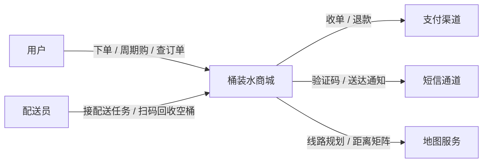

# 第四阶段：架构方法论

> 所属学习计划：[软件架构学习大纲](../软件架构学习大纲.md)（建议时长 3~4 周）
> 本文件是第四阶段的详细学习笔记；大纲文件中只保留进度追踪。
> 示例取材：[示例项目场景](../示例项目场景.md)——主线：桶装水商城（DDD 划界 + 演进式改造）；工单中心为第二案例；低代码平台作过度通用化反例。

前三阶段解决了"怎么想"（[第一阶段](../章节1/01-第一阶段-架构思维与设计基础.md)）、"怎么组织代码与模块"（[第二阶段](../章节2/01-第二阶段-经典架构模式.md)）、"怎么应对分布式"（[第三阶段](../章节3/01-第三阶段-分布式系统核心技术.md)）。本阶段回答三个工程问题：**架构怎么表达**（C4、4+1、ADR）、**业务复杂度怎么建模**（DDD，本阶段重点）、**架构怎么演进**（适应度函数、绞杀者模式）。

继续桶装水商城演进主线（见[第二阶段](../章节2/01-第二阶段-经典架构模式.md)）：第二阶段把它从单体分层改造成模块化单体、讨论了何时拆微服务；这次用 DDD 决定边界，再用演进式架构安全地走到那里。

## 1. 架构设计与表达

架构 = 决策 + 表达。决策没人看得懂、没人找得到，等于没做。表达工具对应三类受众：业务方（宏观）、新同事（结构）、一年后的自己（理由）。

### 1.1 C4 模型

定义：Simon Brown 提出的架构图分层方法，核心思想是**像地图一样分级缩放**——每张图只回答一个层级的问题，避免"一张巨图塞进所有细节"。

| 层级 | 名称 | 回答的问题 | 图上的方块 | 桶装水商城例子 |
|---|---|---|---|---|
| 1 | 系统上下文 Context | 系统为谁服务、依赖谁 | 人 + 外部系统 | 用户、配送员、桶装水商城、支付渠道、短信通道、地图服务 |
| 2 | 容器 Container | 系统内有哪些可独立运行的单元 | 应用 + 数据存储 | 商城应用、订阅调度、配送服务、MySQL、Redis、MQ |
| 3 | 组件 Component | 容器内部怎么分模块 | 模块/包 | 商城应用内的商品、订单、押金、营销模块 |
| 4 | 代码 Code | 这个类内部长什么样 | 类/接口 | 押金聚合的类图（Deposit、BucketHolding、Money）——通常交给 IDE，不手画 |

两个易错点：**Container 不是 Docker 容器**，指"一个独立运行单元"——Spring Boot 应用、React SPA、MySQL、Redis 各算一个；**C4 的价值在 1~3 层**，第 4 层画了也会过期，交给 IDE。

L1 系统上下文图（Mermaid；L2 容器图同法，把方块换成"商城应用 / 订阅调度 / 配送服务 / MySQL / Redis / MQ"并画出它们之间的调用与消息流）：



❌ 反例：一张图里同时出现类名（DepositPayService）、部署细节（Pod 副本数）、外部系统（微信支付）和模块框——读者被迫同时回答四个层级的问题，谁也看不懂。
✅ 修正：先问"这张图给谁看、回答哪一层的问题"，再决定画到第几层；不同层级分开画、分开存档。

### 1.2 4+1 视图

定义：Philippe Kruchten（RUP）提出的多视角描述法：四个视图各管一类关注点，再用"+1"的场景视图串起来验证完整性。

| 视图 | 关注点 | 主要受众 | 桶装水商城例子 |
|---|---|---|---|
| 逻辑视图 | 功能如何分解（类、模块、职责） | 设计/开发 | 商品、订单、订阅、押金、配送各域的领域模型（见本章第 2 节） |
| 开发视图 | 软件怎么组织（分包、分层、依赖） | 开发 | 商城工程按 order / subscription / deposit / delivery 分模块，依赖方向受适应度函数守护（见 3.2） |
| 进程视图 | 运行时并发、同步、容错 | 后端/运维 | 下单请求链路、订阅调度定时任务、配送服务的消息消费者、押金超时扫描 |
| 物理视图 | 部署到哪些节点 | 运维/DBA | 商城应用 3 个 Pod、配送服务独立部署、MySQL 主从、Redis 哨兵、跨可用区 |
| 场景（+1） | 用核心用例把四个视图串起来 | 全体 | "用户下单支付 → 订阅下期生成配送任务 → 排线 → 送水 → 空桶回收退押金"端到端走一遍每个视图 |

换成工单中心同理：场景视图拿"工单创建 → 分派 → SLA 超时 → 催办升级 → 关单回访"串起另外四个视图。

关键理解：**+1 不是附录**。拿 1~2 个核心场景在四个视图里各走一遍，最容易暴露图与图之间的矛盾——比如逻辑视图里"下单即锁库存"，进程视图里却是"支付成功后异步扣"，这正是 4+1 的用途。

C4 与 4+1 怎么选：C4 按**缩放层级**组织（不同受众看不同粒度），4+1 按**关注点维度**组织（保证每类问题都有视图覆盖），两者互补。常见组合：用 C4 画上下文/容器图，用 4+1 检查进程、物理视角有没有被遗漏。

### 1.3 ADR（架构决策记录）

定义：记录**某个架构决策的背景、选项与后果**的短文档（Michael Nygard）。核心洞察：架构的沉淀物不是图，而是决策及其理由——图会过期，"为什么当时这么做"才是长期资产。

轻量模板（放代码仓库 `docs/adr/` 下，随代码一起评审）：

````markdown
# ADR-007：桶装水商城配送排线独立为单独服务

- 状态：已接受（2026-10-20）

## 背景
商城单体里配送排线与订单逻辑耦死：排线算法每次迭代（装载率、线路合并策略）都要连带回归下单链路；
且排线是 CPU 密集计算，早高峰批量排线占满交易线程池，下单 P99 明显抖动。

## 决策
将配送排线独立为配送服务。订单域支付成功后发布 OrderPaid 事件，配送服务消费事件生成配送任务并排线；
排线结果通过开放主机服务（OHS）的查询接口回供订单与用户端；地图/距离矩阵的调用收敛在配送服务内部。

## 备选方案（为什么不是别的）
继续留在单体做模块化隔离（发布节奏仍互相牵制，CPU 争用无解）、整体外采 TMS
（空桶回收与押金联动的业务太特殊， customization 成本高），均否决。

## 后果
- 正向：排线算法独立演进、独立扩容；交易链路与计算负载隔离
- 负向：订单到配送改为事件驱动，引入秒级延迟；配送服务不可用时配送任务积压，需补偿与告警
- 复查点：若订单峰值 QPS 降一个数量级且团队缩减到两三人，重新评估合回单体模块（见第二阶段"微服务的代价"）
````

三条纪律：

1. **一决策一文件**，编号递增，文件名带标题（如 `007-delivery-routing-as-service.md`）
2. **状态要显式**：提议中 / 已接受 / 已废弃 / 被 ADR-0XX 取代——废弃时不删除，加链接指向新决策
3. **负向后果必须写**：只写好处的 ADR 是宣传稿，不是决策记录

❌ 反例：配送排线要不要拆出去只在评审会上讲了一遍，结论落在聊天记录里；半年后新人把排线又改回同步调用塞进商城应用，理由是"没人说得清当初为什么拆"。
✅ 修正：凡是"单向门"决策（回头改代价大，见第一阶段），先补 ADR 再实施；改架构的 PR 必须一并更新对应 ADR。

本节自测：

1. 不看资料，画出你工单中心或 MES 的 C4 L2 容器图；数不清自己系统有几个"可独立运行单元"说明什么？
2. 4+1 的"+1"场景视图为什么能发现其余四个视图的矛盾？用"工单创建→SLA 超时→催办升级"举一个它可能暴露的问题。
3. 给你负责的系统补一条真实 ADR（如 MES 报工数据从同步写库改为消息队列）：标题是什么？"负向后果"一栏你敢写吗？

## 2. 领域驱动设计（DDD）

### 2.1 DDD 是什么、不是什么

定义：Eric Evans（2003）提出的设计方法，核心主张：**软件的复杂度主要来自业务，模型必须由业务语言驱动**，业务方与开发围绕同一套领域模型工作。分两层：

| 层面 | 解决的问题 | 工具 |
|---|---|---|
| 战略设计 | 系统怎么切分、各部分什么关系 | 统一语言、限界上下文、上下文映射 |
| 战术设计 | 上下文内部的代码怎么组织 | 实体、值对象、聚合、领域事件、仓储 |

先纠正常见误区：

- ❌ **误区一：DDD = 微服务**。DDD 早于微服务十年出现；桶装水商城哪怕长期保持单体，照样能按上下文分模块用 DDD；微服务也可能写成分布式泥球。正确关系是：**限界上下文为服务划分提供依据**，而不是 DDD 依附于微服务。
- ❌ **误区二：限界上下文 = 微服务**。限界上下文是**模型边界**（逻辑概念），微服务是**部署边界**（物理概念）。一个上下文可以是模块化单体里的一个模块，也可以是一个服务；反过来，一个微服务横跨两个上下文则是坏味道。
- ❌ **误区三：DDD = 堆战术模式**。在用户地址簿、商品资料这种 CRUD 为主的支持域上套聚合、仓储是自找麻烦；押金、周期购、订单流转这种规则密集且多变的核心域才值得。DDD 的适用判据是**业务规则复杂且多变的核心域**，不是"显得专业"。

### 2.2 战略设计：统一语言与限界上下文

统一语言（Ubiquitous Language）：业务方和开发共用同一套词汇，类名、方法名、需求文档直接使用这套词汇——词表不一致本身就是 bug 温床。工单中心是正面典型：业务方嘴里的"工单、分派、流转、SLA、催办、关单"，代码里就叫 `Ticket.assign()`、`Ticket.escalate()`、`Ticket.close(reason)`、事件 `TicketSlaBreached`——需求评审不需要人肉翻译。反面则是代码里叫 `WorkItemDO.status = 3`：每次"这个工单催办了吗"都要查一张只有离职同事懂的状态映射表。

限界上下文（Bounded Context）：**一个特定模型成立的边界**。同一个词在不同边界里含义不同，这不是灾难而是常态——各上下文各自建模，远比"全公司一个统一大模型"健康。

桶装水商城的上下文切分（八个上下文；注意同一个词"桶"在四个上下文里的差异）：

| 限界上下文 | 核心职责 | "桶"在这个上下文的含义 |
|---|---|---|
| 商品与库存 | SKU、定价、可售桶数 | 可售卖的库存数字（还剩多少桶可卖） |
| 订单 | 下单、状态流转 | 成交快照里的货品（skuId、名称、成交单价） |
| 周期购订阅 | 周期计划、下次配送日、暂停/恢复/退订 | 每期要送的数量；"订单"只是每期的产物 |
| 支付 | 收单、退款、对账 | 与桶无关，只是金额载体 |
| 配送排线 | 线路、配送任务、装载 | 占用配送车装载容量、挂在线路上的货物 |
| 押金管理 | 押金账、桶资产、回收验收 | 可追踪的资产（桶号/RFID，有身份、有状态） |
| 营销 | 券、会员 | 券适用范围里的一类商品 |
| 用户 | 账号、地址簿 | 无关 |

```text
桶装水商城（模块化单体或一组服务）
 ├─ [商品与库存] [订单] [周期购订阅] [支付] [配送排线] [押金管理] [营销] [用户] 八个限界上下文
 └─ 上下文之间通过"上下文映射"集成（见 2.3）
```

判断边界的三条线索：**语言差异**（"桶"在押金域是资产、在库存域是数字 → 拆）、**不变量归属**（押金余额不变量归押金上下文独立保证）、**团队归属**（康威定律，见[康威定律-补充](../章节1/05-康威定律-补充.md)）。

❌ 反例：为了"数据打通"建一张全局共享的 `t_bucket` / `t_product` 大表，订单、库存、配送、押金都直接读写——押金要加"桶 RFID 号"字段，库存模块也得陪着重编译；改一个字段全线心惊胆战。
✅ 修正：各上下文有自己的模型与存储（订单存商品快照，押金存桶资产台账），靠事件/接口同步，而不是共享表。

顺带纠一个常见偷懒：**周期购是领域概念，不是数据库表上的标志位**。它有自己的生命周期（生效、暂停、恢复、退订、到期）和规则（错过配送窗口顺延、暂停期间不生成订单），值得一个独立上下文去建模——而不是在订单表上加个 `is_subscription` 字段了事。

### 2.3 战略设计：上下文映射

定义：描述**限界上下文之间如何集成与协作**。集成方式本身就是架构决策，选错了模型会互相污染。

| 模式 | 含义 | 适用场景 | 风险 |
|---|---|---|---|
| 合作关系 Partnership | 两团队共同成败、协同改动 | 无明确上下游的小团队 | 耦合最重，团队变大即失效 |
| 共享内核 Shared Kernel | 共享一小块模型/代码 | 两上下文确有稳定公共子集 | 共享部分成改动瓶颈 |
| 客户-供应商 Customer-Supplier | 下游提需求，上游排优先级 | 内部团队之间 | 需要强势的下游代言人 |
| 防腐层 ACL | 下游建翻译层隔离上游模型 | 对接老旧/外部系统 | 多一层维护成本 |
| 开放主机服务 OHS + 发布语言 PL | 上游提供标准协议与文档化模型 | 上游服务众多下游 | 协议演进要管好版本 |
| 遵奉者 Conformist | 下游全盘接受上游模型 | 上游太强、改不动 | 上游模型差则一起烂 |
| 各行其道 Separate Ways | 干脆不集成，各做各的 | 集成成本 > 收益 | 功能重复 |

桶装水商城的三组典型映射：

- **订单 ↔ 支付渠道：防腐层（ACL）**。渠道模型（微信支付的 appid、mch_id、cash_fee、result_code）绝不能渗入订单域——明天换渠道、后天渠道升级字段，订单域不能跟着抖。
- **周期购订阅 → 订单：客户-供应商 + OHS**。订阅是上游客户，每期到点"要一单"；订单是供应商，用开放主机服务提供标准下单协议（`POST /orders {subscriptionId, lines}`），订阅不关心订单内部怎么建模。
- **配送 ↔ 地图服务：遵奉者**。距离矩阵接口是地图厂商定的，改不动，全盘接受其模型——但必须把它关在配送服务内部，不许外溢（呼应 ADR-007）。

支付防腐层的 Kotlin 实现——防止渠道模型渗入订单域：

```kotlin
// ❌ 反例：渠道回调 DTO 长驱直入——订单/押金/订阅各处直接引用 WechatPayNotifyDTO，
// appid、cash_fee、result_code 这些渠道词汇散落领域代码；换渠道或渠道改字段，全商城跟着改

// ✅ 修正：防腐层把渠道报文翻译成本域自己的模型，外部变化被拦截在一处
data class OrderId(val value: String)
data class PayTradeNo(val value: String)
data class PaymentConfirmed(                     // 订单域自己的模型：只留订单关心的语义
    val payTradeNo: PayTradeNo,
    val orderId: OrderId,
    val paidCents: Long,
)

/** 订单域依赖的端口（领域层接口，对应第二阶段六边形架构的端口） */
interface PaymentResultPort {
    fun toConfirmed(notify: WechatPayNotifyDTO): PaymentConfirmed?
}

/** 渠道 DTO：字段与命名全是渠道的烙印 */
data class WechatPayNotifyDTO(
    val outTradeNo: String, val transactionId: String,
    val totalFee: String, val resultCode: String,
)

/** 防腐层实现：放基础设施层，只负责验签后的翻译与容错 */
class WechatPaymentAdapter : PaymentResultPort {
    override fun toConfirmed(notify: WechatPayNotifyDTO): PaymentConfirmed? {
        if (notify.resultCode != "SUCCESS") return null      // 翻译 1：渠道返回码 → 订单域"已支付/未支付"
        return PaymentConfirmed(                             // 翻译 2：渠道字段 → 领域模型
            payTradeNo = PayTradeNo(notify.transactionId),
            orderId = OrderId(notify.outTradeNo),
            paidCents = notify.totalFee.toLong(),
        )
    }
}
```

### 2.4 战术设计：实体与值对象

| | 实体 Entity | 值对象 Value Object |
|---|---|---|
| 标识 | 有身份（ID），身份终身不变 | 无身份，"值相等"即同一 |
| 可变性 | 状态可变（受控） | 不可变，"改"= 换新实例 |
| 生命周期 | 长期跟踪（存库、有状态） | 随宿主生灭 |
| 回答的问题 | "它是哪一个？" | "它是什么？" |
| 桶装水例子 | 订单 Order、押金单 Deposit、配送任务 DeliveryTask、订阅 Subscription | 收货地址 Address、金额 Money、桶规格 BucketSpec（容量+品牌） |

值对象（贯穿例子：收货地址）：

```kotlin
// ❌ 反例：可变 + 无行为，任何代码都能 address.city = "宁波市" 改半个地址，配送面单的校验无处安放
data class BadAddress(var province: String, var city: String, var detail: String)

// ✅ 修正：不可变、自校验、带领域行为；"修改"返回新值而不是改旧值
data class Address(val province: String, val city: String, val district: String, val detail: String) {
    init {
        require(province.isNotBlank() && city.isNotBlank() && detail.length >= 5) { "收货地址不完整" }
    }
    fun withDetail(newDetail: String) = copy(detail = newDetail)   // 产生新实例
    fun shippingLabel() = "$province$city$district $detail"        // 配送面单
}
```

判定技巧：把两个内容相同的实例互换，业务毫无察觉 → 值对象（地址、金额、桶规格——两桶"18.9L 同品牌"无差别）；业务立刻发现不对 → 实体（你家的押金单和邻居家的互换，退款就错了）。金额强烈建议做成 `Money(amount, currency)` 值对象——Long 裸奔加散落的乘除是精度事故的固定来源。

### 2.5 战术设计：聚合——一致性边界

定义：**聚合（Aggregate）是一组作为整体保持一致性的对象**，对外由聚合根（Aggregate Root）唯一代表；外部只能持有根，聚合内部对象不允许被外界直接修改。

押金是讲透聚合的最好例子：它有完整生命周期状态机（支付押金 → 桶在手 → 回收验收 → 退押金/扣损），全程要维持三条不变量——"实缴押金 = 桶数 × 单桶押金""只有验收过的桶才能退押金/扣损""退还 + 扣损不得超过实缴"。这些规则必须在**同一个事务边界内**被保证，所以押金单与桶资产记录必须同属一个聚合——**聚合的本质是事务一致性边界**。

聚合设计四原则（本阶段最需要背下来的四条）：

1. **按不变量划界**：只有"必须同一事务内强一致"的规则才放进一个聚合——桶资产记录直接影响押金余额 → 与押金单同聚合。
2. **跨聚合只用 ID 引用**：押金单存 `userId`、`orderId`，不存 User/Order 对象——用户改昵称、订单改状态不应牵动押金账。
3. **一个事务只修改一个聚合**：跨聚合联动（支付成功 → 激活押金）用领域事件做最终一致（见[第三阶段](../章节3/01-第三阶段-分布式系统核心技术.md)）。
4. **聚合尽量小**：大聚合 = 大锁 = 高冲突 = 低吞吐，只装"必须强一致"的部分。

```kotlin
data class DepositId(val value: String)
data class BucketNo(val value: String)                                   // 桶号（RFID）：每个桶有身份
data class Money(val cents: Long) {
    operator fun times(n: Int) = Money(cents * n)
    operator fun plus(o: Money) = Money(cents + o.cents)
}

enum class DepositStatus { PENDING_PAYMENT, ACTIVE, SETTLED }            // 待缴 → 押金生效（桶在手）→ 结清

class User(val id: String, var nickname: String)                         // 用户聚合的根（示意）
class DeliveryTask(val id: String, var routeNo: String)                  // 配送聚合的对象（示意）

// ❌ 反例：巨型聚合——押金单直接持有 User、配送任务、订单对象
class BigDeposit(val user: User, val task: DeliveryTask?, val orderId: String) {
    var refundedCents: Long = 0
    fun settle() { refundedCents = 30_000_00 }    // 退款数字写死：三条不变量无人看守；
}                                                 // 配送任务一变，历史押金读到的关联也跟着漂移

// ✅ 修正：押金聚合——不变量收口在根；跨聚合只留 ID；桶资产是内部实体
class Deposit private constructor(
    val id: DepositId,
    val userId: String,                    // 原则 2：跨聚合只用 ID 引用（User/Order/DeliveryTask 都不许进来）
    val orderId: String,
    private val unitDeposit: Money,        // 单桶押金（值对象）
) {
    /** 桶资产记录：聚合内部实体，生命周期完全由 Deposit 管理 */
    class BucketHolding(val bucketNo: BucketNo) {
        var acceptedAt: java.time.Instant? = null; private set   // 验收时间；非空 = 已回收结清
        var damaged: Boolean = false; private set
        fun accept(now: java.time.Instant, dmg: Boolean) { acceptedAt = now; damaged = dmg }
    }

    private val _holdings = mutableListOf<BucketHolding>()
    val holdings: List<BucketHolding> get() = _holdings.toList()          // 只读视图
    var status: DepositStatus = DepositStatus.PENDING_PAYMENT
        private set                                                        // 状态只能经由聚合根行为变更

    companion object {
        fun open(id: DepositId, userId: String, orderId: String, unitDepositCents: Long) =
            Deposit(id, userId, orderId, Money(unitDepositCents))
    }

    fun pay(bucketNos: List<BucketNo>, amount: Money) {                    // 支付押金 → 桶在手
        check(status == DepositStatus.PENDING_PAYMENT) { "状态 $status 不允许缴纳押金" }
        require(bucketNos.isNotEmpty()) { "至少押一个桶" }
        require(amount == unitDeposit * bucketNos.size) {                  // 不变量 1：实缴 = 桶数 × 单桶押金
            "缴纳 ${amount.cents} 与应付 ${(unitDeposit * bucketNos.size).cents} 不一致"
        }
        bucketNos.forEach { _holdings.add(BucketHolding(it)) }
        status = DepositStatus.ACTIVE
    }

    /** 回收验收：完好退押金、损坏扣损；全部结清后押金单 SETTLED */
    fun returnBuckets(accepted: List<BucketNo>, damaged: List<BucketNo>): Pair<Money, Money> {
        check(status == DepositStatus.ACTIVE) { "押金单未生效或已结清" }
        val open = _holdings.filter { it.acceptedAt == null }
        require(accepted.size + damaged.size <= open.size) { "验收数量超过在手桶数" }
        val now = java.time.Instant.now()
        (accepted.map { it to false } + damaged.map { it to true }).forEach { (no, dmg) ->
            open.first { it.bucketNo == no }.accept(now, dmg)
        }
        val refund = unitDeposit * accepted.size
        val deduction = unitDeposit * damaged.size
        check(refund + deduction <= unitDeposit * _holdings.size) {       // 不变量 3：退还+扣损 ≤ 实缴
            "退还与扣损之和不得超过实缴押金"
        }
        if (_holdings.all { it.acceptedAt != null }) status = DepositStatus.SETTLED
        return refund to deduction
    }
}
```

常考问题：**桶资产记录为什么在聚合内、地址为什么是值对象、配送任务为什么在聚合外**？判据回到原则 1：桶的验收与扣损直接影响押金余额不变量（强一致 → 入聚合）；地址只是描述性数据（值对象）；配送任务有独立生命周期与并发冲突，属于配送上下文（聚合外，靠 ID + 事件联动）。

工单中心同理：**工单聚合** = 工单（根）+ 流转记录（内部实体），不变量如"非当前处理人不能流转""SLA 未解除不能关单"——把"流转记录表"从 CRUD 视角换成聚合视角，规则才有了唯一的家。

### 2.6 贫血模型 vs 充血模型

贫血模型：实体只有数据，业务规则全部堆在 Service——Spring/MyBatis 传统下最普遍的写法，也是 DDD 眼里最大的反模式：**模型失去行为，规则散落在几十个 Service 里互相复制**（订单模块的 `AnemicOrder` + `OrderStatusService` 同病）。

```kotlin
// ❌ 反例：贫血模型——把 2.5 的押金业务改写成最常见的贫血写法：数据与行为分离，规则散落在 Service
data class AnemicDeposit(
    val id: DepositId, val userId: String,
    var paidCents: Long = 0, var refundedCents: Long = 0,
    var status: String = "PENDING",                                 // 状态是裸字符串
    val holdings: MutableList<Map<String, Any?>> = mutableListOf(), // 桶记录是裸 Map
)

class DepositSettleService {
    fun returnBuckets(deposit: AnemicDeposit, returned: Int, damaged: Int, unitCents: Long) {
        // "完好退还、损坏扣损"这条规则被复制在 Service、对账定时任务、客服后台脚本三处
        deposit.refundedCents = (returned - damaged) * unitCents    // 某次复制漏了校验：returned < damaged 时算出负数退款
        deposit.status = "SETTLED"                                  // 而且任何代码都能一行改状态，绕过全部规则
        // …落库
    }
}
```

修正版即 2.5 的充血写法：状态 `private set`、行为进模型、Service 只做薄编排（开事务 → 调聚合行为 → 存仓储 → 发事件，见 2.7）。

| | 贫血模型 | 充血模型 |
|---|---|---|
| 规则位置 | 散在各 Service | 聚合根内聚 |
| 绕过规则 | 一行赋值即可 | 编译期就难 |
| Service 角色 | 上帝类（越写越胖） | 薄编排（用例） |
| 适合场景 | 纯 CRUD 的支持域（商品资料、地址簿） | 规则密集的核心域（押金、订单、订阅） |

公允提醒：不必全系统充血。支持域用贫血 CRUD 完全合理（DDD 投入集中在核心域，见 2.1 误区三）；但押金账这种碰钱的核心域，贫血等于把业务规则埋进代码的沼泽。

### 2.7 领域事件与仓储

领域事件（Domain Event）：**用过去式描述"领域中已发生的事实"**（DepositPaid、DepositSettled、OrderPaid）。它是"一个事务只改一个聚合"之后，跨聚合/跨上下文联动的解法：本聚合提交后发布事件，下游各自消费、最终一致。

```kotlin
sealed interface DomainEvent { val occurredAt: java.time.Instant }

sealed interface DepositEvent : DomainEvent { val depositId: DepositId }

data class DepositPaid(
    override val depositId: DepositId, override val occurredAt: java.time.Instant,
    val bucketCount: Int, val paid: Money,
) : DepositEvent

data class DepositSettled(
    override val depositId: DepositId, override val occurredAt: java.time.Instant,
    val refunded: Money, val damagedDeduction: Money,
) : DepositEvent

class Deposit {                                          // 只展示事件相关部分，业务逻辑同 2.5
    private val _events = mutableListOf<DomainEvent>()
    val events: List<DomainEvent> get() = _events.toList()
    fun clearEvents() { _events.clear() }

    fun pay(bucketNos: List<BucketNo>, amount: Money) {
        /* 校验与状态变更同 2.5 */
        _events.add(DepositPaid(id, java.time.Instant.now(), bucketNos.size, amount))
    }
}
```

工单中心的领域事件同一套思路：**工单超时是"已发生的事实"，催办与升级是各订阅者自己的决定**——

```kotlin
data class TicketId(val value: String)
sealed interface TicketEvent : DomainEvent { val ticketId: TicketId }

data class TicketSlaBreached(                            // 超时事实：过去式命名
    override val ticketId: TicketId, override val occurredAt: java.time.Instant,
    val slaName: String, val overdueMinutes: Long,
) : TicketEvent
// 订阅者 A 发催办通知；订阅者 B 按策略把工单升级给上级处理组；统计侧计入 SLA 达成率——发布方一个都不认识
```

仓储（Repository）：**以聚合为单位**的持久化抽象——接口属于领域层，实现属于基础设施层（与[第二阶段六边形架构](../章节2/01-第二阶段-经典架构模式.md)的端口-适配器完全同构）。

```kotlin
interface DepositRepository {
    fun findById(id: DepositId): Deposit?
    fun save(deposit: Deposit)      // 保存整个聚合（押金单+桶资产+待发布事件），而非片段
}
// 实现放基础设施层，如 JpaDepositRepository.findById / save：聚合整体一个事务落库

interface EventPublisher { fun publishAll(events: List<DomainEvent>) }

/** 应用层：只做编排，不含业务规则 */
class DepositApplicationService(
    private val deposits: DepositRepository,
    private val publisher: EventPublisher,
) {
    fun returnBuckets(depositId: DepositId, accepted: List<BucketNo>, damaged: List<BucketNo>) {
        val deposit = deposits.findById(depositId) ?: error("押金单不存在: ${depositId.value}")
        deposit.returnBuckets(accepted, damaged)      // 规则全在聚合内
        deposits.save(deposit)                        // 先落库
        publisher.publishAll(deposit.events)          // 再发事件，避免"库没提交、消息已发"
        deposit.clearEvents()
    }
}
```

❌ 反例：DAO 里 `updateStatus(id, "SETTLED")`、`updateRefunded(id, amount)` 各自为政，绕开聚合根直接改押金表——充血模型白建了。
✅ 修正：写路径只认 `save(deposit)` 整体聚合；押金账单页这类复杂查询另走 CQRS 查询通道，不塞进仓储。事件的可靠投递、幂等消费见[第三阶段](../章节3/01-第三阶段-分布式系统核心技术.md)。

### 2.8 反例专题：低代码平台——DDD 通用性边界的教训

场景文档指定用低代码平台做反例讨论：它不是坏技术，而是"**什么不该做成平台**"的最佳解剖标本。对照着看：工单中心里"新增工单类型只配表单不改代码"是合理的内嵌低代码（变化同构且高频）；独立低代码平台想把所有业务装进一套引擎，就是另一回事了。

**陷阱一：通用性陷阱——流程引擎越长越像通用 BPM**。流程设计器从"审批流"起步：分支、并行够用了；接着客户要会签、要撤回、要加签、要驳回任意节点……每个需求单看都合理，叠加起来引擎复杂度失控——你正在重造 Activiti/Flowable，却没有它的社区与测试覆盖。为覆盖 1% 的场景付出 100% 的复杂度，这是 YAGNI 的反面教材。

**陷阱二：解释执行导致领域逻辑流失**。平台的原则是"一切皆配置"，于是业务逻辑从代码搬进表单联动表达式、流程条件脚本、隐藏的"高级配置"。半年后：押金扣损规则藏在 40 层嵌套的 JSON 里，版本库里 grep 不到关键词，IDE 无法重构、测试无法覆盖；统一语言只剩"组件、属性、事件"这套平台词汇——业务语言消失了，DDD 最核心的资产被抽空。

**DDD 视角的通用性边界**——什么样的领域变化值得抽象，什么应该写死：

| 判断问句 | 变化的性质 | 归宿 |
|---|---|---|
| 变化由谁执行？业务/实施人员在页面上改，每周都可能发生 | 同构且高频：新增工单类型、表单加字段、优惠券新玩法 | 值得抽象：元数据/配置驱动，做成"内嵌低代码" |
| 变化必须开发改代码、过测试、走发版才能安全上线 | 业务规则的深度变化：押金扣损规则、排线算法、SLA 升级策略 | 应该写死：充血聚合 + 策略扩展点（开闭原则），别伪装成配置 |

❌ 反例：把押金扣损规则做成"可配置表达式引擎"——业务实际一年改一次，还得开发来写表达式；平台多了一门没人懂的 DSL，规则却从类型系统和单测的保护里裸奔出来。
✅ 修正：扣损规则写成聚合内的显式策略类（`DamagePolicy`），变化时改代码、跑测试、随版本发布；只把"单桶押金金额"这类真正高频的运营参数放进配置。

判断的锚点仍是第一阶段的质量属性与投资回报：**抽象是贷款，通用性是利息**——为真实高频的变化借贷，别为想象中的变化借贷。

本节自测：

1. 限界上下文和微服务的区别是什么？把桶装水的 8 个上下文部署成一个单体，算错吗？
2. 为什么押金单只能存 `userId`/`orderId` 而不能持有 User/Order 对象？从一致性与吞吐两方面回答。
3. "一个事务只改一个聚合"，那"支付渠道回调成功 → 激活押金单"怎么实现？用文字写出事件时序（含防腐层在哪一步）。
4. 用 DDD 眼光重新看你的工单中心/MES：限界上下文怎么划？哪些"表"其实是聚合（工单？设备？批次？），哪些只是一堆值对象？
5. 低代码平台的流程引擎为什么越做越像通用 BPM？用"通用性的代价"解释，并指出你系统里一个"应该写死"的规则。

## 3. 演进式架构

### 3.1 什么是演进式架构

定义（Ford / Parsons / Kua，《Building Evolutionary Architectures》）：**在业务方向、技术与需求变化时，能以低且可控的成本演进**的架构。核心理念：架构不是交付那天定型的成品，而是持续被引导的生长过程——重要的不只是"现在的结构"，还有"改变结构的难易与方向"。

三个前提认知：变化是常态（需求、团队、流量都会变，"一次设计终身受用"不成立）；演进有方向（围绕业务目标与质量属性，见第一阶段）；演进要防护（没有自动护栏的"演进"会退化为熵增——护栏就是适应度函数）。

桶装水商城已经走完"单体分层 → 模块化单体"（第二阶段），微服务一节还留了个问题：什么时候拆、怎么拆才安全。演进式架构给出的正是"怎么安全地走到那里"的路径——DDD 先决定边界（本章第 2 节），绞杀者模式负责安全迁移，适应度函数一路护栏。

### 3.2 架构适应度函数

定义：**对某项架构目标的客观、可执行的度量**——用"函数"强调它能像测试一样反复运行并给出通过/失败，把"架构要守住什么"从口头约定变成 CI 硬门禁。

| 分类维度 | 类型 | 桶装水商城例子 |
|---|---|---|
| 粒度 | 原子（单一指标） | 下单链路 P99 < 300ms |
| | 整合（多指标组合） | "下单 → 排线 → 配送任务生成"成功率 ≥ 99.9% |
| 触发方式 | 触发式（人工/定时） | 季度架构评分卡 |
| | 持续式（每次提交） | 模块依赖规则、覆盖率门禁 |
| 评估对象 | 静态（结构） | 订单模块不得直接引用配送模块内部类/内部表 |
| | 动态（运行时） | 压测中超卖率为 0 |

动态函数不必自造轮子——把现有监控指标挂上阈值即成"红/绿"门禁：MES 用"设备数据入库延迟 P99 < 5s"，工单中心用"SLA 超时从发生到催办发出的延迟 < 60s"。

用 ArchUnit 把依赖规则写成自动化测试：

```kotlin
// 依赖：com.tngtech.archunit:archunit-junit5（classes / JavaClasses / ClassFileImporter 均来自它）
class MallArchitectureFitnessTest {
    private val appClasses: JavaClasses = ClassFileImporter().importPackages("com.water.mall")

    @Test
    fun `订单模块不得直接依赖配送模块内部实现`() {
        classes().that().resideInAPackage("..order..")
            .should().notDependOnClassesThat().resideInAPackage("..delivery.internal..")
            .check(appClasses)
    }

    @Test
    fun `押金领域层不得依赖基础设施层`() {
        classes().that().resideInAPackage("..deposit.domain..")
            .should().notDependOnClassesThat().resideInAPackage("..deposit.infra..")
            .check(appClasses)     // 守护六边形架构（见第二阶段）
    }
}
```

"不得直接引用他人内部表"要两道防线：代码层——实体类即表的所有权，上面的类依赖规则同时禁止订单模块 import 配送模块的实体类；数据库层——各模块独立 DB 账号，配送表的 GRANT 里没有订单应用（ArchUnit 看不见裸 SQL，账号权限才是硬门禁）。

❌ 反例："模块边界、依赖方向"只写在架构文档第 4 章；三个月后新人提交的订单代码直接 import 了配送模块的实体类去 JOIN 排线表，没人发现，直到拆服务那天才发现耦合根本没断。
✅ 修正：把关键约束翻译成适应度函数挂进 CI，违规 PR 直接红；文档解释"为什么"，CI 负责"执行"。

选择要点：**宁少而准，不多而滥**——每条函数对应一个真实架构目标（对应第一阶段的质量属性场景），跑不过时有明确修复动作；跑不过也没人理的函数是负资产。

### 3.3 遗留系统改造与绞杀者模式

绞杀者模式（Strangler Fig Pattern，Martin Fowler 2004）：像绞杀榕缠绕老树——**新系统在老系统外围逐渐生长，按路由一块块接管功能；老系统逐块萎缩，最终整树下线**。对立面是"大爆炸重写"，而大爆炸几乎总是失败：老系统承载的规则藏在代码深处（需求文档早丢了）；重写期间老系统还得继续迭代，双份维护；上线一刻是最高风险时刻，且没有回滚路径。

桶装水老单体的渐进改造（承接第二阶段"单体 → 模块化单体"，也承接 1.3 的 ADR-007）：

```text
              ┌──────────────── API 网关 / Façade ────────────────┐
用户/配送员 ──► │ /delivery/**、/route/**  ──► 新·配送服务（先拆：ADR-007）│
              │ /subscription/**         ──► 新·订阅调度服务            │
              │ /order/**、/deposit/**   ──► 老单体（核心域最后迁）      │
              │ 其余                     ──► 老单体（逐块缩水，最终下线）│
              └───────────────────────────────────────────────────┘
```

落地步骤：

1. **先立 façade 再动刀**：入口统一收到网关/门面，路由完全可控——不动任何业务代码，风险为零
2. **按限界上下文排顺序**：用 2.2 的上下文切分老单体内部模块，先迁"价值可控、耦合最浅"的配送（ADR-007 已论证）与订阅调度（独立的定时触达逻辑），押金与订单核心最后甚至长期共存。这也呼应第二阶段"新功能走新边界"：绞杀者就是把这条原则放大到系统级——新能力一律长在新边界里，老单体只减不增
3. **数据同步先行**：老库到新库用 CDC/双写过渡（一致性方案见[第三阶段](../章节3/01-第三阶段-分布式系统核心技术.md)），新服务先"影子读"验证，再接管写
4. **逐块绞杀**：每切一块流量就删除老单体对应模块——否则没人敢删，改造永远"差最后一步"
5. **适应度函数先于迁移就位**：3.2 的"订单模块不得引用配送内部类/表"必须先在老单体里跑绿，再谈拆服务——依赖没断干净的拆分，只是把耦合搬进了网络调用

配套战术（了解概念即可）：**事件拦截**（在老单体与老库之间埋 CDC，捕获"老系统正在发生什么"，为新系统构建提供自检数据）；**资产捕获**（先只迁读、后迁写，用读写分离降低切换风险）。

❌ 反例："我们把 30 万行桶装水老单体推倒重写"——两年并行维护拖垮团队，上线前夜回滚，教科书级失败。
✅ 修正：绞杀者 + 小步快跑，任何时刻都存在"可回滚的完整系统"；每迁一块即产生业务价值，顺带偿还技术债。

本节自测：

1. 适应度函数和普通单元测试的本质区别是什么？（提示：各自度量的对象）
2. 绞杀者改造为什么先拆配送/订阅调度、最后拆订单/押金核心？排序依据是什么？
3. 给你的工单中心或 MES 排一个绞杀者迁移顺序（如先把 SLA 计时、设备数据采集拆出去）：每步的数据同步与回滚方案是什么？哪条适应度函数应在动手前就位？

## 第四阶段自测

1. 用 C4 给桶装水商城画 L1/L2 图，再用 4+1 检查"下单支付 → 排线 → 配送 → 空桶回收退押金"场景：它在进程视图和物理视图上各是什么样？两类方法各自补足了什么？
2. "桶"在库存、订单、配送、押金四个上下文里的含义分别是什么？你的工单中心/MES 里有没有一个类似的词（"工单""批次""设备"）被一张共享大表绑架了？
3. 画出押金聚合的边界：给出聚合内对象清单、跨聚合 ID 引用清单、"支付成功激活押金单"的事件时序（文字即可）。若面试官追问"为什么不把配送任务放进押金聚合"，怎么回答？
4. 贫血模型在什么场景是合理选择？如何同时反驳"全系统都要充血"和"DDD 是过度设计"两种极端说法？
5. 工单中心的"SLA 超时 → 催办升级"与订阅到期生成订单，都跨了上下文：写出各自"一个事务只改一个聚合"的事件时序，并说明消费方如何幂等（联系第三阶段）。
6. 给桶装水老单体的绞杀者改造排一个迁移顺序（配送/订阅/押金/订单/商品），说明每步的数据同步与回滚方案，并指出哪些适应度函数应在动手前就位。
7. 用"DDD 的通用性边界"分析你系统里的一项配置化设计：它是值得抽象的高频同构变化，还是被硬塞进配置、应该写死在代码里的业务规则？
