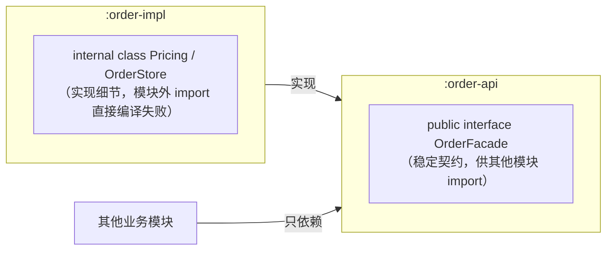

# 代码级设计能力

> [返回：软件架构学习大纲](../软件架构学习大纲.md)

> 本篇是第一阶段主笔记 [01-第一阶段-架构思维与设计基础.md](01-第一阶段-架构思维与设计基础.md) 第 2 节的独立展开篇：原有编号体系（2.1 / 2.1.1 / 2.2 / 2.3 / 2.3.1 / 2.4）原样保留，其他笔记写“见 2.x”即指本篇对应小节。贯穿示例为订单系统，并按 [示例项目场景.md](../示例项目场景.md) 引入工单中心、桶装水商城、低代码平台等场景。所有带 `main` 的 Kotlin 完整示例均已在本地实际编译运行，文中给出的运行输出为真实结果；仅标注“片段”的代码不单独成程序。

## 2. 代码级设计能力 ✅

架构的最小单元是代码结构；代码级的坏设计会不断累积，最终变成一团泥球的架构（Big Ball of Mud）。本节是架构思维在最小尺度上的训练。

### 2.1 SOLID 五大原则（贯穿例子：订单系统）

- **S 单一职责（SRP）**：一个类/模块只有一个变化原因。反例：OrderService 同时算价格、写数据库、发邮件——三个变化方向堆进一个类。修正：拆成 OrderService + OrderRepository + NotificationService。判据是“有几个外部原因会迫使它修改”，不是“做了几件事”。
- **O 开闭（OCP）**：对扩展开放、对修改关闭。反例：支付逻辑写成 if/else，每接一种新支付都要改老函数。修正：定义 PaymentMethod 抽象，每种支付一个实现（策略模式）。本质：**用抽象隔离预判到的变化**；但与 YAGNI 平衡——不为所有想象中的变化留扩展点。
- **L 里氏替换（LSP）**：子类必须能无感替换父类且程序行为仍正确。经典反例：正方形继承长方形（setWidth 会影响 getHeight）；业务反例：“不可退款订单”子类把 refund() 抛异常，逼所有调用方加 instanceof。继承必须表达**行为兼容的 is-a**，不为贪图代码复用而继承。
- **I 接口隔离（ISP）**：调用方不应被迫依赖它用不到的方法。反例：巨大的 PaymentService 接口包含支付/退款/对账/结算，收银台只需要支付却面对全部。修正：按使用者拆接口。SRP 按“变化原因”划分，ISP 按“依赖面”划分，目标都是缩小依赖范围。
- **D 依赖倒置（DIP）**：高层模块不依赖低层模块，两者都依赖抽象。反例：OrderService 内部直接 new MySQLOrderRepository。修正：依赖 OrderRepository 接口，具体实现由外部注入。**DIP 是六边形架构、整洁架构的理论基石**——那两种模式就是把它应用到系统层面。

下面把五条原则逐条展开成“五件套”：一句话定义、Kotlin 反例与修正、以及**判据——什么时候违反它反而是合理的**。原则不是法律，是把变化局部化的杠杆；不知道什么时候可以不守，说明还没真正理解它。

#### S 单一职责（SRP）：先找到“变化的轴”

**一句话定义**：一个类应该只有一个被修改的理由——即只对一个“角色/利益方”负责。

关键在把“职责”理解为**变化的轴**，而不是“做了几件事”：订单系统里的计价规则（产品/运营驱动，天天改）、存储技术（DBA/架构驱动，一年改一次）、通知渠道（市场驱动，随政策改）是三条互不相关的轴。谁驱动它变化，它就属于谁。三个轴堆进一个 OrderService，意味着产品改促销要碰存储代码、DBA 换表结构要审促销逻辑——代码评审的“受害者”全是无辜路人。

反例与修正（与下面 DIP 的示例同一个 Kotlin 文件编译运行，含 `main`，输出为真实结果）：

```kotlin
// ❌ 反例（文字版）：OrderService 一身三职，三个变化轴拧在一起
// ✅ 修正：按轴拆开——每个类只有一个"被迫修改"的理由
data class Order(val id: String, val item: String, val unitPrice: Int, val qty: Int, val vip: Boolean)

class PriceCalculator {
    // 变化轴 1：计价规则（促销、会员折扣）——产品/运营驱动
    fun total(order: Order): Int {
        val gross = order.unitPrice * order.qty
        return if (order.vip) gross * 95 / 100 else gross
    }
}

class OrderRepository {
    private val db = mutableMapOf<String, Order>()
    // 变化轴 2：存储技术（MySQL/ES/归档）——DBA/架构驱动
    fun save(order: Order) { db[order.id] = order }
}

class NotificationService {
    // 变化轴 3：通知渠道（短信/站内信/微信）——渠道运营驱动
    fun orderCreated(order: Order) = println("  [通知] 订单 ${order.id} 创建成功，已通知用户")
}

class OrderService(
    private val calculator: PriceCalculator,
    private val repository: OrderRepository,
    private val notification: NotificationService,
) {
    fun place(order: Order): Int {
        val total = calculator.total(order)
        repository.save(order)
        notification.orderCreated(order)
        return total
    }
}
```

真实运行输出（会员价 15 × 4 × 95% = 57 元）：

```text
== SRP：按变化的轴拆分 OrderService ==
  [通知] 订单 O1001 创建成功，已通知用户
  应付金额 = 57 元
```

注意拆分后的 OrderService 仍然“做了三件事”（算价、落库、通知）——它没有违反 SRP，因为它自己的变化原因只剩一个：**下单流程本身**（先算价、再落库、再通知的编排顺序变了才改它）。这正是“判据是有几个变化原因，不是做了几件事”的含义：编排者与执行者可以合法共存。

**判据——什么时候违反 SRP 反而合理**：

- **脚本与原型期**：一次性数据迁移脚本、验证想法的 demo，拆出五六个类是负资产；此时“快”就是最高的内聚。等它活过第二次使用再拆不迟。
- **两条轴并不独立**：如果两块代码永远被同一个需求同时修改（例如订单金额与订单积分流水，业务上必须原子一致），把它们合在一起反而是内聚——拆开制造的是假边界。
- **变化概率趋近于零**：一个几十行、只有一种调用方、三年没变过的工具类，硬拆只是增加导航成本。拆分的收益 ≈ 变化概率 × 隔离价值 − 拆分成本，概率不成立就别付成本。

SRP 放大到模块级就是“一个模块一个变化原因”——第二阶段“模块化单体”按业务能力切分（见 [../章节2/01-第二阶段-经典架构模式.md](../章节2/01-第二阶段-经典架构模式.md)）用的正是同一条判据。

#### O 开闭（OCP）：用抽象隔离“预判到的”变化

**一句话定义**：对扩展开放（新增行为靠加代码），对修改关闭（老代码不用动）。

OCP 的全部成本在“预判”二字：抽象本身不产出价值，**预判对了才产出价值**。为每种想象中的变化留扩展点，留出来的其实是猜测固化成的耦合——这是 OCP 与 YAGNI 的张力所在。工程上的折中是：只对**已经发生过至少一次**的变化上抽象，对纯想象中的变化保持沉默。

```kotlin
// 片段：渠道集合稳定且封闭时，sealed + 穷尽 when 是"另一种 OCP"
sealed interface RefundChannel {
    data object Original : RefundChannel   // 原路退回
    data object Balance : RefundChannel    // 退到余额
}

fun refundTo(ch: RefundChannel, cents: Int): String = when (ch) {
    RefundChannel.Original -> "原路退回 $cents 分"
    RefundChannel.Balance  -> "退入余额 $cents 分"
} // 不写 else：新增渠道时，编译器立刻在所有 when 处报错——变化被压缩到"一处修改 + 编译器兜底"
```

这个片段说明 OCP 不是只有策略模式一种做法：当变化点是**封闭集合**时，“修改集中在一处 + 编译器穷尽检查”比“每处一个策略类”更便宜也更安全——策略忘了注册只会在运行期出错，`when` 少写分支在编译期就报错。什么时候用哪种？变化点开放（第三方接入、插件）用策略；变化点封闭（退款渠道、订单状态）用 sealed + when。

**判据——什么时候违反 OCP 反而合理**：

- 变化从未发生过、也没有任何业务信号表明会来：写 if/else，等第二次出现再抽象（Rule of Three 的前奏）。
- 分支体极小且永远同步变化：抽象层的文件数、跳转成本超过了分支本身的维护成本。
- 探索期方向未定：过早的策略化会把猜测焊死在接口上，改接口比改 if/else 贵得多。

**度量 OCP 落地好坏的土办法**：看新增一个用例时 diff 的形状——新增文件、新增行占比越高，对已有行的改动越少，OCP 越成功；反之每次都在“老函数中间”插行，就是 OCP 缺失。

#### L 里氏替换（LSP）：is-a 是行为契约，不是分类学

**一句话定义**：任何用到父类引用的地方，换成子类对象后程序行为仍然正确——子类不许背弃父类的可观察契约。

契约具体指三件事：**前置条件不能加强**（父类接受 0~100 的参数，子类不能只接受 1~99）、**后置条件不能削弱**（父类承诺返回排序列表，子类不能返回乱序）、**不变量必须保持**（父类承诺 width、height 独立赋值，子类不能偷偷绑定二者）。“正方形是一种长方形”在数学分类学上成立，在行为契约上不成立——这就是 LSP 教的第一课：**is-a 看的是行为，不是世界观的分类**。

Kotlin 版经典反例（完整示例已编译运行，输出为真实结果）：

```kotlin
open class Rectangle(protected var w: Int = 0, protected var h: Int = 0) {
    open fun setWidth(w: Int) { this.w = w }
    open fun setHeight(h: Int) { this.h = h }
    val area: Int get() = w * h
}

class Square(side: Int = 0) : Rectangle(side, side) {
    // 为了守住"四边相等"的不变量，子类被迫改动父类方法的语义
    override fun setWidth(w: Int) { this.w = w; this.h = w }
    override fun setHeight(h: Int) { this.h = h; this.w = h }
}

// 调用方按父类契约写的代码：宽、高是两个独立的可写属性
fun enlarge(r: Rectangle) {
    r.setWidth(4)
    r.setHeight(5)
    check(r.area == 20) { "LSP 违约：面积是 ${r.area}，按父类契约应为 20" }
}
```

真实运行输出：

```text
== LSP：长方形/正方形 ==
Rectangle 通过 enlarge（4x5=20）
Square 在 enlarge 中违约 -> LSP 违约：面积是 25，按父类契约应为 20
```

问题不在 Square 的“四边相等”约束本身，而在于它**继承了一个自己无法遵守的契约**还想硬撑——撑的办法就是让 setWidth 产生“改宽度连累高度”的副作用，把违约藏进 setter。业务里的同款：“不可退款订单”继承“订单”却把 refund() 抛异常，逼所有调用方写 `if (order is NonRefundable)`——这不是继承，是用类型系统撒谎，撒谎的账单由调用方付。

修正方向一：拆接口，让“可退款”成为独立的能力而不是父类的默认承诺：

```kotlin
// 片段：能力拆出来，撒谎的继承就消失了
interface Order { val id: String }
interface RefundableOrder : Order { fun refund(cents: Int): Boolean }

class NormalOrder(override val id: String) : RefundableOrder {
    override fun refund(cents: Int) = true  // 正常退款
}
class SealedOrder(override val id: String) : Order  // 不可退款单根本没有 refund 可违背
```

修正方向二：组合 + 不可变值对象——“正方形不是长方形”就再也伤不到任何人：

```kotlin
// 片段：组合与不可变，让"is-a 之争"失去舞台
data class Rect(val width: Int, val height: Int)          // 不可变值对象，没有 setter 可被重写
data class Square(val side: Int) {
    fun toRect() = Rect(side, side)                       // 显式转换：需要长方形时说出来，而不是假装是
}
fun enlarge(r: Rect) = r.copy(width = r.width + 1, height = r.height + 1) // 无多态，无违约
```

**判据——什么时候“违反 LSP”可以容忍**：框架强制的基类体系里，异常类继承 RuntimeException 却不改任何行为（没有削弱契约，只是空壳）；为测试伪造的子类（假仓储）在测试作用域内替代真实子类。除此之外，Kotlin 没有私有继承，“只为复用代码而继承”的每个案例，答案几乎都是改成组合——**继承留给真正的行为兼容，复用交给组合**。

提前发现 LSP 违约的三问法：这个子类是否加强了父类方法的前置条件？是否削弱了后置条件？是否抛出父类从未承诺的异常？再加一个工程手段：**测试只针对父类写一遍，让所有子类都跑同一个测试套件**——正方形会在长方形的测试里现出原形。这个思想到第二阶段会再次出现（“测试即驱动侧适配器”，见 [../章节2/01-第二阶段-经典架构模式.md](../章节2/01-第二阶段-经典架构模式.md)）。

#### I 接口隔离（ISP）：依赖面就是耦合面

**一句话定义**：调用方不应该被迫依赖它用不到的方法；接口按“使用方式”切，不按“实现者是谁”切。

胖接口的三重伤害：**编译期**，调用方看见了大量与己无关的方法签名（认知负担）；**实现期**，被迫为用不到的方法写空壳或抛异常（陪跑代码）；**演进期**，任何一个不相关方法的改动都会重新编译、重新测试、重新部署所有实现者——依赖面有多大，耦合面就有多大。

完整示例已编译运行（输出为真实结果）：

```kotlin
interface FatPaymentService {
    fun pay(orderId: String, cents: Int): Boolean
    fun refund(orderId: String, cents: Int): Boolean
    fun reconcile(date: String): String      // 对账
    fun settle(merchantId: String): String   // 结算
}

// 收银台只需要 pay，却被迫把其余三个方法写成"不会用"的空壳
class CashierWithFatApi : FatPaymentService {
    override fun pay(orderId: String, cents: Int): Boolean { /* 支付 */ return true }
    override fun refund(orderId: String, cents: Int): Boolean = throw NotImplementedError("收银台不退款")
    override fun reconcile(date: String): String = throw NotImplementedError("收银台不对账")
    override fun settle(merchantId: String): String = throw NotImplementedError("收银台不结算")
}

// 修正：按使用者拆接口，依赖面缩到最小；实现侧仍可聚合
interface Payable { fun pay(orderId: String, cents: Int): Boolean }
interface Refundable { fun refund(orderId: String, cents: Int): Boolean }

class CashDesk(private val gateway: Payable) {   // 只看得见 pay
    fun pay(orderId: String, cents: Int) = gateway.pay(orderId, cents)
}
class RefundDesk(private val gateway: Refundable) {
    fun refund(orderId: String, cents: Int) = gateway.refund(orderId, cents)
}
class PaymentGateway : Payable, Refundable {     // 实现类可以同时实现多个窄接口
    override fun pay(orderId: String, cents: Int): Boolean { return true }
    override fun refund(orderId: String, cents: Int): Boolean { return true }
}
```

真实运行输出：

```text
== ISP：巨大接口 vs 按使用者拆分 ==
  胖接口下调用 refund -> NotImplementedError: 调用方被迫陪跑
  [网关] 支付 O9001：1500 分
  [网关] 退款 O9001：1500 分
```

SRP 与 ISP 是同一枚硬币的两面：SRP 按**变化原因**切实现，ISP 按**使用方式**切依赖；实现侧可以聚合（PaymentGateway 同时实现 Payable、Refundable），依赖侧应当分发（收银台只拿 Payable）。Kotlin 把 ISP 推到了极致——传函数比传接口更窄：`class CashDesk(private val pay: (String, Int) -> Boolean)` 连接口都省了，这是“策略 ≈ 传一个函数”（见 2.3）在语言层面的支撑。

**判据——什么时候违反 ISP 反而合理**：

- 方法定义上就同生共死：`InputStream` 的 read/close 拆成两个接口，“只读不关”的使用者根本不存在，拆了只会制造“两个接口一个实现类”的形式主义。
- 内部小组件、使用者只有一两个：接口粒度等于类粒度即可，为内部协作预拆接口是过度设计。
- 跨团队边界、调用方众多：哪怕方法少，也值得按调用方拆——**使用者越多，越要按“谁在用”切窄**。

#### D 依赖倒置（DIP）：依赖箭头指向稳定的那一头

**一句话定义**：高层模块（业务策略）不依赖低层模块（技术细节），两者都依赖抽象；而且抽象由高层拥有，不是低层实现完“顺便”被用。

“倒置”倒的是**依赖箭头的方向**：自然写法是 OrderService 调用 MySQLOrderRepository，箭头从业务指向存储——存储一变，业务跟着改。DIP 让两者共同依赖 OrderRepository 抽象，箭头从“指向易变的实现”倒转为“指向稳定的抽象”。最容易被忽略的是后半句：**接口归高层拥有**——OrderRepository 接口长什么样，由 OrderService 的业务需要说了算（我需要 save、findById），而不是由 MySQL 的能力说了算（我有 N 张表、M 个字段）。接口形状是业务的形状，不是技术的形状。

完整示例已编译运行（输出为真实结果）：

```kotlin
interface OrderRepo {
    fun save(order: Order)
    fun count(): Int
}

class MySqlOrderRepo : OrderRepo {
    private val table = mutableMapOf<String, Order>()
    override fun save(order: Order) { table[order.id] = order }  // 模拟写 MySQL
    override fun count() = table.size
}

class InMemoryOrderRepo : OrderRepo {
    private val mem = mutableMapOf<String, Order>()
    override fun save(order: Order) { mem[order.id] = order }
    override fun count() = mem.size
}

// 高层策略只认识 OrderRepo 抽象，不认识任何具体存储
class CheckoutService(private val repo: OrderRepo) {
    fun checkout(order: Order): String {
        repo.save(order)
        return "订单 ${order.id} 已落库（当前库存记录数 ${repo.count()}）"
    }
}
```

真实运行输出（同一份高层代码，两种存储实现即插即用）：

```text
== DIP：高层依赖抽象，实现可替换 ==
  订单 O2002 已落库（当前库存记录数 1）
  订单 O2002 已落库（当前库存记录数 1）
```

Kotlin 里做 DIP 不需要框架——构造函数注入加默认参数就够了，时间、随机数这类“隐藏依赖”同理值得倒置（测试时换假时钟，才能把“7 天后过期”写成毫秒级断言）：

```kotlin
// 片段：没有 Spring 也能 DIP——构造注入 + 默认参数
class OrderService(
    private val repo: OrderRepo = MySqlOrderRepo(),       // 生产默认
    private val clock: Clock = Clock.systemDefaultZone(), // 时间也是依赖：测试时注入假时钟
)
```

**判据——什么时候违反 DIP 反而合理**：

- 稳定到“永远不会换”的东西：`StringUtils`、标准库集合、纯函数工具——抽象一层只有成本没有收益。DIP 抽象的是**会变的实现**与**昂贵/不可控的依赖**（数据库、网络、时钟、随机数），不是万物。
- 值对象与领域内聚的数据结构：Order 既是高层用的也是低层用的，为它再造一层抽象是绕圈。
- 只有一个实现且领域内聚的小工具：等第二个实现真实出现再抽，接口形状那时才准。

**埋一个伏笔**：“接口由高层拥有”这句话，正是第二阶段六边形架构的雏形——把“应用核心定义端口、外部适配器实现端口”这个类级技巧放大到系统级，就是端口与适配器（hexagonal architecture）；整洁架构的依赖规则（源码依赖只能指向内）是同一句话的架构版。2.4 的 `internal` 与模块边界，则是它在编译器层面的落地。到第二阶段（见 [../章节2/01-第二阶段-经典架构模式.md](../章节2/01-第二阶段-经典架构模式.md)）你会看到：六边形架构里被驱动的仓储端口、驱动侧的用例端口，形状全都由内部业务决定——和上面 CheckoutService 决定 OrderRepo 的形状，是同一个动作。

总记：S/I 管边界划分，O/L 管扩展方式，D 管依赖方向；五条共同目标只有一个——**让变化的影响范围局部化**。

#### 2.1.1 场景案例（工单中心）：if-else 如何腐烂，OCP + 策略如何止血

工单中心的流转规则随工单类型变化：投诉单要先绑定责任组，报修单要先生成上门任务，催办规则、SLA 时限也各不相同。最初几乎所有团队都会写成这样：

```kotlin
// ❌ 反例：流转规则硬编码，每加一种类型就再摞一层 else——
// 三个月后 300 行 if-else：没人敢动、改一处崩三处、新人不敢上线
fun transfer(ticket: Ticket, action: Action): Status {
    if (ticket.type == TicketType.COMPLAINT) {
        if (ticket.status == Status.PENDING && action == Action.START) return Status.BINDING // 投诉单先绑责任组
        if (ticket.status == Status.BINDING && action == Action.ASSIGN) return Status.PROCESSING
    } else if (ticket.type == TicketType.REPAIR) {
        if (ticket.status == Status.PENDING && action == Action.START) return Status.VISITING // 报修单直接生成上门
        // ……每个类型、每个状态对都是一段新分支
    }
    throw IllegalStateException("不支持的操作")
}
```

烂掉的不是写代码的人，而是**把“随类型变化的东西”写死在“不随类型变化的流程”里**——这正是 OCP 要隔离的变化。修正：把“下一步去哪”抽象为一族策略，按类型各自实现：

```kotlin
// ✅ 修正：一族 TransferPolicy——新增工单类型只加一个实现，不改已有代码（OCP + 策略模式）
interface TransferPolicy {
    fun supports(type: TicketType): Boolean
    fun next(current: Status, action: Action): Status
}

class ComplaintTransferPolicy : TransferPolicy {
    override fun supports(type: TicketType) = type == TicketType.COMPLAINT
    override fun next(current: Status, action: Action): Status = when (current to action) {
        Status.PENDING to Action.START -> Status.BINDING      // 投诉单先绑责任组
        Status.BINDING to Action.ASSIGN -> Status.PROCESSING
        else -> throw IllegalStateException("投诉单不支持 $action")
    }
}

class TransferService(private val policies: List<TransferPolicy>) {
    fun transfer(ticket: Ticket, action: Action): Status =
        policies.first { it.supports(ticket.type) }.next(ticket.status, action)
}
```

同一张药方还治“分派规则频繁调整”：按技能组、按负载、按优先级的分派逻辑若硬编码，每两周调整一次就要改代码发版；把规则做成**配置/规则引擎**（数据而非代码），新规则上线不动代码——“用抽象隔离变化”从类级别放大到系统级别，这正是第二阶段模块划分要接着讲的话题。

### 2.2 高内聚低耦合与朴素原则

- 高内聚：模块内部的东西在业务上是一件事；低耦合：模块之间只通过窄接口往来。实用判据：两个模块总是必须一起改，说明它们其实是同一个模块，边界画错了。
- 关注点分离：业务逻辑与技术细节（日志、事务、鉴权、重试）分开——这也是“分层”的理论来源。
- DRY：消除的是**知识的重复**（同一件事的定义出现在多处），不是文本重复；两段恰好长得一样的代码不一定该合并，过度 DRY 会把不相关的东西错误耦合。
- KISS：能用简单方案就不用聪明方案。
- YAGNI：不为想象中的未来需求写代码；它的放大版就是架构上“提前设计 vs 演进式等待”的取舍。

“高内聚低耦合”是方向，不是刻度。下面两张谱系表把它变成可操作的标尺：内聚看“模块内部的东西是不是一件事”，耦合看“模块之间牵扯多深”。两者是同一件事的正反面——内聚做对了，剩下的对外关系自然只剩窄接口。

#### 2.2.1 两张谱系表：内聚从高到低，耦合从轻到重

**内聚类型谱系**（从高到低，越靠上越该追求）：

| 类型 | 一句话 | 订单/场景示例 | 现场识别与治理 |
|---|---|---|---|
| 功能内聚 | 所有元素协作完成、且只完成一个功能 | `PriceCalculator` 只算价，算完就结束 | 理想态；类名能用一个动词短语说清 |
| 顺序内聚 | 前一步的输出恰好是后一步的输入 | 导出流水线：校验→算价→格式化→写出 | 尚可；若每步都在变，考虑拆成管道（第二阶段“管道-过滤器”） |
| 通信内聚 | 不同功能只因操作同一份数据而聚在一起 | 订单 DAO：查单、改状态、加备注都操作订单表 | 警惕；“同表”不是“同职责”，按业务能力重新分组 |
| 瞬时内聚 | 只因同一时间被执行而聚在一起 | 每日零点定时任务集：日结、催办扫描、报表快照 | 常见于定时任务类；按功能各自成类，调度器只负责“几点跑” |
| 逻辑内聚 | 因“逻辑上相似”被 if/switch 归并进一个模块 | `handle(event)` 里按事件类型分叉做互不相干的事 | 危险信号；相似是错觉，按类型拆成各自的处理者 |
| 偶然内聚 | 无内在关系，历史上凑到了一起 | `Utils` 类塞字符串、日期、HTTP、加密工具 | 最差；按真实功能重新安置，Utils 只留真正通用的纯函数 |

**耦合类型谱系**（从轻到重，越靠下越危险）：

| 类型 | 一句话 | Kotlin 示例 | 治理方向 |
|---|---|---|---|
| 数据耦合 | 只通过基本类型/值参数往来 | `calc(price: Int, qty: Int): Int` | 最轻；保持参数少而稳 |
| 标记耦合 | 传整个对象但只用其中两三个字段 | `fun ship(order: Order)` 内部只用收货地址 | 收窄为 `fun ship(to: Address)` 或只暴露所需字段的窄接口 |
| 控制耦合 | 传 flag 决定被调方的行为分支 | `fun process(order: Order, isVip: Boolean)` 内部两套流程 | 拆成两个函数，或让调用方传策略/多态 |
| 公共耦合 | 多方读写同一个可变全局/静态状态 | 共享的 `object GlobalCache`、静态 map | 收窄作用域、改为注入；可变共享状态是并发与测试的万恶之源 |
| 内容耦合 | 直接访问对方的内部：反射进私有字段、直连对方的表写 SQL、复制对方内部常量 | `order.lineItems` 直接 add 绕过校验 | 任何“私有”改动都会引发故障；用门面/不可变视图封死内部 |

两张表合起来给一条工程判据：**耦合不可能归零，只能升档**——把内容耦合降为公共耦合、公共耦合降为控制耦合、控制耦合降为数据耦合，每升一档，“对方改动会不会连累我”的概率就降一截。2.4 的 `internal` 与窄接口，本质就是用编译器强制耦合降档。

#### 2.2.2 代码坏味道 ↔ 原则违反对照表

坏味道（code smell）是“信号”不是“罪名”——见到别急着重构，先问一句：**这个味道最近造成过真实的修改成本吗？** 有，才值得动手；没有，记一笔就走（YAGNI 同样适用于重构）。

| 坏味道 | 症状 | 常见根因（违反了什么） | 第一反应 |
|---|---|---|---|
| 霰弹式修改 | 一个需求要改 N 个文件，改完提心吊胆 | SRP 缺失 / 同一知识散落多处（DRY 违背） | 沿“变化的轴”把知识收拢到一处 |
| 发散式修改 | 一个类被 N 种需求反复改，越改越胖 | 内聚缺失（多为逻辑/偶然内聚） | 按变化轴拆类，每个类只服务一种需求 |
| 长参数表 | 八个参数、三个 Boolean、顺序靠猜 | 缺对象封装 / ISP 违背（依赖面过宽） | 引入参数对象；按使用者收窄接口 |
| 依恋情结 | 函数从头到尾都在用别人对象的数据 | 数据与行为分家 | 把函数搬回数据所在的家（Move Method） |
| 数据泥团 | 三五个字段总是一起出现在各处 | 标记耦合 / 缺领域对象 | 提炼成一个类（哪怕只是个 data class） |
| 基本类型偏执 | 到处用 `String` 表示手机号、`Int` 表示金额 | 缺领域建模 | `value class` / 领域类型，让非法状态不可表示 |
| 类型分叉反复出现 | 同一套 if/else 按类型分叉散落多处 | OCP 缺失 | 一处收敛：策略/多态或 sealed + 穷尽 when |
| 消息链 | `a.b().c().d()` 一路挖到底 | 内容耦合（依赖对方的内部结构） | 隐藏委托：让 a 直接提供你要的结果 |
| 注释在解释“这个函数其实干两件事” | 注释比代码诚实 | SRP 缺失 | 拆函数；注释应该解释为什么，不是遮掩是什么 |
| 平行继承体系 | 给 A 加子类就得给 B 加配对的子类 | 控制耦合 / 知识重复 | 合并变化轴，或让一方持有对另一方的策略 |

### 2.3 常用设计模式（每类挑高频）

设计模式 = 给常见解法起的**标准名字**，价值在于沟通；不要为用而用。现代语言特性让很多模式变轻（策略 ≈ 传一个函数）。

| 类别 | 模式 | 一句话 | 业务例子 |
|---|---|---|---|
| 创建型 | 工厂方法 | “造什么”的决定收拢到一处 | 按渠道创建支付客户端 |
| | 单例 | 全局唯一实例（注意并发安全） | 配置中心客户端 |
| | 建造者 | 多参数对象分步构造 | 含 10+ 可选参数的查询对象 |
| 结构型 | 适配器 | 接口不匹配时做转换 | 老系统接口包装成新接口 |
| | 装饰器 | 不改原类、叠加能力 | HTTP 客户端叠加重试、日志 |
| | 代理 | 控制访问，持有真实对象 | RPC 客户端的本地桩（stub） |
| 行为型 | 策略 | 一族可替换算法 | 多种优惠计算方式 |
| | 模板方法 | 父类定骨架，子类填空位 | 导出流程：校验→查询→格式化 |
| | 观察者 | 状态变化通知多方 | 下单后通知库存、积分、消息 |
| | 责任链 | 请求沿链传递，各自处理或放行 | 风控规则、过滤器链 |

装饰器 vs 代理：装饰器**叠加职责**（调用方知情），代理**控制访问**（调用方不知情）。模式与 SOLID 的关系：模式是原则的落地做法（策略模式 = OCP 的具体应用）。

GoF 全部 23 个设计模式的逐一详解（前 10 个高频精讲、后 13 个补全；意图、订单系统贯穿的 Kotlin 可运行示例、反例与 Kotlin 惯用写法）已拆到单独文件：[常用设计模式-补充](06-常用设计模式-补充.md)，配套可运行代码在 [07a-示例-patterns/](07a-示例-patterns/) 目录——一个模式一个 .kt 文件（P01~P23），每份围绕一个具体业务场景、带独立 main 可单独运行；什么时候该用哪个模式，另有一份症状反查表：[设计模式使用场景](07-设计模式使用场景.md)。

#### 2.3.1 场景案例（低代码平台）：解释器 + 组合的天然舞台

低代码平台里，表单设计器产出的不是代码而是**元数据 Schema**（字段、校验、联动规则），流程设计器产出节点/分支/会签的流程定义；运行时引擎对这份“数据”解释执行——一门小语言加一个解释器（解释器模式），而表单与流程天然是树形结构（组合模式）。工单中心“新增工单类型只配表单、不改代码”的能力，本质就是内嵌的低代码：

```kotlin
// 流程定义 = 元数据（组合成树）；interpret = 解释器（对元数据求值）
sealed interface FlowNode {
    data class Task(val role: String) : FlowNode
    data class Condition(val expr: String, val yes: FlowNode, val no: FlowNode) : FlowNode
}

fun interpret(node: FlowNode, ctx: TicketContext) = when (node) {
    is FlowNode.Task -> ctx.assign(node.role)
    is FlowNode.Condition ->
        if (ctx.eval(node.expr)) interpret(node.yes, ctx) else interpret(node.no, ctx)
}
```

代价也要看见：解释执行慢于生成代码、Schema 要做版本演化（历史单据按提交时的旧版结构渲染）、流程引擎很容易越做越像通用 BPM 而复杂度失控——通用性的代价，第四阶段 DDD 处回头细算。

#### 2.3.2 DRY 的边界：偶然重复 vs 本质重复

2.2 说过：DRY 消除的是**知识的重复**，不是文本的重复。这一小节把它变成可操作的判断。

先给判据：看到两段相似的代码，问一个问题——**“如果 A 的需求变了，B 有没有业务理由跟着变？”** 有，说明它们表达的是同一份知识（本质重复），该抽；没有，说明它们只是恰好长得像（偶然重复），抽了反而把两个独立的变化方向焊死在一起。桶装水商城里“单次购订单的金额计算”与“周期购订单的金额计算”都遍历商品、都乘数量——文本很像，但促销规则改单价逻辑时，周期购按期扣款的价格根本不该动：这是偶然重复，抽到一起是灾难；反过来，“水桶押金 50 元/桶”这个数字同时出现在下单计价、退押金、客服话术三处——任何一处都要跟着押金政策变：这是本质重复，必须收拢成一个常量/配置。

再看“错误的抽象比重复更贵”（Sandi Metz）——完整示例已编译运行，输出为真实结果：

```kotlin
// ❌ 反例：CSV 导出（逐行、要转义）与运营汇总（算总额、数 VIP）本来是两个变化方向，
// 因为"都在遍历订单、都在拼字符串"长得像，被抽成一个带 flag 的函数。
fun exportOrders(rows: List<OrderRow>, csv: Boolean): String = buildString {
    if (csv) {
        append("id,amount\n")
        rows.forEach {
            val safeId = if (it.id.contains(',')) "\"${it.id}\"" else it.id // CSV 分叉 1：转义
            append("$safeId,${it.amount}\n")
        }
    } else {
        append("== 运营汇总 ==\n")
        append("总金额=${rows.sumOf { it.amount }}\n")                      // 汇总分叉 1：总额
        append("VIP订单数=${rows.count { it.vip }}\n")                      // 汇总分叉 2：VIP 统计
    }
}

// ❌ 更糟：需求继续进化，第三个 flag 出现，if 嵌套开始爆炸
fun exportOrdersV2(rows: List<OrderRow>, csv: Boolean, withBom: Boolean): String =
    (if (csv && withBom) "\uFEFF" else "") + exportOrders(rows, csv)

// ✅ 修正：承认这是"偶然重复"，拆回两个各自演化的函数
fun exportCsv(rows: List<OrderRow>, withBom: Boolean = false): String = buildString {
    if (withBom) append("\uFEFF")
    append("id,amount\n")
    rows.forEach {
        val safeId = if (it.id.contains(',')) "\"${it.id}\"" else it.id
        append("$safeId,${it.amount}\n")
    }
}

fun exportSummary(rows: List<OrderRow>): String = buildString {
    append("== 运营汇总 ==\n")
    append("总金额=${rows.sumOf { it.amount }}\n")
    append("VIP订单数=${rows.count { it.vip }}\n")
}
```

真实运行输出：

```text
== 错误的抽象 vs 偶然重复 ==
id,amount
"O1,有限公司",150
O2,260

== 运营汇总 ==
总金额=410
VIP订单数=1

V2 引入 withBom：又多一个 flag，签名越来越难懂（BOM=true）
-- 拆回两个函数后，各自演化互不牵连 --
（两份输出与合并版完全一致，但从此 CSV 的转义规则、汇总的统计口径各自演化，互不牵连）
```

这个反例里，错误的抽象付出三笔账：**签名撒谎**（`csv: Boolean` 逼每个调用方理解内部分支才能放心调用）；**理解成本按分支数放大**（读者要同时装下两条路径才能确认自己走的那条是对的）；**修改互相污染**（CSV 加 BOM 得改公共函数，等于替运营汇总的调用方做了一次“他们不需要的发布”）。最痛的是后来者：看到公共函数就不敢拆，继续往里塞 `if (csv && withBom && forExcel)`，直到有一天没人能完整读懂它。

正确的节奏：**先容忍重复，等抽象自己长出来**。经验法则 Rule of Three——第一次重复：抄一下；第二次重复：留意但不抽；第三次重复：这时你看到了三个样本，才知道“共同点”是真共同点还是巧合，抽象的形状这时才画得准。Sandi Metz 那句话的完整含义是：重复的代价是线性的（改 N 处），错误抽象的代价是指数的（所有调用方 + 所有分支 + 不敢动的后来者）——在证据不足时，重复是更便宜的押注。

**KISS 的过度设计反例**（刻意错误的反例，不必编译）：桶装水商城要读一个“配送时段”配置，只有两个取值（上午/下午）。某次重构把它做成了：`DeliveryWindowProvider` 接口 + `YamlDeliveryWindowProvider` 与 `DatabaseDeliveryWindowProvider` 两个实现 + 抽象工厂按环境选择 + 建造器组装——四个类、三层间接，只为读两个值。判断标准很简单：**写完的实现里，有几个类从未被第二个调用方使用过？** 全部只有一个调用方的“抽象”，都是绕路。KISS 的修正版可能就是两行：`val window = if (env == "yaml") yamlWindow else dbWindow`——等到真有第三种来源，再提函数也不迟。

**YAGNI 的过度设计反例**：订单系统为了“未来可能上阶梯优惠”，提前写好 `DiscountStrategy` 接口 + 三层规则管道 + 每层可插拔的组合器，共六百行。两年后促销真正上线，需求是“满 99 减 15、限时 3 天”——满减是订单级门槛而非商品级阶梯，时限需要与活动系统联动，当初的扩展点一个都用不上，反而要先花两天拆掉管道。YAGNI 的操作化判据：**扩展点只有在出现第二个真实使用者时才补**——这是 Rule of Three 的接口版。注意它与 OCP 不矛盾：OCP 说“变化来了要用抽象接住”，YAGNI 说“变化没来别造抽象”，两句话合起来才是完整的手艺。

### 2.4 怎么练

- 找当前项目里最“胖”的类/服务，数它有几个变化原因，说出拆分方案。
- Code review 时练习用术语描述问题：“这个类不满足 SRP”“这里违反了 DIP”。

在此之上补两条更完整的练习路径：一条向上（从代码级升到模块级），一条向深（一次完整的重构演练）。

#### 从代码级到模块级：用 internal 守住边界

SOLID 管住了类与类的关系，但“模块”的边界（谁允许依赖谁）靠纪律是守不住的——得让编译器守。Kotlin 的可见性修饰符就是干这个的：`public`（默认，谁都能 import）、`internal`（**同模块内**可见，模块外 import 直接编译失败）、`private`（文件/类内）。这里的“模块”指一次一起编译的单元（Gradle/IDEA 的 module）——一次编译打包里的所有文件互为同模块。

多数团队的坑在默认值：Kotlin 不写修饰符就是 public，等于“所有实现细节自动导出”，模块边界名存实亡。`internal` 把“这是内部实现、别依赖它”从口头约定变成编译期红线。完整示例已编译运行（单文件内 `internal` 正常使用，输出为真实结果）：

```kotlin
// 假设下面这些代码属于"订单模块"。public 的只有稳定门面，
// internal 的计价、存储细节对模块外不可见。
interface OrderFacade {
    fun place(id: String, amount: Int, vip: Boolean): String
}

internal class Pricing {
    fun total(amount: Int, vip: Boolean) = if (vip) amount * 95 / 100 else amount
}

internal class OrderStore {
    val saved = mutableListOf<String>()
    fun save(id: String) { saved += id }
}

class DefaultOrderFacade : OrderFacade {
    // 模块内部的自由：明天把 Pricing 换成规则引擎，模块外无人受影响
    private val pricing = Pricing()
    private val store = OrderStore()
    override fun place(id: String, amount: Int, vip: Boolean): String {
        val total = pricing.total(amount, vip)
        store.save(id)
        return "订单 $id 应付 $total 元"
    }
}
```

跨模块引用 internal 类时，编译器真的会拦（在 Gradle 多模块工程中实测的错误信息）：

```text
error: cannot access 'class Pricing : Any': it is internal in file.
```

真实的 Gradle 多模块布局长这样（示意片段，不单独编译）：



为什么说这是**模块化单体的地基**：微服务拆分失败的头号原因是“分布式单体”——服务分了进程，代码上的随意依赖原样带过去。解法是反过来走：先在单体内部切出模块，用 `internal` 这类编译期手段把模块间接口收窄、把“内部细节”焊死在模块里，等每个模块只能通过窄门面被依赖了，再把模块改成进程——边界早已验证过，拆的只是部署单元。这正是 2.1 DIP“接口由高层拥有”在工程结构上的放大，也是第二阶段“模块化单体→微服务”路线（见 [../章节2/01-第二阶段-经典架构模式.md](../章节2/01-第二阶段-经典架构模式.md)）的第一步。模块边界往哪画？一条经典参考是康威定律：边界最好与团队/组织的沟通结构对齐，详见 [康威定律-补充](05-康威定律-补充.md)。

#### 重构演练：工单分派的四步演进

给一段真实的 if-else 腐烂代码，按“提取意图 → 策略化 → 选择器收口 → 开闭验证”四步走到策略 + 工厂。全部代码已编译运行，输出为真实结果。

**第 0 步：腐烂起点。** 工单中心的分派规则：网络故障单按优先级分专家/普通队列，计费单进计费组，其余进公共池。它还很小，但每一个新规则都会长在这里：

```kotlin
// 片段：每接一类工单、每调一次规则，都往这里塞分支
fun dispatchV0(t: Ticket): String {
    return if (t.type == "NETWORK") {
        if (t.priority >= 3) "网络组-值班专家" else "网络组-普通队列"
    } else if (t.type == "BILLING") {
        "计费组"
    } else {
        "公共池"
    }
}
```

**第 1 步：提取意图。** 把每个分支体收进命名函数，if-else 只剩“选哪个”。这一步不减风险、只增可读——但它是后三步的脚手架：

```kotlin
// 片段：分支体有了名字；when 取代 if-else 链
fun dispatchNetwork(t: Ticket) = if (t.priority >= 3) "网络组-值班专家" else "网络组-普通队列"
fun dispatchBilling(t: Ticket) = "计费组"

fun dispatchV1(t: Ticket): String = when (t.type) {
    "NETWORK" -> dispatchNetwork(t)
    "BILLING" -> dispatchBilling(t)
    else -> "公共池"
}
```

**第 2 步：策略化。** 一类工单一个规则对象，“怎么派”各自封装。变化最频繁的规则（按负载派）被隔离在自己的策略里，改它不碰别人：

```kotlin
// 片段：策略接口 + 各类型实现
interface DispatchRule {
    fun supports(type: String): Boolean
    fun dispatch(t: Ticket): String
}

class NetworkDispatchRule : DispatchRule {
    override fun supports(type: String) = type == "NETWORK"
    override fun dispatch(t: Ticket) =
        if (t.priority >= 3) "网络组-值班专家" else "网络组-普通队列"
}
class BillingDispatchRule : DispatchRule {
    override fun supports(type: String) = type == "BILLING"
    override fun dispatch(t: Ticket) = "计费组"
}
class IotLoadDispatchRule(private val loadOf: (String) -> Int) : DispatchRule {
    override fun supports(type: String) = type == "IOT"
    override fun dispatch(t: Ticket) = if (loadOf("工控组") > 20) "工控组-备班" else "工控组"
}
class FallbackDispatchRule : DispatchRule {
    override fun supports(type: String) = true
    override fun dispatch(t: Ticket) = "公共池"
}
```

**第 3 步：选择器收口。** Dispatcher 不认识任何具体类型，只依赖 `DispatchRule` 抽象——“选哪个规则”与“规则怎么派”从此是两个独立的变化轴：

```kotlin
// 片段：单一选择点；规则表就是"工厂"——按序匹配，兜底规则永远放最后
class Dispatcher(private val rules: List<DispatchRule>) {
    fun dispatch(t: Ticket): String =
        rules.first { it.supports(t.type) }.dispatch(t)
}
```

**第 4 步：开闭验证。** 新增“投诉单优先派资深坐席”规则——只加一个类、在规则表注册一行，Dispatcher 零修改。完整 main 的真实运行输出：

```text
== 工单分派：从 if-else 到策略+工厂 ==
  V0/V1 行为不变：
    T01(NETWORK) -> 网络组-值班专家 / 网络组-值班专家
    T02(NETWORK) -> 网络组-普通队列 / 网络组-普通队列
    T03(BILLING) -> 计费组 / 计费组
  策略版：
    T01(NETWORK) -> 网络组-值班专家
    T02(NETWORK) -> 网络组-普通队列
    T03(BILLING) -> 计费组
    T04(IOT) -> 工控组-备班
    T05(OTHER) -> 公共池
  新增 COMPLAINT 规则后（Dispatcher 零修改）：
    T06(COMPLAINT) -> 投诉组-资深坐席
    T07(COMPLAINT) -> 投诉组
```

两点工程提醒。其一，**每步都要验证“行为没变”**：V0 与 V1 输出一致再继续，重构的定义就是“不改变可观察行为的前提下调整结构”。其二，**工厂/规则引擎别提前上**：规则少且都住在代码里时，`List<DispatchRule>` 注册表就是全部；只有当规则要求“不改代码上线”（运营可配、灰度切换、秒级回滚）时，才升级为配置化规则引擎——那已经不是重构而是架构决策，对应 2.1.1 末段“用抽象隔离变化从类级别放大到系统级别”的那一步。更多模式级的正反例与反查表见 [设计模式使用场景](07-设计模式使用场景.md)。

## 【本节自测】代码级设计能力

按工作区约定：只出题不含答案；作答后逐题批改，记录写入 [自测答案与点评](99-自测答案与点评.md)。

1. **原则判据（SRP）**：订单系统里有个 `OrderService`，同时做三件事：计算订单金额（促销规则每月调）、扣减库存（与仓储团队联调时改）、写审计日志（合规部门提需求时改）。请判断：哪几件该拆出去、哪件可以留在 OrderService 里？说出你的判据（提示：判据是“变化的轴”，不是“做了几件事”——想清楚谁驱动每个变化）。
2. **原则判据（OCP 与 YAGNI 的张力）**：同事提议：现在只有“短信”和“站内信”两种通知渠道，但要为“未来可能新增十种渠道”预先设计 `NotificationStrategy` 接口 + 插件加载器 + 渠道工厂。你支持吗？给出支持/反对的判据；如果反对，说明你会等到什么信号出现再上这套抽象。
3. **坏味道诊断（一）**：`fun handle(order: Order, mode: Int)` 函数体内 `if (mode == 1) {…一套完整流程…} else if (mode == 2) {…另一套完全不同的流程…}`，两路只共用 Order 对象本身。指出至少两处坏味道及其对应违反的原则（可参考 2.2.2 对照表），并给出你的重构方向。
4. **坏味道诊断（二）**：桶装水商城里，每次调整“水桶押金规则”（如 50 元/桶改为 40 元），需要同时修改：押金计算类、订单落库时的押金字段、客服退押金话术模板。这是什么坏味道？根因是知识的重复还是内聚缺失？说出收拢方案与“该不该现在动手”的判断依据。
5. **原则判据（LSP）**：鸟类继承体系——`Bird` 有 `fun fly()`，`Penguin : Bird` 把 `fly()` 抛 `UnsupportedOperationException`。判定是否违反 LSP 并说出理由（用前置条件/后置条件/不变量三件套中的哪一件）；再给出两种改法：接口隔离版与组合版。
6. **重构开放题（DRY 边界）**：回忆或构造一个“错误抽象”现场：两段相似代码被抽成带 Boolean flag 的公共函数后，两条路径各自演化、flag 越加越多。说明：你判断“该不该抽”的那一个问题是什么？什么时候才动手抽（经验法则）？
7. **重构开放题（工单分派）**：把下面骨架演进到“策略 + 选择器”（参考 2.4 的四步）：

   ```kotlin
   fun dispatch(t: Ticket): String = when {
       t.type == "NETWORK" && t.priority >= 3 -> "网络组-值班专家"
       t.type == "NETWORK" -> "网络组-普通队列"
       t.type == "BILLING" && t.amount > 10000 -> "计费组-大额专席"
       t.type == "BILLING" -> "计费组"
       else -> "公共池"
   }
   ```

   要求：写出每一步的中间形态与“行为没变”的验证方式；并回答——什么信号出现时，才值得把规则从代码升级为配置/规则引擎？
8. **重构开放题（模块边界）**：单体工程里，你希望“订单模块的 `Pricing` 类不被其他模块直接实例化”。用 Kotlin 的什么语句落地？编译器会报什么样的错（凭 2.4 的实测信息复述）？这件事与第二阶段“模块化单体”和六边形架构各是什么关系（各用一句话说清）？

## 替换清单

- “从代码级到模块级：用 internal 守住边界”Gradle 多模块布局示意 → `flowchart`（模块子图 + 依赖箭头）
