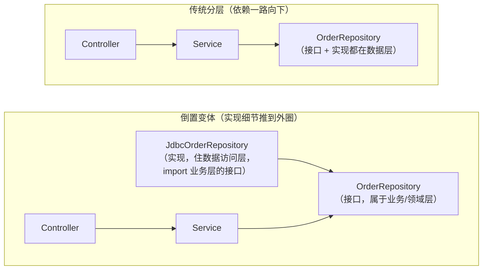

# 单体架构：分层与模块化

> [返回：软件架构学习大纲](../软件架构学习大纲.md)
> 本文是第二阶段主笔记《[第二阶段：经典架构模式](01-第二阶段-经典架构模式.md)》第 1 节的完整展开；小节编号（1.1 分层架构 / 1.2 模块化单体）与主笔记保持一致，其他文件引用“见 1.1 / 见 1.2”即指向本文，引用 2.x、3.x、4.x 仍指主笔记对应节。
> 示例取材：[示例项目场景](../示例项目场景.md)，主线为桶装水商城。读题提示——原主笔记引言给出了贯穿全篇的五条架构挑战，后文多处引用：① 订单—库存—支付一致性；② 周期购是“定时触发的订单”；③ 押金有完整生命周期状态机；④ 读多写少；⑤ 配送排线是独立的算法问题。

## 1. 单体架构

单体（Monolith）：整个系统打包为**一个进程、一次部署**，所有功能编译进同一个制品（如一个 Spring Boot fat-jar）。这绝不等于“落后”——它是默认正确、应被优先考虑的选项。

### 1.1 分层架构（三层 / N 层）

**概念**：把系统按职责垂直切分为若干层，每层只与相邻层对话，依赖方向自上而下。经典三层（以桶装水商城“下单”为例）：

| 层 | 职责 | 桶装水中的例子 | 典型错误 |
|---|---|---|---|
| 表现层（接口层） | 协议转换、参数校验、鉴权 | `OrderController` 接收小程序/APP 的 HTTP/JSON | 写业务规则 |
| 业务逻辑层 | 用例编排、事务边界、领域规则 | `OrderService.create()` 校验库存、算押金、发起支付 | 直接写 SQL |
| 数据访问层 | 持久化细节 | `OrderRepository` 映射 ORM、生成 SQL | 把连接暴露给上层 |

N 层变体：再加缓存层（商品浏览读多写少，先查 Redis——深入在[第三阶段](../章节3/01-第三阶段-分布式系统核心技术.md)）、防腐层（隔离外部模型）、或把业务层细分为应用层与领域层（见 4.2 整洁架构）。

**为什么分层**：关注点分离是[第一阶段](../章节1/01-第一阶段-架构思维与设计基础.md)“可修改性”的具体手法——换数据库只动一层，小程序接口换 gRPC 只动一层。**代价**：一次业务修改要穿透多层；横切逻辑（事务、日志）天然跨层，分层挡不住它。对五条挑战的态度：分层只解决“代码放哪”，挑战 1（跨模块一致性）与挑战 5（排线独立演进）它完全无能为力——这正是后面几节的演进动机。

❌ **反例：越层调用 + 业务规则泄漏进 Controller**

```kotlin
@RestController
class OrderController(private val jdbc: JdbcTemplate) {
    @PostMapping("/orders")
    fun create(@RequestBody req: OrderRequest): ResponseEntity<String> {
        val stock = jdbc.queryForObject(
            "SELECT stock FROM product WHERE sku = ?", Int::class.java, req.sku)
        if (stock < req.quantity) throw IllegalStateException("库存不足")      // 业务规则泄漏到接口层
        val inHand = jdbc.queryForObject(
            "SELECT COUNT(*) FROM bucket_deposit WHERE user_id = ? AND status = 'IN_HAND'",
            Int::class.java, req.userId)
        if (inHand + req.quantity > 4) throw IllegalStateException("押金桶数超上限") // 押金规则也泄漏了
        jdbc.update("UPDATE product SET stock = stock - ? WHERE sku = ?", req.quantity, req.sku)
        jdbc.update("INSERT INTO orders(id, sku, qty) VALUES (?, ?, ?)",
            UUID.randomUUID(), req.sku, req.quantity)
        return ResponseEntity.ok("created")
    }
}
```

问题：换数据库要改“接口层”；将来配送员代客下单入口上线时，库存与押金校验被迫复制一份；规则无法被其他用例复用、无法单测；“押金上限 4 桶”这种会变的策略被焊死在 HTTP 代码里。

✅ **修正：各层各司其职，依赖自上而下**

```kotlin
// 表现层：只做协议转换，不含任何业务规则
@RestController
class OrderController(private val orderService: OrderService) {
    @PostMapping("/orders")
    fun create(@RequestBody req: OrderRequest): OrderResponse =
        orderService.create(req.toCommand()).toResponse()
}

// 业务逻辑层：编排用例、划定事务边界
@Service
class OrderService(
    private val orders: OrderRepository,
    private val products: ProductRepository,
    private val deposits: DepositRepository,
) {
    @Transactional
    fun create(cmd: CreateOrderCommand): Order {
        val product = products.find(cmd.sku) ?: throw ProductNotFoundException(cmd.sku)
        deposits.assertBucketQuota(cmd.userId, cmd.quantity)   // 押金上限：最懂押金的代码说了算
        return Order.place(product, cmd.quantity).also { orders.save(it) }
    }
}

// 领域对象：规则内聚在最懂它的地方
class Order private constructor(val id: OrderId, val lines: List<OrderLine>) {
    companion object {
        fun place(product: Product, qty: Int): Order {
            require(product.stock >= qty) { "库存不足: ${product.sku}" }
            return Order(OrderId.new(), listOf(OrderLine(product.sku, qty, product.price)))
        }
    }
}

// 数据访问层：持久化细节，上层只见接口
interface OrderRepository {
    fun save(order: Order)
    fun find(id: OrderId): Order?
}
```

分层的真正纪律不在“层数”，而在**依赖方向**与**每层的单一职责**。

#### 1.1.1 层的依赖规则：单向依赖与依赖倒置的分层变体

上文结尾那句“分层的真正纪律不在层数，而在依赖方向”，值得展开成一条可执行、可检查的规则。

**规则本体**：每一层只允许依赖它的直接下一层（严格分层），或至少只允许依赖“更下层”（松散分层）；依赖箭头永不向上、永不成环。编译期的体现极其朴素——**import 语句的方向就是依赖方向**：`OrderController` import `OrderService`，`OrderService` import `OrderRepository`；任何一行反向的 import（数据访问层 import 业务层、业务层 import 表现层）都是分层已破的直接证据。

| 变体 | 约束 | 得到 | 付出 |
|---|---|---|---|
| 严格分层 | 只许调用相邻下一层 | 层职责最稳定，层间接口就是契约清单；替换某层实现零波及 | 每穿一层都要写转发代码，样板多 |
| 松散分层 | 允许上层直达任意下层 | 少写转发，小项目轻快 | “层”名存实亡：Controller 直调 Repository 后，业务层随时被绕空 |

工程判据：**默认严格分层**；唯一的口子开给“无规则、无事务的只读查询”，且必须按 1.1.2 的判据执行。

**依赖倒置的分层变体**。传统分层里，`OrderRepository` 接口和它的实现一起住在数据访问层——业务逻辑层 import 数据层的接口，依赖箭头顺流而下。倒置变体只做一件事：**把接口上提**，让接口住在业务（领域）一侧，数据访问层反过来实现它：



编译期依赖箭头在接口处反转（数据层 import 业务层），运行期调用仍自上而下（业务层拿到的是注入的实现对象）。收益：换数据库、写不连库的测试桩，业务层一行不改——1.1.5 的可运行示例就是按这个变体写的（`OrderRepository` 接口与业务层同侧，`OrderTableV1/V2` 在数据侧实现它）。

这颗种子先埋在这里：**“接口归谁、箭头朝哪”正是主笔记 4.2 六边形/洋葱/整洁架构的全部出发点**——届时你会看到，那三种风格不过把这个思路推到了底：接口由内核拥有，一切技术细节推到外圈，成为“被适配的角落”。

**何时值得倒置**：单体初期把接口和实现一起放数据层即可（少一层心智负担）；出现任一信号——计划更换存储、需要脱离数据库做单测、同一用例要暴露多个入口——再把接口上提到业务层。倒置不是免费的：多一层间接总要有人读懂它。

#### 1.1.2 反例：跨层调用与层跳跃——Controller 直调 Repository 的便利与代价

**场景**：产品要一个“我的订单”页。有同事发现 `OrderService.ordersOf()` 只是转发，于是让 Controller 直接注入 Repository：

```kotlin
// ❌ 片段（反例）：表现层跳过业务层，直达数据访问层
@RestController
class OrderController(private val orders: OrderRepository) {
    @GetMapping("/orders")
    fun myOrders(@RequestParam userId: String) = orders.findByUser(userId)
}
```

**便利是真实的**：少一个类、少一个转发方法，演示页十分钟上线。**代价藏在下一步**：

1. **规则无处生长**。产品下周要求“只展示 90 天内的订单”——这条规则写到哪？写进 Controller，就是 1.1 开头那个反例（业务规则泄漏进接口层）的重演；每多一个直调入口，规则就多一个分叉点，将来收敛规则要改 N 处。
2. **事务与横切钩子失守**。`@Transactional` 贴在 Service 方法上（机制见 1.1.3）；Controller 直调 Repository，每条 SQL 各自提交，事务边界形同虚设。更隐蔽的是：将来 Service 上挂的审计、缓存刷新、领域事件发布，所有直调方一律绕过——钩子只拦得住走正门的人。
3. **可测试性倒退**。Controller 里的过滤逻辑要连真库（或额外搭桩）才能测。
4. **“换数据库只动一层”的承诺破产**。分层承诺的可修改性依赖“上层只依赖接口”，而直调让表现层对数据访问的具体形态（分页怎么传、过滤怎么做）产生了硬编码假设。

✅ **修正不是“一律禁止”，而是给读路径一条有名有姓的快捷道**：

```kotlin
// ✅ 片段：薄查询服务——它今天只是转发，明天规则来了知道住在哪
class OrderQueryService(private val orders: OrderRepository) {
    fun myOrders(userId: String): List<Order> = orders.findByUser(userId)
}
```

| 判据维度 | 允许跳层（Controller 直达数据访问层） | 必须回到业务层 |
|---|---|---|
| 读写 | 纯只读展示 | 一切写操作 |
| 业务规则 | 无（过滤、数据权限、金额相关都没有） | 命中任何一条 |
| 事务 | 无 | 跨多条写 |
| 横切钩子 | 审计 / 缓存 / 事件都不需要 | 任一需要 |

一句话判据：**写路径严守分层；读路径可以走快捷道，但快捷道必须有自己的名字（查询服务），不许是无主野路**——名字是规则未来的家。

#### 1.1.3 哪些逻辑分层管不住：横切关注点与 AOP（伏笔）

分层解决的是“纵向切职责”，但有一类逻辑天然**横向穿过所有层**：事务（每个用例入口都要）、日志与链路追踪（每一层都想知道发生了什么）、权限校验（入口处拦截）、指标采集、幂等、重试。它们叫**横切关注点**（cross-cutting concern）。硬塞进分层框架的两种结局都不好：

- **放进某一层**：权限校验放表现层，只拦得住 HTTP 入口——定时任务（周期购触发）、消息消费者一来就全部绕过；
- **每层各写一遍**：重复 + 漂移，三个月后各层日志格式各不相同，traceId 断在层与层的缝隙里。

✅ 解法是把它们**从层里抽出来，织入切面**——面向切面编程（AOP）。看 Spring 里最常见的一个“魔法”：

```kotlin
// 片段：业务方法里没有一行事务代码，事务却真实存在
@Service
class OrderService(
    private val orders: OrderRepository,
    private val products: ProductRepository,
) {
    @Transactional                 // 代理在 create 前开启事务；正常返回提交；抛异常回滚
    fun create(cmd: CreateOrderCommand): Order {
        val product = products.find(cmd.sku) ?: throw IllegalArgumentException("商品不存在")
        val order = Order.place(cmd.userId, product, cmd.qty)
        products.save(product.copy(stock = product.stock - cmd.qty))
        orders.save(order)
        return order
    }
}
```

`@Transactional` 的真实身份是**动态代理**（第一阶段设计模式中代理模式的框架化）：容器生成的不是 `OrderService` 本体而是它的代理对象；Controller 注入并调用的其实是代理，代理在方法前后织入事务逻辑。这个机制妙在哪——**横切逻辑从侧面织入，分层的依赖方向一根汗毛都没动**：业务层不 import 任何事务代码，也不知道代理的存在。

❌ 对照反面：手写事务样板散落每个用例。

```kotlin
// 片段（反例）：每个用例手写一遍 begin/commit/rollback，总有人忘记 catch 里回滚
fun create(cmd: CreateOrderCommand): Order {
    tx.begin()
    try {
        val order = doCreate(cmd)
        tx.commit()
        return order
    } catch (e: Exception) {
        tx.rollback()
        throw e
    }
}
```

**边界警示**：AOP 只收“对所有用例一视同仁”的事（事务、日志、指标、幂等）。一旦业务规则藏进切面——比如“大促期间自动改价”写在某个切面里——排查的人对着 Service 与 Controller 都找不到规则出处。切面是隐形的，**隐形只配承载真正无业务语义的关注点**。这条“策略与业务分离”的红线，后面讲网关腐化（见 2.2）、ESB 腐化（见 2.4）时会以更大的尺度重现。

可观测性（日志 / 指标 / 追踪）横切的工程化收口，在[第五阶段](../章节5/01-第五阶段-工程化与运维视角.md)展开；依赖方向如何彻底倒置（连“业务层定义数据层接口”都成为内核的一部分），见主笔记 4.2。

#### 1.1.4 三层到 N 层：什么时候值得把业务层拆成“应用层 + 领域层”

业务逻辑层胖起来之后，里面其实混着两种性质不同的东西：

- **用例编排**：接命令 → 查数据 → 调规则 → 存结果 → 提交事务。它回答“这个用例分几步”，自己**不含规则**。这部分若单独成层，叫**应用层**。
- **领域规则**：库存必须足够、押金上限 4 桶、只对有效订阅生成周期购订单。它们回答“这件事在业务上是否成立”，与入口（HTTP / 定时任务 / 消息）无关。这部分若单独成层，叫**领域层**。

桶装水 `OrderService.create()` 里两者已经隐约分居：编排是方法体的执行顺序，规则住在 `Order.place` 与押金模块。要不要把它们明升为两层？

| 信号（命中越多越值得拆） | 说明 | 桶装水对照 |
|---|---|---|
| 同一套规则被多个入口复用 | HTTP、定时任务、消息消费者、后台都要走同一套规则，规则只配写一处 | 周期购“定时触发的下单”（挑战 2）与人工下单必须共享同一套下单与押金校验 |
| 规则密度高到值得独立测试 | 状态机、计费、配额这类规则要有不连基础设施的单测 | 押金生命周期状态机（挑战 3） |
| 需要脱离存储做规则测试 | 规则测试想要毫秒级、纯内存 | `Order.place` 纯函数化后不连库即可测 |
| 团队规模撑得起抽象成本 | “编排 vs 规则”两层心智需要团队共识 | 十人以上或领域团队成型 |

**不值得拆的信号**：CRUD 为主、规则稀薄（订单列表页、后台字典维护）；小团队；强行拆出的“两层皮”最难看——应用层全是转发，领域层全是贫血数据袋，抽象加了、能力没来。此时“三层 + 胖 Service”（事务脚本风格）反而诚实。

判断演练：**“管理员改价格”**（薄：查 → 改 → 存，无规则）不值得拆两层；**“周期购生成本期订单”**（厚：订阅有效性、押金配额、错过补送规则）值得。工单中心的 SLA 计时与超时升级规则、MES 的工序流转约束，同属“值得”一侧。

最后一个提醒：分层不止“技术职责”一个维度。MES 与工控的 ISA-95/Purdue 参考模型按**时间尺度**分层（ERP 天/周 → MES 分钟/秒 → PLC 毫秒级确定性控制），同样遵守“只与相邻层对话”（详见[示例项目场景](../示例项目场景.md)的工控扩展场景）。分层思想的普适版口诀：**把变化频率或抽象层级不同的东西隔开，层就是那张隔网**。

#### 1.1.5 完整可运行示例：桶装水“下单”的三层最小实现（含“改表结构只动一层”演示）

下面是不依赖框架的最小实现（已实际编译运行验证）：`OrderController / OrderService / Repository` 用普通类模拟，Spring 里的对应物写在注释中——逻辑完全同构，去掉装饰就是真实项目的骨架。重点看三件事：依赖方向、规则的位置、以及“换表结构只动一层”。

```kotlin
// LayeredOrder.kt —— 桶装水商城"下单"三层最小实现（无框架版）

// ---------- 领域对象：不属于任何一层，规则内聚在最懂它的地方 ----------
data class Product(val sku: String, val name: String, val priceFen: Int, val stock: Int)

class OrderLine(val sku: String, val qty: Int, val unitPriceFen: Int)

class Order private constructor(val id: String, val userId: String, val lines: List<OrderLine>) {
    val totalFen: Int get() = lines.sumOf { it.qty * it.unitPriceFen }

    companion object {
        private var seq = 1000

        /** 演示辅助：让两次运行都从 O-1000 起编号，便于对比输出 */
        fun resetSeqForDemo() { seq = 1000 }

        /** 下单工厂：业务不变量（库存必须够）写在这里，谁调用都绕不过去 */
        fun place(userId: String, product: Product, qty: Int): Order {
            require(qty > 0) { "购买数量必须大于 0" }
            require(product.stock >= qty) { "库存不足: ${product.sku} 仅剩 ${product.stock} 桶" }
            return Order("O-${seq++}", userId, listOf(OrderLine(product.sku, qty, product.priceFen)))
        }

        /** 重建工厂：数据访问层从存储里恢复对象用，不做校验 */
        fun restore(id: String, userId: String, lines: List<OrderLine>): Order = Order(id, userId, lines)
    }

    override fun toString(): String =
        "订单$id 用户=$userId 明细=${lines.map { "${it.sku}x${it.qty}" }} 合计=${totalFen}分"
}

data class CreateOrderCommand(val userId: String, val sku: String, val qty: Int)

// ---------- 数据访问层：上层只见接口，见不到表（接口归业务侧，即 1.1.1 的倒置变体） ----------
interface ProductRepository {
    fun find(sku: String): Product?
    fun save(product: Product)
}

interface OrderRepository {
    fun save(order: Order)
    fun findByUser(userId: String): List<Order>
}

// 商品表：两次演示里不变
class ProductTable : ProductRepository {
    private val rows = mutableMapOf<String, Product>()
    override fun find(sku: String): Product? = rows[sku]
    override fun save(product: Product) { rows[product.sku] = product }
    fun seed(product: Product) { rows[product.sku] = product }
}

// 旧存储：单表 t_order(id, user_id, lines) —— 明细连单价压成一列自定义编码
class OrderTableV1 : OrderRepository {
    private val rows = mutableMapOf<String, Pair<String, String>>()   // id -> (userId, lines编码)

    override fun save(order: Order) {
        val encoded = order.lines.joinToString("|") { "${it.sku}:${it.qty}:${it.unitPriceFen}" }
        rows[order.id] = order.userId to encoded
    }

    override fun findByUser(userId: String): List<Order> =
        rows.filterValues { it.first == userId }.map { (id, row) ->
            val lines = row.second.split("|").map {
                val (sku, qty, price) = it.split(":")
                OrderLine(sku, qty.toInt(), price.toInt())
            }
            Order.restore(id, row.first, lines)
        }
}

// 新存储：规范化两表 t_order(id, user_id) + t_order_line(order_id, sku, qty, unit_price_fen)
// 注意：表结构彻底变了（一行变两表、编码列变结构化列），但接口签名一个字没动
class OrderTableV2 : OrderRepository {
    private val orderRows = mutableMapOf<String, String>()            // t_order: id -> userId
    private val lineRows = mutableListOf<Array<String>>()             // t_order_line: 每行一条明细

    override fun save(order: Order) {
        orderRows[order.id] = order.userId
        order.lines.forEach { lineRows.add(arrayOf(order.id, it.sku, it.qty.toString(), it.unitPriceFen.toString())) }
    }

    override fun findByUser(userId: String): List<Order> {
        val ids = orderRows.filterValues { it == userId }.keys
        return ids.map { id ->
            val lines = lineRows.filter { it[0] == id }
                .map { OrderLine(it[1], it[2].toInt(), it[3].toInt()) }
            Order.restore(id, userId, lines)
        }
    }
}

// ---------- 业务逻辑层：编排用例，不含协议、不含 SQL ----------
class OrderService(
    private val products: ProductRepository,
    private val orders: OrderRepository,
) {
    // 真实项目这里加 @Transactional：事务边界 = 用例边界，两条写同生共死
    fun create(cmd: CreateOrderCommand): Order {
        val product = products.find(cmd.sku) ?: throw IllegalArgumentException("商品不存在: ${cmd.sku}")
        val order = Order.place(cmd.userId, product, cmd.qty)          // 规则在领域对象里
        products.save(product.copy(stock = product.stock - cmd.qty))   // 扣库存
        orders.save(order)
        return order
    }

    fun ordersOf(userId: String): List<Order> = orders.findByUser(userId)
}

// ---------- 表现层：只做协议转换与参数装配，不含业务规则 ----------
class OrderController(private val service: OrderService) {
    /** 模拟 POST /orders，body 形如 "userId=u1&sku=A01&qty=2"；Spring 里是 @RequestBody */
    fun postOrder(body: String): String {
        val p = body.split('&').associate { val kv = it.split('=', limit = 2); kv[0] to kv[1] }
        val qty = p.getValue("qty").toIntOrNull() ?: throw IllegalArgumentException("qty 必须是整数")
        val cmd = CreateOrderCommand(p.getValue("userId"), p.getValue("sku"), qty)
        return try {
            val order = service.create(cmd)
            "HTTP 200 {\"orderId\":\"${order.id}\",\"totalFen\":${order.totalFen}}"
        } catch (e: IllegalArgumentException) {
            "HTTP 400 {\"error\":\"${e.message}\"}"    // 业务失败翻译成状态码：只属于这一层的职责
        }
    }

    /** 模拟 GET /orders?userId=u1 */
    fun getOrders(userId: String): String =
        "HTTP 200 [" + service.ordersOf(userId)
            .joinToString(",") { "{\"id\":\"${it.id}\",\"totalFen\":${it.totalFen}}" } + "]"
}

// ---------- 组装点（Composition Root）：三层在这里接线；Spring 里由容器完成 ----------
private fun run(tag: String, orders: OrderRepository) {
    Order.resetSeqForDemo()
    println("======== $tag ========")
    val products = ProductTable()
    products.seed(Product("A01", "18.9L 桶装水", 2600, 3))   // 库存 3 桶，单价 26 元
    val controller = OrderController(OrderService(products, orders))
    println(controller.postOrder("userId=u1&sku=A01&qty=2"))  // 成功
    println(controller.postOrder("userId=u1&sku=A01&qty=2"))  // 剩 1 桶：库存不足
    println(controller.postOrder("userId=u2&sku=XX&qty=1"))   // 商品不存在
    println(controller.getOrders("u1"))
}

fun main() {
    run("【第一次运行】订单存储 = 旧表 t_order（明细压成一列）", OrderTableV1())
    // 换表结构：只改下面这一行组装点，Controller/Service/领域对象零改动
    run("【第二次运行】订单存储 = 新表 t_order + t_order_line（规范化两表）", OrderTableV2())
}
```

实际运行输出（`kotlinc LayeredOrder.kt -include-runtime -d layered.jar && java -jar layered.jar`）：

```
======== 【第一次运行】订单存储 = 旧表 t_order（明细压成一列） ========
HTTP 200 {"orderId":"O-1000","totalFen":5200}
HTTP 400 {"error":"库存不足: A01 仅剩 1 桶"}
HTTP 400 {"error":"商品不存在: XX"}
HTTP 200 [{"id":"O-1000","totalFen":5200}]
======== 【第二次运行】订单存储 = 新表 t_order + t_order_line（规范化两表） ========
HTTP 200 {"orderId":"O-1000","totalFen":5200}
HTTP 400 {"error":"库存不足: A01 仅剩 1 桶"}
HTTP 400 {"error":"商品不存在: XX"}
HTTP 200 [{"id":"O-1000","totalFen":5200}]
```

**三个演示点**：

1. **依赖方向可检查**：表现层只认识业务层，业务层只认识两个 Repository 接口与领域对象；数据访问层反过来实现业务侧的接口（1.1.1 的倒置变体）。全文没有任何一行反向 import。
2. **规则住对了地方**：“库存不足”判定在 `Order.place`（领域工厂），不在 Controller 也不在 Service——对比 1.1 开头的反例，同一规则在错误的位置会长出 N 个分身。
3. **“改表结构只动一层”的成立与边界**：`OrderTableV1 → OrderTableV2` 表结构天翻地覆，组装点换一行，两次运行输出逐字符一致，表现层与业务层零改动。但要诚实地划清这条承诺的适用范围：它只对**“替换实现型”变更**成立（换表、换 ORM、换存储介质）；如果变更属于**“改变契约型”**——比如风控要“按用户统计近 30 天单数”——那就得给 `OrderRepository` 加方法、给领域对象补字段，牵动多层。动手前先问一句：这次变更是替换实现，还是改变契约？分层不是所有变更的保险箱，只是实现替换的保险箱。

### 1.2 模块化单体（Modular Monolith）

**概念**：保留单体的部署模型（一个进程），但按业务能力/限界上下文把代码切成高内聚模块，模块间只通过彼此的**公开接口**通信，各自拥有自己的数据表。它是单体与微服务之间的关键中间态：**微服务的设计纪律（边界、数据所有权）可以先在进程内练**，将来确有必要时按模块线拆出去。

**主线演进第 1 步：桶装水从“分层但耦合”到“模块化单体”。** 分层单体跑了一年后：八个模块共用一个库，订单代码随手 join 押金表，排线算法和促销计算混在同一个“业务逻辑层”里。模块化改造：商品与库存、订单、周期购订阅、支付、配送排线、押金管理、营销、用户各成一模块，模块内自己分层，模块间只见 API。

| 维度 | 传统单体 | 模块化单体 | 微服务 |
|---|---|---|---|
| 部署单元 | 1 个 | 1 个 | N 个 |
| 模块边界 | 包名约定（可被绕过） | 强制（编译期/测试保障） | 进程 + 网络边界 |
| 数据库 | 共享，随意跨表 | 每模块自己的 schema | 每服务自己的库 |
| 事务 | 本地事务 | 本地事务（跨模块仍要设计） | 分布式事务/最终一致 |
| 团队协作 | 无并行约束 | 可按模块分工 | 按服务 ownership |

**改造前后对比**——解决了：边界腐化被强制手段拦住；押金、排线、营销各自独立演进互不拖累；团队可按模块认领。付出了：跨模块不再是“一个事务全包”（下单要同时锁库存、记押金，现在要么接受进程内两段编排，要么引入进程内事件）；要养 ArchUnit 等守护纪律的工具；一笔数据修改从“改表”升级为“改 API + 版本协商”。

❌ **反例：模块间直接查对方的表（共享数据是最大耦合源）**

```kotlin
// 订单模块的代码直接读库存模块的表
class OrderService(private val jdbc: JdbcTemplate) {
    fun place(cmd: CreateOrderCommand) {
        val stock = jdbc.queryForObject(
            "SELECT stock FROM inventory_item WHERE sku = ?", Int::class.java, cmd.sku)
        // 库存模块一旦按仓库分表重构，订单模块跟着一起崩
    }
}
```

✅ **修正：跨模块只走对方公开的进程内 API**

```kotlin
// 库存模块对外唯一入口，库存表只有它自己能碰
interface InventoryApi {
    fun reserve(orderId: OrderId, lines: List<OrderLine>): Reservation
}

// 订单模块只依赖接口，感知不到表的存在
class OrderService(private val inventory: InventoryApi, private val orders: OrderRepository) {
    fun place(cmd: CreateOrderCommand): Order {
        val reservation = inventory.reserve(cmd.orderId, cmd.lines)
        return Order.confirmed(cmd.orderId, reservation).also { orders.save(it) }
    }
}
```

落地手段：Gradle 多模块用 `api`/`implementation` 分离依赖可见性、模块间走进程内事件总线、用 ArchUnit 规则测试守护边界（“订单模块不得 import 库存模块内部包”）。检验模块化单体是否合格的标尺：**随机挑两个模块，能否不改业务代码、只改通信方式就把它们拆成两个服务**。

**第二案例：工单中心的模块划分。** 工单中心（多渠道进单、自动分派、SLA 时限、关单回访）同样适合模块化单体，按“变化原因”切模块：

| 模块 | 职责 | 变化原因 |
|---|---|---|
| 工单管理 | 工单生命周期与状态机 | 流转规则随工单类型变化 |
| 分派调度 | 自动/手动分派策略 | 按技能组/负载/优先级频繁调整 |
| SLA 计时与催办 | 时限检测、超时升级 | SLA 策略相对稳定 |
| 工单类型与表单配置 | 元数据驱动的表单/流程 | 每新增类型都变（内嵌的低代码） |
| 通知 | 短信/APP/钉钉触达 | 渠道经常增减 |
| 统计报表 | 聚合分析 | 报表需求持续新增 |

这套边界里，“创建工单 + 首次分派 + 启动 SLA 计时”仍在同一进程内一个事务即可完成——这正是模块化单体相对微服务的红利。它也是“**模块化单体够不够、要不要微服务**”的标准讨论素材：企业内部平台、团队十人上下、几十万在途工单——模块化单体大概率够用；真要拆，先拆的也是变化原因与流量画像都独立的统计报表和通知（见 2.1、2.3），而不是工单核心链路。

#### 1.2.1 模块间通信三规则

模块化单体的全部价值都压在“模块间怎么通信”上。三规则如下，违反任何一条，模块化单体就退化回“按包名分文件夹的大泥球”。

**规则一：只经公共接口，对方的数据表不是你的契约。** 每个模块对外发布一组公共接口（一个 `api` 包或一组接口类），实现类与数据表全部收进内部。库存模块怎么分表、字段叫什么，是它的**内部私事**——订单模块哪怕物理上连着同一个库，逻辑上也只能调 `InventoryApi.reserve()`。1.2 开头的反例（订单直查库存表）违反的就是这一条：表结构一旦成为隐式契约，库存模块的每次重构都在不知情的情况下改着别人的依赖。

**规则二：禁止反向依赖，模块依赖图必须无环。** 依赖方向跟随业务流向：订单 → 库存（下单要扣库存）、订单 → 押金（校验桶数上限）、订单 → 营销（核销优惠券）；库存、押金、营销**永远不许回头 import 订单**。什么时候会冒出反向的冲动？——库存模块想“预留成功后通知下单侧关闭待支付单”。两个合规解法：

- **端口回注（依赖倒置的模块级应用）**：库存模块自己定义“预留结果监听器”接口（SPI 端口），订单模块实现它、库存模块回调——编译期依赖仍然都指向“接口的定义方”，箭头没有反向；
- **进程内事件**：库存模块发布 `StockReserved` 事件，谁关心谁订阅——库存根本不需要知道订单的存在。

一旦依赖图上出现 A → B → A 的环，诊断结论只有两种：边界切错了（该合并或重切），或者有一个共享概念没被识别出来（该抽成第三个模块，让 A、B 都依赖它而不是互相依赖）。

**规则三：跨模块通信，默认进程内直接调用，满足判据才升级为进程内事件。** 判据表：

| 判据维度 | 进程内直接调用（同步） | 进程内事件（异步） |
|---|---|---|
| 调用方要不要“马上要答案” | 要：下单必须当场知道库存扣没扣成 | 不要：发券、记积分、发通知 |
| 结果语义 | 当场成功/失败，同一事务语境可回滚整单 | 最终一致，各模块各自事务 |
| 耦合形态 | 编译期显式依赖对方接口 | 只依赖事件定义，天然支持一对多扇出 |
| 失败处理 | 异常上抛，主流程回滚 | 消费者自行重试/进死信，不拖累主流程 |
| 拆服务后的对应物 | 远程同步调用 REST/gRPC（见 2.2） | 消息中间件（见 3.1） |

桶装水映射：扣库存 = 调用；发券/积分/到货通知 = 事件。反例警示——“万物皆事件”：如果连“扣库存”也改成事件，用户下单后拿不到“成功/失败”的当场确认，界面上只能转圈——**要答案的交互不许用事件**。这个误用的完整形态谱系在 3.3 展开。

**演进红利**是模块化单体的核心卖点：今天事件总线是一个进程内的 `EventBus` 接口，明天拆服务时把实现换成 Kafka/MQ，发布方一行不改；今天进程内调用换成 REST，调用方的接口抽象也不用动。这正是“微服务的纪律先在进程内练”的落点（拆分时的渐进手法见 2.5）。

一句话判据：**要答案的用调用，要广播的用事件；拿不准就先用调用（显式、好排查），痛了再把那一处发布点换成事件**——从调用改事件是局部手术，反向回改是全局考古。

#### 1.2.2 边界守护：Kotlin internal 可见性与 Gradle 多模块（已验证）

规则有了，靠什么强制？答案分两层：语言层的 `internal`，构建层的 Gradle 多模块。

**`internal` 的语义与陷阱**：Kotlin 的 `internal` 表示“同一**编译单元**内可见”。关键词是编译单元——它不是包、不是目录，而是编译产物（Gradle 子模块 / jar）。所以有个致命细节：**单模块工程里给类加 `internal` 形同虚设**——整个工程是一个编译单元，谁都能 import。要让 `internal` 长出牙齿，必须先做 Gradle 多模块拆分。

**最强形态是“API/实现双子模块”**：把每个业务模块切成 `-api` 与 `-impl` 两个子模块，消费方只依赖 `-api`——实现类根本不在消费方的编译类路径上，想 import 都无从 import。`internal` 与 `implementation`（Gradle 依赖可见性）是它下面的两道辅助防线。

**可运行验证**（以下均为真实编译与运行结果）。两个独立编译单元，库存模块：

```kotlin
// InventoryModule.kt —— 库存模块（独立编译单元 = Gradle 子模块 / 独立 jar）
package com.water.inventory

// 对外唯一入口：公共接口。模块之外的世界只认识这个接口。
interface InventoryApi {
    /** 预留库存，返回预留单号；不足时抛异常（同步调用语义） */
    fun reserve(orderId: String, sku: String, qty: Int): String
    fun available(sku: String): Int
}

// 模块内部实现：internal —— 其他编译单元编译期不可见
internal class InventoryServiceImpl : InventoryApi {
    // 库存模块私有的"表"：只有本模块代码能碰，等价于"每模块自己的 schema"
    private val stock = mutableMapOf("A01" to 100, "B02" to 50)
    private val reservations = mutableListOf<String>()

    override fun reserve(orderId: String, sku: String, qty: Int): String {
        val current = stock[sku] ?: throw IllegalArgumentException("未知商品 $sku")
        check(current >= qty) { "库存不足: $sku 仅剩 $current" }
        stock[sku] = current - qty
        val reservationId = "R-$orderId"
        reservations.add(reservationId)
        return reservationId
    }

    override fun available(sku: String): Int = stock[sku] ?: 0
}

// 模块组装：外部只通过这个工厂拿到接口，拿不到实现类
fun inventoryApi(): InventoryApi = InventoryServiceImpl()
```

订单模块（另一个编译单元，只 import 公共接口）：

```kotlin
// OrderModule.kt —— 订单模块
package com.water.ordering

import com.water.inventory.InventoryApi   // 只 import 公共接口
import com.water.inventory.inventoryApi

class OrderService(private val inventory: InventoryApi) {
    /** 下单 = 同步调用库存模块预留库存（模块化单体里仍是进程内调用，事务语境还在） */
    fun place(orderId: String, sku: String, qty: Int): String {
        val reservation = inventory.reserve(orderId, sku, qty)
        return "订单$orderId 已预留库存（预留单 $reservation）"
    }
}

fun main() {
    val inventory = inventoryApi()          // 组装点：像 Spring 注入一样拿到的是接口
    val service = OrderService(inventory)

    println(service.place("O-1", "A01", 2))
    runCatching { service.place("O-2", "A01", 200) }
        .onFailure { println("下单失败: ${it.message}") }   // 库存不足：同步语义，当场知道失败
    println("查询库存 A01 = ${inventory.available("A01")}")
}
```

分两步编译成两个 jar（等价于两个 Gradle 子模块），运行结果：

```
kotlinc inventory/InventoryModule.kt -d inventory.jar
kotlinc -cp inventory.jar ordering/OrderModule.kt -include-runtime -d ordering.jar
java -cp ordering.jar:inventory.jar com.water.ordering.OrderModuleKt

订单O-1 已预留库存（预留单 R-O-1）
下单失败: 库存不足: A01 仅剩 98
查询库存 A01 = 98
```

现在让订单模块**试图绕过 API 直接抓 internal 实现类**：

```kotlin
// ViolatingOrder.kt —— 刻意违规
import com.water.inventory.InventoryServiceImpl

class ViolatingOrder {
    val impl: InventoryServiceImpl = InventoryServiceImpl()
}
```

编译被 Kotlin 编译器当场拒绝（真实报错）：

```
violation/ViolatingOrder.kt:6:28: error: cannot access 'class InventoryServiceImpl : InventoryApi': it is internal in file.
import com.water.inventory.InventoryServiceImpl
                           ^^^^^^^^^^^^^^^^^^^^
```

这就是“边界从约定升级为编译期事实”的现场：违规代码根本编译不过，code review 都轮不到出场。对比 1.2 开头那个“订单直查库存表”的反例——JDBC 字符串 SQL 的世界里没有任何编译器能拦住它，这就是模块化单体与传统单体的本质差别。

构建层的守护片段（片段，示意）：

```kotlin
// settings.gradle.kts（片段）：每个业务模块切成 api / impl 两个子模块
include("inventory-api", "inventory-impl", "ordering")

// ordering/build.gradle.kts（片段）：只依赖 api 子模块
dependencies {
    implementation(project(":inventory-api"))
    // 绝不依赖 ":inventory-impl"：实现类不在编译类路径，想越界都无从下手
    // Gradle 的 api/implementation 区分的是"传递依赖是否可见"，与 internal 互补
}
```

包级边界的 CI 守护（片段，ArchUnit 风格示意——当模块还没有拆成子模块时，用测试规则先顶上）：

```kotlin
// 片段：ArchUnit 风格边界测试，跑在 CI 里
noClasses().that().resideInAPackage("..ordering..")
    .should().dependOnClassesThat().resideInAPackage("..inventory.impl..")
    .because("订单模块只许依赖库存模块的公开 API（..inventory..），不许伸手进实现包（..inventory.impl..）")
```

**工程判据**：起步阶段单模块 + 清晰的包结构 + 这类边界测试就够了；当模块数 ≥ 4~5 个、或有两个以上小组在同一仓库并行开发时，切 Gradle 多模块；“api/impl 双子模块”是边界已经失控过（internal 越界屡禁不止）之后的重装手段——防君子用约定，防小人用编译器，防惯性用 CI。

#### 1.2.3 模块化单体的腐化路径：边界松弛五信号

模块化单体不是“编译通过就一劳永逸”——它是一件**需要持续付费的资产**。腐化从来不是一次大破坏，而是一连串“这次例外一下”。按典型出现顺序，五个信号：

**信号一：随手 import 别的模块 internal。** IDE 自动补全把 `InventoryServiceImpl` 塞进了订单代码，理由听起来永远合理：“就调一个方法，走 API 还要加接口定义，麻烦。”一次例外没人管，它就成为惯例，公共 API 形同虚设。拦截手段：`internal` + 子模块拆分（1.2.2），让编译器替你翻脸。

**信号二：模块间共享表。** 报表需求一来，最快的路永远是“直接 join 订单表和押金表”。一旦发生，改一张表就要所有连过它的模块点头，模块边界退化回包名约定。拦截手段：数据库账号/schema 权限隔离（每个模块的表只有自己能写，报表走只读副本或视图）；跨模块取数走 API 或事件复制（2.5 数据拆分三阶段的第一个阶段“共库不同 schema”正是这道闸）。**共享数据是最大的耦合源**——1.2 反例违反的就是它。

**信号三：循环依赖。** 订单 → 营销（下单核销优惠券），营销 → 订单（查 30 天单数算发券资格）——环成了。后果：谁也拆不出去、编译与测试互相拖、改 A 必崩 B。三个解法按序尝试：① 事件反转（营销订阅 `OrderPlaced` 自建“近期下单画像”，不再回头查订单）；② SPI 端口（订单定义 `OrderStatsPort`，营销实现——依赖倒置的模块级应用）；③ 识别共享概念抽第三个模块（“用户营销画像”模块，订单与营销都依赖它，依赖图恢复无环）。判据：**模块 import 图出现环 = 边界切错的确诊信号**，不是“容忍一下”的信号。

**信号四：公共模块变垃圾抽屉。** `common/utils` 里出现了 `OrderHelper`、`DepositUtils`、`MarketingConstants`……谁都不肯把代码放回自己的业务模块，全都塞进 common。后果：common 依赖一切、一切依赖 common，改一行全工程重编重测；它事实上长成了“全局共享大模型”——与主笔记 2.6 批判的 common-domain-lib 是同一种病。拦截手段：准入规则——进 common 前必须回答“它与哪个业务模块无关？”答不出就不许进；common 只收与业务无关的基础设施（日期、金额、日志格式）。

**信号五：测试互相引用。** 最隐蔽的一个：订单模块的测试 import 营销模块的测试夹具来造数据。后果：测试成为耦合的后门——重构营销模块，订单的测试先红；“测试全绿”给人虚假的安全感。拦截手段：每模块测试自足（自己的夹具、自己的内存桩）；跨模块测试数据一律走对方公共 API 造——这还顺带持续验证了“对方的 API 好不好用”。

**诊断仪式**：每个迭代跑一次边界体检——模块 import 图必须是 DAG、internal 跨模块引用数为 0、无跨模块表权限。五信号命中任意两个，先停下来修边界，再谈新需求：**腐化的根因不是能力不足，而是“这一次先例外”的成本永远比守护低——所以守护必须比自觉便宜**（编译器、CI 规则、自动化检查，都是把守护价格打下来的工具）。

#### 1.2.4 单体何时到头：信号清单

主笔记 2.3 给过“不该用微服务”的信号清单，审判结论是桶装水“模块化单体为主 + 至多拆一个排线服务”。本节从另一头补齐：**单体确实到头了**的正向信号——避免两个方向的错误：没到头就拆（白付分布式税），到头了不拆（组织与技术互相拖死）。关键方法：每条信号先问“能不能在单体内自救”，自救有效就继续单体，自救无效才是真到头。

| 信号 | 典型表现 | 单体内自救 | 自救无效时 |
|---|---|---|---|
| 发布耦合 | 排线算法组想每天实验发版，交易要稳——一辆火车大家一起等 | 特性分支再独立也要全量回归，发布排队时长本身成为瓶颈 | 拆出发布节奏独立的排线服务（绞杀四步见 2.5） |
| 资源画像冲突 | 排线 CPU 密集 vs 商品读 IO 密集，扩容只能整进程一起扩 | 线程池隔离、读写分离、加缓存（深入见[第三阶段](../章节3/01-第三阶段-分布式系统核心技术.md)） | 按扩展性差异拆（拆分依据表见 2.1） |
| 故障域共享 | 排线一次 OOM，全商城没人能下单——一个进程全体陪葬 | 舱壁隔离、独立线程池；但同进程内存崩溃照样全部宕机 | 拆出真正的故障隔离边界 |
| 团队拓扑冲突 | 模块 ownership 已清晰，但合并冲突与发布协调成本超过开发本身 | 模块化边界 + 代码所有权已尽力，剩下的约束是组织规模 | 按康威定律对齐服务边界（见[康威定律补充](../章节1/05-康威定律-补充.md)） |
| 安全合规边界 | 支付模块要求独立部署、独立审计（如卡数据隔离） | 进程内隔离满足不了合规的物理要求 | 拆出独立部署的支付服务 |
| 技术栈冲突 | 排线要 Python/GPU 算法栈，交易在 JVM | 导出数据离线跑批凑合（慢、链路脆） | 拆出异构技术栈服务 |

**判据串联**：本表给“到头的证据”，2.3 的清单给“别拆的约束”，两者取交集才是真正该拆的候选。桶装水走一遍：排线同时命中“发布耦合 + 资源画像 + 技术栈”三条，自救（离线跑批）无效——第一拆；商品读洪峰只命中“资源画像”一条，且缓存/读写分离能自救——不拆，见 2.3 的完整审判。

**收尾回到演进主线**：模块化单体的终极价值是“随时可拆”——模块边界就是未来的服务边界，进程内调用按 1.2.1 判据表逐条映射为远程调用或消息。反过来说也成立：**一个边界松弛的单体（五信号全中）拆出来的必然是分布式单体**——纪律先在进程内练好，是拆好微服务的前提。演进主线的下一站（微服务），见主笔记第 2 节。

## 【本节自测】（单体架构）

> 作答后按【本节自测】批改流程逐题批改，记录写入 [99-自测答案与点评.md](99-自测答案与点评.md)。
> 读题提示：题 1 的“五条架构挑战”出自原主笔记引言——① 订单—库存—支付一致性；② 周期购是“定时触发的订单”；③ 押金有完整生命周期状态机；④ 读多写少；⑤ 配送排线是独立的算法问题。

1. 对照引言的五条架构挑战：哪些分层架构能缓解、哪些完全无能为力？无能为力的分别靠第 2、3 节的什么手段解决？
2. “依赖方向自上而下”如果不强制，最常见的腐化路径是什么？（提示：从配送排线模块“我就直接查一下库存表”开始。）
3. 工单中心六个模块中，“SLA 计时与催办”要不要并进“工单管理”？给出你依据的变化原因与事务边界理由。
4. 你的工单中心 / 桶装水商城 / MES 现在是单体还是微服务？模块边界划在哪里？哪里已经腐化（举一个越层调用或跨模块查表的实例）？

5. 分层判据：桶装水有两个新需求——A“管理员在后台把某 SKU 价格从 26 元改成 24 元”；B“周期购每周一自动为每个有效订阅生成订单，并校验押金桶数配额”。哪个需求值得为它拆出“应用层 + 领域层”（1.1.4）？逐条对照判据表说明；如果两个需求都用“三层 + 胖 Service（事务脚本）”实现，分别会得到什么、失去什么？
6. 分层判据：同事主张“Controller 直接注入 Repository 查列表最省事，Service 只是空壳转发”。给出你允许或禁止这条捷径的完整判据（至少覆盖 1.1.2 判据表的四个维度），并解释“读路径可以走快捷道，但快捷道也要有名字”这句话里，“名字”（查询服务）到底买到了什么？另外说明：`@Transactional` 贴在 Service 上这件事，与“Controller 直调 Repository 会绕过事务”是何关系？
7. 模块边界诊断：对照 1.2.3 的五信号（internal 越界、模块间共享表、循环依赖、公共模块垃圾抽屉、测试互相引用）逐一检查你手上的项目（工单中心 / 桶装水商城 / MES），指出命中了哪几个、各自的实证代码位置；选最严重的一个，说明它阻塞了哪条演进路径（例如“统计报表模块永远拆不出去”），以及 1.2.2 / 1.2.3 中哪个手段能拦住它。
8. 模块边界诊断：营销模块的发券资格要用“该用户近 30 天的下单次数”。三种实现——① 营销模块直接 SELECT 订单模块的表；② 营销调用订单模块 API `countOrders(userId, days)`；③ 营销订阅 `OrderPlaced` 事件，自建“近 30 天单数”只读计数。这三种做法分别踩中或符合 1.2.1 / 1.2.3 的哪条规则或信号？你会选哪个？给出判据（新鲜度要求、调用方数量、依赖方向、一致性延迟对发券场景是否可接受）；若选 ②，依赖箭头是谁指向谁？若选 ③，秒级延迟对“发券资格”可接受吗，什么时候不可接受？
9. 演进开放题：三年后的桶装水商城：日订单 50 万、团队 30 人分四组（交易 / 配送 / 营销 / 基础平台）、排线算法组每周实验发版 20 次、大促商品读 QPS 是下单的 200 倍、支付刚通过合规审查要求独立部署。给出未来 18 个月的演进路线图：每一步写清触发信号（对应 1.2.4 信号表的哪一条）、第一步动作与回退条件；并回答：哪些诉求用“单体内自救”就能满足、不必拆服务？哪些信号即使出现也建议暂缓拆分、为什么？

## 替换清单

- “1.1.1 层的依赖规则：单向依赖与依赖倒置的分层变体”传统分层与倒置变体的依赖方向图 → `flowchart`（两个子图对照）
