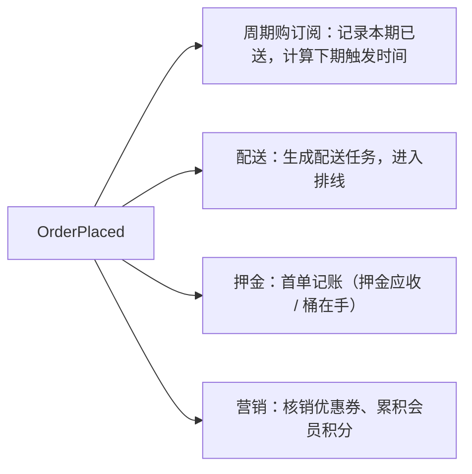

# 事件驱动架构
> [返回：软件架构学习大纲](../软件架构学习大纲.md)

> 本文是第二阶段主笔记 [01-第二阶段-经典架构模式.md](01-第二阶段-经典架构模式.md) 第 3 节的拆分扩写版，保留原节编号 3.1~3.5；配套可运行示例见 [04b-示例-event-driven/](04b-示例-event-driven/) 与 [04a-示例-es-cqrs/](04a-示例-es-cqrs/)。

## 3. 事件驱动架构

（场景切换：本节主线取 MES 与物联网平台，IM 辅助讲消息语义；桶装水主线在 3.1 末尾“订单事件驱动化”处收尾。）

### 3.1 发布订阅、消息队列

**概念**：组件之间通过**事件**（已发生的事实，用过去时态命名）间接通信：生产者只负责“宣布发生了什么”，不关心谁在听；消费者各自订阅、各自处理；消息队列（Broker）在中间承担路由、缓冲与持久化。

它买到三样东西：
- **解耦**：交易服务发布 `OrderPlaced`，库存/配送/押金/营销各订各的；新增一个“大数据分析”订阅者，交易服务零改动。
- **削峰**：物联网平台一台设备秒级多条上报、海量设备并发，同步逐条 INSERT 数据库必然无法承受——上报先进队列，消费者按自己的节奏批量聚合写入；存储抖动时接入层照收不误（背压与流控在[第三阶段](../章节3/01-第三阶段-分布式系统核心技术.md)展开）。
- **交付语义**：主流是 at-least-once（至少一次）→ **消费者必须幂等**。IM 把这一点演到极致：消息必达靠 ACK + 重发，不重靠消息 ID 幂等去重——“至少一次 + 去重”逼近“恰好一次”；同一会话内还要不乱序（按会话分区串行消费）。

常见中间件速览（选型深入在[第三阶段](../章节3/01-第三阶段-分布式系统核心技术.md)）：

| | Kafka | RabbitMQ | 云托管（RocketMQ/SNS 等） |
|---|---|---|---|
| 模型 | 分布式日志，可重放 | 传统队列 + 交换机路由 | 免运维 |
| 顺序 | 分区内有序 | 队列内有序 | 依产品而异 |
| 回溯消费 | 支持（offset） | 不便 | 依产品而异 |
| 适合 | 高吞吐事件流（设备采集、MES 报工流） | 任务队列、低延迟路由 | 不想自建集群 |

❌ **反例：把命令当事件 + 胖事件 + 消费者改写别人的库**

```kotlin
// "事件"里带着命令口吻，还把整个订单实体连同内部字段都塞进去
data class DoReserveAndArrangeEvent(
    val command: String = "reserve_and_arrange_delivery",  // 这是指令，不是事实
    val order: OrderEntity,                                // 共享实体：改一个字段，所有消费者跟着改
)

class DeliveryConsumer(private val jdbc: JdbcTemplate) {
    fun onEvent(e: DoReserveAndArrangeEvent) {
        jdbc.update("UPDATE orders SET status = 'ARRANGED' WHERE id = ?",  // 消费者改写订单库！
            e.order.id.toString())
    }
}
```

问题：契约耦合（共享实体定义）、破坏数据所有权（消费者写订单表）、命令式命名让新增订阅者误解语义。

✅ **修正：过去时态事件 + 最小契约 + 幂等消费**

```kotlin
sealed interface OrderEvent {
    val orderId: OrderId
    val occurredAt: Instant
    data class OrderPlaced(
        override val orderId: OrderId,
        val lines: List<OrderLineDto>,      // 只带消费者需要的最小字段
        override val occurredAt: Instant,
        val version: Int = 1,               // 契约版本，演进时向后兼容
    ) : OrderEvent
}

class DeliveryConsumer(private val delivery: DeliveryService) {
    fun onEvent(e: OrderEvent.OrderPlaced) {
        if (delivery.alreadyHasTask(e.orderId)) return      // 幂等：at-least-once 的必配
        delivery.createTask(e.orderId, e.lines)             // 生成配送任务，进入排线
    }
}
```

**主线收尾：桶装水订单事件驱动化。** 微服务化后，交易服务若还要同步调用四个下游（订阅、配送、押金、营销），任何一家抖动都会拖垮下单。最后一步改造：下单成功只发布 `OrderPlaced`，其余各自订阅——



前后对比——解决了：下单可用性与下游解耦（押金服务宕机照样下单，记账滞后补上）；新增消费者零改造。付出了：最终一致（下单后数秒配送任务才生成）；排查从“一条堆栈”变成“一条消息链”；要防重复与乱序（幂等 + 版本号）。至此桶装水的演进闭环完成：**分层单体（起步）→ 模块化单体（纪律）→ 微服务（伸缩与隔离）→ 事件驱动（解耦与弹性）**，每一步都是一次明确的权衡。

**权衡**：事件驱动换来弹性与解耦，付出的是最终一致（下单后数百毫秒到数秒后续动作才发生）、排查链路变长（需要消息级追踪）、重复与乱序防御（幂等 + 版本号）。

#### 3.1.1 消息中间件三大语义：at-most-once / at-least-once / exactly-once

上文“交付语义”一条只给了结论——“at-least-once → 消费者必须幂等”。这里把三种语义的实现代价与工程真相一次讲透，它是消费端一切防御设计的源头。

| 语义 | Broker 怎么做 | 你买到什么 | 你付出什么 |
|---|---|---|---|
| at-most-once（至多一次） | 发完即忘：不持久化、不等 ACK、失败不重投 | 最低延迟、实现最便宜 | **会丢消息**：Broker 崩溃、网络抖动，消息没了就是没了 |
| at-least-once（至少一次） | 持久化 + ACK 确认 + 超时重投 | 不丢 | **会重复**：消费成功但 ACK 未送达（消费方在 ACK 前崩溃、ACK 包丢在网络上），Broker 视为未消费成功，重投 |
| exactly-once（恰好一次） | 事务性生产 + 消费位移与处理结果原子绑定 | 理论上不丢不重 | 端到端极贵：生产者、Broker、消费者三方协作，任何一环失效就退化为 at-least-once |

两个最容易误读的点：

**重复不是 bug，是 at-least-once 语义的必然产物。** “至少一次”的字面意思就是“可能多于一次”——要保证不丢，Broker 就必须在拿不准的时候重投，而“拿不准”是常态（消费到底成没成功，Broker 只能靠 ACK 判断，ACK 本身也会丢）。谁向你承诺“绝不重复”，谁就在偷换语义；正确的承诺是“重复不可避免，但重复无害”。

**“Kafka 支持 exactly-once”只覆盖它自己家里。** Kafka 的事务与幂等生产者保证的是“从一个 topic 消费—加工—写另一个 topic”这条 **Kafka 内部**链路的原子性（典型流处理形态）。它管不住你的消费者“写 MySQL、调第三方 HTTP”这两步——出了 Kafka 的门，交付语义立刻跌回 at-least-once。RocketMQ、Pulsar 的事务消息同理，各管各家门内。

**工程正解：基础设施取 at-least-once，业务侧用幂等消费把它“逼成”效果上的恰好一次（effectively-once）。** 幂等的本质一句话：**副作用只与业务事实绑定，与投递次数无关**——同一笔支付事件投三次，积分只加一次。幂等消费的三种实现位阶，按优先级排：

1. **唯一业务键约束**：下单按 orderId 唯一索引，重复投递的插入直接撞约束失败——最便宜、最难失效，能用先用。
2. **消息表 / 去重表**：消费前先往 `processed_msgs(consumer, msg_id)`（或按业务键）登记，登记与业务写入在**同一个数据库事务**里提交；重投的消息查到已登记直接跳过。适合“一条消息触发多种副作用”的复杂消费逻辑。
3. **状态机守卫**：只有当前状态匹配才流转（`ARRANGED` 的订单不再生成第二个配送任务），重复请求落在状态不匹配上自然跳过——与 3.2 押金状态机同一手法。

❌ **反例：消息表形同虚设的两种写法。** ① 登记与业务写入不在同一事务：登记提交了、业务写入回滚了——重投被“已登记”挡掉，副作用实际丢了，at-least-once 被你自己降级成 at-most-once；反过来业务先提交、登记失败，重投照样重复办事。② 先办事后登记：两步之间进程崩溃，重投重复办事。一句话纪律：**登记与办事，同库、同事务、同生共死**；跨库做不了同一事务时，退回第 1 位阶靠业务唯一键兜底。

✅ **修正：消息表幂等消费最小示例**（完整可运行版 IdempotentConsumer.kt，已实际编译运行验证；此处摘消费者类，片段）：

```kotlin
// 消费者：消息表去重（生产中是 DB 表 processed_msgs，UNIQUE(consumer, msg_id) 兜底）
class IdempotentDeliveryConsumer(private val book: DeliveryTaskBook) {
    private val seen = HashSet<String>() // 消息表：已处理的 msgId
    var duplicateSkipped = 0

    fun onMessage(m: DeliveryMsg) {
        if (!seen.add(m.msgId)) { // add 返回 false = 已登记 → 重复投递，直接跳过
            duplicateSkipped++
            return
        }
        book.createTask(m.orderId) // 生产中：INSERT 消息表与生成任务必须在同一个 DB 事务里
    }
}
```

demo 用 5 个订单、9 次投递（混入 4 次重复，模拟消费超时未 ACK 与重连后 Broker 重发），对比开关幂等的结果，实际运行输出：

```
不做幂等：投递 9 次 -> 配送任务 9 个（同一订单任务超发）
消息表幂等：投递 9 次 -> 配送任务 5 个（5 个订单恰好 5 个任务）
重复投递跳过 4 次；去重键 = msgId（更稳的做法是按业务键 orderId 去重）
```

生产映射：内存里的 `seen` 换成数据库表，`HashSet.add` 换成“INSERT 撞唯一索引”或“先 SELECT 后 INSERT”，其余结构不变。还有一个选键细节：优先用**业务键**（orderId）而不是 Broker 的 msgId 去重——生产者重试时可能生成新的 msgId 却带着同一个 orderId，按 msgId 去重会被绕过；业务键才是“事实”的身份证。

幂等治重复，**乱序要另治**。重试与消费组再平衡都可能把后发的事件送到先发的事件更前面；治理手段与幂等同源——事件带版本号或业务序号，消费侧“只处理比已见序号更新的事件”，同一张消息表顺带记下已见的最大序号即可。桶装水 `OrderPlaced.version` 与 3.2 押金流的 version 都是这把锁。“重复 + 乱序”两道防御共用一张去重表，是消息表设计里最值钱的一步棋。

#### 3.1.2 推 vs 拉：背压从哪里来

消息从 Broker 到消费者有两条路，决定的是**背压（backpressure）信号往哪边传**——当下游处理能力跟不上上游生产速率时，“我处理不过来”这个事实如何被感知、传给谁。

**推（push）**：Broker 主动把消息塞给消费者（RabbitMQ 的默认形态）。延迟低，消息到达即刻出发；但 Broker 并不知道消费者此刻的死活与水位，推得太快消费者就被淹没——所以推模式必须配**配额机制**：RabbitMQ 的 prefetch（basic.qos）限制“未 ACK 的消息最多囤 N 条”，消费者处理完一条、ACK 一条，Broker 才再推一条。prefetch 就是推模式下的背压阀门：调太大等于没有阀门（消费者内存耗尽），调太小吞吐上不去（Broker 大部分时间在等 ACK）。

**拉（pull）**：消费者主动来取（Kafka 的 poll 形态）。背压天然存在——消费者拉不动就不拉，消息积压在 Broker 侧排队，永远不会压垮消费者；代价是轮询空转（long polling 缓解）与端到端延迟略高（要等下一次 poll）。拉模式还白送两样东西：**消费位移由消费者自己掌控**（重放、跳过、回溯都好办，为 3.2 的投影重建铺路）与**天然成批**（一次 poll 抱回一批，物联网/MES 批量入库的成本优势就在这）。

背压的三种应对策略，按优先级：**缓冲**（队列积压，给下游争取时间——所以积压监控是事件驱动体系的血压计）、**限速**（prefetch / 消费端限流，主动放慢入口）、**丢弃降级**（低价值消息丢了就丢了，保住主链路）。物联网平台是三者连动的完整样本：上报先进队列（缓冲）；存储抖动时消费者拉取变慢、队列积压上升，触发告警与消费端扩容（限速 + 伸缩）；监控类低价值上报在接入层直接采样丢弃（降级）——背压信号从数据库一路传回接入层，而不是让数据库硬扛洪峰。

积压还要会算账：上游 1 万条/秒、单个消费者 2 千条/秒，稳态积压每秒 8 千条——10 分钟就是 480 万条，Broker 磁盘要按“最长故障恢复时间 × 积压速率”预留；追平时间是另一个数字：每秒 8 千条的缺口靠加消费者填，单个消费者 2 千条/秒，加 4 个才追得平，而分区只有 8 个时消费者最多加到 8 个。**生产速率、单消费速率、分区数**这三个数字在容量评审时就要摆上桌，出了事再算就晚了。

选型判据一句话：**低延迟任务队列偏推（配好 prefetch），高吞吐流处理与需要重放的偏拉**；IM 的“在线推、离线拉”是混合形态——在线长连接推送保实时，离线靠拉取补齐，两种背压控制各守一段。

并行度与顺序的天平也在这条路上：**分区内有序、分区间并行**是拉模式的标准并行模型——同一分区同一时刻只被消费组里的一个消费者占住（分区是消费的最小分配单位），这既保住“同 key 事件按序消费”（同一订单的事件进同一分区），也决定了**并行度上限 = 分区数**：8 个分区最多 8 个消费者并行，第 9 个只能空转。分区数要在建 topic 时按目标吞吐规划好，事后扩分区会破坏按 key 的路由稳定性（同一个 key 可能换分区，顺序瞬间没了）。

#### 3.1.3 消息队列选型速查表

上文速览表只列三列，工程上常被摆上桌的四个候选一次对齐（机制深入在第三阶段）：

| | Kafka | RabbitMQ | RocketMQ | Pulsar |
|---|---|---|---|---|
| 定位 | 分布式日志 / 流平台：高吞吐、可回放、可流式计算 | 传统消息代理：交换机路由灵活、延迟低 | 电商交易场景出身：业务消息特性最全 | 存算分离的云原生架构：多租户、海量 topic |
| 顺序能力 | 分区内严格有序（按 key 路由到分区） | 队列内有序（且基本要单消费者） | 队列级有序（同 key 进同队列） | 分区内有序 |
| 事务消息 | 只覆盖 Kafka 内部流处理链路（见 3.1.1） | 无严格事务消息（publisher confirms 只是投递确认） | **原生事务消息**：半消息 + 回查，本地事务与发消息原子绑定（相当于官方版 Outbox） | 支持事务，多 topic 原子写 |
| 延迟消息 | 不原生支持（自行按时间分桶模拟） | 插件方式（TTL + 死信队列） | 原生支持（固定级别 / 高版本任意定时） | 支持（按 topic 配延迟投递） |
| 适用判据 | 高吞吐事件流、日志管道、需要回放与流式计算（设备采集、MES 报工流） | 任务队列、复杂路由拓扑、低延迟小消息（工单分派） | 交易链路：顺序 + 事务 + 延迟消息都要的（桶装水周期购续订触发） | 海量 topic、多租户大集群、存算分离运维诉求 |

选型先回答三个问题再谈产品：**吞吐量级多大？要不要回放历史？要不要事务 / 延迟 / 顺序消息？** 三问下来候选通常只剩一两个——桶装水的周期购“到期续订”需要延迟消息 + 顺序（同一订阅期次不乱），物联网采集需要回放 + 批量吞吐，两句话就分别指向了不同候选。没问就上“最流行的”，那是随大流，不是选型。教学示例不绑定具体产品：本文所有 demo 都是内存实现，要带走的是语义，不是某个产品的 API。

最后补一条真实系统的常态判据：**允许并存，但要有收敛的理由表**。中大型系统常见 Kafka（数据管道、回放）+ RocketMQ/RabbitMQ（业务消息、事务与延迟）并存——两者判据不同，各守其位不算架构腐败；但每多一种 Broker 就多一套集群运维、监控告警与人才储备，没有专职中间件运维的团队，宁可牺牲一两项特性也要收敛到一种。选型表的最后一列永远是“你养不养得起”。

#### 3.1.4 从同步调用到事件：桶装水“下单后发短信”的四步迁移

“主线收尾”一步跳到了终态（下单只发 `OrderPlaced`、下游各自订阅），但真实改造不能一步切——同步调用跑了两年，短信是资费敏感、用户可感知的旁路，切坏了就是事故。把“下单成功发确认短信”从同步 RPC 改成事件订阅，标准路径是四步，**每步一个开关、每步可回滚**：

**第一步：双写（影子运行）。** 保留同步发短信不动；同时交易服务开始发布 `OrderPlaced`（必须先上 Outbox / 本地消息表，保证“DB 写成功则事件必达”，见 3.5 缺点第 6 条），消费者收到事件后**只记日志、不发真短信**——影子消费。
最大风险有两个：一是**双份逻辑漂移**——同步路的短信模板改了、影子路没跟上，对拍失真却无人发现，所以影子期就要把两路输出落成可比对的记录，比对脚本与功能同步上线；二是**没上 Outbox 就开始影子**——DB 写成功、MQ 发失败的裂缝会让影子样本系统性缺失，对拍结论不可信，等于给后面的灰度决策喂了假数据。
回滚点：关掉事件发布开关，回到纯同步，零影响——影子路本来就不产生副作用。

**第二步：灰度（按流量对拍）。** 消费者开始真正发短信，但按订单号取模灰度（5% → 30% → 100% 分批放量）；**灰度命中的订单，同步路跳过**——同一订单永远只有一路发短信，这是灰度期防重复短信的关键设计，比“两路都发再事后去重”便宜且用户无感；两路的成功率、P99 延迟、内容一致性持续对拍出报表。
最大风险：**消费积压**——事件路短信延迟从 200ms 涨到 30s（下单后短信迟迟不到），这不是功能 bug 而是容量问题，必须把“短信延迟 P99”定为灰度准出指标，不达标不放大比例；其次是灰度路由 bug（订单号取模算错导致两路都发或都不发），靠按订单号抽样回查两路日志兜住。
回滚点：灰度比例回拨到 0，同步路恢复全量，秒级生效。

**第三步：切换（同步路降级为保险丝）。** 100% 订单走事件路；同步调用**代码保留但不执行**（feature flag 守着），再观察一个完整业务周期——必须覆盖周期购批量扣单、促销洪峰这类积压高发场景。
最大风险：切换后才暴露的消费者边界 bug（此前灰度没覆盖到的：跨天订单、取消后重下、订阅单与普通单并存）；以及团队手痒提前删代码——**同步代码此刻就是你的回滚方案本身**，删了它，第三步出事就只剩“紧急热修消费者”一条路。
回滚点：开关切回同步路，保留的同步代码直接顶上，分钟级恢复。

**第四步：下线（收尾）。** 删除同步代码，事件路成为唯一实现；积压告警、死信告警、延迟 SLI 补齐到位。风险：不可回滚——所以前提是第三步观察期足够长（至少一个完整月度周期）；从此 `OrderPlaced` 的契约变更会波及短信消费者，2.6 的兼容纪律正式生效（加字段必须向后兼容，删字段要先确认所有消费者都不再依赖）。

| 步骤 | 做什么 | 最大风险 | 回滚点 |
|---|---|---|---|
| 1 双写 | 同步照旧 + 事件影子消费 | 双份逻辑漂移；缺 Outbox 则样本失真 | 关发布开关，零影响 |
| 2 灰度 | 事件路真实发送，按订单号分流，两路对拍 | 消费积压拉长短信延迟 | 灰度回拨 0%，秒级 |
| 3 切换 | 100% 走事件，同步代码保留待命 | 切换后才暴露的边界 bug | 开关切回同步路，分钟级 |
| 4 下线 | 删同步代码，补齐监控告警 | 不可回滚 | 无——用第 3 步足够长的观察期换安全 |

迁移开始前还有一份前置清单，缺一项就别开第 1 步：Outbox 落库与投递补偿任务上线（没有它，影子样本系统性缺失，后面全部对拍都是假证据）；两路各自的埋点与对拍报表就绪（成功率、P99 延迟、内容哈希三个指标）；开关必须是运维平台可即时操作的配置项而非改代码发版——“每步可回滚”整个压在开关的即时性上。

这套四步不是事件驱动专属——它和 2.5 绞杀者模式的“影子对拍 / 按站灰度 / 自动回滚”是同一套迁移纪律：**先建并行证据链，再放流量，最后才拆老路**。桶装水的四个下游（订阅 / 配送 / 押金 / 营销）各自独立走完这四步，“主线收尾”的终态才算真正落地；3.4 的扇出记账（支付场景）也是同一剧本。

### 3.2 事件溯源（Event Sourcing）与 CQRS

**场景切换：MES 批次追溯——事件溯源思想的最佳载体。** 制造现场要回答“这批产品用了哪几批料、经过哪些工序、谁在什么时间报的工”：投料、报工、质检本身就是一串不可变事实，批次谱系是一条天然的事件链。如果只存“当前状态表”（当前工序、当前用料），历史投料关系会被后续工序覆盖丢失，追溯无从谈起。

**事件溯源**：不存“当前状态”，只存**追加式（append-only）的事件序列**；状态 = 事件回放。批次的表从 `batch(step, material)` 变成 `batch_events(batch_id, seq, type, payload, at)`。

```kotlin
sealed interface BatchEvent {
    data class MaterialIssued(val batchId: BatchId, val stepId: StepId,
        val materialBatchId: BatchId, val qty: Int, val at: Instant) : BatchEvent
    data class OperationCompleted(val batchId: BatchId, val stepId: StepId,
        val outputQty: Int, val operator: String, val at: Instant) : BatchEvent
    data class QualityInspected(val batchId: BatchId, val passed: Boolean, val at: Instant) : BatchEvent
}

// 状态由事件折叠（fold）而来，"当前状态"只是缓存；追溯 = 沿事件链回放
fun rebuild(events: List<BatchEvent>): Batch = events.fold(Batch.initial()) { b, e -> b.apply(e) }

class Batch private constructor(
    val id: BatchId,
    val passedSteps: List<StepId>,        // 经过哪些工序
    val upstreamBatches: Set<BatchId>,    // 用了哪几批料——谱系由事件自然累积
) {
    fun apply(e: BatchEvent): Batch = when (e) {
        is BatchEvent.MaterialIssued    -> copy(upstreamBatches = upstreamBatches + e.materialBatchId)
        is BatchEvent.OperationCompleted -> copy(passedSteps = passedSteps + e.stepId)
        is BatchEvent.QualityInspected  -> this
    }
}
```

价值：完整审计与时间旅行（“这批为什么被判不合格？”回放即知）、天然产出事件流喂给分析与 CQRS。代价：查询难（“查所有待检批次”要全量回放）→ 必须配 CQRS；事件 schema 要版本化演进；学习与运维成本高。**适合资金、审计、批次追溯、复杂状态机领域（押金生命周期状态机同理）；不适合简单 CRUD。**

**CQRS**（命令查询职责分离）：MES 里两种读的负载完全不同——实时生产看板（高频写 + 聚合读）与月底报表（全量分析）不该压在同一个模型上。写模型（Batch 聚合 + 事件）与读模型（看板投影表、报表库）彻底分开，中间靠事件异步同步。

```kotlin
// 写侧：只接受命令、产出事件
class ReportWorkHandler(private val store: EventStore) {
    fun handle(cmd: ReportWorkCommand) {
        val batch = rebuild(store.eventsOf(cmd.batchId))
        store.append(cmd.batchId, batch.complete(cmd.stepId, cmd.outputQty, cmd.operator))
    }
}

// 读侧：投影器消费事件，维护一张查询友好的宽表
class DashboardProjection(private val dao: DashboardDao) {
    fun on(e: BatchEvent) = when (e) {
        is BatchEvent.OperationCompleted -> dao.addStepOutput(e.stepId, e.outputQty)
        else -> Unit
    }
}
// 看板查询变成一条 SQL：SELECT step_id, SUM(output_qty) FROM dashboard GROUP BY step_id
```

注意：CQRS 可独立于事件溯源使用（读写分模型、分库即可），两者常一起出现但**并不绑定**。读模型必然滞后（最终一致）——报工后看板晚几百毫秒无伤大雅；但“质检不通过就拦下流转”这类决策不能读投影，必须走写侧或同步校验。同一系统里，**容忍滞后的读交给投影，不容忍的读回到写侧**。

**把写侧做对：追加原子性与乐观并发控制。** 上文 `store.append` 看似只是“往列表加一条”，并发下却是正确性的命门。就用桶装水的**押金账户**（开头说过“押金生命周期状态机同理”，这里把它做出来）演示：一个用户一条事件流，不变式是**累计退桶数 ≤ 累计交桶数**。反例：两个“退 1 桶”请求同时到达，都读到“可用 1 桶”、都通过校验、都追加成功——用户退了没交过的桶，押金池透支。事件溯源里这类超卖/超退问题落在**追加**这一步，解法是把数据库乐观锁搬进事件库：**append 带上 expectedVersion（决策时看到的流长度），库端原子校验，不符即拒**；命令方收到冲突不是报错，而是“重读最新状态、重新校验、再追加”的信号。

✅ **修正：追加带版本校验 + 命令侧冲突重试**（完整可运行版：[04a-示例-es-cqrs/DepositWriteSide.kt](04a-示例-es-cqrs/DepositWriteSide.kt)，本例已实际编译运行验证）

```kotlin
fun append(userId: String, expectedVersion: Int, newEvents: List<DepositEvent>) {
    val s = streams.getOrPut(userId) { Stream() }
    if (s.events.size != expectedVersion) throw ConcurrencyException(expectedVersion, s.events.size)
    s.events += newEvents   // 校验与写入必须原子——生产中靠 UNIQUE(stream_id, version) 约束兜底
    ...
}

// 命令侧：冲突不是错误，是"重来"的信号
while (true) {
    val acc = store.load(userId)
    val ev = acc.refund(buckets, at)                  // 决策时点：聚合里校验不变式
    try { store.append(userId, acc.version, listOf(ev)); break }
    catch (e: ConcurrencyException) { /* 提交时点被拒 → 重读重判 */ }
}
```

demo 运行结果节选：交 2 桶退 1 桶后，两个并发“再退 1 桶”——A 提交成功；B 因版本不符被拒（`命令基于版本 2 决策，流已是版本 3`）；B 重读后发现可用已为 0，不变式把超退真正拦下。**校验写在聚合里（决策时点），原子性守在追加处（提交时点），两层合起来才封得住并发口子。**

**快照：事件流变长的止痛药。** 用户用三年，押金流几百条事件，每次 load 全量回放明显变慢。解法：每 N 条事件落一次**快照**（状态定格），load = 快照 + 增量事件。两条纪律：**快照是缓存不是事实**——丢了就从事件流重建，删了系统照样正确、只是变慢；**先追加后拍照**——同一聚合的追加与快照更新次序不能反。demo 里 `snapshotEvery = 4`（教学取小值，生产通常 100+ 条一拍），运行打印“事件流 6 条，快照版本 4——load 只回放其后 2 条增量”。

**事件 schema 演进：事件不可变，但业务会变。** 2024 年押金全站统一 50 元/桶，事件只记桶数；2025 年按桶型定价，单价必须进事件。❌ 反例：回头修改 v1 事件的字段含义、或给历史 payload 直接塞新字段——已存数据读出来对不上，旧账静默算错，审计直接失真（“时间旅行”旅行到假历史）。✅ 修正：**历史事件一条不改**，演进靠三招：① 新事件类型替代旧类型（写侧切换，老事件照存）；② **读时升级（upcasting）**——回放读出 v1，按“当时的业务事实”补齐新字段再进 fold；③ 事件带 schema 版本号，升级规则写成代码并配测试。押金定价演进的完整例：

```kotlin
// 读时升级（完整可运行版：[04a-示例-es-cqrs/DepositSchemaUpcast.kt](04a-示例-es-cqrs/DepositSchemaUpcast.kt)，本例已实际编译运行验证）
fun upcast(e: Any): DepositEvent = when (e) {
    is DepositPaidV1     -> DepositEvent.Paid(e.userId, e.bucketCount, unitCents = 5_000L)  // 2024 统一价 50 元/桶
    is DepositPaidV2     -> DepositEvent.Paid(e.userId, e.bucketCount, e.unitCents)
    is DepositRefundedV1 -> DepositEvent.Refunded(e.userId, e.bucketCount, e.refundCents)
    else -> throw IllegalArgumentException("未知事件形态：$e")
}
// 新旧事件同一条 fold 链回放：李四 2024 年交的桶按 50 元、2025 年按 80 元，余额分毫不差
```

**投影工程化：检查点、幂等与重建。** 上文的投影器是“收到事件就更新”的玩具版，工程化补三件事：① **检查点**——投影记录已消费到的全局序号，重启从检查点续跑而不是从头；② **幂等**——经消息队列至少一次送达（见 3.1），同一事件可能被消费多次，按全局序号/事件 ID 去重；③ **重建**——投影表被误删、口径要改、或想新增一个投影（报表库、搜索索引）？清空、检查点归零、从事件流全量重放即可。demo 的 `RefundStatsProjection` 演示了追赶 → 模拟误删 → 重建，前后统计一致。一句话：**读模型是可丢弃缓存，事件流才是唯一事实**——“状态 = 事件回放”在读侧的镜像。

**CQRS 渐进谱系：别一步到位。** CQRS 不是开关，是刻度盘。多数系统走到 L1/L2 就该停，L3 只属于写不变式复杂或确有审计追溯诉求的子域：

| 级别 | 形态 | 付出 | 适用信号 |
|---|---|---|---|
| L0 | 同一模型读写（默认） | 无 | 绝大多数 CRUD |
| L1 | 读写分模型、同库 | 两套映射代码 | 读写形状差异大（列表页 vs 表单） |
| L2 | 读写分库 | 最终一致 + 同步设施 | 读多写少、读写争抢（桶装水商品读洪峰，见 2.3） |
| L3 | 事件驱动投影（常配事件溯源） | 全套复杂度：投影运维、滞后处理 | 复杂写不变式 + 多种读形状（MES 看板/报表）、审计追溯刚需 |

配套一道必答题：**读自己写**。用户退桶后立刻刷“我的押金”页，投影还没同步——账面没变，用户以为失败再点一次。处置还是那条纪律的两端：写后立读的关键页面回写侧查（或等投影追上再返回），容忍滞后的读才交给投影。

❌ **反例：小团队一步登天。** 5 人团队、日订单几千的桶装水商城，一步到位引入 Axon + 事件溯源 + CQRS 整套组合：本该一个方法解决的“改地址”变成命令、聚合、事件、upcaster、投影五件套——复杂度陡增（见阶段总结权衡表）而收益为零。
✅ **修正：从 L0/L1 起步，痛点真实出现再逐级升级；只有 MES 批次追溯、押金/资金这类子域才值得 L3。**

**选型与边界：事件存哪里、什么时候别用。** 事件存储三个候选：① **关系库单表**（`stream_id, version, type, payload, at`，`UNIQUE(stream_id, version)` 兜并发）——大多数场景的最优解，别嫌土；② 专用事件库（EventStoreDB、Axon Server）——按流读、订阅、投影开箱即用，代价是多一套基础设施；③ **Kafka 当事件存储？** 它确实 append-only，但按聚合随机读不友好（按分区扫，无法按 stream_id 点查）、也没有 per-stream 唯一约束兜并发追加。正确分工：**事件库存事实，Kafka 做投影分发管道**（事件库 → Kafka → 各投影消费）。最后一条边界辨析：**事件溯源 ≠ 审计日志 / binlog**——审计日志记录“存储层的行被改成了什么”（`UPDATE deposit SET balance = ...`），事件溯源记录“业务上发生了什么”（`DepositRefunded：退 1 桶`）；前者是技术产物，后者是领域语言（呼应本阶段自测第 4 题）。什么时候都别用：简单 CRUD、团队没踩过坑又没人力补课、读多写少无审计诉求——命中任意一条，上事件溯源就是自购复杂度。

#### 3.2.1 投影 N 个 vs 存储一份：把成本账算清

事件溯源只存一份事件流，查询需求却有 N 个——“每个查询建一个投影”听起来存储要翻 N 倍。这笔账要拆开算：

**真正翻倍的往往不是存储，是运维面。** 事件流是增量事实：一天 10 万条订单事件、每条 1KB，约 100MB/天；投影是全量状态：活跃订单 500 万行加索引。把“事件流 + N 个投影”算成 N+1 份存储是对成本的误读——传统方案里那张状态表和它的二级索引本来就在。真正线性上升的是：N 条投影同步链路、N 个检查点、N 份滞后监控与重建脚本。**每加一个投影，加的是一条要养一辈子的数据管道，不是一块磁盘。**

账的另一头是查询灵活性：投影想怎么建就怎么建——看板要宽表、报表库要星型模型、搜索要倒排索引，各自独立重建、独立伸缩；传统单库里这些诉求挤压在同一张表和它的索引上互相争抢（2.3 读写分离要解决的一半问题）。这就是权衡的两边：**投影换来查询自由与读写隔离，付出的是 N 条管道的运维成本与最终一致。**

那第 N 个投影什么时候值得建？三条判据，命中才建：

1. **查询形状根本不同**：点查（客服按订单号查）与全量聚合（看板 GROUP BY）与模糊检索（商品搜索）——同一份状态表伺候不了这些形状，才需要独立投影甚至独立引擎；
2. **负载量级或可用性诉求不同**：高频聚合读不能压业务库，或该投影要独立伸缩、独立故障域；
3. **投影可丢弃重建**：它本质是缓存，事件流重放即可复原——“可重建”是投影的安全垫，也是敢删敢改的底气。

❌ 反过来：“按状态查待配送订单”与“按配送员查今日任务”若只是同一张任务表的两个 WHERE 条件，就别拆成两个投影——一张表加两个索引解决。**投影的最小粒度是“独立的存储引擎或独立的负载”，不是“每种查询一张表”。** 桶装水的合理配置：订单事件流 1 份，值得建的投影 2 个（客服查询表：点查形态；营销报表库：月度复购聚合）；配送任务不单开投影——它本来就是写侧的业务表。

投影运维面里最容易被低估的一项是**滞后监控**：投影落后事件流的差值（全局序号与检查点之差）要作为核心指标——差值超过阈值说明投影陈旧，读侧所有“以投影为准”的页面都要有兜底口径（回写侧查，或界面标注“数据延迟中”）。没有滞后监控的投影等于把最终一致黑箱化——数据陈旧到什么程度没人知道，第一个发现的永远是用户。

#### 3.2.2 事件溯源适用判据表

本小节反复出现的“适合 / 不适合”，收拢成一张可勾选的判据表——**正向信号命中越多越值得，负向信号命中任意一条就该缓**：

| 信号 | 方向 | 说明 |
|---|---|---|
| 审计合规强：每笔变动要能回答“谁、何时、基于什么事实” | ✅ 适合 | 押金账户、支付清结算流水；审计报告直接从事件流生成，不用另抄一份 |
| 需要时点回放：“上周三那批货用的哪批料”“当时账面是多少” | ✅ 适合 | MES 批次追溯；状态表只答“现在”，永远答不了“当时” |
| 领域状态机复杂且规则持续演进 | ✅ 适合 | 押金生命周期、工单流转——历史轨迹本身有业务价值 |
| 误操作要可恢复（回放修正） | ✅ 适合 | 错账冲正：重放到正确时点、修正其后事件再重放 |
| CRUD 为主：改地址、删收货人、改昵称 | ❌ 不适合 | 没有“事实史”价值，状态表更便宜 |
| 查询形状复杂多变、实时性要求高 | ❌ 不适合 | 全靠投影养查询，复杂度放大器（见 3.2.1 的运维面账） |
| 大流量高频写且事件粒度细 | ❌ 不适合 | 事件流与投影同步压力被同比例放大——先削峰再谈溯源 |
| 团队没踩过坑又没人力补课 | ❌ 不适合 | 学习成本会在生产事故中支付（上文“小团队一步登天”反例） |

一句话总判据：**你要回答的问题是“当时发生了什么”，还是“现在是什么”？** 前者事件溯源有正收益；后者普通状态表加审计日志更便宜。落到桶装水：押金账户、支付流水走事件溯源，商品资料、收货地址留在普通表——**同一系统按子域混用才是常态**，“全面事件溯源”和“全面不用”都是懒政。

#### 3.2.3 快照策略：N 怎么定

原文给了两条纪律（“快照是缓存不是事实”“先追加后拍照”），没给参数——每 N 条事件拍一次，N 到底怎么定？N 的两侧各有一个陷阱：

- **N 太小**：写放大。每次拍快照 = 全量状态序列化落库，N 小意味着频繁全量写，快照表膨胀、追加路径变慢——对押金账户这种小聚合无所谓，对 MES 报工流这种高频流是灾难。
- **N 太大**：读放大。load = 快照 + 增量回放，N 大意味着一次 load 可能要回放几百条事件，“查一下押金余额”变成重演用户三年历史。

工程经验起点：**100~1000 条事件一拍**；更合理的做法是**放弃固定 N，按回放代价触发**——load 时统计实际回放的事件条数，超过阈值（比如 200 条，或回放耗时 P99 超过 50ms）就异步补拍快照：把“当前版本的状态”整体序列化，与事件流 version 对齐存档，下次 load 从新快照起步。好处是快照频率跟随真实读负载：热账户自动多拍、冷账户不浪费，不必凭主观判断定常数。

三条配套纪律（原文两条之外的补全）：

1. **快照写入失败要告警但不拦截业务**——快照是缓存，这次拍失败，下次 load 多回放一段就是了；绝不能让“拍快照失败”卡住用户的退桶请求。
2. **快照必须带事件流 version**——快照状态只对“该 version 之后的增量事件”负责，版本对不上的快照宁可弃用重建。
3. **schema 演进后旧快照要失效重建**——快照存的是 fold 之后的状态，事件结构升级（upcasting 规则变更）后，旧快照可能与新语义不一致；最省事的处置是 schema 变更后清空快照表、从事件流全量重建一遍——又一次印证“事件流是唯一事实”。

按规模对照：桶装水押金流（一年几十条事件）甚至可以不拍快照；MES 报工流（一条流一天几千条事件）不仅阈值要调大，还必须异步拍——绝不能让拍快照的动作卡在追加路径上。

### 3.3 事件的形态谱系：通知、携带状态转移与溯源

3.1 的反例治“胖事件”，但反向走极端——事件瘦到只剩一个 ID——同样有坑。把事件的“携带量”排成谱系，正好是 Martin Fowler 的三档分法：

| 形态 | 事件里带什么 | 消费者怎么拿数据 | 代价 |
|---|---|---|---|
| 事件通知（Event Notification） | 只带标识（`ticketId`） | 回查上游查询接口 | 回查风暴、读耦合、时点漂移 |
| 事件携带状态转移（ECST，Event-Carried State Transfer） | 各消费者决策所需的最小事实快照 | 直接用事件载荷，可物化本地副本 | 字段冗余，“最小”边界要守 |
| 事件溯源（Event Sourcing） | 事件即事实，状态 = 回放 | 重建 / 投影（见 3.2） | 全套复杂度（见 3.2 选型边界） |

❌ **反例：瘦事件的回查风暴。** 工单中心发布 `TicketResolved`（只带 ticketId），通知、看板、SLA 三个消费者各自回查工单查询接口：一次解决 = 3 次回查，订阅者翻倍回查翻倍；更要命的是**查询接口一宕机，全体消费者瘫痪**——事件买到的时间解耦，被一次回查连本带利卖了回去（读依赖原地复活）。还有一个隐蔽坑：**时点漂移**——回查拿到的是“消费时点的当前状态”，不是“事发时点的事实”。工单解决后被运营改判分类，回查式看板把同一次解决先后计入两个分类，统计口径悄悄失真。

✅ **修正：ECST——事件携带事发时点的事实快照。** `TicketResolved` 带上 reporterId、解决时点的分类、解决时长：三个消费者零回查；看板还能把事件**物化成本地副本**（自己维护一张按分类计数的表），从此连读都不依赖工单服务——解耦从“时间、空间”扩展到“读”。demo 运行对照（完整可运行版：[04b-示例-event-driven/EventStyles.kt](04b-示例-event-driven/EventStyles.kt)，本例已实际编译运行验证）：风格 A 一次事件回查 3 次、工单改判后看板统计漂移（同一次解决先后计入“机械故障”“电气故障”）；风格 C 回查 0 次，本地副本 `{机械故障=1}` 不受改判污染。

**边界：ECST ≠ 胖事件。** 谱系两端是同一个坑的两副面孔——瘦事件把耦合藏在回查里，胖事件把耦合写进契约里（3.1 反例：整实体入事件，加一个字段全体消费者跟着改）。判据一句话：**字段进不进事件，看“有没有消费者要拿它做决定”，不看“实体里有没有”**；诊断日志、解决说明这类无人决策的字段一概不带。反向确认：如果消费者需要的本来就是**最新状态**（处理动作前先看工单此刻到哪一步），那是命令式的同步查询，本来就该走查询 API，而不是塞进事件。

**取舍**：通知买最小契约、留读耦合；ECST 用冗余买断读依赖；溯源把状态本身交给事件（复杂度见 3.2）。谱系逐级加码，按消费者数量与读隔离的真实需求停档——单一内部消费者，通知 + 回查完全够用。

### 3.4 补充场景：事件驱动还落在哪

前两节的主线（MES / 物联网 / 桶装水）之外，把大纲里的经典场景在事件驱动视角下过一遍——重点是识别共性信号，深入内容在各场景的主章节：

| 模式 | 场景（深入章节） | 事件驱动解决什么 | 付出的代价 / 注意点 |
|---|---|---|---|
| 削峰填谷 | 秒杀抢购（第三阶段缓存与限流） | 瞬时洪峰先入队，消费者按数据库能力匀速扣减建单 | 交互模式改变：用户看“排队中”而非即时结果；要积压监控与超时降级 |
| 扇出记账 | 支付与清结算（第三阶段分布式事务） | 支付成功事件扇出发货 / 记账 / 积分 / 分账，互不阻塞 | 双写裂缝要 Outbox 兜；日终对账不可省 |
| 延迟触发 | 桶装水周期购续订、工单 SLA 超时升级（第三阶段选型题） | “到期才发生”的事（下期订单、超时升级）交给延迟消息 | 与“任务表定时扫描”二选一；消费端按业务键幂等防重复触发 |
| 状态广播 | 工单流转、IM 在线状态 | 状态一次变更多方感知：IM 通知、看板、SLA 计时器各自订阅 | 即 3.3 的形态选择题：通知还是携带状态 |
| 计量事件流 | 多租户 SaaS 用量与配额（第三阶段限流） | API 调用 / 存储用量先记事件，异步聚合成计量，再出账计费 | 计费最终一致；配额硬拦截需同步判定，不能等异步聚合 |
| 采集管道 | 物联网上报、MES 报工流（3.1 已讲） | 上报先进队列，消费者按下游节奏批量写入 | 背压与流控（第三阶段） |

看点不是背表，是提炼**共性信号**——每行至少命中一条：**一个事实发生后有多方关注**（扇出）；**洪峰与处理速度不匹配**（削峰）；**动作要在未来某时点发生**（延迟）。命中任一信号，事件驱动进入候选；三条都不沾，老老实实请求-响应。再加第四条隐性信号：**上游不该知道下游的存在**（3.1 大数据订阅者零改造）——组织上要独立演进的边界之间，事件是默认语言。

#### 3.4.1 扇出记账完整示例：一笔支付事件，三个幂等消费者

上表“扇出记账”一行值得展开成可运行的完整形状——它是支付与清结算场景的骨架，也是 3.1.1 幂等三件套在真实拓扑里的落位：**一笔支付成功事件扇出到积分、通知、对账三个消费者，每个消费者独立去重，重复投递不重复记账。**

完整可运行版 FanoutAccounting.kt（已实际编译运行验证），三个消费者骨架同构，摘积分消费者（片段）：

```kotlin
class PointsConsumer(val ledger: PointsLedger, private val idempotent: Boolean) {
    private val seen = HashSet<String>() // 去重键：paymentId（生产中 = 消费者私有消息表）
    var deliveries = 0
        private set
    fun on(e: PaymentSucceeded) {
        deliveries++
        if (idempotent && !seen.add(e.paymentId)) return
        ledger.earn(e.userId, e.amountCents / 100) // 1 元 = 1 积分
    }
}
```

demo 让同一批支付事件对每个消费者重复投递 3 次（模拟消费超时重试与重平衡后重新消费），对比开关幂等，实际运行输出：

```
== 开启幂等 ==
投递次数：积分 6 / 通知 6 / 对账 6
积分余额 u-100 = 50（20 + 30，各只记一次）
短信 2 条；对账流水 2 条
== 关闭幂等 ==
积分余额 u-100 = 150 —— 6 次投递全部记账，积分发成 3 倍
短信 6 条、对账流水 6 条 —— 重复短信 + 重复资金流水
```

三个消费者正好落了三种去重位阶（对应 3.1.1 的排法）：**积分**按 paymentId 建消息表去重——一笔支付只发一次积分；**通知**在消息表之外再按“支付单号 + 短信模板”二重去重——防同一订单的不同事件重复触达用户；**对账**流水表直接给 paymentId 上唯一索引——重复投递撞数据库约束，是资金数据最硬的一道闸。读这个例子要带走的不是代码，是拓扑直觉：**扇出结构的幂等是“每消费者自治”的，不存在中央去重器**——三个消费者各自维护各自的消息表，谁也不能替谁担保；这也意味着新增第四个消费者（比如分账）时，幂等防御要从零再建一遍，别复用别人的去重表。

顺着这张图补最后一块工程拼图：**失败隔离**。三个消费者的失败语义不同——积分与对账失败必须无限重试直到成功（丢了就是资损），通知失败（空号、通道降级）重试有限次后进死信即可（短信晚到不致命）；三个消费组各自独立重试、互不牵连，通知通道瘫了不影响积分到账。把“哪些副作用不可丢、哪些不可迟”想清楚，重试策略与死信策略就都有了依据——这也是“每消费者自治”的另一半：自治的不只是去重，还有失败处置。

### 3.5 优缺点与取舍：什么时候选事件驱动

**买到什么（优点）**：
- **解耦三件套**：时间解耦（下游宕机上游照发）、空间解耦（生产者不认识消费者）、读解耦（ECST 物化副本，3.3）。
- **弹性与故障隔离**：单个消费者故障不拖垮发布方与其他消费者，重试各自进行。
- **削峰填谷**：把瞬时洪峰摊平成下游可承受的匀速流量（3.1 物联网、3.4 秒杀）。
- **独立伸缩**：消费者各自按积压伸缩，互不绑架。
- **可演进**：新增行为 = 新增订阅者，老链路零改动。
- **审计与重放**：配合事件溯源得到时间旅行能力（3.2）。

**付出什么（缺点）**：
1. **最终一致成为默认**：用户可见滞后（下单后数秒配送任务才生成），关键页面要专门处理“读自己写”（3.2）。
2. **流程不可见**：一次业务动作散成一串异步消息，没有一处能看全链路——责任在谁、卡在哪，要靠消息级追踪与相关性 ID 才能回答（第五阶段可观测性）。
3. **重复与乱序防御**：at-least-once 下，幂等是每个消费者的入场费（3.1）。
4. **契约演进更难**：一个事件 N 个消费者，改字段 = 动 N 份契约——2.6 的兼容纪律在这里加倍适用。
5. **运维面变宽**：Broker 集群、积压监控、死信处理、消息留存，都是新增设施（第三阶段）。
6. **一致性裂缝**：DB 写成功而消息发丢的窗口，要靠 Outbox / 本地消息表补（第三阶段分布式事务）。

**两种拓扑：中介者（Mediator）与代理者（Broker）。** 事件流需要按流程推进（先扣款、再发货、再分账，某步失败要补偿）时有两种放法：**中介者拓扑**——中央编排器按流程依次触发并监听各步骤事件，流程集中可见、可控，代价是中心组件成为耦合点与单点；**代理者拓扑**——没有编排器，事件直接扇出、各消费者自行链式触发，极致松耦合、伸缩性好，代价是流程“只存在于各消费者的脑中”，出问题没人看得全。这与第三阶段 Saga 的编排 / 协同之辨同构（选型在那边展开）；经验法则：**流程要求可观测、可干预（支付清结算）偏中介者；纯事实广播（`OrderPlaced` 扇出）偏代理者。** 注意别与 4.5 的代理者模式混淆：那边讲的是“进程内对象间的消息中介”，这边讲的是“事件流要不要一个流程中枢”。

**同步还是事件？一道判定题。** 需要即时答复（下单当场返回订单号）或强一致决策（库存不足当场拒单）→ 同步调用；事实已定、多方关注、容忍秒级滞后 → 事件。真实系统常是两段拼装：**同步段守住“成不成”，事件段广播“成了之后”**——3.1 桶装水最后一步正是这个形态（下单事务同步完成，其余各自订阅 `OrderPlaced`）。

❌ **反例：万物皆事件。** 团队尝到甜头后走向极端：查询也改成“发查询请求事件、订阅查询结果事件”；单体内部两个模块的一次函数调用也要过 MQ；改个地址（本该一个方法）拆成命令、事件、投影三件套。延迟、幂等、排查三税全交，解耦收益为零——耦合本来就不存在，谈何消除。

✅ **修正：事件用在“事实发生后”的扇出点上；需要“回答”的地方保持请求-响应。** 起步做法：核心链路同步 + 旁路事件化，随真实痛点（下游拖垮上游？新增关注方频繁改上游？洪峰压垮数据库？）逐段异步化——事件驱动是止痛药，先确诊再吃。

一句话接住 3.1 末尾的权衡：事件驱动用**最终一致、可观测性、契约纪律**换**解耦、弹性、削峰**——换不换取决于这三样付不付得起，而不是它流不流行。

#### 3.5.1 事件驱动成熟度阶梯：L0~L4

“要不要上事件驱动”问得太粗——实践中真正要回答的是“**走到哪一级**”。把本节所有概念排成阶梯，每一级都有明确的晋级判据与专属风险：

| 级别 | 形态 | 晋级判据（痛点了才升） | 专属风险 |
|---|---|---|---|
| L0 内部观察者 | 进程内事件（观察者模式 / EventBus），单体模块间解耦 | 单体内有“一个动作多方反应”的诉求，但都在一个进程里 | 同步执行、无持久化：发布者与订阅者同生共死——它只是解耦，不是异步 |
| L1 进程间异步通知 | 引入 Broker 与少量 topic，旁路功能事件化（发短信、记审计） | 出现“旁路拖垮主链路”的真实事故（3.1.4 四步迁移的起点） | 双写裂缝无人治理：DB 写成功、消息发丢，副作用静默缺失 |
| L2 交付纪律完备 | 幂等消费、死信队列、积压监控、重放演练成为标配 | 事件链路开始承载“不做会丢钱”的副作用（扣库存、记账、押金） | 以为上了 MQ 就等于 L2——多数“MQ 事故”是 L1 的形态承载了 L2 的责任 |
| L3 事件即契约 | 跨团队事件目录、schema 版本化管理、消费者驱动契约评审 | 事件的生产方与消费方分属不同团队、发布节奏不同步（呼应 2.6） | 事件大杂烩：一个 topic 塞几十种事件无人治理，消费者不敢动、生产者改不动 |
| L4 全域事件骨干 | 事件溯源 + CQRS 常态化，核心状态以事件流为唯一事实，全域可回放 | 审计与追溯是产品能力本身（MES 批次谱系、支付清结算） | 3.2 全套复杂度常态化：投影运维、schema 演进、快照治理要专人长期投入 |

两条使用规则：**判据是“痛”，不是“流行”**——没有 L1 级别的真实事故，就不该为 L2 的设施买单；**跳级的代价会在下一级爆发**——从 L1 直接上 L4（“小团队一步登天”反例），L2 缺位的幂等会在 L4 的投影里变成脏读与重复统计。多数业务系统（含桶装水商城的合理终态）停在 L2~L3 就是最优点；L4 只属于少数“追溯即业务”的领域。对照 3.2 的 CQRS 谱系（L0~L3）：两把刻度尺量的是同一件事的两面——事件侧的成熟度，与读写模型的分离度，逐级对齐着走最稳。

把判定题套到桶装水下单链路的全景上，两段拼装的边界一目了然：**留在同步段的**——库存预扣（不够当场拒单）、订单落库返回订单号（即时答复）、发起支付（拿不到凭证用户无法跳转收银台）；**走事件段的**——配送任务、押金记账、积分与券核销、确认短信（事实已定、多方关注、容忍秒级滞后）；**天生事件形态的**是周期购续订——没有“用户在等”，由延迟消息独立触发，整条链路无需同步段。画不出这条边界线的团队，往往把配送任务也做成了同步调用——那正是押金服务抖动拖垮下单的事故原型（3.1 主线收尾的起点）。

**本节自测（事件驱动）**
1. `OrderPlaced`（事件）与 `PlaceOrderCommand`（命令）的本质区别是什么？各适合什么场景？
2. MES 批次追溯为什么天然适合事件溯源？如果只存“当前工序、当前用料”状态表，追溯时具体丢什么？
3. IM 场景：“必达”（ACK + 重发）与“不重”（消息 ID 去重）为什么必须成对出现？只做一边分别出什么事故？
4. 物联网平台用消息队列削峰，代价是什么？（从延迟、积压、背压三个角度各说一条。）
5. “报工后看板晚一秒没事，质检拦截却不能等投影”——同在 MES，两种读为何处理不同？你的系统里举一个对应的例子。
6. 押金账户两个并发“退 1 桶”请求，若 append 没有 expectedVersion 会发生什么事故？命令侧收到并发冲突后的正确动作是什么？
7. “押金从统一 50 元/桶改为按桶型定价”后，为什么不能回头改 v1 事件的语义？写出 upcasting 的做法与它依赖的前提。
8. “Kafka 天然 append-only，直接当事件存储用”——在“按聚合加载”与“并发追加”两点上各有什么问题？Kafka 在事件溯源体系里的正确位置是什么？
9. 事件通知（只带 ID）与事件携带状态转移（带事实快照）各自的代价是什么？为什么说“回查风暴把事件买来的解耦卖了回去”？
10. 工单解决事件发出后，工单又被改判分类：回查式看板与 ECST 看板的统计结果分别是什么？哪种通常是想要的口径？消费者需要的确实是“最新状态”时，正确做法是什么？
11. “延迟触发”模式落地工单 SLA 超时自动升级：延迟消息与任务表定时扫描各适合什么规模与团队？给出两条选型依据。
12. “万物皆事件”反例里，“查询走事件”和“单体内部两模块过 MQ”分别错在哪？用一句话写出你自己的同步 / 事件判别规则。
13. at-most-once / at-least-once / exactly-once：为什么说重复投递是 at-least-once 的必然产物而不是 Broker 的 bug？“Kafka 支持 exactly-once”这句话的适用边界在哪？写出消费端消息表的两条硬纪律。
14. 推模式与拉模式各自如何形成背压？物联网平台“上报先进队列、消费者批量入库”的链路上，存储抖动时背压信号如何逐级传回设备端？prefetch 调得过大相当于什么？
15. 桶装水订单有 5 个查询需求：客服点查、看板聚合、月度报表、商品搜索、按状态查待配送单——哪些值得建独立投影、哪些不该？“投影的最小粒度”判据是什么？
16. 快照间隔 N 太小与太大各出什么问题？“按回放代价触发”比“固定 N”好在哪？事件 schema 升级之后，存量旧快照该怎么处理、为什么？
17. 四步迁移（双写 → 灰度 → 切换 → 下线）里：为什么第三步之前绝不能删同步代码？灰度期防重复短信的关键设计是什么？请写出每一步的回滚点，以及第 4 步为什么没有回滚点。

---

## 替换清单

- “3.1 发布订阅、消息队列”主线收尾：`OrderPlaced` 扇出到四个订阅方 → `flowchart`
