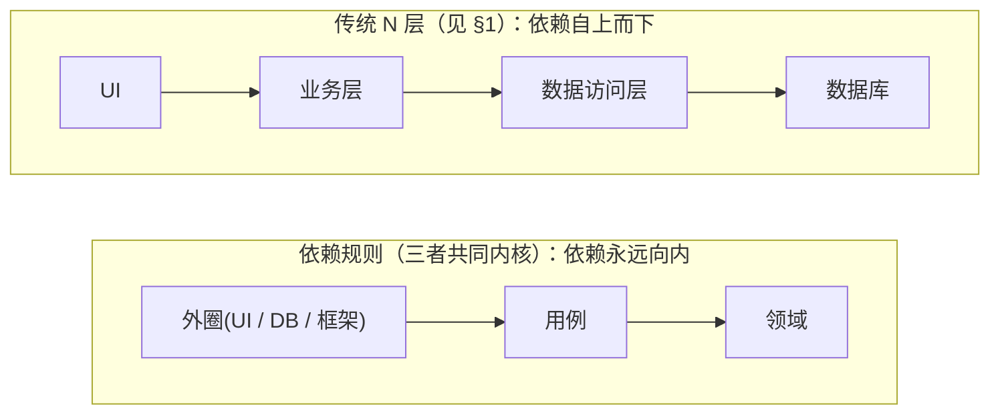

# 其他重要架构风格
> [返回：软件架构学习大纲](../软件架构学习大纲.md)
> 本文是第二阶段主笔记《[第二阶段：经典架构模式](01-第二阶段-经典架构模式.md)》第 4 节的完整展开；小节编号（4.1 管道-过滤器 / 4.2 六边形·洋葱·整洁 / 4.3 Serverless / 4.4 主从 / 4.5 Broker / 4.6 微内核）与主笔记保持一致，其他文件引用“见 4.2”即指向本文；引用 1.x、2.x、3.x、5.x 与阶段自测仍指主笔记对应小节。
> 示例取材：[示例项目场景](../示例项目场景.md)；主线桶装水商城，本章重点场景为 MES 报工数据、工单中心多渠道接入、物联网设备接入、低代码平台与 API 网关。

## 4. 其他重要风格

单体（§1）回答“系统怎么组织成一个进程”，微服务（§2）回答“拆到什么粒度”，事件驱动（§3）回答“模块之间怎么通信”。本节的六种风格回答的问题更具体：它们不像前三节那样整体替换系统形态，而是各自瞄准一类反复出现的结构痛点——数据要流经一串加工步骤（4.1）、领域要与技术细节隔离（4.2）、部署粒度要细到函数（4.3）、读写与任务要分角色（4.4）、调用方与服务之间要插中介（4.5）、能力要外置成插件（4.6）。工程里它们几乎从不单独成系统，而是嵌在前三种骨架里当**局部结构**使用。

### 4.1 管道-过滤器

（场景切换：Feed 流内容社区。）

**概念**：数据像水一样流经一串**过滤器**（独立的小处理步骤），由**管道**连接；每个过滤器不看全局，只做“输入 → 变换 → 输出”。Unix shell（`cat | grep | wc`）是鼻祖。

Feed 发布管道示例——一条帖子从发布到可见，流经审核与统计两级管道：

```kotlin
data class PostContext(val post: Post, val score: Int = 0, val blocked: Boolean = false)

// 每个过滤器只做一件事，可独立测试、自由重组
val machineReview: (PostContext) -> PostContext = { ctx ->      // 机审：涉政/色情识别
    ctx.copy(blocked = ctx.blocked || RiskModel.flag(ctx.post))
}
val quality: (PostContext) -> PostContext = { ctx ->            // 质量分：低质内容限流
    ctx.copy(score = ctx.score + QualityModel.score(ctx.post))
}
val hotSearchTap: (PostContext) -> PostContext = { ctx ->       // 旁路：热搜实时统计
    HotWordCounter.tap(ctx.post.text); ctx
}

// 管道 = 组合子；新增"地域合规过滤"只需再插入一个过滤器，其余代码零改动
fun publish(post: Post): PostContext =
    PostContext(post).let(machineReview).let(quality).let(hotSearchTap)
```

热搜榜是另一条流式管道：发帖/点击事件流 → 分词 → 计数 → 滑动窗口聚合 → 榜单更新，每个环节无状态、可并行、可分别扩容。

时间线生成则是一个点到为止的权衡预告：**写给所有人看（写扩散：发布时推到每个粉丝的时间线，读快写慢）还是读时聚合（读扩散：刷 Feed 时实时合并关注者的帖子，写快读慢）？大 V 百万粉丝把天平压向哪边？**这是“架构本质是权衡”的教科书案例，完整推演见[第六阶段](../章节6/01-第六阶段-实战与案例分析.md)的 Feed 流拆解。

适合流式/批量数据处理、编译器、规则链、推荐特征流水线。**不适合**需要全局事务、强交互（每步要看结果再决定走向）或有长生命周期状态的场景。权衡：换来可组合、可并行（无依赖的过滤器可并发执行），付出交互性差、错误处理要提前设计（异常如何沿管道传播）。

**管道-过滤器的工程形态**。同一副骨架，工程里长成了四种成熟的形状——看清楚“过滤器多粗、数据长什么样”，你才能在它们之间做迁移成本评估：

| 工程形态 | 过滤器粒度 | 数据形态 | 工程实例 |
|---|---|---|---|
| Unix 管道 | 进程（每个过滤器一个进程） | 字节流/文本行，流式逐条 | `cat app.log \| grep ERROR \| wc -l`；导数据、洗日志的胶水脚本 |
| 流式处理（Flink / Kafka Streams） | 算子（进程内一小段变换） | 无限事件流，按事件或窗口处理 | 热搜榜“分词→计数→滑动窗口”；物联网上报的清洗与告警 |
| 编译器 pass | 阶段（pass） | 语法树/中间表示，整块传递 | 词法→语法→语义→优化→代码生成 |
| CI 流水线 | 任务（stage/job） | 代码快照 + 构建制品 | 桶装水商城的“构建→单测→镜像→部署”，任一步失败即断流 |

读表要点：**过滤器语义可以在四种形态间平移，运维形态全变**——“去重、换算、过滤”这三个动词，昨天写成一串 shell，明天升格成 Flink 作业，语义不变、部署与容错语义全变。所以评审管道方案时先问一句：“这是哪种形态？上游断供、某一步宕机，谁担责？”

**有状态过滤器 vs 无状态过滤器**。无状态过滤器对每条数据的处理只依赖这条数据本身（单位换算：来一条换一条），开 N 个副本并行处理，结果完全一致——**天然可水平扩展，加机器即加吞吐**。有状态过滤器要“记住之前”（去重要看序号是否出现过、滑动窗口要攒最近 N 分钟、聚合要累加），状态放在哪决定扩展方式，只有两条路：① **按 key 分区**——同一序号永远路由到同一实例，状态留在实例内存里（Flink 的 keyed state + checkpoint 就是在工程化这件事），代价是实例数变更时要搬迁状态；② **状态外置**——去重表/窗口状态放 Redis 或时序库，实例本身无状态可随意扩缩，代价是每条数据多一跳网络。判据一句话：**先问过滤器的正确性是否依赖“之前见过的数据”——不依赖，随便扩；依赖，分区或外置，二选一，没有第三条路。**对照上面的 Feed 管道：机审过滤器无状态（模型打分只看单帖），热搜计数有状态（要累加），所以两者扩容方式截然不同。

管道-过滤器也最容易名不副实：架构图上画一条漂亮的直线，实现里却在过滤器之间共享数据库连接、全局单例——那不是管道，是穿了管道外衣的网状调用。口说无凭，下面用 MES 的报工清洗管道把“可插拔”落到可运行的代码上：

```kotlin
// MES 报工数据清洗管道：原始报工 → 去重 → 单位换算 → 聚合（越界剔除为可插拔过滤器）

data class WorkReport(
    val workOrder: String,   // 生产工单号
    val op: String,          // 工序
    val qty: Int,            // 数量
    val unit: String,        // 计数单位：产线报"千只"，计件/计薪系统用"只"
    val ts: Long,            // 报工时间
    val seq: Long,           // 报文序号：边缘网关断网补传时靠它去重
)

// 过滤器契约：输入一批、输出一批；上一关的输出就是下一关的输入，过滤器之间零耦合
interface ReportStage {
    val name: String
    fun apply(reports: List<WorkReport>): List<WorkReport>
}

// 管道 = 组合子：按顺序把过滤器串起来，fold 就是那条"管道"
class Pipeline(private val stages: List<ReportStage>) {
    fun run(input: List<WorkReport>): List<WorkReport> =
        stages.fold(input) { acc, stage -> stage.apply(acc) }
}

// 过滤器 1：按报文序号去重——车间断网时边缘网关本地缓存、恢复后补传，同一条报工会被重发
class DedupStage : ReportStage {
    override val name = "去重"
    override fun apply(reports: List<WorkReport>) = reports.distinctBy { it.seq }
}

// 过滤器 2：单位换算——产线按"千只"计数，下游计件与计薪按"只"结算
class UnitConvertStage(private val from: String = "千只", private val factor: Int = 1000) : ReportStage {
    override val name = "单位换算"
    override fun apply(reports: List<WorkReport>) = reports.map {
        if (it.unit == from) it.copy(qty = it.qty * factor, unit = "只") else it
    }
}

// 过滤器 3（后来才补的）：越界剔除——扫码枪误触、设备抖动会产生负数或离谱大值
class OutlierStage(private val maxQty: Int) : ReportStage {
    override val name = "越界剔除"
    override fun apply(reports: List<WorkReport>) =
        reports.filter { it.qty in 1..maxQty }
}

// 汇聚：管道末端通常落一个聚合器（数据在这里"变形态"：List -> Map）
fun aggregate(reports: List<WorkReport>): Map<String, Int> =
    reports.groupBy { "${it.workOrder}/${it.op}" }
        .mapValues { (_, v) -> v.sumOf { it.qty } }

fun main() {
    // 原始报工：含断网补传的重发(seq=7 两条)、"千只"单位、一条越界脏数据
    val raw = listOf(
        WorkReport("WO2601", "注塑", 2, "千只", 1_700_000_000_100L, 6),
        WorkReport("WO2601", "注塑", 3, "千只", 1_700_000_000_200L, 7),
        WorkReport("WO2601", "注塑", 3, "千只", 1_700_000_000_200L, 7),   // 补传重发
        WorkReport("WO2601", "组配", 400, "只", 1_700_000_000_300L, 8),
        WorkReport("WO2602", "注塑", -5, "只", 1_700_000_000_400L, 9),    // 扫码枪误触
    )

    val base = Pipeline(listOf(DedupStage(), UnitConvertStage()))
    val full = Pipeline(listOf(DedupStage(), UnitConvertStage(), OutlierStage(maxQty = 100_000)))

    println("原始 ${raw.size} 条 → 基础管道(去重+换算)输出 ${base.run(raw).size} 条")
    println(aggregate(base.run(raw)))
    println("原始 ${raw.size} 条 → 全量管道(+越界剔除)输出 ${full.run(raw).size} 条")
    println(aggregate(full.run(raw)))
}
```

（已实际编译运行，输出如下）：

```text
原始 5 条 → 基础管道(去重+换算)输出 4 条
{WO2601/注塑=5000, WO2601/组配=400, WO2602/注塑=-5}
原始 5 条 → 全量管道(+越界剔除)输出 3 条
{WO2601/注塑=5000, WO2601/组配=400}
```

三个工程要点藏在输出里：① **可插拔是字面意义的**——`OutlierStage` 是质量事故（负数报工混进报表）之后才补的，既有过滤器与 `Pipeline` 零改动，只是组合清单里多了一项；② **顺序有讲究**——去重键选了与单位无关的 `seq`，所以“去重在前、换算在后”结果不变，但**去重必须发生在聚合之前**，否则补传重发会被累加两次（基础管道若去掉去重，WO2601/注塑 会是 8000 而不是 5000）；③ **聚合器已不是过滤器**——它只出不进，管道理论里叫汇（sink），“过滤器链 + 末端汇聚”才是生产管道的完整形状。另外注意：`DedupStage` 在这个示例里是批内去重（一批之内核对 `seq`），跨批次去重才是真挑战——上文讲的有状态过滤器两条路（按 `seq` 分区 / 去重表外置到 Redis）就该用上了。判据：**步骤能否排成有向无环的直线？每步能否独立测试、独立替换？中间数据能否用统一形态表达？三者皆是才值得管道化；一旦出现“第 3 步要看第 5 步的结果”，改用事件驱动（§3）或直接调用。**

### 4.2 六边形架构（端口与适配器）、整洁架构、洋葱架构

（场景切换：工单中心——多渠道接入的标准案例。）

三者是同一思想的演进：**领域逻辑放中心，所有技术细节通过依赖倒置推到外圈，依赖方向永远指向内**。

| | 六边形（Cockburn, 2005） | 洋葱（Palermo, 2008） | 整洁（Martin, 2012） |
|---|---|---|---|
| 圈层语言 | 内核 + 端口 + 适配器 | Domain / Application / Infrastructure / UI | Entities / UseCases / Interface / Infra |
| 强调 | 对称性：左侧驱动适配器、右侧被驱动适配器 | 依赖规则 | 依赖规则 + 跨边界只传 DTO |

**演进脉络：同一个思想的三次命名。** 2005 年 Cockburn 提出“端口与适配器”，回答的问题是“**UI 和数据库凭什么站在架构图中央**”——他画成六边形（不是六层！）是为了表达“各边等价”：任何一条边都可以接一个驱动者，谁也不比谁特殊。2008 年 Palermo 的洋葱架构把它 DDD 化：画出同心圆、给内圈起名（Domain / Application），把“依赖只能向内”写成硬规则。2012 年 Martin 的博文《The Clean Architecture》把六边形、洋葱等图并列“收编”，统一成一套同心圆话术（2017 年成书《架构整洁之道》）。所以**三者不是三个候选选项，而是同一条依赖规则的三次命名**——先记共同内核：



支点都是[第一阶段](../章节1/01-第一阶段-架构思维与设计基础.md)的依赖倒置：**接口（端口）由内核拥有，实现在外圈**——于是就成了“数据库适配我的领域”，而不是“领域迁就数据库”。

工单中心的接入画像：电话（呼叫中心话单转工单）、APP 用户自主提交、IoT 告警自动生成（售水机故障、水质异常）、外部系统转入（ERP/MES）——每个渠道报文格式各异，但工单内核必须稳定。

❌ **反例：渠道差异用 if-else 吞进领域层**

```kotlin
class TicketService {
    fun create(raw: Map<String, Any?>, channel: String): TicketId {
        val title: String; val reporter: String
        when (channel) {
            "PHONE" -> { title = raw["summary"].toString();    reporter = raw["callerPhone"].toString() }
            "APP"   -> { title = raw["subject"].toString();    reporter = "user:${raw["userId"]}" }
            "IOT"   -> { title = "设备告警:${raw["alarmCode"]}"; reporter = "device:${raw["deviceId"]}" }
            else -> throw IllegalArgumentException("未知渠道")
        }
        // 每接一个新渠道这里就长一个分支，报文解析把工单领域逻辑淹没
        // ...
    }
}
```

✅ **修正：每个渠道一个驱动侧适配器，报文 → 命令的翻译就是防腐层**

```kotlin
// 端口与用例：由领域层定义的统一入口，零渠道痕迹
class CreateTicketUseCase(
    private val tickets: TicketRepository,   // 被驱动侧端口：工单存储
    private val notifier: NotifierPort,      // 被驱动侧端口：通知
) {
    fun execute(cmd: CreateTicketCommand): TicketId {
        val ticket = Ticket.open(cmd)        // 领域只认识命令，不认识任何渠道报文
        tickets.save(ticket)
        notifier.notifyAssigned(ticket)
        return ticket.id
    }
}

// 驱动侧适配器：呼叫中心话单 → 领域命令（防腐层翻译在此发生）
class PhoneChannelAdapter(private val useCase: CreateTicketUseCase) {
    fun onCallFinished(report: TelephonyReport) = useCase.execute(
        CreateTicketCommand(source = Channel.PHONE, title = report.summary,
            reporter = report.callerPhone, attachments = listOf(report.recordingId)))
}

// 驱动侧适配器：IoT 告警报文 → 同一个命令
class IotAlarmAdapter(private val useCase: CreateTicketUseCase) {
    fun onAlarm(alarm: DeviceAlarm) = useCase.execute(
        CreateTicketCommand(source = Channel.IOT, title = "设备告警:${alarm.code}",
            reporter = "device:${alarm.deviceId}"))
}
```

新增“微信小程序”渠道 = 新写一个适配器，领域与其他适配器零改动（[第一阶段](../章节1/01-第一阶段-架构思维与设计基础.md)开闭原则的架构版）。被驱动侧同理：`NotifierPort` 的实现可以是短信适配器、钉钉适配器；工单存储可从 MySQL 换成 ES 而不触及用例。

❌ **反例：领域对象长满框架注解，依赖方向反了**

```kotlin
@Entity
@Table(name = "ticket")
data class Ticket(
    @Id @GeneratedValue val id: Long = 0,                          // 数据库身份污染领域身份
    @Column(name = "sla_deadline") val slaDeadline: Instant,
    @Transient val attachments: List<Attachment> = emptyList(),    // "不落库"要靠注解声明
)
// JPA 要求无参构造与可变字段，领域被迫放弃不可变性；单测要 mock 框架甚至起数据库
```

✅ **修正**：领域模型保持纯净（不可变、无注解），ORM 映射放进适配器（JPA POJO + 转换器或 MyBatis 映射），存储变化不触及领域。

**三者的细粒度对比**（同源，差异只在强调什么）：

| 维度 | 六边形 | 洋葱 | 整洁 |
|---|---|---|---|
| 出身动机 | 对称性：UI/测试/消息消费者是平等的驱动者 | 给 DDD 一个家：Domain 与 Application 分环 | 集大成 + 统一话术：“框架是细节” |
| 内核内部结构 | **不规定**（内核内部自组织） | 规定两内环：Domain / Application | 规定两内环：Entities / Use Cases |
| 驱动侧的处理 | **显式**分左右两侧（驱动/被驱动） | 不区分，都在环上 | 不区分，统称 Interface Adapters |
| 跨边界传什么 | 命令/DTO（未特别强调） | DTO | 硬规定：**只传简单数据结构**，领域实体不许跨界 |
| 招牌卖点 | 可替换性与可测试性（测试即驱动侧适配器） | 依赖规则可视化 | 口号好记、传播力强 |
| 框架/DB 的地位 | 适配器，可整体替换 | Infrastructure 外环 | “细节”，采用哪个框架的决定推迟到最后 |

**同一件事的三种叫法**（第一列锚定 §1 已学的传统分层）：

| 实际角色 | 传统 N 层 | 六边形 | 洋葱 | 整洁 |
|---|---|---|---|---|
| 领域规则 | 业务层实体类 | 内核 | Domain 环 | Entities 环 |
| 用例编排 | 业务层 Service | 内核里的用例 | Application 环 | Use Case（Interactor） |
| 技术细节（DB/消息） | DAO / 消息客户端 | 被驱动侧适配器 | Infrastructure 环 | Frameworks & Drivers |
| 系统入口 | Controller / UI | 驱动侧适配器 | 最外环 | Interface Adapters（Controller） |
| 依赖方向 | 向下 | **向内** | 向内 | 向内 |

**落成代码几乎是同一份**——三个名字，一份代码，差异只在命名与强调（完整可运行版：[05a-示例-hex-onion-clean/HexOnionClean.kt](05a-示例-hex-onion-clean/HexOnionClean.kt)，已实际编译运行验证）。它额外演示两条这家族的通用红利：

1. **被驱动侧可替换**：`NotifierPort` 的短信实现换成钉钉实现，改的是装配、不是内核；
2. **测试就是又一个驱动侧适配器**：`FixedClock` + 内存库替身驱动同一个用例——不起 UI、不起数据库、不依赖真实时钟即可验证“关键工单 SLA = 2h”。“**时间也是外部细节**”这一点常被忽略：`ClockPort` 一旦倒置，SLA 这类时间规则立刻可测——传统分层里“取当前时间”散在业务代码中，恰恰最难测。

**端口粒度设计**：内核该开几个端口？两个极端都有问题。**一端口一用例**（每个用例一个接口，如 `CreateTicketPort`、`CloseTicketPort` 各自独立）：接口窄，实现方容易做，单测替身只 stub 一两个方法；代价是接口爆炸——二十个用例二十个接口，装配代码成倍膨胀，而且“同一种外部资源”被拆散在多个接口里。**粗粒度端口**（按资源/能力聚合：一个 `TicketRepository` 上挂 save/find/closeAll，一个 `NotifierPort` 上挂 notifySms/notifyDingtalk/notifyMail）：接口数量可控、内聚；代价是接口变胖——实现方被迫实现用不到的方法（接口隔离原则被违反），替身也要为大量方法提供空实现。工程判据按**替换单元**而非用例数划端口：**凡是会被整体替换的外部依赖就是一个端口**——换通知供应商，`NotifierPort` 是一个端口；换存储引擎，`TicketRepository` 是一个端口；同一端口内部再按能力分组方法。两个信号说明粒度错了：替身写得痛苦（太粗），或装配代码开始像电话簿（太细）。工单中心的实践：驱动侧一渠道一适配器（天然按接入方式划分），被驱动侧按资源划分——存储、通知、时钟、外部系统各一端口。

**六边形在单体与微服务中的不同价值**：同一套端口-适配器，在两种形态里买到的不是同一样东西。**在单体里，六边形是边界纪律**：所有代码住在同一个进程、同一个部署单元里，物理上没有任何东西阻止工单 Service 直接 new 一个 JdbcTemplate 写库——只有端口契约（加上 lint 与评审）在拦。这时六边形买到的是“逻辑隔离”：模块之间只能走内核接口，将来按 2.5 绞杀者路径要拆出去的候选模块，依赖早就是清晰的、搬走时不用先“解绑”。**在微服务里，六边形是防腐 + 可测试**：每个服务天然要与大量外部系统交互（其他服务、MQ、缓存、数据库），驱动侧适配器收编“入站协议 + 对方模型翻译”，被驱动侧适配器收编“出站调用 + 失败处理”，替身驱动的单测不起网络就能跑通用例。一句话：**单体里六边形防的是“将来”，微服务里防的是“现在”**——微服务不加六边形几乎必然腐化（每个服务直接依赖别人的 DTO 与表结构，长成分布式单体，见 §2），而单体晚一点再倒置通常也来得及。这也解释了为什么同一个团队在两种形态里对六边形的“痛感”不同：单体里它是自律，微服务里它是刚需。

**使用场景与选型**：

- **先判断要不要用这一家族**（判据三者共享）：复杂领域、规则密集（工单状态机、押金生命周期），或技术细节预计会换（通知渠道、数据库、接入渠道持续增加）。简单 CRUD、薄领域（报表、配置管理）、原型期——分层就够，强行倒置只是交样板代码税。
- **三选一：按“哪面墙最痛”选话术**：
  - **集成与渠道密集** → 六边形话术最贴切（驱动/被驱动两侧、适配器即防腐层）：工单中心的多渠道接入、MES 的 PLC/SCADA/ERP 对接、支付通道对接，本质都是“**两侧适配器在变、内核不动**”。
  - **领域深、走 DDD** → 洋葱/整洁更顺手：Application 与 Domain 两环的分界，正好承接 DDD 应用服务与领域服务之分（桶装水的押金、周期购规则适合住进 Domain 环；战略设计见[第四阶段](../章节4/01-第四阶段-架构方法论.md)）。
  - **要统一团队认知** → 整洁的口号传播力最强：“数据库不是架构、Web 不是架构、框架是细节”——评审、新人培训时最能防“框架绑架”。
- **混用是常态**：Martin 的博文本身就收录了六边形与洋葱的图；实践中常见“整洁的分层 + 六边形的左右两侧话术”。**坚持一套话术 > 纠结哪个正宗**——文档与评审里术语统一的价值，远大于站队。
- **渐进落地**：不必起步就用。从分层开始，痛点出现（渠道越接越多、单测被迫起数据库、领域模型长满注解）再把端口倒置出来——六边形常常是**重构目标**而非起步做法，与 2.5 绞杀者“可逆、渐进”是同一哲学。

### 4.3 Serverless

**概念**：应用逻辑交给托管运行时按需执行（FaaS，云函数），状态与通用能力用托管服务（BaaS：对象存储、托管数据库、消息、鉴权）。部署粒度从“一个服务”细化到“一个函数”，按调用量计费。

```kotlin
// IoT 数据采集的轻量函数：设备上报经接入网关触发，无需维护常驻服务器
class TelemetryIngestHandler(
    private val tsdb: TimeSeriesStore,   // BaaS：托管时序库
    private val alarms: AlarmBus,        // BaaS：托管消息
) {
    fun handle(request: HttpRequest): HttpResponse {
        val payload = DeviceCodec.decode(request.body)
            ?: return HttpResponse.badRequest()
        if (tsdb.alreadyIngested(payload.deviceId, payload.eventTime))
            return HttpResponse.ok()                    // 幂等：设备弱网重传是常态
        tsdb.writeBatch(payload.toPoints())             // 批量落库
        if (payload.outOfRange()) alarms.publish(payload.toAlarm())
        return HttpResponse.ok()
    }
}
```

适合：流量极端不均（秒杀、大促）、事件触发的粘合逻辑（回调、定时对账、图片处理）、无运维能力的小团队。代价：**冷启动延迟**（首请求慢数百毫秒到秒级）、厂商锁定（触发器与 SDK 不通用）、不适合长任务与有状态长连接（MQTT 接入这类长连接仍需常驻集群，见[第三阶段](../章节3/01-第三阶段-分布式系统核心技术.md)）、本地调试麻烦；持续高流量下按调用计费**反而更贵**。

### 4.4 主从模式（Master-Slave）

**概念**：节点分成两类角色——**主**（Master/Leader/Primary）：接收写入、分解或分发任务、持有权威状态；**从**（Slave/Replica/Follower/Worker）：执行任务或维护副本，服从主的调度。工程里到处都是它的两个子型：

| 子型 | 主做什么 | 从做什么 | 例子 |
|---|---|---|---|
| 主从复制（primary-replica） | 接收写、向从推送变更 | 只读副本，扛读流量 | MySQL 主从 + 读写分离（接住桶装水“读多写少”的挑战 4，深入见[第三阶段](../章节3/01-第三阶段-分布式系统核心技术.md)）、Redis 主从、Kafka 分区 Leader/Follower |
| 主从任务分发（master-worker） | 切分任务、调度、汇聚结果 | 领任务干活，水平加机器 | K8s 控制面与 kubelet、Spark driver/executor、MES 里 Modbus 主站轮询 PLC 从站采集报工数据 |

（术语注：社区已改用 leader/follower、primary/replica、main 等叫法，结构不变，本文保留“主从”作模式名。）它的对偶是**对等/无主（P2P，leaderless）**：没有主，所有副本地位相同，靠协议仲裁（Cassandra 的 quorum 读写、Git 的多远端同步）——省掉选主，代价是每笔写都要协商（CAP 与共识见[第三阶段](../章节3/01-第三阶段-分布式系统核心技术.md)）。

主从买到三样：**读扩展**（写一份读 N 份）、**并行**（worker 越多吞吐越大）、**容灾**（主宕机后提升从上位）。代价集中在两处：**复制滞后**（从库晚几百毫秒——“支付成功页立刻查积分”这类读不能走从库，判据同 3.2“容忍滞后的读交给投影/副本”）与**选主**（主宕机后谁说了算？）。

❌ **反例：“ping 不通对端就当主”——脑裂（split-brain）**（本例已实际编译运行验证）

```kotlin
class NaiveNode(private val id: String, private val peerReachable: Boolean) {
    var writes = 0
    fun tick() {
        if (!peerReachable) applyWrite()   // 探测不到对端 = "对端死了，我该当主"
    }
    private fun applyWrite() { writes++ }
}
```

网络分区时 A、B 互相探测不通——**两边同时晋升为主、同时收写**：库存一边扣了、一边没扣，网络恢复后数据已经分叉。这就是脑裂，主从模式最著名的事故形态。

✅ **修正：租约 + 多数派仲裁——同一时刻至多一个主**

```kotlin
// 仲裁组 3 票：必须拿到超过半数选票才能当主；分区后只有看得见多数派的一方当选
class QuorumStore(private val voters: Int) {
    var holder: String? = null
    fun elect(candidate: String, votes: Set<String>): Boolean =
        (votes.size > voters / 2).also { if (it) holder = candidate }
}

class LeaseNode(private val id: String, private val quorum: QuorumStore) {
    var isLeader = false
    var writes = 0
    fun tryPromote(visible: Set<String>) { isLeader = quorum.elect(id, visible) }
    fun tick() { if (isLeader) writes++ }
}
```

分区后 n1 仍看得见 3 个节点 → 多数派同意，当选；n2 只看得见自己 → 1 票不足多数，拒绝晋升。**单一写者**由此保住。Redis 哨兵、etcd 租约、Raft 选主全是这个结构的工程化（租约带 TTL 到期重选、仲裁组取奇数个节点，Raft 细节见[第三阶段](../章节3/01-第三阶段-分布式系统核心技术.md)）。顺带一提：2.2 治理清单里的注册中心、K8s 的控制面都是主从结构——**控制面（主）管调度，数据面（从）干活**。

**选主的三种实现**。“谁说了算”这道题，工程里只有三种标准化解法，选型先看家里已有什么：

| 实现 | 怎么保证唯一主 | 典型载体 | 适合 | 代价与注意 |
|---|---|---|---|---|
| 租约（lease） | 主定期续租；租期到了没续上即视为失去主位，其他节点可竞选接管 | Redis `SETNX`+TTL、etcd lease、ZooKeeper 临时顺序节点 | 简单场景、基础设施已有 Redis/ZK、允许短暂无主 | 时间敏感（判“过期”依赖时钟与超时精度）；主宕机后有最长一个租期的“无主空窗”，写不可用 |
| 仲裁选举（quorum election） | 候选拉票，拿到超过半数选票者当选；票数天然防分区双主 | Raft（etcd/TiKV 内建）、Redis Sentinel、MongoDB 副本集 | 数据面自己要高可用地选主（存储、消息总线） | 投票成员要奇数个；选举期间不可写；协议实现复杂，一般不自己写 |
| 外部协调器 | 选主整体外包给专职协调服务，自己只订阅“我现在是不是主” | K8s Lease API + leader-election 库、ZooKeeper/etcd 客户端 | 业务服务不想自造共识（如多副本的后台任务调度器） | 多引入一套基础设施与其可用性问题；故障检测延迟取决于协调器会话超时 |

三者共享一个约束：**多数派/租约只能保证“同一时刻至多一个合法主”，挡不住旧主复活**——n1 当选后 GC 停顿 10 秒，仲裁组早已选出新主，停顿结束的 n1 醒来还以为自己是主，继续收写；它可不觉得自己是“少数派”，多数派记忆里的自己依然合法。工程补法是 **fencing（栅栏）**：每次当选把一个单调递增的代数（epoch/term/generation）+1，写请求必须携带当前代数，存储层**拒绝代数过期的写入**——旧主带着旧代数来写，直接被弹回。租约方案同理：租约到期，原主必须“先停写、再谈其他”，宁可短暂不可写，不可双主并写。判据一句话：**选主协议 + 存储侧代数校验，两道闸都要有，脑裂才真正关死**（Raft 的 term 与图 8 提交规则、Kafka 的 controller epoch，都是这道闸的标准化，见[第三阶段](../章节3/01-第三阶段-分布式系统核心技术.md)）。给桶装水商城的落点：周期购扣款的后台调度器如果部署两个副本“互相备份”，就是典型的“该选主而没选主”——两个副本同时扫到同一批到期订阅、同时发起扣款，用户被扣两次；正确做法是两个副本经外部协调器选主，只有主副本执行扫描，代数校验由扣款表上的乐观锁兜底。

### 4.5 代理者模式（Broker）

**概念**：POSA 里最古老的分布式模式之一（1996）：**调用方与服务之间插一个中介**，中介负责请求转发、结果回传、服务注册与**位置透明**——调用方不需要知道服务在哪台机器上。二十多年过去，中介演化出三个化身，你天天在用：

| 化身 | 中介承担什么 | 例子 |
|---|---|---|
| RPC Broker | 注册中心、地址解析、负载均衡 | Dubbo/Eureka、Nacos、Consul（见 2.2 服务发现） |
| 消息 Broker | 存转消息、路由、削峰、投递语义 | RabbitMQ、Kafka（见 3.1 发布订阅） |
| 边缘 Broker | 统一入口的路由与策略 | API 网关、服务网格 sidecar（见 2.2） |

❌ **反例：点对点直连成网**

```kotlin
class PaymentService {
    // 每个服务硬编码所有依赖的地址：N 个服务 = N(N-1) 条依赖
    private val inventory = HttpClient("http://10.2.3.4:8080")
    private val points    = HttpClient("http://10.2.3.7:9090")
    // 库存服务迁移机房 / 扩容加副本 / 换端口：全公司跟着改配置、发版
}
```

✅ **修正：调用方只认服务名，地址交给 Broker 解析**（本例已实际编译运行验证，运行时 3 次调用被随机摊到两个副本上）

```kotlin
class Registry {                       // Broker 的最小化身：注册与发现
    private val services = mutableMapOf<String, MutableList<Instance>>()
    fun register(name: String, instance: Instance) {
        services.getOrPut(name) { mutableListOf() }.add(instance)
    }
    fun resolve(name: String): Instance =
        services.getValue(name).random()      // 随机挑一个 = 最朴素的负载均衡
}

class BrokerClient(private val registry: Registry, private val name: String) {
    fun call(path: String): String {
        val t = registry.resolve(name)        // 调用时才解析：扩容、迁移对调用方透明
        return "$name@${t.host}:${t.port}$path"
    }
}
```

事后给 inventory-service 加第二个副本，调用方一行不改——`resolve` 自动把流量摊过去。两个化身解耦的深度不同：**RPC Broker 解的是位置耦合**（它在哪里），**消息 Broker 解的是时间与语义耦合**（我根本不关心谁在听、什么时候处理，见 3.1）。

**Broker 的代价**（两条都要盯住）：中介自身成为可用性与性能的关键路径——注册中心要集群化、消息 Broker 要副本与持久化；**中介膨胀**——往 Broker 里塞业务逻辑，它就长成 SOA 的 ESB（见 2.4）。“网关只做策略、消息队列只搬字节”这条纪律，对三个化身一视同仁。

**Broker 与 MQ 的关系辨析**。常见说法是“我们用了 Kafka，所以我们的架构采用了 Broker 模式”——对一半，混掉了两层：**Broker 模式是结构**（POSA 定义的那副骨架：调用方—中介—服务，中介负责转发、注册与位置透明），**消息队列只是这种结构的一种工业级实现**，正如“分层”是结构、Spring MVC 脚手架是实现——不能拿一个产品名去指认一个风格。辨析的价值在两条边界上：其一，**Broker 不必走 MQ**：RPC 注册中心（Nacos/Eureka）做的是“查表 + 转发”式中介，服务网格 sidecar 直接劫持流量做策略，API 网关做路由与限流——它们都是 Broker 化身，与消息队列毫无关系；其二，**用了 MQ 不等于解耦到位**：Broker 结构买到的是“调用方不认识具体实例”（位置透明），而“发的人不关心谁在听、什么时候处理”（时间与语义解耦）是发布订阅（3.1）额外选择的交付语义——反过来两个反例都真实存在：小系统用注册中心点对点直连，只解了位置耦合；大团队上了 Kafka 却让生产者往消息体里塞满某个消费者才认识的字段、topic 按消费方一对一开——时间解耦名存实亡，Broker 退化成远程方法调用的加长网线。判据：**谈风格时问“中介在哪、中介承担什么”，谈实现时才说产品名**——把结构与产品混为一谈，评审会上就会得出“引入 Kafka = 完成 Broker 化”这种错结论。

### 4.6 微内核架构（插件化）

（场景切换：低代码开发平台——表单/流程/页面拖拽搭建、元数据驱动运行，是微内核最典型的现代样本；工单中心渠道接入、API 网关插件链均为同构结构。）

**概念**：内核只保留最稳定、最小的公共能力——**扩展点契约、插件注册与发现、生命周期管理、插件间通信**；业务能力全部做成插件，运行时装配。语出操作系统（微内核 OS vs 宏内核），工程里的实现谱系：Eclipse/OSGi、IDEA 与 VS Code 的插件、Chrome 扩展、K8s 的 CRI/CNI/CSI 与 admission webhook、API 网关的插件链（见 2.2）。教义一句话：**内核提供机制，插件提供策略。**

与已学知识的接线：它是[第一阶段](../章节1/01-第一阶段-架构思维与设计基础.md)开闭原则的**架构级落地**（新增能力 = 加插件，内核零改动）；进程内插件 ≈ 策略/责任链（章节1 设计模式），**架构级插件**（独立开发、独立发布、故障隔离）才是风格层面的东西；与 4.2 六边形的分工——六边形管**依赖方向**（技术细节推外圈），微内核管**能力本身外置**（内核 + 扩展点 + 插件注册）；FaaS（4.3）可以看作插件的极致形态——连运行时都托管了。

❌ **反例：活动规则焊死在结算内核里**（桶装水营销，本例已实际编译运行验证）

```kotlin
class MonolithicCheckout {
    fun settle(cart: CartContext): CartContext {
        var c = cart
        if (c.amount >= 200) c = c.copy(amount = c.amount - 30)         // 满减
        if ("VIP" in c.tags) c = c.copy(amount = c.amount * 90 / 100)   // 会员九折
        // 每上一个新活动就改内核、全量回归；活动下线就删代码
        return c
    }
}
```

✅ **修正：内核只管注册与调度，规则全是插件**

```kotlin
interface PromotionPlugin {                     // 扩展点契约：全系统最贵的接口
    val id: String
    fun applicable(cart: CartContext): Boolean
    fun apply(cart: CartContext): CartContext
}

class PromotionEngine {                         // 内核：机制，不含任何营销规则
    private val plugins = linkedMapOf<String, PromotionPlugin>()
    fun register(p: PromotionPlugin) { plugins[p.id] = p }
    fun settle(cart: CartContext): CartContext =
        plugins.values.filter { it.applicable(cart) }.fold(cart) { c, p -> p.apply(c) }
}

class FullReduction(private val threshold: Int, private val off: Int) : PromotionPlugin {
    override val id = "full-reduction"
    override fun applicable(cart: CartContext) = cart.amount >= threshold
    override fun apply(cart: CartContext) = cart.copy(amount = cart.amount - off)
}

class VipDiscount(private val percentOff: Int) : PromotionPlugin {
    override val id = "vip-discount"
    override fun applicable(cart: CartContext) = "VIP" in cart.tags
    override fun apply(cart: CartContext) = cart.copy(amount = cart.amount * (100 - percentOff) / 100)
}
```

运行验证：两种写法对同一购物车算出相同金额（满 200 减 30、会员再九折：260→230→207）；随后热插一个“满 3 件立减 20”的双十一插件，**内核与既有插件一行不改**，金额变为 187。对照低代码平台读这个结构：元数据引擎与渲染器是内核，表单组件、连接器、自定义函数全是插件；工单中心同理，渠道适配器（电话/APP/IoT）天然是插件——4.2 的六边形接口 `CreateTicketCommand` 就是它的扩展点契约。

**插件化落地四要素**。从“结构上像微内核”到“工程上能运转”，中间隔着四件事，每件都有自己的判据：

1. **扩展点契约**——契约划定插件能看见的世界。判据是**最小知识面**：契约只暴露插件完成任务必需的数据（`CartContext` 加金额的读与写），绝不让插件摸到内核内部（订单库连接、用户表、事务管理器）。契约要带版本意识：改契约的默认答案是“新增 `PromotionPluginV2`、旧 `V1` 标记废弃再下线”，而不是原地改签名——一次原地改动等于全体插件同时返工。反过来也别过度设计：只有一个实现且肉眼可见不会有第二个的扩展点，先别抽。
2. **插件注册与发现**——内核怎么知道有哪些插件。档位从低到高：**编译期装配**（配置类里手动 `register`，最可控、出错在编译期暴露）→ **运行时扫描**（Java SPI / `ServiceLoader`，classpath 上自动发现）→ **远程发现**（网关、K8s 从注册中心或配置中心拉插件清单并热装载）。判据按**插件发布节奏**选：插件与内核同仓库、同发版，编译期装配足够；插件由第三方或独立团队发布、发版节奏不同，才需要 SPI 或远程发现。发现机制越自动，治理负担越重——谁来审核进 classpath 的东西？
3. **隔离与沙箱**——插件坏了、慢了、恶了怎么办。进程内插件共享同一个 JVM：一个插件 OOM、死循环或内存泄漏会拖垮内核，只能靠评审 + 超时包裹 + 熔断兜底（对应 §2 的舱壁与熔断）；进程外插件（独立进程、admission webhook、容器）有天然故障边界，代价是序列化与运维复杂度（同三条纪律第 3 条）。判据按**信任级别**选：自己团队的插件，进程内、快；第三方/租户提交的插件，进程外 + 沙箱（权限收敛、资源限额、只许走内核代理的网络与存储）。低代码平台允许租户写自定义函数，就必须沙箱——否则一个死循环脚本拖死整个搭建运行时，所有租户陪葬（多租户隔离的延伸话题见第六阶段）。
4. **版本兼容**——插件 × 内核的兼容矩阵随版本数乘法膨胀。最低成本做法是**向后兼容规则**（同 2.6）：内核只增不改契约，插件声明“兼容内核 ≥ x.y”，内核升级前跑一遍全量插件的兼容冒烟。判据：兼容矩阵超过一页纸就该收编——要么砍掉长期不升级的旧插件版本支持，要么把高频共用的插件收编为内核内置能力。**不是所有插件都值得永远当插件**：当某插件被 90% 的租户启用时，它事实上已是产品能力，留着扩展点只会增加一层无意义的间接性。

结构讲完了，落一个能跑的最小插件容器：内核经 Java 标准的 `ServiceLoader`（运行时扫描档位）从 classpath 发现解码插件——这是“注册与发现”要素的标准实现，插件与内核物理分离在不同 jar 里：

```kotlin
// MES 设备接入网关：最小插件容器（ServiceLoader 风格）
// 内核只提供机制——扩展点契约、注册发现、调度；协议解码能力全部是插件
import java.util.ServiceLoader

// ===== 扩展点契约：全系统最贵的接口 =====
interface DecoderPlugin {
    val id: String
    fun accept(raw: String): Boolean                 // 能否处理这种报文
    fun decode(raw: String): List<TelemetryPoint>    // 原始报文 → 标准遥测点
}

data class TelemetryPoint(val device: String, val metric: String, val value: Double)

// ===== 内核：注册与调度，不含任何协议知识 =====
class AccessGateway {
    private val plugins: List<DecoderPlugin> =
        ServiceLoader.load(DecoderPlugin::class.java).toList()

    init { println("内核启动：发现 ${plugins.size} 个解码插件 ${plugins.map { it.id }}") }

    fun ingest(raw: String) {
        val p = plugins.firstOrNull { it.accept(raw) }
            ?: return println("  $raw → 无插件能处理，转入死信队列")
        println("  $raw → ${p.id} → ${p.decode(raw)}")
    }
}

// ===== 插件 A：Modbus 网关透传报文（车间老设备）=====
class ModbusDecoder : DecoderPlugin {
    override val id = "modbus"
    override fun accept(raw: String) = raw.startsWith("MB|")
    override fun decode(raw: String): List<TelemetryPoint> {
        // 形如 MB|HJ-01|temp|38.5
        val parts = raw.split("|")
        return listOf(TelemetryPoint(parts[1], parts[2], parts[3].toDouble()))
    }
}

// ===== 插件 B：MQTT JSON 报文（新产线设备；演示从简，生产用 JSON 库）=====
class MqttJsonDecoder : DecoderPlugin {
    override val id = "mqtt-json"
    override fun accept(raw: String) = raw.startsWith("{")
    override fun decode(raw: String): List<TelemetryPoint> {
        val device = Regex("\"device\"\\s*:\\s*\"([^\"]+)\"").find(raw)!!.groupValues[1]
        val metric = Regex("\"metric\"\\s*:\\s*\"([^\"]+)\"").find(raw)!!.groupValues[1]
        val value  = Regex("\"value\"\\s*:\\s*([0-9.]+)").find(raw)!!.groupValues[1].toDouble()
        return listOf(TelemetryPoint(device, metric, value))
    }
}

fun main() {
    val gateway = AccessGateway()
    gateway.ingest("MB|HJ-01|temp|38.5")
    gateway.ingest("""{"device":"HJ-02","metric":"pressure","value":0.4}""")
    gateway.ingest("OPC|HJ-03|speed|1200")   // OPC UA 报文：当前没有插件能处理
}
```

插件与内核分两个 jar 发布：内核 jar 里只有一个 `META-INF/services/DecoderPlugin` 描述文件（每行一个实现类名，随构建产物打包；Maven/Gradle 把它当资源文件放进 `src/main/resources` 即可）。第一次运行（只有两个插件）：

```text
内核启动：发现 2 个解码插件 [modbus, mqtt-json]
  MB|HJ-01|temp|38.5 → modbus → [TelemetryPoint(device=HJ-01, metric=temp, value=38.5)]
  {"device":"HJ-02","metric":"pressure","value":0.4} → mqtt-json → [TelemetryPoint(device=HJ-02, metric=pressure, value=0.4)]
  OPC|HJ-03|speed|1200 → 无插件能处理，转入死信队列
```

新上的数控机床说 OPC UA——写一个 `OpcUaDecoder`、打一个独立 jar、带上自己的 `META-INF/services/DecoderPlugin`，扔进 classpath（如 `-cp kernel.jar:opc.jar`），**同一内核、同一 main，一行不改**，第二次运行：

```text
内核启动：发现 3 个解码插件 [modbus, mqtt-json, opc-ua]
  MB|HJ-01|temp|38.5 → modbus → [TelemetryPoint(device=HJ-01, metric=temp, value=38.5)]
  {"device":"HJ-02","metric":"pressure","value":0.4} → mqtt-json → [TelemetryPoint(device=HJ-02, metric=pressure, value=0.4)]
  OPC|HJ-03|speed|1200 → opc-ua → [TelemetryPoint(device=HJ-03, metric=speed, value=1200.0)]
```

“新增插件零改内核”到这里不再是口号：内核里连插件的名字都没出现过——它只认契约与描述文件。对照四要素自查这个最小容器：契约最小（`accept` + `decode`）、注册发现靠 SPI（运行时扫描档）、隔离为零（进程内共享 JVM，插件抛异常内核要自己兜——真实网关会给 `ingest` 包超时与 try-catch）、版本兼容靠纪律（契约只增不改）。它缺的两条恰好说明：**微内核的难度不在结构，在治理**。这个结构往前一步就是 MES 的真实需求：PLC/SCADA 协议各异（OPC UA、Modbus、私有 TCP），接入网关必须“新协议 = 新插件”；API 网关的插件链（鉴权、限流、灰度）是同一个形状，只是扩展点从“解码”换成了“请求处理”。

**三条纪律**：
1. **内核必须薄且稳定**：扩展点契约是全系统最贵的接口——改一次契约，全体插件跟着返工。宁可加新扩展点，不动旧契约（契约版本化演进，同 3.1 事件的 `version` 字段）。
2. **插件之间不许互相 import**：插件协作只通过内核提供的事件/消息总线，否则插件网状依赖，卸载或升级一个就牵连一片。
3. **插件的独立程度决定收益**：进程内插件换来编译期解耦与并行开发（本例）；进程外插件（网关、K8s admission webhook、OSGi）再换来故障隔离与热插拔，付出序列化成本与运维复杂度。

**权衡**：买到扩展性、并行开发、按需装配（按需安装插件，缩小体积与安全面）、隔离；付出契约冻结（扩展点设计是最大难点，一次设计定生死）、版本矩阵（插件 × 内核兼容性管理）、性能间接层（注册与查表）、生态治理（插件质量参差，需要审核与沙箱）。

### 本节收束：六种风格一句话选型表

六种风格各治一种痛。选型不看哪个流行，看信号——**左列信号出现两条以上才动手，右列信号出现任何一条就先停**（风格是为痛点发的药，没痛别吃药）：

| 风格 | 什么信号选它 | 什么信号别选 |
|---|---|---|
| 管道-过滤器（4.1） | 处理步骤天然排成直线：采集→清洗→换算→汇聚；步骤要可独立替换、可并行扩容 | 步骤间强交互（看结果再定走向）、需要全局事务、有长生命周期状态 |
| 六边形/洋葱/整洁（4.2） | 领域规则密集且反复修改；外部依赖（渠道/存储/通知）持续增加或更换；单测想起数据库就痛 | 简单 CRUD、薄领域报表、一次性原型——分层就够，倒置只交样板代码税 |
| Serverless（4.3） | 流量极端不均；事件触发的小段粘合逻辑（回调/定时/转码）；团队无运维 | 长任务、有状态长连接（MQTT 接入）、持续高流量（按量计费反贵）、重度顾虑厂商锁定 |
| 主从（4.4） | 读远多于写（读写分离）；任务可切分并行（master-worker）；要容灾与故障接管 | 写入天然多点（要多副本都可写时选 leaderless + quorum，见第三阶段） |
| Broker（4.5） | 实例动态扩缩与迁移频繁，调用方不该知道对端在哪；收发双方节奏不匹配 | 固定两三个服务的小系统（中介是净开销）；已有人想往中介里塞业务逻辑 |
| 微内核（4.6） | 核心稳定 + 外围多变：营销规则、协议适配、网关/IDE/低代码插件；多团队并行扩展 | 能力少而稳定（插件化是负资产）；扩展点还没想清楚就先动工 |

**本节自测（其他风格）**
1. Feed 发布管道要新增“地域合规过滤”，需要改动几处代码？这体现了第一阶段的哪个原则？
2. 工单中心要新增“微信小程序”渠道：六边形架构下你要新写什么、保证不改什么？如果渠道报文里混入了对方系统的工单状态模型，防腐层该怎么处理？
3. 为什么说整洁架构用在简单 CRUD 项目上是过度设计？你的工单中心/MES 里哪个模块最值得用它？
4. IoT 采集函数冷启动 800ms：对“上报数据入库”和“设备指令同步应答”分别致命吗？为什么？
5. 主从复制场景：从库延迟 200ms，“支付成功页立刻展示会员积分余额”能不能读从库？给出判断依据（提示：对照 3.2“容忍滞后的读”）。
6. 物联网接入层用 master-worker 分发设备消息：一个 worker 宕机消息怎么办？主节点宕机呢？（提示：任务重派、副本与选主。）
7. 注册中心整体宕机的 30 秒里，服务间调用会立刻全部失败吗？靠什么兜底？（提示：客户端缓存地址快照——Broker 自身的可用性设计。）
8. “Kafka 是一种 Broker，Eureka 也是一种 Broker”——两者解耦的对象有何不同？（提示：位置 vs 时间与语义，对照 3.1 的交付语义。）
9. 扩展点契约为什么是微内核里“最贵的接口”？给扩展点接口加一个参数会引发什么连锁反应？什么情况下宁可新增一个扩展点也不动旧契约？
10. 微内核的插件与章节 1 责任链的处理器，本质区别是什么？（提示：进程边界、独立生命周期与发布、故障隔离。）
11. 你的低代码平台 / 工单中心 / MES：哪里已经是“内核 + 扩展点”？哪个“该插件化却焊在内核里”的模块最值得第一个拆出来？
12. 六边形、洋葱、整洁三者落成代码几乎相同，为什么还要分三个名字？按“哪面墙最痛”原则，工单中心、桶装水商城、你们团队新人的入职培训分别最适合用哪套话术？说出判断依据。
13. “SLA 截止时间 = 当前时间 + 2 小时”这条规则，为什么在传统分层里很难写稳定的单测，端口倒置之后就变得可测？（提示：时钟也是被驱动侧的外部细节。）
14. 报工清洗管道的“去重”过滤器，正确性依赖“之前见过哪些 seq”：如果把这个去重状态放在管道实例自己的内存里、水平扩到两个实例，会发生什么？给出两条不破坏正确性的扩展路线，并说出各自代价。（提示：本节 4.1“有状态过滤器”两条路。）
15. 端口粒度：工单中心的“通知”该开一个 `NotifierPort`（内含短信/钉钉/邮件方法），还是拆成 `SmsPort` / `DingtalkPort` / `MailPort` 三个端口？用“替换单元”判据推理，并指出哪种粒度会让实现方被迫实现空方法、哪种会让装配代码变成电话簿。
16. 选主三选一：两节点成本敏感的小集群、Redis 哨兵、公司已有的三节点 etcd 上跑的业务后台调度器——分别倾向租约、仲裁选举、外部协调器中的哪一种？“投票成员取奇数”防的是什么？fencing 代数校验挡住的又是哪一种多数派挡不住的脑裂？
17. “我们上了 Kafka，所以完成了 Broker 化改造”——这句话混掉了哪两层概念？用“模式是结构、产品是实现”重述它，并各举一例：没上 MQ 也在用 Broker 结构的系统；上了 MQ 也没拿到时间解耦的系统。
18. 对照“六种风格一句话选型表”逐格检查你的 MES：设备多协议接入、报工清洗、排程调度核心、ERP 对接——分别贴哪一行？哪一格“左列信号已出现两条以上、风格却还没用上”？哪一格是“右列信号在场、别吃药”？

（作答后按【本节自测】批改流程逐题记录于 [99-自测答案与点评.md](99-自测答案与点评.md)。）

---

[返回本章主笔记：第二阶段：经典架构模式](01-第二阶段-经典架构模式.md)

## 替换清单

- “4.2 六边形架构（端口与适配器）、整洁架构、洋葱架构”演进脉络：传统 N 层与依赖规则的依赖方向对照 → `flowchart`（两个子图对照）
