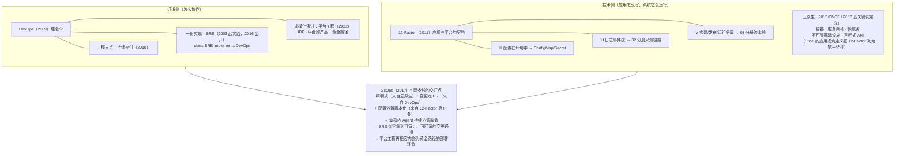

# 核心概念档案：云原生、DevOps 与 SRE

> [返回：软件架构学习大纲](../软件架构学习大纲.md)

> **本档案定位**：第五阶段正文分册——[02 可观测性](02-可观测性-日志指标与链路追踪.md)、[03 部署与发布](03-部署与发布策略-CICD与灰度.md)、[04 安全](04-安全架构-认证授权与零信任.md)、[05 性能工程](05-性能工程-容量规划与压测.md)、[06 混沌工程](06-混沌工程与故障演练.md)——回答“这些工程实践**怎么做**”；本档案回答它们背后的概念“**从哪来**”：谁（人名/公司）、何时（年份）、何地（书/会议/博文，给出原始标题）、诞生时在反抗怎样的失败、又如何演化成今天的行业默认做法。与第四阶段的《[核心概念档案：方法论起源](../章节4/06-核心概念档案-方法论起源.md)》同系列、同一四段式：**起源 → 核心要点 → 使用场景 → 示例**；第四段是分工线——正文分册已有的展开一律只放链接、绝不重写，本档案的独特价值在“起源考 + 思想史”。**阅读建议**：可以在 02/03 分册之前读（先知道一个实践在反抗什么，再学怎么用），也可以学完正文回读（把工具放回时间线坐标）；读完用第 08 节概念关系图与第 09 节时间线总表统一收束。人名、年份、原始出处是本档案的核心资产。

本档案覆盖六个概念：**云原生、12-Factor、DevOps、SRE、GitOps、平台工程**。它们不是六个孤立名词，而是同一条主线的六次接续回答：**应用如何生存在云上（技术侧），人如何协作让它稳定运行（组织侧）**。取材沿用[示例项目场景](../示例项目场景.md)：桶装水商城、工单中心、MES/工控承担正反例，秒杀、支付与清结算承担典型场景。第 07 节配一个可运行的 Kotlin 示例，把 12-Factor 第 III 条“配置存在环境中”完整运行一遍。

---

## 01｜云原生（Cloud Native）：从营销热词到技术体系

### 起源

**更早的零星使用**。“cloud native”一词并非凭空造出：2010 年前后 Netflix 把整个流媒体业务搬上 AWS 并四处布道（Adrian Cockcroft 等人的演讲与博客），“为云而生的应用”已是云厂商语境里的零星说法。**把它变成一个可传播的品类名词的，是 Pivotal 的 Matt Stine**：他 2013 年前后加入 Pivotal 并开始在演讲中反复使用 cloud native，2015 年由 O'Reilly 出版（Pivotal 赞助）的小册子《Migrating to Cloud-Native Application Architectures》给出第一份系统表述——云原生应用架构的五个特征：**12-Factor 应用、微服务、自助式敏捷基础设施（self-service agile infrastructure）、基于 API 的协作、反脆弱（anti-fragility）**。注意这份清单的视角：谈的全是“应用怎么写、团队怎么协作”，几乎不点名具体技术组件。

**CNCF 登场**。2015 年 6 月 21 日，Linux 基金会宣布成立**云原生计算基金会（Cloud Native Computing Foundation，CNCF）**；同年 7 月，Google 在 OSCON 大会上发布 Kubernetes 1.0，并将其捐赠给 CNCF 作为种子项目；12 月，基金会宣布开始正式接收技术贡献。云原生从一家公司的营销叙事升格为一个开放生态。**2018 年，CNCF 发布 v1.0 官方定义**，首句是技术宣言：“云原生技术帮助组织在现代动态环境（公有云、私有云、混合云）中构建和运行可弹性扩展的应用”，随后点名五大关键词——**容器、服务网格、微服务、不可变基础设施、声明式 API**。

**定义之争**。两套定义几乎同时流行，各有拥趸。**Pivotal 一派是应用/组织视角**：Stine 的五特征之外，Pivotal 后期的官方口径进一步浓缩为四要素——**DevOps、持续交付、微服务、容器**；**CNCF 一派是技术/组件视角**：强调服务网格、不可变基础设施、声明式 API 这些基础设施能力。争论的实质是“云原生属于应用架构师还是基础设施工程师”。2019 年 VMware 收购 Pivotal 后，两套话语事实上向 CNCF 版合流；如今再谈“云原生”，默认语境是 **CNCF 技术体系 + 敏捷交付实践的合体**。

**时代背景（它在反抗什么）**。IaaS 时代的“上云 = 租虚拟机”：云被当成别人家的机房，机器仍是手工配置出来的“雪花服务器”（snowflake，每台都略有不同、无人敢轻易改动），运维仍是“宠物式”照料——服务器出了故障要抢救，而不是换新（“宠物 vs 牲畜”的比喻最早出自微软工程师 Bill Baker，2012 年 Randy Bias 的博客《Pets v Cattle》使其流行）。云原生是对“**用数据中心思维用云**”这一失败的回应：既然资源可以通过 API 随取随用，应用与运维方式就应该按弹性、可替换、可编排重造一遍。

### 核心要点

- **容器 + 不可变基础设施**：部署单元是完整镜像而非增量补丁；变更 = 换镜像，而不是登录机器改文件。服务器从“宠物”变“牲畜”：坏了不修，直接换。
- **声明式 API + 控制回路**：只描述期望状态（“我要 3 个副本”），控制器持续比对实际状态并自动调谐（reconcile）。这一思想既是 Kubernetes 的心脏，也是后文 GitOps“持续协调”原则的地基。
- **微服务与松耦合**：技术清单与应用架构相互成就——容器编排、服务网格解决的是微服务的运维痛点，微服务则让弹性伸缩有可伸缩的单元（详见[03-微服务架构](../章节2/03-微服务架构.md)）。
- **为失败而设计的应用**：进程无状态、可处置（disposability，随时可终止、可重建）、健康可探测、遥测可外露——弹性不是平台单方面给的，是应用配合出来的。
- **“云原生 ≠ 上云”**：判据是**变更方式与弹性能力**（镜像替换、声明式伸缩、按需创建销毁），不是部署地点。在云上开一台手工维护的虚拟机，仍然是数据中心思维。

### 使用场景

**最对**：流量弹性大、迭代快的在线业务——秒杀/限时抢购（瞬时洪峰只能靠弹性伸缩与削峰填谷来承接，见[示例项目场景](../示例项目场景.md)）、IM、Feed 流；以及多环境按需拉起（测试环境分钟级创建、用完即毁——桶装水商城大促前的全链路压测环境就是典型）。

**典型误用**：①**容器化的单体**：把 20 万行单体打包成 Docker 镜像就宣布“云原生改造完成”——只收获了打包标准化，弹性与解耦并未获得。修正路径：先做模块化边界（或按绞杀者路线逐块拆出），再逐模块容器化；容器只是最后一步。②**对稳态工控系统强行全面容器化**：MES 的 PLC 采集、工控指令下发要求确定性时延与断网可用，大规模调度反而引入抖动与更大的故障面。修正：IT 层（报表、看板、API 集成）容器化，OT 层（采集、工控）保留专用网关/工控机——按实时性分层，而不是一刀切。③**KPI 式云原生**：为了“通过评审”引入 K8s，发布却仍是每月手工窗口——工具升级、流程原地踏步，只收获复杂度。

### 示例

- 微服务作为云原生的主流应用形态：[03-微服务架构](../章节2/03-微服务架构.md)
- 容器化之后的部署与发布策略（蓝绿/金丝雀/滚动）：[03-部署与发布策略-CICD与灰度](03-部署与发布策略-CICD与灰度.md)
- 场景取材（秒杀洪峰、MES 实时性分层）：[示例项目场景](../示例项目场景.md)

---

## 02｜12-Factor 应用（The Twelve-Factor App，2011）

### 起源

**谁与何时**：2011 年，Heroku 平台团队，**Adam Wiggins 主笔**，Todd Hoff、James Lindenbaum 等数十位贡献者参与，发布于 12factor.net，标题即**《The Twelve-Factor App》**。**背景**：Heroku 是当时最成功的 PaaS（平台即服务），到 2011 年已托管数十万应用——平台方因此看到了海量应用的“共性问题”：配置硬编码在代码里、依赖安装在具体机器上、日志写到本地文件、在本地运行良好、上了平台却水土不服。12-Factor 是 Heroku 对“**什么样的应用能被平台良好地托管**”的经验提炼，本质是一份**应用与平台之间的契约**。

**它在反抗什么**：2011 年的主流“上云”是 IaaS 租机器，开发者把物理机时代的工作习惯（登录服务器、手工修改配置、安装依赖、scp 传包）原样搬上云。12-Factor 反对这种“机器思维”，主张应用按平台的运行方式来写。它比“云原生”一词的流行**早两年**，后来被 Matt Stine 列入其云原生定义的第一特征，是云原生应用方法论的先声。后续演化：Pivotal 的 Kevin Hoffman 在《Beyond the Twelve-Factor App》（2016）里为云原生时代补写三条（API 优先、遥测、认证授权），可见这套契约的生命力。

### 核心要点

12 条守则逐条一句话（编号沿用原文的罗马数字）：

| # | 守则 | 一句话 |
|---|------|--------|
| I | 代码库（Codebase） | 一份基准代码（版本库），多份部署；环境差异不来自分支分叉 |
| II | 依赖（Dependencies） | 显式声明并隔离依赖，绝不依赖机器上“恰好装过”的库 |
| III | 配置（Config） | **配置存在环境中**——代码与配置严格分离，同一构建产物可部署任何环境 |
| IV | 后端服务（Backing services） | 数据库、消息队列、缓存都是附加资源，以 URL/凭据接入，可无差别替换 |
| V | 构建/发布/运行（Build, release, run） | 严格分离三个阶段；发布 = 构建产物 + 配置的组合，一经产出不可变 |
| VI | 进程（Processes） | 应用以一个或多个**无状态**进程运行，状态外置到后端服务 |
| VII | 端口绑定（Port binding） | 服务通过端口绑定自我暴露，应用自含（也可以是别人的“后端服务”） |
| VIII | 并发（Concurrency） | 通过进程模型横向扩展（多进程），而不是单进程内加线程、加内存 |
| IX | 易处理（Disposability） | 快速启动、优雅终止——进程随时可被终止并重建，弹性与部署提速的前提 |
| X | 开发生产等价（Dev/prod parity） | 尽可能缩小开发、预发、生产在时间、人员、工具三个维度的差距 |
| XI | 日志（Logs） | **把日志当作事件流**：只写 stdout/stderr，不管理文件、不轮转、不聚合 |
| XII | 管理进程（Admin processes） | 一次性管理任务（数据订正、迁移）作为一次性进程运行，与正式代码同源同版本 |

重点展开与本阶段正文直接相连的两条：

- **第 III 条：配置存在环境中**。12-Factor 给“配置”的定义是**随部署环境变化的一切**——数据库地址、凭据、第三方端点、功能开关；判断标准：同一代码库的两处部署（开发/生产）之间不同的部分都算配置。配置不属于代码，就绝不进代码库——尤其不能把 `config/dev.properties` 连同生产密码提交进 Git。正确形态是环境变量注入：它对语言、操作系统、部署平台全部中立，约定唯一。**Kubernetes 的 ConfigMap（非敏感配置）与 Secret（敏感数据）正是这一思想的对象化**：应用只声明“我需要哪些键”，值的提供与分发是平台的事；密钥的进一步管理（轮转、审计）见[04-安全架构](04-安全架构-认证授权与零信任.md)。本档案第 07 节给出这一条的可运行演示。
- **第 XI 条：日志当作事件流**。应用自己不管理日志文件——不轮转、不压缩、不聚合，只把事件按时间顺序写往 stdout/stderr；采集、转发、聚合、索引、检索是运行环境的职责。这正是[02-可观测性](02-可观测性-日志指标与链路追踪.md)里“stdout → 采集器 → 集中存储”日志链路的思想源头；违反它（应用写本地文件、按天分目录）会让容器化后的日志采集与进程可处置性（第 IX 条）一起失效。

再指出两条后文会用到的：第 V 条“构建/发布/运行分离”是 CI/CD 流水线三段式（构建一次、按环境组合发布、运行时不可变）的原型，展开见[03-部署与发布策略](03-部署与发布策略-CICD与灰度.md)；第 X 条“开发生产等价”正是容器化要治的“我本地是好的”之病——等价性靠**镜像不可变 + 配置外置**两项手段达成。

### 使用场景

**最对**：任何要部署到共享平台、要跑多环境的后端应用；SaaS 与多租户服务（[示例项目场景](../示例项目场景.md)的多租户 SaaS 控制平面）；以及**新项目立项第一天**——此时按 12 条立规范的成本几乎为零，事后再改（尤其配置与日志习惯）就要还技术债。

**典型误用**：①把第 VI 条“无状态进程”读成“系统不存状态”——这是误读。正确理解是**状态外置**：会话进 Redis、文件进对象存储、数据进数据库；进程无状态的回报是随时可终止、可扩容（第 IX、VIII 条成立的前提）。②把第 XII 条管理进程做成“ssh 登录生产库手改数据”——管理进程同样要代码化、走评审与审计，只是运行形态是一次性进程。③教条全量套用：12-Factor 原生面向“可复制、可丢弃的在线服务进程”；常驻大内存的计算任务、桌面应用硬套第 VIII 条进程模型会十分勉强——判据是工作负载能否表达为“无状态、可复制、可丢弃的进程”。

### 示例

- 第 III 条思想在 Kubernetes 的对象化与密钥管理：[04-安全架构-认证授权与零信任](04-安全架构-认证授权与零信任.md)
- 第 XI 条在日志采集链路的落地：[02-可观测性-日志指标与链路追踪](02-可观测性-日志指标与链路追踪.md)
- 第 V 条在流水线三段式的落地：[03-部署与发布策略-CICD与灰度](03-部署与发布策略-CICD与灰度.md)
- 第 III 条的可运行演示：本档案第 07 节

---

## 03｜DevOps（2009）：一场从鸟池会议开始的运动

### 起源

**2008 年 8 月，多伦多，Agile 大会的鸟池会议**。比利时咨询师 Patrick Debois 与美国开发者 Andrew Shafer 在 Agile 2008 相遇：Shafer 提交的“敏捷基础设施（Agile Infrastructure）”议题未被正式收录，只能以 BoF（birds of a feather，鸟池会议——同好自发的小型讨论）形式开一场，到场者寥寥，Debois 是其中之一。两位都相信“敏捷不该止步于开发”的人从此保持联系，随后共建 Google Group「Agile System Administration」，把零散讨论汇聚成社群。

**2009 年，两次点火**。6 月，O'Reilly Velocity 大会上 Flickr 的 John Allspaw 与 Paul Hammond 发表著名演讲**《10+ Deploys Per Day: Dev and Ops Cooperation at Flickr》**（每天部署十次以上：开发与运维在 Flickr 的合作），线上直播打动了远程观看的 Debois，他随即宣布要在比利时举办一场同类会议；10 月，首届 **DevOpsDays** 在 Debois 的家乡根特（Ghent）举行——由于 Twitter 话题标签容纳不下 #devopsdays，社区将其截短为 **DevOps**，一个词就此诞生。**2010 年，理论与工程支点双双到位**：Damon Edwards 与 John Willis 把 DevOps 的内核归纳为 **CAMS**——Culture（文化）、Automation（自动化）、Measurement（度量）、Sharing（共享），后来 Willis 又补上第五支柱 Lean（精益，合称 CALMS）；同年 Jez Humble 与 David Farley 出版**《Continuous Delivery: Reliable Software Releases through Build, Test, and Deployment Automation》**（Addison-Wesley），部署流水线成为这场运动的工程支点。更早的先声：2006 年 AWS CTO Werner Vogels 提出 **“You build it, you run it”**（谁构建，谁运行）。

**它在反抗什么**：开发与运维的**激励对立**——开发因“交付变化”受奖，运维因“保持稳定”受奖；变更天然等于风险，于是发布成了高危事件：凌晨上线、全员待命、变更周期以月计。工单中心的老经验就是写照：一个紧急修复从提交到进入生产要走两周审批。DevOps 的主张：把“变更 = 风险”的死锁拆开，让发布变成低风险、高频、可回滚的日常动作——**稳定不是靠少变更换来的，而是靠小步、自动、可观测的变更换来的**。

### 核心要点

- **CAMS 四（五）支柱**：文化、自动化、度量、共享（+精益）。顺序有讲究：文化在前——买来 Jenkins 不等于 DevOps，自动化只是文化达成共识之后的执行手段。
- **激励对齐替代部门墙**：发布不是“扔过墙”而是共同责任；“You build it, you run it” 让构建者对生产运行负责。
- **部署流水线**：一次构建产物自动走完提交 → 测试 → 预发 → 生产；“构建一次、处处部署”（正是 12-Factor 第 V 条的工程化）。展开见[03-部署与发布策略](03-部署与发布策略-CICD与灰度.md)。
- **度量闭环**：变更频率、变更前置时间、变更失败率、恢复时间——后来 DORA（《Accelerate》，2018）把这四个指标固化成行业基准。度量的前提是看得见系统，即[02-可观测性](02-可观测性-日志指标与链路追踪.md)。
- **DevOps 是文化伞，不是职位、不是工具箱**：这是理解它与 SRE、平台工程关系的钥匙——后两者分别是它的“实现”与“演进”。

### 使用场景

**最对**：发布频次是主要瓶颈、迭代速度决定生死的业务——互联网产品、SaaS；也适合任何有“变更恐惧症”的组织做流程改造：把月度高危发布改造成周/日级低风险发布，配灰度与自动回滚（见[03-部署与发布策略](03-部署与发布策略-CICD与灰度.md)的金丝雀部分）。

**典型误用**：①**成立“DevOps 部门”**——把一种协作方式做成新的部门孤岛：墙从 dev|ops 变成 dev|devops|ops，协调节点反而更多。修正：DevOps 是横切的实践与度量，不是组织结构图上的格子。②**工具决定论**：“运维学会了 Jenkins 就等于实现了 DevOps”——没有文化与度量配套，流水线只是把手工错误自动化了。③**把 DevOps 理解为“裁掉运维”**——实际是运维能力前移进交付流程（基础设施代码化、平台自助化），专业运维演化为 SRE 与平台工程（见第 04、06 节）。

### 示例

- 部署流水线、蓝绿/金丝雀/自动回滚（A 的落地）：[03-部署与发布策略-CICD与灰度](03-部署与发布策略-CICD与灰度.md)
- CAMS 的 M（度量）的落地：[02-可观测性-日志指标与链路追踪](02-可观测性-日志指标与链路追踪.md)
- 组织侧如何承载 DevOps（Team Topologies 的团队拓扑）：[章节4/06 档案第 07 节](../章节4/06-核心概念档案-方法论起源.md)

---

## 04｜SRE（Site Reliability Engineering）：Google 的答案

### 起源

**2003 年，Google，Ben Treynor Sloss**。受命组建生产运维团队时，这位工程 VP 做了一个决定性选择：**让软件工程师去设计运维职能**。他的名言（出自 2016 年《Site Reliability Engineering》开篇对他的一段访谈）：**“SRE 是当你让软件工程师去设计一个运维职能时所得到的结果。”** 这套方法在 Google 内部打磨了 13 年；2016 年，由 Betsy Beyer、Chris Jones、Jennifer Petoff、Niall Richard Murphy 编辑、O'Reilly 出版**《Site Reliability Engineering: How Google Runs Production Systems》**，SLO、错误预算、50% 红线、无责复盘整套方法论首次公开——行业第一次看到“可靠性可以被工程化地经营”。

**与 DevOps 的关系**：DevOps（2009 年得名）提出理念，SRE（2003 年起实践、2016 年公开）给出一份 Google 量级的工程实现。Google 官方 2018 年的讲解视频（Liz Fong-Jones 与 Seth Vargo，《What's the Difference Between DevOps and SRE?》）给出了流传最广的类比——**`class SRE implements DevOps`**：把 DevOps 看作接口，SRE 是它的一份具体实现；接口规定了“打通开发与运维”的契约，实现给出了错误预算、SLO、无责复盘这些具体机制。

**它在反抗什么**：纯人工运维的极限。Google 量级的系统（数万台服务器、每周多次变更）靠运维人力已难以为继——硬盘损坏、进程宕机、流量增长，全是重复劳动。SRE 的立场：**运维问题本质是软件问题**，重复性劳动（toil，琐务）应该被工程系统消灭，而不是被人吸收。

### 核心要点

- **SLO 与错误预算**：100% 可用性是错误目标——它意味着零发布、零尝试。先定 SLO（如 99.9%），SLO 之外的部分（0.1%）就是**错误预算**：可以“花”在发布风险与灰度试验上。**把“开发求快 vs 运维求稳”的立场之争，变成预算核算问题**：预算充足时放心发布；预算耗尽时冻结发布、优先偿还可靠性债。月度额度的量化推演已在[01-架构质量属性](../章节1/04-架构质量属性.md)展开，此处不重写。
- **50% 运维红线**：SRE 团队的运维性事务（toil）不得超过总工时的 50%；一旦超过，就把工单**退还给产品研发团队**。用组织机制保证 SRE 不退化成高级运维，也让研发切实感受到自己代码的运维成本。
- **用软件工程消灭 toil**：自动化、自愈、容量规划（见[05-性能工程](05-性能工程-容量规划与压测.md)）、告警治理——每条告警必须可行动，否则删掉。
- **无责复盘（blameless postmortem）**：故障归因于系统而非个人，复盘产出改进项与预案——这是[06-混沌工程与故障演练](06-混沌工程与故障演练.md)的组织前提；Google 的 DiRT（灾难恢复训练）是制度化演练的先例。
- **SLI / SLO / SLA 三层**：SLI 是内在测量指标（必须从用户视角选，如“下单成功率”而非“CPU 使用率”）；SLO 是对内的目标承诺；SLA 是对外的合同（含违约后果）。

### 使用场景

**最对**：大规模在线服务，且**稳定性和迭代速度同时是硬要求**的系统——支付与清结算（错一笔就是资损）、电商主站、IM。内部系统可用轻量版：工单中心只选两三个用户真实感知的 SLI（“工单分派 P95 时延”“关单成功率”），同样能用错误预算协调排期——不必照搬大型企业的全套做法。

**典型误用**：①**SRE = 运维改名**——没有错误预算的决策权（预算耗尽时能冻结发布），就没有 SRE，只是换了头衔。②**SLI 选成内部指标**：“CPU < 80%”“GC 停顿 < X 毫秒”不是用户可感知的可靠度；SLI 选型应从用户旅程出发（详见[02-可观测性](02-可观测性-日志指标与链路追踪.md)的告警质量一节）。③**预算尚有余量就“放开消耗”**——错误预算是留给**可控风险**（发布、演练）的，不是鼓励事故；消耗在重复犯的低级错误上等于浪费。④照搬 99.99%：SLO 是业务决策不是技术洁癖——内部报表系统定 99.99% 只会带来高昂的冗余成本。

### 示例

- 错误预算的量化推演（不同 SLO 的月度不可用分钟数）：[01-架构质量属性](../章节1/04-架构质量属性.md)
- SRE 的容量规划职能：[05-性能工程-容量规划与压测](05-性能工程-容量规划与压测.md)
- SRE 的故障演练与无责复盘：[06-混沌工程与故障演练](06-混沌工程与故障演练.md)

---

## 05｜GitOps（2017）：把“真相”装进 Git

### 起源

**2017 年，Weaveworks**。这家英国公司的 CEO **Alexis Richardson** 在博文**《GitOps — Operations by Pull Request》**（2017 年 8 月，Weaveworks 博客/Medium）与同年 KubeCon Austin 的同名演讲中提出并普及了 GitOps 一词。语境：Weaveworks 替客户管理大量 Kubernetes 集群，把自己的实践抽象为“**以 Git 为唯一事实源来运维系统**”，名字有意呼应 DevOps——用开发者的工具（Git、Pull Request、代码评审）来做运维。随后 CNCF 的 **OpenGitOps** 工作组把社区共识标准化为四原则（v1.0）。两个代表实现都出自这条脉络：Weaveworks 的 **Flux**（CNCF 毕业项目；Weaveworks 公司 2024 年停止运营后由社区接续维护）与 Intuit 开源的 **ArgoCD**（Argo 项目，同样已从 CNCF 毕业）。

**它在反抗什么**：两件事。①**期望状态的散落**：集群中到底运行着什么，一半在某人的笔记本脚本里、一半在 Wiki、一半只存在于现场——“配置漂移”（drift）无人能说清。②**变更的黑箱**：`kubectl apply` 手工敲入生产，无评审、无审计、难以回滚，出现故障只能靠人回忆“当时改了什么”。

### 核心要点

- **四原则**（OpenGitOps v1.0）：**声明式**——系统期望状态以声明式描述（K8s YAML 等）；**版本化且不可变**——期望状态存放在带完整历史的版本库中；**自动拉取**——软件代理自动从 Git 拉取期望状态；**持续协调（continuously reconciled）**——代理持续观察实际系统状态，发现与期望状态的偏差即自动纠正。第四条是灵魂：GitOps 不只是“用 Git 存配置”，而是**一个持续收敛的控制回路**（云原生声明式 API 的运维化应用）。
- **Git 是唯一事实源**：任何生产变更走 PR（评审、审计、可追溯），回滚 = `git revert`，事故调查 = `git log`。
- **push 与 pull 的信任边界差异**：**push 模型**——CI 流水线构建完成后**推**到集群，CI 必须持有**所有**目标集群的凭证；CI 一旦沦陷，全线沦陷；且推送之后的漂移无人纠正。**pull 模型**——Flux/ArgoCD 运行在**集群内**，主动从 Git 拉取：凭证不出集群、对 Git 只读、暴露面骤减，且漂移被持续纠正。集群数量越多，差异越被放大：N 个集群 × push = N 份凭证外发；pull = 0 份。
- **与 12-Factor 第 III 条同一血脉**：第 III 条说“配置存在环境中、与代码分离”；GitOps 把它放大到整个系统——**整个系统的期望状态外置到 Git，与代码同样对待（评审、版本、回滚）**。
- **与 CD 的关系**：GitOps 不是替代持续交付，而是 CD 在 Kubernetes 时代的 **pull 模式实现**——从“CI 推着集群走”变成“集群自己拉”。见[03-部署与发布策略](03-部署与发布策略-CICD与灰度.md)。

### 使用场景

**最对**：K8s 上的应用与基础设施配置；多集群、多环境的一致性管理；强审计场景——支付与清结算的合规审计天然受益：监管要求的“谁在何时改了什么”，`git log` 可零成本给出。

**典型误用**：①**明文密钥进 Git**——“Git 是唯一事实源”不适用于密钥本身：修正做法是 SealedSecrets/SOPS/外部密钥管理（见[04-安全架构](04-安全架构-认证授权与零信任.md)），Git 里只存密钥的**引用**。②**“把一切文件都塞进 Git”**——Git 管理的是期望状态声明；镜像制品存 Registry、大数据存对象存储，Git 不是万能仓库。③**有 Git 记录、没有协调回路**——脚本推送加一条 commit 记录就自称 GitOps：缺第四原则（持续协调），漂移照旧，那只不过是“带版本管理的脚本运维”。

### 示例

- CD 流水线与 pull 模式的衔接：[03-部署与发布策略-CICD与灰度](03-部署与发布策略-CICD与灰度.md)
- GitOps 下的密钥管理：[04-安全架构-认证授权与零信任](04-安全架构-认证授权与零信任.md)
- 声明式 API 与控制回路（GitOps 的技术地基）：[03-微服务架构](../章节2/03-微服务架构.md)

---

## 06｜平台工程（Platform Engineering，2022）：DevOps 的规模化补丁

### 起源

**走向主流的节点：2022 年的 Gartner**。《Hype Cycle for Software Engineering, 2022》把 platform engineering 推上高位，并给出著名预测：**到 2026 年，80% 的大型软件工程组织将设立平台工程团队，通过内部开发者平台提供可复用的服务、组件与工具（2022 年这一比例是 45%）**。术语与实践早有伏线：Netflix 的 **Paved Road**（约 2012 年起——“铺好的路”，走默认路径最省力，正是“黄金路径”的精神源头）；思想根基则是 Skelton & Pais 的**《Team Topologies》**（2019，IT Revolution；起源考见[章节4/06 档案第 07 节](../章节4/06-核心概念档案-方法论起源.md)）——平台团队是四种团队拓扑之一，**认知负荷（cognitive load）**由此进入工程管理词汇表。

**它在反抗什么**：DevOps“人人自理”在规模化之后的疲劳。“You build it, you run it” 在 5 个团队时是解放，在 50 个团队时是灾难：每个产品团队都必须掌握 K8s、安全合规、可观测性、CI/CD、成本治理——认知负荷激增，业务带宽被大量挤占。2022~2023 年间“DevOps 已死，平台工程当立”的争论，本质是这对矛盾的爆发。

### 核心要点

- **IDP（Internal Developer Platform，内部开发者平台）**：自助式内部产品——申请环境、部署、配置监控、领取凭据都能像点击按钮一样自助完成，背后封装 K8s、GitOps 流水线、可观测性栈。
- **平台即产品（Platform as a Product）**：平台的用户是内部开发者，因此要按产品经营：有 roadmap、有采纳率与满意度度量、有旧版本弃用——**像经营产品一样经营平台，而不是像管机房一样管平台**。
- **黄金路径（Golden Path）**：从代码到生产的默认路径——脚手架、流水线模板、可观测性预置、安全基线全部内置；走默认路径最省力，偏离也允许（说服式而非强制式）。
- **度量的是认知负荷的下降**：不是平台功能数量，而是“开发者从想法到上线”的时长与摩擦（平台采纳率是北极星指标之一）。
- **DevOps 的演进而非否定**：把 DevOps、持续交付、GitOps 的最佳实践封装进平台，让产品团队不必人人成为全栈运维——DevOps 理念由平台规模化兑现。

### 使用场景

**最对**：拥有几十到上百个产品团队的中大型组织——此时自助平台的规模收益超过建设成本（例：20 个团队每队省 0.5 个工程师的运维负担 > 平台团队 8 人的成本）。

**典型误用**：①**平台无人使用仍强行推广**——不按产品经营（无用户反馈回路、无采纳度量），平台团队沦为“二级运维/工单黑洞”。修正：先找 2~3 个种子团队共创，以采纳率验证价值。②**小团队强行建平台**——研发规模仅几十人的组织，平台成本远超收益；直接用云服务与开源（安装一个 Backstage 门户 ≠ 平台工程）。③**与业务中台混淆**——中台沉淀**业务能力**（订单中心、支付中心、商品中心），服务对象是**业务线**；平台工程沉淀**研发能力**（环境、流水线、可观测性、凭据），服务对象是**内部工程师**。检验工具现成：用[02-06-平台化架构：BFF 与中台](../章节2/06-平台化架构-BFF与中台.md)的**“能力沉淀判据四问”**逐项检验——四问全部通过才沉淀，任何一问不通过就先不沉淀；“先有 ≥2 个真实消费方，再有平台”的铁律对内部平台同样成立。**BFF 是业务侧的“薄平台”，IDP 是工程侧的“厚平台”，两层并存不冲突**。

### 示例

- 中台四问与“沉/不沉”判据、BFF 边界：[02-06-平台化架构-BFF与中台](../章节2/06-平台化架构-BFF与中台.md)
- 黄金路径内嵌的流水线模板：[03-部署与发布策略-CICD与灰度](03-部署与发布策略-CICD与灰度.md)
- 平台团队的组织定位（Team Topologies）：[章节4/06 档案第 07 节](../章节4/06-核心概念档案-方法论起源.md)

---

## 07｜配套可运行示例：第 III 条的三级配置装配（Kotlin）

12-Factor 第 III 条落到代码是什么形态？下面这个**无第三方依赖**的 Kotlin 程序模拟桶装水商城后端服务的配置装配：**默认值 < 配置文件 < 环境变量**三级优先级合并，输出最终生效配置并标注**每个键的来源**；随后用同一份“构建产物”换两套注入的环境变量（开发/生产），演示“换环境不改代码”；最后演示漏注入必需密钥时的**快速失败**（配置错误应在启动期暴露，而不是等到运行中第一次连库才崩溃）。

```kotlin
/**
 * TwelveFactorConfig.kt —— 12-Factor 第 III 条「配置存在环境中」的三级优先级装配
 *
 * 优先级（低 → 高）：默认值 < 配置文件 < 环境变量
 * 场景：桶装水商城后端服务用同一份构建产物（app.jar）启动，
 *       dev / prod 两套环境只换注入的环境变量，无须改代码。
 *
 * 编译运行：
 *   kotlinc TwelveFactorConfig.kt -include-runtime -d app.jar
 *   java -jar app.jar
 */

/** 第 1 级：代码内兜底默认值——任何环境都没提供时的最后防线，只放不含秘密的通用值 */
val DEFAULTS: Map<String, String> = linkedMapOf(
    "PORT" to "8080",
    "DB_HOST" to "127.0.0.1",
    "DB_USER" to "water",
    "LOG_LEVEL" to "info",
)

/** 第 2 级：模拟读取随构建产物分发的配置文件——环境无关，dev / prod 用同一份 */
val FILE_CONFIG: Map<String, String> = linkedMapOf(
    "DB_HOST" to "shared.db.water-mall.internal",
    "DB_USER" to "water_mall",
    "LOG_LEVEL" to "debug",
)

/** 第 3 级：模拟部署环境注入的环境变量——每套环境一份，注入发生在进程之外 */
val DEV_ENV: Map<String, String> = mapOf(
    "DB_HOST" to "dev-1.db.water-mall.internal",
    "DB_PASSWORD" to "dev-no-secret",
)

val PROD_ENV: Map<String, String> = mapOf(
    "PORT" to "9090",
    "DB_HOST" to "prod-1.db.water-mall.internal",
    "DB_PASSWORD" to "prod-SECRET-from-vault",
    "LOG_LEVEL" to "warn",
)

/** 单个配置项的解析结果：值 + 来源（来源即审计线索） */
data class Sourced(val key: String, val value: String?, val source: String)

/** 三级优先级装配：环境变量 > 配置文件 > 默认值；必需键任何一级都拿不到即为"缺失" */
fun assemble(keys: List<String>, file: Map<String, String>, env: Map<String, String>): List<Sourced> =
    keys.map { key ->
        when {
            env.containsKey(key)      -> Sourced(key, env.getValue(key), "环境变量")
            file.containsKey(key)     -> Sourced(key, file.getValue(key), "配置文件")
            DEFAULTS.containsKey(key) -> Sourced(key, DEFAULTS.getValue(key), "默认值")
            else                      -> Sourced(key, null, "缺失")
        }
    }

fun render(envName: String, env: Map<String, String>, rows: List<Sourced>) {
    println("== 环境 $envName（本套注入的环境变量: ${env.keys.sorted().joinToString(" / ")}）==")
    for (r in rows) {
        println("  ${r.key.padEnd(12)} = ${(r.value ?: "<MISSING>").padEnd(36)} [来源: ${r.source}]")
    }
    println()
}

fun main() {
    // 配置键清单：唯一"写死"在代码里的部分是键名，不是值
    val keys = listOf("PORT", "DB_HOST", "DB_USER", "DB_PASSWORD", "LOG_LEVEL")
    // 密钥永不进代码/配置文件，必须由环境注入（第 III 条）
    val required = setOf("DB_PASSWORD")

    // 同一份构建产物 + 同一份配置文件，只换注入的环境变量 = 换一套环境
    render("dev", DEV_ENV, assemble(keys, FILE_CONFIG, DEV_ENV))
    render("prod", PROD_ENV, assemble(keys, FILE_CONFIG, PROD_ENV))

    // 反例演示：生产环境漏注入必需密钥 —— 装配阶段就快速失败（fail fast），
    // 而不是等到运行中第一次连数据库时才莫名崩溃
    val brokenEnv = PROD_ENV - "DB_PASSWORD"
    val brokenRows = assemble(keys, FILE_CONFIG, brokenEnv)
    render("prod（模拟漏注入 DB_PASSWORD）", brokenEnv, brokenRows)
    val missing = brokenRows.filter { it.key in required && it.value == null }.map { it.key }
    println("!! 启动被拒绝（fail fast）：必需配置缺失 -> $missing")
    println("   依据第 III 条：密钥不属于代码与配置文件，只能由环境注入。")
}
```

**编译与运行**（kotlinc 2.2.20，macOS / JRE 21）：

```bash
mkdir -p /tmp/kt-12factor && cd /tmp/kt-12factor
# 将上述代码保存为 TwelveFactorConfig.kt
kotlinc TwelveFactorConfig.kt -include-runtime -d app.jar
java -jar app.jar
```

**真实输出**（实测，kotlinc 2.2.20 / JRE 21）：

```
== 环境 dev（本套注入的环境变量: DB_HOST / DB_PASSWORD）==
  PORT         = 8080                                 [来源: 默认值]
  DB_HOST      = dev-1.db.water-mall.internal         [来源: 环境变量]
  DB_USER      = water_mall                           [来源: 配置文件]
  DB_PASSWORD  = dev-no-secret                        [来源: 环境变量]
  LOG_LEVEL    = debug                                [来源: 配置文件]

== 环境 prod（本套注入的环境变量: DB_HOST / DB_PASSWORD / LOG_LEVEL / PORT）==
  PORT         = 9090                                 [来源: 环境变量]
  DB_HOST      = prod-1.db.water-mall.internal        [来源: 环境变量]
  DB_USER      = water_mall                           [来源: 配置文件]
  DB_PASSWORD  = prod-SECRET-from-vault               [来源: 环境变量]
  LOG_LEVEL    = warn                                 [来源: 环境变量]

== 环境 prod（模拟漏注入 DB_PASSWORD）（本套注入的环境变量: DB_HOST / LOG_LEVEL / PORT）==
  PORT         = 9090                                 [来源: 环境变量]
  DB_HOST      = prod-1.db.water-mall.internal        [来源: 环境变量]
  DB_USER      = water_mall                           [来源: 配置文件]
  DB_PASSWORD  = <MISSING>                            [来源: 缺失]
  LOG_LEVEL    = warn                                 [来源: 环境变量]

!! 启动被拒绝（fail fast）：必需配置缺失 -> [DB_PASSWORD]
   依据第 III 条：密钥不属于代码与配置文件，只能由环境注入。
```

**读输出，对照四件事**：

1. **三级优先级各赢一次**：`PORT` 在 dev 未被注入，由**默认值**兜底（8080）；`DB_USER` 两套环境都没注入，由**配置文件**生效（water_mall）；`DB_HOST`、`LOG_LEVEL`（prod）、`PORT`（prod）由**环境变量**覆盖。谁离环境越近，谁的优先级越高——因为越贴近部署时刻的信息越“真”。
2. **来源标注即审计线索**：每个键都标注了来源，“这个值从哪里来”一目了然——生产排障时这比“翻代码找硬编码的值”快一个量级。
3. **换环境不改代码**：dev 与 prod 两次渲染，变的只有传入的 `env`（现实中是运维/K8s 注入的环境变量），`DEFAULTS`、`FILE_CONFIG` 与装配逻辑一行未动——第 III 条“同一份构建产物 + 环境注入 = 任意环境部署”的落地。
4. **必需键快速失败**：`DB_PASSWORD` 属于“只能来自环境”的键（绝不提供默认值），漏注入时在装配阶段直接拒绝启动——对照反例：把密码硬编码在代码里作为默认值，短期省事，泄露后却要在全部环境更换密钥。

与 Kubernetes 的对应：`FILE_CONFIG` ≈ ConfigMap，第 3 级环境变量 ≈ 容器 `env`/Secret 注入，装配与校验逻辑 ≈ 应用启动时的配置读取层。

---

## 08｜概念关系图：谁包含谁、谁成就谁



用文字把“包含/成就”关系明确下来：

- **谁包含谁**：DevOps 是**理念伞**——持续交付是它的工程支点，SRE 是它的一份具体实现（`class SRE implements DevOps`），平台工程是它规模化后的组织演进形态，三者都在伞下。云原生是**技术体系**，12-Factor 是它应用侧的契约（Stine 定义的第一特征），微服务是它应用架构的默认形态。GitOps 横跨两条线：既是 CD（DevOps 侧）的 pull 模式实现，又是云原生声明式 API 的运维化应用。
- **谁成就谁**：12-Factor（2011）先于云原生一词两年，为它准备好了应用契约；云原生的声明式 API + 控制回路成就了 GitOps 的“持续协调”；DevOps“人人自理”的规模化疲劳成就了平台工程；SRE 的错误预算给了灰度发布理论依据（预算内大胆放量，见[03 分册](03-部署与发布策略-CICD与灰度.md)）；平台工程反过来把前四者封装成 IDP，让中小团队不必重复建设这些能力。
- **一句话总括**：DevOps 管协作文化，云原生管技术底座，12-Factor 立应用契约，SRE 给出可靠性经营的实现样本，GitOps 是两条线交汇出的部署模式，平台工程把这一切封装成内部产品。

## 09｜时间线总表

| 年份 | 概念/事件 | 原始出处 | 一句话定位 | 相关分册 |
|------|-----------|----------|------------|----------|
| 2003 | SRE 实践起点 | Google，Ben Treynor Sloss | 让软件工程师设计运维职能 | [01-架构质量属性](../章节1/04-架构质量属性.md)（错误预算） |
| 2006 | “You build it, you run it” | AWS，Werner Vogels | 运维责任回归开发的先声 | [03-部署与发布](03-部署与发布策略-CICD与灰度.md) |
| 2008 | DevOps 前奏 | Agile 2008（多伦多）“敏捷基础设施” BoF，Debois × Shafer | 敏捷跨过开发/运维边界的首次碰面 | — |
| 2009 | DevOps 诞生 | 首届 DevOpsDays，比利时根特 | 术语与社区的元年 | [03-部署与发布](03-部署与发布策略-CICD与灰度.md) |
| 2010 | CAMS / 持续交付 | Willis & Edwards；Humble & Farley《Continuous Delivery》 | 文化框架 / 部署流水线工程支点 | [03-部署与发布](03-部署与发布策略-CICD与灰度.md) |
| 2011 | 12-Factor | Heroku《The Twelve-Factor App》（12factor.net） | 云上应用的十二守则 | [02-可观测性](02-可观测性-日志指标与链路追踪.md) |
| 2013~2015 | 云原生术语流行 | Matt Stine（Pivotal）《Migrating to Cloud-Native Application Architectures》（2015） | 应用/组织视角的定义 | [03-微服务架构](../章节2/03-微服务架构.md) |
| 2015 | CNCF 成立 | Linux 基金会（6 月 21 日宣布）；Google 捐赠 K8s 1.0 为种子项目 | 云原生从营销词升格为开放生态 | [03-微服务架构](../章节2/03-微服务架构.md) |
| 2016 | SRE 方法论公开 | 《Site Reliability Engineering》（O'Reilly） | 错误预算、50% 红线、无责复盘公开 | [05-性能工程](05-性能工程-容量规划与压测.md)、[06-混沌工程](06-混沌工程与故障演练.md) |
| 2017 | GitOps 提出 | Weaveworks 博文《GitOps — Operations by Pull Request》 | 以 Git 为唯一事实源的运维 | [03-部署与发布](03-部署与发布策略-CICD与灰度.md) |
| 2018 | CNCF v1.0 定义 | CNCF 官网 | 容器/服务网格/微服务/不可变基础设施/声明式 API | [03-微服务架构](../章节2/03-微服务架构.md) |
| 2022 | 平台工程广为流行 | Gartner《Hype Cycle for Software Engineering, 2022》 | IDP、平台即产品、黄金路径（2026 年 80% 预测） | [02-06-BFF与中台](../章节2/06-平台化架构-BFF与中台.md) |

---

## 【本节自测】

1. 术语史：Pivotal 与 CNCF 两次“云原生”定义分别站在什么视角？两份要素清单（四要素 vs 五关键词）的本质差异是什么？为什么说“在云上开一台手工维护的虚拟机”不叫云原生——判据是什么？
2. 12-Factor 第 III 条：按原文，什么算“配置”？把 `config/dev.properties` 连同生产库密码提交进 Git 同时违反了哪两条原则？这一条在 Kubernetes 时代落成哪两个对象、在部署工具链上对应第 V 条的哪三个阶段？
3. 判断题：“把 20 万行单体打包成 Docker 镜像部署到 K8s，就算完成了云原生改造。”对不对？请给出理由与修正路径（提示：容器化之前的两步）。
4. DevOps 与 SRE：写出 Google 的经典类比并解释其含义；错误预算如何把“开发求快 vs 运维求稳”的立场之争变成可核算的问题？50% 运维红线在组织上起什么作用？
5. GitOps 四原则逐条说出，并回答：push 与 pull 两种部署模型的信任边界差异在哪里？为什么说“有 Git 记录但没有持续协调”不算 GitOps？
6. 场景题：你们的 MES 平台计划 IT 层（报表/看板/API 集成）容器化、OT 层（PLC 采集、工控指令）保留专用网关。请用云原生的判据论证这样分层是否合理；并指出 IT 层容器化后最先要补齐的三项工程事项（提示：可观测、流水线、配置注入分别对应本阶段哪三份分册）。
7. 平台工程 vs 业务中台：两者的沉淀内容与服务对象各是什么？请用《02-06-平台化架构：BFF 与中台》的“能力沉淀判据四问”检验“公司是否应该建统一部署平台”这一提案，写出四问的答案要点。
8. 时间线题（不翻阅笔记排序）：SRE 实践起点、DevOps 一词诞生、12-Factor 发布、CNCF 成立、GitOps 提出、平台工程广为流行——按时间先后排序，并为每个概念配一个原始出处（人名/组织 + 标题）。

## 替换清单

- “08｜概念关系图：谁包含谁、谁成就谁”组织侧 / 技术侧两条线交汇于 GitOps → `flowchart`（两个子图 + 交汇节点）
