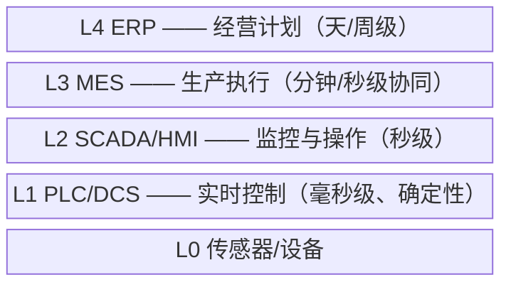

# 认识软件架构

> [返回：软件架构学习大纲](../软件架构学习大纲.md)
> 本文是第一阶段“认识软件架构”一节的完整展开，小节编号 1.x 与主笔记保持一致，其他笔记可直接引用“见 1.4”这类编号；阶段导览与进度见 [01-架构思维与设计基础](01-架构思维与设计基础.md)，示例取材见 [示例项目场景](../示例项目场景/00-导览.md)。


## 1.1 什么是软件架构

定义：**对系统高层结构做出的、影响全局且难以轻易更改的设计决策**。回答三个问题：

1. 系统由什么组成——模块/服务/组件怎么划分
2. 部分之间如何交互——谁调用谁、数据怎么流动、同步还是异步
3. 为什么这样划分——背后的约束与取舍

第三个问题最容易被忽略，但恰恰是架构的核心：**框图谁都会画，理由才见功力**。1.1.2~1.1.4 是这句话的三个展开：先换视角看全（分层视角），再换定义看深（决策视角），最后把表达工具管起来（架构图的诚实度）。

### 1.1.1 案例（MES 工控）：ISA-95/Purdue 分层——“为什么这样划分”的工业版答案

工厂信息系统按 ISA-95/Purdue 参考模型天然分五层：



为什么温度控制回路放在 L1 的 PLC 而不是 L3 的 MES？因为控制回路要求毫秒级**确定性**响应，多绕一次网络往返就超时；“这单活排给哪条产线”以分钟计，归 MES；“下周产能怎么分配”以天/周计，归 ERP。**时间尺度与可靠性要求决定某段逻辑放在哪一层**——每一层的存在都对应一类不同的响应时间与故障容忍要求，而不是层数越多越专业。第二阶段的分层架构沿用的正是这个思路，只是划分依据换成了职责与变化方向。

把这套判据抽象出来，分层的三问是：**这段逻辑的响应时间尺度是多少？它故障时容忍多久的恢复窗口？它的变更频率与谁相同？**三问答案相同的逻辑才放同一层。反例：某系统按“前端组 / 后端组”分层的依据是组织汇报线，结果一个纯统计页面的改动要横跨三层审批——康威定律在这里帮了倒忙，层数没有对齐时间尺度，划分依据错成了组织结构。

### 1.1.2 架构的分层视角：业务架构 / 应用架构 / 数据架构 / 技术架构

同一个系统，不同的人嘴里的“架构”往往不是同一个东西——业务负责人说的架构是业务怎么组织，DBA 说的架构是数据怎么流动，运维说的架构是机器怎么摆。业界通行把视角拆成四层，各回答一个不同的问题：

| 视角 | 回答的问题 | 桶装水商城示例 |
|---|---|---|
| 业务架构 | 企业做哪些业务、业务之间什么关系、价值从哪里来 | 单次购买、周期购订阅、配送服务、桶押金回收四条业务线；订阅带动复购，押金把“桶”和“回收”绑成一个闭环 |
| 应用架构 | 用哪些应用/服务承载业务，服务之间怎么交互 | 订单服务下单时同步调库存服务扣减、异步通知配送排线服务与押金服务；支付服务对内统一多个支付渠道 |
| 数据架构 | 数据存在哪、怎么流动、谁是主数据的拥有者 | 商品主数据归商品域独占、其他域只读；订单数据按用户 ID 分片；押金流水只增不改（审计要求）；数仓按 ODS/DWD/ADS 分层 |
| 技术架构 | 用什么技术底座把上面三层托住 | MySQL + Redis + Kafka 的选型组合、K8s 部署拓扑、双可用区、静态资源走 CDN |

三个使用要点：

1. **四个视角是同一个系统的四个投影，不是四份独立设计**。业务架构一动，应用架构跟着动（新增“周期购”业务催生调度能力），应用架构一动数据架构跟着动（订阅单与普通单同库还是分库），技术架构最后兜底。越靠上的视角变更越频繁、越靠下的越稳定——所以技术选型要按“上层可能怎么变”来留余地，而不是反过来让业务迁就技术。
2. **沟通失败常常是视角错位，不是观点冲突**：业务方抱怨“架构师听不懂人话”，多半是架构师在讲技术架构而对方需要业务架构；拉着 DBA 评审服务拆分同样鸡同鸭讲。开工先对齐“我们现在聊的是哪个视角”，再进入细节——这一句话能省掉一半架构会。举一个真实感的错位：业务方问“能不能加'以租代售'的桶租赁业务”——业务架构视角的回答是“这是新业务线，押金模型与回收闭环要重审”；应用架构视角回答“要动押金服务与订单服务”；技术架构视角回答“加个服务就行”。三层答案都对，但只有第一层回应了对方真正的问题——只答得出第三层的人，在业务方眼里就是答非所问。
3. **每个视角都要有归属和载体**。四视角没人认领是“架构缺位”最常见的形态：业务架构靠口口相传，应用架构靠某次重构的残留记忆，数据架构靠 DBA 个人经验。自检方法：新人问“要接入一家新的桶装水配送商”，四个视角各能不能在 10 分钟内找到答案——业务架构答它挂在哪条业务线下，应用架构答要动哪些服务，数据架构答商品与线路数据归属，技术架构答部署与容量。任何一环卡壳，那一环就是当前欠账。

顺带把四视角与常见文档对上号，画图时先想清楚自己画的是哪一层：业务架构对应业务流程图与业务能力地图；应用架构对应服务清单 + 调用关系图（C4 的 Container 层）；数据架构对应数据流图 + ER 图 + 主数据清单；技术架构对应部署图与拓扑图。一张图混合多层视角，是 1.1.4 要拆解的骗人方式之一。

再练一遍“同一决策、四个视角”：桶装水商城决定“订单库按用户 ID 分片”——

- 业务架构视角：业务能力不变，几乎无感
- 应用架构视角：订单服务内部多一个路由组件，调用方无感
- 数据架构视角：核心受影响——分片键选择、跨片查询限制、扩容再平衡方案全在这一层
- 技术架构视角：引入分片代理或中间件，监控与容量指标随之改变

同一个决策在四个视角的“重量”完全不同：它主要压在数据架构上。评审分工由此而来——**让最重的那个视角出席，其余视角知情即可**，四个视角全员到场的评审是最常见的浪费。

### 1.1.3 架构 = 一组重要决策：约束会向下游传递

1.1 开头的定义偏“结构视角”；GoF 之一的 Ralph Johnson 给过另一个常被引用的定义：**架构是“重要的、变更成本高的决策”的集合**——不用管这个决策最终长成什么形态（结构、协议、流程、规范、选型都算），只要它重要且难以更改，它就是这套架构的一部分。

两个定义不矛盾，是同一枚硬币的两面：**结构是决策的结果，决策是结构的成因**。“订单和支付拆成两个服务”是一个决策；决策做完，结构里就多出一条服务边界、一份接口契约、一套独立部署单元。看结构能做评审，看决策才能做复盘——复盘时问“当时为什么这么决定”，远比问“这个结构好在哪”更容易挖到真问题。

这个视角里最值得咀嚼的是“变更成本高”的另一面：**决策会向下游传递，变成别人的约束**。

- 你在项目第一周选了 MySQL，此后所有团队都在 SQL 方言、事务模型、分库方式、运维技能上被它约束——他们没有参与这个决策，却在为它持续付费。
- 桶装水商城定了“订单号里编码用户 ID 路由位”（为了按用户分库），此后所有按订单号查询的服务都必须经过路由层，“拿订单号直连查询”这个简单方案永久消失。订单号格式这个看起来很小的决定，约束了此后数年的所有查询链路。
- API 网关选型同理：网关定了“对外只暴露 HTTP、内部统一 gRPC”，此后每个新服务的接口设计、每个新客户端的接入方式、甚至排障时抓包看什么协议，都被这个早期决策框死。
- 反过来，约束传得越远、影响的人越多，这个决策就越“架构”。**一个决策是不是架构决策，不看它本身多复杂，看它让多少后续决策失去了自由。**

工程推论有两条。其一：**架构决策必须显式记录**（ADR，见 1.3.8）——传递下去的约束若没有文字依据，半年后就变成“没人知道为什么、但没人敢动”的祖传规矩，要么被误改，要么被过度敬畏。其二：**读架构先读约束**——接手一个陌生系统，别急着看类图，先问“这个系统里哪些东西是当年定下之后就再没自由过的”：那一串清单才是它真正的架构。

“读约束”是双向的：除了读“它给下游定了什么约束”，还要读“它自己被哪些上游决策框住”——上游包括合规（数据留存与出境）、组织（两支团队共用一个库是康威定律的产物）、历史（存量设备不可升级）。MES 是第三类的典型：车间里 Modbus、OPC UA、厂商私有协议并存，还有多年不升级的上位机，集成层任何“统一协议”的方案都要先被“存量设备改不动”这个约束裁剪一轮；工单中心的“多渠道接入、内核稳定”同样是一组显式约束——电话、APP、IoT 告警、外部系统格式各异，集成层按“渠道还会继续新增”来设计。**架构方案从来不是在白纸上选优，而是在约束清单里找最大可行域。**

最后补一个容易被忽略的时间维度：决策也有半衰期。Johnson 定义里的“难以更改”是快照——同一个“共享数据库”决策，5 人团队时是双向门，50 人团队时就变成了架构级的单向门，因为约束的传递面随组织规模增长。所以 1.2.1 的四维打分不是一次定终身，约束变了就要重打；ADR 里写“契约稳定期”，本质是给半衰期显式定价。

### 1.1.4 架构图的三种骗人方式

架构图是最常用的沟通载体，也是最高频的误导载体——多数时候画图的人不是故意的，但误导效果一样。三种高频骗法，每种配一个反例：

**骗法一：只画方框不画箭头。**
反例：一张评审图上画着“订单服务、库存服务、支付服务”三个并列方框，所有人都看图以为三者平级；真实关系是订单强依赖库存的同步接口——库存服务宕机 30 秒，下单链路跟着中断 30 秒。没画依赖方向的图，容量规划算不出瓶颈在谁，故障分析推不出爆炸半径，等于什么都没说。**方框回答“有什么”，箭头才回答“靠什么活”。**

**骗法二：箭头不标协议、方向与同步异步。**
反例：图上“订单 → 支付”一根线。实际上它同时是两条通道：同步 HTTP 调用（超时 300ms）+ 异步 MQ 通知。新同事按“同步调用”的直觉在异步通道加了失败重试，结果 MQ 重复投递叠加重试，造成重复扣款通知。协议与语义不标注，每个看图的人都会用自己的假设补全——十个人看同一张图能补出十种系统。**每根箭头都应该能回答三件事：什么协议、谁到谁、同步还是异步。**

**骗法三：把编译期结构与运行时拓扑混画一图。**
反例：一张图左边是“OrderService 依赖 PaymentClient”的类级静态依赖，右边画着“部署 3 个实例、MySQL 一主两从”。评审时讨论扩容，有人对着类图数实例；讨论代码分层，有人指着“3 个实例”问为什么依赖画了三条。编译期结构回答“代码怎么组织”，运行时拓扑回答“进程怎么部署”，两者的时间维度、变更频率、受众完全不同——混画等于两个问题都没回答。C4 模型（Context / Container / Component / Code 四级，一图只画一级）正是防这种骗术的标准化做法。

三种骗法的共同根源是**把图当交付物，而不是当沟通工具**——图的价值在评审现场被质疑的次数，不在版面的精美程度。工程判据一句话：**一张图只回答一个问题**。画完按最小自检清单过一遍：

- 说得出这张图回答谁的问题（受众、视角、层级）
- 每个框有名字，每根箭头有协议、方向与同步/异步标注
- 图与代码还对得上吗——最久多久没同步了？图的典型结局是“三个月前是对的”

任何一条不过，宁可重画也不要拿去评审：一张骗人的图比没有图更糟，因为它会把错误假设批量复制给所有看图的人。

## 1.2 架构 vs 详细设计 vs 代码

| 层级 | 关注什么 | 例子 |
|---|---|---|
| 架构 | 系统/模块级结构、技术选型 | 订单和支付拆成两个服务，用消息队列解耦 |
| 详细设计 | 模块内部的类、函数、数据结构 | 订单模块里设计 OrderService 和状态机 |
| 代码 | 具体实现 | 写出状态机的逻辑 |

分界线是**改动成本**：牵动全局的决策是架构级（换数据库、改服务边界），只影响局部的是设计级（重命名函数）。判断法：“这个决定做错了以后，回头改的代价有多大？”

实践中大量决策落在中间地带，两个处理技巧：**按“错了之后的第一动作”判断**——如果第一动作是“发个版本就好”，多半是设计级；如果是“开会、写迁移方案、通知合作方”，八成是架构级。**拿 1.2.1 的打分表过一遍**——四维分数会把凭感觉的“好像挺大”变成可讨论的数字。反过来也要警惕：不要用“这看着就是个细节”给大决策降级，“订单号加个路由位”看起来像细节，实际是 1.1.3 里约束全站查询链路的架构决策。

康威定律：系统结构会映射组织的沟通结构——所以架构决策不能只看技术，还要看团队怎么协作。扩展阅读：[康威定律-补充](05-康威定律-补充.md)（机制、逆康威定律与三条实践启示）。

### 1.2.1 决策分级与下放：单向门、双向门与“什么算架构决策”

1.3.4 会讲“区分可逆与不可逆决策”，这里先把判据和分工讲透。**双向门（two-way door）**：走进去发现不对，可以退回来重来；**单向门（one-way door）**：穿过去就回不了头，或回头的代价远高于前进。判据表：

| 判据 | 双向门（可逆） | 单向门（不可逆） |
|---|---|---|
| 回退成本 | 一天内可回退（配置切换、代码回滚） | 数周以上，或技术上回不去（数据已按新模型写入） |
| 影响范围 | 单模块内部 | 跨模块、跨服务、跨团队 |
| 数据 | 无状态，或新旧格式可兼容互转 | 涉及数据迁移，历史数据难以还原 |
| 对外契约 | 不改对外接口/协议/存储格式 | 改接口、协议、公开文档或计费口径 |
| 试错成本 | 一次回滚就是全部学费 | 学费是客户信任、资金或合规记录 |

配套的分工原则：**可逆决策下放给团队，架构师保留不可逆决策与跨模块契约。**

- 下放的理由不只是省架构师的时间：贴近上下文的人决策质量更高，而且**只有真金白银地做双向门决策，团队才练得出判断力**——架构师把所有决策攥在手里，团队永远长不出架构能力（呼应 1.3.6 的“传导架构思维”）。
- 保留的理由同样清楚：单向门决策的试错成本是一整个组织的学费；跨模块契约则是 1.1.3 所说“向下游传递的约束”，两者拍错了，没有人能替组织兜住。
- 两个反面例证。反面例证 A（该放不放）：架构师要求所有第三方库选型——包括 JSON 序列化库、日志门面、重试工具——都必须经他审批，自己成了流水线上的盖章节点，团队学会的是“等批复”而不是“做判断”，连双向门决策都要排队一周。反面例证 B（该留不留）：某团队把“数据库从 MySQL 换成 MongoDB”当双向门，两个后端一个周末就切了；三个月后交易报表、事务语义、运维技能全线不适配，数据模型已按文档模型写入，回迁成本约等于重做一遍——**单向门被当双向门推开，是架构事故里最贵的一类**。

那么一条具体的决策到底归哪边？与其争论，不如打分。四个维度各打 1~5 分：

| 维度 | 1 分 | 3 分 | 5 分 |
|---|---|---|---|
| 跨模块影响 | 只影响单个类/函数 | 影响一个模块 | 影响多个服务/团队 |
| 变更代价 | 半天内可改 | 约一周 | 需要迁移、停机或数月重构 |
| 质量属性杠杆 | 几乎不影响 | 影响单一属性 | 决定性能/可用性/安全的上限 |
| 契约稳定期 | 内部实现随时可换 | 半年内稳定 | 对外承诺一年以上 |

判读规则：**总分 ≥ 12，或任一维度打 5 分 → 架构决策，走 ADR + 架构师评审；总分 9~11 → 架构师参与，按普通评审节奏；总分 ≤ 8 → 团队自决。**“任一维度 5 分单独升级”是因为打 5 分本身就是单向门信号——比如“契约稳定期 5 分”意味着对外承诺已经做出，想改先赔信誉。

用 Kotlin 把这套打分固化成工具（决策分级器，已编译运行验证）：

```kotlin
// 决策分级器：把"这算不算架构决策、该谁拍板"从争论变成打分
// 四个维度各打 1~5 分，总分与单项同时决定分级与下放去向

data class Decision(
    val name: String,
    val crossModule: Int,   // 跨模块影响：1=单个类/函数，3=一个模块，5=多个服务/团队
    val changeCost: Int,    // 变更代价：1=半天内，3=一周，5=迁移/停机/重构数月
    val qualityLever: Int,  // 质量属性杠杆：1=几乎不影响，3=影响单一属性，5=决定性能/可用性/安全上限
    val contractLife: Int   // 契约稳定期：1=内部实现随时可换，3=半年内稳定，5=对外承诺一年以上
)

enum class Grade { TEAM, ARCHITECT, ARCHITECT_SLOW }

fun grade(d: Decision): Grade {
    val total = d.crossModule + d.changeCost + d.qualityLever + d.contractLife
    val anyCritical = listOf(d.crossModule, d.changeCost, d.qualityLever, d.contractLife).any { it == 5 }
    return when {
        total >= 12 || anyCritical -> Grade.ARCHITECT_SLOW  // 架构决策且带单向门特征：慢、论证、ADR
        total >= 9 -> Grade.ARCHITECT                        // 架构决策：架构师参与评审，但不必全员大会
        else -> Grade.TEAM                                   // 双向门：下放给团队，快决策
    }
}

fun main() {
    val decisions = listOf(
        Decision("JSON 库选型（模块内部使用）", 1, 1, 1, 1),
        Decision("订单库读写分离", 3, 2, 4, 2),
        Decision("订单号从自增改为雪花算法", 5, 4, 3, 5),
        Decision("MySQL 整体迁移 MongoDB", 5, 5, 3, 4),
    )
    for (d in decisions) {
        val advice = when (val g = grade(d)) {
            Grade.TEAM -> "双向门：团队自决，错了再改"
            Grade.ARCHITECT -> "架构决策：架构师参与评审，记录 ADR"
            Grade.ARCHITECT_SLOW -> "单向门倾向：慢决策、充分论证，ADR 必须写退出成本与复查点"
        }
        println("${d.name} => $advice")
    }
}
```

运行结果：

```text
JSON 库选型（模块内部使用） => 双向门：团队自决，错了再改
订单库读写分离 => 架构决策：架构师参与评审，记录 ADR
订单号从自增改为雪花算法 => 单向门倾向：慢决策、充分论证，ADR 必须写退出成本与复查点
MySQL 整体迁移 MongoDB => 单向门倾向：慢决策、充分论证，ADR 必须写退出成本与复查点
```

注意“订单库读写分离”落在中间档：影响一个模块、代价约一周、对读性能杠杆不小，但没有单项 5 分——这类决策最忌讳两种极端：要么拉全员大会吵两周（把 9 分决策当 17 分决策用），要么某个人顺手就切了流量（把 9 分决策当 5 分决策用）。打分表的真正价值是**把“要不要慎重”变成可讨论的数字，而不是职位之争**——谁都可以对打分提出异议，但异议要指向维度与分数，而不是“我觉得这事很大”。这张表也可以反向用：评审会上有人质疑“凭什么这个决策要架构师定”，把四维分数摆出来，讨论立刻从“谁官大”变成“哪一维的分数有分歧”——分歧点通常只有一两维，比全案重吵便宜得多。

分级不是终点，还有两个配套动作。

**其一，用工程手段把单向门改造成双向门。**单向门之所以危险，在于“不可逆”；很多不可逆其实是流程没设计，而不是物理定律：

| 工程手段 | 原本的单向门 | 改造后 |
|---|---|---|
| 双写迁移 | 换存储：数据一次性写入新模型 | 新旧库双写 → 读流量灰度切换 → 旧库转只读后下线，每一步都可退 |
| 灰度开关 | 新策略全量生效 | 按工单类型/租户/百分比灰度，“回退”就是改一条配置 |
| 防腐层适配 | 直接依赖外部系统接口 | 中间垫一层适配器，换外部系统只换适配器，业务侧零感知 |

改造本身有成本（双写要处理两边一致性、灰度要双倍观测），所以它不是免费的——但“花小钱把单向门变双向门”常常比“在单向门前反复论证”便宜。这正是 1.4.4“把大决策拆成一串双向门小决策”的具体抓手。

**其二，下放不等于失管：轻量留痕 + 抽样复盘。**双向门决策也要留痕，但用一行日志的轻量格式（谁、选了什么、一句话理由）；架构师每月抽样回看 3 条团队的双向门决策，目的不是追责而是校准判断力（呼应 1.3.6 传导架构思维）。否则下放三年，团队的“判断力”会长成“偏好集合”——没人说得清哪些判断被验证过、哪些只是习惯了。

## 1.3 架构师的角色

先破两个误解：

- 误解一：架构师 = 画框图的。实际上画图只是输出形式，核心工作是权衡与守护。
- 误解二：架构师 = 最资深程序员的自动升级。资历不自动带来架构能力。

关键观念：**架构师是角色，不是职位**。在模块内决定怎么分层、依赖朝哪个方向，就是在做架构决策。

### 1.3.1 职责全景：架构师到底做什么

按软件生命周期看，架构师的工作远不止画图：

**1. 需求阶段——翻译与识别**
- 识别质量属性需求：业务方说“系统要稳”，架构师要追问成可验证指标（可用性几个 9？故障容忍多久？）
- 收集真实约束：预算、团队技能、上线期限、合规要求、遗留系统——架构永远在约束下做，不在真空中

**2. 设计阶段——结构与契约**
- 划分模块/服务边界，定义接口契约和数据流向
- 技术选型：自建 / 开源 / 采购 / 云服务的权衡，重点不是“哪个最好”而是“哪个的代价我们承受得起”
- 产出可沟通的方案：C4 图、ADR（架构决策记录），让方案能被评审、被挑战

**3. 实施阶段——守护边界**
- Review 代码与设计是否偏离架构（依赖方向有没有被破坏、边界有没有被绕过）
- 处理例外的艺术：deadline 压力下允许破例，但破例必须记录、必须有偿还计划——否则例外会变成新常态
- 守门的两个高频现场：有人为了“快一点”在服务间直连了对方的数据库（绕过接口契约）；有人把业务逻辑写进了网关插件（1.3.8 的边界台账抓的就是这两类事）

**4. 交付运维阶段——闭环反馈**
- 参与上线方案（灰度、回滚）、容量规划
- 参与故障复盘，把线上教训反哺到架构演进——架构不是交付那天就完成了，而是持续演进的

**5. 沟通协调——横向与纵向**
- 向上：向管理层解释技术投资与风险，用业务语言而不是技术名词
- 横向：对齐有依赖关系的团队，处理跨团队的接口争议
- 向下：让团队理解架构意图，而不是只发号施令

### 1.3.2 现实中的架构师分类

“架构师”是一族角色，按关注层次从高到低：

| 角色 | 关注范围 | 典型问题 |
|---|---|---|
| 企业架构师（EA） | 公司级业务-技术战略对齐 | 哪些系统该合并、该淘汰 |
| 解决方案架构师 | 一个项目/交付的端到端方案 | 这个需求用哪些系统怎么组合实现 |
| 应用/软件架构师 | 单个系统内部结构 | 订单系统怎么分层、怎么拆模块 |
| 基础设施/云架构师 | 平台、网络、部署拓扑 | 多活怎么部署、容量怎么规划 |
| 数据架构师 | 数据模型、数据流、治理 | 主数据在哪、数仓怎么分层 |
| 安全架构师 | 认证授权体系、威胁建模 | 零信任怎么落地 |

小公司一个人兼任多种，大公司有架构委员会做集体决策。关键是识别：**当前问题属于哪一层，就借用哪一层的视角**。近年还有两个新角色值得留意：平台/基础设施架构师（管网关、中间件、研发平台，像这些“内部产品”的产品经理）与 SaaS 架构师（管控制面/数据面、租户隔离与计费，“多租户 SaaS 控制平面”场景的主角）——遇到对应问题时各借各的视角。

### 1.3.3 能力模型展开

三件套“技术深度 + 业务理解 + 沟通影响力”展开看：

- **技术深度（T 的竖）**：至少在一个领域足够深，深到能识别别人看不见的风险和成本；没有深度的广度是浮浅的
- **技术广度（T 的横）**：知道解决方案全景图和各自的代价，选型时才有“菜单”可选
- **业务/领域理解**：能跟业务方用领域语言对话，能判断“这个需求会不会变”——很多取舍依赖对业务演进的预判
- **沟通表达**：写方案（结构化、有权衡、有结论）、讲权衡（讲清“为什么”比讲清“是什么”更难）
- **影响力**：架构师往往没有人事指挥权，推动靠让人信服的判断力和靠谱的历史决策记录
- **决策力**：信息不完备时敢拍板，并为后果负责

常用的成长描述：**会设计模块 → 会设计系统 → 会设计演进路径**——第三步最难，它要求理解组织、成本和时间。

能力三件套配一组自检三问：①最近一年，我在哪个领域做过“别人没看见、我能识别其风险”的判断？（技术深度）②上一次向业务方解释技术决策，我用的是领域语言还是组件名词？（业务理解与沟通）③我最近一次推动成功一个自己没有指挥权的改动，是什么时候？（影响力）三问有一问答不上，那一格就是当前的能力短板——比“我觉得自己还缺历练”具体得多。

### 1.3.4 架构师如何做决策

**1. 区分可逆与不可逆决策（单向门 vs 双向门）**
换数据库、改服务边界这类“单向门”几乎不可逆，要慢、充分论证；换缓存库、改内部实现这类“双向门”可以回退，要快、错了再改。常见错误是对两类决策用同一种速度——要么什么都慢，要么什么都轻率。（判据表、四维打分与“下放给谁”的分工，见 1.2.1。）

**2. 记录决策理由（ADR）**
“为什么当时这么选”比“选了什么”更重要。没有记录，半年后要么重新吵一遍，要么有人悄悄“优化”掉一个当初有充分理由的决策。背景-决策-理由-后果，一页以内。

**3. 与其预测未来，不如保持可演进**
架构师无法预测业务三年后的样子，可靠的替代是：确定不变的领域核心做稳，不确定的部分留松（可替换的边界、防腐层）。演进能力 > 预测能力。

### 1.3.5 常见失败形态（反模式）

| 反模式 | 症状 | 后果 |
|---|---|---|
| PPT 架构师 | 方案精美但不落地，不考虑团队能力和交付成本 | 纸上架构，落地变形 |
| 简历驱动开发（RDD） | 为个人简历引入新技术 | 系统为技术买单，团队为学习成本买单 |
| 架构独裁者 | 不听反馈，方案不容挑战 | 决策质量差，团队阳奉阴违 |
| 事必躬亲 | 把架构当唯一正确答案，事事插手 | 团队失去自主性，架构师成为瓶颈 |
| 脱离代码 | 不再看代码，判断全凭印象 | 选型和评估失真，失去团队信任 |
| 过度设计 / 设计不足 | 为想象的需求过度抽象；或对已知变化毫无预留 | 前者复杂度失控，后者快速腐化 |

表格里是“类型”，实际滑坡都是慢慢发生的。补两个案例化反例，各自的症状清单可以直接当自检表用。

**案例化反例一：远离代码的“空中楼阁”架构师。**
情境：某平台架构师两年没提交过一行代码，方案输入全部来自大会演讲与厂商白皮书。他为团队规划了“服务网格 + 多运行时”的蓝图，而团队现有注册中心的版本连基础特性都不支持；工作量评估从不打开现有代码库，数字全部来自“行业经验”；上线可行性论证写的是“厂商确认支持”。注意这不是简单的“PPT 架构师”——他的方案在图纸上往往相当自洽，问题出在**全部输入都与真实的代码、团队、运维脱节**（表格里“脱离代码”一条的完整剧情版）。
症状清单：
- 引用任何新技术时说不出它的运维代价——谁值班、怎么排障、故障率多少
- 评估工作量从不看现有代码，估算与实际偏差常在一倍以上
- 团队追问实现细节时，标准答案是“这是实现细节，你们自己定”
- 方案里的组件没有一个在团队现有技能栈里完整跑通过
- 对线上事故没有第一手感知，事故复盘时只能复述别人的结论
- 方案文档里引用的数字全是行业平均值，没有一个来自本系统的监控
后果：方案在纸上自洽、落地第一周撞上现实；团队演化出两套话语体系——对架构师讲 PPT 语言、实际干活讲现实语言，架构沟通彻底失效（1.3.6“架构是团队共识”的完全反面）。

**案例化反例二：只救火不做前瞻的“消防队长”架构师。**
情境：架构师因为“最熟悉线上”成为所有 P1 故障的默认处理人，每天救火、每周复盘，但复盘结论从未固化成结构改进；同一个热点 key 第三次压垮缓存，复盘动作仍然停留在“加监控”；下季度的容量缺口没有人看——他的日历里全是故障会议，没有一场“三个月后的架构评审”。
症状清单：
- 日历上 80% 是故障处理与临时救场，没有任何固定的前瞻时间块
- 同类故障第二次、第三次出现，改进措施仍停留在“加监控、加人”
- 明知某模块下季度必撞容量墙，连续两个月抽不出两天做预案
- 团队形成“出事反正架构师会来救”的依赖，无人做容量与技术演进规划
- 复盘文档越攒越多，架构层面的改进项一条都没有落过地
后果：架构师本人成为系统最大的单点——他休假的那一周团队不敢发版；系统进入“故障 → 救火 → 没空改进 → 更多故障”的死循环，而他在这个循环里的价值越高，循环就越牢。
解药：把救火强制转化为结构产出——每次复盘必须落一条架构级改进项（带 deadline 与验收标准，进 ADR 或任务台账），并在日历上为前瞻工作保留每周固定半天，谁也不许挪，包括他自己。前瞻时间块的产出物不是会议纪要，而是结构改进：每半年至少有一条演进项真正进入 ADR 并落地——否则时间块会退化成“每周发的呆”，症状卷土重来。

### 1.3.6 架构师与团队的关系

- **架构是团队共识，不是个人作品**：架构师提方案 + 讲清权衡 → 团队评审挑战 → 共同承诺。强推的架构一定会被悄悄绕过。
- **保持写代码**：至少写原型、核心模块或坚持 code review——手离开代码，判断就会失真。
- **传导架构思维**：review 时讲为什么（而不只是改什么），架构思维才能在团队里规模化，架构师才不必成为单点。

### 1.3.7 成长路径参考

1. **先深后广**：先在一个领域做深（能负责复杂模块端到端设计），再横向扩展
2. **主动跨模块**：争取跨模块/跨团队的 design 任务，练全局视角
3. **写方案并接受挑战**：把每个技术方案当架构练习——有背景、有选项对比、有结论，主动找人 review
4. **复盘大决策**：半年一年后回看当时的选型对不对、错在哪——最便宜的“实战课”
5. **读案例**：DDIA、凤凰架构、大厂架构分享，积累“别人的权衡”

### 1.3.8 架构师的三类产出物

“架构师每天到底产出什么”——这个问题答不出具体物件，前面的职责就都是空话。归纳为三类：

**1. 决策记录（ADR / 决策台账）。**背景、候选、理由、后果，一页以内。产出物表面是文档，实质是**组织的记忆**——1.1.3 说过，约束会向下游传递，ADR 是让传递下去的约束“有据可查”的唯一手段。最小模板：

```text
# ADR-014：商品详情读链路引入 Redis 缓存（TTL 60s）
背景：峰值 8000 QPS 超出单库上限 2000 QPS（数字见 1.4.7 案例一）
候选：A 不缓存 / B 缓存+TTL / C 缓存+改价主动失效
决策：先 B 后 C；库存读不走缓存
理由：读容量是主要矛盾；B 是双向门，可渐进
代价（接受）：价格陈旧窗口最长 60s；新增缓存穿透/击穿故障面
复查点：出现明星商品击穿事故 → 重新评估是否引入分布式锁
```

判据：半年后新人问“为什么订单号要编码路由位”，任何人 5 分钟内能找到答案。

**2. 结构模型（C4 图、模块图、依赖图、关键时序图）。**不是“把系统画出来”，而是**可评审、可挑战的抽象**——1.1.4 的三种骗法就是结构模型的质量底线。判据：一个刚入职的开发，仅凭这张图就能做出正确的局部决策（知道改动会波及谁、依赖该朝哪个方向），不需要再找架构师当面解释一遍。

**3. 边界守门（契约定义 + 评审清单 + 破例台账）。**守的是依赖方向与契约稳定：哪些模块间调用必须走接口、哪些“暂时”直连属于破例、每条破例欠了多少债、偿还计划是什么。产出物是一份持续维护的台账，而不是一次性的评审意见——1.3.1 说的“破例必须记录、必须有偿还计划”，落点就在这里。判据：随机抽一次线上事故复盘，能回答“这次事故有没有绕过某条已记录的边界”。

三类产出物对应决策的三个时间点：**决策前用结构模型评审，决策时用 ADR 留档，决策后用守门台账防漂移**。三者缺一，分别退化为“图只负责好看”“决策靠考古”“边界靠口头约定”。放到 1.3.1 的生命周期上看，三类产出物构成一个循环而不是一份交付物：需求与设计阶段产出结构模型与 ADR；实施阶段守门台账持续变厚（每次破例、每次偿还都记一笔）；运维阶段的复盘反哺新一轮 ADR——1.3.5“消防队长”的解药（复盘必须落一条架构级改进项），落点正是这个循环。

### 1.3.9 技术权威 vs 组织影响力：双轨并行

架构师几乎没有人事指挥权，能调动的力量只有两种，缺一不可：

- **技术权威**：判断被反复验证的历史（过去的决策大多站住了）、看穿方案真实代价的深度（能具体指出“这个方案三个月后会在哪里痛”）、让团队变强的教学能力（review 里讲得清为什么，团队下一次自己就能判断）。它是本钱——没有它，一切推动都是空转。
- **组织影响力**：向管理层做翻译（把“重构支付模块”翻译成“降低资金事故风险，预计减少 X 起客诉与 Y 人日损耗”）、跨团队协调（没有指挥权也要让别的团队愿意配合接口改造）、为技术投资争取排期（可观测性、技术债偿还这类不直接产生业务功能的投入）。

两者的关系是**本钱与杠杆**：只有技术权威没有组织影响力的架构师，守得住一个模块，守不住一条技术路线——正确的判断推动不了落地，最后看着错误方案带着资源上线；只有组织影响力没有技术权威的，就是 1.3.5 表格里的 PPT 架构师——杠杆撬不动没有本钱的支点。

两者的四种组合可以摆成一张 2×2 表：

| 组合 | 形态 | 典型结果 |
|---|---|---|
| 权威 ✓ 影响力 ✓ | 理想形态 | 判断正确且落得了地 |
| 权威 ✓ 影响力 ✗ | “修道院架构师” | 方案正确但推不动，眼看着错误方案带资源上线 |
| 权威 ✗ 影响力 ✓ | PPT 架构师（见 1.3.5） | 错误方案被高效落地 |
| 权威 ✗ 影响力 ✗ | — | 还不是架构师，先补本钱再谈杠杆 |

实践上双轨各留证据：技术权威靠“判断被验证”的案例集（当时的预测、后来的事实，大决策复盘正好攒这个，见 1.3.7 第 4 条）；组织影响力靠“推动落地”的项目集（争取到的排期、协调成的接口）。两者都不是话术练出来的，是决策记录一条条攒出来的——这也解释了为什么“影响力”在 1.3.3 能力模型里排在“决策力”后面。这张 2×2 表还能当职业规划图用：先判断自己当前在哪一格，缺哪格补哪格——本钱不够去攒“判断被验证”的案例集，杠杆不够去攒“推动落地”的项目记录，而不是去练汇报话术。

本节自测：

1. 你身边最接近架构师角色的人，五类职责（需求翻译/结构设计/守护边界/运维闭环/沟通协调）各占多少？
2. 你最近参与的一个技术决策，是单向门还是双向门？处理速度匹配吗？
3. 反模式自检：上面表格里的六种，加上 1.3.5 的“空中楼阁”与“消防队长”两个案例化反例，一共八种——对照症状清单，你目前最可能滑向哪一种？预警信号是什么？

## 1.4 架构的本质是权衡

没有银弹（Fred Brooks）：任何方案都是在解决一部分问题的同时制造另一些问题。判断架构好坏的标准：**是否解决了当时的主要矛盾、代价是否被清醒地接受**——而不是用了多新的技术。

### 1.4.1 为什么权衡不可避免

三个根源决定了“全都要”不存在：

1. **质量属性天然冲突**：性能与可维护性、一致性与可用性、安全与开发效率——优化其中一个往往要在另一个上付费。这是结构性的，不是技术不够好。
2. **资源永远有限**：时间、人力、预算约束下，做 A 就少做 B；“小孩子才全都要”在架构上的版本是“什么都想要的系统通常什么都不行”。
3. **本质复杂性无法消除**（Brooks《没有银弹》）：软件的复杂性来自问题域本身，工具和框架只能搬走偶然复杂性，业务本身的复杂性你得原样接住。

所以架构工作的正确做法不是寻找“最优解”，而是**在冲突的属性间分配预算**。

怎么判断自己在“分配预算”而不是仍在“寻找最优解”？一个信号：如果你能说出“这个方案在 X 属性上我们是全公司最差的，但我们不在乎，因为主要矛盾不在这”——你在做预算；如果你希望每个属性都排到前面——你还在找那个不存在的东西。

### 1.4.2 常见权衡对清单

| 权衡对 | 一边 | 另一边 | 典型问题 |
|---|---|---|---|
| 一致性 vs 可用性 | 故障时拒绝请求保数据正确 | 继续服务接受暂时不一致 | 转账 vs Feed 流点赞数 |
| 性能 vs 可维护性 | 绕过分层、缓存套缓存 | 清晰分层、留出演进空间 | 快一时，贻害后人 |
| 简单 vs 灵活 | 单体、模块化单体 | 微服务、插件化 | 团队 5 人时灵活性的代价付不起 |
| 自建 vs 复用 | 控制力、深度定制 | 开源/云服务快速起效 | 自建的消息队列谁来值班？ |
| 交付速度 vs 质量债 | 先上线再还债 | 打好基础再上线 | 债要记在案，不是不存在 |
| 同步 vs 异步 | 调用直观、强一致 | 削峰、解耦、延迟低 | 下单扣库存可以异步吗？ |
| 数据反范式化 vs 一致性 | 冗余字段免 join、读快 | 多处更新、可能不一致 | 订单里冗余商品名，改名怎么办？ |
| 冗余 vs 成本 | 多副本、多活高可用 | 机器与运维成本 | 99.99% 比 99.9% 贵一个数量级 |
| 共享 vs 复制 | 共享库一处修改 | 复制代码各自独立演进 | 共享库会成为发布瓶颈 |
| 实时性 vs 吞吐 | 告警、交易秒级必达 | 批量聚合换吞吐 | MES 告警与统计数据分流（1.4.7 案例三） |
| 自动化 vs 人工兜底 | 规则自动分派、自动扩缩 | 关键单据与极端情况人工把关 | 工单敏感单仍人工指派（1.4.7 案例二） |

记法：**每一行右边都不是“错”，只是“另一头”**——判断依据永远是当前场景哪个代价更能承受。这张表还能当自检工具：把你的系统在每一行的位置标出来，凡是没有道理地站在某一边的行，就是下次架构评审的议题清单。

### 1.4.3 做权衡的五步方法

1. **先定主要矛盾**：问“什么会先杀死这个系统/项目”——是性能？交付速度？还是没人能看懂代码？主要矛盾决定资源往哪倾斜。
2. **列出至少两个候选方案**：只有一个选项就不存在决策，只有服从。
3. **显式写出每个方案的收益与代价**：代价不只是钱，还有复杂度、对团队技能的要求、运维负担、**退出成本**（将来想换掉它有多痛）。
4. **评估可逆性**：结合 1.3.4 的单向门/双向门——不可逆的决策值得慢，可逆的决策值得快。
5. **记录结论（ADR）**：写下当时的场景、选项和理由，半年后它是对是错都能复盘。

一个关键纪律：**权衡要落在数字和场景上，不能停在形容词上**。“要支撑高并发”不是需求，“大促峰值 5 万 QPS、可容忍 1 分钟降级”才是——前者没法权衡，后者才能。

五步法还有三种常见走形，评审时可以对着检查：

1. **跳过第 1 步，先有方案再找理由**：评审会上问“主要矛盾是什么”答不上来——方案再精美也是倒果为因，所有论证都是给既定结论补票。
2. **第 3 步只算收益账**：代价栏写“有少量开销”——不能量化、落不到退出成本的代价等于没写，这是 1.4.5“只报喜不报忧”的流程版。
3. **第 5 步只记结论、不记被拒选项**：半年后一定有人把被否方案当新发现再提一遍——负决策清单（见 1.4.7）就是防这个的。

### 1.4.4 权衡是动态的：时间维度

今天的正确决策，明天可能就是错的——因为业务规模、团队、约束都变了：

- 典型演进路径：几乎所有大厂都从单体开始（Amazon、Netflix、淘宝），等到单体真的成为主要矛盾才拆服务——**不是他们一开始不知道微服务，而是早期用不上那份灵活性，付不起那份复杂度**
- 存储演进同理：SQLite/单库 MySQL → 读写分离 → 分库分表，每一步都是在“数据量成为主要矛盾”时才发生
- 所以比“一次做对”更重要的是**保持可调整的能力**：把不确定的部分留松、用防腐层隔离可能替换的依赖、把大决策拆成一串双向门小决策

推论：评估一个架构要问“它给下一步演进留路了吗”，而不只问“它现在对不对”。

1.4.6 记录表里的“复查点”一栏，就是给这种动态性装上触发器：权衡过期不应该靠某次事故来提醒，而应该由复查点主动到期重估。没有复查点的 ADR 只有一半价值——它记住了“当时为什么对”，却没法告诉你“现在还对不对”。顺带一个反直觉提醒：动态性不等于反复横跳。复查点触发的是“重新评估”，不是“必须改变”——评估结论可以是“维持原决策”，写一行即可。害怕显得摇摆而拒绝重估，与为了显得敏捷而频繁翻烧饼，是同一枚硬币的两面。

### 1.4.5 权衡的错误姿态

| 错误姿态 | 症状 | 解药 |
|---|---|---|
| 假权衡 | 为不存在的需求付出真实代价（日活 1 万按亿级流量设计） | 回到数字和场景 |
| 隐式权衡 | 没意识到在权衡：照搬大厂方案 | 大厂方案解决的是大厂的矛盾，先问自己的矛盾是什么 |
| 只报喜不报忧 | 方案只列收益不列代价 | 每个方案强制写“我们付出的代价是” |
| 二极管思维 | 要么单体要么微服务，非黑即白 | 多数权衡存在中间态（模块化单体、混合部署） |
| 分析瘫痪 | 怕做错决定，永远在调研 | 区分可逆性，双向门决策先动起来 |

表里五种错误的根治法几乎都指向同一件事：**把权衡写下来**——写了数字，假权衡现形；写了代价，“只报喜不报忧”现形；写了可逆性，分析瘫痪有出口。下一小节的权衡记录表和 1.4.7 的三个完整案例，都是这句话的展开。

### 1.4.6 练习与自测

练一个可复用的权衡记录表（以后做技术方案直接套）：

```text
决策：<一句话>
场景与主要矛盾：<数字和场景，如峰值 5 万 QPS、团队 6 人>
候选方案 A / B / C：<每个的收益、代价、退出成本>
可逆性：<单向门 / 双向门>
结论与理由：<选了什么，为什么，接受了什么代价>
复查点：<什么信号出现时重新评估这个决策>
```

自测：

1. 你的系统最近一次大的技术选型，显式列出代价了吗？代价里包含退出成本吗？
2. 在 1.4.2 的清单里，你的系统当前每一行站在哪一头？是有意识选的还是默认滑过去的？
3. 你的系统当前的主要矛盾是什么？半年前是同一个吗？——如果变了，架构跟上没有？

这三题不必急着答：1.4.7 的三个案例就是 1.4.6 记录表填完的样子（每个案例的五步与负决策清单都能映射回表格的六行），读完案例再回头作答，答案会具体得多。

### 1.4.7 三个完整权衡推演案例

五步法看会了不等于会用——下面三个案例各走一遍完整流程，覆盖三类高频冲突：读性能 vs 实时性、人力成本 vs 保障水平、吞吐 vs 实时性。三个案例分别代表“读多写少的电商”“内部效率平台”“高频数据采集”三种形态：同一套五步法，第一步定出的主要矛盾完全不同——**方法通用，矛盾特异**。每个案例以**负决策清单**收尾：权衡的成熟标志，是敢于白纸黑字写“不做什么、为什么”。

**案例一（桶装水商城）：商品详情缓存——读性能 vs 实时性**

背景数字：商品详情页承担日常 95% 的读流量；日常峰值 8000 QPS，单库安心读上限约 2000 QPS；商家改价希望秒级生效（次要但真实的需求）。

1. **先定主要矛盾**：先死的是读不是写——8000 对 2000 的缺口靠“优化 SQL”填不平；价格实时性是体验问题，读容量是生死问题。主要矛盾 = 读容量。
2. **列出候选方案**：
   - A 不加缓存，所有读走 DB
   - B 加 Redis 缓存，TTL 60s（cache-aside，读时回填）
   - C 在 B 基础上增加“改价事件 → 主动删缓存”，兜底 TTL 保留
3. **显式写出收益与代价**（用数字说话，Kotlin 推演已编译运行验证）：

```kotlin
// 桶装水商城·商品详情读链路：缓存收益与实时性损失的数字推演
// 权衡要落在数字上：同一份流量，三种方案在"DB 压力"与"价格陈旧窗口"上各付各的账

data class CachePlan(
    val name: String,
    val hitRatio: Double,          // 缓存命中率
    val staleWindowSeconds: Long   // 价格/库存陈旧窗口：多久的变化用户可能看不到
)

fun main() {
    val peakQPS = 8000L   // 商品详情峰值读
    val dbLimit = 2000L   // 单库安心读上限
    val plans = listOf(
        CachePlan("A 不加缓存（全走 DB）", 0.00, 0),
        CachePlan("B Redis + TTL 60s", 0.90, 60),
        CachePlan("C 缓存 + 改价主动失效", 0.90, 2),
    )
    for (p in plans) {
        val db = (peakQPS * (1 - p.hitRatio)).toLong()
        val status = if (db > dbLimit) "DB 过载（上限 $dbLimit）" else "DB 余量 ${dbLimit - db} QPS"
        println("${p.name}: DB 承接 $db QPS，$status；价格陈旧窗口 ≤ ${p.staleWindowSeconds}s")
    }
    // B 的 60s 窗口意味着：商家改价后最长一分钟，详情页旧价、下单新价
    // C 把窗口压到 2s，代价是多一条"改价事件 → 删缓存"链路 + 兜底 TTL 仍要保留
}
```

运行结果：

```text
A 不加缓存（全走 DB）: DB 承接 8000 QPS，DB 过载（上限 2000）；价格陈旧窗口 ≤ 0s
B Redis + TTL 60s: DB 承接 799 QPS，DB 余量 1201 QPS；价格陈旧窗口 ≤ 60s
C 缓存 + 改价主动失效: DB 承接 799 QPS，DB 余量 1201 QPS；价格陈旧窗口 ≤ 2s
```

   - A：数据绝对实时（陈旧窗口 0s），但 DB 直接过载 4 倍——“实时”这个收益在系统宕机时一文不值。
   - B：DB 压力降到 799 QPS、余量健康；代价是价格陈旧窗口最长 60s——商家改价后一分钟内，用户看旧价、按新价下单，客诉口径要提前准备好；同时新增缓存穿透/击穿故障面。
   - C：窗口压到 2s；代价是多一条“改价 → MQ → 删缓存”事件链路（多一个可能丢消息的环节，兜底 TTL 必须保留），复杂度上了一个台阶。
4. **评估可逆性**：三者都是双向门（缓存不迁移数据，随时可整体下线），支持 A → B → C 渐进，不需要一步到位。
5. **记录结论（ADR）**：日常上线 B；改价链路升级 C；大促热门商品提前预热。明确接受的代价：详情页价格最长 60s 延迟 + 缓存运维负担。（完整 ADR 样例见 1.3.8——注意复查点写了“出现明星商品击穿事故 → 重评分布式锁”，负决策清单与 ADR 本是同一份记录的两面。）

负决策清单（明确不做什么）：

- **不做“缓存与 DB 双写强一致”**：代价高一个数量级，而 60s 窗口的业务损失约等于零——为不存在的对账需求买最贵的方案。
- **不给浏览量、评价数做实时强一致**：它们本来就是展示值，短暂偏差无人在意。
- **不引入分布式锁防击穿**：热点商品数量有限，TTL 加随机抖动 + 大促预热已够；等真发生明星商品击穿事故再上不迟（该信号已写进 ADR 的复查点）。

这个案例的要点：**“加不加缓存”不是二极管问题，“缓存到什么程度、哪些字段容忍多旧的值”才是问题**。把实时性按字段拆开定价：

| 字段 | 链路 | 容忍陈旧度 | 理由 |
|---|---|---|---|
| 商品名/图文 | 缓存 | 小时级 | 改名、换图无交易风险 |
| 价格 | 缓存 + 主动失效 | 2s | 影响下单决策，但不足以为此上强一致 |
| 库存 | 不缓存 | 0 | 超卖是资金与信任双重损失 |
| 浏览量/评价数 | 缓存 | 无所谓 | 纯展示，短暂偏差无人在意 |

一张字段级定价表，每行都能问“为什么是这个数”，每行都可能被业务方挑战后调整——权衡就从主观拍板变成了分配预算。

**案例二（工单中心）：SLA 时限保障 vs 人力成本（分派策略权衡）**

背景数字：对外承诺 SLA 达标率 95%（工单在时限内办结），当前实际 87%；拆解发现分派环节平均延迟 12 分钟（主管手工派单 / 坐席抢单），是时限侵蚀的最大头；调度岗 3 人/班。

1. **先定主要矛盾**：SLA 达标率是合同违约成本，人力是运营成本；但“加人”填不平 12 分钟的分派延迟——延迟来自流转环节而不是人手不足。主要矛盾 = 分派自动化程度。
2. **列出候选方案**：
   - A 维持人工派单，增派 1~2 人/班
   - B 全自动轮询分派（round-robin，谁空给谁）
   - C 技能组 + 负载 + 优先级加权自动分派，保留人工兜底通道
3. **显式写出收益与代价**：
   - A：分派延迟纹丝不动（人再多，还是主管看单派单）——延迟的大头是“主管看到单、判断该给谁”的流转认知时间，与坐席人数无关，调度员加人只会多一层流转；SLA 照旧不达标，月成本 +2~4 万，花钱没买到目标。
   - B：分派延迟降到秒级；但复杂工单会派给不会处理的人，二次流转率预计 +30%，总办结时长反而上升——分派快了、办结慢了，SLA 改善有限。这笔账可以粗算：单均处理 40 分钟，二次流转意味着时限被多吃 40 分钟，SLA 余额直接翻倍消耗，省下的分派 12 分钟远填不平。
   - C：分派延迟秒级 + 命中率接近人工；代价是规则引擎开发约 2 人月、规则调整从“改代码”变成“改配置”（新规则上线不动代码）、灰度期需要双轨对拍 4 周（新工单双路分派：自动一单、人工一单，对比命中人与耗时，偏差样本逐条归因；四周偏差率 < 5% 再切全量），人力成本暂不下降。
4. **评估可逆性**：B/C 都有配置开关可退回人工模式（双向门）；但“撤销调度员排班”是单向门——先减班次不裁人，指标稳定一个季度再说。
5. **记录结论（ADR）**：上 C，灰度 4 周，验收指标三条：分派延迟 P95 < 30s、二次流转率不升、SLA 达标率 ≥ 95%。接受代价：2 人月开发 + 灰度期人力成本不减。三条指标各守一个目标：P95 < 30s 守“分派不再侵蚀时限”；二次流转率不升守“分派快不能以派错为代价”（正是 B 方案跌的坑）；达标率 ≥ 95% 守最终业务承诺——三条缺一，B 的教训就会换个形式重演。

负决策清单（明确不做什么）：

- **不做“AI 预测工单处理时长再智能分派”**：没有足够的标注数据，规则加权已能吃掉 80% 的收益；先让规则引擎跑半年攒数据，够条件了再评估。
- **不取消人工兜底通道**：投诉单、敏感单、大客户单必须人工指派——自动化的目标是覆盖 90% 的常规单，不是 100%。
- **不把 SLA 计时起点从“分派完成”提前到“渠道接入”来美化达标率**：改口径能让报表变绿，但客户感知不会变——这已经不是权衡，是用数据造假替代权衡，永不出现在选项里。

这个案例的要点：**人力成本与系统成本要算总账**——B 方案“系统最便宜”，但把成本转嫁成二次流转的更长办结时间；C 方案贵 2 人月，买的是时限侵蚀最大头的消除。权衡对象永远是与主要矛盾直接相关的那个成本，而不是最容易度量的那个成本。

**案例三（MES）：上报实时性分层——秒级告警数据 vs 分钟级统计数据**

背景数字：全厂 3000 个采集点位，一台设备秒级多条上报，合计每秒上万条；产线告警（超温、停机）要求 ≤ 2s 推送到看板与 APP；产量统计、OEE 分析是 T+1 甚至周级需求。现状：所有数据走同一条“实时入库 + 查询”链路，统计高峰期告警被慢查询拖住——**最重要的事情排在最不可靠的链路上**。

1. **先定主要矛盾**：告警延迟是物理性损失（超温 30 秒可能报废一批料），统计延迟只是分析便利性损失。主要矛盾 = 告警的确定性延迟，而不是入库吞吐。
2. **列出候选方案**：
   - A 全量实时逐条入库主库
   - B 全量走 MQ 削峰批量入库，告警也从批量链路出（分钟级）
   - C 双链路分层：告警类走“边缘判断 → 内存规则 → 直推 + 旁路存储”；统计类走“MQ 削峰 → 批量聚合 → 时序库”
3. **显式写出收益与代价**：
   - A：链路最简单；但写入洪峰把库拖垮，告警延迟随负载恶化——用最简单买到了最关键路径上的最不可靠。
   - B：库安全了；但告警变分钟级——把最重要的实时需求牺牲掉，省下的复杂度买错了东西。
   - C：告警 ≤ 2s 达标、统计吞吐靠批量消化；代价是两套链路两套运维、告警与统计可能出现数字对不上（口径差必须文档化：告警用原始值，统计用聚合窗口值——比如告警链路报“炉温 385°C”，统计链路取 1 分钟窗口均值是 360°C，两个数字都“对”，只是口径不同；没有口径表，排障的第一步会变成吵半小时数据）、断网时边缘要能本地判断告警（边缘自治，规则下发与版本管理是新开发量）。用 Kotlin 表达这个分层路由（已编译运行验证）：

```kotlin
// MES 上报实时性分层：时间尺度决定链路——同一台设备的数据走两条不同的路
// 告警类走"直推"链路保秒级，统计类走"批量"链路保吞吐（本案例的 C 方案）

sealed interface Reading {
    val deviceId: String
    val value: Double

    // 告警类：超温、停机——秒级必达，延迟预算 2s
    data class Alarm(
        override val deviceId: String,
        override val value: Double,
        val rule: String
    ) : Reading

    // 统计类：产量计数、能耗累计——分钟/小时级，延迟预算 60s 起步
    data class Metric(
        override val deviceId: String,
        override val value: Double,
        val metric: String
    ) : Reading
}

data class Channel(val name: String, val budgetMs: Long, val transport: String)

fun route(r: Reading): Channel = when (r) {
    is Reading.Alarm  -> Channel("告警链路", 2_000, "边缘判断 → 内存规则 → 直推看板/APP（旁路存储）")
    is Reading.Metric -> Channel("统计链路", 60_000, "入 MQ 削峰 → 消费端批量聚合 → 时序库")
}

fun main() {
    val readings = listOf(
        Reading.Alarm("oven-07", 385.0, "炉温 > 350°C 持续 3s"),
        Reading.Metric("line-2-counter", 421.0, "班次产量"),
        Reading.Alarm("press-3", 0.0, "主轴停机"),
        Reading.Metric("oven-07-energy", 128.4, "小时能耗 kWh"),
    )
    for (r in readings) {
        val c = route(r)
        val label = if (r is Reading.Alarm) "告警" else "统计"
        println("[$label] ${r.deviceId} -> ${c.name}（延迟预算 ${c.budgetMs / 1000}s）：${c.transport}")
    }
}
```

运行结果：

```text
[告警] oven-07 -> 告警链路（延迟预算 2s）：边缘判断 → 内存规则 → 直推看板/APP（旁路存储）
[统计] line-2-counter -> 统计链路（延迟预算 60s）：入 MQ 削峰 → 消费端批量聚合 → 时序库
[告警] press-3 -> 告警链路（延迟预算 2s）：边缘判断 → 内存规则 → 直推看板/APP（旁路存储）
[统计] oven-07-energy -> 统计链路（延迟预算 60s）：入 MQ 削峰 → 消费端批量聚合 → 时序库
```

有人会追问：告警也走 MQ、只是消费者优先级更高，行不行？行，但那等于把“最重要的低延迟需求”押在队列排队时间上——把确定性寄托在负载上限上。大促与事故时恰恰是队列最深的时候，而那往往正是设备最容易超温的时候：**负载与风险正相关**。低延迟需求必须与排队系统解耦，这正是 C 方案里告警走“内存规则直推”而非任何队列的原因。

4. **评估可逆性**：A ↔ B 可随意切换；**C 是单向门**——链路拆开容易、合并回去等于重做。所以 C 值得慢：先在一条产线试点一个月，验证边缘规则下发与断网自治，再全厂推广。
5. **记录结论（ADR）**：上 C，单产线试点先行。接受代价：双链路运维、口径差文档化、边缘规则下发机制的开发量。试点期额外观察两件事：告警与统计的口径差业务方是否接受（看板与报表数字不同，要提前打招呼，而不是等投诉）；断网演练中边缘本地告警是否真实生效——演练不过关，全厂推广顺延，不因排期压力放行一个单向门。

负决策清单（明确不做什么）：

- **不把毫秒级控制回路拉进任何一条 MES 链路**：控制是 L1 PLC 的事（见 1.1.1），MES 链路永远只做秒级以上的协同——实时性分层有自己的上边界，越界就是抢错活。
- **不为统计链路上“实时数仓”**：报表没有秒级需求，T+1 够用；给不存在的实时性付费是 1.4.5 的假权衡。
- **不让告警路径依赖数据库可用性**：告警推送绕开主库（旁路存储兜底），主库宕机与否不影响“发现超温”——依赖关系按重要度排序，越重要的事依赖越少的环节。

三个案例合起来看五步法的用法：第一步定主要矛盾时全部用了数字（QPS 缺口、分派延迟占比、告警延迟的物理代价）；第三步的代价清单里全部包含退出成本；可逆性评估直接决定了试点与灰度节奏。负决策清单则回答了五步法没有显式问的问题——**这次权衡里，哪些“看起来也能做”的事我们主动放弃了**。没有负决策清单的 ADR，半年后一定有人把被放弃过的选项当新发现再提一遍。

## 【本节自测】

以下题目覆盖 1.1~1.4 全部内容：第 1~3 题承接 1.4.6 的自测，第 4~11 题为本节新增；概念辨析 2 题、场景判断 3 题、开放权衡 3 题。作答后按批改流程逐题记录到 [自测答案与点评](99-自测答案与点评.md)。另 1.3 末尾有三道面向自身的观察题，可一并作答。建议的作答方式：概念辨析题先写出自己的定义再对照正文；场景判断题按判据表逐栏走、不要跳步；开放权衡题直接用 1.4.6 的记录表作答。

1. 你的系统最近一次大的技术选型，显式列出代价了吗？代价里包含退出成本吗？
2. 在 1.4.2 的清单里，你的系统当前每一行站在哪一头？是有意识选的还是默认滑过去的？
3. 你的系统当前的主要矛盾是什么？半年前是同一个吗？——如果变了，架构跟上没有？
4. （概念辨析）业务架构、应用架构、数据架构、技术架构各回答什么问题？把你所在系统现存的一张架构图归到其中一个视角，并说明它回答不了另外哪三个视角的问题。
5. （概念辨析）按 Ralph Johnson“架构是重要且难以更改的决策的集合”的定义判断两个决策：①“订单服务内部把 ArrayList 换成 LinkedList”；②“订单号从自增改为雪花算法”。分别用 1.2.1 的四维打分表打分，并解释为什么①打多低的分都不影响系统，②却向下游传递了新约束——新约束具体约束了谁？
6. （场景判断）某团队架构师要求所有第三方库选型（包括 JSON 序列化库、日志门面、重试工具）必须经他审批。用 1.2.1“决策分级与下放”的原则诊断他错在哪；再列出三类确实应该由他保留的决策，说明为什么这三类下放不得。
7. （场景判断）你们的架构图上画着“用户服务 → 订单服务”一根箭头，新同事据此认为订单数据实时同步自用户服务；实际上同步走的是每天凌晨的批量抽数。这属于 1.1.4 的哪种骗人方式？它还可能诱导出哪两个错误决策（提示：一个关于容量，一个关于一致性）？
8. （场景判断）工单中心打算把“工单类型与表单配置”从代码硬编码迁移到配置中心动态下发、由运营自助修改。用 1.2.1 判据表逐条判断这是单向门还是双向门——特别注意“对外契约”（历史工单必须按提交时的配置渲染与校验）与“回退成本”两栏；如果结论是“混合”，说清哪部分可以快、哪部分必须慢。
9. （开放权衡）桶装水商城的周期购订阅要“每月 1 号自动下单”。候选方案：调度中心扫表（分钟级延迟、实现简单）vs 延迟消息（秒级精确、依赖 MQ 可靠投递）。两个方案各自付出什么代价？在 5 万订阅用户的规模下你选哪个，明确接受什么？规模涨到 50 万订阅用户时，你的结论会变吗？
10. （开放权衡）MES 告警规则下沉到边缘网关本地判断（断网也能告警），代价是“告警规则需要下发与版本管理机制”。你会接受吗？写出两个“一旦出现就触发 1.4.6 复查点、重新评估这个决策”的信号。
11. （开放权衡）用 1.4.6 的权衡记录表，把你最近做的一个技术决策完整填一遍，“退出成本”与“复查点”两栏必须诚实。填完后回答：如果当时把它当单向门慢处理（对照 1.2.1 打分），结论会变吗？

## 替换清单

- “1.1.1 案例（MES 工控）：ISA-95/Purdue 分层”五层分层图 → `block-beta`（块图，单列自上而下分层）
