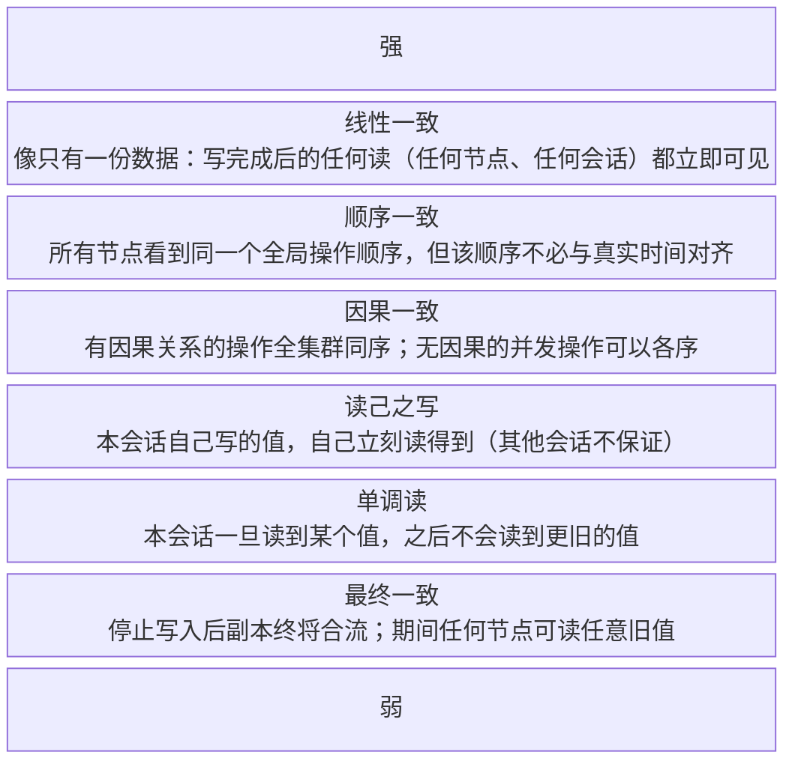

# 分布式理论基础：CAP、共识与一致性
> [返回：软件架构学习大纲](../软件架构学习大纲.md)

本文件是第三阶段主笔记 [01-分布式系统核心技术.md](01-分布式系统核心技术.md) 第 1 节“理论基础”的完整展开版：原 1.1~1.6 全部内容与编号原样保留（其他笔记引用“见 1.4”仍然成立），在其上做深化扩写。文中“见 4.5”“见 3.1”等编号指主笔记的对应小节；三个可运行示例目录 [02a-示例-cap-algorithms/](02a-示例-cap-algorithms)（Paxos 模拟、Quorum/NWR 演示、Gossip/CRDT）与本节新增的 Raft 选举模拟配套使用。


## 1.1 CAP：被普遍误读的“三选二”

**概念定义**：CAP 描述分布式系统在**网络分区（Partition）**发生时的三个属性：

| 字母 | 含义 | 场景化例子 |
|---|---|---|
| C（一致性） | 所有节点同一时刻看到同一份数据 | 库存、账户余额的所有副本都认为 sku=1001 只剩 2 件 |
| A（可用性） | 每个请求都能在合理时间内得到非错误响应 | 设备上报、IM 发消息总有响应，而不是报错或无限挂起 |
| P（分区容忍） | 节点间网络断开时系统仍能工作 | 物联网接入网关与数据管道之间、两地 IM 机房之间网络断了 |

**常见误读**：❌ “CAP 就是三选二，我们的系统选 CA。”

**修正理解**：✅ P 不是可选项。只要数据分布在多台机器上，网络分区**迟早**发生：物联网平台百万设备分布各地，网关与后端、机房与机房之间的链路断开是常态而非意外；IM 两地机房之间的光缆被挖断也不是新闻；甚至一次长 GC 在效果上也像分区。真正的取舍只发生在**分区期间**：要么拒绝写入保 C（牺牲 A），要么继续接受写入保 A（两侧数据暂时不一致）；**没有分区时 C 和 A 可以同时拥有**——Brewer 本人在 2012 年专门撰文澄清过这一点。

分区真的发生时，两类业务的选法相反：

- **支付扣款（支付与清结算）选 C**：宁可让付款页报“系统繁忙”，也不能出现两份成功扣款。钱相关的数据通常倾向 CP。
- **设备数据上报（物联网平台）选 A**：接入层照常收数据，分区恢复后按事件时间去重、对账收敛。设备端本来就有弱网重传，“先收下来慢慢收敛”是常态，价值密度低的时序数据经得起秒级延迟。

⚠️ 再强调：不要给整个系统贴 CAP 标签。CAP 描述的是**单个数据副本组在一次分区中的行为**——同一个物联网平台里，指令下发模块可以是 CP（宁可不发，不能发错发重），时序数据模块可以是 AP。

**CAP 常见误读纠正表**：把工程评审和面试里反复出现的错误逐条钉死。每一条都值得背下来，因为它们分别对应一次真实的事故形态：

| 常见误读 | 纠正 |
|---|---|
| “三选二就是三个里随便放弃一个，我们放弃 P” | P 不是选项。多副本 + 网络 = 分区迟早发生（包括长 GC、网卡重置这类“软分区”），只能假设它会发生；真正的取舍是分区发生时在 C、A 之间二选一 |
| “P 是‘分区的概率’，我们网络稳，所以没有 P” | P 不是概率而是能力声明：“分区发生时系统仍能继续服务”。网络再稳也要按“会分区”设计——稳只是让分区的频率低，不改变定理 |
| “C 就是 ACID 的事务一致” | CAP 的 C 是**单对象**线性一致；多对象、跨表、跨服务的“要么全成要么全不成”是分布式事务（主笔记第 4 节）的领地，CAP 根本不覆盖它 |
| “只要没拒绝服务就是可用，超时不算故障” | 形式化 A 只承诺“最终得到非错误响应”——阻塞 30 秒再答也算 A。工程说的可用性（低延迟、高成功率）是比 CAP 的 A 强得多的指标，所以才有 PACELC |
| “我们系统整体是 CP / AP，全站贴一个标签” | C、A 是**单个数据副本组在单次分区中**的属性。同一个物联网平台里指令下发 CP、时序上报 AP 混用是常态（Kleppmann 2015 的观点正是“别给数据库贴标签”） |
| “平时也要在 C 和 A 里做取舍” | 无分区时 C、A 可兼得；平时的权衡是**延迟 vs 一致性**（PACELC 的 E 分支），跟分区期间的 A/C 取舍是两码事 |
| “分区时选了 A 就完事了，等它自己好” | 选 A 只是第一步。没有“检测 → 仲裁 → 修复”的收敛闭环（见下方三阶段），“最终一致”的“最终”就没有着落——副本可能永远分叉 |
| “脑裂时丢了数据是 CAP 定理决定的，没办法” | 定理只约束**分区期间**的行为。恢复后靠多数派仲裁、读修复、反熵、业务补偿可以把状态找回来；丢数据几乎总是实现缺陷（比如没做提交前多数派确认），不是定理的代价 |

**分区恢复后的收敛三阶段**：AP 系统真正的设计量不在“分区时选 A”这个决定，而在恢复路径。三阶段各自有一套工程动作：

1. **检测——知道“断没断、好了没”**。工程动作：心跳超时不能是二值的，用疑似度计分（Phi Accrual，Cassandra/Gossip 风格）代替“一次超时即判死”，把“网络抖一下”和“真宕机”区分开；Leader 身份用**租约 + 多数派确认**双重判断——不能只靠本机时钟（时钟漂移会让两侧都认为自己是主，这是脑裂事故最常见的根因）；Raft 的做法最干净：Leader 定期向 Follower 收心跳回执，凑不齐多数派响应就自行退位，“我是不是主”由多数派说了算，不由自己说了算。
2. **仲裁——分区期间谁说了算**。工程动作：多数派（Quorum）是通用仲裁器——只有能凑齐多数派的侧才能提交写入、才能担任 Leader（原理见 1.4、1.5）；少数派侧要么拒绝写（CP），要么照写但把每次写打上版本号/向量时钟标记“未定案”（AP）。铁律是：**分区期间两侧绝不动手“修数据”**——修复必须在恢复后、基于全局信息做，分区期间任何一侧的“自信修复”都是制造冲突。
3. **数据修复——愈合后把差异补齐**。工程动作清单：**读修复**（读到比本地新的值时顺手回写本地，Dynamo/Cassandra 的 read repair，零成本搭车）；**反熵同步**（Gossip 周期性两两比对，用 Merkle 树定位差异块只传差量，见 1.6）；**日志回放**（把 WAL/变更日志按序重放给落后副本）；**冲突裁决**（LWW、向量时钟、CRDT merge 或业务层补偿，见 1.6 与主笔记 4.5 对账）。两条纪律：修复流量要限速——刚愈合的链路最脆，修复洪峰常把恢复中的节点再次压垮；修复完成前读流量要声明“可能旧”（响应带版本号），别让上游误以为已经一致。

物联网平台的**设备影子**是三阶段的完整样本：分区期间设备端与云端各自记录状态（选 A）；恢复后先比对双方版本号（检测/仲裁），再按最新版本互补差量（修复）——影子文档里的“期望值/上报值”两个字段就是为这个流程设计的。

**理论来源：从工程直觉到“定理”**。CAP 不是凭空掉下来的公理，它走过一条“实践总结 → 猜想 → 形式化证明 → 作者本人纠偏”的路：

| 时间 | 事件 | 一句话要点 |
|---|---|---|
| 1998~1999 | Brewer（UC Berkeley 教授、Inktomi 联合创始人）经营大规模集群服务时总结出这一权衡（与 Fox 合著 Harvest/Yield 论文） | 出身工程实践，最初是经验之谈 |
| 2000 | PODC（分布式计算原理大会）主题演讲 *Towards Robust Distributed Systems* | 正式以**猜想**形式提出“一致性、可用性、分区容忍不可兼得”，讲稿只有寥寥数页幻灯片 |
| 2002 | MIT 的 Gilbert & Lynch 发表 *Brewer's Conjecture and the Feasibility of Consistent, Available, Partition-Tolerant Web Services* | 把三个性质形式化，在**异步网络模型**下证明猜想成立；2010 年修订后重刊于 CACM，“CAP 定理”由此得名 |
| 2012 | Brewer 撰文 *CAP Twelve Years Later: How the “Rules” Have Changed* | 亲自纠偏：“三选二”是误导，无分区时 C、A 可兼得；分区期间更好的策略是记录冲突、分区恢复后补偿收敛，而非简单弃 A |
| 2015 | Kleppmann 发表 *Please Stop Calling Databases CP or AP* | C、A 是**单个操作**的属性，给整个数据库贴 CP/AP 标签没有意义——正是上文“不要给系统贴标签”的理论依据 |

**形式化定义**（Gilbert & Lynch 的原始定义比日常口语严格，常见的误区都出在这里）：

| 字母 | 形式化定义 | 与日常口语的偏差 |
|---|---|---|
| C | **单对象**上的原子一致性（atomic，即线性一致）：所有读写表现得像按某个全局顺序逐个执行，且符合实时先后 | 日常说的“数据一致”常混入“多表/多对象事务一致”——CAP 不覆盖后者，那是分布式事务（第 4 节）的领地 |
| A | **完全可用**：到达任何非故障节点的请求**最终**得到非错误响应 | 定义只承诺“最终响应”，阻塞 30 秒再答也算 A；工程说的“高可用/低延迟”是更强的要求（于是有了下方的延迟维度扩展） |
| P | 网络可以任意丢消息、无限延迟（直到分区愈合） | 不是“容忍偶尔丢包”，而是假设节点间通信可能**任意长时间**中断——这正是“P 不可选”的原因：只能假设它会发生 |

**证明直觉**（异步模型，两个节点就够）：分区期间 G1 收到写请求、G2 收到读请求，两边无法通信。若 G2 必须立刻响应（保 A），它无法证明自己拿到的是最新值（弃 C）；若 G2 憋住不答、等分区恢复再对齐（保 C），请求就无限挂起（弃 A）。异步模型里节点分不清“对方宕机”和“链路断了”，这个二选一无处可逃；部分同步模型下结论稍弱：三者兼得的系统在分区愈合的收敛过程中，仍必然出现违反 C 或 A 的窗口。

**PACELC（2010，Abadi）：把 CAP 从“灾备时刻”扩展到“平时”**。CAP 只回答了分区那一小段时间的取舍；可系统 99.99% 的时间没有分区，平时的权衡是**延迟（Latency）vs 一致性（Consistency）**：

> 分区时（P）在 A/C 里二选一；无分区时（E）在延迟/一致性里二选一。

- **PC/EC**：分区时弃 A，平时同步复制保 C——etcd/ZooKeeper、支付收款主库（宁慢三分，不错一笔）。
- **PA/EL**：分区时弃 C，平时异步复制换低延迟——Dynamo、Cassandra 默认配置、Feed 计数、物联网时序、MES 看板聚合。
- 同一系统内混用是常态：支付与清结算里，收款流水 PC/EC，商户经营报表 PA/EL——取舍粒度仍然是“单个数据副本组”。

PACELC 落到评审里就变成两个问题：“分区了你站哪边？”（P 分支）和“平时你愿意为强一致付多少毫秒？”（E 分支）。第二个问题经常被忽略：同步复制每多等一个副本，写延迟就加一次跨机房 RTT——支付主库愿意付，Feed 点数不愿意付，这就是 EC 和 EL 的日常形态。

## 1.2 BASE：AP 路线的工程化契约

BASE 是对“分区期间选 A”的工程化补充（对 ACID 的妥协）：

| 字母 | 含义 | 场景化例子 |
|---|---|---|
| Basically Available（基本可用） | 损失部分可用性换生存：限流、降级、响应变慢 | 秒杀时下单排队、推荐位返回兜底商品；Feed 热搜降级为分钟级更新 |
| Soft state（软状态） | 允许存在中间状态 | 支付单停在“支付中”等渠道回调；分账单“分账处理中” |
| Eventually consistent（最终一致） | 停止写入后，经过一段时间副本收敛一致 | 支付成功几秒后，发货指令、分账、积分才陆续看到该事件；MES 看板聚合延迟秒级 |

**一句话关系**：CAP 是理论判断（分区时必弃其一），BASE 是选 A 之后的工程纪律（接受软状态，但必须保证收敛，且收敛过程要有对账与补偿，见 4.5）。

**“基本可用”的两种形态**值得拆开：一是**流量降级**——请求还在但变慢、排队（秒杀进入虚拟排队、MQ 削峰），服务“打折不缺席”；二是**功能降级**——直接砍掉非核心能力（大促时关闭商品评论、推荐位换成静态兜底图），服务“缺席不打折”。两者都要预设触发条件和恢复动作，而不是等宕机再临场发挥。

**“软状态”的工程红线**：中间状态必须**可见、可查、可推进**。支付单停在“支付中”不是问题，没人管它才是问题——必须有超时主动查证（向渠道反查）、有补偿任务推进到终态（成功/失败），有运营视角的“卡单监控”。软状态是借据，不是可以遗忘的垃圾。

**“最终”是多久、靠什么收敛**：最终一致从来不承诺时间点，但成熟系统会给自己定**收敛 SLA**——例如“停止写入后 99% 的副本在 5 秒内收敛”。把“最终”变可信的手段全是机械重复式的：本地消息表 + MQ 重试（主笔记 4.5）、日终对账批处理（支付与清结算）、读修复与反熵（1.6）、CRDT 结构化合并（1.6）。选哪种取决于数据形态，但共同点是：**收敛靠持续运行的机制，不靠一次性的祈祷**。

**BASE 的边界——什么不能 BASE**：判据一句话——**错一时会铸成事实的状态不能用 BASE，错一时只是显示旧的可以**。账户余额、库存数字这类“钱和货”是后续计算的输入，读旧值做出的扣款、发货会立刻变成不可逆的事实，所以它们必须强一致（共识或事务）；而通知、积分、报表、缓存、推荐这些“衍生数据”，读旧值最多让用户晚几秒看到，BASE 正合适。桶装水商城的下单链路能做最终一致的只有后半段（通知、积分、配送排线），前半段扣款扣库存不行——这就是 1.3 分层取舍表的理论根据。

## 1.3 一致性模型：强一致 / 最终一致

**强一致（线性一致）**：任何读都能读到最近一次写的结果，系统表现得像只有一份数据。实现代价高：要么单点串行（单库事务），要么依赖共识算法（1.4）同步复制。
**最终一致**：停止写入后，经过一段时间所有副本收敛到相同状态；期间不同节点可能读到不同版本。

一致性不是二值，而是一个光谱：读己之写（自己写完自己一定能读到）、单调读（不会越读越旧）、因果一致（先问后答的顺序保留）……工程上常按“会话保证”逐条承诺，而非全有或全无。

**一致性模型强弱阶梯**（文字版阶梯图，从最强到最弱）：



每级的判据与破约反例（什么操作会破约）：

| 层级 | 一句话判据 | 破约反例 |
|---|---|---|
| 线性一致 | 写 x=1 完成后，任何后续读必须返回 1 或更新的值 | 分区期间从副本返回旧值——一次“读到了过去”即破约；所有强一致存储的核心卖点就是这一条 |
| 顺序一致 | 所有节点对同一组并发写看到**同一个**全局顺序（顺序可以“错”，但大家错得一样） | 节点 A 看到 x=1 后 y=2，节点 B 看到 x=2 后 y=1——顺序分叉即破约；多主复制最容易踩这里 |
| 因果一致 | “先发帖 → 后评论”这类因果链全集群同序；互不知情的并发写无此约束 | 用户先在帖子下发评论，刷新后却先刷到帖子、评论“消失”几秒——因果倒挂即破约；把回复链的 ID 依赖带上就能守住 |
| 读己之写 | 自己提交的写，本会话下一次读立即可见 | 改完收货地址立刻下单，订单里却是旧地址（读写路由到不同副本）——会话内“写丢了一样”即破约 |
| 单调读 | 会话内读序不倒退：读过“已发货”就不会再看到“打包中” | 第二次刷新落到了更落后的从库，状态“回滚”——越读越旧即破约；粘性会话路由就是防它 |
| 最终一致 | 只承诺停写后收敛，不承诺何时、不承诺期间读什么 | 写入早已停止、副本却永远不合流（反熵停摆、合并函数有 bug）——“最终”没有着落即破约 |

两类业务的典型选型：

- **必须强一致**：支付扣款——同一笔交易绝不能出现两份成功；秒杀扣库存——不能超卖。
- **接受最终一致**：Feed 时间线——发帖后粉丝几秒内才刷到完全无妨；MES 生产看板——各工序报工聚合出“今日产量”，秒级延迟不影响决策。

**阶梯落位速查**（按场景对号入座，评审配置时直接抄）：

| 场景 | 阶梯位置 | 理由 |
|---|---|---|
| 支付扣款、秒杀库存扣减 | 线性一致 | 错了变成事实（双扣、超卖） |
| 订单状态流转（用户侧） | 读己之写 | 用户自己操作后必须立刻看到结果，别人晚几秒无妨 |
| 购物车、收货地址 | 读己之写 + 单调读 | 自己别看到旧值即可，跨设备可放宽 |
| Feed 时间线、评论区 | 因果一致 ~ 最终一致 | 评论不该先于帖子出现；实际系统常用“带排序键的最终一致”近似因果 |
| 点赞数、浏览量、MES 看板 | 最终一致 | 数字旧一点无决策风险 |
| IM 消息 | 会话内顺序一致 + 读己之写 | 同一会话消息不能乱序（会话级序列号），自己发的消息自己立刻可见 |

**反例**：❌ 把整条链路做成同步强一致——桶装水商城下单：同步扣库存 → 同步核销优惠券 → 同步算配送线路 → 同步记押金 → 同步发短信，任何一环失败整体回滚。延迟逐级叠加，可用性相乘（4 个 99.9% 的服务串起来只剩约 99.6%），改一处通知逻辑要动下单代码。

**修正**：✅ 分层取舍——

| 环节 | 一致性要求 | 手段 |
|---|---|---|
| 支付扣款、余额/额度冻结 | 强一致（不能凭空扣钱、不能两份成功） | 数据库事务 / 共识 / TCC |
| 秒杀库存扣减 | 强一致（不能超卖） | Redis + Lua 原子预扣，DB 乐观锁兜底（3.1） |
| 订单/支付单状态流转 | 读己之写 + 最终一致 | 主从复制、状态机 + 消息驱动（4.5） |
| Feed 时间线、MES 看板、积分、通知 | 最终一致（秒级延迟可接受） | 本地消息表 + MQ |

**会话保证的最便宜实现是粘性路由**：同一用户的读写固定到同一副本（或同一主库），读己之写与单调读自动成立，一行路由配置换两条保证——比升级存储便宜几个量级。代价是该副本宕机要重新粘（短暂破约），以及热点用户可能压垮单副本（配合 3.3 缓存缓解）。评审时的顺序应该是：先问“会话保证够不够”，不够再谈线性一致——多数业务要的其实是前者。

## 1.4 共识算法：Raft 为主，了解 Paxos

**要解决的问题**：多个节点如何对“下一个值是什么”达成一致，且少数节点宕机、网络分区时不出错。这是实现强一致存储（如 etcd、TiKV）的底座。多数派是关键：**2f+1 个节点可容忍 f 个故障**，因为任意两个多数派必然相交，已提交的值不会丢。

**Paxos（了解细节，重点看它为什么“长这样”）**：经典共识算法，角色分为 Proposer（提案者）/ Acceptor（表决者）/ Learner（学习者），通过 **Prepare → Promise、Accept → Accepted** 两阶段对**单个值**（single decree）达成一致。完整可运行模拟见 [03-第三阶段/02a-示例-cap-algorithms/](02a-示例-cap-algorithms)：

```kotlin
// —— 单个值的 Paxos 核心：每个 Acceptor 只记两样东西 ——
class Acceptor(val id: Int) {
    var promisedN = 0L                        // 已承诺的最大提案号：不再接受编号更小的提案
    var accepted: Pair<Long, String>? = null  // 已接受的最大编号提案 (n, value)

    fun prepare(n: Long): Boolean =           // Phase 1：Promise（承诺 + 带回已接受的旧值）
        if (n >= promisedN) { promisedN = n; true } else false

    fun accept(n: Long, value: String): Boolean =     // Phase 2：Accept
        if (n >= promisedN) { accepted = n to value; true } else false
}

// —— Proposer：二阶段的值不许自作主张 ——
fun propose(n: Long, selfValue: String, acceptors: List<Acceptor>): String? {
    val granted = acceptors.filter { it.prepare(n) }              // Phase 1 收 Promise
    if (granted.size <= acceptors.size / 2) return null           // 没拿到多数派承诺，换更高编号重试
    // ⚠️ 关键：只要任何一个 Promise 带回了已接受的旧值，就必须放弃自选值改用它
    val carried = granted.mapNotNull { it.accepted }.maxByOrNull { it.first }?.second
    val value = carried ?: selfValue
    val acks = granted.count { it.accept(n, value) }              // Phase 2 发 Accept
    return if (acks > acceptors.size / 2) value else null         // 多数派接受 → 值被"选定"
}
```

三条关键不变量（Paxos 的全部安全性都藏在这里）：

1. **提案号全局唯一且全序**（如“轮次计数 + 节点 ID”拼位），谁大谁说了算。
2. **Promise 是承诺**：Acceptor 承诺不再接受编号更小的提案，并**带回它已接受的最高编号值**——这保证已被多数派接受的值不会被后来者换掉。
3. **Proposer 必须沿用旧值**：二阶段提的值只能是 Promise 里编号最大的那个旧值；只有没人接受过值时才能用自选值。于是：一旦某值被多数派接受，之后所有提案提的都是同一个值，Learner 学到的值唯一。

**活锁**：两个 Proposer 交替抬高提案号——A 的 Accept 还没落地，B 的更高号 Prepare 已把 Acceptor 的承诺抢走，A 失败、加号重试、又抢走 B 的……理论上永远选不定。**工程解法就是 Multi-Paxos 的稳定 Leader**：选出一个 Leader 独占提案权后，后续提案省掉 Phase 1 只走 Phase 2（两阶段压成一阶段）。Raft 用选举一步到位实现了同样的事——**Prepare ≈ 选举**（“你日志比我新我就服你”）、**Accept ≈ 日志复制**；Paxos 对每个日志位独立跑一次共识，Raft 用“日志连续 + 只认最新 Leader”把它串成流水线，这就是“为可理解性设计”的落点。正确但极难理解、更难实现正确，于是有了 Raft。

**Raft 主流程**：把共识分解为三个子问题——Leader 选举、日志复制、安全性。所有写请求都经过 Leader。

```kotlin
// —— 选举：随机超时把"瓜分选票"的概率压到极低 ——
enum class Role { FOLLOWER, CANDIDATE, LEADER }

class RaftNode(val id: Int, val peers: List<RaftNode>) {
    var role = Role.FOLLOWER
    var currentTerm = 0          // 任期，单调递增，是 Raft 的"逻辑时钟"
    var votedFor: Int? = null    // 本任期投给谁（一任一票）
    var commitIndex = -1         // 已提交（已复制到多数派）的最高日志下标
    val log = mutableListOf<Pair<Int, String>>()   // (term, command)

    fun startElection() {                       // 选举超时（如 150~300ms 随机）未收到心跳
        role = Role.CANDIDATE
        currentTerm += 1
        votedFor = id                           // 先投自己
        val votes = peers.count { it.grantVote(currentTerm, id, log.lastIndex()) } + 1
        if (votes > peers.size / 2) role = Role.LEADER   // 拿到多数派即当选
    }
}

// —— 日志复制：一条"账户扣款"命令的旅程 ——
fun replicate(leader: RaftNode, command: String): Boolean {
    leader.log += leader.currentTerm to command                  // 1. Leader 先追加本地日志（未提交）
    val acks = leader.peers.count { it.appendEntries(leader) } + 1
    return if (acks > leader.peers.size / 2) {                   // 2. 并行发给 Follower，复制到多数派
        leader.commitIndex = leader.log.lastIndex()              // 3. 达到多数派才"提交"
        applyToStateMachine(command)                             // 4. 应用到状态机后才响应客户端
        true
    } else false
}
```

记住三条就够面试和设计用了：

1. **选举**：Follower 随机超时未收到心跳 → 升任 Candidate、term+1、拉票；多数派同意则成为 Leader；一任一票 + 随机超时避免选举活锁。
2. **复制**：命令先写 Leader 本地日志，AppendEntries 并行同步 Follower，**提交条件是复制到多数派**；Follower 日志与 Leader 冲突时被强制覆盖成 Leader 的（日志匹配特性）。
3. **安全**：选举时只有拥有“最新日志”的节点能赢（比较最后一条日志的 term 和 index），所以旧 Leader 脑裂成少数派时无法提交任何日志——已提交的数据绝不丢失。

**工程补丁（真实实现绕不开的四个细节）**：

1. **提交规则（“图 8 问题”）**：Leader 只能靠**当前任期**的日志推进 commitIndex——旧任期日志即使已复制到多数派，也不能直接判定已提交（它可能随新 Leader 当选被覆盖），只能夹在新日志里“搭车”提交。防止的事故：旧 Leader 脑裂期间把某条日志复制到了多数派但未响应客户端，新 Leader 上台把它覆盖掉——若按“复制到多数派即提交”就会丢掉一条“曾经算数”的日志。
2. **PreVote**：被网络隔离的 Follower 反复选举超时、term 疯涨，重新连上后用巨大的 term 把正常集群的 Leader 顶翻。PreVote 让节点先“试探拉票”（不涨 term），确认能联系上多数派才真正开始选举——把“隔离节点的歇斯底里”挡在门外。
3. **线性一致读**：读也走日志复制太贵。ReadIndex——Leader 先向多数派确认“我仍是 Leader”，再读本地状态机返回；Leader Lease——靠租约期内时钟上界保证身份有效，免确认直接读。读己之写也要走 ReadIndex（客户端的读可能落在已被替换的旧 Leader 上）。
4. **快照与成员变更**：日志不能无限增长，定期快照 + 丢弃已快照前缀；扩缩容改成员组要走两阶段联合一致（joint consensus），避免新旧配置两个“多数派”各选出一个 Leader。

**可运行示例：3 节点 Raft 选举超时与脑裂的最小状态机模拟**。上面的 RaftNode 片段只有骨架，下面给一个能跑的完整模拟：3 节点、150~300ms 随机选举超时、50ms 心跳、两轮故障注入——第一轮隔离**现任 Leader**（经典脑裂窗口：旧 Leader 毫无察觉地继续自认 Leader，直到愈合时被更高任期的心跳迫令退位）；第二轮隔离一个 **Follower**（term 疯涨、重连后顶翻健康集群——工程补丁 2 PreVote 要防的那件事，安全起见完整跑一遍让你亲眼看到）。用固定随机种子保证输出可复现；时间用离散事件推进（真实实现里就是定时器 + 网络线程）。保存为 `RaftElectionSim.kt`，用 `kotlinc RaftElectionSim.kt -include-runtime -d raft.jar && java -jar raft.jar` 即可复跑（本文输出为 kotlinc 2.2.20 实际运行结果）。

```kotlin
import kotlin.random.Random

enum class Role { FOLLOWER, CANDIDATE, LEADER }

// —— 最小 Raft 状态机：只保留"选主 + 脑裂避免"所需的状态 ——
class RaftNode(val id: Int, private val rnd: Random) {
    var role = Role.FOLLOWER
    var term = 0                 // 任期：Raft 的逻辑时钟，单调递增
    var votedFor: Int? = null    // 本任期投给谁（一任一票）
    var leaderId: Int? = null
    var nextElectionAt = 0       // 下次选举超时的时刻（随机化）

    fun resetElectionTimer(now: Int) {
        nextElectionAt = now + ELECTION_TIMEOUT_MIN + rnd.nextInt(ELECTION_TIMEOUT_SPREAD) // 150~300ms
    }

    // 处理 RequestVote：任期比我新就先更新自己；同任期本任期还没投过票才投
    fun grantVote(candidateTerm: Int, candidateId: Int, now: Int): Boolean {
        if (candidateTerm < term) return false
        if (candidateTerm > term) observeHigherTerm(candidateTerm, now)
        if (votedFor != null && votedFor != candidateId) return false
        votedFor = candidateId
        resetElectionTimer(now)  // Raft 约定：投出票也算"见到活动"，同样续命
        return true
    }

    // 处理心跳（AppendEntries 的空载体）：任期不落后才认账，认账即续命
    fun receiveHeartbeat(leaderTerm: Int, fromId: Int, now: Int): Boolean {
        if (leaderTerm < term) return false
        if (leaderTerm > term) observeHigherTerm(leaderTerm, now)
        role = Role.FOLLOWER   // 同任期的 CANDIDATE 见到合法 Leader 也要让位
        leaderId = fromId
        resetElectionTimer(now)
        return true
    }

    // 发现更高任期：无条件让位降级，并清空本任期投票（新任期可以重新投）
    private fun observeHigherTerm(newTerm: Int, now: Int) {
        if (role != Role.FOLLOWER)
            ev("节点$id（自认 ${role.name}, term=$term）见到更高任期 term=$newTerm，让位降级 FOLLOWER")
        role = Role.FOLLOWER
        term = newTerm
        votedFor = null
        leaderId = null
        resetElectionTimer(now)
    }

    // 选举超时：自荐当候选者，向所有同伴拉票
    fun onElectionTimeout(now: Int, peers: List<RaftNode>, requestVote: (RaftNode, RaftNode, Int) -> Boolean) {
        role = Role.CANDIDATE
        term += 1
        votedFor = id                 // 先投自己
        resetElectionTimer(now)
        ev("节点$id 选举超时 -> CANDIDATE，发起 term=$term 拉票（自投 1 票）")
        val votes = mutableSetOf(id)
        for (p in peers) if (requestVote(this, p, now)) votes += p.id
        val total = peers.size + 1                // 3 节点集群
        val majority = total / 2 + 1              // 多数派 = 2 票
        if (votes.size >= majority) {
            role = Role.LEADER
            leaderId = id
            ev("节点$id 得票 ${votes.size}/$total 过半 -> 当选 LEADER（term=$term），按 50ms 周期广播心跳")
        } else {
            ev("节点$id 得票 ${votes.size}/$total 未过半，等下一次随机超时再选")
        }
    }

    companion object {
        const val ELECTION_TIMEOUT_MIN = 150
        const val ELECTION_TIMEOUT_SPREAD = 150
        const val HEARTBEAT_INTERVAL = 50   // 心跳间隔必须 < 最小选举超时 150ms
    }
}

// —— 离散事件模拟：虚拟时钟按 10ms 步进；真实实现里这是定时器 + 网络线程 ——
var clock = 0
fun ev(msg: String) = println("[t=${clock.toString().padStart(4)} ms] $msg")

fun main() {
    val rnd = Random(42)                     // 固定种子，输出可复现
    val nodes = (1..3).map { RaftNode(it, rnd) }
    nodes.forEach { it.resetElectionTimer(0) }
    ev("集群启动：3 节点全为 FOLLOWER，随机选举超时分别设在 ${nodes.map { it.nextElectionAt }} ms")

    val isolated = mutableSetOf<Int>()       // 分区名单：名单内节点收发一律丢弃
    val announced = mutableSetOf<Pair<Int, Int>>()
    var splitBrainAnnounced = false
    fun blocked(a: Int, b: Int): Boolean {
        if (a in isolated || b in isolated) {
            if (a to b !in announced) { ev("[分区] 节点$a -> 节点$b 的消息被网络丢弃（后续同类丢弃不再逐条打印）"); announced += a to b }
            return true
        }
        return false
    }
    fun requestVote(from: RaftNode, to: RaftNode, now: Int): Boolean =
        !blocked(from.id, to.id) && to.grantVote(from.term, from.id, now)

    fun heartbeat(from: RaftNode, to: RaftNode, now: Int): Boolean {
        if (blocked(from.id, to.id)) return false
        val ok = to.receiveHeartbeat(from.term, from.id, now)
        if (!ok) ev("节点${to.id} 拒绝节点${from.id} 的心跳（自己任期更高 term=${to.term}）")
        return ok
    }

    val leaderIsolatedAt = 500    // 第一次故障：隔离现任 Leader（经典脑裂窗口）
    val healAt = 900
    val followerIsolatedAt = 1300 // 第二次故障：隔离一个 Follower（演示 term 疯涨与 PreVote 动机）
    val heal2At = 1700
    val end = 2200
    while (clock <= end) {
        if (clock == leaderIsolatedAt) {
            val leader = nodes.first { it.role == Role.LEADER }
            isolated += leader.id
            ev("【故障一】隔离现任 Leader 节点${leader.id}（term=${leader.term}）——它自己毫无察觉")
        }
        if (clock == followerIsolatedAt) {
            val follower = nodes.first { it.role == Role.FOLLOWER }
            isolated += follower.id
            ev("【故障二】隔离 Follower 节点${follower.id}（term=${follower.term}）")
        }
        if (clock == healAt || clock == heal2At) {
            isolated.clear()
            val leaders = nodes.filter { it.role == Role.LEADER }
            splitBrainAnnounced = false
            ev("【网络愈合】此刻集群有 ${leaders.size} 个自认 LEADER：${leaders.joinToString { "节点${it.id}(term=${it.term})" }}")
        }
        // 1) 所有自认 LEADER 的节点按周期广播心跳（发送前复查身份：本 tick 内已让位的不发）
        if (clock > 0 && clock % RaftNode.HEARTBEAT_INTERVAL == 0) {
            for (l in nodes) {
                if (l.role != Role.LEADER) continue
                for (p in nodes) if (p.id != l.id) heartbeat(l, p, clock)
            }
        }
        // 2) 脑裂窗口播报：两个自认 LEADER 并存
        if (!splitBrainAnnounced && isolated.isNotEmpty() && nodes.count { it.role == Role.LEADER } > 1) {
            splitBrainAnnounced = true
            ev("⚠ 脑裂窗口：两个自认 LEADER 并存。旧 Leader 的写请求凑不齐多数派确认，一条日志也提交不了")
        }
        // 3) FOLLOWER/CANDIDATE 检查选举超时
        for (n in nodes)
            if (n.role != Role.LEADER && clock >= n.nextElectionAt)
                n.onElectionTimeout(clock, nodes.filter { it.id != n.id }, ::requestVote)
        clock += 10
    }

    println("---- ${end} ms 终态 ----")
    nodes.forEach { ev("节点${it.id}: role=${it.role}, term=${it.term}, 认为的 Leader=节点${it.leaderId}") }
}
```

实际运行输出（kotlinc 2.2.20，种子固定，逐字可复现）：

```text
[t=   0 ms] 集群启动：3 节点全为 FOLLOWER，随机选举超时分别设在 [233, 240, 191] ms
[t= 200 ms] 节点3 选举超时 -> CANDIDATE，发起 term=1 拉票（自投 1 票）
[t= 200 ms] 节点3 得票 3/3 过半 -> 当选 LEADER（term=1），按 50ms 周期广播心跳
[t= 500 ms] 【故障一】隔离现任 Leader 节点3（term=1）——它自己毫无察觉
[t= 500 ms] [分区] 节点3 -> 节点1 的消息被网络丢弃（后续同类丢弃不再逐条打印）
[t= 500 ms] [分区] 节点3 -> 节点2 的消息被网络丢弃（后续同类丢弃不再逐条打印）
[t= 700 ms] 节点2 选举超时 -> CANDIDATE，发起 term=2 拉票（自投 1 票）
[t= 700 ms] [分区] 节点2 -> 节点3 的消息被网络丢弃（后续同类丢弃不再逐条打印）
[t= 700 ms] 节点2 得票 2/3 过半 -> 当选 LEADER（term=2），按 50ms 周期广播心跳
[t= 710 ms] ⚠ 脑裂窗口：两个自认 LEADER 并存。旧 Leader 的写请求凑不齐多数派确认，一条日志也提交不了
[t= 900 ms] 【网络愈合】此刻集群有 2 个自认 LEADER：节点2(term=2), 节点3(term=1)
[t= 900 ms] 节点3（自认 LEADER, term=1）见到更高任期 term=2，让位降级 FOLLOWER
[t=1300 ms] 【故障二】隔离 Follower 节点1（term=2）
[t=1300 ms] [分区] 节点2 -> 节点1 的消息被网络丢弃（后续同类丢弃不再逐条打印）
[t=1410 ms] 节点1 选举超时 -> CANDIDATE，发起 term=3 拉票（自投 1 票）
[t=1410 ms] [分区] 节点1 -> 节点2 的消息被网络丢弃（后续同类丢弃不再逐条打印）
[t=1410 ms] [分区] 节点1 -> 节点3 的消息被网络丢弃（后续同类丢弃不再逐条打印）
[t=1410 ms] 节点1 得票 1/3 未过半，等下一次随机超时再选
[t=1580 ms] 节点1 选举超时 -> CANDIDATE，发起 term=4 拉票（自投 1 票）
[t=1580 ms] 节点1 得票 1/3 未过半，等下一次随机超时再选
[t=1700 ms] 【网络愈合】此刻集群有 1 个自认 LEADER：节点2(term=2)
[t=1700 ms] 节点1 拒绝节点2 的心跳（自己任期更高 term=4）
[t=1750 ms] 节点1 拒绝节点2 的心跳（自己任期更高 term=4）
[t=1800 ms] 节点1 拒绝节点2 的心跳（自己任期更高 term=4）
[t=1820 ms] 节点1 选举超时 -> CANDIDATE，发起 term=5 拉票（自投 1 票）
[t=1820 ms] 节点2（自认 LEADER, term=2）见到更高任期 term=5，让位降级 FOLLOWER
[t=1820 ms] 节点1 得票 3/3 过半 -> 当选 LEADER（term=5），按 50ms 周期广播心跳
---- 2200 ms 终态 ----
[t=2210 ms] 节点1: role=LEADER, term=5, 认为的 Leader=节点1
[t=2210 ms] 节点2: role=FOLLOWER, term=5, 认为的 Leader=节点1
[t=2210 ms] 节点3: role=FOLLOWER, term=5, 认为的 Leader=节点1
```

**从这次运行里读出四件事**：

1. **随机超时是选主唯一的“指挥”**：全程没有任何协调组件，节点3 只因为随机抽到 191ms 的超时先醒过来就当了 Leader（t=200）。把三处的超时改成相同值重跑一遍试试——三个节点会同时自荐、互相不投、全体反复落选，选举永远完不成：这就是“一任一票 + 随机超时”这对组合防的选举活锁。
2. **少数派永远选不出主，也永远提交不了**：两次故障里被隔离的节点参选都只有 1/3 票（t=1410、t=1580）；脑裂窗口中旧 Leader 节点3 的心跳与写入进不了多数派，“复制到多数派才提交”让它在窗口期一条日志都定不了案——**脑裂对 Raft 只是“暂时没人服务少数派侧”，不是“数据分叉”**。
3. **term 是逻辑时钟，让位是自动的**：愈合那一刻（t=900）不需要任何人介入，旧 Leader 收到 term=2 的心跳立刻降级——“谁的任期高谁代表最新共识”这一条规则同时完成了旧 Leader 下野、新 Leader 确立、集群恢复三件事。
4. **第二次故障正是 PreVote 的现成动机**：被隔离的 Follower 节点1 白白把 term 从 2 涨到 4（t=1410、t=1580 两次落选），重连后反而以“更高任期”拒绝健康 Leader 的心跳（t=1700~1800 三连拒），最终用 term=5 把好好的 Leader 节点2 顶替掉（t=1820）。注意这**安全但不优雅**——没丢任何已提交数据（安全性靠“只认最新日志当 Leader”兜底），却白白换了一次主、抖动了集群。PreVote 把“涨 term”拆成两步：先无任期地试探拉票，确认够得着多数派才真正参选，被隔离节点的 term 就疯涨不起来。真实系统（etcd 等）全都带着这个补丁。

顺带一提模拟里一个实现细节：心跳广播循环在发送前复查 `l.role != Role.LEADER` 才发——因为 Leader 可能在同一 tick 内刚让位，“让位后还把攒下的旧广播发出去”是模拟和真实实现共有的陷阱（消息发出前的状态检查）。这个最小模拟不含日志复制（那部分看上文 `replicate` 与 [02a-示例-cap-algorithms/PaxosSimulation.kt](02a-示例-cap-algorithms/PaxosSimulation.kt) 的两阶段演示），但选举、任期、多数派三条骨干与真实 Raft 完全同构，改参数（超时区间、心跳间隔、节点数）就能做小型实验。

**调参口诀**：选举超时 ≫ 心跳间隔（本例 50ms 心跳 / 150~300ms 选举超时，生产建议至少一个数量级差距），心跳间隔 ≪ 可容忍的故障切换时间（想 500ms 内切主，心跳就得 50ms 量级）；超时区间下限必须大于“一次心跳往返 + 处理延迟”的最大值，否则正常抖动也会触发重选。

**常见实现陷阱清单**（自研或选型时逐条对照）：用本地系统时钟判租约不留漂移余量（双主）；新 Leader 上任后不立即广播日志与心跳（身份传播慢，又触发一轮选举）；先响应客户端再应用状态机（客户端读到未提交值）；日志压缩把未提交前缀一起删掉（图 8 问题的变体）；成员变更不走两阶段联合一致（新旧配置各选一个 Leader）。每一条都在真实事故报告里出现过。

一句话对照：ZooKeeper 的 ZAB 与 Raft 同属多数派共识家族（ZXID 的 epoch ≈ term）；etcd/Consul 用 Raft，TiKV 用 Multi-Raft（按 key range 切成多个 Raft 组并行）。

## 1.5 Quorum 与 NWR：CAP 的连续旋钮

共识算法（1.4）给的是“非黑即白”的强一致，但很多业务要的是**中间档位**：比最终一致更稳，又不想每次写都等多数派同步复制。Quorum 机制把 CAP 的二选一变成可调参数：

- **N**：每个数据的副本数；**W**：写成功要求至少确认的副本数；**R**：读成功要求至少响应的副本数。
- **强一致的充分条件：W + R > N**——写集合与读集合各自过半、必然相交，交集中的副本带着最新版本，读时取版本最高的那份。
- **W > N/2**：两次写的集合也必然相交，写冲突才有“先后”可言。

典型档位（Cassandra/Dynamo 风格，N=3）：

| 配置 | 行为 | CAP 位置 | 场景 |
|---|---|---|---|
| W=1, R=1 | 一个副本确认即成功，最快 | AP：分区两侧都能写读 | 物联网时序上报、Feed 计数 |
| W=2, R=2（QUORUM/QUORUM） | 读写都过半、集合必相交 | 偏 C：分区少数派侧写不进 | 商品库存、订单状态 |
| W=3（ALL） | 全部副本确认才成功 | CP 极端：任一副本失联即不可写 | 极少用——可用性太脆 |

**W/R/N 三参数权衡细账**（N=3 基准，把上表的“为什么”算出来）：

| 配置 | 写路径代价 | 读路径代价 | 一致性得到什么 | 可用性付出什么 |
|---|---|---|---|---|
| W=1, R=1 | 最低：1 副本确认即返回 | 最低：1 副本应答即返回 | 只剩最终一致：读写集合可不相交，读到旧值是常态 | 容忍 2 副本同时失效；分区两侧照写照读（代价是分叉） |
| W=2, R=1 | 中 | 最低 | **没有保证**：W+R=3=N 不满足，读可能落在没收到这次写的副本上 | 最危险的“伪 QUORUM”——写按时过半了，读却未必新，千万别配 |
| W=2, R=2（QUORUM） | 中：等 2 副本 | 中：等 2 副本 | W+R=4>N：任意读必含最新已确认版本 | 写、读各容忍 1 副本失效；分区少数派侧读写都不可用 |
| W=3, R=1（写 ALL 读 ONE） | 最高：3 副本全确认 | 最低 | 强：写过的值任意读皆新 | 写的可用性最脆：任一副本失联即不可写——分区期间宁可写不进去 |
| W=1, R=3（写 ONE 读 ALL） | 最低 | 最高：读全部副本取版本最高者 | 能读到最新已确认写，但可能读到“未定案”的并发写 | 读的可用性最脆：任一副本失联即不可读 |

规律：**W 定“分区期间还想不想写”（可用性），R 定“读要多新”（延迟），W+R>N 只是把两边接起来的充分条件**。调 R 不影响写路径，调 W 不影响读路径——所以配置顺序是先按分区立场定 W，再按延迟预算配 R。另外注意 Cassandra 还有 LOCAL_QUORUM（本机房内过半）：跨机房部署时用它把仲裁范围钉在本地机房，避免写一次跨两个机房 RTT——NWR 的 N 本身也可以按机房切成局部仲裁组。

**为什么仲裁组取奇数——一笔算术账**：

- **容忍度账**：容忍 f 个故障需要 2f+1 个节点（多数派 = f+1）。3 节点容忍 1 个，5 节点容忍 2 个，7 节点容忍 3 个——每加 2 台才多容 1 个故障。倒过来看偶数有多亏：4 节点的多数派是 3，失效 2 台就凑不齐，**容忍度和 3 节点一样却多花一台机器**；6 节点多数派 4，容忍 2 个，和 5 节点相同。这就是 ZooKeeper/etcd 官方建议 3 或 5 节点、行业约定“仲裁组取奇数”的全部算术根源。
- **部署形状账**：奇数还决定故障域怎么切。5 节点放 3 个机房（2/2/1），任一机房整体失联（最常见的大事故）后剩 3 或 4 台，多数派还在；4 节点放 2 个机房（2/2），任一机房失联只剩 2 台，直接丧失仲裁能力——**同样的硬件，部署形状决定可用性**，“跨机房凑奇数”比“单机房内凑偶数”重要得多。
- **成本上界**：反过来也别盲目上大集群——7 节点以上多数派要 4 台确认，写放大和跨机房延迟上升，而大多数故障场景 5 节点已经扛住；共识组通常止步于 5（更大规模靠 Multi-Raft/分片扩展，不是靠加大单组）。

**反例**：❌ “我们配了 QUORUM，所以系统强一致。”——Quorum 只是**副本数门槛**，一致性还取决于**谁接受写**：

- **单写者 + R+W>N**（所有写经同一个 Leader 串行定序）：可达线性一致。这正是共识算法的本质——**共识 = Quorum 复制 + 唯一 Leader + 日志定序**（对照 1.4 的 Raft）。
- **多写者**（Dynamo 风格，任意副本都能接受写）：R+W>N 只保证读到“最新已确认版本”，两个并发写仍可能在交集中留下分叉——需要冲突处理：向量时钟判定并发、last-write-wins 按时间戳粗暴取舍（可能丢写！）或 CRDT 合并（见 1.6）。

**分区期间**：W=N 的写在少数派侧凑不齐确认 → 拒绝写（弃 A 保 C）；W=1 则两侧照写，愈合后按版本合并收敛（弃 C 保 A）——CAP 的取舍在这里被调成了参数。完整可运行演示（含丢写场景）见 [03-第三阶段/02a-示例-cap-algorithms/](02a-示例-cap-algorithms)。可跑 [QuorumNWR.kt](02a-示例-cap-algorithms/QuorumNWR.kt) 改 W/R/N 参数观察行为差异。

## 1.6 Gossip 与 CRDT：AP 路线的收敛引擎

分区期间选 A（各写各的）只是第一步，BASE 真正的难点是 1.2 里那句“停止写入后副本收敛一致”**靠什么收敛**。AP 世界的两个答案：Gossip 负责“怎么把新值传开”，CRDT 负责“怎么把冲突合掉”。

**Gossip 协议**：每个节点周期性随机挑几个邻居交换信息，像传八卦一样把更新扩散到全集群。三种手段按可靠性/开销递进：

| 手段 | 做法 | 特点 |
|---|---|---|
| Direct mail（直接通知） | 写入时顺手把更新推给其他节点 | 一步到位，但丢一条就漏一洞，只配当加速器 |
| Anti-entropy（反熵） | 周期性两两比对版本、补齐差异；方向分 push / pull / push-pull | 最可靠，是收敛的兜底；push-pull 收敛最快 |
| Rumor mongering（谣言传播） | 新消息像热点谣言传几轮，“过了新鲜期”就不再主动发 | 给反熵省流量——热点消息不必每轮全量比对 |

**收敛速度**：push-pull 每轮让“知情 × 不知情”的配对双方都变为知情，知情数近乎翻倍，约 **O(log n)** 轮收敛——10 个节点三四轮，1000 个节点十轮上下。代价是没有一致性的时点保证：任意时刻读任意节点，可能读到几轮之前的旧值——这正是“最终一致”里“最终”二字的含义。

**为什么 Gossip 最终收敛——直觉论证**：把“知道某条更新的节点”看作染黑的白子。每一轮里每个黑子随机挑 fanout 个邻居交换差异：只要黑子和白子配对，无论 push 还是 pull，配对结果都是白子变黑（push-pull 连黑子自己也补齐缺口）；只有黑黑、白白配对才浪费。所以知情集合每轮**至少翻倍**（直到过半），从 1 个知情节点到 n 个只要 O(log n) 轮；过半之后的尾巴，靠“未染黑节点主动 pull”以极高概率在常数轮内清零。它不依赖任何全局协调、不依赖消息按序到达、甚至容忍丢消息（下一轮反熵会再撞见），只依赖一条：**反熵永不停止 + 消息不会永久丢失**——于是“每个差异最终都会被某次随机配对撞见并补上”是概率意义上的必然。这解释了它的性格：免费（无协调者、无全序要求）但慢（秒到分钟级）且只有“最终”没有“何时”——与 1.2 的收敛 SLA 正好互补。工程上只有两个旋钮：gossip interval（轮间隔）与 fanout（每轮挑几个邻居），调快调大收敛更快、流量随之上升（Cassandra 默认 1 秒 × 3 邻居，是“秒级收敛、流量可忽略”的折中）。

**现实应用**：Cassandra 的集群成员与故障检测（Phi Accrual 疑似度计分）、Consul/Serf 的 memberlist、Redis Cluster 的拓扑传播、Dynamo 的元数据同步，全是 Gossip；Eureka 的对等节点复制同理（呼应 5.4 注册中心的 AP 选型）。

**CRDT（Conflict-free Replicated Data Type，无冲突复制数据结构）**：Gossip 只负责“传”，两个副本各自改了同一份计数器怎么合？CRDT 把收敛性做进数据结构本身——只要 merge 满足**交换律、结合律、幂等**，无论消息乱序、重复、从哪个方向合，所有副本最终收敛到同一值，**不需要人工裁决冲突**：

```kotlin
// G-Counter：只增计数器。每个副本只改自己那一格，merge = 逐格取 max
class GCounter(val replicas: Int) {
    private val counts = LongArray(replicas)              // counts[i] = 副本 i 自己累加的量
    fun increment(replica: Int, by: Long = 1) { counts[replica] += by }   // 只写自己的格
    val value: Long get() = counts.sum()
    fun merge(other: GCounter) {                          // max：交换 + 结合 + 幂等
        for (i in 0 until replicas) counts[i] = maxOf(counts[i], other.counts[i])
    }
}
```

`max` 天然满足三条性质：`max(a,b)=max(b,a)`（交换）、`max(max(a,b),c)=max(a,max(b,c))`（结合）、`max(a,a)=a`（幂等）——乱序、重复收到同一次同步都无害。常用变体：PN-Counter（两个 G-Counter 相减，可增可减）、LWW-Register/Set（带时间戳取新）、OR-Set（增删无歧义的集合）；分布式计数、协作编辑、会话列表合并都在用。一句话对照：**物联网时序去重、支付对账（4.5）是应用层的收敛；CRDT 把同样的收敛下沉为数据结构的数学性质**。

**三条性质逐条拆开看，缺一条会怎样**：

- **交换律 merge(a,b)=merge(b,a)**：保证**乱序无害**——两条同步谁先到达，合并结果一样。缺了它：结果取决于到达顺序，而 Gossip 的投递顺序天然不可控，不同副本按不同顺序合并就收敛到不同值——直接致命。
- **结合律 merge(merge(a,b),c)=merge(a,merge(b,c))**：保证**分组无关**——攒一批状态合一次，与逐个合三次，结果一样。缺了它：同步必须按严格顺序逐条做，并发同步要加全局锁排队，AP 路线的吞吐优势荡然无存。
- **幂等律 merge(a,a)=a**：保证**重复无害**——同一条状态收到十遍也只算一遍。缺了它最隐蔽：比如把 merge 误写成 `counts[i] += other.counts[i]`（求和代替取 max），两个副本互相同步一次，计数就翻一倍，再同步再翻倍——Gossip 不承诺 exactly-once，重复投递是常态，不幂等的 merge 永远收敛不了。
- 三条合起来在数学上构成**半格**（semilattice）：所有副本的状态沿着 merge 方向单调“上升”，最终停在同一处最大值。这就是“不需要仲裁者也能收敛”的数学答案——收敛性不靠时序协议保证，靠数据结构自身的代数性质保证；代价是这个状态必须是“可单调合并”的形状。

顺带看一眼“可减”怎么也守住这三条性质（片段，承接上文 GCounter）：

```kotlin
// 片段：PN-Counter = 两个 G-Counter 相减——"可减"不靠负数，靠把减也变成加
class PNCounter(replicas: Int) {
    private val p = GCounter(replicas)     // 正向格：所有"加"记在这里
    private val n = GCounter(replicas)     // 反向格：所有"减"也只增不减地记在这里
    fun increment(r: Int) = p.increment(r)
    fun decrement(r: Int) = n.increment(r) // 减操作 = 反向格 +1，仍是只增
    val value: Long get() = p.value - n.value
    fun merge(o: PNCounter) { p.merge(o.p); n.merge(o.n) }   // 两条 max 合并，三条性质原样成立
}
```

**CRDT 适用判据——什么状态能做 CRDT，账户余额为什么不行**：

- **适合**：能表达成“逐格取 max / 独立求和 / 集合并”且**每格只被一个写者独占修改**的状态——G-Counter 每个副本只写自己的格，这就是全部诀窍。典型：各种计数器（点赞、浏览量、限流近似计数）、在线名单 / 会话列表（OR-Set）、购物车并集、协作文档的字符序列（RGA/Logoot 一族）、IoT 设备标签合并。
- **不适合，账户余额是标准反例**：余额是**有界、可逆、以精确值为准**的状态。设两个副本各记余额 1000，用户在两端各消费 100：merge 取 max 得 1000——一笔消费凭空消失（钱多发）；取 min 得 800——两笔消费只发生了一笔却被扣两次（钱少给）；逐格求和更荒唐——同一笔消费被算两遍。问题的本质：余额的正确性取决于**操作顺序定案**（先扣哪笔决定够不够扣、余额是否穿底），而 CRDT 的立足点恰恰是“放弃顺序、只保证合并收敛”——要它定序等于要它放弃自己的存在理由。所以钱的正确路径只有两条：共识定序 + 事务约束（1.4，主笔记 4.2/4.4），或事件溯源 + 确定性投影重算（主笔记 3.2）。
- **中间地带**：增长率类状态（秒杀预扣库存、限流配额的本地近似值）介于两者之间——本地先扣、异步对齐、**以权威方为最终事实**（3.1 的 Redis 原子预扣 + DB 乐观锁兜底正是这个结构）：近似值可以 CRDT/异步收敛，结算必须回到权威单点。
- **一句话判据**：错的代价只是“显示旧一点” → CRDT / 最终一致；错的结果会变成**事实**（钱、货、权限、库存） → 共识强一致。

## 【本节自测】

1. 同事说“我们要做一个 CA 系统”，这句话错在哪里？什么前提下才有意义？
2. 桶装水商城里“库存扣减”和“商品浏览”分别倾向 CP 还是 AP？分区期间两者的用户体验各是什么？MES 生产看板为什么可以接受最终一致？
3. Raft 的选举为什么用随机超时？如果所有节点超时相同会发生什么？
4. 为什么“复制到多数派”就能保证已提交日志不丢？2f+1 个节点能容忍几个节点故障？
5. 物联网平台的“指令下发”和“时序数据上报”在分区期间分别该选 C 还是 A？选 A 之后靠什么把状态收敛回来？
6. PACELC：支付收款主库、Feed 热搜计数分别标 PA/EL 还是 PC/EC？说明两者在“分区期间”与“正常时期”各牺牲了什么。
7. Gilbert & Lynch 对 A 的定义只要求“最终得到非错误响应”。一个请求阻塞 30 秒才返回算不算满足 A？这与工程上说的“高可用”差在哪里？
8. Paxos 的 Proposer 为什么在二阶段必须改用 Promise 带回的最高编号旧值？如果各自坚持自选值，会发生什么？
9. Multi-Paxos 选出稳定 Leader 后省掉了哪一步？这与 Raft 的哪个设计互相对应？
10. Raft 为什么规定 Leader 只能直接提交**当前任期**的日志？旧任期日志靠什么方式提交？PreVote 又是为了防什么？
11. N=3、W=2、R=2 时为什么任意读都能看到最近一次写？把 W 降到 1 会发生什么？分区期间 W=ALL 的写入会遇到什么？
12. Gossip 的 push / pull / push-pull 哪个收敛最快？为什么是 O(log n)？G-Counter 的 merge 靠哪三条数学性质保证收敛？
13. 4 节点的仲裁组在“写多数派”规则下能容忍几台同时失效？与 5 节点相比差在哪里？如果把这 4 台机器部署在 2 个机房（各 2 台），任一机房整体失联会发生什么？怎样用同样的机器把部署改得更抗机房故障？
14. 一致性阶梯：用户在 App 里改完收货地址后立刻下单，订单里看到的却是旧地址；刷新一次订单页，状态又从“已发货”退回“打包中”。这两个现象分别破坏了阶梯里的哪一级保证？分别给出两种不同实现成本的修复方案。
15. 桶装水商城想把“购物车”做成多端同时编辑（手机端与平板端各改各的、离线也能改），考虑用 CRDT：它为什么适合？如果要顺手把“水桶押金余额”也照搬成 CRDT（两端各自扣减后 merge），会出什么错？给出押金余额的正确做法。
16. 回看本文 Raft 模拟的第二次故障：被隔离的节点1 把 term 从 2 涨到 4，重连后拒绝健康 Leader 的心跳，最终以 term=5 当选、把原本健康的 Leader 节点2 顶替掉。这个结果安全吗（会不会丢已提交数据）？安全性靠哪条性质兜底？PreVote 在哪个环节把这种“重连扰动”拦下来？如果集群是 5 节点、隔离的仍然是一个 Follower，term 疯涨的现象会更严重还是更轻？为什么？

## 理论学习路线建议

这一节概念密度全大纲最高，别按顺序硬啃，按“先有词汇、再看机制、最后动手”的路线走（材料以 DDIA——《Designing Data-Intensive Applications》，中文版《数据密集型应用系统设计》——为主线）：

1. **第一遍：只建立取舍词汇（半天）**。读本文 1.1、1.2（CAP 纠正表 + 收敛三阶段 + BASE 边界），配合 DDIA 第 9 章开头关于一致性的铺垫。目标不是记住定义，而是能在评审里说出“这是分区时的 A/C 取舍，还是平时的延迟/一致性取舍”。
2. **第二遍：一致性阶梯（半天）**。读本文 1.3 阶梯表，配合 DDIA 第 5 章“复制”（主从/多主/无主三种复制拓扑，正是阶梯各档的物理载体）与第 9 章前半（线性一致、会话保证）。自测：拿“复制滞后”一节里的几个场景对号入座到阶梯上。
3. **第三遍：先 Quorum 后共识（一天，动手）**。先读 1.5（Quorum 是“可以拧的旋钮”，比共识直观），跑 [02a-示例-cap-algorithms/QuorumNWR.kt](02a-示例-cap-algorithms/QuorumNWR.kt) 改 W/R/N 观察丢写与拒绝写；再攻 1.4 共识——先跑 [02a-示例-cap-algorithms/PaxosSimulation.kt](02a-示例-cap-algorithms/PaxosSimulation.kt) 看两阶段，再跑本文的 Raft 选举模拟（换种子、改超时、把心跳调大观察频繁重选），最后读 DDIA 第 9 章后半（Paxos/Raft/成员变更），有兴趣再看 raft.github.io 的可视化动画。
4. **第四遍：AP 收敛引擎（半天，动手）**。读 1.6，跑 [02a-示例-cap-algorithms/GossipAndCrdt.kt](02a-示例-cap-algorithms/GossipAndCrdt.kt)；把“三条性质缺一会怎样”那段自己改坏 merge（把 max 换成求和）复现“永远收敛不了”，印象比读十遍深。
5. **收尾衔接**：本节是第 3 节“数据架构”（主从复制、缓存、分片全部建立在这些保证上）与第 4 节“分布式事务”（共识 + 业务补偿的应用层组合）的地基；两个综合演练见 [01-分布式系统核心技术.md](01-分布式系统核心技术.md) 与第六阶段的[场景拆解](../06-第六阶段/01-实战与案例分析.md)——秒杀、支付清结算把 CAP/共识/最终一致全部用到。学完本节自测达标后，回大纲勾选对应进度。

一句话总纲：**CAP 告诉你必须选，PACELC 告诉你平时也要选，一致性模型告诉你选出来的承诺细到哪一档，共识与 Quorum 是“保 C”的机械，Gossip 与 CRDT 是“选 A 之后”的机械**——五个概念各司其职，谁也不替代谁。

## 替换清单

- “1.3 一致性模型：强一致 / 最终一致”一致性模型强弱阶梯（文字版阶梯图）→ `block-beta`（块图，自强到弱单列阶梯）
