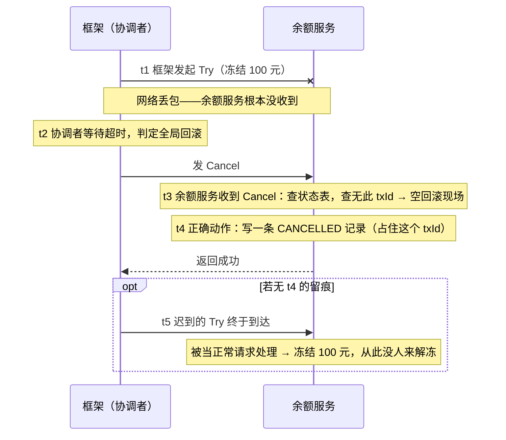
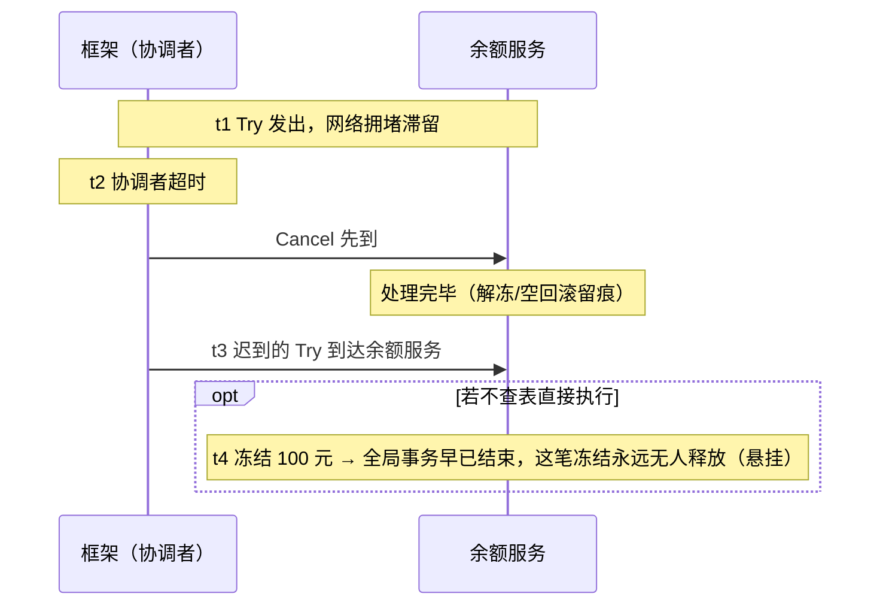
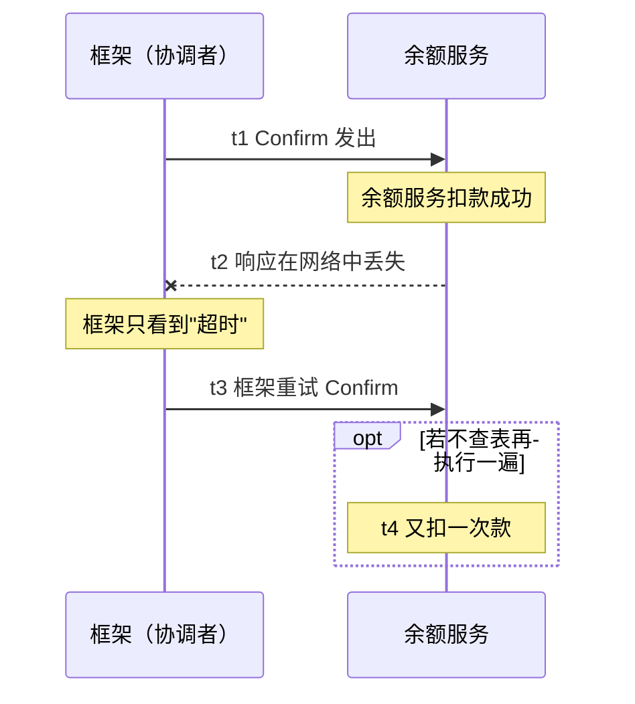

# 分布式事务：从 2PC 到最终一致
> [返回：软件架构学习大纲](../软件架构学习大纲.md)

本文件是 [第三阶段主笔记](01-分布式系统核心技术.md) 第 4 节“分布式事务”的拆分扩写版：原节编号 4.1~4.6 与“本节自测”保持不变，其他笔记可以继续按“见 4.5”引用。阅读前提：已读过 [CAP 与一致性模型](02-分布式理论基础-CAP共识与一致性.md) 的 1.1 与 1.3——本节所有方案都在“强一致”与“最终一致”两档之间做选择，理论推导不再重复。主线场景是[支付与清结算](../示例项目场景/00-导览.md)：**收款（渠道扣款）→ 发货（商户履约）→ 分账（平台/商户/配送员分成）→ 对账（日终核对）**，同一笔交易贯穿四个方案，方便你横向对比；辅助场景是[桶装水商城](../示例项目场景/00-导览.md)的“水费 + 押金”两笔账。读完本节，你应当能做到四件事：对着一次失败现场点名该用的方案（4.1）；画出 Outbox 链路并说清每个组件的职责（4.5）；给一笔新业务选一致性档位并说出业务判据（4.1/4.6）；设计对账差异处理流程（文末）。文末新增“对账：所有方案的最后防线”一节——它是支付场景的一等公民，也是所有分布式事务方案的共同兜底。


> 本节全部围绕一笔交易展开：**用户付款 → 商户发货 → 平台/商户/配送员分账**——它跨支付渠道、订单、履约、分账多个系统，是分布式事务的完整舞台（场景文档指定）；**桶装水商城**的“下单-库存-支付”一致性作为第二个例子。

## 4.1 问题起源

支付、订单、商户、分账拆成独立服务/独立库后，**数据库本地事务的边界（单库）再也罩不住一次交易**：渠道扣款成功、订单落库成功、分账服务超时——三件事没有共同的事务管理器。分布式事务的所有方案，本质都是在回答：**要么牺牲性能换强一致，要么牺牲即时一致换性能，再用补偿把状态收敛回来**。桶装水商城同理：下单成功但扣库存失败、支付成功但押金没记——同一个问题的弱化版；周期购“定时触发的订单”还把可靠性问题拖到了时间维度（4.5）。

拆分的动机在 [微服务架构](../02-第二阶段/03-微服务架构.md) 里已交代：不同模块的伸缩需求、发布节奏、团队边界不同，才值得把库拆开——而拆开的代价立刻在事务上现出原形。本节先把“会出的事”分门别类，再让每个方案对号入座：**你选哪个方案，取决于你的链路里最常出现哪种失败现场**。

### 事务失败的四种现场

| 现场 | 现象 | 危害 | 对应方案 |
|---|---|---|---|
| ① 提交前崩溃 | 一步操作在 commit 之前进程/机器宕机 | 单库无事（本地事务自动回滚）；跨库时表现为“有的库提交了、有的没提交”——分账库还在等指令，订单库已经 PAID | 跨库需要协调：2PC/XA（低频强一致）或 Saga 步骤化 |
| ② 提交后未送达 | 我方提交成功，但“通知下一步”失败：回调丢失、MQ 没发出去、下游没收到 | 上游已完成、下游永远不知道：钱扣了货不发，用户投诉才暴露 | 本地消息表/Outbox + 重试投递（4.5） |
| ③ 部分提交成功 | 多步流程走到一半才失败：扣款✓ 发货✓ 分账✗ | 系统停在中间态，且部分动作不可撤销（货已发出，不能“当作没发”） | Saga 逆序补偿（4.4）、TCC 先冻结后确认（4.3） |
| ④ 消息乱序/重复 | 重试导致同一指令到达两次，或迟到的 Try 晚于 Cancel 到达 | 重复发货、重复分账、冻结款无人释放 | 幂等设计 + 事务状态表（4.3/4.5）+ 对账（文末） |

这四种现场可以组合出支付系统里几乎所有的事故：渠道重复回调 = ② + ④；回调处理成功但投递 MQ 前断电 = ② + ①。关键是看清一点——**每个方案只负责堵其中一两个口子**：2PC 堵①，Outbox 堵②，Saga 堵③，幂等表堵④。没有任何一个方案能单独堵住全部四种，所以生产支付链路一定是组合拳（4.6 选型表 + 文末对账）。

顺带堵一个常见的“假解法”：拆了服务，却让多个服务**直连同一个数据库**来保住本地事务。事务边界看似没破，但拆分的目的也一并丢了——schema 改动牵连所有服务、连接数互相争抢、谁也不能独立伸缩，相当于付了微服务的复杂度、退回了单体的耦合。分布式事务方案的使命是在“真拆开”之后重建一致性，共享库只是把“拆”偷偷撤销，两头不占。

把四种现场放回主线那笔交易里各走一遍：渠道扣款成功但订单库事务回滚——现场①的跨库形态，渠道侧的钱退不回来只能进差错池；回调通知支付系统后处理成功、投递 MQ 前进程重启——现场②，发货侧永远不知道该发货；扣款、发货两步成功后分账服务恰在发布——现场③，只能冲正不能回滚；分账指令因超时重试到达两次——现场④，幂等拦截。**一笔交易的四个环节，四种现场都可能路过**——这解释了为什么支付系统四件套齐全：状态机、Outbox、补偿、对账，一个都不少。

### 为什么最终一致能接受：业务判据

“最终一致”听起来像妥协，其实是多数场景的正解。判断标准不在技术侧，在业务侧——**给数据分级，再为每级选一致性档位**：

- **钱相关的核心账务**（扣款、记账、分账、押金）：原则是“先扣后补”——宁可慢、不可错。允许“暂时没到位”（分账晚 5 分钟到账），不允许“多记/少记且最终不收敛”。选最终一致的前置条件有二：状态收敛有兜底（对账 + 冲正，见文末），且中间态不会被用户当作“完成”来消费（分账处理中 ≠ 用户可提现）。
- **展示类数据**（订单列表的“已支付”标签、消息通知、积分提示）：可延迟——晚几秒用户无感，用最终一致换吞吐，天经地义。
- **衍生/统计类数据**（报表、推荐、热度榜）：可延迟且可重算，一致性档位最低。

❌ 反例一：把展示类当强一致做——下单接口串行同步调订单、库存、优惠券、积分四个服务，任何一个抖动整单失败，吞吐塌方。✅ 修正：非核心旁路全部异步化。❌ 反例二：把钱相关当“最终一致随便漂”——分账失败进死信队列无人消费，月底才发现商户少收了钱。✅ 修正：资金链路的最终一致必须配“重试直到成功 + 超限告警 + 对账兜底”。

桶装水商城的两笔账是最好的判据练习：**水费与押金是两种不同的一致性等级**。退桶时押金退款失败，用户当时未必发现，可以走异步退款 + 重试队列（最终一致）；水费扣款错一分钱就是对账事故，下单时走“先冻结再扣款”（TCC，4.3）。同一个商城，两种账，两种方案——**分级错了，选什么方案都无效**。

## 4.2 2PC（两阶段提交）

**机制**：协调者先向所有参与者发 Prepare（各自执行并**锁住资源**，投“能提交”票）；全部同意后再发 Commit，任一拒绝则 Abort。

**两大缺陷**：① **同步阻塞**——Prepare 之后到二阶段结束前，资源一直锁着，参与者全体干等协调者；落到支付上：渠道侧资金与平台侧订单双双锁死，谁也不敢动。② **协调者单点**——它在两阶段之间宕机，参与者就悬在锁定态。加上两轮网络往返，高并发主链路基本不用，多见于传统数据库间（XA）的低频强一致操作，如日终对账批处理、数据迁移。

两大缺陷不是并列的两件事，而是同一件事的两面：**阻塞窗口的存在，放大了协调者宕机的伤害**。下面把宕机时刻展开推演一遍。

### 协调者单点与阻塞窗口：一次宕机的时序推演

设渠道资金服务（参与者 A）与订单库（参与者 B）参与一笔跨库强一致操作：

- t0：协调者向 A、B 发 Prepare；
- t1：A 执行完，锁住资金行，回 Yes；
- t2：B 执行完，锁住订单行，回 Yes；
- t3：协调者在发出 Commit **之前**宕机。

此刻 A、B 都握着 Yes 票，却陷入两难：不能提交（没收到 Commit）；也不能擅自回滚——万一协调者恢复后重发的是 Commit，单方面回滚会造成“协调者认为已提交、参与者却回滚了”的不一致，比阻塞更糟。于是资源被一直锁到协调者恢复为止。

| 时刻 | 协调者 | 参与者 A（渠道资金） | 参与者 B（订单库） | 系统状态 |
|---|---|---|---|---|
| t0~t2 | 在线收票 | Prepare 完成，已锁定，等 Commit | Prepare 完成，已锁定，等 Commit | 两阶段之间，正常 |
| t3 | 宕机 | 锁定，等待 | 锁定，等待 | **阻塞窗口开始** |
| t4 | 仍宕机 | 只能等（或超时后启发式自决——XA 的“启发式提交/回滚”，可能猜错） | 同左 | 资金与订单双双冻结，业务停摆 |
| t5 | 恢复，重发 Commit | 提交并解锁 | 提交并解锁 | 窗口结束 |

3PC、参与者超时自决等改进想缩小这个窗口，但在网络分区下反而引入新的不一致可能（猜错方向的代价还是脑裂），工程上反而少见。真正的规避办法只有一条：**别在主链路用它**——把窗口问题转嫁给业务补偿（4.4/4.5）。

### 2PC 与 Raft 的关系辨析

一个高频误读是“Raft 是更好的 2PC”。不是：**2PC 是原子提交协议，Raft 是共识协议，回答的是两个不同的问题**。2PC 回答“一组参与者对一次事务要么全部提交、要么全部中止”——它要的是原子性；参与者只是服从投票结果，没有 Leader、没有任期，协调者宕机时它毫无办法（上面推演的阻塞窗口正是这个短板）。Raft 回答“多个副本对一串日志的顺序和内容达成一致，且容得住少数派宕机”——它要的是容错的一致意见（机制细节见 [02-分布式理论基础](02-分布式理论基础-CAP共识与一致性.md) 1.4，配套可运行示例在 `02a-示例-cap-algorithms/`）。两者确实有一个形似的交点：Raft 的 Leader 也要先复制日志再应用（形似两阶段），但它的第二阶段**不锁任何人**——没拿到多数派确认的日志直接作废、重选 Leader 即可，因此不存在 2PC 式的全局阻塞窗口。一句话记忆：**2PC 协调“一次事务要不要都执行”，Raft 协调“一份历史大家都认账”**。工程上的组合做法是：用 Raft 保证协调者本身的高可用（比如把事务协调服务做成 Raft 复制组），再用 2PC 式的Prepare/Commit 协调各参与方——两件事各司其职。

最后补一个冷知识收尾：2PC 并没有从你的系统里消失——**每一次 MySQL 写入，Server 层 binlog 与 InnoDB redo log 之间走的就是一次内部两阶段提交**（redo 先 prepare，写 binlog 成功后 redo 再 commit），否则主库崩溃恢复时 binlog 与引擎层状态就会对不上，主从复制直接错乱。2PC 的思想活在你每天的每一次写库深处，只是被数据库替你管好了；你需要在应用层直面它，恰恰是因为拆库之后“数据库替你兜底”的范围不再覆盖一次完整的交易。

## 4.3 TCC（Try-Confirm-Cancel）：余额冻结切片

把事务控制权上移到业务层，每个参与方实现三个接口：**Try 预留资源 → 全部成功则 Confirm 真正提交 → 任一失败则 Cancel 释放**。以支付为例：Try 冻结用户余额/渠道额度，Confirm 真正扣款记账，Cancel 解冻。锁的不是数据库行，而是业务语义上的“冻结”，性能远好于 2PC，代价是**侵入性极大**（每个参与方三接口 + 状态记录）。

> 片段（骨架示意，不可直接运行）：

```kotlin
interface BalanceTcc {
    fun tryFreeze(txId: String, accountId: String, amountCents: Long): Boolean // 冻结：可用 -amount，冻结 +amount
    fun confirm(txId: String)     // 确认扣款：冻结 -amount，已入账 +amount
    fun cancel(txId: String)      // 取消：解冻，可用 +amount
}

// 事务状态表是 TCC 的护栏：所有接口都先查它
class TccBalance(
    private val txRepo: TccTxRepository,
    private val accountRepo: AccountRepository,
) : BalanceTcc {
    override fun tryFreeze(txId: String, accountId: String, amountCents: Long): Boolean {
        if (txRepo.isTried(txId)) return true            // 幂等：框架可能重发 Try
        if (txRepo.isCancelled(txId)) return false       // 防悬挂：Cancel 已先到，拒绝迟到的 Try
        accountRepo.freeze(accountId, amountCents)
        txRepo.markTried(txId)
        return true
    }
    override fun cancel(txId: String) {
        val tx = txRepo.find(txId)
        when {
            tx == null -> txRepo.markCancelled(txId)     // 空回滚：Try 从未到达也要记录，用于挡悬挂
            tx.tried -> accountRepo.unfreeze(txId)       // 正常解冻（按 txId 找冻结记录，本身幂等）
        }
    }
    override fun confirm(txId: String) { /* 同理：先查幂等记录，再把冻结额转入已扣款 */ }
}
```

**三大坑**（面试高频，全部用“冻结余额”理解）：**幂等**（三个接口都可能被框架重试）；**空回滚**（Try 因网络丢包未到达，Cancel 先到——必须直接返回成功并留痕，否则框架会无限重试）；**悬挂**（Cancel 之后，被网络延迟的 Try 才到达并冻结了余额，从此没人释放——Try 前必须检查“已回滚”标记）。对应回 4.1 的四种现场：空回滚是现场②“未送达”与现场④“乱序”的组合显形，悬挂与幂等是现场④的两种排列——所以 TCC 的坑不是新问题，是老现场在两阶段协议下的具体化。

### 三坑逐个走一遍：时序小场景与防护

三大坑单独看定义都懂，放到时序里才看清它们是**同一组网络延迟和重试在不同排列下的三种显形**。

**坑一：空回滚**。Try 还在网络里丢着，Cancel 先到了。



防护：Cancel 遇到“查无此事务”不是报错，而是**落一条 CANCELLED 记录并返回成功**——报错会让框架无限重试 Cancel；留痕则同时为挡住 t5 的悬挂埋下伏笔。

**坑二：悬挂**。Cancel 已经处理完，迟到的 Try 才姗姗到达。



防护：Try 的第一步必须查状态表——发现 CANCELLED（或已 CONFIRMED）直接拒绝。状态表相当于给参与方装了一台“时间回溯检测器”：全局事务已终结后的任何迟到请求，一律挡在门外。

**坑三：幂等**。执行成功了，但成功响应丢了。



防护：所有接口以 txId 为键先查状态表，已 CONFIRMED/TRIED 的重复请求直接返回上次结果。幂等的本质是把**“网络可能重复”当作常态设计输入**，而不是异常——这与 [03-远程通信](03-远程通信-协议序列化与演进.md) 里“超时 ≠ 失败、响应丢失必然引发重试”的讨论互为印证：凡是跨网络的两阶段交互，幂等都是参与方的法定义务。

### 事务状态表：三坑防护的共同地基

三坑的防护手段看似三条规则，落到工程上收敛成**一张表**：每个参与方为每笔全局事务落一行——`txId`（全局事务号）、业务键（账户/订单号）、状态（TRYING / CONFIRMED / CANCELLED）、金额、时间。使用纪律只有一条：**状态表的写入与资源变更（冻结/扣款/解冻）必须在同一个本地事务里**——否则“解冻成功但状态没更新”又制造出新的不一致。TCC 侵入性大的真正含义就在这里：不只是三个接口，而是每个参与方都要把“业务账 + 事务账”两张表一起维护好。反过来说，这张表也让 TCC 意外地可观测：每笔资金操作的状态变迁有据可查，对账系统（文末）能直接消费它。

TCC 还有一条适用边界值得写在选型清单的最前面：**Try 必须能定义出一个“可释放的资源预留”**。余额冻结、库存锁定、优惠券占用都是天然的预留——Cancel 就是释放它们；而“通知物流”“生成发票”这类动作没有可冻结的前置资源，硬套 TCC 只会写出一个什么都不做、还占一张状态表的假 Try。❌ 反例：给发货服务上 TCC，Try 阶段“预创建发货单但不下发仓库”——看起来像预留，实际仓库侧毫无感知，Confirm 时仓库可能已经没货，预留落空。✅ 修正：发货这类有外部副作用的步骤交给 Saga（4.4）走补偿，TCC 留给纯资金/额度类的短事务。

## 4.4 Saga：扣款 → 发货 → 分账切片

把一次交易拆成若干**各自本地事务**的步骤，全部正向执行则成功；某步失败则**逆序执行补偿**。两种组织方式：**编排**（Orchestrator 集中状态机，流程清晰、易观测，如 Seata Saga、Temporal）与**协同**（事件驱动，服务各自订阅，松耦合但链路难追）。缺点：**没有隔离性**——中间状态对外可见。

> 片段（骨架示意，不可直接运行）：

```kotlin
class PayDeliverSplitSaga(
    private val channel: PaymentChannelService,   // 支付渠道：扣款 / 退款
    private val orderRepo: OrderRepository,
    private val fulfillment: FulfillmentService,  // 商户发货
    private val split: SplitService,              // 分账：平台/商户/配送员分成
    private val retryQueue: CompensationRetryQueue,
) {
    fun settle(cmd: SettleCmd) {
        val compensations = mutableListOf<suspend () -> Unit>()     // 已成功步骤的逆动作栈
        try {
            channel.charge(cmd.userId, cmd.amountCents, cmd.orderId)   // 步骤1：渠道扣款（本地事务）
            compensations += { channel.refund(cmd.orderId) }           // 补偿：原路退款
            orderRepo.markPaid(cmd.orderId)                            // 步骤2：订单支付成功
            compensations += { orderRepo.close(cmd.orderId, CLOSED) }
            fulfillment.dispatch(cmd.orderId, cmd.items)               // 步骤3：通知发货（本地事务）
            compensations += { fulfillment.cancelDispatch(cmd.orderId) }
            split.execute(cmd.orderId, cmd.splitPlan)                  // 步骤4：分账（本地事务）
            compensations += { split.reverse(cmd.orderId) }            // 补偿：分账冲正
        } catch (e: Exception) {
            compensations.reversed().forEach { undo ->               // 失败 → 逆序补偿
                runCatching(undo).onFailure { retryQueue.push(undo, it) }   // 补偿失败进重试表，最终必达
            }
        }
    }
}
```

隔离性缺失在支付业务里的样子：用户能看到“分账处理中”，某步失败后又变回“退款中”；日终对账必须能识别这些中间态。**补偿三纪律**：补偿必须幂等（会被重试）；补偿失败必须持久化重试直到成功；**不可补偿或难补偿的动作（真实打款、已分出的账）尽量排在 Saga 末尾**，让失败发生在还能挽回的阶段。

隔离性既然买不回来，工程上就给它打三块补丁：① **状态语义化**——对外只暴露业务可读状态（“结算中，预计 T+1 到账”），不把技术中间态（“步骤3/4”）直出给用户；② **中间态幂等可查**——处于中间态的单子被重复查询、重复触发查询都安全，因为中间态随时可能被补偿改写；③ **中间态超时监控**——单子卡在中间态超过阈值自动告警并转人工，因为 Saga 没有隔离性也就没有自动超时回滚，卡住的单子不会自愈。（隔离性本身是什么、各档隔离级别各自买到了哪一档、MVCC 与快照隔离的实现机械，展开见[数据系统内核专题：事务与并发控制](../07-数据系统内核专题/03-事务与并发控制.md)。）

### 编排式 vs 协同式：谁来记住流程

两种组织方式的差异，一句话概括：**流程知识放在哪里**。编排式放在中央编排服务的状态机里；协同式摊开在所有订阅关系里——没有人整体知道流程长什么样。

| 维度 | 编排式（Orchestration） | 协同式（Choreography，事件链） |
|---|---|---|
| 谁知道全流程 | 中央编排服务持有状态机，一步一记录 | 无人整体知道，流程散落在各服务的订阅关系里 |
| 支付分账一行示例 | “支付成功 → 编排器依次调发货、分账，任一步失败即按断点逆序补偿” | 支付服务发 `pay.succeeded`；发货服务订阅并发出 `shipment.created`；分账服务订阅前两个事件再执行分成 |
| 新增一步 | 改编排器状态机（集中一处改） | 新服务加订阅即可，上游不动（但流程图要有人记得更新） |
| 失败恢复 | 编排器明确知道走到第几步，从断点重试或补偿 | 靠事件重投 + 各服务自己的幂等与补偿，“断点”是隐式的，恢复逻辑分散 |
| 观测与排障 | 看编排器日志即知全程 | 要跨服务串事件链（trace）才能还原过程 |
| 适用场景 | 步骤多、先后顺序严格、需要人工介入点（如大额分账审核） | 步骤少、松耦合优先、事件本来就要广播给多方（详见 [事件驱动架构](../02-第二阶段/04-事件驱动架构.md) 的中介者/代理者拓扑对照——同一组取舍） |

❌ 反例：把一条五步的资金链做成协同式——支付、发货、积分、开票、分账五个服务互发事件，半年后新同事要回答“分账失败会影响哪些下游”只能读五个服务的代码。✅ 修正：超过 3 步、或链路中有资金动作，就用编排式；协同式留给“一变多广播”的轻量通知。工程判据：**流程要被人读，就编排；事件天然多方要，就协同**。

选了编排式还要回答一个追问：**编排器自己崩了怎么办？**它手里攥着全流程的断点位置，宕机后整个 Saga 就悬在那里。标准做法是编排器状态持久化——每执行一步之前先落“当前步 + 输入”（或执行后确认落状态），恢复时从状态机断点续走；而“执行成功但状态没来得及落”的窗口，靠参与方幂等 + 重试拉齐（又是 4.1 现场④的老朋友）。这提醒我们：编排器没有消除协调者问题，只是把 2PC 那个又重又阻塞的协调者，换成了一个轻量的、可持久化恢复的业务状态机——协调的责任从数据库协议上移到了业务层，而不是消失了。

### 补偿不是回滚：语义辨析与三原则

数据库回滚成立的前提是“事务还没结束，外部世界没被扰动”。Saga 的每一步都是**已提交的本地事务**，对外承诺已经发出：货已从仓里拣出、退款单已在渠道侧生成、短信已发给用户。所以 Saga 的失败处理叫**补偿（Compensation）而不是回滚**——它是“再执行一个新事务，把业务语义拉回可接受的状态”，而不是让前一个事务“从未发生”。已发货不能撤销发货，只能做冲正：生成一张逆向单据、把原单状态改为已冲正、附上原因——这就是财务上“红字冲销”的软件版。

❌ 反例：把补偿写成回滚——`cancelDispatch` 实现成“物理删除发货单”。一旦商户已经开始拣货，单据删了、拣货照做，账实双错且无从追查。✅ 修正：删除改状态——发货单保留，状态置为“已取消”，再生成一张冲正流水供对账配对。

由此推出补偿操作设计三原则（它与上文“补偿三纪律”分工不同：三纪律管**补偿在流程里怎么被编排**——幂等、重试、难补偿的排末尾；三原则管**补偿操作本身怎么设计**）：

1. **可幂等**：补偿会被重试（网络超时、进程重启、人工触发），同一笔补偿执行两次，结果必须与一次相同（以冲正单号幂等）。
2. **可重试**：补偿不能依赖“此刻恰好可用”的外部条件；失败必须持久化进重试队列并告警，绝不悄悄吞掉——重试到成功的最终一致（呼应 4.1 的“先扣后补”）。
3. **留痕**：补偿本身是业务事件，要生成可查的冲正单据/流水，日终对账才能把“正向 + 冲正”逐笔配对核销——这条直接决定了对账系统（文末）修不修得了差异。

## 4.5 本地消息表 + 最终一致（支付系统的默认解）

**核心思想**：把“改业务数据”和“记一条待发消息”放进**同一个本地事务**（原子），再由后台任务把消息投到 MQ——绕开“数据库写成功但 MQ 发送失败”的经典裂缝，即事务性发件箱（Outbox）模式。

一个常见追问：RocketMQ 的**事务消息（半消息）**不也能做这件事吗？能——它相当于“把消息表搬进 MQ”：先发半消息（对外不可见），本地事务提交后确认、回滚后作废，MQ 主动回查你的事务状态来补确认。与本表方案相比：半消息省掉轮询任务，但事务状态回查逻辑仍要自己写，且消息留存、查询、补发能力全部受制于 MQ 组件；本地消息表自管存储，可以建索引、直接给对账系统查、不依赖特定 MQ 的事务特性。两者是同一思想的两种落点，选哪个看团队要“少维护一张表”还是“少依赖一个特性”。

**渠道回调：状态机驱动的最终一致**。支付结果不是同步返回的，而是渠道异步通知到达；通知还会重复（渠道怕丢失会重发）。❌ 反例：回调来了就发货 → 渠道重发 30 次 → 发 30 次货。✅ 修正：状态机守卫 + Outbox，同一本地事务内原子完成：

> 片段（骨架示意，不可直接运行）：

```kotlin
// ① 回调处理：状态机守卫 + Outbox，并发/重复回调只有一个能生效
fun onChannelNotify(n: ChannelNotify) = transaction {
    val pay = payRepo.findByChannelOrderNo(n.channelOrderNo)
        ?: throw UnknownNotifyException(n)                     // 无法识别 → 进差错队列，绝不能丢
    if (!pay.canTransit(PAYING to PAID)) return@transaction    // 已支付/已关闭 → 重复回调，幂等返回成功让渠道停止重发
    payRepo.casUpdateStatus(pay.id, from = PAYING, to = PAID)  // 乐观锁式更新，并发回调只有一个成功
    outboxRepo.insert(Outbox("pay.succeeded", """{"payId":"${pay.id}","amount":${n.amountCents}}"""))
}
```

> 片段（骨架示意，不可直接运行）：

```kotlin
// ② 后台任务轮询（或订阅 binlog）投递 MQ，成功才标记
fun relayOutbox() {
    outboxRepo.findPending(limit = 100).forEach { msg ->
        mq.send(msg.topic, msg.payload, messageId = msg.id)
        outboxRepo.markDone(msg.id)
    }
}

// ③ 消费端幂等：MQ 是 at-least-once，重复投递是常态不是异常
// ❌ 反例：重复消费 → 重复发货、重复分账
// ✅ 修正：以 messageId（或业务唯一键）做幂等表
fun onPaySucceeded(msg: PaySucceededMsg) {
    if (!idempotentRepo.tryInsert(msg.messageId)) return   // 处理过，直接丢弃
    fulfillmentService.createShipment(msg.payId)
    splitService.schedule(msg.payId)
}
```

整条链路是：**本地事务 + Outbox + MQ 可靠投递 + 消费幂等 + 对账兜底**。对账是最后防线：日终拿渠道对账单与平台流水逐笔核对，长款/短款/重复支付自动分类、转人工处理。

**第二例子：桶装水商城**。下单-库存-支付走同一条路：下单本地事务写 Outbox → 库存/支付各自消费。周期购是“定时触发的订单”：订阅生效时投递一条**延迟消息**，到期触发“生成下一期订单”，消费端以 `订阅ID+期号` 幂等防重复生成；替代方案是任务表定时扫描——可控、易运维，但几十万订阅全量扫表有压力，与工单中心 SLA 超时检测（几十万在途工单）是同一道选型题（见自测）。

> 片段（骨架示意，不可直接运行）：

```kotlin
// 周期购：延迟消息到期触发续订，幂等键 = 订阅ID + 期号
fun onRenew(msg: RenewMsg) {
    if (!idempotentRepo.tryInsert("renew:${msg.subId}:${msg.cycleNo}")) return
    orderService.createCycleOrder(msg.subId, msg.cycleNo)
}
```

### 最小可运行实现：同事务落库、崩溃恢复、消费幂等

上面的片段只有骨架，下面给一个能跑的完整示例（保存为 `OutboxDemo.kt`，`kotlinc OutboxDemo.kt -include-runtime -d outbox.jar && java -jar outbox.jar` 可复跑；本文输出为 kotlinc 2.2.20 实际运行结果）。用内存 Map 模拟数据库两张表，`synchronized` 块模拟“同一个本地事务”；故意注入一次“发送后、标记前崩溃”的故障，让你亲眼看到消息不丢、重复投递、消费幂等三件事如何接力：

```kotlin
// 本地消息表（Outbox）最小可运行实现
// 场景：支付回调 → 「订单置为已支付 + 写 Outbox」同一事务 → 独立投递器轮询投 MQ → 消费端幂等发货
// 用内存 Map 模拟数据库两表；synchronized 块模拟"同一个本地事务"（要么全成功要么全失败）

class CrashException(msg: String) : RuntimeException(msg)

// ---------- "数据库"：两张表 + 一把锁（锁内 = 一个本地事务） ----------
class Db {
    val payStatus = HashMap<String, String>()            // 支付单表: payId -> 状态
    val outbox = HashMap<String, String>()               // 消息表: msgId -> payload(订单号)
    val shipped = HashSet<String>()                      // 发货表（消费方业务表）: 订单号
    val dedup = HashSet<String>()                        // 消费幂等表: messageId
    fun <T> inTransaction(block: () -> T): T = synchronized(this) { block() }
}

// ---------- ① 业务侧：状态机守卫 + 同一事务写 Outbox ----------
fun onChannelNotify(db: Db, payId: String, orderId: String) {
    db.inTransaction {
        if (db.payStatus[payId] != "PAYING") {           // 状态机守卫：重复/并发回调只有第一个生效
            println("[业务] 支付单 $payId 已非 PAYING，重复/并发回调幂等返回")
            return@inTransaction
        }
        db.payStatus[payId] = "PAID"                     // 业务更新
        db.outbox["pay.succeeded:$payId"] = orderId      // 同一事务写入待发消息
        println("[业务] 支付单 $payId 置为 PAID，Outbox 同事务写入 pay.succeeded:$payId")
    }
}

// ---------- ② 独立投递器：轮询 Outbox，发送成功才删除 ----------
class Relay(
    private val db: Db,
    private val mq: MutableList<Pair<String, String>>,
    private var failBeforeMark: Boolean,                 // 注入故障：发送后、标记前崩溃
) {
    fun tick() {
        val pending = db.inTransaction { db.outbox.toList() }   // 扫描待投递消息
        for ((msgId, orderId) in pending) {
            mq.add(msgId to orderId)                     // 发 MQ（真实实现是网络调用，无法纳入 DB 事务）
            println("[投递器] 已发送 $msgId -> MQ")
            if (failBeforeMark) {                        // 模拟进程在此刻被 kill：标记未落库
                failBeforeMark = false
                throw CrashException("[故障] 进程崩溃！消息已发出但 Outbox 未删除，恢复后将重发")
            }
            db.inTransaction { db.outbox.remove(msgId) } // 成功才标记完成
            println("[投递器] 已标记完成：Outbox 移除 $msgId")
        }
    }
}

// ---------- ③ 消费端：幂等表去重，重复投递只处理一次 ----------
fun consume(db: Db, msgId: String, orderId: String) {
    db.inTransaction {
        if (!db.dedup.add(msgId)) {                      // 幂等表：插入成功 = 第一次处理
            println("[消费] $msgId 已处理过，幂等丢弃")
            return@inTransaction
        }
        db.shipped.add(orderId)
        println("[消费] 首次处理 $msgId：订单 $orderId 发货")
    }
}

fun main() {
    val db = Db()
    val mq = mutableListOf<Pair<String, String>>()

    db.inTransaction { db.payStatus["P1001"] = "PAYING" }

    // 渠道怕丢失会重发：同一笔支付，回调到达 3 次
    repeat(3) { onChannelNotify(db, "P1001", "O2001") }
    println(">> 支付单=${db.payStatus["P1001"]}，Outbox 条数=${db.outbox.size}（3 次回调只落 1 条消息）")

    // 第一次投递：MQ 已发出、标记未落库时进程崩溃
    runCatching { Relay(db, mq, failBeforeMark = true).tick() }.onFailure { println(it.message) }
    println(">> 崩溃后 Outbox 条数=${db.outbox.size}（消息与业务状态同事务落库，重启不丢）")

    // 重启恢复：重扫 Outbox → 同一条消息再投一次 → 这次标记成功
    Relay(db, mq, failBeforeMark = false).tick()
    println(">> MQ 中消息数=${mq.size}（同一业务消息被投递两次——投递器是 at-least-once）")

    // 消费端收到两份拷贝，幂等表保证只发一次货
    mq.forEach { (msgId, orderId) -> consume(db, msgId, orderId) }
    println(">> 发货记录=${db.shipped}（两次投递只发一次货）")
}
```

实际运行输出：

```
[业务] 支付单 P1001 置为 PAID，Outbox 同事务写入 pay.succeeded:P1001
[业务] 支付单 P1001 已非 PAYING，重复/并发回调幂等返回
[业务] 支付单 P1001 已非 PAYING，重复/并发回调幂等返回
>> 支付单=PAID，Outbox 条数=1（3 次回调只落 1 条消息）
[投递器] 已发送 pay.succeeded:P1001 -> MQ
[故障] 进程崩溃！消息已发出但 Outbox 未删除，恢复后将重发
>> 崩溃后 Outbox 条数=1（消息与业务状态同事务落库，重启不丢）
[投递器] 已发送 pay.succeeded:P1001 -> MQ
[投递器] 已标记完成：Outbox 移除 pay.succeeded:P1001
>> MQ 中消息数=2（同一业务消息被投递两次——投递器是 at-least-once）
[消费] 首次处理 pay.succeeded:P1001：订单 O2001 发货
[消费] pay.succeeded:P1001 已处理过，幂等丢弃
>> 发货记录=[O2001]（两次投递只发一次货）
```

三个关键点，对着输出读：

1. **3 次回调只落 1 条消息**——状态机守卫在“同一个事务”里先检查后更新，重复/并发回调天然被挡掉（堵 4.1 的现场④）。支付单状态是 `PAID`、Outbox 恰好 1 条，两者一起成立，这就是“同一本地事务”的原子性。
2. **崩溃后 Outbox 条数=1**——消息和业务状态是同一个事务落库的，进程怎么崩都带不走它；恢复后重扫，消息还在。这一条正面堵住 4.1 的现场②（提交后未送达）：崩溃丢的至多是“内存里没落库的东西”，而消息已经落库。
3. **MQ 中消息数=2，发货记录只有 1 条**——投递器“先发送、后删除”的结构决定崩溃窗口内必然重发，Outbox 投递**天生 at-least-once**，这不可消除也不必消除；真正保证“只发一次货”的是消费端幂等表（`dedup.add` 一步完成检查并占位，没有 check-then-act 竞态）。**可靠投递的分工永远是：投递层负责不丢，消费层负责不重**。

这条链路还缺一个隐形的第四角色：**主动查单**。上面所有机制都建立在“渠道回调会到达”之上，而最恶劣的现场是回调永远不来（渠道通知服务故障）。支付系统的标配是“通知 + 查询”双保险：对 `PAYING` 超过 N 分钟仍未终态的支付单，定时任务主动向渠道查询结果，查到的结果与回调走完全相同的状态机 + Outbox 入口——**代码里不区分“通知到的”和“查出来的”，两者只是同一状态迁移的两个触发源**。查单频次用指数退避（5 分钟、15 分钟、1 小时……），一般到 T+24 小时仍无终态就放弃等待、转差错池人工处理。工程判据可以推广到一切“等待外部通知”的最终一致链路：等待重试管“通知慢”，主动拉取管“通知不来”，两者互补才闭环。这也是 4.1 现场②的最坏形态的兜底。

与真实工程的差距清单（把这个示例升级为生产可用的待办）：① `synchronized` 换成数据库真实事务（`payStatus` 与 `outbox` 两张表同库同事务）；② Outbox 记录**标记完成用状态更新而非删除**——投递记录要留档给对账配对（呼应补偿三原则的“留痕”）；③ 轮询按主键序批量扫、加索引与过期归档，量大了换 binlog 订阅（Canal/Debezium）：轮询简单可控、秒级延迟，binlog 实时但多一个运维组件，与 4.6 的选型逻辑同构；④ 消费幂等的键优先用业务唯一键（订单号/支付单号）而非 MQ 的 messageId——业务键在差错排查和对账里都能直接用；⑤ MQ 分区会打乱投递顺序，顺序敏感的消费仍需业务排序键（如同一订单号固定分区）。

## 4.6 方案对比与选型（以收款/分账业务为例）

| 方案 | 一致性 | 侵入性 | 性能 | 开发量 | 收款/分账中的适用 |
|---|---|---|---|---|---|
| 2PC / XA | 强 | 低（数据库代劳） | 差（阻塞） | 小 | 日终对账、数据迁移等低频跨库强一致 |
| TCC | 准强（结果确定） | 高（每方三接口+状态表） | 中 | 大 | 资金短事务：余额/额度冻结 + 确认扣款 |
| Saga | 最终一致（补偿回滚） | 中 | 好 | 中 | 扣款→发货→分账的长流程跨系统编排 |
| 本地消息表 + MQ | 最终一致（正向重试） | 中 | 好 | 中 | 回调后通知发货、记账、开票等旁路 |

**选型顺序**：能合并到同库就别上分布式事务 → 短而关键的链路用 TCC → 长流程用 Saga → 旁路用消息最终一致。**先问能不能不一致，再选哪种一致**。

第一句“能合并到同库”值得单独展开，它是选型顺序里最便宜也最容易被跳过的一步。合并的判据是业务内聚：支付单与支付流水天然同生共死，合并同库后一条本地事务即可完成，根本不需要分布式事务；订单与库存分库，是因为大促时库存要独立扩容、团队边界也不同——伸缩与组织的收益大于事务的代价，拆才是对的。❌ 反例：为了“架构先进”把本可同库的支付单与记账流水拆成两个服务，再用 TCC 把它们粘回来——**自造问题再买解**。判据一句话：拆库的理由（伸缩、隔离、团队）压不过分布式事务的复杂度，就不拆。

表格回答“怎么选”，但选错的人往往不是不会选，而是**没先写下自己的一致性语义需求**。下面三个错配反例，都来自“机制能跑、语义错了”。

### 选型错配反例集

| 错配 | 症状 | 修正 |
|---|---|---|
| 强一致场景误用本地消息表 | 扣款与记账两步之间有延迟窗口：风控在窗口内看到“钱已扣、账未记”，误判为套利、拦截正常交易 | 资金核心改 TCC（先冻结后确认，结果确定后两账齐动）；本地消息表退回给发货、开票等旁路 |
| Saga 补偿设计成回滚 | 补偿实现为物理删除正向单据；补偿重试后出现“幽灵正向单”或账实不符，对账配不上对 | 补偿 = 逆向冲正单据，正向单据只改状态不删除（见 4.4 三原则；真实发货更不能“回滚”，只能冲正） |
| 把 MQ 当可靠投递、不配消息表 | “先发 MQ 再提交事务”：事务回滚后消息已飞出去，下游发货了订单却不存在；反过来“先提交再发 MQ”，发送前崩溃则下游永远不知道 | 业务与消息同事务落 Outbox（4.5），MQ 只是投递通道、不是存储承诺；顺序倒过来也一样漏 |

三个反例的共同根因：把“代码能跑通”当成了“语义正确”。选型前先回答三个问题——**谁先谁后（顺序语义）、允许谁暂时不知道谁（可见性语义）、失败后谁负责收敛（恢复语义）**——再回到上面的表格挑机制。这个问题清单本身，比任何方案都值钱。

## 【本节自测】

1. 2PC 的两个致命缺陷在支付业务里分别对应什么事故场景？
2. 用自己的话解释 TCC 的空回滚与悬挂（用“冻结余额”举例），以及各自的防护手段。
3. Saga 为什么“没有隔离性”？举一个分账业务里中间状态外泄的例子，以及它给日终对账带来的麻烦。
4. 渠道同一笔回调重发了 30 次，你的系统靠哪两层机制保证只发货一次？
5. 桶装水周期购“每周自动生成下周订单”，选延迟消息还是任务表扫描？工单中心 SLA 超时检测（几十万在途工单）是同一道题吗？给出选型依据。
6. 事务失败的四种现场（4.1）中，“提交后未送达”和“部分提交成功”分别该由哪个方案堵口子？如果一条链路两种现场都常见，你的组合拳是什么？
7. 4.5 的可运行示例中，投递器在“已发送 MQ、未删除 Outbox”时崩溃，导致同一消息被投递了两次。为什么不在投递器里做“恰好一次”投递？消费端靠什么兜住重复？
8. 桶装水商城退桶场景：押金退款走异步重试队列，水费扣款走 TCC 冻结——用 4.1“钱相关先扣后补 vs 展示类可延迟”的判据，说明这样分工的理由。
9. 结合本文末尾“对账：所有方案的最后防线”：分账服务某天漏掉 3 笔应分账单，对账系统如何发现它？按差异处理四步各会发生什么？若规则库已有“分账遗漏自动补单”规则，流程有何不同？

## 对账：所有方案的最后防线

回看 4.2~4.5：TCC 用状态表把资金短事务做准，Saga 用补偿把长流程收敛，Outbox 用同事务落库保证消息不丢——但每一层都只把出错概率压低，没有一层是“恰好一次”的银弹。资金业务的工程底线因此不是“错误永不发生”，而是**错误一定能被事后发现并纠正**。这就是对账的地位：[支付与清结算场景](../示例项目场景/00-导览.md)把“日终对账、差错处理（长款/短款/重复支付）”列为一等公民架构挑战，第六阶段的[支付场景拆解](../06-第六阶段/01-实战与案例分析.md)也会把对账画在架构图的最外圈。

**对账维度设计：按发现速度分三个频段**，各管一类问题：

| 频段 | 时效 | 手段 | 抓什么 |
|---|---|---|---|
| 实时对账 | 秒级 | 流式比对上下游事件流（渠道回调 vs 平台支付流水） | 渠道已扣款、平台无记录的丢失回调——发现即触发补单 |
| 准实时对账 | 分钟级 | 增量批次扫描当日可疑单 | Outbox 积压、MQ 丢消息、消费重试超限的单 |
| 日终批对账 | T+1 | 拉取渠道对账文件，逐笔核对全量流水 | 最完整也最慢的兜底：长款/短款/重复支付全量盘点 |

注意日终批的两个工程细节：渠道对账文件与平台流水的**口径差异**（金额单位有无分、切账时区、渠道侧不含退款单）必须先映射归一再核对，否则满屏假差异；文件解析本身要用 4.5 的套路——解析入库与登记“已解析”水位放同一事务，文件可重复处理。

差错的三种基本类型先定义清楚，后面的四步才有着落：**长款**——渠道已收钱、平台无单（用户付了但通知丢失且查单也漏），处理方向是补单或原路退款；**短款**——平台有单、渠道未收（平台认为支付成功，最危险，可能已经发货），处理方向是催收或撤单；**无主款**——渠道通知里有，但订单号对不上任何平台记录，处理方向是人工认领。核对动作双向各跑一遍：以渠道单为基准在平台找配对（抓长款/无主款），再以平台单为基准在渠道找配对（抓短款）。实时对账抓到的“渠道成功、平台仍 PAYING”正是长款的前身——发现即自动重放回调状态机，多数长款在分钟级就被消化掉，轮不到日终批。

**差异处理四步**：① **挂起**——差异单进差错池，冻结相关后续动作（短款不发货、长款不自动确认），防止差异被放大；工程落点是给相关业务单的状态机加一个“差错挂起”态，冻结是状态迁移不是口头约定。② **人工/自动冲正**——规则库按“差错类型 + 金额段 + 商户维度”匹配，能匹配的走自动冲正（补单、退款、补分账），匹配不了的转人工工单；自动冲正与补偿一样必须幂等、可重试、留痕（4.4 三原则原样适用）。③ **复盘**——追根因并归因到可改的东西：代码缺陷、超时配置过紧、重试策略错误还是渠道侧异常；复盘结论要落到具体改进项，不开无结论的会。④ **规则沉淀**——把人工处理结论写回自动规则库，新规则上线前用历史差错数据回放验证；同类差异下次自动处理。健康的对账系统的标志是差错率随运营时间单调下降：**人工处理过的差错种类，第二次就该自动处理**。

最后一个选型视角收束全节：评估任何分布式事务方案时，除了 4.6 表格的五列，还要追问隐藏的第六列——**可对账性**：它的正向操作与补偿/冲正是否留下可配对的流水号？4.3 的状态表、4.4 的冲正单据、4.5 的 Outbox 留档都在为此铺路；如果一个方案出错后对账系统只能报“有差异”却找不到配对依据，它就不该出现在资金链路里。分布式事务的完整答案因此是一句话：**用合适的一致性档位把错误概率压到业务可接受，再用对账把残余错误变成可发现、可纠正、下次可自动处理的事件**。

## 替换清单

- “三坑逐个走一遍：时序小场景与防护”坑一：空回滚（t1~t5）→ `sequenceDiagram`（时序图，`-x` 箭头表示丢包；原文“框架”“协调者”指同一方，合为一条生命线）
- 同上·坑二：悬挂（t1~t4）→ `sequenceDiagram`（时序图）
- 同上·坑三：幂等（t1~t4）→ `sequenceDiagram`（时序图，`--x` 箭头表示响应丢失）
