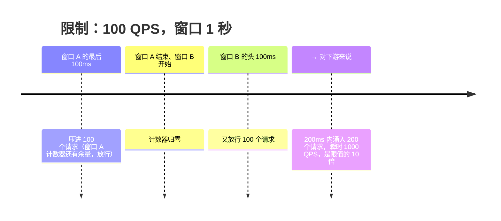
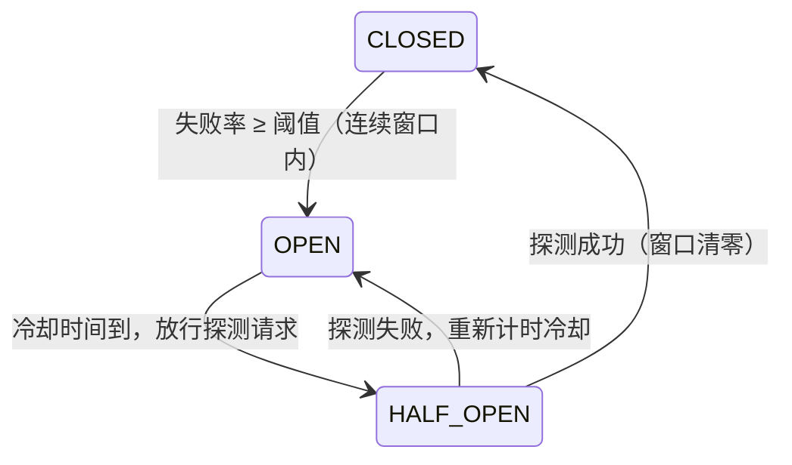

# 高可用与稳定性：限流、熔断与多活
> [返回：软件架构学习大纲](../软件架构学习大纲.md)

> 本文件是 [第三阶段主笔记](01-分布式系统核心技术.md) 第 5 节“高可用与稳定性”的拆分扩写版：原节编号 5.1~5.5 与“本节自测”保持不变，其他笔记可以继续按“见 5.1”引用。阅读前提：已读过 [CAP 与一致性模型](02-分布式理论基础-CAP共识与一致性.md) 的 1.1（分区期间的取舍）与 1.4（Raft/Paxos——注册中心选型会用到）。主线场景是**秒杀**（读洪峰，限流的主舞台），对照场景是**物联网平台**（写洪峰，背压流控的主舞台）与 **MES**（产线 7×24 不能停），[桶装水商城](../示例项目场景/00-导览.md)贯穿取材。读完本节，你应当能做到四件事：给一条新链路做容量推演并选对限流算法（5.1）；给旁路依赖布熔断、写出分级降级预案（5.2）；给全链路分配超时预算并守住重试纪律（5.3）；为服务选负载均衡策略、为业务判断要不要做异地多活（5.4/5.5）。


秒杀讲稳定性要从**容量推演**开始：预计 100 万人抢 1000 件，峰值 QPS 是平时的百倍——逐个环节问“能扛多少”：网关 10 万、下单服务 2 万、DB 写入 5 千；容量之外的流量，必须在离用户最近的地方挡掉或排起队来。本节另两个舞台：**MES**（产线 7×24 不能停）与**物联网平台**（写入型洪峰，与秒杀方向相反）。

稳定性技术栈全景——五道防线各管一段，5.1~5.5 就是沿这条链路展开的：

| 防线 | 回答的问题 | 核心手段 | 对应小节 |
| --- | --- | --- | --- |
| 限流 | 流量超过容量时，多余的部分怎么办？ | 四种限流算法、集群限流、分层限流、背压排队 | 5.1 |
| 隔离 | 一个组件出事，为什么不能殃及全船？ | 舱壁模式：线程池/信号量/连接池三种隔板 | 5.2 |
| 熔断降级 | 下游坏了，上游是陪葬还是绕行？ | 熔断器三状态、L1~L4 分级降级预案 | 5.2 |
| 超时重试 | 一个慢调用为什么能拖垮整条链路？ | 超时预算递减、退避+抖动、幂等 | 5.3 |
| 冗余切换 | 单机/单机房宕机，业务能不能不断？ | 负载均衡、服务发现、异地多活 | 5.4 / 5.5 |

一个反直觉的优先级排序：**限流排在熔断之前**。很多团队先学了熔断就先上熔断，结果熔断器天天跳闸——根本原因是流量与容量本来就不匹配，熔断只是把这个矛盾推迟到了下游。正确的落地顺序是：先想清楚“系统到底能扛多少”（容量推演 → 限流），再谈“扛不住的部分怎么有损服务”（熔断、降级、隔离），最后才谈“整个机房没了怎么办”（多活与演练）。跨过第一步直接上第三步的团队，做的往往是昂贵的纸面工程。

## 5.1 限流

### 5.1.1 四种限流算法：先选型，再落地

**四种算法**：固定窗口（临界处会出现双倍突刺）、滑动窗口（平滑计数）、漏桶（恒定速率流出，绝不突发）、令牌桶（匀速产令牌、允许攒令牌应付突发——互联网最常用）。

把这句话展开成一张选型表，六列看全：

| 算法 | 核心机制 | 突发容忍 | 平滑度 | 单机实现复杂度 | 分布式实现难度 | 典型适用 |
| --- | --- | --- | --- | --- | --- | --- |
| 固定窗口计数 | 每个时间窗一个计数器，超限即拒，窗口重置归零 | 差：窗口边界处可出现双倍突刺 | 低 | 最低（一个计数器即可） | 最低：Redis `INCR` + `EXPIRE` 两行即可实现 | 粗粒度总量保护：日配额、短信条数、网关兜底 |
| 滑动窗口 | 窗口随时间滑动统计（切成 N 个小格加权，或逐请求记日志） | 较好：无边界突刺，但短时突发仍可冲到窗口阈值 | 中 | 中 | 较高：Redis `ZSET` 滑动日志，内存与操作成本随 QPS 增长 | 需要精确计数的场景：风控、计费校验 |
| 漏桶 | 请求先进桶，以恒定速率流出（放行），桶满即拒 | 零：绝不突发 | 最高 | 中 | 高：需要中央节流点或 Lua 脚本模拟恒速 | 对下游承诺“恒速”是硬约束的场景：调用脆弱的外部系统、物联网下行指令下发 |
| 令牌桶 | 恒速产令牌入桶，取到令牌才放行，桶容量 = 可攒下的突发额度 | 可配置：容量即突发上限 | 中（均值恒定，允许突发） | 中 | 中：Redis + Lua 原子取令牌，成熟方案多 | 互联网服务的默认选择：秒杀入口、API 配额 |

固定窗口的“双倍突刺”值得单独画一遍时间线——这是最容易被低估的坑：



❌ 反例：某平台用固定窗口给短信接口限 100 条/秒，营销活动整点开始，恰好在窗口边界前 1 秒 + 后 1 秒各压满 100 条，运营商侧按秒采样看到瞬时 200 条/秒，直接封禁了平台通道——限流组件自己变成了事故诱因。

✅ 修正：换成滑动窗口或令牌桶；如果坚持用固定窗口（简单），就把阈值降到真实容量的 70% 左右，给边界突刺留出余量。

选型判据一句话版：对外承诺“绝不压垮下游”选漏桶；要放行开抢瞬间的洪峰、保用户体验选令牌桶；只求便宜的总量兜底选固定窗口；计数必须精确选滑动窗口。工程上最常见的组合是**网关固定窗口粗兜底 + 服务令牌桶细限**，两层各司其职。

### 5.1.2 单机令牌桶与秒杀入口（片段）

```kotlin
class TokenBucket(private val capacity: Int, private val refillPerSecond: Double) {
    private var tokens = capacity.toDouble()
    private var lastRefill = System.nanoTime()
    private val lock = ReentrantLock()

    fun tryAcquire(n: Int = 1): Boolean = lock.withLock {
        val now = System.nanoTime()
        tokens = min(capacity.toDouble(), tokens + (now - lastRefill) * 1e-9 * refillPerSecond)
        lastRefill = now
        if (tokens >= n) { tokens -= n; true } else false
    }
}

// ❌ 反例：秒杀开始，10 万 QPS 直击下单服务 → 线程池打满 → 连普通下单也不能用
// ✅ 修正：入口限流，超出容量的请求快速失败（生产中用 Redis+Lua 做集群级限流，或 Sentinel/Resilience4j）
val seckillBucket = TokenBucket(capacity = 2000, refillPerSecond = 1000.0)

fun seckill(skuId: String, userId: String): ApiResult =
    if (seckillBucket.tryAcquire()) ApiResult.ok(seckillService.place(skuId, userId))
    else ApiResult(429, "太火爆了，请稍后再试")     // 宁可拒绝，不可拖垮
```

这是一个**片段**（`ReentrantLock`、`ApiResult`、`seckillService` 等为示意符号，不能直接编译）：`ReentrantLock` 保证多请求并发取令牌的原子性；放行率语义是“均值 1000/s，最多一次性放 2000 个突发”。注意反例与修正的重点不在代码而在判断——**宁可拒绝，不可拖垮**：拒绝产生的是“部分用户抢不到”的局部损失，拖垮产生的是“所有用户全都不能下单”的全局损失。库存预扣的 Redis + Lua 原子化在 [数据架构笔记](04-数据架构-缓存分库与选型.md) 3.1 已展开，此处不再重复。

### 5.1.3 可运行示例：突发洪峰下的放行/拒绝分布

桶的两个参数要这样理解：**速率 = 下游的持续承受力**（它决定稳态吞吐），**容量 = 突发预算**（它决定“比匀速多放多少个”）。下面把令牌桶和漏桶放进同一个洪峰剧本里对拍：1 秒内到达 1000 个请求——前 100ms 是开抢突发 600 个（每毫秒 6 个），后 900ms 匀速再来 400 个。令牌桶容量 300、速率 500/s；漏桶恒速放行 500/s、桶深 100。所有时间由虚拟时钟传入，结果完全可复现。

```kotlin
// TokenBurst.kt：令牌桶 vs 漏桶，1 秒 1000 请求的放行/拒绝分布（虚拟时钟，可复现）
class TokenBucket(private val capacity: Int, private val refillPerSecond: Double) {
    private var tokens = capacity.toDouble()
    private var lastMs = 0.0

    fun tryAcquire(nowMs: Double): Boolean {
        if (nowMs > lastMs) {
            tokens = minOf(capacity.toDouble(), tokens + (nowMs - lastMs) / 1000.0 * refillPerSecond)
            lastMs = nowMs
        }
        return if (tokens >= 1.0) { tokens -= 1.0; true } else false
    }
}

// 漏桶：恒速流出（放行），桶满即拒——绝不突发
class LeakyBucket(private val outflowPerSecond: Double, private val depth: Int) {
    private var level = 0.0
    private var lastMs = 0.0

    fun tryAcquire(nowMs: Double): Boolean {
        if (nowMs > lastMs) {
            level = maxOf(0.0, level - (nowMs - lastMs) / 1000.0 * outflowPerSecond)
            lastMs = nowMs
        }
        return if (level < depth) { level += 1.0; true } else false
    }
}

fun main() {
    // 洪峰剧本：1 秒 1000 请求 = 前 100ms 开抢突发 600 个（每 ms 6 个）+ 后 900ms 匀速 400 个
    val arrivals = buildList {
        repeat(600) { add(it * (100.0 / 600)) }            // 0~100ms：开抢瞬间
        repeat(400) { add(100.0 + it * (900.0 / 400)) }    // 100~1000ms：长尾
    }

    val token = TokenBucket(capacity = 300, refillPerSecond = 500.0)  // 容量 300（突发上限），匀速产 500/s
    val leaky = LeakyBucket(outflowPerSecond = 500.0, depth = 100)    // 恒速放 500/s，桶深 100

    val slotTotal = IntArray(10)
    val tAllow = IntArray(10); val tReject = IntArray(10)
    val lAllow = IntArray(10); val lReject = IntArray(10)
    for (t in arrivals) {
        val slot = minOf(9, (t / 100).toInt())
        slotTotal[slot]++
        if (token.tryAcquire(t)) tAllow[slot]++ else tReject[slot]++
        if (leaky.tryAcquire(t)) lAllow[slot]++ else lReject[slot]++
    }

    println("桶配置：令牌桶(容量300, 速率500/s)  vs  漏桶(恒速放行500/s, 桶深100)")
    println("洪峰剧本：1 秒 1000 请求 = 前100ms 突发600 + 后900ms 匀速400")
    println()
    println(" 时间片     请求   令牌桶放行/拒绝    漏桶放行/拒绝")
    for (i in 0..9) {
        println("%3d~%3dms  %4d      %4d / %4d        %4d / %4d"
            .format(i * 100, i * 100 + 99, slotTotal[i], tAllow[i], tReject[i], lAllow[i], lReject[i]))
    }
    val tA = tAllow.sum(); val lA = lAllow.sum()
    println(" 合计       1000     %4d / %4d        %4d / %4d".format(tA, 1000 - tA, lA, 1000 - lA))
}
```

编译运行（kotlinc 2.2.20）：`kotlinc TokenBurst.kt -include-runtime -d token.jar && java -jar token.jar`，真实输出：

```text
桶配置：令牌桶(容量300, 速率500/s)  vs  漏桶(恒速放行500/s, 桶深100)
洪峰剧本：1 秒 1000 请求 = 前100ms 突发600 + 后900ms 匀速400

 时间片     请求   令牌桶放行/拒绝    漏桶放行/拒绝
  0~ 99ms   600       349 /  251         150 /  450
100~199ms    45        45 /    0          44 /    1
200~299ms    44        44 /    0          44 /    0
300~399ms    45        45 /    0          45 /    0
400~499ms    44        44 /    0          44 /    0
500~599ms    45        45 /    0          45 /    0
600~699ms    44        44 /    0          44 /    0
700~799ms    45        45 /    0          45 /    0
800~899ms    44        44 /    0          44 /    0
900~999ms    44        44 /    0          44 /    0
 合计       1000      749 /  251         549 /  451
```

三条读数：① 开抢的 100ms 里，令牌桶放行 349 个（300 个攒下的令牌 + 期间新产的约 50 个），漏桶只放行 150 个（桶深 100 + 期间恒速漏出约 50 个）——这就是“突发容忍”的直观形态；② 长尾阶段两个桶行为几乎一致，都按 500/s 附近的速率匀速放行，因为到达率已经低于速率；③ 放行总量差 200 个（749 vs 549），差值来源就是那 300 的突发预算被用掉了约 2/3。反过来读也成立：**调大容量 = 提高突发容忍 = 把更多洪峰放给下游**，容量参数必须和“下游一次能吃下多少”对齐，而不是凭主观判断给个大数。

### 5.1.4 集群限流的两种实现

单机限流有个漏洞：给下单服务限 2000 QPS，部署 10 台实例，各自限 200——负载均衡稍不均匀（或某几台正在回收发布），有的实例提前用完配额开始拒绝，有的实例配额闲置，全局总量控制失真。集群级限流有两种主流实现，精度和故障面正好互补：

**网关集中式**：所有流量先经过同一个限流点——网关层做拦截，计数存 Redis（`INCR` 或 Lua 取令牌），全局一个真实总数。优点是**精度高**：看到的就是全局真实流量，适合“库存前置闸门”这类强总量场景。代价与故障面有三：① 限流组件进入关键路径，每请求多一跳 Redis 往返（约 0.5~2ms）；② **Redis 宕机怎么办必须预先决策**——fail-open（放行所有请求，限流失效但服务可用）还是 fail-close（全部拒绝，保住下游但自断服务），秒杀入口通常选 fail-close + 兜底静态排队页，普通浏览接口选 fail-open；③ 高 QPS 下集中计数本身有竞争，Redis 要做分桶计数再汇总，否则限流器自己成为瓶颈。

**客户端配额分片**：把总配额按实例数均分（或按机器权重分），每台实例在本地限自己的份额，实例之间不通信。优点是**无中心依赖、零额外延迟**：限流就在本进程内完成，Redis 是否宕机与它无关。代价是精度差：流量倾斜时“有人挨饿有人撑死”，全局总量只是名义值；扩缩容时配额要重分配（10 台变 9 台，每台从 200 变 222），切换瞬间有抖动，可以按“配额分桶哈希”缓解。

选型判据：**强总量控制**（秒杀入口，多放一个都可能击穿库存）选集中式 + fail-close；**防拖垮型保护**（大促整体保护、接口自我保护）用分片式就够；生产上最常见的还是两者叠加——网关集中粗限 + 服务本地细限，任何一层失效仍有另一层兜底。

### 5.1.5 分层限流

**分层限流**：网关按总量粗限（保住机房带宽）、服务按接口细限（保住线程池）、再叠加用户维度限（防单用户脚本刷单）。展开说，三层各保各的命：网关层限的是“进机房的总量”，阈值挂在带宽与入口连接数上；服务层按接口限，秒杀接口 2000、查询接口 20000，阈值挂在各自的线程池容量上；用户维度限（如单用户每秒 1 次、整个活动期 5 次）挡的是灰产脚本——不挡它，100 万 QPS 里可能有 80 万来自同一批伪装成 1 万个用户的脚本，总量限流会被它们吃光配额，真人反而抢不到。

桶装水商城的补充提醒：**内部流量也要计入配额**。周期购是定时任务自动生成订单——大促当晚如果外部请求被限得死死的，而周期购批处理任务照样全速跑，内部流量会把服务容量吃光。给内部任务单独设低优先级配额（或在洪峰窗口期主动推迟周期购扣款批次），是分层限流容易被漏掉的第四层。

### 5.1.6 写洪峰对照：物联网平台的限流是排队与背压

**写洪峰对照（物联网平台）**：秒杀超容量可以拒绝用户（429、排队页），设备数据却**拒绝不得**——水表一条读数丢了就永远丢了。写入型洪峰的“限流”是**排队与背压**：接入层照单全收 → 写进 MQ 削峰 → 消费者按下游能力匀速批量写入（隔离见 5.2）。一句话对照：**读洪峰在入口挡，写洪峰在管道排**。

这条原则的机制名叫**背压（backpressure）**：下游把“我处理不过来了”的信号逐级向上传导，让上游降速或暂存，而不是无限积压或默默丢弃。正例链路里每一环都有自己的暂存上限：设备 SDK 的发送队列有上限（满了就本地落盘缓存，断网补传，见 5.2 的 MES 边缘自治）、MQTT 接入层靠 QoS1 的 in-flight 窗口限制未确认消息数（协议细节见 [远程通信笔记](03-远程通信-协议序列化与演进.md)）、消费者用拉取模型按自己的处理节奏拉消息——拉取模型的速率天然由消费者控制，这正是“背压内建”的形态；削峰管道的 MQ 选型与消费语义在 [事件驱动架构](../02-第二阶段/04-事件驱动架构.md) 已展开。

❌ 反例：接入层无限接收 + 推模型直写数据库——洪峰来时数据库连接池瞬间打满，写入全部超时，重试进一步放大流量，全平台采集停摆；更隐蔽的变体是“队列无限”：MQ 不设上限看起来很安全，实际是慢性故障——积压涨到千万条时延迟以小时计，数据“最终一致”到没有任何业务还能用它。

✅ 修正：入口不断、管道可涨、下游可慢；每一级队列设水位上限 + 水位告警，超过水位触发消费扩容或上游限速，宁可让设备端暂存补传，不让数据静默堆积。写洪峰系统的限流判据一句话：**拒绝是不可能的，唯一的问题是在哪一级排队、队列满了让谁暂存**。

## 5.2 熔断、降级、隔离

### 5.2.1 熔断器三状态

**熔断**：下游持续失败时直接“跳闸”，一段时间内不再发起真实调用、立刻走失败逻辑，避免线程全都阻塞在等超时上；窗口结束后放一个探测请求试探恢复。

三状态转换关系：



两个工程细节，教科书常省略但生产必踩：

- **用“失败率窗口”而不是“连续失败次数”**。连续 5 次失败才跳闸的规则，会被偶发抖动误触发（网络闪断 5 次），也可能被“每 10 次失败 1 次成功”的规律性成功打断（永远凑不齐连续 5 次）。失败率（如最近 10 次中失败 ≥ 5 次）更能代表“服务整体坏了”；窗口还必须是**滑动的**——旧结果移出窗口，否则一次历史故障的失败计数永远留在窗口里，熔断器再也无法闭合。
- **HALF_OPEN 只放一个探测请求**。冷却结束的瞬间往往积压着一整排等待中的请求，如果全部放行，等于让一排探测同时砸向刚恢复的下游——刚醒就被打晕，直接二次跳闸。所以 HALF_OPEN 状态下放行一个探测、其余照旧快速失败，探测结果决定闭合还是继续跳闸。

### 5.2.2 可运行示例：三状态翻转全过程

下面用虚拟时钟把两个剧本完整跑一遍。参数：滑动窗口取最近 10 次调用、失败率阈值 50%、OPEN 冷却 300ms、HALF_OPEN 只放一个探测请求。剧本 A 探测成功恢复闭合；剧本 B 探测失败继续跳闸，二次探测才恢复。

```kotlin
// CircuitBreakerDemo.kt：熔断器三状态模拟（虚拟时钟驱动，结果可复现）
enum class BState { CLOSED, OPEN, HALF_OPEN }

class CircuitBreaker(
    private val windowSize: Int = 10,                // 滑动窗口：最近 10 次调用
    private val failureRateThreshold: Double = 0.5,  // 失败率 ≥ 50% 跳闸
    private val openMillis: Long = 300,              // OPEN 冷却时长
) {
    var state = BState.CLOSED; private set
    private val window = ArrayDeque<Boolean>()
    private var openedAt = 0L
    private var probeUsed = false                    // HALF_OPEN 只放一个探测请求，其余仍快速失败

    private fun failureRate(): Double = window.count { !it }.toDouble() / windowSize

    /** 调用方发起调用前询问熔断器：true = 放行去真实调用；false = 快速失败走降级 */
    fun tryCall(nowMs: Long): Boolean = when (state) {
        BState.CLOSED -> true
        BState.OPEN ->
            if (nowMs - openedAt >= openMillis) {
                state = BState.HALF_OPEN; probeUsed = false
                println("      t=${nowMs}ms 冷却结束：OPEN → HALF_OPEN（只放行一个探测请求）")
                true
            } else false
        BState.HALF_OPEN ->
            if (probeUsed) false else { probeUsed = true; true }
    }

    /** 真实调用结束后把结果报告给熔断器 */
    fun onResult(nowMs: Long, success: Boolean) {
        if (state == BState.HALF_OPEN) {
            if (success) {
                state = BState.CLOSED; window.clear()
                println("      t=${nowMs}ms 探测成功：HALF_OPEN → CLOSED（窗口清零，恢复放行）")
            } else {
                state = BState.OPEN; openedAt = nowMs
                println("      t=${nowMs}ms 探测失败：HALF_OPEN → OPEN（再冷却 ${openMillis}ms，不反复骚扰病重的下游）")
            }
            return
        }
        if (state != BState.CLOSED) return
        window.addLast(success)
        if (window.size > windowSize) window.removeFirst()     // 滑动：旧结果移出窗口
        if (window.size == windowSize && failureRate() >= failureRateThreshold) {
            state = BState.OPEN; openedAt = nowMs
            println("      t=${nowMs}ms 最近 $windowSize 次失败率 ${(failureRate() * 100).toInt()}% ≥ ${(failureRateThreshold * 100).toInt()}%：CLOSED → OPEN")
        }
    }
}

/** 剧本：10 次健康调用填满窗口 → 5 次连续失败触发跳闸 → 冷却 → 探测；probeSuccess 决定探测结果 */
fun runScenario(title: String, probeSuccess: Boolean) {
    println("── $title")
    val cb = CircuitBreaker()
    var now = 0L

    // 1) 健康期：10 次全部成功（每 20ms 一次调用，下同）
    repeat(10) { cb.onResult(now, success = true); now += 20 }
    println("      t=0~180ms：10 次调用全部成功，窗口失败率 0%")

    // 2) 故障期：连续 5 次失败，失败率爬到 50% 跳闸
    println("      t=200ms 起：下游故障，连续失败……")
    repeat(5) { cb.onResult(now, success = false); now += 20 }

    // 3) 跳闸期：请求持续到达，全部被快速失败（走降级兜底），统计条数
    var fastFails = 0; var firstReject = -1L; var lastReject = -1L
    while (!cb.tryCall(now)) {
        if (firstReject < 0) firstReject = now
        lastReject = now; fastFails++; now += 20
    }
    if (fastFails > 0)
        println("      本段冷却（t=${firstReject}~${lastReject}ms）：$fastFails 次请求全部快速失败，走降级兜底（不打下游）")

    // 4) 探测：while 退出时探测请求已放行，把探测结果报给熔断器
    cb.onResult(now, success = probeSuccess)

    // 5) 若探测失败回到 OPEN：继续冷却、二次探测（下游终于恢复）
    if (cb.state == BState.OPEN) {
        var more = 0; now += 20
        while (!cb.tryCall(now)) { more++; now += 20 }
        if (more > 0) println("      第二次冷却：又有 $more 次请求快速失败走降级")
        cb.onResult(now, success = true)
    }
    println("      最终状态：${cb.state}")
    println()
}

fun main() {
    println("熔断器参数：滑动窗口=最近10次，失败率阈值=50%，OPEN 冷却=300ms，HALF_OPEN 只放 1 个探测请求")
    println()
    runScenario("剧本 A：探测成功 → 恢复闭合", probeSuccess = true)
    runScenario("剧本 B：探测失败 → 继续跳闸，二次探测才恢复", probeSuccess = false)
}
```

编译运行（kotlinc 2.2.20）：`kotlinc CircuitBreakerDemo.kt -include-runtime -d breaker.jar && java -jar breaker.jar`，真实输出：

```text
熔断器参数：滑动窗口=最近10次，失败率阈值=50%，OPEN 冷却=300ms，HALF_OPEN 只放 1 个探测请求

── 剧本 A：探测成功 → 恢复闭合
      t=0~180ms：10 次调用全部成功，窗口失败率 0%
      t=200ms 起：下游故障，连续失败……
      t=280ms 最近 10 次失败率 50% ≥ 50%：CLOSED → OPEN
      t=580ms 冷却结束：OPEN → HALF_OPEN（只放行一个探测请求）
      本段冷却（t=300~560ms）：14 次请求全部快速失败，走降级兜底（不打下游）
      t=580ms 探测成功：HALF_OPEN → CLOSED（窗口清零，恢复放行）
      最终状态：CLOSED

── 剧本 B：探测失败 → 继续跳闸，二次探测才恢复
      t=0~180ms：10 次调用全部成功，窗口失败率 0%
      t=200ms 起：下游故障，连续失败……
      t=280ms 最近 10 次失败率 50% ≥ 50%：CLOSED → OPEN
      t=580ms 冷却结束：OPEN → HALF_OPEN（只放行一个探测请求）
      本段冷却（t=300~560ms）：14 次请求全部快速失败，走降级兜底（不打下游）
      t=580ms 探测失败：HALF_OPEN → OPEN（再冷却 300ms，不反复骚扰病重的下游）
      t=880ms 冷却结束：OPEN → HALF_OPEN（只放行一个探测请求）
      第二次冷却：又有 14 次请求快速失败走降级
      t=880ms 探测成功：HALF_OPEN → CLOSED（窗口清零，恢复放行）
      最终状态：CLOSED
```

两条读数：① 剧本 A 里，跳闸后的 280ms 冷却期内有 14 个请求到达，它们**一个都没打到下游**——这就是熔断对上游线程的保护价值（没有熔断时，这 14 个请求各自阻塞到超时，线程池被成倍占用）；② 剧本 B 里探测失败把冷却重新计时到 880ms——探测请求本身也是有成本的，反复探测等于反复骚扰一个病重的下游，所以探测失败要“罚一次冷却”，让恢复期的下游得到真正的静养。

### 5.2.3 熔断器挂在哪：旁路依赖，不是主链路

```kotlin
enum class BreakerState { CLOSED, OPEN, HALF_OPEN }

class CircuitBreaker(private val failureThreshold: Int = 20, private val openMillis: Long = 10_000) {
    var state = BreakerState.CLOSED; private set
    private var failures = 0
    private var openedAt = 0L

    fun <T> call(block: () -> T, fallback: () -> T): T {
        if (state == BreakerState.OPEN) {
            if (System.currentTimeMillis() - openedAt < openMillis) return fallback()  // 跳闸中：快速失败
            state = BreakerState.HALF_OPEN                                            // 冷却结束：放行探测
        }
        return try {
            block().also { failures = 0; state = BreakerState.CLOSED }                // 探测成功：闭合
        } catch (e: Exception) {
            if (++failures >= failureThreshold || state == BreakerState.HALF_OPEN) {   // 探测失败：继续跳闸
                state = BreakerState.OPEN; openedAt = System.currentTimeMillis()
            }
            fallback()
        }
    }
}

// ✅ 推荐位是旁路：挂了不应该拖垮秒杀主链路
val recBreaker = CircuitBreaker(failureThreshold = 20, openMillis = 10_000)

fun seckillPage(skuId: String, userId: String): SeckillPage {
    val stock = stockService.get(skuId)                     // 主链路：库存与下单，必须成功
    val recs = recBreaker.call(
        block = { recommendService.forUser(userId, limit = 6) },
        fallback = { DEFAULT_RECOMMENDATIONS },             // 降级：运营配置的兜底商品
    )
    return SeckillPage(stock, recs)
}
```

这也是**片段**（`stockService`、`recommendService` 等为示意符号）。注意代码里的注释“推荐位是旁路”——**熔断器的布点判据：挂在旁路依赖上（推荐、评论、积分、营销弹窗），不挂在主链路上（库存、下单、支付）**。主链路依赖宕机，正确动作是限流保护 + 排队 + 人工预案，而不是“熔断跳过”——跳过库存查询的下单不是降级，是资损。生产框架（Sentinel / Resilience4j）都支持按资源埋点，上熔断前先画依赖分级图：哪些依赖宕机时页面照常能用，哪些宕机时业务必须停。

❌ 误用反例：有人给“查询库存”也配了熔断，fallback 返回固定值 `999`——推荐位返回兜底数据顶多体验降级，库存返回假数据就是事故：用户看到“有货”，下单时才发现没货，或更糟——前端把假库存显示给了黄牛，脚本按假库存规律抢购。✅ 修正：**降级返回的数据要么明确标注“非实时/仅供参考”，要么就不展示**；任何参与交易决策的数据（库存、价格、余额）不允许走兜底数据路径。

### 5.2.4 降级：分级预案

**降级**是目的（有损服务），熔断是手段（快速失败给降级让路）。常见降级：兜底数据（默认推荐）、简化响应（不显示实时库存）、异步化（先落库后处理）、拒绝低优先级流量（保交易砍浏览）。MES 的工控版：产线 7×24 不能停——MES 与云端断网时，报工与设备采集在**边缘网关本地续采**，看板降级为“本地最近数据”（牺牲新鲜度保可用）；恢复后补传，靠上报幂等去重（与 IoT 弱网补传同一招）。

预案要分级才可执行——事故现场没有时间发明方案，只能“按开关”。四级降级预案表：

| 级别 | 手段 | 含义 | 秒杀示例 | 桶装水示例 |
| --- | --- | --- | --- | --- |
| L1 读裁剪 | 砍页面数据项，核心信息保留 | 少展示，但功能完整 | 秒杀页去掉推荐/评论区，只留库存与下单按钮 | 配送页暂不显示配送员实时位置 |
| L2 写排队 | 收下请求但延后处理，用户看到“处理中” | 削峰，承诺最终完成 | 下单成功但公告“发货延迟 30 分钟”，订单进 MQ 排队 | 周期购扣款延后到非高峰时段批量执行 |
| L3 功能关停 | 非核心功能直接下线入口 | 舍卒保车 | 活动期关闭积分抵扣与优惠券叠加 | 大促关闭商品评价发表（浏览不受影响） |
| L4 只读降级 | 系统进入只读，写操作暂停或转异步 | 最后的保底 | 后台运营系统只读，交易主链路仍可用 | MES 云端看板显示“本地最近数据”，补传待恢复 |

两条执行纪律：① **手动开关与自动触发双轨**——可预判的洪峰（整点开抢）用手动开关提前降级，不可预判的故障用指标阈值自动触发（如 P99 超 2s 自动切 L1）；② **预案必须演练**——没按过一键降级开关的预案，事故当天大概率发现开关权限没人有、兜底数据没配置，降级预案的真伪只有演练能验证（演练见 [第五阶段笔记](../05-第五阶段/01-工程化与运维视角.md) 与 [第六阶段的场景拆解](../06-第六阶段/01-实战与案例分析.md)）。

### 5.2.5 隔离：舱壁模式

**隔离**（舱壁模式）：每个下游独立线程池/信号量配额，推荐服务再慢也只耗尽自己的池子，耗不尽主链路线程；部署层面同理——核心链路与非核心服务分开分组。IoT 的经典故障：❌ 一个慢消费者拖垮整条链路——告警消费者处理慢 → MQ 积压 → 背压向上传导 → 接入层写入受阻 → 全平台采集停摆。✅ 修正：按消费者分组隔离（独立 Topic/消费者组 + 各自配额），存储抖动只让自己的组排队；写洪峰系统的保命原则是“**入口不断、管道可涨、下游可慢**”。

进程内的隔板有三种，各自的判据一句话：

| 隔板 | 机制 | 开销 | 判据（什么时候用） |
| --- | --- | --- | --- |
| 线程池隔离 | 每个下游调用独占一个线程池，慢调用只堵自己的池 | 高（线程切换、内存占用） | 跨进程慢调用（RPC/HTTP），且需要“慢调用被硬隔离”的最强保证；池大小 ≈ QPS × 平均耗时 × 余量 |
| 信号量隔离 | 计数器限制并发数，调用仍在主线程完成 | 低（无切换） | 本地快调用或高并发低延迟场景；缺点是拦不住“卡死”的调用——线程被占住就回不来，必须配超时使用 |
| 连接池隔离 | 对每类存储（DB/Redis/HTTP）独立配连接池 | 中 | 资源型下游；防止一个慢查询耗光全部数据库连接、拖累所有服务 |

漏掉任何一种隔板的代价都不抽象：秒杀站点的推荐服务变慢，若无线程池隔离，Tomcat 的 200 个工作线程全部阻塞在推荐调用上，库存接口虽健康却再无线程可用——这就是“旁路拖垮主路”的标准剧本；MES 里报工写入与设备采集共享一个 DB 连接池，设备批量补传一拥而上，工人报工被挤掉线，产线数据断流——按业务分池后，补传再猛也只是自己的池子排队。

## 5.3 超时与重试

### 5.3.1 超时预算：沿调用链递减分配

**每个跨进程调用必须设超时**，且超时预算沿调用链**递减分配**：网关 3s → 交易服务 2s → 渠道支付 500ms，保证上游先于下游放弃，不留悬挂请求。

为什么要“递减”而不是“统一 3 秒”？看 800ms 总预算怎么切：

| 层级 | 预算 | 分配逻辑 |
| --- | --- | --- |
| 用户 → 网关（总承诺） | 800ms | 对外承诺的 P99 上限，一切内层预算的总和约束 |
| 网关 → 订单服务 | 500ms | 留 300ms 给网关自身逻辑 + 回程 + 网络余量 |
| 订单服务 → 库存服务 | 300ms | 留 200ms 给订单服务自己的处理与组装 |
| 库存服务 → DB | 150ms | 留 150ms 给库存服务组装结果、写日志 |

三条铁律：① **上游预算 > 下游预算 + 自身处理时间**，否则“上游先于下游放弃”就没意义——最坏的写法是全链路统一 3s：用户请求里嵌套三次调用，每层都等满 3s 才放弃，用户等到 9s+，线程占用时间同样放大三倍，雪崩被时间维度放大；② **连接超时与读超时分开设**（连接 100ms、读 500ms）——连不上（下游宕机）要快速失败换实例，读得慢（下游忙）可以多等一会，两种故障的等待策略不同；③ **重试占用剩余预算**：发起重试前先看“剩余预算够不够一次完整调用”，不够就直接放弃转降级，让重试跑超预算等于放弃总承诺。

### 5.3.2 重试三前提：幂等是安全带

**重试三个前提**：① 被调操作**幂等**（渠道扣款接口没做幂等前，超时重试 = 重复扣款，资金事故）；② 判断下游是**暂时性故障**（超时、503 可重试；400、业务拒绝不重试）；③ **指数退避 + 上限**，否则重试风暴会把正在恢复的下游再次压垮。

第①条展开说，因为它是资金事故的高发点。幂等的判据是“同一请求执行一次和执行多次，结果相同”：天然幂等的有查询、按唯一键 upsert、带状态机的状态更新（“已支付 → 已发货”重复提交会被状态机挡住）；不幂等的有 `stock = stock - 1` 式的自减（执行两次扣两次）和无键插入。工程做法是**幂等键**：调用方生成唯一键（订单号、请求 ID），被调方按键去重——支付渠道以订单号为幂等键，同一订单重复请求只扣一次款。HTTP 超时的语义也要在这里辨析：超时 ≠ 失败，请求可能已到达且执行成功、只是响应没回来，所以“超时了就当没发生”对读操作成立、对写操作绝不成立——这正是 [分布式事务笔记](05-分布式事务-从2PC到最终一致.md) 里“渠道重复回调”现场的根源，幂等表与状态机是那一节的主菜。

第②条的隐含推论是**重试会放大流量**：下游 10% 失败率 + 每请求重试 2 次，QPS 从 1000 变成 1200；如果失败率涨到 50%，重试让 QPS 变成 2000——重试在下游最弱的时候给它最重的负载。所以第③条不只是“慢一点再试”，还要有**重试预算**（如重试流量不超过总流量的 10%，预算耗尽后剩余请求直接失败不重试），把放大系数锁死。

### 5.3.3 指数退避 + 抖动：公式与可运行示例

指数退避的等待序列：`delay(n) = base × 2^(n-1)`，并设封顶 `cap`（如 400ms），即 100 → 200 → 400 → 400 ……。但固定间隔的指数序列仍有隐患：同时失败的一批调用方会按相同的节奏重试，在 t+100ms、t+300ms、t+700ms 形成同步波峰——这叫**惊群效应（thundering herd）**，波峰正好撞在下游恢复的关键期。解法是加**抖动（jitter）**把重试时刻摊开，常用两种：

- 等值抖动（equal jitter，推荐）：`delay = backoff/2 + random(0, backoff/2)` —— 保底等一半（给下游喘息），随机加另一半（错开各调用方）；
- 完全抖动（full jitter）：`delay = random(0, backoff)` —— 摊得更开，但个别请求可能几乎立即重试。

```kotlin
// ❌ 反例：不设超时、固定间隔无脑重试 → 线程耗尽 + 重试流量放大
// ✅ 修正：指数退避 + 抖动 + 重试预算，耗尽后转异步补偿而非无限等
fun payWithRetry(orderId: String): PayResult {
    var backoff = 100L
    repeat(3) { attempt ->
        if (attempt > 0) {
            Thread.sleep(backoff + Random.nextLong(0, 50))   // 抖动错开同时重试的请求
            backoff *= 2                                      // 100ms → 200ms → 400ms
        }
        try { return paymentClient.charge(orderId, timeoutMs = 800) }   // 前提：charge 幂等
        catch (e: TimeoutException) { log.warn("pay attempt {} timeout", attempt) }
    }
    throw PayPendingException(orderId)    // 转入"支付中"+ 对账任务，而不是让用户干等
}
```

这是一个**片段**（`paymentClient`、`log`、`PayPendingException` 等为示意符号）。它演示的收尾动作值得强调：重试耗尽不是抛个异常完事，而是**转入中间态 + 异步补偿**——订单置“支付中”，对账任务稍后向渠道查证真实结果（对账兜底见 [分布式事务笔记](05-分布式事务-从2PC到最终一致.md) 文末）。

把“退避 + 抖动 + 预算截断”完整跑一遍时间线（固定随机种子，可复现）：

```kotlin
// RetryBudget.kt：渠道支付超时的重试时间线（虚拟时钟 + 固定种子，可复现）
import kotlin.random.Random

fun main() {
    val rnd = Random(42)
    val deadlineMs = 800.0      // 用户可感知的总预算：网关给这笔支付 800ms
    val callTimeoutMs = 200.0   // 每次真实调用的超时（前提：charge 幂等，重试才安全）
    var backoff = 100.0         // 首次退避 100ms，每次 ×2，封顶 400ms
    var now = 0.0
    var attempt = 0

    println("重试策略：指数退避 base=100ms(×2, 封顶400ms) + 等值抖动；总预算 800ms；单次调用超时 200ms")
    while (now + callTimeoutMs <= deadlineMs) {
        attempt++
        val start = now
        now += callTimeoutMs
        println("第 $attempt 次尝试：t=${fmt(start)}~${fmt(now)}ms 超时失败（渠道无响应）")
        // 等值抖动（equal jitter）：delay = backoff/2 + random(0, backoff/2)
        val delay = backoff / 2 + rnd.nextDouble() * (backoff / 2)
        now += delay
        println("        退避等待 ${fmt(delay)}ms（backoff=${fmt(backoff)}ms 抖动后），时钟走到 t=${fmt(now)}ms")
        backoff = (backoff * 2).coerceAtMost(400.0)
    }
    println("剩余预算 ${fmt(deadlineMs - now)}ms 已不够一次 200ms 的调用 → 停止重试")
    println("最终：t=${fmt(now)}ms 内共 $attempt 次尝试 → 订单转『支付中』+ 异步对账补偿，不让用户挂在前端干等")
}

private fun fmt(v: Double): String = "%.0f".format(v)
```

编译运行（kotlinc 2.2.20）：`kotlinc RetryBudget.kt -include-runtime -d retry.jar && java -jar retry.jar`，真实输出：

```text
重试策略：指数退避 base=100ms(×2, 封顶400ms) + 等值抖动；总预算 800ms；单次调用超时 200ms
第 1 次尝试：t=0~200ms 超时失败（渠道无响应）
        退避等待 61ms（backoff=100ms 抖动后），时钟走到 t=261ms
第 2 次尝试：t=261~461ms 超时失败（渠道无响应）
        退避等待 190ms（backoff=200ms 抖动后），时钟走到 t=652ms
剩余预算 148ms 已不够一次 200ms 的调用 → 停止重试
最终：t=652ms 内共 2 次尝试 → 订单转『支付中』+ 异步对账补偿，不让用户挂在前端干等
```

注意最后一步的判断逻辑：不是“重试满 3 次才停”，而是**预算说了算**——剩余 148ms 不够一次完整调用（200ms），第三次尝试直接取消。让重试服从总预算，上游才不会为了“多试一次”破坏对用户的总承诺。

## 5.4 负载均衡与服务发现

### 5.4.1 服务发现：注册中心三要素

**服务发现**：实例上下线动态，调用方不能写死地址。注册中心（Nacos / Consul / etcd / Eureka）三要素：服务注册（启动时上报）、健康检查（心跳失败摘除）、变更推送（订阅者拿到最新实例列表）。桶装水商城拆出的商品/订单/库存/配送服务全部注册进中心，大促前给下单服务扩容 10 个实例、宕机实例自动摘除；工单中心高峰前对分派服务做同样的事。

三要素里最容易被低估的是**健康检查的灵敏度**：心跳间隔太长（如 30s），实例宕机后调用方最多要拿着死地址打 30s——这段时间的报错率取决于流量比例；太短又容易把“GC 停顿 10s”的好实例误摘，引发服务连锁抖动。生产上常见“心跳摘除 + 调用方主动探活”双保险，误摘的实例靠调用方的重试与熔断兜住。

### 5.4.2 负载均衡策略：一张表

**负载均衡算法**：轮询、加权轮询（按机器配置分配）、最少连接（慢请求场景）、一致性哈希（同一请求方落到同一实例，对本地缓存友好——IM 的连接路由正是用它：同一用户的长连接始终落在同一接入网关，Session 状态本地化）。实现位置：服务端 LB（Nginx/网关集中转发，简单但多一跳）与客户端 LB（消费端从注册中心拉列表本地直连，少一跳，gRPC 原生支持）。

把原文这段展开成五策略对照表，按“会话粘性、倾斜缓解、适用场景”三列看：

| 策略 | 做法 | 会话粘性 | 倾斜缓解 | 适用场景 |
| --- | --- | --- | --- | --- |
| 轮询 | 依次分发 | 无 | 无——慢机器被同等施压 | 无状态服务默认选择 |
| 加权轮询/加权随机 | 按机器配置分配权重 | 无 | 权重对齐机器性能差异 | 池子里新旧机型混布 |
| 最少连接 | 发给当前连接数最少的实例 | 弱（连接存活期内） | 自动适配请求耗时不均 | 请求耗时差异大：网关、文件传输 |
| 一致性哈希 | 按 key 哈希到哈希环，节点增减只影响相邻区段 | 天然粘性：同 key 恒落同实例 | 虚拟节点打散热点 key | IM 长连接路由、本地缓存亲和、分片路由 |
| p2c（两次随机择优） | 随机选 2 个实例，取负载低者 | 无 | 以 O(1) 成本逼近最少连接效果 | 大规模服务网格（Envoy 默认），全局计数不可行时 |

一致性哈希的粘性有代价：**粘住的实例宕机，会话就丢了**。IM 同一用户的长连接恒落在网关 A，A 宕机用户重连到网关 B，本地 Session 不在 B 上——所以粘性方案必须回答“会话存在哪”：要么集中存储（Redis，B 能取到），要么会话迁移（A 的数据同步给 B），要么容忍重登。原文说“Session 状态本地化”的完整含义是：粘性带来本地化红利，同时把“实例故障如何恢复会话”变成了必须设计的问题。p2c 的价值在规模化：实例数上千后，“最少连接”需要维护全局计数（本身成为瓶颈与单点），p2c 只需本地随机采样两次，负载分布就能接近最优——**规模决定了你能用多“聪明”的算法**。

### 5.4.3 服务端 LB 与客户端 LB 的取舍

实现位置是第二个决策点。服务端 LB（集中转发）的运维心智简单：调用方只认识一个 VIP/域名，扩缩容、健康检查全在 LB 层统一做；代价是每一跳都经过它（延迟 +1 次 NAT/转发），且它是容量与故障的集中点（LB 自己要主备）。客户端 LB（本地直连）：消费端从注册中心拉实例列表，按算法本地选一个直连——少一跳、无集中瓶颈，gRPC 原生支持；代价是逻辑分散在所有调用方（升级均衡算法 = 升级所有客户端 SDK），且多语言技术栈下每种语言都要有等价实现。判据：外部流量与异构调用方 → 服务端 LB；内部微服务同栈直连 → 客户端 LB；两者并存是常态（南北向走网关，东西向走客户端直连）。

### 5.4.4 注册中心的 CAP 取舍

**注册中心的 CAP 取舍**：etcd/Consul/ZooKeeper 基于 Raft/ZAB，是 **CP**——分区时少数派侧不可注册/查询，牺牲可用性；Eureka 是 **AP**——分区时各自可用，但可能返回已死实例（靠调用方超时+熔断兜底）。内网万级实例的大公司常自研 AP 系注册中心，呼应 1.1：**又是一次分区期间的 C/A 权衡**。

补一句为什么 AP 在服务发现场景如此常见：注册中心分区时“返回可能已死的实例”的代价，是调用方发起一次注定失败的调用（超时+熔断，毫秒到秒级恢复）；而 CP 系在分区时“拒绝服务”的代价，是**所有**依赖它的服务发现全部停摆（新实例无法注册、列表无法刷新，分钟级起步）。两害相权，服务发现选“宁可给旧名单”——这个判断正是 [CAP 理论笔记](02-分布式理论基础-CAP共识与一致性.md) 1.1 里“按业务逐个场景选 C 或 A”的又一实例：同一个公司里，配置管理选 CP（etcd），服务发现选 AP（Eureka 系），并不矛盾。

## 5.5 异地多活

### 5.5.1 演进路径与三种方案对照

**演进路径**：同城双活（两机房距离近、延迟 <2ms，可**同步**复制，故障秒级切换，但整体抗不了城市级灾难）→ 两地三中心（同城双活 + 异地灾备，异地**异步**复制，灾难时丢少量数据）→ **异地多活**（多地同时提供服务，城市级故障也能接管）。

按“成本、一致性代价、切换速度”三列对齐看：

| 方案 | 部署形态 | 数据复制 | 成本 | 一致性代价 | 切换速度 | 抗灾能力 |
| --- | --- | --- | --- | --- | --- | --- |
| 同城双活 | 同城 2 机房 | 同步/半同步 | 低（专线短、免异地机房全量建设） | 近似无额外代价（同步复制，RPO≈0） | 秒~分钟级 | 服务器/机房级故障，**不抗城市级灾难** |
| 两地三中心 | 同城双活 + 异地灾备 | 同城同步 + 异地异步 | 中（异地机房平时近乎闲置） | 异地数据有分钟级滞后（RPO>0） | 同城切换秒级；**异地要先把灾备升格为可服务**（补数据、开写），分钟~小时级 | 抗城市级，但异地平时不承载流量，切换从未被真实验证 |
| 异地多活（单元化） | N 地 N 活 | 单元内强一致 + 单元间异步 | 高（多地全量冗余 + 路由/同步体系） | 单元间最终一致（RPO 秒~分钟） | 按单元切流，分钟级 | 抗城市级，且多地容量同时服务业务 |

选型判据：业务按地域天然分割（桶装水的配送半径）、体量到了单城容量瓶颈 → 异地多活顺带解决扩展性；只需要机房级容灾 → 同城双活性价比最高；中间形态“两地三中心”的最大风险是**灾备从未实战**——它更像一份需要持续验证的保险单。

### 5.5.2 核心是单元化

**异地多活的核心是单元化（Set 化）**：按用户 ID 把流量和数据路由到固定单元，**每个用户的数据只在归属单元可写**，单元内读写封闭；跨单元之间做异步数据同步与对账。桶装水商城按城市单元化天然合适——配送本来就是地域业务：华南用户归属广州单元。

单元化之所以是“核心”而不是“优化”，在于它把一个不可能的问题（跨城数据强一致）换成了一个可解决的问题（单元内本地强一致 + 单元间最终一致）——这就是 5.5.3 反例要对照的。

### 5.5.3 反例、修正与两个指标

❌ 反例：北京、上海机房都部署全量服务，用户请求就近接入、数据两地双写——同一账户两地同时扣款，异步复制互相覆盖，余额两边各扣各的，资金错乱+对不平账。

✅ 修正：全局路由层（DNS/GSLB）按 userId 把该用户**始终**送进归属单元，只有归属单元可写；单元故障时先把该单元用户整体切到备份单元（等数据追平再切写）。衡量指标：RPO（能容忍丢多少数据）与 RTO（多久能恢复服务）。故障切换演练属于[第五阶段-工程化与运维视角](../05-第五阶段/01-工程化与运维视角.md)的混沌工程话题。

RPO 与 RTO 用桶装水翻译一遍：华南机房磁盘级灾难，切到上海单元——RPO 是“广州单元最后 30 秒的订单上海没有，用户可能需要重下”（异步复制滞后窗口），RTO 是“从宣布切换到上海单元承接流量用了 8 分钟”。这两个数不是架构师自说自话，是要和业务方签字画押的合同条款：业务接受“灾难时丢 1 分钟数据”才能选异步复制方案，业务要求“一分不丢”就只能同城同步复制、放弃跨城多活。

### 5.5.4 多活的正确打开顺序

落地顺序必须是：**先容灾演练、再数据同步、后流量切换**——这个顺序反了，每一步都会变成事故：

1. **先容灾演练**：在单机房内把“切流脚本、配置开关、回切流程”真实跑通。不做演练的多活是纸面多活——真出事时才会发现 DNS TTL 还配着 24 小时（切流命令发出后全网用户 24 小时内仍指向故障单元）、切流按钮的审批权限在离职员工名下、单元流量比例的配置项根本不存在。演练的具体形态见 [第五阶段笔记](../05-第五阶段/01-工程化与运维视角.md)。
2. **再数据同步**：建立单元间双向同步 + 对账修复，并确认“切过去的用户在目标单元能读到自己的数据”。跳过这步直接切流的后果：桶装水把华南用户切到上海单元，用户打开 App 看不到自己的周期购订阅、水桶押金余额显示为零——**把局部故障升级成了大面积“数据不可见”事故，比不做多活更糟**。
3. **后流量切换**：同步链路稳定后，按单元灰度切流（1% → 10% → 50% → 100%），每一步观察错误率与数据对账差异，随时可回切。

❌ 顺序错误的复合反例：某团队跳过演练与同步验证，直接在压力测试时切了 50% 流量“练练手”——上海单元没有华南用户数据，一半用户登录态失效；运营紧急回切，但切过去的 10 分钟里上海单元已经产生了新写入（下单、押金变动），回切时这些数据要反向同步回广州，与广州本地的后续写入冲突，对账团队处理了三天。✅ 修正后流程：演练（含回切）→ 同步追平 → 灰度切流 → 对账零差异 → 逐步放量。多活不是“上了就多活”，**没有演练过的多活方案，事故当天就是它自己的事故现场**。

## 【本节自测】

1. 令牌桶和漏桶的区别是什么？秒杀接口更适合哪种，为什么？
2. 画出熔断器三态转换图：什么条件从 CLOSED 到 OPEN？HALF_OPEN 的探测请求起什么作用？
3. “渠道扣款接口超时了，重试 3 次”——这句话在什么前提下是安全的？什么前提下是资金事故？
4. 注册中心选 CP 还是 AP？分别举一个各自更合适的场景。
5. 为什么异地多活必须单元化？“两地双写”错在哪里（用桶装水的库存/押金余额举例）？
6. MES 车间与云端断网 2 小时：报工与设备数据怎么办？哪些功能必须本地闭环、哪些可以降级暂停？
7. 物联网平台的告警消费者变慢导致 MQ 积压，如何避免拖垮接入层？这和秒杀超容量时的处理方向有何不同？
8. 集群限流的“网关集中式”与“客户端配额分片”各自的故障面是什么？秒杀库存扣减的入口闸门应选哪种，Redis 宕机时的 fail-open / fail-close 你会怎么决策？
9. 为什么熔断器一般挂在推荐、评论这类旁路依赖上，而不挂在下单主链路上？如果给“查询库存”也配了返回固定值的 fallback，会出什么问题？
10. 舱壁隔离的三种隔板（线程池/信号量/连接池）各适合什么场景？MES 的报工写入与设备采集共享一个 DB 连接池会有什么风险？
11. 桶装水商城要做异地多活：按“容灾演练 → 数据同步 → 流量切换”的顺序，说明跳过第一步直接做第三步会发生哪两类事故，以及为什么回切比切换更容易出数据冲突。

## 稳定性工作清单

把 5.1~5.5 的手段串成一条可执行的 checklist，新链路上线前逐条打勾：

1. **容量推演**：给每条核心链路写下“能扛多少”的三个数字（网关/服务/DB），圈出最窄的木板，限流阈值按木板容量设定而不是按峰值流量倒推。
2. **入口限流**：所有对外入口配限流（默认令牌桶），超出容量返回 429 或排队页——公网接口不存在“不限流”这个选项。
3. **集群限流**：明确集中式还是分片式，并预写 Redis 故障时的 fail-open/fail-close 决策进配置，而不是事故现场凭主观判断。
4. **全链路超时**：扫描所有跨进程调用，无一缺超时；上游预算必须大于下游预算 + 自身处理时间，连接超时与读超时分开设。
5. **幂等登记**：所有会被重试的写操作（支付、下单、MQ 消费、补传上报）逐个登记幂等键与去重实现，没有幂等的写操作禁止接入重试。
6. **重试纪律**：只对暂时性故障重试（超时/503），指数退避 + 抖动 + 重试预算三件套齐全，预算耗尽转异步补偿或中间态，不无限等。
7. **熔断布点**：旁路依赖全部挂熔断器 + 准备好兜底数据，主链路只靠限流与容量保护；熔断参数（窗口/阈值/冷却）进配置中心可热调。
8. **舱壁隔离**：每个下游独立线程池/连接池，核心与非核心服务分组部署；MQ 按消费者分组隔离（独立 Topic/消费者组），慢消费者只堵自己的队列。
9. **降级预案**：按 L1 读裁剪 → L2 写排队 → L3 功能关停 → L4 只读降级四级写预案并绑定配置开关，兜底数据提前备好，开关权限至少两人知晓。
10. **监控与演练**：限流拒绝数、熔断状态翻转、队列水位、P99 延迟四类指标必有告警；每季度至少一次真实故障演练（摘节点、注延迟、真切流），演练结论回写预案。

## 替换清单

- “5.1.1 四种限流算法：先选型，再落地”固定窗口“双倍突刺”时间线 → `timeline`（时间线图）
- “5.2.1 熔断器三状态”三状态转换关系 → `stateDiagram-v2`（状态图）
