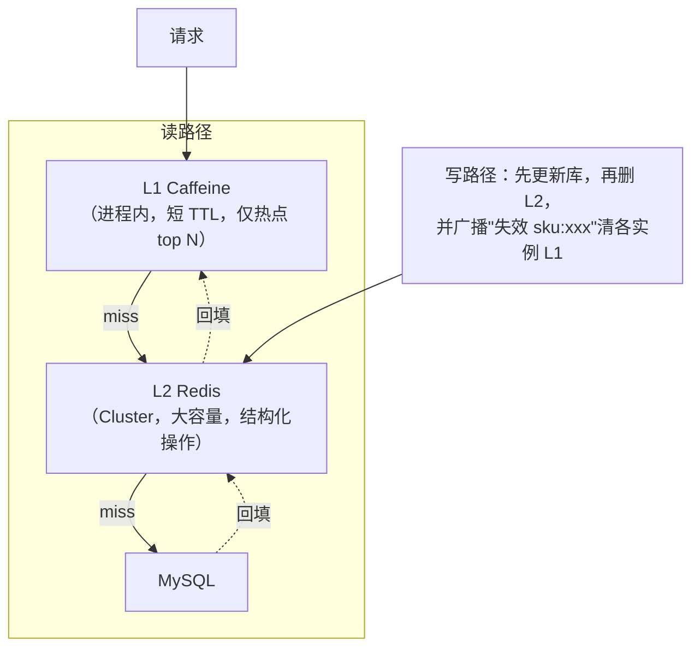

# 技术工具档案：缓存

> [返回：软件架构学习大纲](../软件架构学习大纲.md)

> 本分册是第三阶段“技术工具档案”系列的**缓存篇**：给正文反复引用、却从未系统展开的三个缓存工具立档案。每个工具固定四段式——**概况**（出身档案：作者、诞生年份与背景故事、当前归属、一句话定位）、**解决了什么问题**（出现前的痛，用具体场景痛点讲）、**如何解决**（核心机制拆解：数据结构/线程模型/持久化/高可用，讲清设计动机）、**对比同类**（逐维度对比 + 何时选它）。与 [04-数据架构-缓存分库与选型.md](04-数据架构-缓存分库与选型.md) 的分工是“模式 vs 工具”：04 讲缓存这一**架构模式**的通用课题（三大问题、一致性四象限、容量推演、singleflight、TTL 设计），本档案只讲**工具本身**的机制与对比——模式的课题一律链接过去、不重写。示例统一 Kotlin，主线场景是桶装水商城商品页热点读，工单中心看板计数、MES 设备最新状态、秒杀库存热点对照取材（各场景画像见 [示例项目场景/00-导览.md](../示例项目场景/00-导览.md)）；带 `main` 的完整示例已用 kotlinc 2.2.20 实际编译运行验证并附真实输出。

## 1. Redis：一个“副业项目”如何成为缓存事实标准

### 1.1 概况：出身档案

- **作者**：Salvatore Sanfilippo，网名 antirez，意大利西西里人。
- **诞生**：2009 年。背景故事值得完整讲一遍，因为它直接决定了 Redis 的形态：antirez 和朋友 Fabio Pietrosanti 运营着一个副业网站 **LLOOGG**——一个实时访问统计服务，站长在页面嵌入一段代码，就能看到自己网站“此刻谁在访问”的实时页面，还能暂停回看最近若干条访问记录。为了支持回看，每个站点最近 100 条访问记录都必须保存下来；antirez 最初把它们存 MySQL，这是典型的写多读少负载——每个页面浏览都要落一次盘，磁盘 I/O 首先成为瓶颈；他试着加 memcached 缓冲，发现只是把写入洪峰从一个磁盘转移到另一个磁盘（内存里的数据终究要周期性刷回 MySQL）。某天深夜他顿悟：真正需要的不是“更快的数据库”，而是**一个内存里的列表结构，外加后台慢慢落盘**。他先用 Tcl 在几个小时内做出原型验证想法，随后用 C 重写，2009 年开源。名字 REmote DIctionary Server——“远程字典服务器”，这个名字本身就宣告了它与 memcached 这类“远程字符串缓存”的分野。
- **当前归属**：2010 年起 VMware 雇佣 antirez 全职开发 Redis；2013 年转入 Pivotal；2015 年起由 Redis Labs（2021 年更名 Redis Ltd）赞助并主导至今（antirez 本人在 2020 年淡出日常开发）。2024 年 3 月，Redis 把许可证从 BSD 换成 RSALv2/SSPL 双许可，云厂商随即在 Linux 基金会发起分叉 **Valkey**；2025 年 Redis 8 起增加 AGPLv3 选项、重回 OSI 认证的开源阵营。截至 2026 年，Redis 与 Valkey 双轨并存，API 层面高度兼容——选型时把它当成“同一血统的两个发行版”看待即可，本文按主线 Redis 讲。
- **一句话定位**：**内存优先的数据结构服务器**——不只是缓存，而是一个把常用数据结构（字符串、哈希、列表、集合、有序集合、位图、流）放进内存、可选持久化、可选分片的服务端进程。

### 1.2 解决了什么问题：出现前的痛

**痛点一：磁盘数据库难以承受“每页一写”的实时统计**。LLOOGG 的负载是“每次页面浏览都写、只有站长偶尔查看”——写入量比读取量大几个数量级，而这恰恰是 B 树磁盘存储最不擅长的形状：每次写都可能触发随机 I/O。当年加 memcached 也无济于事，因为数据**最终还是要落库**，缓存只是把洪峰延迟了几秒。

**痛点二：纯 KV 字符串“服务端零理解”，改一个字节也要整取整存**。memcached 时代（下一节详述）服务端只识别不透明字符串，想维护一个计数器只能“GET → 客户端加一 → SET”三步走：三次网络往返尚且不论，**并发下两个客户端各自读到 5、各自写回 6，一次加法凭空蒸发**——经典的 read-modify-write 竞态（第二阶段 03 分册的幂等重试里见过它的表亲）。想在列表尾部追加一条？把整个列表序列化取回、修改后再整体写回，列表越长网络放大越严重。

**痛点三：业务要的不止 get/set**。对照我们的示例场景：桶装水商城商品页要“取最新一条价格变更”；工单中心看板要“今日新建工单数”原子累加，还要“处理量排行榜”；MES 大屏要“每台设备的最新状态”（键存在即最新，旧值天然可覆盖）。这些需求拆到存储原语，分别是**列表/字典、原子计数、有序集合**——纯 KV 字符串一种也承接不了，全要靠客户端“手工模拟”，把服务端该做的原子性摊给了每一个客户端。

### 1.3 如何解决：核心机制拆解

#### 1.3.1 线程模型：命令执行单线程 + IO 多线程（6.0）

**为什么能采用单线程**：Redis 的核心洞察是——内存操作的瓶颈不在 CPU，而在**网络 I/O 与内存带宽**。既然一条命令的执行只需几十纳秒到几微秒，串行执行命令省下的锁开销、上下文切换与原子性设计（单线程内 `INCR` 天然原子，不需要任何锁），远比并行执行命令的收益更大。主线程跑一个 epoll 事件循环，“解析请求 → 执行命令 → 回包”全部串行，任何时刻至多一条命令在执行——这是 Redis 所有原子性保证的根。

**“单线程”的精确含义**：是**命令执行**单线程，不是整个进程只有一条线程。不在主线程里的工作有多项：RDB 快照与 AOF 重写交给 `fork()` 出的子进程；4.0 起惰性删除（`UNLINK`）和 AOF fsync 交给后台线程；**6.0 起 IO 多线程**——读写 socket、协议解析/回包可以由多个 IO 线程并行处理，但最核心的“执行命令”一步仍回到主线程串行。动机源于压测：单机 QPS 逼近 10 万时，CPU 的主要开销在**网络读写和协议编解码**而不是命令执行，IO 多线程正是对症下药。

**反例与修正**：单线程的阿喀琉斯之踵是慢命令——一条 `KEYS *` 扫描百万 key，其余所有命令都要排队。修正：生产用 `SCAN` 游标迭代、大 key 删除用 `UNLINK`。这个教训通用化为一条工程判据：**共享单线程资源的服务，任何操作都要有上界**。

#### 1.3.2 核心数据结构与编码：为什么快、为什么省

**SDS（简单动态字符串）**：Redis 自己的字符串，头部记 `len`（已用长度）与 `alloc`（分配长度），后跟字节数组、结尾补 `\0` 兼容 C 函数。对比 C 字符串的四项优势：取长度 O(1)（C 版要 strlen 扫到结尾）；**二进制安全**（值里可以含 `\0`，图片、序列化字节流都能直接存储）；追加时按“小于 1MB 翻倍、大于等于 1MB 每次 +1MB”预分配、配合惰性释放，把连续 append 的 realloc 次数摊薄——这几个字段省下的，是每条命令执行路径上的微秒。

**编码分层（小数据用紧凑编码，增长后切换标准结构）**：这是 Redis 省内存的关键设计。小哈希/小集合不构建真正的哈希表，而是用 **listpack**——一段连续内存里紧凑排布各字段（长度前缀 + 数据），没有指针、没有对齐浪费，几十个字段的哈希表能省 5~10 倍内存；元素多或单值过大（阈值如 `hash-max-listpack-entries 128`、`hash-max-listpack-value 64`）自动升级为标准结构。listpack 的前身 ziplist 因为每个 entry 记录“前驱长度”，插入删除可能引发连锁调整，7.0 起 listpack 去掉后向引用、根除了这一病根。列表则是 quicklist——listpack 节点串成的双向链表，兼得两端操作与内存紧凑。**设计动机**：缓存场景海量 key 的 value 都很小，编码分层让“100 万个小 key”的内存占用从 GB 级降到百 MB 级。

**skiplist 跳表（zset 的骨架）**：有序集合 zset 内部是**双结构**——一个 dict（成员→分数，点查 O(1)）加一个跳表（按分数有序，范围查询）。跳表是多层有序链表：最底层含全部元素，每上一层按 1/4 概率“抽签”保留部分元素当快车道，查找从顶层往下走、期望 O(log N)。**为什么用跳表而不用红黑树**？antirez 的公开回答概括成三条：①**范围查询天然**——最底层本身就是有序链表，`ZRANGE` 沿链顺序访问即得结果，红黑树要做中序遍历回溯；②**实现简单**——没有旋转、没有重平衡，插入删除只改几个前向指针，并发改造与调试都容易；③**内存可调**——概率参数直接决定层高期望，指针开销比红黑树的父子三指针小。这条选型在桶装水商城 SKU 销量榜（`ZINCRBY` 加销量、`ZREVRANGE` 取前 50）和工单处理榜上每天都在得到印证。

**渐进式 rehash**：dict 扩容时（负载因子超阈值）不给整张表做一次性 rehash——那是百万 key 级别的内存重排，在单线程模型里就是一次几百毫秒的全局卡顿。做法：字典同时持有 `ht[0]`、`ht[1]` 两张表，扩容时给 `ht[1]` 分配双倍空间，此后**每次增删改查顺带迁移一个桶**（后台定时任务也会批量迁移若干），期间查询需同时查两张表、新写入只进 `ht[1]`，迁移完毕释放旧表。把一次长停顿摊销成无数个微秒级动作——与第一性原理一致：**单线程服务里，任何 O(N) 的一次性动作都要想办法摊销掉**。

**“为什么快”总结**：纯内存操作 + 为内存定制的结构（SDS/listpack/跳表）+ 无锁单线程 + epoll 事件循环。四者缺一不可——只说“因为内存”是不完整的，结构选择同样是为内存带宽优化的。

#### 1.3.3 持久化：RDB、AOF 与混合

**RDB（快照）**：某一时刻全量数据的二进制紧凑镜像。`BGSAVE` 通过 `fork()` 生成子进程写临时文件，靠操作系统的**写时复制（COW）**——子进程看到的是 fork 瞬间的内存视图，父进程照常服务，只有父进程随后修改到的内存页才会真正复制一份。优点：文件小、恢复快（直接载入，无需重放）。代价有三：大实例 fork 本身要复制页表，有可感知的启动停顿；COW 在快照期间遇上高写入，内存占用可能接近翻倍（被修改的页父子进程各存一份）；两次快照之间的数据全部丢失——丢失多少取决于间隔多长。

**AOF（命令日志）**：把每条写命令追加进日志文件，恢复时重放。安全性由 `appendfsync` 三档决定：`always` 每条命令刷盘（最安全最慢）、`everysec` 每秒一刷（默认，最多丢约 1 秒）、`no` 交给操作系统（最快，丢失量不可控）。日志会无限增长、重放越来越慢——**AOF 重写**：同样 fork 子进程，按**当前内存状态**生成一份“最小等价命令集”（一百次 `INCR` 压成一条 `SET`）写入新文件，期间的新命令先记入重写缓冲，子进程完成后原子替换。注意重写不是“修剪日志”，而是“从现状反推最短表示”。

**4.0 混合持久化**：重写产生的 AOF 文件改为“RDB 格式的全量头 + 之后的增量 AOF 尾”——恢复时先秒级载入 RDB 头、再重放尾部增量，兼得两者的优点，是如今数据不可全丢场景的主流配置（7.0 进一步拆成 Multi-Part AOF 的 base+incr 文件组，思想不变）。

**选型判据**：纯缓存、数据丢失后可回源重建 → 只 RDB 甚至关持久化；缓存之外还承担计数、锁、去重这类“丢失会出事”的数据 → everysec AOF 或混合持久化；想把 Redis 当主存储——须先停下权衡，那是另一个量级的运维责任。

#### 1.3.4 高可用三档：主从复制 → Sentinel → Cluster

**第一档：主从复制**。从库 `REPLICAOF` 指向主库，**全量同步**时主库 BGSAVE 生成 RDB 发给从库、期间的新写入暂存在复制缓冲区、从库载入 RDB 后续传增量；断线重连走 **PSYNC**——从库带着复制 ID 与偏移量回来，若偏移量还落在主库的**复制积压缓冲区（backlog 环形缓冲）**里，只补差量，否则退回全量。关键认知：复制是**异步**的——主库不等从库确认就向客户端回“成功”，主库刚写入就宕机时，未同步到从库的写会丢。这是工程上刻意选的可用性（CAP 取舍详见 [02-分布式理论基础-CAP共识与一致性.md](02-分布式理论基础-CAP共识与一致性.md)），缓存场景通常可接受，计数/锁场景必须心中有数。

**第二档：Sentinel（哨兵）**。解决“主库宕机后谁来自动切换”。机制三步：**主观下线（sdown）**——某一个哨兵 ping 主库，超过 `down-after-milliseconds` 判定失联（可能是自身网络抖动，只算一家之言）；**客观下线（odown）**——达到 quorum 数量的哨兵都报告失联才定性“确实宕机”，用多数派观察对冲单个哨兵的误判；**哨兵选举**——执行故障转移前，哨兵们先在内部用类 Raft 的方式（率先发现者拉票、多数派确认当选 leader）选出一个哨兵主持切换——选举的原理与活锁规避正是 [02 分册](02-分布式理论基础-CAP共识与一致性.md) Raft 小节的内容，02a-示例-cap-algorithms/ 里有可运行的选举示例。当选哨兵挑选“优先级高、复制偏移量新”的从库提升为新主，其余从库改指向新主，客户端通过哨兵拿到新主地址。**反例**：三个哨兵全和主库同机房——机房整体断电时哨兵集体失明，还可能在网络分区时误切。修正：哨兵跨机房部署、至少三个且取奇数。

**第三档：Cluster（集群）**。单主容量或写吞吐不够时，分片内置化。**16384 个槽**，key 按 `CRC16(key) mod 16384` 落槽、槽再分配给节点；为什么是 16384 不是 65536——节点间 gossip 心跳要携带“我负责哪些槽”的位图，16384 位 = 2KB，心跳开销可接受（antirez 给出的原由），且集群设计上限约 1000 节点，14 位槽绰绰有余。节点间用 **gossip 协议**（PING/PONG）交换集群视图。客户端可连任一节点：key 不由该节点负责时返回 **MOVED**（槽已完成迁移，客户端应更新本地槽表，下次直连）或 **ASK**（槽正在迁移中，仅本次重定向到目标节点、需带 ASKING 前缀，不更新槽表）——两者的区别是“永久搬家”和“搬家施工中”。多 key 操作需落在同一槽，可用 hash tag `{user1000}` 强制聚槽。**为什么用槽而不用一致性哈希**：槽是**显式可管理的分配单位**——扩缩容按槽整批迁移、槽的归属一目了然，运维可控性远好于“环上顺时针”的隐式分布；这与 04 分册分库三路线里“槽位映射 vs 一致性哈希”的取舍是同一个思想在存储与缓存两侧的重复出现。

**三档判据**：读扩展、能接受人工切换 → 主从；单主容量够、要自动故障转移 → Sentinel；单主容量/写吞吐不够 → Cluster。不要跳级——Cluster 带来的多 key 限制与运维复杂度是真金白银的成本。

#### 1.3.5 典型用途：缓存、分布式锁、排行榜、计数器（限流转 06 分册）

**缓存**：第一用途。容量推演、命中率账、三大问题（穿透/击穿/雪崩）、TTL 设计、singleflight 回源合并——全是 04 分册 3.1 的内容，此处只登记不重写：见 [04-数据架构-缓存分库与选型.md](04-数据架构-缓存分库与选型.md)。

**分布式锁**：`SET lock:order1 <唯一token> NX PX 30000` 一条命令完成“不存在才设置 + 过期时间”，NX 保证互斥、PX 保证持锁者崩溃后锁能自动释放。三个进阶问题层层递进：
1. **误删他人锁**——A 的业务超时导致锁过期，B 抢到锁，A 执行完毕后直接 DEL，误删了 B 的锁。修正：value 存随机 token，解锁必须“先查是自己的 token 再删”，而“查+删”两步必须原子——交给 Lua 脚本在服务端单线程执行。
2. **业务比锁活得久**——TTL 30s，业务跑了 35s，中途锁早被别人拿走。修正：看门狗续期（如 Redisson 默认每 10s 把 TTL 续回 30s，业务线程终止后续期自然停止）。
3. **RedLock 争议**——对 5 个**独立**主节点依次加锁、多数成功且总耗时小于 TTL 才算持锁，试图在“单点 Redis 锁不严格”之上构建更安全的分布式锁。Martin Kleppmann（《Designing Data-Intensive Applications》作者）2016 年发文批评：其安全性依赖**时钟不跳变、进程不停顿**这类无法保证的假设——一次 GC 长停顿或时钟回拨后，暂停的客户端可能“醒来仍自以为持锁”，两个客户端同时进入临界区；antirez 回应时钟漂移可以补偿，论战无定论。**工程判据（比站队更重要）**：先问锁失效的代价——只是“效率”损失（偶发重复计算、多付一次回源）→ 效率锁，单实例 Redis 锁完全够用、简单可靠；会造成“正确性”损失（资损、数据损坏）→ 正确性锁，要么给资源方引入 **fencing token**（单调递增令牌，下游拒绝旧令牌的写入），要么换 ZooKeeper/etcd，要么重新设计把锁从关键路径上移除。一句话：**Redis 锁能用，但不可神化**。

**zset 排行榜**：`ZINCRBY sku:rank 1 sku:1001` 原子加销量，`ZREVRANGE sku:rank 0 49 WITHSCORES` 取前 50——跳表让两端都是 O(log N)。桶装水商城销量榜、工单中心处理榜的标准解法，对照第 1.3.2 节“为什么跳表”读。

**计数器**：`INCR` 在单线程模型下天然原子，工单看板“今日新建/按期关闭”计数、API 配额统计都是一行命令。跨实例合并计数的进阶形态是 CRDT（见 [02a-示例-cap-algorithms/](02a-示例-cap-algorithms) 的 G-Counter 示例，原理在 [02 分册](02-分布式理论基础-CAP共识与一致性.md)）。

**限流**：固定窗口 `INCR + EXPIRE`、滑动窗口 ZSET、令牌桶 Lua 脚本——本质都是“06 分册已讲透的限流算法 + 本文的 Redis 原子性”组合而成，算法与洪峰对拍的完整可运行示例见 [06-高可用与稳定性-限流熔断与多活.md](06-高可用与稳定性-限流熔断与多活.md) 的 TokenBurst.kt，此处不重写。

### 1.4 对比同类：三工具总表

三个工具不在同一个层面（服务端进程 ×2 + 进程内库 ×1），但选型时总被放在一起比较，先给总表（详细解读见第 2、3 节）：

| 维度 | Redis | Memcached | Caffeine |
| --- | --- | --- | --- |
| 线程模型 | 命令执行单线程，6.0 起 IO 多线程，后台线程做惰性删除/fsync | 多线程：主线程 accept + worker 线程池各自事件循环 | 进程内库，调用方线程直接读写 + 后台异步清理 |
| 数据结构丰富度 | String/List/Hash/Set/ZSet/Stream/Bitmap/HyperLogLog/Geo | 纯 KV 字符串，结构靠客户端序列化 | 任意 Java 对象作 value，“结构”就是对象本身 |
| 持久化 | RDB / AOF / 4.0 混合 | 无 | 无（进程即生命周期） |
| 高可用方案 | 主从复制 → Sentinel → Cluster 三档 | 无复制；节点宕机 = 该部分缓存蒸发，靠回源重建 | 无意义（每实例独立副本，靠 TTL/失效广播对齐） |
| value 容量上限 | 单值理论上限 512MB（不建议大 value） | 默认 1MB（`-I` 可调） | 受堆内存约束 |
| 协议 | RESP（文本、可读、带订阅） | 文本协议（可用 telnet 直接交互）+ 二进制协议 | 无网络协议，方法调用 |
| 集群方式 | 服务端 Cluster 槽分片（16384 槽，MOVED/ASK） | 客户端一致性哈希分片（Ketama） | 无（单进程） |
| 一致性语义 | 异步复制，最终一致；单 key 命令原子 | 无复制语义可言 | 单机强一致（线程安全），多实例间只能最终一致 |
| 适用场景 | 缓存 + 结构化数据服务（锁/排行/计数/去重） | 纯对象缓存、多核充分利用、极简运维 | 单实例热点读、省 RTT、抗热点 |

**何时选 Redis**：需要数据结构、需要原子操作、需要持久化或复制、需要排行榜/计数/锁——当今新系统的默认答案。**何时不选**：只需要纯字符串缓存且已有运转良好的 Memcached 集群（迁移无收益），或数据本质单进程热点（直接 Caffeine，少一跳网络）。

## 2. Memcached：把“缓存”带进工程主流的老兵

### 2.1 概况：出身档案

- **作者**：Brad Fitzpatrick，LiveJournal 的创始人（Danga Interactive）。
- **诞生**：2003 年。最初用 Perl 写，很快由 Anatoly Vorobey 用 C 重写定形。背景：LiveJournal 是当年最大的社区博客之一，动态页面每秒数千次请求全部涌向 MySQL，Fitzpatrick 不愿靠不断更换更大的机器勉强支撑，于是把“内存缓存”做成独立守护进程——这就是 memcached（memory cache daemon）。它普及了两个此后统治行业十几年的观念：**cache-aside 旁路缓存模式**（04 分册的主角）与**用一组对等节点 + 客户端分片构成“逻辑上单机的内存池”**。
- **当前归属**：纯社区项目，无单一公司主导（长期维护者 dormando）。
- **一句话定位**：**分布式内存对象缓存系统**——多线程、纯 KV 字符串、无持久化、无复制，一切设计服务于“把数据库前面的热点读接走”这一件事。

### 2.2 解决了什么问题：2003 年的 LiveJournal 之痛

动态页面 = “查库 → 渲染 HTML”，而访问高度集中在少数热内容（某篇被大量转发的博客），**同一行数据一秒被查几百次**——数据库 CPU 全部消耗在重复劳动上。当年的出路只有两条：更贵的机器（寄希望于摩尔定律），或读写分离（把重复读分摊给从库）。Fitzpatrick 的洞察是第三条：这些重复读的结果**根本不该到数据库**——在 Web 服务器与 MySQL 之间增设一层内存池，命中就无需再访问数据库。衍生问题随之而来：单机内存不够怎么办？于是“多台对等 memcached + 客户端按 key 哈希分发”的横向扩展模式一并诞生——**分片逻辑从第一天就在客户端**，这是理解 memcached 一切取舍的钥匙。

### 2.3 如何解决：多线程、slab 分配器、纯 KV、客户端分片

**多线程模型**：主线程只负责 accept 新连接，把连接分发给 N 个 worker 线程，每个 worker 运行各自的 libevent 事件循环处理既有连接——**多核利用率高**（对比 Redis 命令单线程只用满一核）。代价是共享数据要加锁：哈希表与 LRU 链表长期是全局锁热点，后续版本不断细化（分锁粒度）才缓解。同一问题的两种答案：Redis 用“单线程 + 把多核让给 IO 与后台任务”，memcached 用“多线程 + 锁工程”，没有免费的午餐。

**slab 分配器**：解决 glibc malloc/free 在“变长对象高频分配释放”下的内存碎片——经典病：malloc 出大量大小不一的块、交错释放后，空闲总量充足却无法取出连续大块。memcached 的解法：把内存按 chunk 大小分级（size class，默认从几十字节起按约 1.25 倍递增），1MB 的页整页切成同规格 chunk；存 100 字节的 value 就向最近似的 class 取用一个 chunk。分配/回收退化为“从链表摘/还”，碎片从机制上消失。代价：①class 向上取整的空间浪费（100 字节占 112 字节的 chunk）；②**slab 失衡**——某 class 的页全满而其他 class 闲置，总内存尚有余量却无法容纳新对象，后期版本加 slab rebalance 才可在线调剂。对照：Redis 用“jemalloc 天然抗碎片 + listpack 紧凑编码”给出另一种答案——两个工具对同一个底层问题（变长内存管理）的不同解，是学习内存管理的活教材。

**纯 KV 字符串 + 1MB 上限**：服务端对 value 零理解，序列化（JSON/Thrift/原生序列化）全在客户端；value 默认上限 1MB。上限的动机不是吝啬：防止单个大对象垄断内存与网络、造成单请求长尾延迟。这份克制是它二十多年稳定的原因之一——也预演了 Redis 侧“大 key 治理”的红线（见 4.4 反例四）。

**LRU 与分代**：淘汰按 slab class 各自维护 LRU；过期是**惰性**的（访问时校验时间戳），淘汰发生在分配不到空闲 chunk 时剔除该 class 中最久未用者。2017 年 1.5.0 引入**分代 LRU**（young/old 两代 + 后台 crawler 线程）：只被访问过一次的“青年”条目优先牺牲，访问两次才晋升“老年”——直接对标“一次性扫描把热集冲光”的扫描污染问题（Caffeine 用 W-TinyLFU 更彻底地治同一个病，见第 3 节）。

**无持久化、无复制、无原生集群**：设计哲学一以贯之——**缓存是易失的、可从源头重建的**。不落盘、不复制，节点宕机后那 1/N 的缓存蒸发、流量回源重建；扩缩容用**客户端一致性哈希**（Ketama，由 last.fm 的 Richard Jones 2007 年提出，虚拟节点抹平环上分布不均）把影响压到约 1/(N+1)。注意这条哲学的暗面：节点宕机瞬间那部分 key 的**回源洪峰**，正是 04 分册“雪崩”教训的工具侧根源——不是 memcached 错了，而是“缓存宕机时系统仍要存活”这一前提要求回源链路留有富余容量，该要求对 Redis 集群同样成立。

### 2.4 对比同类：今天何时仍选 Memcached

对照第 1.4 总表，memcached 的现代定位收窄但依然成立：
- **仍选它**：纯字符串/序列化对象缓存、value 小而规整；希望充分利用多核且不愿受 Redis 单线程慢命令纪律约束；运维面要极简（进程简单但稳定）；团队希望用 telnet 直接敲文本协议排查。存量 Memcached 集群大量仍在运行且多年无事——“老”不等于“错”。
- **不选它**：需要列表/排行/位图等结构（memcached 每次整取整存）；需要原子读改写（read-modify-write 竞态）；数据不能丢（无持久化）；要自动故障转移；value 超过 1MB。
- 与 Redis 的分水岭一句话：**要不要服务端理解数据**。只需要字符串，两者皆可，memcached 更轻量；需要结构、原子性与持久化时，只有 Redis。新系统无历史包袱时默认 Redis，此决策成本最低。

## 3. Caffeine 与本地缓存：零网络跳数的“最后一公里”

### 3.1 概况：出身档案

- **作者**：Ben Manes，2015 年发起的开源 Java 缓存库（作者当时在 Google，项目源于他对缓存算法的系统调研）。
- **理论出身**：核心淘汰算法 W-TinyLFU 来自 Einziger、Friedman、Manes 等人的 TinyLFU/W-TinyLFU 论文（2017/2018）——少见的“论文与工业库几乎同步落地”的案例。
- **当前归属**：社区开源项目；Spring 5.2（2019）起取代 Guava Cache 成为 Spring 生态官方集成的本地缓存——Guava Cache 是它的前辈与对照。
- **一句话定位**：**JVM 进程内、以命中率为第一目标的现代缓存库**——零网络、零序列化，读就是一次方法调用。

### 3.2 解决了什么问题：分布式缓存解决不了的“最后一跳”

有了 Redis，为什么还要本地缓存？两笔账：
1. **延迟账**：Redis 再快，每次读也要一次网络往返（同机房 0.2~1ms 起，含序列化）。桶装水商城商品页的热点 SKU 每秒上万次读——这些请求哪怕 100% 命中 Redis，也是上万次网络往返、上万次连接/带宽占用，Redis 自身成为热点与单点风险。
2. **命中率账（本地缓存自己的病）**：朴素 LRU（Guava Cache 时代）有**扫描污染**——一次后台任务把全量商品遍历一遍，访问历史只有一次的冷数据就会把真正的热 key 从缓存中驱逐出去，之后命中率断崖式下跌。

本地缓存的用武之地：把**最热的一小部分** key 迁入进程堆内，读是纳秒~微秒级、零网络零序列化，Redis 只承接穿透下来的 miss——“抗热点、省 RTT”是收益，代价见 3.4 与第 4 节。

### 3.3 如何解决：W-TinyLFU，命中率的胜负手

W-TinyLFU 由三个部件拼成，各自对准一种经典缓存病：
1. **新生窗口（Window，约占容量 1% 的小 LRU）**——治“新 key 饿死”。新来的 key 没有任何历史频率，直接按频率和老 key 竞争必输（LFU 的老病：上周的热 key 占据频率高位，新热点难以进入）。窗口给新 key 一个“见习区”：先进窗口暂避，表现好再竞争主空间。
2. **主空间（SLRU：80% 试用区 + 20% 保护区）**——治“偶发访问噪声”。从窗口晋升的新条目先进试用区，**命中一次才升入保护区**；只有保护区头部的“受害者”才可能被新晋升者替换掉。一次偶然访问无法把条目直送高位，必须两次以上访问才证明价值。
3. **频率草图（Count-Min Sketch，4bit 计数器，定期整体减半）**——治“内存爆炸”与“旧热度僵化”的矛盾。精确记录每个 key 的访问次数需要一张大哈希表，草图用极小内存给出近似频率（允许少量高估、不会低估）；**定期减半**让“上周很热、这周已冷”的 key 频率平滑衰减，为新热点腾出位置。

准入规则一句话：窗口中的新条目要进入主空间，须与试用区最老条目**比频率**，胜出者才能换入。三个部件协同，在 Zipf 型（少数 key 占绝大部分访问）负载下命中率显著高于朴素 LRU——这正是生产缓存负载最常见的形状。

其余能力按需简述：`expireAfterWrite/AfterAccess/Variable` 三种 TTL、`refreshAfterWrite` 异步刷新（避免“同一时刻集体过期、回源洪峰齐射”——与 04 分册防雪崩的 TTL 加随机抖动同源，但由库内异步线程兜底）、`recordStats` 埋点、容量按权重而非条数。工程上值得单独强调的一点：**它的清理是异步的**——过期与容量超限不会阻塞读写线程，与 1.3.2 节“把长尾动作摊销掉”是同一哲学。

### 3.4 对比同类：本地 vs 分布式的边界

- 与 **Guava Cache**：前身，朴素 LRU + 基本能力，Spring 5.2 起官方集成让位于 Caffeine；老项目还在用，新项目没有理由不升级（API 几乎同构，`CacheBuilder` → `Caffeine.newBuilder()`）。
- 与 **Ehcache**：堆内 + 堆外 + 磁盘多层的大而全方案，还支持搭配 RMI 集群——层次多配置重，适合“一个缓存框架解决所有层”的诉求；Caffeine 只做堆内但把命中率做到极致。
- 与裸 `ConcurrentHashMap`：**反例**——把 Map 当缓存用，没有容量上界、没有 TTL、没有统计：只进不出的 map 就是内存泄漏，一次全量导出任务就能把堆撑爆。修正：任何缓存都要显式回答“最多装多少、活多久、装不下淘汰谁”三个问题——这三个问题正是本档案三个工具共同的设计主线。

**边界判据**：数据单实例读多写少、热点集中 → 本地缓存；需要跨实例共享、写多、容量大 → 分布式缓存；既要吞吐又要容量 → 两级（下一节）。

## 4. 组合拳：Caffeine + Redis 多级缓存与一致性判据

### 4.1 标准两级结构



读是层层兜底的漏斗；写的关键动作是“**先更新库，后删缓存**”（为什么不更新缓存、为什么删除优于更新，04 分册四象限已论证），再叠加**失效广播**（Redis pub/sub 或 MQ 广播“key 失效”消息，各实例收到后清除本地 L1）。广播是尽力而为——消息会丢，所以 **L1 必须再叠一个短 TTL 兜底**；若要求“失效消息不丢”，可用本地消息表/Outbox 模式保至少一次投递（见 [05-分布式事务-从2PC到最终一致.md](05-分布式事务-从2PC到最终一致.md)）。

### 4.2 场景联动：四个场景的取舍对照

| 场景 | 数据 | L1 本地 | L2 Redis | 判据 |
| --- | --- | --- | --- | --- |
| 桶装水商城商品页 | SKU 详情（名称/图/描述/价格） | 短 TTL 5~10s + 改价事件失效 | TTL 30min + 随机抖动 | 详情容忍秒级旧；改价要快可见 → 事件失效兜底 |
| 工单中心看板 | 今日新建/超时计数 | 1~3s（看板自动刷新周期内） | INCR 原子累加 | 计数允许秒级漂移，绝不能为省事让各实例各自计数（漂移失控） |
| MES 设备大屏 | 设备最新状态 | 1~5s | 上报高频 SET，单 key 即最新 | 旧值天然被覆盖；大屏容忍秒级滞后；**指令下发永不读缓存**（安全红线） |
| 秒杀库存 | 可售余量 | **不缓存**（展示字段另当别论） | Redis 单点 Lua 原子扣减 | 扣减是热点账本：读旧值判“有货”再扣 = 超卖（见 4.4 反例一与 [第六阶段秒杀](../06-第六阶段/02-场景拆解-秒杀.md)） |

### 4.3 一致性判据：上 L1 前先回答四个问题

1. **业务能容忍多久的旧值？** 0 秒（余额、库存判定、权限）→ 这份数据不应进入缓存，读库或走专门的原子路径；秒级（商品详情、看板计数、设备状态）→ L1 短 TTL 可用；分钟级以上 → L1 可放心使用。
2. **写路径有没有失效广播？** 只有 TTL：一致性窗口 = TTL（最坏）；TTL + 广播：窗口 = 广播延迟（毫秒~秒级），TTL 只作兜底。广播通道本身不可靠时需靠 Outbox 补足。
3. **L1 放多少？** 容量受堆内存约束（GC 压力），只放 top N 热点——以命中率数据（`recordStats`）为准，而非凭主观臆断。
4. **穿透到 L2/L1 都 miss 的防护在哪？** 击穿用 singleflight 合并回源、穿透用空值缓存、雪崩用 TTL 抖动——三道防线全在 [04 分册](04-数据架构-缓存分库与选型.md)，不重写。

### 4.4 反例与修正

**反例一：万物两级缓存（秒杀库存读旧值本地扣）**。把库存读进 L1 判断“有货”再在本地减——多实例各持旧值各自扣，超卖成灾。修正：**展示与判定分离**——商品页显示“仅剩 37 件”可以来自缓存；下单判定的那次扣减必须走 Redis 单点原子操作（Lua：查余量+扣减一气呵成），扣完异步落库。完整秒杀链路见 [06-第六阶段/02-场景拆解-秒杀.md](../06-第六阶段/02-场景拆解-秒杀.md)。

**反例二：L1 不设 TTL，全靠失效广播**。广播若丢了一条（MQ 抖动、实例重启错过订阅），那个 key 的旧值就会在该实例“永生”。修正：**TTL 兜底 + 广播加速**双保险——TTL 定脏值上限，广播把窗口压小；两者缺一，一致性要么不可控要么不收口。

**反例三：先删缓存、后更新库**。删除到库提交之间并发读会把旧值回填，脏值比新值更晚写入、活到下次删除——完整四象限分析在 [04 分册](04-数据架构-缓存分库与选型.md)，本文示例第二部分把这个窗口演成可复现的时间线剧本（见第 5 节）。

**反例四：大 value 入缓存**。把整页渲染后的 HTML（5MB）存入 Redis 或 L1——Redis 单线程回包被长尾拖累，L1 堆内存与 GC 承压。修正：控制 value 尺寸（几百字节~几 KB 为宜）、拆字段、启用压缩；memcached 的 1MB 上限（第 2 节）就是这条纪律的机制化表达。

## 5. 可运行示例：MiniLruTtlCache.kt

下面两段合在一个单文件里：第一部分实现一个带 **TTL 过期 + LRU 容量淘汰**的内存缓存（`LinkedHashMap` 的 `accessOrder=true` 就是 LRU 的现成骨架），用**注入的虚拟时钟**驱动——所有“时间”由 `now` 变量推进，输出完全可复现（与 04/06 分册示例同一手法）；第二部分把 4.4 反例三的“先更库后删缓存”窗口与**延迟双删**修正演成剧本。缓存与库一致性的完整模式分析在 04 分册，本示例只负责把窗口“演出来”。

```kotlin
// MiniLruTtlCache.kt：TTL 过期 + LRU 容量淘汰的内存缓存模拟；第二部分演示缓存-库一致性窗口
// 编译运行：kotlinc MiniLruTtlCache.kt -include-runtime -d app.jar && java -jar app.jar
import java.util.Locale

// ---------- 第一部分：MiniLruTtlCache ----------
class MiniLruTtlCache<K, V>(
    private val capacity: Int,
    private val defaultTtlMs: Long,
    private val clock: () -> Long,            // 注入虚拟时钟，输出可复现
) {
    private class Entry<V>(val value: V, val expireAt: Long)

    // accessOrder = true：每次 get 把节点挪到"最近使用"端，迭代器头部即最久未用
    private val table = LinkedHashMap<K, Entry<V>>(16, 0.75f, true)

    var hits = 0L;           private set
    var misses = 0L;         private set
    var lruEvictions = 0L;   private set      // 容量淘汰路径（发生在 put）
    var ttlExpirations = 0L; private set      // 惰性过期路径（发生在 get）

    @Synchronized
    fun put(key: K, value: V, ttlMs: Long = defaultTtlMs) {
        table[key] = Entry(value, clock() + ttlMs)  // 覆盖旧值并重置 TTL；容量内覆盖不触发淘汰
        trimToCapacity()
    }

    @Synchronized
    fun get(key: K): V? {
        val e = table[key]
        if (e == null) { misses++; return null }                  // 从没来过，或已被 LRU 淘汰
        if (clock() >= e.expireAt) {                              // 惰性过期：访问这一刻才清除
            table.remove(key); misses++; ttlExpirations++; return null
        }
        hits++                                                    // accessOrder 顺带标记为最近使用
        return e.value
    }

    private fun trimToCapacity() {
        val it = table.entries.iterator()
        while (table.size > capacity && it.hasNext()) {
            it.next(); it.remove(); lruEvictions++                // 从"最久未用"端淘汰
        }
    }

    val hitRatePercent: Double
        get() = if (hits + misses == 0L) 0.0 else hits * 100.0 / (hits + misses)
}

// ---------- 第二部分（剧本式片段）：先更库后删缓存的窗口 vs 延迟双删 ----------
object CacheDbConsistencyPlay {
    private var dbPrice = "2.0 元"                  // 库：商品现价
    private val cache = HashMap<String, String>()   // 缓存（只演一个 key）

    private fun state(tag: String) =
        println("      [$tag] cache=${cache["sku:1"] ?: "(空)"}  db=${dbPrice}")

    fun run() {
        cache["sku:1"] = dbPrice                    // 初态：缓存与库一致

        println("-- 剧本 A（残留窗口）：单删，读请求把旧值回填 --")
        cache.remove("sku:1")                       // T0：缓存恰好被淘汰，读请求 R 未命中
        val staleValue = dbPrice
        println("T0  读请求 R 未命中，回源库读到旧值 $staleValue（尚未回填）")
        dbPrice = "2.5 元"                          // T1：写请求 W 先更新库
        cache.remove("sku:1")                       //      再删缓存——此刻缓存本来就空
        println("T1  写请求 W 更新库为 2.5 元，随后删缓存（缓存此刻为空，没清掉任何脏值）")
        cache["sku:1"] = staleValue                 // T2：R 这时才回填 T0 读到的旧值
        println("T2  读请求 R 此时才回填，写入的是 T0 读到的旧值")
        state("A 结果")
        println("      脏窗口 = 直到 TTL 到期或下次写——长度不可控（四象限分析见 04 分册）")

        println()
        println("-- 剧本 B（修正）：延迟双删，把脏窗口压进 Δt --")
        dbPrice = "3.0 元"                          // T1：写请求更新库 → 第一删
        cache.remove("sku:1")
        println("T1  写请求 W 更新库为 3.0 元 → 第一删")
        cache["sku:1"] = "2.5 元"                   // T2：并发读请求 miss，回填了旧值
        println("T2  并发读请求 miss，回填了旧值 2.5 元（交错仍会发生）")
        state("第二删前")
        cache.remove("sku:1")                       // T3：睡过 Δt 后补第二删
        println("T3  等待 Δt（略大于一次回源耗时）后执行第二删，清掉并发回填的脏值")
        state("B 结果")
        println("      脏窗口 ≤ Δt；下一读将 miss 并回源，拿到库里的 3.0 元")
    }
}

fun main() {
    var now = 0L                                   // 虚拟时钟
    println("== 第一部分：MiniLruTtlCache（capacity=3，默认 TTL=200ms，虚拟时钟） ==")
    val cache = MiniLruTtlCache<String, String>(capacity = 3, defaultTtlMs = 200, clock = { now })

    cache.put("sku:A", "商品A"); cache.put("sku:B", "商品B"); cache.put("sku:C", "商品C")
    println("t=0    插入 sku:A / sku:B / sku:C，容量打满（size=3，均用默认 TTL 200ms）")

    now = 50
    println("t=50   读 sku:B -> ${cache.get("sku:B")}（命中；accessOrder 把 B 挪到最近使用端）")

    now = 100
    cache.put("sku:D", "商品D")
    println("t=100  插入 sku:D，容量打满触发 LRU 淘汰：最久未用的 sku:A 出局（lruEvictions=${cache.lruEvictions}）")
    println("t=100  再读 sku:A -> ${cache.get("sku:A")}（未命中：sku:A 死于【容量淘汰】，put 路径）")

    now = 150
    println("t=150  读 sku:C -> ${cache.get("sku:C")}（命中）")
    cache.put("sku:B", "商品B(改价)", ttlMs = 30)    // 覆盖写：重置 value 与 TTL，不触发容量淘汰
    println("t=150  覆盖写 sku:B，单独给 30ms 短 TTL（容量内覆盖，无淘汰）")

    now = 200
    println("t=200  读 sku:B -> ${cache.get("sku:B")}（未命中：sku:B 死于【TTL 过期】，惰性清除于本次 get）")

    println()
    println("命中率统计：hits=${cache.hits}  misses=${cache.misses}  lruEvictions=${cache.lruEvictions}  " +
            "ttlExpirations=${cache.ttlExpirations}  hitRate=${String.format(Locale.ROOT, "%.1f", cache.hitRatePercent)}%")

    println()
    println("== 第二部分：先更库后删缓存的一致性窗口（剧本式交错，虚拟时间线） ==")
    CacheDbConsistencyPlay.run()
}
```

编译运行（kotlinc 2.2.20）：

```bash
mkdir -p /tmp/kt-cache && cd /tmp/kt-cache
kotlinc MiniLruTtlCache.kt -include-runtime -d app.jar && java -jar app.jar
```

真实输出：

```text
== 第一部分：MiniLruTtlCache（capacity=3，默认 TTL=200ms，虚拟时钟） ==
t=0    插入 sku:A / sku:B / sku:C，容量打满（size=3，均用默认 TTL 200ms）
t=50   读 sku:B -> 商品B（命中；accessOrder 把 B 挪到最近使用端）
t=100  插入 sku:D，容量打满触发 LRU 淘汰：最久未用的 sku:A 出局（lruEvictions=1）
t=100  再读 sku:A -> null（未命中：sku:A 死于【容量淘汰】，put 路径）
t=150  读 sku:C -> 商品C（命中）
t=150  覆盖写 sku:B，单独给 30ms 短 TTL（容量内覆盖，无淘汰）
t=200  读 sku:B -> null（未命中：sku:B 死于【TTL 过期】，惰性清除于本次 get）

命中率统计：hits=2  misses=2  lruEvictions=1  ttlExpirations=1  hitRate=50.0%

== 第二部分：先更库后删缓存的一致性窗口（剧本式交错，虚拟时间线） ==
-- 剧本 A（残留窗口）：单删，读请求把旧值回填 --
T0  读请求 R 未命中，回源库读到旧值 2.0 元（尚未回填）
T1  写请求 W 更新库为 2.5 元，随后删缓存（缓存此刻为空，没清掉任何脏值）
T2  读请求 R 此时才回填，写入的是 T0 读到的旧值
      [A 结果] cache=2.0 元  db=2.5 元
      脏窗口 = 直到 TTL 到期或下次写——长度不可控（四象限分析见 04 分册）

-- 剧本 B（修正）：延迟双删，把脏窗口压进 Δt --
T1  写请求 W 更新库为 3.0 元 → 第一删
T2  并发读请求 miss，回填了旧值 2.5 元（交错仍会发生）
      [第二删前] cache=2.5 元  db=3.0 元
T3  等待 Δt（略大于一次回源耗时）后执行第二删，清掉并发回填的脏值
      [B 结果] cache=(空)  db=3.0 元
      脏窗口 ≤ Δt；下一读将 miss 并回源，拿到库里的 3.0 元
```

**输出解读**（对照真实输出读三条）：
1. **同样是 miss，死法不同**：sku:A 死于 put 路径的**容量淘汰**（插 D 时它最久未用），sku:B 死于 get 路径的**惰性过期**（被覆盖写赋予 30ms TTL，到点后第一次访问才清除）——真实缓存的 miss 原因需分开统计，容量淘汰多说明该扩容或热集变大，过期淘汰多属于正常代谢。
2. **过期是惰性的**：t=180 时 sku:B 的 TTL 已到，但缓存并没有立刻删除它——直到 t=200 的 get 才发现并清除。这与 Redis 的过期策略同构（惰性删除 + 定期采样双管齐下），纯被动方案里“过期 key 占用内存”是常态，所以真实系统都需要补充主动清理。
3. **剧本 A 与 B 的差别只在“第二删”**：剧本 A 中并发读者的回填发生在删除**之后**，脏值无人再清、活到 TTL；B 的第二删发生在“可能的最晚回填”之后，把窗口压进 Δt。注意 B 没有消灭窗口——Δt 内仍可能读到旧值，这正是 04 分册那句“缓存一致性从定义上就是最终一致”的可复现证据。

## 【本节自测】

1. Redis 用 Tcl 原型验证、C 重写定形；LLOOGG 的痛“每次页面浏览都要写盘”为什么靠加 memcached 缓冲解决不了？这个出身故事如何预示了 Redis“数据结构服务器”的定位？
2. “Redis 是单线程的”这句话哪里不精确？请列出至少三类**不在命令执行主线程**里的工作，并说明 6.0 IO 多线程为什么只并行“读写与协议解析”、不并行“命令执行”。
3. zset 为什么选跳表而不是红黑树？给出 antirez 的三条理由，并结合“桶装水商城 SKU 销量榜取前 50”说明范围查询为什么天然快。dict 的渐进式 rehash 把什么代价摊销成了什么？rehash 进行期间，一次 GET 的查找路径是怎样的？
4. RDB、AOF、混合持久化各自的数据丢失窗口与恢复速度如何权衡？纯缓存场景与“缓存 + 工单看板计数”场景应分别怎么配？fork 写时复制在大实例 + 快照期高写入下有什么风险？
5. 主从复制、Sentinel、Cluster 分别解决什么层次的问题？主观下线与客观下线的区别是什么、为什么要“多数派哨兵都同意”才定性？MOVED 与 ASK 的语义差别是什么（结合槽迁移场景说明）？
6. 用 `SET NX PX` 加锁后，为什么解锁必须用 Lua 脚本“校验 token 再删除”？看门狗续期解决什么问题？Kleppmann 对 RedLock 批评的核心论据是什么？“效率锁”与“正确性锁”的判据如何落到你的秒杀扣库存场景？
7. Memcached 的 slab 分配器解决什么问题？代价（class 取整浪费、slab 失衡）是什么？它与 Redis 侧“jemalloc + listpack 紧凑编码”是同一个底层问题的哪两种答案？为什么 memcached 把分片逻辑放在客户端、而 Redis Cluster 放在服务端？
8. W-TinyLFU 的三个部件（新生窗口、SLRU 主空间、频率草图）分别对准哪三种经典缓存病？多级缓存（Caffeine + Redis）的收益与代价各是什么？结合 4.3 的四问，判断你所在系统里哪份数据可以进 L1、哪份数据根本不该进任何缓存，并说明理由。

## 替换清单

- “4.1 标准两级结构”L1/L2 两级缓存读路径、写路径与回填 → `flowchart`
