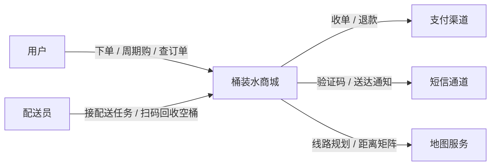
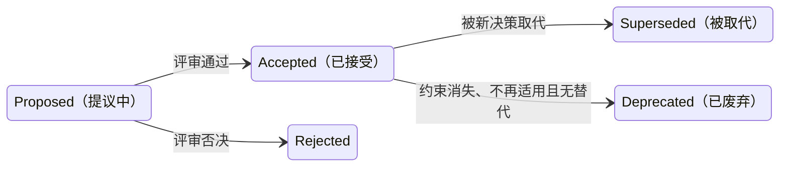

# 架构设计与表达：C4、4+1 视图与 ADR
> [返回：软件架构学习大纲](../软件架构学习大纲.md)

本文是主笔记 [第四阶段：架构方法论](01-架构方法论.md) 中 `## 1. 架构设计与表达` 一节的扩写版。小节编号（1.1 C4 / 1.2 4+1 视图 / 1.3 ADR）与主笔记保持一致——其他笔记写到“见 1.3”时，指的就是本文的 1.3；正文中出现的“见 3.2”“见本阶段第 2 节”等编号，均指主笔记对应小节（3.2 架构适应度函数、第 2 节领域驱动设计）。示例取材同主笔记：[示例项目场景](../示例项目场景/00-导览.md)——主线桶装水商城，辅以工单中心、MES。


架构 = 决策 + 表达。决策没人看得懂、没人找得到，等于没做。表达工具对应三类受众：业务方（宏观）、新同事（结构）、一年后的自己（理由）。

把这句话再往前推一步：架构表达不是画图技巧，而是**决策的可达性**问题。判断一份架构表达是否合格，唯一标准是——目标受众在**你不在场**的情况下，能否得到他需要的那一层答案。业务方拿着上下文图就能回答“这系统和支付渠道是什么关系”；新同事拿着容器图和模块图就能回答“押金逻辑在哪个仓库哪个模块”；一年后的你拿着 ADR 就能回答“当初为什么拆配送服务、现在还成不成立”。三种受众、三种载体，谁也替代不了谁：给业务方看类图、给新同事看 PPT 远景图、给未来的自己只留会议录音，都是“表达了但没表达”。

验收一份架构表达因此只需要三个动作：业务方拿 L1 复述系统边界；新同事拿 L2/L3 在五分钟内找到“押金退费逻辑在哪个模块”；一年后的自己拿 ADR 复原决策当时的约束条件。三个动作有一个失败，表达就没有完成。下面三小节的三套工具各有分工：C4 为前两个动作提供载体，4+1 负责覆盖性检查（哪类问题没人能答），ADR 承接第三个动作。

## 1.1 C4 模型

定义：Simon Brown 提出的架构图分层方法，核心思想是**像地图一样分级缩放**——每张图只回答一个层级的问题，避免“一张巨图塞进所有细节”。

| 层级 | 名称 | 回答的问题 | 图上的方块 | 桶装水商城例子 |
|---|---|---|---|---|
| 1 | 系统上下文 Context | 系统为谁服务、依赖谁 | 人 + 外部系统 | 用户、配送员、桶装水商城、支付渠道、短信通道、地图服务 |
| 2 | 容器 Container | 系统内有哪些可独立运行的单元 | 应用 + 数据存储 | 商城应用、订阅调度、配送服务、MySQL、Redis、MQ |
| 3 | 组件 Component | 容器内部怎么分模块 | 模块/包 | 商城应用内的商品、订单、押金、营销模块 |
| 4 | 代码 Code | 这个类内部长什么样 | 类/接口 | 押金聚合的类图（Deposit、BucketHolding、Money）——通常交给 IDE，不手画 |

两个易错点：**Container 不是 Docker 容器**，指“一个独立运行单元”——Spring Boot 应用、React SPA、MySQL、Redis 各算一个；**C4 的价值在 1~3 层**，第 4 层画了也会过期，交给 IDE。

L1 系统上下文图（Mermaid；L2 容器图同法，把方块换成“商城应用 / 订阅调度 / 配送服务 / MySQL / Redis / MQ”并画出它们之间的调用与消息流）：



❌ 反例：一张图里同时出现类名（DepositPayService）、部署细节（Pod 副本数）、外部系统（微信支付）和模块框——读者被迫同时回答四个层级的问题，谁也看不懂。
✅ 修正：先问“这张图给谁看、回答哪一层的问题”，再决定画到第几层；不同层级分开画、分开存档。

### 1.1.1 四层图的适用表：给谁看、什么时候画、什么时候别画

上面的修正给出了原则，落地还需要判据。下表把四层各自“给谁看、什么时候值得画、什么时候别画”摊开：

| 层级 | 给谁看 | 什么时候画 | 什么时候别画 |
|---|---|---|---|
| L1 上下文 | 业务方、管理层、售前、新同事第一天 | 立项评审、对外协作、向非技术角色解释边界与依赖 | 内部重构讨论——L1 根本不会变，画了纯属浪费 |
| L2 容器 | 新入职工程师、运维、做技术方案的你 | 系统出现第一个独立部署单元、拆服务决策落地、容量与部署评审 | 个人小工具、单元数量少且结构自明时 |
| L3 组件 | 维护该容器的开发自己 | 模块划分评审、复杂容器内部交接、模块边界出现争议 | 容器内重构频繁、组件图周周过期时——改用代码结构本身 |
| L4 代码 | 没人（应该让 IDE 看） | 永远不手画；需要时用工具从代码生成，看完即弃 | 一切场景 |

每层再给一条可执行的判据：

- **L1 画不画**：系统有 ≥2 类外部角色或 ≥2 个外部依赖就值得画。桶装水商城有用户、配送员两类角色，支付、短信、地图三个外部依赖——典型的“该画”。判据的本质是：L1 回答的是“系统边界在哪”，只要有人会问“你们和支付渠道怎么分工”，这张图就有存在价值。
- **L2 画不画**：出现第一个“可独立运行单元”之外的单元（比如 Redis 独立部署、第一个后台 Job 独立进程），就该画了。L2 是运维和新同事最依赖的一层——“这个系统跑着几个进程、各自连哪个库”，口口相传必错。
- **L3 画不画**：只有当容器内模块划分存在争议，或新人反复问“XX 逻辑在哪儿”时才画。L3 的半衰期最短（重构最频繁），维护成本最高，宁缺毋滥。
- **MES 取材**：MES 的 L1 要画出 ERP、WMS、PLC/SCADA、边缘网关——边界一画出来，“MES 和 PLC 到底谁管设备控制”的职责争议自动消失：L1 上 MES 只有一个方块，设备控制发生在方块之外的工控层（ISA-95 分层，见[示例项目场景](../示例项目场景/00-导览.md)）。这就是 L1 的隐藏用途：**用边界终结“该不该我做”的扯皮**。
- **工单中心同理**：它的 L1 要画出电话、APP、IoT 告警、外部系统四个入口方块汇入工单中心——“多渠道接入、内核稳定”的诉求在 L1 上自动浮现：渠道是边界外的方块，随时可增，工单内核不动。这张图还是六边形架构（端口/适配器）在业务层的前置论证（见[第二阶段](../02-第二阶段/01-经典架构模式.md) 4.2）：先有 L1 证明“渠道易变、内核必须稳”，再谈代码里怎么放端口和适配器。

### 1.1.2 用 C4 表达桶装水商城演进的三个时点（纯文字）

C4 的“分级缩放”不仅是对不同受众缩放，也是**对时间缩放**——架构演进时，变化的压力被限制在对应层级。拿桶装水商城走过的三段（见[第二阶段](../02-第二阶段/01-经典架构模式.md)单体→模块化单体→微服务、[事件驱动](../02-第二阶段/04-事件驱动架构.md)）在纯文字里“画”一遍：

**时点一：单体分层期**（一个 Spring Boot 应用打天下）。

- L1 长这样：用户、配送员、桶装水商城、支付渠道、短信通道、地图服务——和上面那张 Mermaid 图完全一致。
- L2 可怜得很：只有“商城应用”+ MySQL + Redis 三个方块；订阅调度、配送排线、押金都只是应用里的包，不是独立运行单元。
- L3 反而是唯一有信息量的一层：商城应用内部是按技术分层切（controller / service / dao），还是按业务切（商品 / 订单 / 押金 / 配送模块）？这正是[第二阶段“分层与模块化”](../02-第二阶段/02-单体架构-分层与模块化.md)那场争论在图上的呈现。
- 判据：**单体期 L2 的信息量低到近乎没有，这本身就是信号——值得投入的是 L3 模块图**，因为那时唯一正在形成的架构资产是“模块边界”。

**时点二：拆微服务后**（ADR-007 之后，配送排线独立成服务，订阅调度随之独立）。

- L1 依然不变：用户还是下单，支付渠道还是收单退款。这是 C4 分层的第一个红利——**对外承诺稳定，内部重构不惊动业务方**；L1 在整个演进过程中几乎没有改过一行。
- L2 长出了新方块：配送服务、订阅调度服务；MQ 作为独立容器登场；MySQL 拆成“商城库 + 配送库”两块。变化全部集中在 L2。
- 关键纪律：L2 上每一处新增的方块，都应该能指向一条 ADR——配送服务方块对应 1.3 的 ADR-007。**方块不是画出来的，是“决策”出来的**；指不出决策来源的新方块，要么补 ADR，要么它就不该出现。

**时点三：上了事件驱动后**（支付成功发 OrderPaid 事件，下游各自消费）。

- L2 出现第二种箭头：实线是同步调用（用户 → 商城应用），虚线是事件流（商城应用 → MQ → 各消费者）。一张 L2 图从“调用拓扑”变成“调用 + 事件”双拓扑。
- 把动态流向用文字描述一遍：支付成功 → 商城应用发布 OrderPaid 进 MQ → 配送服务消费它生成配送任务、押金服务消费它激活押金单、营销服务消费它发券——三个下游互不认识，各自幂等消费同一条事件（可靠投递与幂等见[第三阶段](../03-第三阶段/01-分布式系统核心技术.md)）。
- 判据：**事件驱动之后，L2 不画事件流就是自欺**——同步箭头只回答“谁调谁”，回答不了“谁的可用性依赖谁”。商城应用宕机用户立刻感知；MQ 宕机配送任务停发——这两类故障传播路径完全不同，只有双拓扑能同时表达。

三个时点收束成一句总结：**演进不改 L1、重写 L2、微调 L3**。这就是分级缩放在时间维度上的含义——变更的影响面被限制在对应层级，图与图之间互不牵连，维护成本才有下限。压缩成一张对照表：

| 层级 | 时点一：单体分层 | 时点二：拆微服务 | 时点三：事件驱动 |
|---|---|---|---|
| L1 | 与最终版几乎一致 | 不变 | 不变 |
| L2 | 商城应用 + MySQL + Redis，近乎零信息量 | 长出配送/订阅服务与 MQ，库一分为二 | 同步实线之外增加事件虚线，升级为双拓扑 |
| L3 | 唯一有信息量：技术分层 vs 业务模块之争 | 各容器内部重新画模块图 | 订单模块内多出“事件发布”组件，其余少动 |

### 1.1.3 架构图维护腐化：三个信号与“图跟着 ADR 走”的纪律

架构图最大的敌人不是画不好，而是画完之后的半年。腐化有三个可观察的信号：

1. **图与代码对不上**：新人按容器图找“订阅调度服务”，发现它根本没独立部署，只是老单体里的一个包。表现是图在描述一个不存在的系统——多发生在“图是画的、代码是赶的”团队。危害最大：新人会基于图建立错误心智模型，排障方向从一开始就偏。
2. **图比代码“先进”**：图上画着配送服务、事件总线，代码里还是同步 RPC 直连——这是“目标架构”混进了“现状架构”却不标注。图没有错，错在没区分 as-is（现状）与 to-be（目标）；新人拿 to-be 图找到的是 as-is 世界。
3. **没人敢改图**：改一张图要走架构组审批、要重画、要开会——于是大家宁可不改。信号是“最后一次修改日期”停在一年前，而代码的 git log 显示这半年拆了两个服务。图从资产变成了纪念碑。

对应的纪律是“**图跟着 ADR 走**”，四条：

1. **ADR 模板里加一行“影响哪些图”**：决策落地时明确列出“ADR-007 影响 L2 容器图、商城应用 L3 组件图”，改图成为决策执行的一部分而不是事后美化。
2. **图进仓库、走 PR 评审**：图和代码同仓库、同评审、同回滚。改架构的 PR 没带图更新，reviewer 直接打回——和“改架构的 PR 必须一并更新对应 ADR”是同一条纪律的两个侧面。
3. **每张图标注最后核对日期与核对人**：给读者一个信任度的锚——“这张图 2026-10 核对过”和“不知道这张图多久没动”是两种完全不同的使用方式。
4. **宁可画少，不可画错**：过期图比没有图危险得多——没有图，读者会去读代码；错的图，读者会先信图。拿不准的细节就别画，画出来的每一笔都要有人为它负责。

另有一条容易被忽略的图面纪律：**每张图带图例，箭头语义全工作区统一**——实线同步调用、虚线事件流、双实线数据复制，跨任何两张图不得换含义。图例缺失是“每人自画一套”的起点：同样一条虚线，一张图表示事件、另一张表示“可能有点关系”，读者无从比较。绞杀者迁移期间（见主笔记 3.3）还有进阶用法：L2 图用三种标注区分“已接管 / 共存中 / 待迁移”，一张图同时充当结构文档与改造进度仪表盘。

## 1.2 4+1 视图

定义：Philippe Kruchten（RUP）提出的多视角描述法：四个视图各管一类关注点，再用“+1”的场景视图串起来验证完整性。

| 视图 | 关注点 | 主要受众 | 桶装水商城例子 |
|---|---|---|---|
| 逻辑视图 | 功能如何分解（类、模块、职责） | 设计/开发 | 商品、订单、订阅、押金、配送各域的领域模型（见本阶段第 2 节） |
| 开发视图 | 软件怎么组织（分包、分层、依赖） | 开发 | 商城工程按 order / subscription / deposit / delivery 分模块，依赖方向受适应度函数守护（见 3.2） |
| 进程视图 | 运行时并发、同步、容错 | 后端/运维 | 下单请求链路、订阅调度定时任务、配送服务的消息消费者、押金超时扫描 |
| 物理视图 | 部署到哪些节点 | 运维/DBA | 商城应用 3 个 Pod、配送服务独立部署、MySQL 主从、Redis 哨兵、跨可用区 |
| 场景（+1） | 用核心用例把四个视图串起来 | 全体 | “用户下单支付 → 订阅下期生成配送任务 → 排线 → 送水 → 空桶回收退押金”端到端走一遍每个视图 |

换成工单中心同理：场景视图拿“工单创建 → 分派 → SLA 超时 → 催办升级 → 关单回访”串起另外四个视图。

关键理解：**+1 不是附录**。拿 1~2 个核心场景在四个视图里各走一遍，最容易暴露图与图之间的矛盾——比如逻辑视图里“下单即锁库存”，进程视图里却是“支付成功后异步扣”，这正是 4+1 的用途。

C4 与 4+1 怎么选：C4 按**缩放层级**组织（不同受众看不同粒度），4+1 按**关注点维度**组织（保证每类问题都有视图覆盖），两者互补。常见组合：用 C4 画上下文/容器图，用 4+1 检查进程、物理视角有没有被遗漏。

### 1.2.1 五视图 ↔ 现代工程工件映射表

4+1 诞生于 1995 年，那时的默认载体是“文档”。今天再学 4+1，重点不是补写五份 Word，而是认出**每个视图在今天活在哪个工件里**：

| 视图 | 1995 年的载体 | 今天它活在哪里 | 通常谁维护 | 桶装水商城对应 |
|---|---|---|---|---|
| 逻辑视图 | 类图、模块划分文档 | 领域模型文档、上下文映射图（见主笔记第 2 节 DDD） | 领域负责人 | 八个限界上下文及各自的聚合、领域事件清单 |
| 开发视图 | 分包规范文档 | 仓库目录树、构建脚本模块、依赖规则测试（ArchUnit，见 3.2 与本文 1.4） | 架构师 + CI | order / subscription / deposit / delivery 四个 Gradle 模块及其依赖规则 |
| 进程视图 | 进程/线程拓扑图 | 部署拓扑、线程池与消费者组配置、链路追踪（Trace）样本 | 后端 + 运维 | 下单链路、订阅调度 Job、OrderPaid 消费者组、押金超时扫描任务 |
| 物理视图 | 硬件部署图 | K8s 清单（Deployment/HPA/NetworkPolicy）、IaC（Terraform）、发布系统配置 | SRE | 商城应用 3 副本、配送服务 HPA 按 CPU 扩缩、MySQL 主从跨可用区 |
| 场景视图（+1） | 用例文档 | 关键用例时序图、E2E 测试、真实 Trace 样例 | 全员 | “下单支付 → 排线 → 配送 → 空桶回收退押金”的时序图 + 一条真实链路 Trace |

从这张表能读出三层意思：

- **四个视图大多已经以“可执行工件”的形态存在**。K8s 清单就是物理视图的可执行版本——它不可能过期，因为它就是运行的东西本身；ArchUnit 测试就是开发视图的可执行版本（开发视图说“订单不得依赖配送内部”，测试保证它仍然成立）。可观测性体系（Trace、监控拓扑）则是进程视图的持续实测版（详见[第五阶段](../05-第五阶段/01-工程化与运维视角.md)）。
- **4+1 的现代用法是 checklist，不是文档清单**。评审一个方案时，拿五类关注点挨个问：“逻辑上模型对吗？开发上模块边界守得住吗？进程上并发与失败怎么处理？物理上部署在哪、怎么扩？场景上端到端走得通吗？”——缺哪个工件的回答，就补哪个工件，而不是补一份文档。
- ❌ 反例：某团队为应付架构评审，临时补写了一份《进程视图》文档，评审完没人再更新，三个月后文档描述的消费者组配置和线上已经完全不同。✅ 修正：进程视图的载体就是链路追踪和消费者组配置——评审时拿一条真实 Trace 现场讲，过期问题根本不会出现。判据一句话：**凡是已经活在工件里的视图，不再另写文档；文档只写工件表达不了的东西（取舍、理由、边界条件）**。
- 4+1 与质量属性还有一层对应（见[第一阶段：架构质量属性](../01-第一阶段/04-架构质量属性.md)）：场景视图守护功能正确性，进程视图守护性能与并发安全，物理视图守护可用性与可扩展性，开发视图守护可维护性与可测试性，逻辑视图守护业务复杂度的可控性。评审时让每个视图回答一个对应的质量属性问题——“进程视图：峰值并发下这条链路的瓶颈在哪？”“物理视图：单可用区宕机会怎样？”——五个问题都有工件或图可答，方案完整性就有了下限。

### 1.2.2 4+1 与 C4 的分工与混用规则

两套方法并存，最容易出现的混乱是“同一件事画两遍、两遍还不一致”。给出分工与三条混用规则：

**分工**：C4 回答“结构长什么样”（名词），4+1 回答“每类关注点被覆盖了吗”（检查清单）。C4 的强项是给不同受众不同粒度的静态结构；4+1 的强项是逼你检查运行时行为、部署形态这些“图上容易漏”的维度。

1. **讲结构用 C4，查遗漏用 4+1**。新同事入职、跨团队协作、立项汇报——用 C4 的 L1/L2/L3 分层缩放；技术方案评审、上线前检查——用 4+1 当 checklist 过一遍五类关注点。两者的输出物可以是同一套图，但入口不同。
2. **受众对话用 C4 的“缩放”，评审提问用 4+1 的“维度”**。老板问“系统边界”，翻 L1；运维问“有几个进程”，翻 L2；评审会上问“消费积压怎么办”——这是进程视图的问题，拿着 L2 图也答不全，得看消费者组配置与补偿机制。判断眼前问题属于哪套方法管辖，是架构师的基本功。
3. **不维护两套平行大文档**。C4 的 L2 容器图与 4+1 的物理视图高度重叠（都是“商城应用 3 Pod、配送服务独立部署”）。约定口径：结构类问题以 C4 图为准，运行时与部署类问题以活工件（K8s 清单、Trace、监控）为准；任何一份材料只回答属于它的问题，不重复承载。

工单中心示范一次混用：场景视图选“工单创建 → SLA 超时 → 催办升级”，先在 C4 L2 上走——创建走工单应用的同步 API，SLA 计时是独立的扫描任务容器，催办由通知服务消费事件发出；再切到进程视图检查——扫描任务每分钟全表扫在途工单，和工单 API 同一个进程池，早高峰大批量创建时扫表拖慢创建接口。这个矛盾在 C4 图上完全看不见（图上两者只是两个方块），只有把场景按进程视图过一遍才暴露——这就是“+1 不是附录”的具体含义。

## 1.3 ADR（架构决策记录）

定义：记录**某个架构决策的背景、选项与后果**的短文档（Michael Nygard）。核心洞察：架构的沉淀物不是图，而是决策及其理由——图会过期，“为什么当时这么做”才是长期资产。

轻量模板（放代码仓库 `docs/adr/` 下，随代码一起评审）：

````markdown
# ADR-007：桶装水商城配送排线独立为单独服务

- 状态：已接受（2026-10-20）

## 背景
商城单体里配送排线与订单逻辑耦死：排线算法每次迭代（装载率、线路合并策略）都要连带回归下单链路；
且排线是 CPU 密集计算，早高峰批量排线占满交易线程池，下单 P99 明显抖动。

## 决策
将配送排线独立为配送服务。订单域支付成功后发布 OrderPaid 事件，配送服务消费事件生成配送任务并排线；
排线结果通过开放主机服务（OHS）的查询接口回供订单与用户端；地图/距离矩阵的调用收敛在配送服务内部。

## 备选方案（为什么不是别的）
继续留在单体做模块化隔离（发布节奏仍互相牵制，CPU 争用无解）、整体外采 TMS
（空桶回收与押金联动的业务太特殊， customization 成本高），均否决。

## 后果
- 正向：排线算法独立演进、独立扩容；交易链路与计算负载隔离
- 负向：订单到配送改为事件驱动，引入秒级延迟；配送服务不可用时配送任务积压，需补偿与告警
- 复查点：若订单峰值 QPS 降一个数量级且团队缩减到两三人，重新评估合回单体模块（见第二阶段"微服务的代价"）
````

三条纪律：

1. **一决策一文件**，编号递增，文件名带标题（如 `007-delivery-routing-as-service.md`）
2. **状态要显式**：提议中 / 已接受 / 已废弃 / 被 ADR-0XX 取代——废弃时不删除，加链接指向新决策
3. **负向后果必须写**：只写好处的 ADR 是宣传稿，不是决策记录

❌ 反例：配送排线要不要拆出去只在评审会上讲了一遍，结论落在聊天记录里；半年后新人把排线又改回同步调用塞进商城应用，理由是“没人说得清当初为什么拆”。
✅ 修正：凡是“单向门”决策（回头改代价大，见第一阶段），先补 ADR 再实施；改架构的 PR 必须一并更新对应 ADR。

### 1.3.1 ADR 生命周期：状态流转与修改权限

三条纪律里的“状态要显式”值得单独展开成一个状态机。一条 ADR 的完整生命周期：



状态流转规则与操作权限：

| 从 | 到 | 触发条件 | 谁有权操作 |
|---|---|---|---|
| Proposed | Accepted | 架构评审通过（评审会决议或 PR review 通过） | 有决策权的人——不一定是作者，通常是技术负责人或架构组 |
| Proposed | Rejected | 评审否决 | 同上 |
| Accepted | Superseded | 新 ADR 取代了本决策，随新 ADR 通过一并生效 | 新决策的评审通过时一并操作 |
| Accepted | Deprecated | 决策依据的约束消失、不再适用，且没有新决策替代 | 原决策人或现任架构负责人 |

两条铁律，比状态机本身更重要：

1. **Accepted 之后正文不可变**。决策一经接受就成了历史——历史可以失效，但不可以篡改。想改方案，唯一途径是写新 ADR 并把旧的标为 Superseded；状态行和“被 ADR-0XX 取代”的链接是正文里仅有的两处允许修改的地方。这条铁律保住的是 ADR 的可信度：如果“已接受”的文档还会被悄悄改写，读者就永远要怀疑“我看到的是决策时的版本还是事后美化过的版本”。
2. **Superseded ≠ Deleted**。被取代的 ADR 永远留档。删掉旧决策，“为什么从 A 改到 B”就断了链——新 ADR 写得再清楚，也回答不了“当年选 A 时考虑过什么”，而那恰恰是最值钱的部分。

工单中心取材：ADR-012“分派规则引入 Drools 规则引擎”运行一年后，团队发现几十条规则用不满 Drools 一成的能力，维护成本反超收益，于是 ADR-019“自研轻量规则表”取代之。正确做法：ADR-012 状态改为“被 ADR-019 取代（2026-09-15）”，正文一字不动；ADR-019 的背景里写明“取代 ADR-012，原因：……”。新人顺着两条链接能读完整条决策链——包括当初为什么选 Drools（那时候规则复杂度确实够得上），以及后来为什么退出。**决策的演化史比任何单条决策都更有教育价值**。

顺带澄清 Superseded 与 Deprecated 的区别，实践中极易混：Superseded 是“有新决策替代了我”，读者应该跳转到新决策；Deprecated 是“约束消失，此问题不复存在”，没有替代物，读者看到“此决策作废”即可停止。写错方向会让读者白找一圈。

### 1.3.2 轻量模板的最小字段集：状态/背景/决策/后果 为什么够用

ADR-007 用了五个小节（状态、背景、决策、备选方案、后果），但注意“备选方案”其实是“决策”的一部分——它回答的是“为什么是这个而不是别的”，正是决策的价值所在（一个没被比较过的选择不叫决策，叫押注）。所以最小字段集是四个：**状态 / 背景 / 决策 / 后果**。

逐个看它为什么不可删：

- **状态**：决策是活的。没有状态的 ADR 让读者无法判断“它现在还算数吗”——一条 2023 年“已接受”的决策和一条“被取代”的决策，对新人的指令完全相反。状态是整条 ADR 里唯一需要持续维护的字段，也是索引和看板的数据来源（见 1.3.3 的生成器）。
- **背景**：约束 + 问题。这是四个字段里**信息密度最高、也最常被写塌**的一个——很多 ADR 的背景只写一句“为了提升可扩展性”，等于没写。合格的背景要写清楚当时的约束条件（QPS 多少、团队几人、上线时间点）和具体的痛点症状（排线占满交易线程池、P99 抖动），因为**决策的正确性只相对于背景成立**；约束变了，决策就该重审（这正是“复查点”的依据）。一年后重新评估决策时，唯一靠得住的输入就是背景。
- **决策**：主动语态、可执行。“我们将配送排线独立为配送服务，订单域发布 OrderPaid 事件……”——写完这条决策，一个没参加评审的工程师能直接照着实施。如果决策段读完还需要追问“所以到底怎么改”，它就不是决策，是意向。
- **后果**：双向、带复查点。正向后果说明值在哪，负向后果说明代价在哪、谁要为它兜底（“配送服务不可用时任务积压，需补偿与告警”直接翻译成运维待办）；复查点写明“什么条件出现时重新评估”，把决策从“永久真理”降格为“当前约束下的最优解”。

最小字段集的真正意义是**成本控制**：四个字段的 ADR 半小时内能写完、一页纸能装下，才可能成为日常习惯。字段越多，ADR 越像“文档工程”——写一条要填十项表单的模板，结局是没人写。Nygard 原版还有“被取代时如何迁移”等字段，社区里 MADR 等模板字段更多（含决策者、相关需求、链接），选型判据很简单：**团队纪律强、靠自觉能回写状态的，用最小字段集；需要工具校验、多人协作怕跑偏的，用结构化模板换取可校验性**。模板没有高下，和团队匹配才算数。

### 1.3.3 哪些决策值得写 ADR：门槛、时机与编号

不是每个决定都配得上一条 ADR。写多了，ADR 库通胀成“什么都记”的流水账，重要决策反而被淹没——ADR 自身也要“宁缺毋滥”。

**门槛判据：单向门才写**（单向门/双向门的区分见[第一阶段](../01-第一阶段/01-架构思维与设计基础.md)）。回头的代价小——换一个缓存实现、改一处接口参数——是双向门，做完就做完了，不值得留档；回头的代价大——拆服务、选消息队列、分库分表、定防腐层边界——是单向门，必须写。桶装水商城半年里开过的会上百个，配得上编号的只有个位数：ADR-007、ADR-008 都是“改回去要牵动好几个上下文”的单向门。

**时机判据：决策作出当场写，随评审走**。ADR 不是项目收尾补写的史书——补写的背景靠回忆，回忆天然美化。正确时机是决策还挂着“提议中”时就随方案评审的 PR 一起走，评审通过的一刻正文即冻结；事后流转的只有状态。

**一个工程细节：编号冲突**。两个人在各自分支上同时写了 ADR-008，合并时撞号——此时不要重排历史编号（所有外部引用会断），把其中一条改成 009，并在两条的背景或状态里互相注明；编号只保证唯一，先后顺序看状态行里的日期。

### 1.3.4 ADR 反模式三例

**反例一：决策日志变散文集**。表现：`docs/adr/` 里是一篇篇“今天我们讨论了配送排线的拆分问题，大家认为……”的会议纪要——没有状态行、没有编号、找不到“所以到底定了什么”。半年后新人想查“排线拆没拆”，得把十篇纪要全部读完自己拼结论。修正：一决策一文件 + 状态行，决策段用“我们将……”的主动句式收口。判据：随机抽一条，30 秒内答不出“定了什么、为什么”，它就是散文不是决策。

**反例二：只记录成功决策**。表现：ADR 库里清一色“已接受”，没有一条 Rejected、没有一条上线后回滚的记录——决策库成了宣传册。而失败决策恰恰是信息密度最高的资产：一次“分库分表方案上线一周回滚”的记录，包含分库粒度怎么估错的、回滚怎么执行的、触发条件是什么——这些是任何成功决策都教不了的。修正：否决的方案照常编号入库（状态 Rejected + 否决理由），上线后推翻的决策诚实标注并链接新决策。检验标准：翻 ADR 库时能看到“我们错过什么、为什么错过”，这个库才算决策资产而不是成绩单。

**反例三：决策后不回写状态**。表现：代码里方案早换了，ADR 还挂着“已接受”——文档从资产变成误导源，这正是 1.1.3 “图比代码先进”在决策维度的孪生兄弟。修正：状态回写写进决策执行的完成标准（DoD），并用工具把状态可见化——下面这个小工具把“扫一眼就知道哪些决策还有效”从手工维护的表格变成自动生成的产物。

Kotlin 示例：**ADR 索引生成器**（完整可运行，已编译验证；扫描 `docs/adr` 目录下的 ADR 文件，输出 Markdown 索引表）：

```kotlin
import java.io.File

/** 一条 ADR 的解析结果：编号、标题、状态行、文件名 */
data class AdrEntry(val number: Int, val title: String, val status: String, val fileName: String)

/** 从单个 markdown 文件解析 ADR：文件名形如 007-delivery-routing-as-service.md */
fun parseAdr(file: File): AdrEntry? {
    val m = Regex("^(\\d+)-(.+)\\.md$").matchEntire(file.name) ?: return null   // 不符合"编号-标题"命名 → 跳过
    val lines = file.readLines()
    val title = lines.firstOrNull { it.startsWith("# ") }?.removePrefix("# ")?.trim() ?: return null
    val status = lines.firstOrNull { it.trimStart().startsWith("- 状态") }
        ?.substringAfter("：", "格式错误") ?: "缺少状态行"          // 状态必须显式，缺失也要在索引里亮出来
    return AdrEntry(m.groupValues[1].toInt(), title, status, file.name)
}

/** 扫描目录 → 生成 Markdown 索引表：按编号排序，被取代/废弃的照常列出 */
fun buildIndex(dir: File): String {
    val entries = dir.listFiles { f -> f.extension == "md" }
        .orEmpty()
        .mapNotNull(::parseAdr)
        .sortedBy { it.number }
    if (entries.isEmpty()) return "| 编号 | 标题 | 状态 | 文件 |\n|---|---|---|---|\n\n（目录中未发现任何 ADR）"
    val table = buildString {
        appendLine("| 编号 | 标题 | 状态 | 文件 |")
        appendLine("|---|---|---|---|")
        entries.forEach { appendLine("| ${it.number} | ${it.title} | ${it.status} | [${it.fileName}](02a-示例-adr/${it.fileName}) |") }
    }
    val noStatus = entries.count { it.status.startsWith("缺少") }
    return "$table\n\n共 ${entries.size} 条 ADR，其中缺少状态行 $noStatus 条"
}

fun main(args: Array<String>) {
    println(buildIndex(File(args.getOrElse(0) { "docs/adr" })))
}
```

对本阶段示例 ADR 目录 [02a-示例-adr/](02a-示例-adr)（含 ADR-003 被取代、ADR-007 已接受、ADR-008 已接受三个文件）运行 `java -jar adrindex.jar 04-第四阶段/02a-示例-adr`，实际输出：

```text
| 编号 | 标题 | 状态 | 文件 |
|---|---|---|---|
| 3 | ADR-003：下单链路先走同步事务 | 被 ADR-007 取代（2026-10-20） | [003-old-adr.md](02a-示例-adr/003-old-adr.md) |
| 7 | ADR-007：桶装水商城配送排线独立为单独服务 | 已接受（2026-10-20） | [007-delivery-routing-as-service.md](02a-示例-adr/007-delivery-routing-as-service.md) |
| 8 | ADR-008：周期购下期订单生成采用调度扫表而非 MQ 延迟消息 | 已接受（2026-11-04） | [008-subscription-delayed-message.md](02a-示例-adr/008-subscription-delayed-message.md) |


共 3 条 ADR，其中缺少状态行 0 条
```

这个不足五十行的小工具体现了本节的两个主张：其一，**索引不手工维护**——状态回写做了没有，跑一遍生成器立刻现形，“缺少状态行”计数就是反例三的自动检测；其二，它是“让架构约束自动检查”思想的雏形，顺着这条线往前走一步（把生成结果与上一次对比、红了就卡 CI），就是主笔记 3.2 的适应度函数。能自动检查的，绝不靠自觉。

### 1.3.5 完整示例：ADR-008——周期购下期订单用延迟消息还是调度扫表

桶装水商城还有一个悬而未决的决策（见[示例项目场景](../示例项目场景/00-导览.md)：“周期购是定时触发的订单，调度可靠性与错过处理”）。照 ADR-007 的格式写全一条新决策：

````markdown
# ADR-008：周期购下期订单生成采用调度扫表而非 MQ 延迟消息

- 状态：已接受（2026-11-04）

## 背景
周期购订阅（每周/每月自动送）本质是"定时触发的订单"：约 3 万条在途订阅，每天要到点生成当日
应配订单。候选机制有二：MQ 延迟消息（订阅生效/本期完成时投递一条"7 天后到达"的延迟消息，
消费时生成下期订单）与调度扫表（定时任务每分钟扫描 subscription 表 next_delivery_date 到期的
记录，批量生成）。若选延迟消息将遇到：长延迟（7 天 × 30 天）跨度的消息可靠性受 broker 重启、
消息堆积影响，丢失即"某期订单凭空消失"且无补偿抓手；用户中途暂停/退订后消息无法撤回，只能在
消费端二次校验订阅状态——校验逻辑照样要写，复杂度并未消失，只是挪了位置。

## 决策
采用调度扫表（任务表 + 分布式调度平台 + 分片）。订阅上下文维护 next_delivery_date 索引，调度
Job 按分片扫描到期订阅，经客户-供应商协议调用订单上下文的开放主机服务（见主笔记 2.3）生成当期
订单；生成成功后推进 next_delivery_date，错过配送窗口的订阅按顺延规则处理。暂停/退订只改表，
不产生"已发出、无法撤回"的延迟消息。

## 备选方案（为什么不是别的）
MQ 延迟消息（长延迟可靠性不足、退订无法撤回、丢失无补偿，否决）；每订阅一个内存定时器
（进程重启全部丢失，否决）；数据库触发器/事件（耦合存储层、无法分片扩容，否决）。

## 后果
- 正向：到期生成可靠可补偿（漏扫下一轮自动补上）；暂停/退订零成本生效；批量扫表压力可控、可分片
- 负向：订单生成时间有分钟级误差；调度 Job 成为单点依赖，需心跳监控与告警；next_delivery_date
  索引失效（如大批量改约）会拖垮扫表，需容量预案
- 复查点：订阅量上到百万级，或出现"到期秒级精度"需求时，重新评估"扫表为主 + 短延迟消息兜底"
  的混合方案
````

一条判据留在正文里（写方案文档时直接可用）：**延迟消息适合“短延迟、一次触发、无需撤回”的场景**——比如“下单 30 分钟未支付自动取消”；**调度扫表适合“长延迟、可变更、可补偿”的场景**——周期购、押金超时、工单 SLA 超时都是这一类（工单中心“SLA 超时检测：定时扫描 vs 延迟消息”是与 ADR-008 同构的决策，可直接复用此判据）。消息队列的投递语义与可靠补偿见[第三阶段](../03-第三阶段/01-分布式系统核心技术.md)。

## 1.4 让架构可发现

文档（以及图、ADR）的死穴从来不是写得不好，而是**没人知道它存在、没人信它是最新的**。架构表达做到最后一步是“可发现性”：需要信息的人，在他本来就在看的地方，碰到正确且新鲜的信息。三种手段，各配一条判据。

**手段一：架构决策看板**。内容是一份自动生成的 ADR 索引（1.3.3 的生成器产出），放在仓库 `docs/adr/README.md` 或团队 Wiki 首页，列出每条决策的编号、标题、当前状态。判据：**新同事入职第一周，不问任何人就能回答“这个系统为什么这么设计、哪些决策仍然有效”**——做不到，说明决策要么没记录、要么状态腐烂。看板超过一个月没有状态变化，先怀疑腐化而不是庆幸稳定。

**手段二：README 首页图**。每个仓库的 README 放一张该服务的 C4 L3 组件图（或模块图）加三行架构摘要：职责是什么、依赖谁、明确不做什么。判据：**改结构的 PR 必须携带图更新，图与代码同评审**——README 图是新人打开仓库的第一眼，宁可粗不可错；一张过期 README 图的误导力比没有图大得多（与 1.1.3 第 4 条纪律同源）。“明确不做什么”那一行尤其值钱：它把边界的另一半——别人不该来找你做什么——也固定了下来。

**手段三：代码即文档——适应度函数**。把“订单模块不得依赖配送模块内部”“押金领域层不得依赖基础设施层”这类架构约束写成 CI 里的自动化测试（ArchUnit），违规提交直接红。判据：**一条架构约束如果能在测试里断言，就不允许只存在于文档里**；文档负责解释“为什么”（ADR 的职责），测试负责保证“仍然成立”（CI 的职责）。这条是主笔记 3.2 架构适应度函数的伏笔——到那一节会把“哪些架构目标值得写成函数、怎么避免函数泛滥”展开讲透。

**手段四：统一语言词表**。把业务方与代码共用的核心词汇（押金、在手、验收；工单、分派、催办）整理成一页词表，与领域模型文档放在一起：每个词条一句话定义，加它在代码里的对应物（类名、事件名）。判据：**需求评审会上出现“你说的'关单'是哪个 close”这类追问时，词表能在 30 秒内给出唯一答案**——词表防的是表达层的慢性病：同一概念在需求、代码、报表里三个名字，谁也说不清哪个是权威（详见主笔记第 2 节统一语言）。

四种手段共同的总判据：**可发现的信息必须是“活的”**——看板由生成器产出、README 图有 PR 纪律看守、约束测试跑在每次 CI 里、词表随领域模型同步修订。死文档不叫可发现，叫埋藏：埋得越深（写得越厚），误导越重。

## 【本节自测】

> 第 1~3 题沿用主笔记原第 1 节自测题；第 4~8 题为扩写新增，接续编号。只出题，作答后按批改流程逐题点评。

1. 不看资料，画出你工单中心或 MES 的 C4 L2 容器图；数不清自己系统有几个“可独立运行单元”说明什么？
2. 4+1 的“+1”场景视图为什么能发现其余四个视图的矛盾？用“工单创建→SLA 超时→催办升级”举一个它可能暴露的问题。
3. 给你负责的系统补一条真实 ADR（如 MES 报工数据从同步写库改为消息队列）：标题是什么？“负向后果”一栏你敢写吗？
4. C4 层次判断：以下三种诉求各应画到第几层？（a）向公司申请配送服务独立扩容预算；（b）新人问“押金退费逻辑在哪个模块”；（c）排查“早高峰排线拖慢下单”。三种诉求里哪一种根本不该指望“画图”来解决、该拿什么回答？
5. 桶装水商城从单体拆到微服务后 L1 几乎不变、L2 大改；上了事件驱动后 L2 又多出一类箭头。用这个事实解释“图跟着 ADR 走”为什么能把图维护成本控制在可承受范围？如果 L1 和 L2 的修改被混在同一张图里，维护成本会发生什么变化？
6. 视图选型：你要对“下单支付 → 排线 → 配送 → 空桶回收退押金”做端到端评审，手上有 C4 L2 图和一份 K8s 部署清单。按 4+1 的思路还缺哪些工件的回答？“进程视图”你会拿什么充当而不是新写一份文档？
7. ADR-008 用“调度扫表”否决了“延迟消息”。假设半年后订阅量涨到百万级，你要推翻它改用混合方案：写出新旧两条 ADR 的编号关系、各自状态行怎么写、旧 ADR 正文允许改哪几处、不允许改哪几处，并说明 Superseded 与 Deprecated 在这里该选哪个、为什么。
8. 开放题：为你熟悉的工单中心或 MES 补齐“可发现性”手段——架构决策看板放在哪、README 首页图画到 C4 第几层、哪三条架构约束值得写成适应度函数？每条给一句理由，并指出其中哪一项最可能先腐烂、为什么。

## 替换清单

- “1.3.1 ADR 生命周期：状态流转与修改权限”ADR 完整生命周期 → `stateDiagram-v2`（状态图）
