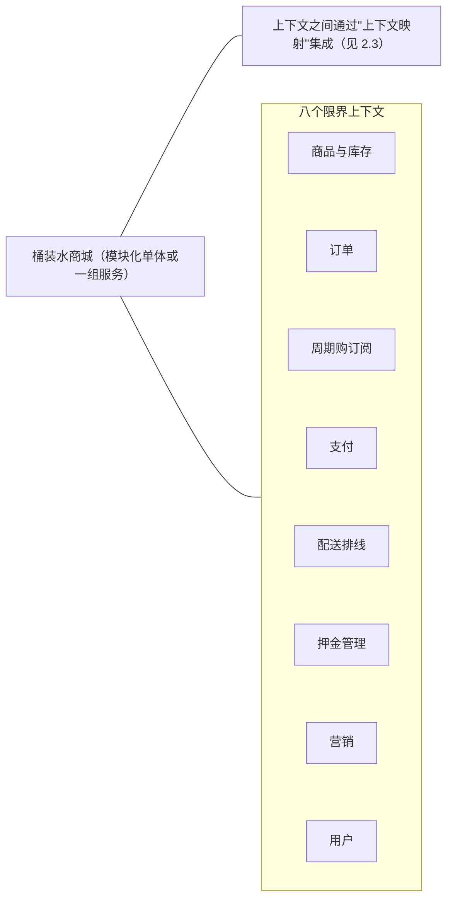
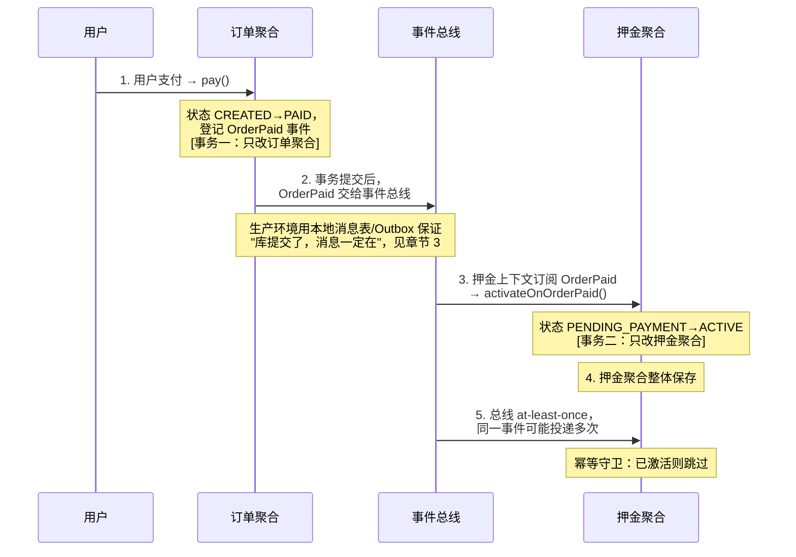

# 领域驱动设计（DDD）

> [返回：软件架构学习大纲](../软件架构学习大纲.md)

本文是第四阶段主笔记 `## 2. 领域驱动设计（DDD）` 一节的完整展开，小节编号 2.1~2.8 与主笔记保持一致，其他笔记引用“见 2.5”即指向本文对应小节。主线业务贯穿桶装水商城（押金、周期购、配送排线是 DDD 重点素材），辅以工单中心、MES、低代码平台。文中标注“已编译运行验证”的 Kotlin 示例均在 Kotlin 2.2.20 下实际编译运行，引用的输出为真实运行结果。

## 2.1 DDD 是什么、不是什么

定义：Eric Evans（2003）提出的设计方法，核心主张：**软件的复杂度主要来自业务，模型必须由业务语言驱动**，业务方与开发围绕同一套领域模型工作。分两层：

| 层面 | 解决的问题 | 工具 |
|---|---|---|
| 战略设计 | 系统怎么切分、各部分什么关系 | 统一语言、限界上下文、上下文映射 |
| 战术设计 | 上下文内部的代码怎么组织 | 实体、值对象、聚合、领域事件、仓储 |

先纠正常见误区：

- ❌ **误区一：DDD = 微服务**。DDD 早于微服务十年出现；桶装水商城哪怕长期保持单体，照样能按上下文分模块用 DDD；微服务也可能写成分布式泥球。正确关系是：**限界上下文为服务划分提供依据**，而不是 DDD 依附于微服务。补一句反方向的澄清：“上微服务之前必须先做完整 DDD”同样不成立——DDD 不规定部署形态，微服务也不以 DDD 为前置条件，两者只在“按业务切分”这一点上同源（限界上下文给服务划分提供候选边界，具体拆分路径见[微服务架构](../02-第二阶段/03-微服务架构.md)）。
- ❌ **误区二：限界上下文 = 微服务**。限界上下文是**模型边界**（逻辑概念），微服务是**部署边界**（物理概念）。一个上下文可以是模块化单体里的一个模块，也可以是一个服务；反过来，一个微服务横跨两个上下文则是坏味道。
- ❌ **误区三：DDD = 堆战术模式**。在用户地址簿、商品资料这种 CRUD 为主的支持域上套聚合、仓储是自找麻烦；押金、周期购、订单流转这种规则密集且多变的核心域才值得。DDD 的适用判据是**业务规则复杂且多变的核心域**，不是“显得专业”。

再补三条同样常见的误解：

- ❌ **误区四：DDD 必须事件溯源 / 必须引入 Kafka**。DDD 对存储与中间件零要求：押金聚合存三张关系表完全合法；领域事件用进程内的发布器（如 Spring `ApplicationEventPublisher`）发也算数。事件溯源只是一种持久化风格（机制与选型边界见[第三阶段事件溯源与 CQRS](../02-第二阶段/04-事件驱动架构.md)），是可选项不是入场券；先上事件存储再补建模，是把可选项当成了地基。
- ❌ **误区五：充血模型就等于 DDD**。把字段收进实体、加几个方法只是战术结果；没有统一语言与限界上下文先行，充血只是把 Service 里的过程代码换了个房间堆放，边界照样烂。战略设计（2.2/2.3）才是 DDD 回报最大的部分，战术模式是它的自然产物。
- ❌ **误区六：DDD 是一次性项目**。“这个季度做完 DDD 改造然后验收”是典型错觉——模型随业务演化，统一语言要持续维护，聚合要在重构中反复调整。DDD 是持续的建模纪律，不是能交付归档的工程包（渐进路线见 2.9）。

### DDD 的投入产出判据：领域复杂度三档

DDD 的成本真实存在（建模讨论、术语对齐、聚合改造都要人时），所以动手之前先估领域复杂度，再决定投入多少。三档：

| 复杂度 | 特征 | 桶装水/工单中心的例子 | 结论：值不值得上 DDD |
|---|---|---|---|
| 简单 CRUD | 规则少且稳定，“改数据”而非“算规则”，一年变不了两次 | 收货地址簿、商品资料维护、运营后台的字典管理 | 不值得。分层 + ORM 直接实现，别堆抽象 |
| 中等 | 有一批规则但模式可预期，变化按月/按季 | 优惠券规则（满减/折扣/限品类）、库存可售量扣减 | 部分引入战术模式：金额封装成值对象、状态做成状态机；不必全套聚合 + 仓储 + 事件 |
| 复杂 | 规则密集、多变、错了赔钱，规则之间互相咬合 | 押金（三条不变量 + 状态机）、周期购（生命周期 + 错过窗口顺延）、工单 SLA 流转、支付清结算 | 全套 DDD（战略 + 战术），投入集中在这里 |

工程判据（三问定档）：① 这块规则过去半年变过几次？② 把规则完整写出来，超过三条 if 或检查约束吗？③ 规则算错会直接赔钱或挨投诉吗？——三问有两个“是”，按复杂档对待；全“否”，按简单档对待。押金三问全是“是”（扣损规则改过、三条不变量互相咬合、算错就退错钱），所以它是桶装水商城里第一个值得上 DDD 的上下文；MES 里的批次追溯与工单中心的 SLA 流转同理。

## 2.2 战略设计：统一语言与限界上下文

统一语言（Ubiquitous Language）：业务方和开发共用同一套词汇，类名、方法名、需求文档直接使用这套词汇——词表不一致本身就是 bug 温床。工单中心是正面典型：业务方嘴里的“工单、分派、流转、SLA、催办、关单”，代码里就叫 `Ticket.assign()`、`Ticket.escalate()`、`Ticket.close(reason)`、事件 `TicketSlaBreached`——需求评审不需要人工翻译。反面则是代码里叫 `WorkItemDO.status = 3`：每次“这个工单催办了吗”都要查一张只有离职同事懂的状态映射表。

限界上下文（Bounded Context）：**一个特定模型成立的边界**。同一个词在不同边界里含义不同，这不是灾难而是常态——各上下文各自建模，远比“全公司一个统一大模型”健康。

桶装水商城的上下文切分（八个上下文；注意同一个词“桶”在四个上下文里的差异）：

| 限界上下文 | 核心职责 | “桶”在这个上下文的含义 |
|---|---|---|
| 商品与库存 | SKU、定价、可售桶数 | 可售卖的库存数字（还剩多少桶可卖） |
| 订单 | 下单、状态流转 | 成交快照里的货品（skuId、名称、成交单价） |
| 周期购订阅 | 周期计划、下次配送日、暂停/恢复/退订 | 每期要送的数量；“订单”只是每期的产物 |
| 支付 | 收单、退款、对账 | 与桶无关，只是金额载体 |
| 配送排线 | 线路、配送任务、装载 | 占用配送车装载容量、挂在线路上的货物 |
| 押金管理 | 押金账、桶资产、回收验收 | 可追踪的资产（桶号/RFID，有身份、有状态） |
| 营销 | 券、会员 | 券适用范围里的一类商品 |
| 用户 | 账号、地址簿 | 无关 |



判断边界的三条线索：**语言差异**（“桶”在押金域是资产、在库存域是数字 → 拆）、**不变量归属**（押金余额不变量归押金上下文独立保证）、**团队归属**（康威定律，见[康威定律-补充](../01-第一阶段/05-康威定律-补充.md)）。

❌ 反例：为了“数据打通”建一张全局共享的 `t_bucket` / `t_product` 大表，订单、库存、配送、押金都直接读写——押金要加“桶 RFID 号”字段，库存模块也得陪着重编译；改一个字段全线心惊胆战。
✅ 修正：各上下文有自己的模型与存储（订单存商品快照，押金存桶资产台账），靠事件/接口同步，而不是共享表。

顺带纠一个常见偷懒：**周期购是领域概念，不是数据库表上的标志位**。它有自己的生命周期（生效、暂停、恢复、退订、到期）和规则（错过配送窗口顺延、暂停期间不生成订单），值得一个独立上下文去建模——而不是在订单表上加个 `is_subscription` 字段了事。

### 统一语言落地四件套

“统一语言”不能停留在口号，落地靠四件看得见的东西：

1. **词汇表（Glossary）**：每个上下文一页——术语、定义、英文名、禁用叫法。押金上下文示例：押金单 Deposit（一次押金业务的总账；禁叫“押金记录”）；桶资产 BucketHolding（一只桶的占用条目；禁叫“库存桶”——那是库存上下文的词）；扣损 DamageDeduction（损坏不退款；禁叫“罚款”——罚款是行政处罚词汇，财务无法入账）。禁用叫法一栏最值钱：它把“这两个词是不是一个意思”的扯皮提前终结。
2. **代码命名对齐**：类、方法、事件直接用词表英文，代码评审对照词表检查。工单中心 `Ticket.escalate()` 能 grep 到、押金 `DamageDeduction` 能 grep 到，语言就没漂移；出现 `deposit_record`、`penalty_amount` 这类词表外命名，要么改代码、要么修订词表，二选一，不允许并存。
3. **评审用语**：需求评审禁说“那个状态、那个标志位”，必须用词表术语；出现新概念当场入表并定英文。这条纪律的价值不在评审本身，而在于让业务方发现“代码里的词就是我说的话”——信任建立之后，业务方提需求会主动标注术语变化，建模的信息源从此多了一路。
4. **文档模板**：每个上下文固定一页纸——职责一句话、核心概念表、对外发布的事件列表、上下游依赖与集成模式。新人拿着模板半小时读懂一个上下文的边界，比一万字的总体设计文档管用。

### 语言漂移的两个检测信号

词汇表会腐化，漂移要靠信号主动检测：

- **信号一：同一事物出现多个名字**。业务方说“扣损”、代码里叫 `penalty`、运营后台写“罚款金额”——三个名字意味着三拨人对同一事物有三种理解，每次需求都要人工对齐，而且迟早出错。发现即仲裁：定一个词（回到词表），其余全局改名，不允许“都留着、看语境”。
- **信号二：出现“翻译型注释”**。`status = 3 // 3 = 已催办` 这行注释就是漂移的铁证——如果语言统一，状态叫 `ESCALATED`，注释根本多余。同理，“这里对应需求文档里的'顺延'”这类注释，说明代码没有用“顺延”这个词。见到翻译注释，正确动作是把被翻译的概念提升为词表术语并改代码，而不是留着注释当字典用。

自检口诀：**新人拿着需求文档，能在代码里 grep 到同名概念 = 健康；grep 不到 = 已经漂移**。

### 同一个类，在两个上下文长得完全不同

限界上下文最反直觉也最值钱的一点：类名可以相同，模型可以毫无关系。“押金”在押金管理上下文是桶资产账，在财务上下文是负债科目——两边关心的字段、不变量、行为完全不同。Kotlin 对照（完整示例已编译运行验证）：

```kotlin
// 同名类 Deposit 在押金管理上下文与财务上下文中是完全不同的两个模型。
// 真实工程里它们分属两个模块/服务（各自独立演进）；
// 为便于 kotlinc 单文件验证，这里用两个 object 充当"两个包/模块"。

/* ============ 限界上下文一：押金管理 —— Deposit 是"桶资产账" ============ */
object DepositContext {
    data class BucketNo(val value: String)                 // 桶有身份（RFID）

    /** 关心的问题：哪些桶押在我这里？退还时该退多少钱？ */
    class Deposit(val depositId: String, val userId: String, private val unitCents: Long) {
        private val held = mutableListOf<BucketNo>()
        val heldCount: Int get() = held.size
        fun hold(vararg buckets: BucketNo) { held += buckets }
        fun refundable(): Long = held.size * unitCents     // 可退押金 = 在手桶数 × 单桶押金
    }
}

/* ============ 限界上下文二：财务 —— Deposit 是"押金负债科目" ============ */
object FinanceContext {
    enum class Direction { CREDIT, DEBIT }                 // 贷记：收押金（负债增）；借记：退押金
    data class Entry(val direction: Direction, val cents: Long, val voucherNo: String)

    /** 关心的问题：押金负债余额多少？每笔对应什么凭证？桶只是备注里的摘要 */
    class Deposit(val accountNo: String) {
        private val entries = mutableListOf<Entry>()
        val liabilityCents: Long
            get() = entries.sumOf { if (it.direction == Direction.CREDIT) it.cents else -it.cents }
        fun post(entry: Entry) { entries += entry }
        fun balanceSheetLine(): String = "其他应付款-押金($accountNo): ${liabilityCents}分"
    }
}

fun main() {
    // 押金域视角：桶在手几只、可退多少
    val d1 = DepositContext.Deposit("D-2026-001", "u_9527", 30_00)
    d1.hold(DepositContext.BucketNo("B-0001"), DepositContext.BucketNo("B-0002"))
    println("[押金域] ${d1.depositId} 在手 ${d1.heldCount} 桶，可退押金 ${d1.refundable()} 分")

    // 财务域视角：同一笔业务的负债科目流水，桶号只出现在凭证备注里
    val d2 = FinanceContext.Deposit("LIAB-DEPOSIT-u_9527")
    d2.post(FinanceContext.Entry(FinanceContext.Direction.CREDIT, 60_00, "V-001 收押金2桶"))
    d2.post(FinanceContext.Entry(FinanceContext.Direction.DEBIT, 30_00, "V-009 退1桶"))
    println("[财务域] ${d2.balanceSheetLine()}")

    // 两个 Deposit 没有任何共享字段/行为——各自服务各自的不变量
}
```

实际运行输出：

```text
[押金域] D-2026-001 在手 2 桶，可退押金 6000 分
[财务域] 其他应付款-押金(LIAB-DEPOSIT-u_9527): 3000分
```

三个观察：① 押金域的 `Deposit` 根本没有“借贷方向”的概念，财务域的 `Deposit` 根本不认识桶——试图砍掉差异做“统一押金模型”，得到的是两边都不好用的四不像；② 各自的不变量各自把守：押金域管“可退 = 在手桶数 × 单价”，财务域管“贷记减借记 = 负债余额”；③ 两边靠事件与对账对齐（收押金当天两边各记一笔），而不是共享一张表。这就是“各上下文各自建模，远比全公司一个大模型健康”的具体含义。

## 2.3 战略设计：上下文映射

定义：描述**限界上下文之间如何集成与协作**。集成方式本身就是架构决策，选错了模型会互相污染。

| 模式 | 含义 | 适用场景 | 风险 |
|---|---|---|---|
| 合作关系 Partnership | 两团队共同成败、协同改动 | 无明确上下游的小团队 | 耦合最重，团队变大即失效 |
| 共享内核 Shared Kernel | 共享一小块模型/代码 | 两上下文确有稳定公共子集 | 共享部分成改动瓶颈 |
| 客户-供应商 Customer-Supplier | 下游提需求，上游排优先级 | 内部团队之间 | 需要强势的下游代言人 |
| 防腐层 ACL | 下游建翻译层隔离上游模型 | 对接老旧/外部系统 | 多一层维护成本 |
| 开放主机服务 OHS + 发布语言 PL | 上游提供标准协议与文档化模型 | 上游服务众多下游 | 协议演进要管好版本 |
| 遵奉者 Conformist | 下游全盘接受上游模型 | 上游太强、改不动 | 上游模型差则连带受损 |
| 各行其道 Separate Ways | 干脆不集成，各做各的 | 集成成本 > 收益 | 功能重复 |

桶装水商城的三组典型映射：

- **订单 ↔ 支付渠道：防腐层（ACL）**。渠道模型（微信支付的 appid、mch_id、cash_fee、result_code）绝不能渗入订单域——明天换渠道、后天渠道升级字段，订单域不能跟着抖。
- **周期购订阅 → 订单：客户-供应商 + OHS**。订阅是下游客户，每期到点“要一单”；订单是供应商，用开放主机服务提供标准下单协议（`POST /orders {subscriptionId, lines}`），订阅不关心订单内部怎么建模。
- **配送 ↔ 地图服务：遵奉者**。距离矩阵接口是地图厂商定的，改不动，全盘接受其模型——但必须把它关在配送服务内部，不许外溢（呼应 ADR-007）。

支付防腐层的 Kotlin 实现——防止渠道模型渗入订单域：

```kotlin
// ❌ 反例：渠道回调 DTO 长驱直入——订单/押金/订阅各处直接引用 WechatPayNotifyDTO，
// appid、cash_fee、result_code 这些渠道词汇散落领域代码；换渠道或渠道改字段，全商城跟着改

// ✅ 修正：防腐层把渠道报文翻译成本域自己的模型，外部变化被拦截在一处
data class OrderId(val value: String)
data class PayTradeNo(val value: String)
data class PaymentConfirmed(                     // 订单域自己的模型：只留订单关心的语义
    val payTradeNo: PayTradeNo,
    val orderId: OrderId,
    val paidCents: Long,
)

/** 订单域依赖的端口（领域层接口，对应第二阶段六边形架构的端口） */
interface PaymentResultPort {
    fun toConfirmed(notify: WechatPayNotifyDTO): PaymentConfirmed?
}

/** 渠道 DTO：字段与命名全是渠道的烙印 */
data class WechatPayNotifyDTO(
    val outTradeNo: String, val transactionId: String,
    val totalFee: String, val resultCode: String,
)

/** 防腐层实现：放基础设施层，只负责验签后的翻译与容错 */
class WechatPaymentAdapter : PaymentResultPort {
    override fun toConfirmed(notify: WechatPayNotifyDTO): PaymentConfirmed? {
        if (notify.resultCode != "SUCCESS") return null      // 翻译 1：渠道返回码 → 订单域"已支付/未支付"
        return PaymentConfirmed(                             // 翻译 2：渠道字段 → 领域模型
            payTradeNo = PayTradeNo(notify.transactionId),
            orderId = OrderId(notify.outTradeNo),
            paidCents = notify.totalFee.toLong(),
        )
    }
}
```

选型口诀：**上游强且模型好 → 遵奉者或 OHS+PL；上游弱或在组织外部 → 防腐层；势均力敌且团队小 → 合作关系/共享内核（慎用，团队一大就退化）；集成收益小于成本 → 各行其道**。拿不准时默认上防腐层——它是最不后悔的选择，代价只是多一层翻译。另外记住防腐层防的是“模型”不只是“数据”：哪怕做了字段映射，只要渠道词汇（`cash_fee`、`result_code`）出现在领域层代码里，防腐就已失效——判断标准是领域层读不读得出“这是哪家渠道”。重要映射决策应记录为 ADR（写法见[架构设计与表达：C4 视图与 ADR](02-架构设计与表达-C4视图与ADR.md)）。

## 2.4 战术设计：实体与值对象

| | 实体 Entity | 值对象 Value Object |
|---|---|---|
| 标识 | 有身份（ID），身份终身不变 | 无身份，“值相等”即同一 |
| 可变性 | 状态可变（受控） | 不可变，“改”= 换新实例 |
| 生命周期 | 长期跟踪（存库、有状态） | 随宿主生灭 |
| 回答的问题 | “它是哪一个？” | “它是什么？” |
| 桶装水例子 | 订单 Order、押金单 Deposit、配送任务 DeliveryTask、订阅 Subscription | 收货地址 Address、金额 Money、桶规格 BucketSpec（容量+品牌） |

值对象（贯穿例子：收货地址）：

```kotlin
// ❌ 反例：可变 + 无行为，任何代码都能 address.city = "宁波市" 改半个地址，配送面单的校验无处安放
data class BadAddress(var province: String, var city: String, var detail: String)

// ✅ 修正：不可变、自校验、带领域行为；"修改"返回新值而不是改旧值
data class Address(val province: String, val city: String, val district: String, val detail: String) {
    init {
        require(province.isNotBlank() && city.isNotBlank() && detail.length >= 5) { "收货地址不完整" }
    }
    fun withDetail(newDetail: String) = copy(detail = newDetail)   // 产生新实例
    fun shippingLabel() = "$province$city$district $detail"        // 配送面单
}
```

判定技巧：把两个内容相同的实例互换，业务毫无察觉 → 值对象（地址、金额、桶规格——两桶“18.9L 同品牌”无差别）；业务立刻发现不对 → 实体（你家的押金单和邻居家的互换，退款就错了）。金额强烈建议做成 `Money(amount, currency)` 值对象——裸 Long 加散落的乘除是精度事故的固定来源。

值对象判据三问（比背定义更快）：① 两个实例互换业务毫无察觉吗？（察觉 → 实体）② 它需要被独立跟踪、独立查询吗？（需要 → 实体）③ 它会被并发地独立修改吗？（会 → 实体）。三问全“否”就是值对象。反向提醒两条：**实体有数据库自增主键不等于建模完成**——身份必须是业务身份（押金单号、桶号），自增主键只是存储细节；**值对象常被误升格为实体**——把 Address 单独建表发 ID，订单、用户、配送各存一份 addressId，改一个地址要对三张表同步，这就是把值对象错当实体的代价。

## 2.5 战术设计：聚合——一致性边界

定义：**聚合（Aggregate）是一组作为整体保持一致性的对象**，对外由聚合根（Aggregate Root）唯一代表；外部只能持有根，聚合内部对象不允许被外界直接修改。

押金是讲透聚合的最好例子：它有完整生命周期状态机（支付押金 → 桶在手 → 回收验收 → 退押金/扣损），全程要维持三条不变量——“实缴押金 = 桶数 × 单桶押金”“只有验收过的桶才能退押金/扣损”“退还 + 扣损不得超过实缴”。这些规则必须在**同一个事务边界内**被保证，所以押金单与桶资产记录必须同属一个聚合——**聚合的本质是事务一致性边界**。

聚合设计四原则（本阶段最需要背下来的四条）：

1. **按不变量划界**：只有“必须同一事务内强一致”的规则才放进一个聚合——桶资产记录直接影响押金余额 → 与押金单同聚合。
2. **跨聚合只用 ID 引用**：押金单存 `userId`、`orderId`，不存 User/Order 对象——用户改昵称、订单改状态不应牵动押金账。
3. **一个事务只修改一个聚合**：跨聚合联动（支付成功 → 激活押金）用领域事件做最终一致（见[第三阶段](../03-第三阶段/01-分布式系统核心技术.md)）。
4. **聚合尽量小**：大聚合 = 大锁 = 高冲突 = 低吞吐，只装“必须强一致”的部分。

```kotlin
data class DepositId(val value: String)
data class BucketNo(val value: String)                                   // 桶号（RFID）：每个桶有身份
data class Money(val cents: Long) {
    operator fun times(n: Int) = Money(cents * n)
    operator fun plus(o: Money) = Money(cents + o.cents)
}

enum class DepositStatus { PENDING_PAYMENT, ACTIVE, SETTLED }            // 待缴 → 押金生效（桶在手）→ 结清

class User(val id: String, var nickname: String)                         // 用户聚合的根（示意）
class DeliveryTask(val id: String, var routeNo: String)                  // 配送聚合的对象（示意）

// ❌ 反例：巨型聚合——押金单直接持有 User、配送任务、订单对象
class BigDeposit(val user: User, val task: DeliveryTask?, val orderId: String) {
    var refundedCents: Long = 0
    fun settle() { refundedCents = 30_000_00 }    // 退款数字写死：三条不变量无人看守；
}                                                 // 配送任务一变，历史押金读到的关联也跟着漂移

// ✅ 修正：押金聚合——不变量收口在根；跨聚合只留 ID；桶资产是内部实体
class Deposit private constructor(
    val id: DepositId,
    val userId: String,                    // 原则 2：跨聚合只用 ID 引用（User/Order/DeliveryTask 都不许进来）
    val orderId: String,
    private val unitDeposit: Money,        // 单桶押金（值对象）
) {
    /** 桶资产记录：聚合内部实体，生命周期完全由 Deposit 管理 */
    class BucketHolding(val bucketNo: BucketNo) {
        var acceptedAt: java.time.Instant? = null; private set   // 验收时间；非空 = 已回收结清
        var damaged: Boolean = false; private set
        fun accept(now: java.time.Instant, dmg: Boolean) { acceptedAt = now; damaged = dmg }
    }

    private val _holdings = mutableListOf<BucketHolding>()
    val holdings: List<BucketHolding> get() = _holdings.toList()          // 只读视图
    var status: DepositStatus = DepositStatus.PENDING_PAYMENT
        private set                                                        // 状态只能经由聚合根行为变更

    companion object {
        fun open(id: DepositId, userId: String, orderId: String, unitDepositCents: Long) =
            Deposit(id, userId, orderId, Money(unitDepositCents))
    }

    fun pay(bucketNos: List<BucketNo>, amount: Money) {                    // 支付押金 → 桶在手
        check(status == DepositStatus.PENDING_PAYMENT) { "状态 $status 不允许缴纳押金" }
        require(bucketNos.isNotEmpty()) { "至少押一个桶" }
        require(amount == unitDeposit * bucketNos.size) {                  // 不变量 1：实缴 = 桶数 × 单桶押金
            "缴纳 ${amount.cents} 与应付 ${(unitDeposit * bucketNos.size).cents} 不一致"
        }
        bucketNos.forEach { _holdings.add(BucketHolding(it)) }
        status = DepositStatus.ACTIVE
    }

    /** 回收验收：完好退押金、损坏扣损；全部结清后押金单 SETTLED */
    fun returnBuckets(accepted: List<BucketNo>, damaged: List<BucketNo>): Pair<Money, Money> {
        check(status == DepositStatus.ACTIVE) { "押金单未生效或已结清" }
        val open = _holdings.filter { it.acceptedAt == null }
        require(accepted.size + damaged.size <= open.size) { "验收数量超过在手桶数" }
        val now = java.time.Instant.now()
        (accepted.map { it to false } + damaged.map { it to true }).forEach { (no, dmg) ->
            open.first { it.bucketNo == no }.accept(now, dmg)
        }
        val refund = unitDeposit * accepted.size
        val deduction = unitDeposit * damaged.size
        check(refund + deduction <= unitDeposit * _holdings.size) {       // 不变量 3：退还+扣损 ≤ 实缴
            "退还与扣损之和不得超过实缴押金"
        }
        if (_holdings.all { it.acceptedAt != null }) status = DepositStatus.SETTLED
        return refund to deduction
    }
}
```

常考问题：**桶资产记录为什么在聚合内、地址为什么是值对象、配送任务为什么在聚合外**？判据回到原则 1：桶的验收与扣损直接影响押金余额不变量（强一致 → 入聚合）；地址只是描述性数据（值对象）；配送任务有独立生命周期与并发冲突，属于配送上下文（聚合外，靠 ID + 事件联动）。

工单中心同理：**工单聚合** = 工单（根）+ 流转记录（内部实体），不变量如“非当前处理人不能流转”“SLA 未解除不能关单”——把“流转记录表”从 CRUD 视角换成聚合视角，规则才有了唯一的家。

### 完整示例：跨聚合一致性守卫（支付成功 → 激活押金）

把四原则串起来跑一遍。“支付渠道回调成功 → 激活押金单”横跨订单与押金两个聚合，如果图省事在一个事务里同时改两个聚合，会立刻遇到三个问题：① **锁扩散**——订单行锁与押金行锁互相等待，高峰期吞吐骤降；② **失败传播**——押金侧任何异常把已成功的支付一起回滚，用户看到“支付失败”但钱已扣，客服投诉当场爆发；③ **团队耦合**——订单团队每次改支付事务都要押金团队评审脚本。正确做法是原则 3：**一个事务只改一个聚合，聚合提交后发领域事件，下游在自己的事务里消费**——用最终一致换解耦与吞吐（最终一致性与可靠投递的完整机制见[分布式事务：从 2PC 到最终一致](../03-第三阶段/05-分布式事务-从2PC到最终一致.md)与[第三阶段核心技术](../03-第三阶段/01-分布式系统核心技术.md)）。

事件时序（文字版）：



完整可运行示例（已编译运行验证）。总线刻意把每条事件投递两次：第 1 次激活押金，第 2 次被幂等守卫拦截——

```kotlin
import java.time.Instant

/* ========== 领域事件：过去式命名，陈述"已发生的事实" ========== */
interface DomainEvent { val eventId: String; val occurredAt: Instant }

data class OrderPaid(
    override val eventId: String, override val occurredAt: Instant,
    val orderId: String, val paidCents: Long,
) : DomainEvent

/* ========== 聚合一：订单 ========== */
class Order private constructor(val orderId: String) {
    enum class Status { CREATED, PAID }
    var status = Status.CREATED; private set
    private val _events = mutableListOf<DomainEvent>()
    val events: List<DomainEvent> get() = _events.toList()

    fun pay(paidCents: Long) {
        check(status == Status.CREATED) { "订单 $orderId 已支付，拒绝重复支付" }
        status = Status.PAID
        _events += OrderPaid("evt-$orderId-${_events.size + 1}", Instant.now(), orderId, paidCents)
    }
    fun clearEvents() { _events.clear() }
    companion object { fun create(orderId: String) = Order(orderId) }
}

/* ========== 聚合二：押金单（另一张表/另一个聚合，与订单无对象引用） ========== */
class Deposit private constructor(val depositId: String, val orderId: String) {
    enum class Status { PENDING_PAYMENT, ACTIVE }
    var status = Status.PENDING_PAYMENT; private set
    var activatedAt: Instant? = null; private set
    var activatedByEventId: String? = null; private set      // 幂等凭证：记录激活来源事件

    /**
     * 由 OrderPaid 事件触发；返回 true 表示本次真的发生了状态迁移。
     * 幂等守卫两层：来源事件重复 → false；先前已被激活 → false。
     */
    fun activateOnOrderPaid(e: OrderPaid, now: Instant): Boolean {
        if (activatedByEventId == e.eventId || status == Status.ACTIVE) return false
        status = Status.ACTIVE
        activatedAt = now
        activatedByEventId = e.eventId
        return true
    }
    companion object { fun open(depositId: String, orderId: String) = Deposit(depositId, orderId) }
}

/* ========== 仓储（内存版，演示"以聚合为单位存取"） ========== */
class OrderRepository {
    private val store = mutableMapOf<String, Order>()
    fun findById(id: String): Order? = store[id]
    fun save(order: Order) { store[order.orderId] = order }
}

class DepositRepository {
    private val store = mutableMapOf<String, Deposit>()
    fun findById(id: String): Deposit? = store[id]
    fun findByOrderId(orderId: String): Deposit? = store.values.firstOrNull { it.orderId == orderId }
    fun save(deposit: Deposit) { store[deposit.depositId] = deposit }
}

/* ========== 应用层：一个事务只改一个聚合，提交后发布事件 ========== */
class OrderApplicationService(
    private val orders: OrderRepository,
    private val onCommitted: (List<DomainEvent>) -> Unit,
) {
    fun payOrder(orderId: String, paidCents: Long) {
        val order = orders.findById(orderId) ?: error("订单不存在: $orderId")
        order.pay(paidCents)
        orders.save(order)                  // 事务边界一：只改订单聚合
        onCommitted(order.events)           // 提交成功后才把事件交给总线
        order.clearEvents()
    }
}

/* ========== 订阅方：押金上下文消费 OrderPaid，在自己的事务里改押金聚合 ========== */
class DepositActivationHandler(private val deposits: DepositRepository) {
    fun onOrderPaid(e: OrderPaid) {
        val deposit = deposits.findByOrderId(e.orderId) ?: return   // 无押金单的订单直接跳过
        val changed = deposit.activateOnOrderPaid(e, Instant.now())
        if (changed) {
            deposits.save(deposit)          // 事务边界二：只改押金聚合
            println("  [押金] ${deposit.depositId} 已激活（来源事件 ${e.eventId}）")
        } else {
            println("  [押金] ${deposit.depositId} 幂等跳过事件 ${e.eventId}（当前状态 ${deposit.status}）")
        }
    }
}

/* ========== 基础设施：内存事件总线，模拟 at-least-once（每条事件投递两次） ========== */
class InMemoryEventBus(private val route: (DomainEvent) -> Unit) {
    private val journal = mutableListOf<String>()
    fun publish(events: List<DomainEvent>) {
        events.forEach { e ->
            journal += "总线收到 ${e.eventId}"
            route(e); journal += "投递 ${e.eventId} 第 1 次"
            route(e); journal += "投递 ${e.eventId} 第 2 次（模拟 at-least-once 重复投递）"
        }
    }
    fun dumpJournal() = journal.forEach { println("  $it") }
}

fun main() {
    val orders = OrderRepository()
    val deposits = DepositRepository()
    val handler = DepositActivationHandler(deposits)
    val bus = InMemoryEventBus { e -> if (e is OrderPaid) handler.onOrderPaid(e) }
    val orderApp = OrderApplicationService(orders) { bus.publish(it) }

    orders.save(Order.create("O1001"))
    deposits.save(Deposit.open("D2001", "O1001"))

    println("== 用户支付订单 O1001（押金单 D2001 待激活） ==")
    orderApp.payOrder("O1001", 45_00)

    println("== 事件流转日志 ==")
    bus.dumpJournal()

    val d = deposits.findById("D2001")!!
    println("== 最终状态 ==")
    println("押金单 ${d.depositId}: status=${d.status}, activatedAt=${d.activatedAt}, 来源=${d.activatedByEventId}")
}
```

实际运行输出（时间戳为实际运行时刻，每次运行不同）：

```text
== 用户支付订单 O1001（押金单 D2001 待激活） ==
  [押金] D2001 已激活（来源事件 evt-O1001-1）
  [押金] D2001 幂等跳过事件 evt-O1001-1（当前状态 ACTIVE）
== 事件流转日志 ==
  总线收到 evt-O1001-1
  投递 evt-O1001-1 第 1 次
  投递 evt-O1001-1 第 2 次（模拟 at-least-once 重复投递）
== 最终状态 ==
押金单 D2001: status=ACTIVE, activatedAt=2026-11-04T03:36:21.857821Z, 来源=evt-O1001-1
```

三个工程判据从这个示例里读出来：① **幂等做在聚合内**——`activateOnOrderPaid` 返回 false 表示无事发生，靠的是状态机本身（最可靠的幂等凭证：状态已是 ACTIVE 就什么都不做），`activatedByEventId` 再补一层“同一事件重复投递”的精确去重；不要把幂等全押在消费框架的去重表上。② **事件发布在事务提交之后**——示例用 `onCommitted` 回调表达“提交成功才 publish”，避免“库没提交、消息已出、消费者读不到数据”的经典事故。③ **订阅方失败不回滚发布方**——第 3 步消费失败，订单照样是已支付，靠重试或人工介入补偿；这正是“一个事务只改一个聚合”换来的故障隔离，代价是需要接受押金激活短暂滞后（秒级），对“押金生效”这种业务完全可接受。

## 2.6 贫血模型 vs 充血模型

贫血模型：实体只有数据，业务规则全部堆在 Service——Spring/MyBatis 传统下最普遍的写法，也是 DDD 眼里最大的反模式：**模型失去行为，规则散落在几十个 Service 里互相复制**（订单模块的 `AnemicOrder` + `OrderStatusService` 同病）。

```kotlin
// ❌ 反例：贫血模型——把 2.5 的押金业务改写成最常见的贫血写法：数据与行为分离，规则散落在 Service
data class AnemicDeposit(
    val id: DepositId, val userId: String,
    var paidCents: Long = 0, var refundedCents: Long = 0,
    var status: String = "PENDING",                                 // 状态是裸字符串
    val holdings: MutableList<Map<String, Any?>> = mutableListOf(), // 桶记录是裸 Map
)

class DepositSettleService {
    fun returnBuckets(deposit: AnemicDeposit, returned: Int, damaged: Int, unitCents: Long) {
        // "完好退还、损坏扣损"这条规则被复制在 Service、对账定时任务、客服后台脚本三处
        deposit.refundedCents = (returned - damaged) * unitCents    // 某次复制漏了校验：returned < damaged 时算出负数退款
        deposit.status = "SETTLED"                                  // 而且任何代码都能一行改状态，绕过全部规则
        // …落库
    }
}
```

修正版即 2.5 的充血写法：状态 `private set`、行为进模型、Service 只做薄编排（开事务 → 调聚合行为 → 存仓储 → 发事件，见 2.7）。

| | 贫血模型 | 充血模型 |
|---|---|---|
| 规则位置 | 散在各 Service | 聚合根内聚 |
| 绕过规则 | 一行赋值即可 | 编译期就难 |
| Service 角色 | 上帝类（越写越胖） | 薄编排（用例） |
| 适合场景 | 纯 CRUD 的支持域（商品资料、地址簿） | 规则密集的核心域（押金、订单、订阅） |

公允提醒：不必全系统充血。支持域用贫血 CRUD 完全合理（DDD 投入集中在核心域，见 2.1 误区三）；但押金账这种碰钱的核心域，贫血等于把业务规则埋进代码的沼泽。

### 灰色地带：校验和装配到底放哪

“行为进模型”说起来干脆，动手就撞上灰色地带：这条校验放聚合里还是 Service 里？这份 DTO 转换写在哪？给一张判据清单：

| 校验/逻辑类型 | 桶装水的例子 | 归宿 | 理由 |
|---|---|---|---|
| 格式/语法校验 | 地址非空、详情 ≥5 字、手机号格式 | 值对象构造器（`init`） | 规则不依赖外部数据，实例存在即合法 |
| 不变量校验 | 缴纳 = 桶数 × 单价、退还+扣损 ≤ 实缴 | 聚合根行为 | 只用聚合内数据即可判定，必须强一致 |
| 需要聚合外数据的校验 | “该用户是否有未结清押金单”“地址是否在配送范围” | 领域服务（接口在领域层，实现可查库/调外部） | 聚合不能为校验去持有别的聚合或开数据库连接 |
| 用例级前置检查 | 权限、风控、库存预占 | 应用层（薄编排里的一步） | 属于用例流程，不是领域规则 |
| 展示校验 | 前端表单红字提示 | UI 层 | 只为体验；服务端永不信任前端 |

一句话判据：**“这条规则不查数据库也成立吗？”成立 → 进模型；不成立 → 领域服务（接口在领域层）或应用层。** 把“查库才能判”的规则硬塞进聚合，聚合就被数据库绑架了，单元测试全程带 mock，充血的好处尽失。以“地址是否在配送范围”为例：地址格式进 `Address` 的 `init`；配送范围判定要读配送上下文的线路数据，写成领域服务 `DeliveryCoverageChecker`（接口放领域层、实现查配送数据），聚合行为里通过它做校验——数据出得去，规则留得住。

装配层的判据同样一句话：**DTO 转换放应用层的装配器（Assembler），领域对象终生不感知 DTO**。两个方向的污染都要防：领域方法参数出现 `WechatPayNotifyDTO` 是外部模型渗入（回到 2.3 防腐层）；`OrderDTO` 上挂 `validate()` 业务方法是领域逻辑外泄到装配层。查询侧另说：列表页、报表直接查 DTO/读模型返回，不必绕道聚合再装配——那是 CQRS 查询通道的职责（见 2.7 结尾与[第三阶段](../03-第三阶段/01-分布式系统核心技术.md)）。

## 2.7 领域事件与仓储

领域事件（Domain Event）：**用过去式描述“领域中已发生的事实”**（DepositPaid、DepositSettled、OrderPaid）。它是“一个事务只改一个聚合”之后，跨聚合/跨上下文联动的解法：本聚合提交后发布事件，下游各自消费、最终一致。

```kotlin
sealed interface DomainEvent { val occurredAt: java.time.Instant }

sealed interface DepositEvent : DomainEvent { val depositId: DepositId }

data class DepositPaid(
    override val depositId: DepositId, override val occurredAt: java.time.Instant,
    val bucketCount: Int, val paid: Money,
) : DepositEvent

data class DepositSettled(
    override val depositId: DepositId, override val occurredAt: java.time.Instant,
    val refunded: Money, val damagedDeduction: Money,
) : DepositEvent

class Deposit {                                          // 只展示事件相关部分，业务逻辑同 2.5
    private val _events = mutableListOf<DomainEvent>()
    val events: List<DomainEvent> get() = _events.toList()
    fun clearEvents() { _events.clear() }

    fun pay(bucketNos: List<BucketNo>, amount: Money) {
        /* 校验与状态变更同 2.5 */
        _events.add(DepositPaid(id, java.time.Instant.now(), bucketNos.size, amount))
    }
}
```

工单中心的领域事件同一套思路：**工单超时是“已发生的事实”，催办与升级是各订阅者自己的决定**——

```kotlin
data class TicketId(val value: String)
sealed interface TicketEvent : DomainEvent { val ticketId: TicketId }

data class TicketSlaBreached(                            // 超时事实：过去式命名
    override val ticketId: TicketId, override val occurredAt: java.time.Instant,
    val slaName: String, val overdueMinutes: Long,
) : TicketEvent
// 订阅者 A 发催办通知；订阅者 B 按策略把工单升级给上级处理组；统计侧计入 SLA 达成率——发布方一个都不认识
```

仓储（Repository）：**以聚合为单位**的持久化抽象——接口属于领域层，实现属于基础设施层（与[第二阶段六边形架构](../02-第二阶段/01-经典架构模式.md)的端口-适配器完全同构）。

```kotlin
interface DepositRepository {
    fun findById(id: DepositId): Deposit?
    fun save(deposit: Deposit)      // 保存整个聚合（押金单+桶资产+待发布事件），而非片段
}
// 实现放基础设施层，如 JpaDepositRepository.findById / save：聚合整体一个事务落库

interface EventPublisher { fun publishAll(events: List<DomainEvent>) }

/** 应用层：只做编排，不含业务规则 */
class DepositApplicationService(
    private val deposits: DepositRepository,
    private val publisher: EventPublisher,
) {
    fun returnBuckets(depositId: DepositId, accepted: List<BucketNo>, damaged: List<BucketNo>) {
        val deposit = deposits.findById(depositId) ?: error("押金单不存在: ${depositId.value}")
        deposit.returnBuckets(accepted, damaged)      // 规则全在聚合内
        deposits.save(deposit)                        // 先落库
        publisher.publishAll(deposit.events)          // 再发事件，避免"库没提交、消息已发"
        deposit.clearEvents()
    }
}
```

❌ 反例：DAO 里 `updateStatus(id, "SETTLED")`、`updateRefunded(id, amount)` 各自为政，绕开聚合根直接改押金表——充血模型白建了。
✅ 修正：写路径只认 `save(deposit)` 整体聚合；押金账单页这类复杂查询另走 CQRS 查询通道，不塞进仓储。事件的可靠投递、幂等消费见[第三阶段](../03-第三阶段/01-分布式系统核心技术.md)。

### 仓储的依赖方向：接口在领域层，实现在基础设施层

2.5/2.6 反复出现“接口在领域层”，这里把它落成双模块结构——这正是[第二阶段六边形架构](../02-第二阶段/01-经典架构模式.md)端口-适配器的直接落地：仓储接口是领域层声明的**出站端口**，JPA/MyBatis 实现是基础设施层的**适配器**；依赖方向只有一条 `:infrastructure → :domain`，领域层不知道存储的存在（接口反转）。完整示意（已编译运行验证；真实工程按注释拆成两个 Gradle 模块）：

```kotlin
// 仓储"接口在领域层、实现在基础设施层"的双模块示意。
// 真实工程拆成两个 Gradle 模块：:domain 与 :infrastructure，
// 依赖方向只有一条：:infrastructure --> :domain（接口反转，六边形架构的端口-适配器）。
// 为便于 kotlinc 单文件验证，用注释标出模块边界，合并编译。

/* ================= 模块 :domain（最内层，不 import 任何框架/驱动） ================= */

data class DepositId(val value: String)
data class Money(val cents: Long) {
    operator fun times(n: Int) = Money(cents * n)
    override fun toString() = "${cents}分"
}

sealed interface DomainEvent { val occurredAt: java.time.Instant }

data class DepositPaid(
    override val occurredAt: java.time.Instant,
    val depositId: DepositId, val paid: Money,
) : DomainEvent

class Deposit private constructor(val id: DepositId) {
    enum class Status { PENDING_PAYMENT, ACTIVE }
    var status = Status.PENDING_PAYMENT; private set
    private val _events = mutableListOf<DomainEvent>()
    val events: List<DomainEvent> get() = _events.toList()
    fun clearEvents() { _events.clear() }

    fun pay(amount: Money, bucketCount: Int, unit: Money) {
        check(status == Status.PENDING_PAYMENT) { "押金单已激活" }
        require(amount == unit * bucketCount) { "缴纳金额与应付不一致" }
        status = Status.ACTIVE
        _events += DepositPaid(java.time.Instant.now(), id, amount)
    }

    companion object { fun open(id: DepositId) = Deposit(id) }
}

/** 仓储接口：领域层声明"我需要以聚合为单位存取"，不关心存储技术 */
interface DepositRepository {
    fun findById(id: DepositId): Deposit?
    fun save(deposit: Deposit)
}

/** 出站端口：领域层只说"我要发事件"，怎么发（内存/Kafka/事务 Outbox）它不知道 */
interface EventPublisher { fun publishAll(events: List<DomainEvent>) }

/* ================= 模块 :infrastructure（实现领域层接口） ================= */

class InMemoryDepositRepository : DepositRepository {
    private val store = mutableMapOf<DepositId, Deposit>()
    override fun findById(id: DepositId): Deposit? = store[id]
    override fun save(deposit: Deposit) { store[deposit.id] = deposit }
}

class ConsoleEventPublisher : EventPublisher {
    override fun publishAll(events: List<DomainEvent>) {
        events.forEach {
            when (it) {
                is DepositPaid -> println("[事件] DepositPaid depositId=${it.depositId.value} paid=${it.paid}")
            }
        }
    }
}

/* ================= 组装根（main / Spring 配置类所在处） ================= */

class DepositApplicationService(
    private val deposits: DepositRepository,   // 依赖的是领域层接口
    private val publisher: EventPublisher,
) {
    fun payDeposit(id: DepositId, bucketCount: Int, unit: Money) {
        val deposit = deposits.findById(id) ?: error("押金单不存在: ${id.value}")
        deposit.pay(unit * bucketCount, bucketCount, unit)
        deposits.save(deposit)                 // 整个聚合落库
        publisher.publishAll(deposit.events)   // 落库后再发事件
        deposit.clearEvents()
    }
}

fun main() {
    // 组装根完成"接口 → 实现"的绑定；领域层一行不改即可换 JPA/MyBatis/Mongo 实现
    val deposits = InMemoryDepositRepository()
    val service = DepositApplicationService(deposits, ConsoleEventPublisher())

    val id = DepositId("D-2026-0100")
    deposits.save(Deposit.open(id))            // 开押金单（示意：真实开单同样由应用服务编排）
    service.payDeposit(id, bucketCount = 2, unit = Money(30_00))
    println("激活后状态: ${deposits.findById(id)!!.status}")
}
```

实际运行输出：

```text
[事件] DepositPaid depositId=D-2026-0100 paid=6000分
激活后状态: ACTIVE
```

两条验收判据：① 领域模块的构建脚本不出现任何 ORM/驱动依赖——一旦出现（或仓储接口返回了 JPA 的 `Page` 对象），说明抽象漏了，基础设施渗进了领域；② **换实现不改领域**：把 `InMemoryDepositRepository` 换成 JPA 实现，领域层与应用层一行不改——这个演练本身就是依赖方向正确的验收标准，顺带得到聚合单元测试的写法（测试里用内存仓储直接驱动聚合，不连数据库）。

### 领域事件命名的完成时态纪律

事件命名只有一条纪律：**过去式陈述事实**——`OrderPaid`，而不是 `PayOrder`。为什么较这个真：

1. **过去式是解耦的语法保证**。`OrderPaid`（订单已支付）是陈述句：我报告一件已发生的事，谁听、听了做什么，是订阅者自己的决定；`PayOrder`（去支付订单）是祈使句：我在指挥下游做事——语义上事件退化成远程调用，订阅方变成被动执行者，发布方被迫知道下游有哪些动作，松耦合名存实亡。
2. **过去式与审计、事件溯源天然对齐**。事件流读起来是历史：`DepositPaid → DepositSettled` 就是押金单的一生；祈使句命名的事件流读起来像一张待办清单。第三阶段讲事件溯源时“事件即事实的记录”，前提就是过去式。
3. **事实不带意图**。错误示范 `OrderPaidAndDepositShouldActivate`——把“希望下游做什么”写进事件名，等于把订阅者名单硬编码进发布方；下游加一个订阅场景就要改发布方，方向彻底反了。正确做法：发布方只说 `OrderPaid`，“激活押金”是押金上下文订阅者自己的决定。工单中心同理：`TicketSlaBreached` 只陈述超时，发催办、升级处理组、计入达成率是三个订阅者各自的事。

自检口诀：把事件名读成一句话——**“订单已支付”通顺，“支付订单”像命令**。见到 `DeductStockEvent` 这类动词开头的命名，先改成 `StockDeducted` 再谈其他；事件相关的架构风格总览见[事件驱动架构](../02-第二阶段/04-事件驱动架构.md)。

## 2.8 反例专题：低代码平台——DDD 通用性边界的教训

场景文档指定用低代码平台做反例讨论：它不是坏技术，而是“**什么不该做成平台**”的最佳解剖标本。对照着看：工单中心里“新增工单类型只配表单不改代码”是合理的内嵌低代码（变化同构且高频）；独立低代码平台想把所有业务装进一套引擎，就是另一回事了。

**陷阱一：通用性陷阱——流程引擎越长越像通用 BPM**。流程设计器从“审批流”起步：分支、并行够用了；接着客户要会签、要撤回、要加签、要驳回任意节点……每个需求单看都合理，叠加起来引擎复杂度失控——你正在重造 Activiti/Flowable，却没有它的社区与测试覆盖。为覆盖 1% 的场景付出 100% 的复杂度，这是 YAGNI 的反面教材。

**陷阱二：解释执行导致领域逻辑流失**。平台的原则是“一切皆配置”，于是业务逻辑从代码搬进表单联动表达式、流程条件脚本、隐藏的“高级配置”。半年后：押金扣损规则藏在 40 层嵌套的 JSON 里，版本库里 grep 不到关键词，IDE 无法重构、测试无法覆盖；统一语言只剩“组件、属性、事件”这套平台词汇——业务语言消失了，DDD 最核心的资产被抽空。

**DDD 视角的通用性边界**——什么样的领域变化值得抽象，什么应该写死：

| 判断问句 | 变化的性质 | 归宿 |
|---|---|---|
| 变化由谁执行？业务/实施人员在页面上改，每周都可能发生 | 同构且高频：新增工单类型、表单加字段、优惠券新用法 | 值得抽象：元数据/配置驱动，做成“内嵌低代码” |
| 变化必须开发改代码、过测试、走发版才能安全上线 | 业务规则的深度变化：押金扣损规则、排线算法、SLA 升级策略 | 应该写死：充血聚合 + 策略扩展点（开闭原则），别伪装成配置 |

❌ 反例：把押金扣损规则做成“可配置表达式引擎”——业务实际一年改一次，还得开发来写表达式；平台多了一门没人懂的 DSL，规则却脱离了类型系统和单测的保护。
✅ 修正：扣损规则写成聚合内的显式策略类（`DamagePolicy`），变化时改代码、跑测试、随版本发布；只把“单桶押金金额”这类真正高频的运营参数放进配置。

判断的锚点仍是第一阶段的质量属性与投资回报：**抽象是贷款，通用性是利息**——为真实高频的变化借贷，别为想象中的变化借贷。这张判断问句表同时也是 2.9 路线图第 4 步“什么该写死”的依据。

## 2.9 DDD 落地路线图：从现有代码到 DDD 的五步渐进

现有系统不推倒重来，按五步渐进推进，每一步独立可停——停在哪一步，哪一步的收益已经落袋：

**第 1 步：找核心域（1~2 周，只讨论不改码）**。用 2.1 的三问给各业务块定档：桶装水商城里押金、周期购、订单流转进复杂档；商品资料、地址簿留在简单档。判据：一张核心域清单得到业务与技术双方共同确认（不是架构师单方面圈定）。常见卡点：① 把“核心域”理解成“最重要的系统”——支付当然重要，但若用的是成熟支付网关，商城侧只是薄封装，属支持域；② 核心域圈得太大——“整个交易都是核心域”等于没圈，切到押金、周期购这个粒度才有建模价值。

**第 2 步：统一语言（持续进行，先在核心域启动）**。落地 2.2 四件套：先给核心域各建一页词汇表，评审用语立规矩，代码命名开始对齐（存量命名不急着改，新代码必须守）。判据：新人拿需求文档能 grep 到代码里的同名概念。常见卡点：词汇表写成一次性交付物，没人维护两周就腐烂——对策是把“新术语入表”嵌进评审流程，让词表活在日常里，而不是躺在知识库的角落里。

**第 3 步：划分限界上下文（讨论 2~4 周 + 模块化改造）**。用三条线索（语言差异/不变量归属/团队归属，见 2.2）画上下文地图，并用 2.3 的模式标注每条连线；单体先做**模块化**：构建脚本多模块或包边界 + 架构测试（如 ArchUnit）守护，上下文之间只经接口与事件通信，不动部署形态。判据：改押金的字段不再牵动库存模块重新编译；上下文地图上每条连线都写得出集成模式。常见卡点：① 按技术分层切（出现“数据层上下文”）——上下文是业务切分不是技术切分；② 切得太碎——十个上下文没几条规则支撑，通信成本反噬建模收益，宁可先粗后细。

**第 4 步：战术建模改造一个上下文（2~6 周）**。只选**一个**核心域上下文（建议押金：规则最密、错误代价最高、体量适中），按 2.4→2.5→2.7 的顺序改造：值对象（Money/Address）→ 聚合（Deposit 收口三条不变量）→ 仓储接口 + 内存实现（测试先行）→ 真实存储适配器 → 领域事件 + 跨聚合联动（2.5 完整示例的套路，什么该配置什么该写死按 2.8 的问句表判）。判据：核心不变量全部在聚合内守住；聚合可脱离数据库做单元测试；跨聚合联动全部走事件。常见卡点：① 想一次改完所有上下文——回到 2.1 误区六；② 改造不彻底——聚合建了，Service 里还在 `deposit.status = "SETTLED"` 直改状态，等于白改；用代码评审守住“状态只能经由聚合行为变更”。

**第 5 步：推广（按需，永远按需）**。把押金上下文沉淀成团队模板：目录结构、词汇表模板、聚合测试写法、事件 Outbox 接法；第二个上下文（周期购）照模板起步。判据：新上下文的建模时间明显短于押金首次改造。常见卡点：强行“全公司统一架构”——支持域照抄核心域的重装备（给商品资料全套上聚合+仓储+事件），复杂度错配；推广的应该是**方法与判据**，不是同一套代码骨架。

收尾提醒：五步可以与日常迭代并行——第 2、3 步本来就是讨论与模块化，第 4 步的押金改造可以按“新需求顺带重构”推进：接到押金相关需求，就按 DDD 写这一块，绞杀者式渐进（见[微服务架构](../02-第二阶段/03-微服务架构.md)）。DDD 落地的真正验收标准从来不是“用了几个模式”，而是半年后回答三个问题：业务词汇和代码词汇还对得上吗？改押金规则是不是只动一个模块？新人能不能一周读懂押金上下文？

## 本节自测

1. 限界上下文和微服务的区别是什么？把桶装水的 8 个上下文部署成一个单体，算错吗？
2. 为什么押金单只能存 `userId`/`orderId` 而不能持有 User/Order 对象？从一致性与吞吐两方面回答。
3. “一个事务只改一个聚合”，那“支付渠道回调成功 → 激活押金单”怎么实现？用文字写出事件时序（含防腐层在哪一步）。
4. 用 DDD 眼光重新看你的工单中心/MES：限界上下文怎么划？哪些“表”其实是聚合（工单？设备？批次？），哪些只是一些值对象？
5. 低代码平台的流程引擎为什么越做越像通用 BPM？用“通用性的代价”解释，并指出你系统里一个“应该写死”的规则。
6. 押金域的 `Deposit` 和财务域的 `Deposit` 是“同一个类的两个视图”吗？为什么两边的字段与行为可以完全不同？这与 2.2“共享大表”的反例分别错在哪、对在哪？
7. `OrderPaidAndDepositShouldActivate` 这个事件名违反了哪条纪律？给出正确命名，并说明发布方与订阅方各自该承担什么。
8. “该用户是否有未结清押金单”这条校验需要查库才能判定——它能放进押金聚合吗？用 2.6 的判据清单给出归宿与理由。
9. 仓储接口为什么必须定义在领域层？如果接口签名返回了 JPA 的 `Page<T>`，说明漏了什么抽象？画出你的双模块依赖图。
10. 为你的真实项目（工单中心/MES）产出五步路线图第 1、2 步的交付物：一张核心域清单（用三问定档）+ 一页词汇表（必须含“禁用叫法”一栏）。

## 替换清单

- “2.2 战略设计：统一语言与限界上下文”桶装水商城限界上下文结构树 → `flowchart`（树形，八个上下文收在子图内）
- “完整示例：跨聚合一致性守卫（支付成功 → 激活押金）”事件时序（文字版）→ `sequenceDiagram`（时序图）
