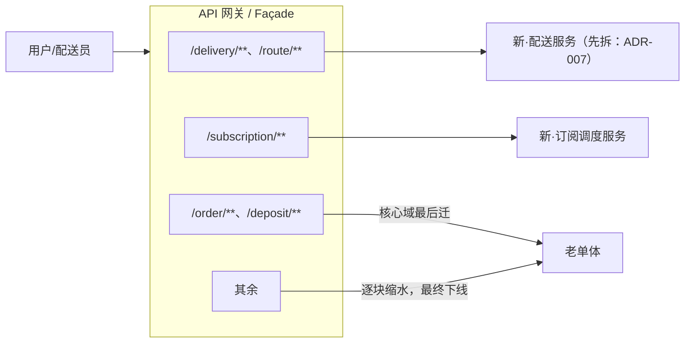
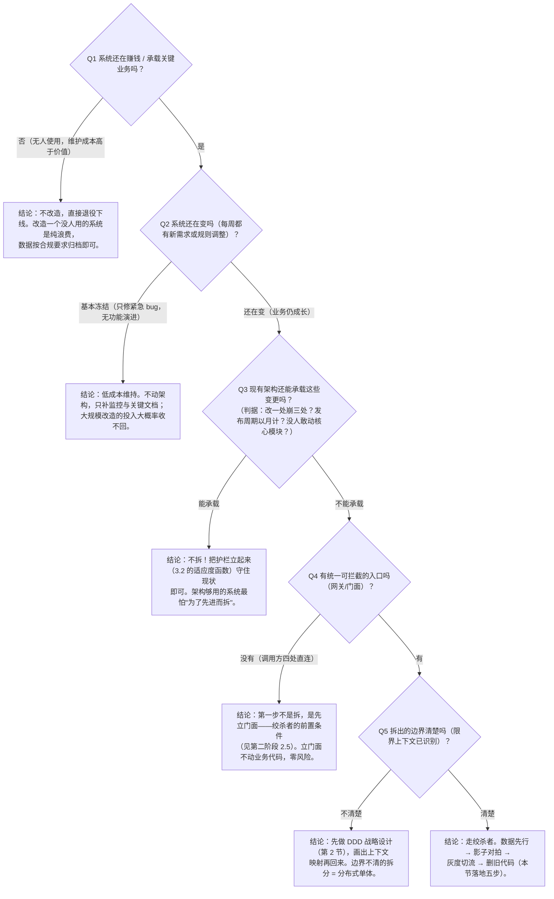

# 演进式架构：适应度函数与绞杀者改造
> [返回：软件架构学习大纲](../软件架构学习大纲.md)

本分册是第四阶段主笔记第 3 节的完整展开，子节编号 3.1~3.3 与主笔记保持一致，其他文件引用“见 3.1 / 见 3.2 / 见 3.3”即指向本文。第四阶段三节是一条流水线：第 1 节《架构设计与表达》负责把决策**记下来**（ADR）并把结构**画清楚**（C4），见 [02 分册](02-架构设计与表达-C4视图与ADR.md)；第 2 节《领域驱动设计》负责把边界**划出来**（限界上下文），见 [03 分册](03-领域驱动设计-DDD.md)；本节负责让系统**安全地走向新边界并守住它**——演进式架构是思维方式，适应度函数是护栏，绞杀者模式是迁移路径。主线仍是桶装水商城从单体到微服务的演进（场景画像见[示例项目场景](../示例项目场景/00-导览.md)），辅以工单中心、MES 的遗留系统改造素材。

## 3.1 什么是演进式架构

定义（Ford / Parsons / Kua，《Building Evolutionary Architectures》）：**在业务方向、技术与需求变化时，能以低且可控的成本演进**的架构。核心理念：架构不是交付那天定型的成品，而是持续被引导的生长过程——重要的不只是“现在的结构”，还有“改变结构的难易与方向”。

三个前提认知：变化是常态（需求、团队、流量都会变，“一次设计终身受用”不成立）；演进有方向（围绕业务目标与质量属性，见第一阶段）；演进要防护（没有自动护栏的“演进”会退化为熵增——护栏就是适应度函数）。

桶装水商城已经走完“单体分层 → 模块化单体”（见[第二阶段·单体架构](../02-第二阶段/02-单体架构-分层与模块化.md)），微服务一节还留了个问题：什么时候拆、怎么拆才安全。演进式架构给出的正是“怎么安全地走到那里”的路径——DDD 先决定边界（见第 2 节[《领域驱动设计》](03-领域驱动设计-DDD.md)），绞杀者模式负责安全迁移，适应度函数一路护栏。

### 演进式 vs 计划式：一张对照表

演进式架构最常被拿来与“计划式”（先设计后建设，Big Design Up Front）对照。两者的分歧不在“要不要设计”，而在“变更发生在什么时候、由谁消化”：

| 维度 | 计划式（Big Design Up Front） | 演进式 |
|---|---|---|
| 对变更的态度 | 变更是例外：设计冻结，变更走重评审流程 | 变更是常态：架构为“容易改对”而设计 |
| 变更频率 | 低：发布以月/季计，每次变更成本高 | 高：发布以天计，单次变更成本被刻意压低 |
| 前期投入 | 重：开工前把结构、接口、数据模型一次想全并评审冻结 | 轻：先立最小骨架与护栏（适应度函数），结构随证据逐步生长 |
| 适应环境变化能力 | 弱：前提假设失效后处处返工，文档与现实逐渐脱节 | 强：每次变更都被护栏检验，关键质量属性不因演进退化 |
| 对人的要求 | 依赖少数资深架构师在前期“想对” | 依赖全员在每次提交“做对”，规则必须可执行 |
| 适用项目类型 | 需求高度稳定、错误代价不可逆的领域：医疗设备固件、航天控制、财务核心账务 | 需求快速变化、靠市场反馈迭代的产品：电商、SaaS、成长期业务系统 |
| 典型失败模式 | 过度设计（为想象中的规模买单）+ 设计与现实脱节 | 没有护栏时退化为熵增——“演进”变“漂流” |

两者不是非此即彼。计划式的价值在**方向性决策**——选微服务还是单体、自建还是采购，这些是单向门，值得前期想透并写成 ADR（见 [02 分册](02-架构设计与表达-C4视图与ADR.md)）；演进式的价值在**结构性细节**——模块依赖、接口粒度、部署拓扑。工程判据：**把单向门留给计划式，把双向门交给演进式**。桶装水商城“要不要拆配送服务”是单向门（ADR-007 前期论证），拆完之后配送服务内部的类怎么组织是双向门（演进式 + 适应度函数护栏）。

### 增量变更的三个前提：可度量、可自动化验证、可回滚

演进式架构的一切手法（适应度函数、绞杀者、灰度发布）都是为了让“增量变更”可信地成立。一次可信的增量变更必须同时满足三个前提，缺任何一个，演进就退化成赌博：

1. **可度量**：变更好不好有数字。拆出配送服务是变好了还是变慢了？必须先有基线指标（下单 P99、排线耗时、故障恢复时长）再动手。度量从哪来？质量属性场景的“响应度量”（见[第一阶段·架构质量属性](../01-第一阶段/04-架构质量属性.md)）。答不出“怎么度量成功”的改造，等于没定义成功。
2. **可自动化验证**：度量由机器守门而不是人守门。CI 跑依赖规则测试、压测脚本比对新旧吞吐、监控阈值自动告警。人工评审可以补充判断，但不能是唯一防线——人会累、会漏、会被人情放行。这正是 3.2 整节存在的理由。
3. **可回滚**：任何一步失败都能退回上一步且代价可控。灰度切流（出问题切回老路由）、数据双写（新库写坏老库还在）、feature flag（新逻辑一键关闭）。没有回滚设计的切换，风险全部压在切换夜。

❌ 反例：“下个季度把桶装水商城拆成八个微服务”——没有基线指标（不可度量）、没有自动化验收（靠人工点验）、一次性全量切换（不可回滚）。三前提全破，这是把“演进式”说出口的计划式豪赌。
✅ 修正：先立指标基线与适应度函数 → 先拆配送一个上下文（影子对拍两周）→ 灰度切流可一键回老单体 → 复盘后再定下一个。每一步都满足三前提。

三前提在不同系统里的重心不同：工单中心分派规则天天变，演进重心在“可度量 + 可自动化验证”（规则改完自动跑流转回归用例集）；MES 产线 7×24 不能停、变更窗口极窄，演进重心在“可回滚”（断网本地续采、降级预案先行）。改造前先问：这三个前提在你的系统里哪个最贵？把预算花在最贵的那个上。

### 演进式不等于不做设计

常见误读：“演进式 = 不用前期设计，走到哪算哪。”错。没有意图的演进不是演进，是熵增——拆乱了的“分布式单体”（见[第二阶段·微服务](../02-第二阶段/03-微服务架构.md)）恰恰是放任演进的结果。演进式架构把设计从一次性动作变成持续性动作：每个迭代问一次“当前结构支撑下个方向吗”，每个单向门决策写 ADR，每条关键约束落成适应度函数。**计划式把设计集中在开工前，演进式把设计摊匀在整个生命周期——总量不减，只是换了分布。**

### 演进的单元与节奏

演进不是“连续不断地改”，而是被切成一批批**演进单元**：一个可独立上线、可独立回滚的最小变更——迁移一个上下文、替换一条规则、抽出一个服务。单元划得多大？判据还是 3.1 的三前提：这个单元能在护栏反馈回来之前落地并稳住，就是合适的大小；护栏还没绿，下一个变更就已经叠上来，说明单元切小了、节奏太快，或者护栏太慢了。

节奏由此受一条硬约束：**演进节奏不得超过护栏反馈节奏**。CI 十分钟能给红的静态函数，支撑得起每天数次提交级演进；影子对拍要跑两周才有结论，那“切写”这种单元就只能两周一个。❌ 反例：团队把“演进式”当口号，一天上线三个结构性变更，适应度函数还没跑到，告警已经分不清是哪个变更触发的——护栏失效，演进退化成盲改。✅ 修正：结构性变更排队进“演进看板”，按护栏反馈节奏逐个放行；功能性变更照常走日常发布，两者分轨道。

桶装水商城的演进单元序列就是一条路线图：模块化单体（1.2）→ 上下文映射（第 2 节）→ ADR-007 → 绞杀配送服务（影子对拍两周）→ 绞杀订阅调度 → ……每个单元独立交付、独立复盘，路线图随证据修正——这正是“演进有方向”落在排期上的样子。

## 3.2 架构适应度函数

定义：**对某项架构目标的客观、可执行的度量**——用“函数”强调它能像测试一样反复运行并给出通过/失败，把“架构要守住什么”从口头约定变成 CI 硬门禁。

| 分类维度 | 类型 | 桶装水商城例子 |
|---|---|---|
| 粒度 | 原子（单一指标） | 下单链路 P99 < 300ms |
| | 整合（多指标组合） | “下单 → 排线 → 配送任务生成”成功率 ≥ 99.9% |
| 触发方式 | 触发式（人工/定时） | 季度架构评分卡 |
| | 持续式（每次提交） | 模块依赖规则、覆盖率门禁 |
| 评估对象 | 静态（结构） | 订单模块不得直接引用配送模块内部类/内部表 |
| | 动态（运行时） | 压测中超卖率为 0 |

动态函数不必自造轮子——把现有监控指标挂上阈值即成“红/绿”门禁：MES 用“设备数据入库延迟 P99 < 5s”，工单中心用“SLA 超时从发生到催办发出的延迟 < 60s”。

用 ArchUnit 把依赖规则写成自动化测试（片段，示意写法——需要 ArchUnit 依赖与被测类，不可直接编译运行）：

```kotlin
// 依赖：com.tngtech.archunit:archunit-junit5（classes / JavaClasses / ClassFileImporter 均来自它）
class MallArchitectureFitnessTest {
    private val appClasses: JavaClasses = ClassFileImporter().importPackages("com.water.mall")

    @Test
    fun `订单模块不得直接依赖配送模块内部实现`() {
        classes().that().resideInAPackage("..order..")
            .should().notDependOnClassesThat().resideInAPackage("..delivery.internal..")
            .check(appClasses)
    }

    @Test
    fun `押金领域层不得依赖基础设施层`() {
        classes().that().resideInAPackage("..deposit.domain..")
            .should().notDependOnClassesThat().resideInAPackage("..deposit.infra..")
            .check(appClasses)     // 守护六边形架构（见第二阶段）
    }
}
```

“不得直接引用他人内部表”要两道防线：代码层——实体类的所有权即表的所有权，上面的类依赖规则同时禁止订单模块 import 配送模块的实体类；数据库层——各模块独立 DB 账号，配送表的 GRANT 里没有订单应用（ArchUnit 看不见裸 SQL，账号权限才是硬门禁）。

❌ 反例：“模块边界、依赖方向”只写在架构文档第 4 章；三个月后新人提交的订单代码直接 import 了配送模块的实体类去 JOIN 排线表，没人发现，直到拆服务那天才发现耦合根本没断。
✅ 修正：把关键约束翻译成适应度函数挂进 CI，违规 PR 直接红；文档解释“为什么”，CI 负责“执行”。

选择要点：**宁少而准，不多而滥**——每条函数对应一个真实架构目标（对应第一阶段的质量属性场景），跑不过时有明确修复动作；跑不过也没人理的函数是负资产。

### 适应度函数分类：再添三组维度

上面按粒度/触发方式/评估对象分了类。实践中还有一组更常用于“向团队解释这条函数是什么性质”的维度：**结果型 vs 实现型、手动 vs 自动、静态 vs 动态**。三个维度正交，一条函数通常各占一格——比如下面的“领域层纯净性检查”是实现型 + 自动 + 静态：

| 维度 | 类型 | 含义 | 架构例子 |
|---|---|---|---|
| 度量性质 | 结果型（outcome） | 度量系统外在表现：用户与运维可感知的运行结果 | “下单 → 配送任务生成”成功率 ≥ 99.9%；周期购触发延迟 P99 < 1min |
| | 实现型（implementation） | 度量代码与结构的内在属性：开发者可见的结构事实 | 领域层不得 import 基础设施包；模块间无循环依赖 |
| 执行方式 | 手动（manual） | 人按节奏执行并解读，适合难以自动化的整体判断 | 季度架构评分卡；技术债盘点 |
| | 自动（automated） | 机器在每次提交/部署/巡检时执行 | CI 依赖门禁；压测脚本断言吞吐 |
| 评估时机 | 静态（static） | 看代码与配置的结构，不运行系统 | 包依赖分析；SQL 扫描禁跨模块 JOIN |
| | 动态（dynamic） | 运行时看行为 | 混沌演练中断路器生效率 100%；压测超卖率 0 |

组合起来最有诊断力的是两翼：**静态 + 实现型守住结构边界，动态 + 结果型守住行为质量**。前者跑在 CI（分钟级反馈），后者跑在监控与演练（持续在线）。桶装水商城拆配送服务前后两翼要一起飞：只守静态不守动态，结构干净但延迟超标没人知道；只守动态不守静态，指标暂时达标但耦合悄悄长回来，下次改动崩盘。

### 最小可运行示例：把“领域层纯净性”变成一条 CI 门禁

ArchUnit 需要 Java 字节码与额外依赖；下面用约 60 行 Kotlin 写一个极简版，演示适应度函数的全部要素——规则声明、自动扫描、红绿判定、违规定位。它是 ArchUnit 思想的最小版：扫描 Kotlin 源码文本，断言“领域层不得 import 基础设施包名”，违规时指出文件与行号。

```kotlin
// FitnessGateDemo.kt —— 完整可运行：极简版"架构适应度测试"
import java.io.File

data class Violation(val fileName: String, val lineNo: Int, val line: String)

// 一条适应度函数 = 规则名 + 检查逻辑。返回违规列表，空列表 = 绿灯。
class DomainPurityFitness(
    private val sourceRoot: File,
    private val forbiddenInDomain: String = ".infra.", // 领域源码禁止出现的 import 包片段
) {
    fun run(): List<Violation> {
        val violations = mutableListOf<Violation>()
        sourceRoot.walkTopDown()
            .filter { it.isFile && it.extension == "kt" }
            .forEach { file ->
                val inDomain = file.path.contains("${File.separator}domain${File.separator}")
                if (!inDomain) return@forEach          // 只检领域层文件，基础设施层不在管辖范围
                file.readLines().forEachIndexed { i, line ->
                    val t = line.trim()
                    if (t.startsWith("import ") && t.contains(forbiddenInDomain)) {
                        violations += Violation(file.name, i + 1, t)
                    }
                }
            }
        return violations
    }
}

fun fixture(root: File, files: Map<String, String>) {
    files.forEach { (rel, content) ->
        val f = File(root, rel)
        f.parentFile.mkdirs()
        f.writeText(content)
    }
}

fun main() {
    val base = File("/tmp/fitness-gate-demo").apply { deleteRecursively(); mkdirs() }

    // 受检工程一：干净版本（预期全绿）
    val good = File(base, "good")
    fixture(good, mapOf(
        "src/com/water/mall/deposit/domain/DepositAccount.kt" to """
            package com.water.mall.deposit.domain

            class DepositAccount(val bucketId: String, val balance: Int) {
                fun refund(times: Int): Int = balance * times
            }
        """.trimIndent(),
        "src/com/water/mall/deposit/infra/DepositDao.kt" to """
            package com.water.mall.deposit.infra

            import com.water.mall.deposit.domain.DepositAccount

            // 基础设施层 import 领域层是允许的方向（依赖朝内）
            class DepositDao {
                fun load(id: String): DepositAccount? = null
            }
        """.trimIndent(),
    ))

    // 受检工程二：违规版本（预期亮红并指出违规文件与行号）
    val bad = File(base, "bad")
    fixture(bad, mapOf(
        "src/com/water/mall/order/domain/OrderService.kt" to """
            package com.water.mall.order.domain

            import com.water.mall.infra.http.RestClient
            import com.water.mall.order.domain.Order

            class OrderService {
                fun place(order: Order): String {
                    return RestClient.post("/delivery/route", order)
                }
            }

            class Order(val sku: String, val qty: Int)
        """.trimIndent(),
        "src/com/water/mall/order/infra/OrderDao.kt" to """
            package com.water.mall.order.infra

            class OrderDao {
                fun save(sql: String) {}
            }
        """.trimIndent(),
    ))

    println("== 架构适应度测试：领域层纯净性（domain 不得 import *.infra.*）==")
    var gateFail = false
    listOf("good 工程（预期绿灯）" to good, "bad 工程（预期红灯）" to bad).forEach { (name, root) ->
        val v = DomainPurityFitness(root).run()
        if (v.isEmpty()) {
            println("[$name] PASS：领域层无违规 import")
        } else {
            gateFail = true
            println("[$name] FAIL：${v.size} 条违规")
            v.forEach { println("    [违规] ${it.fileName}:${it.lineNo} -> ${it.line}") }
        }
    }
    println(
        if (gateFail) "CI 门禁：FAIL —— 拦下合并（真实 CI 中此处应 System.exit(1)）"
        else "CI 门禁：PASS —— 允许合并"
    )
}
```

实际编译运行输出（kotlinc 2.2.20，`kotlinc FitnessGateDemo.kt -include-runtime -d fitnessgate.jar && java -jar fitnessgate.jar`）：

```text
== 架构适应度测试：领域层纯净性（domain 不得 import *.infra.*）==
[good 工程（预期绿灯）] PASS：领域层无违规 import
[bad 工程（预期红灯）] FAIL：1 条违规
    [违规] OrderService.kt:3 -> import com.water.mall.infra.http.RestClient
CI 门禁：FAIL —— 拦下合并（真实 CI 中此处应 System.exit(1)）
```

三个设计要点：

1. **判定必须二值**——函数返回违规列表，空列表绿灯、非空红灯，没有“基本通过”；
2. **违规必须可定位**——报文件 + 行号 + 原文，修的人不用猜；
3. **方向性必须表达**——只检 `domain` 目录、只禁 `.infra.`，“基础设施依赖领域”是合法方向，规则天然表达了“依赖朝内”（六边形架构的依赖规则，见[第二阶段·其他重要架构风格](../02-第二阶段/05-其他重要架构风格.md)）。

真实项目不要停在字符串扫描：ArchUnit/Konsist 能查调用图、继承关系、注解；但它们与上面 60 行共享同一个骨架——**一条规则 + 一个扫描器 + 一个断言**。工程判据：当你在 code review 里第二次说出同一条结构要求时，就该把它写成适应度函数了。

### 适应度函数清单怎么定：从质量属性场景反推

清单不是凭主观判断列的，正路是**从质量属性场景反推**。场景六要素（刺激源/刺激/制品/环境/响应/响应度量，见[第一阶段·架构质量属性](../01-第一阶段/04-架构质量属性.md)）每一格都指向一条或一组函数：

1. 场景的**响应度量**（必须带数字）→ 直接成为一条**动态 + 结果型**函数的阈值；
2. 场景的**制品**（作用在哪部分）→ 指明**静态 + 实现型**函数该守护哪些模块边界；
3. 场景的**环境**（正常/降级/过载）→ 决定函数在哪个环节跑（CI / 压测 / 混沌演练）。

以桶装水押金模块走一遍完整推导（场景：“重复的回收验收消息把桶状态写回未回收”）：

| 场景六要素 | 填法（押金算错防护） | 反推出的适应度函数 |
|---|---|---|
| 刺激源 | 重复的回收验收消息 | ——（输入特征，供测试脚本构造重放流量） |
| 刺激 | 同一空桶的验收消息到达两次 | 动态函数：重放 1000 条历史消息，押金退还金额偏差为 0 |
| 制品 | 押金领域服务与状态机 | 静态函数：`deposit.domain` 不得 import `*.infra.*`；押金状态流转必须走 `transition()`（静态扫描禁直接改状态字段） |
| 环境 | 消费者重启后的重复投递 | 演练函数：强制重启消费者，幂等表命中率监控阈值低于 100% 即告警 |
| 响应 | 退押金只执行一次 | ——（由上面三条函数共同保障） |
| 响应度量 | 1 分钟内发现、10 分钟内纠正、金额零损失 | 上线后“押金差错工单数 = 0/月”作为结果型北极星指标 |

两条判据夹出健康清单：**写不出函数的质量属性场景 = 场景还没想清楚**（回去把六要素填满）；**追溯不回任何场景的适应度函数 = 删掉**（防止清单膨胀成没人维护的形式主义）。

### 适应度函数的执行位置全景

静态/动态之外，还有一把工程视角的尺子：**函数挂在流水线的哪个位置**。位置决定反馈时长，反馈时长决定这条函数能拦住什么——越靠前越便宜（改动成本分钟级），越靠后越昂贵（事故成本以小时与信誉计）：

| 执行位置 | 触发时机 | 桶装水商城例子 | 反馈时长 | 拦得住什么 |
|---|---|---|---|---|
| CI 提交门禁 | 每次 push / PR | 领域层纯净性检查、循环依赖检测 | 分钟级 | 结构违规合入主干 |
| CD 部署流水线 | 每次发布 | 上线前冒烟压测：下单 P99 < 300ms 才放行 | 十分钟级 | 性能退化的版本到达生产 |
| 定时巡检 | 每小时/每天 | 跑一遍“跨模块 JOIN 扫描”，防止旁路脚本绕过 CI | 小时级 | 渠道外写入（运维手工改数、临时脚本） |
| 持续监控 | 实时 | “下单 → 配送任务生成”成功率 < 99.9% 告警 | 秒~分钟级 | 生产事故，触发回滚/降级 |
| 混沌演练 | 每月/每季度 | 拔掉配送服务网线，验证订单侧断路器生效率 100% | 演练日 | 只在真实故障时才暴露的失效模式 |

一条架构目标往往要在多个位置各挂一条同主题函数：配送服务延迟这条目标，CI 冒烟压测是“准入验证”，持续监控是“在线守卫”，混沌演练是“极端场景兜底”——同一目标、三种位置、互为冗余。判据：**目标值（P99 < 300ms）只定义一次，函数在几个位置挂几条，阈值从准入到在线逐级放宽，避免误报**。

### 谁写、谁审、谁维护

适应度函数是代码，就有归属问题。三个角色分工：**写**——改架构的人写（拆服务的 ADR 里必须附“本次演进新增/修改哪些函数”清单）；**审**——code review 里函数与业务代码同权，函数自身也要过评审（规则是否过严、报错信息是否可行动）；**维护**——谁主张目标谁维护，每月一次“函数体检”：本月拦下了什么？没拦住什么？该删什么？没拦下任何东西也不产生安全感的函数进待删名单。把适应度函数当成“架构师的私人脚本”是常见病——人一离职，护栏集体失修，这是把函数写成了单点。

### 适应度函数的反模式

- **摆设函数**：只挑必然通过的规则（“类名不得用拼音缩写”没人会违反），绿灯打卡零信息量。函数的价值与它拦下过的问题成正比。
- **指标游戏**：覆盖率门禁定到 80%，团队开始为凑数写无断言测试。对策：门禁配套“有效断言”抽查，或改测变异分数。
- **僵尸函数**：迁移完成后旧规则不删，长期误报直到全员屏蔽。每次架构演进后，函数清单要跟着修剪——适应度函数和代码一样有生命周期。

## 3.3 遗留系统改造与绞杀者模式

绞杀者模式（Strangler Fig Pattern，Martin Fowler 2004）：像绞杀榕缠绕老树——**新系统在老系统外围逐渐生长，按路由一块块接管功能；老系统逐块萎缩，最终整树下线**。对立面是“大爆炸重写”，而大爆炸几乎总是失败：老系统承载的规则藏在代码深处（需求文档早丢了）；重写期间老系统还得继续迭代，双份维护；上线一刻是最高风险时刻，且没有回滚路径。

桶装水老单体的渐进改造（承接[第二阶段·单体架构](../02-第二阶段/02-单体架构-分层与模块化.md)的“单体 → 模块化单体”，也承接第 1 节分册的 ADR-007，全文见[架构设计与表达：C4 视图与 ADR](02-架构设计与表达-C4视图与ADR.md)）：



落地步骤：

1. **先立 façade 再动刀**：入口统一收敛到网关/门面，路由完全可控——不动任何业务代码，风险为零
2. **按限界上下文排顺序**：用 2.2 的上下文（DDD 战略设计的限界上下文，见第 2 节[《领域驱动设计》](03-领域驱动设计-DDD.md)）切分老单体内部模块，先迁“价值可控、耦合最浅”的配送（ADR-007 已论证）与订阅调度（独立的定时触达逻辑），押金与订单核心最后甚至长期共存。这也呼应第二阶段“新功能走新边界”：绞杀者就是把这条原则放大到系统级——新能力一律长在新边界里，老单体只减不增
3. **数据同步先行**：老库到新库用 CDC/双写过渡（一致性方案见[第三阶段](../03-第三阶段/01-分布式系统核心技术.md)），新服务先“影子读”验证，再接管写
4. **逐块绞杀**：每切一块流量就删除老单体对应模块——否则没人敢删，改造永远“差最后一步”
5. **适应度函数先于迁移就位**：3.2 的“订单模块不得引用配送内部类/表”必须先在老单体里跑绿，再谈拆服务——依赖没断干净的拆分，只是把耦合搬进了网络调用

配套战术（了解概念即可）：**事件拦截**（在老单体与老库之间埋 CDC，捕获“老系统正在发生什么”，为新系统构建提供自检数据）；**资产捕获**（先只迁读、后迁写，用读写分离降低切换风险）。

❌ 反例：“我们把 30 万行桶装水老单体推倒重写”——两年并行维护拖垮团队，上线前夜回滚，教科书级失败。
✅ 修正：绞杀者 + 小步快跑，任何时刻都存在“可回滚的完整系统”；每迁一块即产生业务价值，顺带偿还技术债。

### 绞杀者 vs 大爆炸重写：对照表

上面反例的失败不是运气差，而是重写路线的结构性缺陷。逐维度对照：

| 维度 | 绞杀者渐进改造 | 大爆炸重写（Big Bang Rewrite） |
|---|---|---|
| 风险分布 | 摊薄在几十次小块切换上，单步风险小、步步可回滚 | 全部压在最终切换一刻，且没有回滚路径 |
| 周期 | 每一块都有独立交付点，随时可停、停了不亏 | 中途无可用产出，停即前功尽弃，只能硬着头皮走完 |
| 业务连续性 | 重写期间新需求照常交付（新功能走新边界，老系统只减不增） | 功能冻结或双份维护：冻结丢市场，双份拖垮团队 |
| 行为保真 | 影子对拍用真实流量逼出隐藏规则，差异提前暴露 | “功能对等”永远在切换日才被发现不对等 |
| 团队心理 | 每切一块可见成果，正反馈持续 | 马拉松无里程碑，疲劳与流失随时间累积 |
| 业界证据 | Fowler 2004 命名以来成为改造默认路径；Sam Newman《Monolith to Microservices》把渐进拆分作为首选并给出选序法则 | 业界公认高风险：Joel Spolsky《Things You Should Never Do》以 Netscape 推倒重写为著名教训；大量案例中两年量级的重写鲜有按期、按行为等价交付的记录 |

重写失败率高，业界共识归为四个结构性原因：

1. **隐藏规则**：老系统的真实行为散落在历次热修里，“代码即文档”——只有新代码跑出对不上的结果时才知道漏了哪条规则；
2. **移动靶**：重写期间老系统还在迭代（业务不会停下来等你），需求基线持续漂移，目标物一直在动；
3. **无里程碑**：中间没有任何可用产出，管理层与团队都看不到进展，最常见的结局是拖到预算耗尽、人走光；
4. **切换豪赌**：上线一刻是全生命周期最高风险时刻，且重写天然没有回滚路径——老系统往往已停止维护甚至删除。

何时仍可以考虑重写（苛刻条件，全部满足才考虑）：体量小到几人周可完成；老系统已无流量或仅剩极少量用户；技术平台彻底淘汰、新旧无法共存（如 16 位桌面程序迁 Web 且业务规则极简）；或者干脆按新产品立项、不背“行为对等”的包袱——此时它不是改造，是重新创业，用新项目的标准评估，别用“改造”的名义骗预算。工程判据一句话：**只要老系统还在承载业务、还在变更，默认绞杀者；重写需要论证，绞杀不需要。**

### 遗留系统改造决策树（文字版）

改造之前先回答五个问题，每个分支都有明确结论：



决策树的价值在于把“要不要改”放在“怎么改”之前——大量改造失败不是因为手法不对，而是在 Q3 的答案是“能承载”时直接跳进了施工。工单中心走一遍：承载关键业务（是）→ 分派规则每周在变（是）→ 加类型要改三处代码（不能承载）→ 已有统一网关入口（有）→ 工单/分派/SLA 三个上下文已识别（清楚）→ 结论：走绞杀者，先把 SLA 计时拆出去。

### 迁移顺序怎么排：三个因子打分

“先拆谁”不该凭主观判断，三个因子逐个上下文打分：**耦合浅**（对外依赖少，抽出去牵动的面小）、**价值可控**（万一出问题，业务影响范围小、可兜底）、**认知清晰**（有懂它的人、规则文档化程度高）。桶装水商城四个候选的评分：

| 上下文 | 耦合浅 | 价值可控 | 认知清晰 | 结论 |
|---|---|---|---|---|
| 配送排线 | 高（对外只依赖地图 API） | 高（排线慢/错，订单照成，仅配送延后） | 高（ADR-007 论证过，算法独立成模块） | **第一个拆** |
| 订阅调度 | 高（只依赖订单表，定时触发自成一体） | 高（漏发一次可补发） | 高（规则简单：每周/每月触达） | 第二个拆 |
| 押金管理 | 中（与订单、回收流程双向纠缠） | 低（算错就是真金白银） | 中（状态机七态，边角规则多） | 靠后，且必须先影子对拍 |
| 订单核心 | 低分（被所有模块依赖，是耦合中心） | 低分（下单断了商城就停摆） | 高（团队最熟） | **最后拆，甚至长期不拆** |

注意最后一行的推论：订单核心“认知清晰”却“耦合最深、价值最贵”，绞杀到最后一格的答案往往是——**它留在老单体里长期服役也完全合理**。绞杀者的终点不一定是空壳，也可以是“少数几个稳定的上下文 + 一圈新服务”的长期形态；要不要动它，回到决策树 Q3 重新评估。

### 收尾：删旧代码与老库退役

绞杀者最常见的不完整形态是“永远差最后一步”：流量全切了，老代码老库还留着，新人不知道死活，继续往老单体里提交——绞杀白做。收尾要当正式交付物管理：

1. **删代码是仪式也是纪律**：每切一块流量，同一迭代内删除老单体对应模块与路由，留下“本模块已迁至 XX 服务”的重定向说明。删不掉通常意味着还有隐藏调用方——正好逼你把它找出来；
2. **老库先进“只读期”**：切写完成不等于敢下线，先收掉老库的写权限（只留迁移工具账号），任何还想写老库的旁路立刻暴露；
3. **退役三判据**：连续 90 天零写入、查询流量归零（读请求已全部改道或有归档替代）、合规要求的归档备份完成——三条全中才 drop；
4. **适应度函数同步退役**：守护老边界的规则随代码一起删，守护新边界的规则早已在位（落地五步第 5 条）——护栏的交接，就是架构权的交接。

### 数据先行迁移：三种模式与切换判据

绞杀者最难的不是代码是数据——代码可以逐块接管，数据却必须先于切换就位（切换那一刻新库必须是准的）。三种数据先行模式：

| 模式 | 做法 | 适用场景 | 切写判据 |
|---|---|---|---|
| CDC 双写过渡 | 老库变更经 CDC（解析 binlog，Debezium 类工具）实时投递新库；或过渡期“新服务写老库 + CDC 同步新库”，写路径保持单点 | 需要近实时一致的热数据；老库结构可解析 | 追平延迟 P99 < 5s 持续稳定（如 24 小时）；抽样对拍不一致率 < 0.1%；回滚演练成功 |
| 影子读对拍 | 新服务用新库执行读请求，但对外仍返回老库结果（或双读只比对不返回），差异全量记录 | 行为保真验证期：同时验证新库数据与新服务逻辑都对 | 连续两周差异率为 0，或全部差异可解释为已知的有意修复 |
| 批量回填 + 增量追平 | 先把历史全量数据批量搬入新库，再从断点按更新时间/ID 增量追平，延迟趋零后进入切写评估 | 历史数据量大、允许小时级延迟的冷温数据 | 回填完成 + 增量延迟 < 1s + 冻结窗口切写演练成功 |

三者不是互斥选项，而是同一张迁移时间线上的三段。桶装水押金迁移的标准剧本：50 万行押金单先批量回填历史已退单（冷数据，不着急）；在途押金走 CDC 增量追平；追平延迟趋零后新服务开始影子读，对拍“桶在手状态”连续两周零差异；最后灰度切写，老库只读保留一个季度再退役。

选型对照：MES 设备采集的历史时序数据量巨大但允许延迟——批量回填 + 增量追平最合适；工单中心 SLA 计时强实时强一致——只能 CDC 双写保近实时，绝不能“夜间批量”；桶装水周期购订阅表数据量小——回填半天完成，直接从影子读开始。

切换判据的共性：**切写前必须能回答三个数字——追平延迟多少、对拍差异率多少、回滚耗时多少。**三个数字答不出来，说明还没到切的时候；三个数字都答出来了，切。

### 与第二阶段 2.5 的呼应

本节与[第二阶段·微服务](../02-第二阶段/03-微服务架构.md) 2.5“渐进拆分：绞杀者模式与数据拆分”是一件事的两个视角：2.5 讲绞杀者的工程四步（分流入口 → 影子对拍 → 灰度切流 → 收尾）与可运行示例 StranglerFacadeDemo.kt（含新旧行为对拍、不一致率超阈值告警与自动回滚）；本节把它放进方法论框架——四步恰好对应 3.1 的三前提（影子对拍保证可度量，灰度每步验收保证可自动化验证，自动回滚保证可回滚），而 3.2 的适应度函数是四步全域能跑的护栏。读代码请配合 2.5 的示例，本节不重复。

## 第四阶段三节如何互相咬合

用桶装水商城把三个分册串成一件事：

1. **表达**（[02 分册](02-架构设计与表达-C4视图与ADR.md)）：拆配送排线的争议吵了三轮，最后落成 ADR-007——决策、备选方案、后果全部入档，C4 容器图随之更新，“方块是决策出来的”；
2. **建模**（第 2 节《领域驱动设计》）：DDD 上下文映射划出“配送排线”与“订单”的防腐层边界，地图距离矩阵接口被关进配送服务内部，不许外溢；
3. **演进**（本分册）：“订单模块不得引用配送内部类/表”的适应度函数先在老单体里跑绿（边界被守护）；绞杀者五步接管流量，影子对拍两周零差异后灰度切写（迁移被保真）；老订单模块里配送相关代码删除，演进收尾（老系统只减不增）。

一句话总结：**ADR 记录边界的“为什么”，DDD 设计边界的“是什么”，适应度函数守住边界的“别越线”，绞杀者把系统安全地搬进新边界。**三节互为前提：没有 ADR，演进的理由会失传；没有 DDD，演进的终点是分布式单体；没有适应度函数与绞杀者，演进的过程就是豪赌。

## 【本节自测】

1. 适应度函数和普通单元测试的本质区别是什么？（提示：各自度量的对象）
2. 绞杀者改造为什么先拆配送/订阅调度、最后拆订单/押金核心？排序依据是什么？
3. 给你的工单中心或 MES 排一个绞杀者迁移顺序（如先把 SLA 计时、设备数据采集拆出去）：每步的数据同步与回滚方案是什么？哪条适应度函数应在动手前就位？
4. 同事提议：“下个迭代先重构库存模块，再做自动补货功能。”用 3.1 的“增量变更三个前提”逐条评估：这个提议在什么条件下成立？什么条件下应当推迟？
5. “演进式架构就是不提前做设计，走到哪算哪。”指出这句话错在哪里，并说明演进式架构中“设计”分别发生在哪些时点。
6. 用六要素（刺激源/刺激/制品/环境/响应/响应度量）给桶装水商城押金模块写一张可靠性场景卡（刺激选“周期购退订后押金未按约定时间原路退回”），并把这张卡反推成 1 条动态适应度函数 + 1 条静态适应度函数，写出各自的阈值/规则与执行位置（CI / 压测 / 监控）。
7. 为工单中心“分派规则可配置化”设计两条适应度函数：一条防“规则配置改坏工单流转状态机”，一条防“新规则代码把分派引擎与具体业务耦合死”。各写明：静态还是动态、结果型还是实现型、放 CI 还是监控、违规了怎么修。
8. 某 MES 厂商的报工模块约 8 万行 Delphi 代码，仍在随工艺变更而改动，但原开发团队已全部离职。用 3.3 的改造决策树逐问走一遍给出结论；若走绞杀者，报工历史数据（约 2 亿行）用哪种迁移模式、切写判据的三个数字分别定多少、依据是什么？

## 替换清单

- “3.3 遗留系统改造与绞杀者模式”API 网关 / Façade 按路径分流（新服务 vs 老单体）→ `flowchart`（原图两行“老单体”是同一系统，合为一个节点，括注改为连线标注）
- “遗留系统改造决策树（文字版）”Q1~Q5 改造决策树 → `flowchart`（判断节点 + 结论节点）
