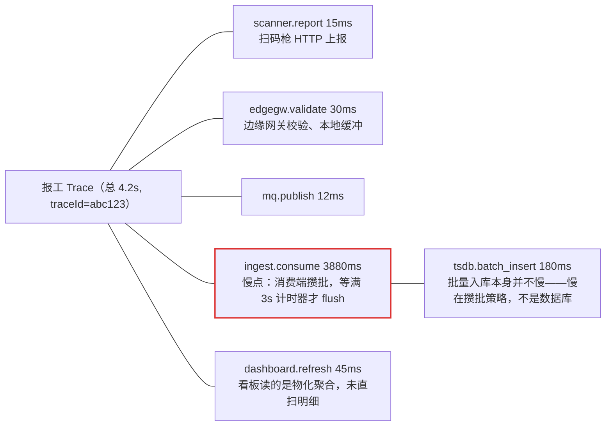
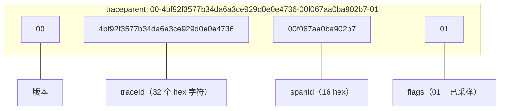

# 可观测性：日志、指标与链路追踪
> [返回：软件架构学习大纲](../软件架构学习大纲.md)

> 本文件是主笔记[第五阶段：工程化与运维视角](01-工程化与运维视角.md)中“## 1. 可观测性”一节的扩写独立版，小节编号 1.1~1.5 与“本节自测”保持不变，方便“见 1.2”式的交叉引用。示例主线是 MES 的设备数据采集与产线看板（链路：`设备/扫码枪 → 边缘网关 → MQ → 入库 → 实时看板`），辅以物联网平台（海量设备日志分级采样）与桶装水商城（业务指标基数）。各场景的业务画像见[示例项目场景](../示例项目场景/01-导览.md)；质量属性视角下的可观测性伏笔（SLI/SLO/错误预算）见[第一阶段：架构质量属性 3.2.8](../01-第一阶段/04-架构质量属性.md)。

## 1. 可观测性

### 1.1 概念：可观测性的三大支柱

**定义**：可观测性（Observability）指仅凭系统的外部输出，推断系统内部状态的能力。监控回答“它是否宕机”，可观测性回答“它为什么不可用、问题出在哪里”。

| 支柱 | 回答的问题 | 数据形态 | 典型技术栈 | MES 例子 |
|---|---|---|---|---|
| 日志 Logging | 单个事件**发生了什么** | 离散事件（文本/JSON） | SLF4J + Logback → ELK / Loki | “3 号注塑机离线重连”“报工被拒：批次已冻结”那一条条事件 |
| 指标 Metrics | 系统当前**整体状态如何** | 可聚合的时序数值 | Micrometer + Prometheus + Grafana | 采集入库延迟、每秒入库点数、断线设备数、产线节拍 |
| 链路追踪 Tracing | 一次数据流**经过了谁、卡在哪** | Span 组成的树 | OpenTelemetry + Jaeger / SkyWalking | 一条报工从扫码枪到看板走了 4 秒，卡在入库攒批 |

MES 对可观测性的要求天然比普通业务系统苛刻：一台设备秒级多条数据、全厂成百上千台设备 7×24 不停上报，而产线不能停——指标体系设计得好不好，直接决定故障时“数据断没断、断在哪一层”能不能被立刻回答。三者协作的排障闭环（核心认知，不是三选一）：**指标发现异常（采集延迟 P99 突增告警）→ 追踪定位环节（打开一条慢 Trace）→ 日志查明原因（按 traceId 检索到具体事件）**。这套闭环与业务无关：桶装水商城下单慢、工单中心分派慢，用的是同一套动作。

#### 监控 vs 可观测性：不是新旧名词之争，而是分工

这两个词经常被混用，也有人觉得“可观测性”只是监控换了个时髦说法。把它们区分开最有效的工具是“已知/未知”故障矩阵——把“我们知不知道系统会怎么坏”拆成两个维度：

| | **会怎么坏已知**（故障模式可枚举） | **会怎么坏未知**（无法预先枚举） |
|---|---|---|
| **知道要看哪**（观测点明确） | 已知-已知：证书 30 天后过期、磁盘会涨到 90%、MQ 消费者会崩溃。→ 固定仪表盘 + 静态阈值告警，传统监控的主场 | 已知-未知：知道网关、入库、看板这些环节可能出问题，但不知道何时、以什么形式。→ 预先布好指标与日志，出事按图索骥 |
| **不知道要看哪**（观测点不明确） | 未知-已知：故障模式说不上来，但老师傅一看就知道——“看板卡了？肯定是昨晚那个聚合任务没跑完”。→ 把经验固化成 runbook，别让它只活在一个人脑子里 | 未知-未知：从没见过的新故障——某固件版本导致报文乱序、某个批次的数据量恰好触发攒批 bug。→ 无法靠预先布告警发现，只能靠可观测性：故障发生后对既有数据提出**新问题**、按**新维度**切分 |

四个象限一句话总结：**监控是“对已知问题自动作答”，可观测性是“让系统可以被任意提问”**。静态阈值告警永远只能覆盖左上角那一格；右下角的未知-未知故障是可观测性存在的根本理由——它要求的不是“多加几个告警”，而是三种原始数据足够完整、彼此关联，让你在没预料到的故障面前还能组合出新的查询。MES 产线 7×24 不停，最怕的恰恰是没见过的故障（某批扫码枪固件升级后偶发丢包，业务上表现为“这批料的追溯记录对不上”），所以制造类系统对可观测性的投入回报比一般业务系统更高：故障每多持续一分钟，就是真实的产量损失。

反过来说，不要用“可观测性”当借口推翻监控：证书到期、磁盘水位这些已知-已知问题，一个静态阈值告警三十行配置就解决，为此搭“任意提问”的分析能力是杀鸡用牛刀。正确的组合是：**已知问题交给监控自动化，未知问题给可观测性留数据**。

#### 三大支柱不是三套系统：统一数据模型与三种关联键

常见误区：日志进 Loki、指标进 Prometheus、追踪进 Jaeger，三套独立系统、三套查询语言、互不关联——排障时值班同学在三个界面之间来回切换、人工拼线索，“闭环”全靠人工。三大支柱的正确理解是：**同一批系统事件的三个投影**（离散事件细节 / 聚合时序 / 请求视角因果），理想形态是共享统一数据模型（OpenTelemetry 正在推进的方向），落地时至少要用三种关联键把它们焊在一起：

1. **traceId 关联（事件级精确串联）**：每条日志带 traceId 字段（1.2 的 MDC 机制），每个 Span 记录异常事件与业务标识（订单号、批次号）。于是“从 Jaeger 的一条 Span 跳到 Loki 按 traceId 检索”是一次点击，而不是一次人工翻译。
2. **资源标签关联（实体级维度切分）**：`service.name`、`host.name`、`deployment.environment`，MES 里再加 `workshop`（车间）、`line`（产线）——日志、指标、追踪都带同一套资源属性，“A 车间 2 号线的采集服务”在任何支柱里都是同一个切分维度。没有它就会出现“指标能按产线切、日志却没打产线字段”这种半截子关联，最磨人。
3. **Exemplar 关联（曲线点→样本的最后一跳）**：直方图的某个 bucket 上挂一个代表性样本的 traceId（Prometheus exemplar / Grafana Tempo 的做法）。效果：`collector_ingest_lag` 的 P99 曲线突增的那个点旁边，直接给出“这条 4.2s 的慢请求长这样”的链接——**从指标到追踪零跳转**。没有 exemplar 时，你得在 Grafana 上框出突增时间窗，再拿着时间窗和过滤条件去 Jaeger 里搜，流量大时还不一定搜得到恰好触发的那条慢 Trace。

三种关联键的分工记法：traceId 管“事件级”串联，资源标签管“维度”切分，exemplar 管“指标到追踪”的最后一跳。三条都通，三支柱才是一张网；只通 traceId 是多数团队的现状，够用，但每次排障都要多付几步人工跳转的税。

### 1.2 日志：结构化、traceId 与海量设备日志的分级采样

- **结构化**：写成 key=value 或 JSON，机器可解析、可检索；不要拼接自然语言。
- **级别纪律**：ERROR = 需要人立刻处理（入库管道断开）；WARN = 已自动恢复但需关注（设备掉线后重连成功）；INFO = 关键业务动作（报工、指令下发、联锁拒绝）；DEBUG = 仅排查时开启。
- **traceId 传递**：入口生成全局唯一 traceId → 写入日志 MDC（Mapped Diagnostic Context），本请求内所有日志自动携带 → 跨服务时放入 HTTP 头（W3C `traceparent`）或 MQ 消息属性透传。

❌ 反例：字符串拼接、没有上下文、异常被吞：

```kotlin
fun reportWork(req: WorkReportRequest) {
    log.info("工号" + req.workerId + "报工了")   // 不可检索，缺工序/批次等关键业务参数
    mesClient.submit(req.toWorkRecord())          // 失败直接 500，事后查不到原因
    TODO()
}
```

✅ 修正：结构化字段 + MDC 中的 traceId + 分级记录 + 保留堆栈：

```kotlin
// 边缘网关入口过滤器统一生成 traceId 并放入 MDC，业务代码无感
class TraceIdFilter : OncePerRequestFilter() {
    override fun doFilterInternal(req: HttpServletRequest, res: HttpServletResponse, chain: FilterChain) {
        val traceId = req.getHeader("traceparent")?.split("-")?.getOrNull(1)  // 有上游就沿用
            ?: UUID.randomUUID().toString().replace("-", "")                  // 否则新生成
        MDC.putCloseable("traceId", traceId).use { chain.doFilter(req, res) }
    }
}

fun reportWork(req: WorkReportRequest) {
    log.info("work_report_received workerId={} operationId={} batchNo={}",
        req.workerId, req.operationId, req.batchNo)
    try {
        val record = workRecordRepository.save(req.toRecord())
        mqProducer.send("work.report", record)  // 客户端把 traceId 写入消息属性透传
        log.info("work_report_accepted recordId={} batchNo={}", record.id, record.batchNo)
    } catch (e: BatchFrozenException) {
        log.warn("work_report_rejected reason=batch_frozen batchNo={} operationId={}", req.batchNo, req.operationId)
        throw e
    } catch (e: Exception) {
        log.error("work_report_failed workerId={} operationId={}", req.workerId, req.operationId, e) // e 单独传参以打印堆栈
        throw e
    }
}
```

**海量设备日志的分级与采样**（MES 特有，普通订单系统没有的量级问题）：

- **原始采集数据不是日志**：温湿度、PLC 寄存器值这些数据点走时序数据库与指标。❌ 反例：`log.info("device data: $payload")` 每秒几万条，ELK 三天撑爆。✅ 修正：数据点入时序库，日志只记“事件”——设备上下线、阈值越限、指令执行结果。
- **风暴期采样聚合**：网关重启时上万台设备同时重连，逐条 INFO 就是日志洪水。✅ 按设备+事件类型在时间窗内聚合：`device_reconnect device=XXX count=37 in 60s` 聚成一条 WARN。
- **边缘侧预聚合**：能在边缘网关算成指标（计数、均值、最值）的先聚合成指标再上报，原始明细日志只在 DEBUG 排查窗口开启。

logback 用 `%X{traceId}` 取 MDC 值，输出形如 `12:00:01.123 INFO [abc123def...] ... - work_report_received workerId=42 operationId=OP-30 batchNo=B2026...`。跨服务不断链：HTTP 头、MQ 消息属性、甚至边缘网关自定义协议里预留的透传字段，都是 traceId 的载体。

#### 分级采样的完整实现：级别 × 采样率决定落盘

上面的“风暴期采样聚合”是事件维度的合并；更基础的一层是**条数维度的采样**——同一级别内部，按采样率决定这条日志到底落不落盘。规则的设计逻辑是“看这条日志是用来做什么的”：

- **ERROR 全量**：ERROR 是故障现场，不可再生。漏掉一条 ERROR 的代价可能是一次完整故障的根因，所以它不参与任何采样与降级。
- **WARN 采 1/10**：WARN 多是“已自动恢复”的事件（重连成功、越限恢复），你关心的是它的频率与分布形状，不是每一条的内容。1/10 足以看清“哪些设备在反复重连”。
- **INFO 采 1/100**：设备状态变化类 INFO 是纯水位信息，1/100 足以画出曲线。日志的水位看“形状”，不看“全量”——要全量计数请用指标（Counter），那是 1.3 的事。

Kotlin 完整示例（已编译运行验证，`kotlinc LogSampling.kt -include-runtime -d logsampling.jar && java -jar logsampling.jar`）：模拟一台边缘网关 24 小时的事件流（5 万台设备规模，INFO 状态变化 240 万条、WARN 重连 3.6 万条、ERROR 采集异常 120 条），按级别采样落盘并输出统计，另含一个“存储降级系数”演示：

```kotlin
// 海量设备日志分级采样：ERROR 全量、WARN 采样 1/10、INFO 采样 1/100
// 场景：物联网平台/MES 边缘网关，数十万台设备 7x24 上报，日志量远超业务系统
import kotlin.random.Random

enum class Level(val keepRate: Double, val label: String) {
    ERROR(1.00, "ERROR"), // 需要人立刻处理：一条都不能丢
    WARN(0.10, "WARN"),   // 已自动恢复但需关注：保留 1/10 足以看清频率与分布
    INFO(0.01, "INFO")    // 常规状态变化：保留 1/100 足以看清水位
}

data class DeviceEvent(val level: Level, val deviceId: String, val message: String)

/**
 * 分级采样器：级别决定基础采样率；globalFactor 是"降级系数"，
 * 存储压力大时整体下调，但 ERROR 永远不参与采样——故障现场不能被降级掉。
 */
class LevelAwareSampler(private val random: Random, private val globalFactor: Double = 1.0) {
    init {
        require(globalFactor in 0.01..1.0) { "globalFactor 必须在 0.01~1.0" }
    }

    fun shouldKeep(level: Level): Boolean = when (level) {
        Level.ERROR -> true
        else -> random.nextDouble() < level.keepRate * globalFactor
    }
}

/** 按剩余配额加权随机选级别，把三类事件交错成一条真实的事件流 */
fun pickLevel(rnd: Random, quota: Map<Level, Int>, emitted: Map<Level, Int>): Level {
    val remaining = quota.map { (k, v) -> k to (v - emitted.getOrDefault(k, 0)) }.filter { it.second > 0 }
    var roll = rnd.nextInt(remaining.sumOf { it.second })
    for ((level, n) in remaining) {
        roll -= n
        if (roll < 0) return level
    }
    error("unreachable")
}

fun runDay(factor: Double, seed: Int): Triple<Map<Level, Int>, Map<Level, Int>, Int> {
    // 一台边缘网关 24 小时的事件量（模拟约 5 万台设备）：
    // INFO 状态变化 240 万条，WARN 重连/越限 3.6 万条，ERROR 采集异常 120 条
    val quota = mapOf(Level.INFO to 2_400_000, Level.WARN to 36_000, Level.ERROR to 120)
    val total = quota.values.sum()
    val rnd = Random(seed)
    val sampler = LevelAwareSampler(Random(seed + 1), globalFactor = factor)
    val produced = mutableMapOf<Level, Int>()
    val kept = mutableMapOf<Level, Int>()

    repeat(total) {
        val level = pickLevel(rnd, quota, produced)
        val event = DeviceEvent(level, "dev-${rnd.nextInt(50_000)}", when (level) {
            Level.INFO -> "state_changed status=NORMAL"
            Level.WARN -> "device_reconnect"
            Level.ERROR -> "ingest_failed"
        })
        produced.merge(event.level, 1, Int::plus)
        if (sampler.shouldKeep(event.level)) kept.merge(event.level, 1, Int::plus)
    }
    return Triple(produced, kept, total)
}

fun main() {
    println("== 正常模式（globalFactor=1.0） ==")
    val (p1, k1, t1) = runDay(1.0, seed = 2026)
    println("级别     原始条数    落盘条数   实际保留率   配置采样率")
    for (l in listOf(Level.ERROR, Level.WARN, Level.INFO)) {
        val p = p1.getOrDefault(l, 0); val k = k1.getOrDefault(l, 0)
        println("%-8s %10d %9d %10.2f%% %8.0f%%".format(l.label, p, k, k * 100.0 / p, l.keepRate * 100))
    }
    val kp1 = k1.values.sum() * 100.0 / t1
    println("合计     %10d %9d %10.2f%%".format(t1, k1.values.sum(), kp1))
    println("存储压力：24h 日志从 $t1 条降到 ${k1.values.sum()} 条（约 ${"%.1f".format(100 - kp1)}% 被采样掉）")
    println()

    println("== 存储降级模式（globalFactor=0.5：只降非 ERROR） ==")
    val (p2, k2, t2) = runDay(0.5, seed = 2026)
    for (l in listOf(Level.ERROR, Level.WARN, Level.INFO)) {
        val p = p2.getOrDefault(l, 0); val k = k2.getOrDefault(l, 0)
        println("%-8s %10d %9d %10.2f%% %8.0f%%".format(l.label, p, k, k * 100.0 / p, l.keepRate * 50))
    }
    println("合计     %10d %9d %10.2f%%".format(t2, k2.values.sum(), k2.values.sum() * 100.0 / t2))
}
```

实际运行输出（固定随机种子，结果可复现）：

```text
== 正常模式（globalFactor=1.0） ==
级别     原始条数    落盘条数   实际保留率   配置采样率
ERROR           120       120     100.00%      100%
WARN          36000      3610      10.03%       10%
INFO        2400000     24214       1.01%        1%
合计        2436120     27944       1.15%
存储压力：24h 日志从 2436120 条降到 27944 条（约 98.9% 被采样掉）

== 存储降级模式（globalFactor=0.5：只降非 ERROR） ==
ERROR           120       120     100.00%       50%
WARN          36000      1800       5.00%        5%
INFO        2400000     12119       0.50%        1%
合计        2436120     14039       0.58%
```

三个工程要点：

- **降级系数绝不作用于 ERROR**：示例里 `globalFactor=0.5` 把 WARN/INFO 再砍一半，ERROR 仍然 100% 保留。这是分级采样最重要的一条纪律——存储再紧张，也不能把故障现场降级掉；真到了连 ERROR 都存不下的地步，该扩容的是存储，不是砍数据。
- **采样带来的统计失真要用指标补**：采样之后“日志条数”不能再当业务计数用（INFO 只剩 1%）。凡是要精确计数的量（报工笔数、指令下发次数）一律走指标 Counter；日志只负责“事件的细节”。这也是三大支柱要协作的又一个原因：**日志负责形状与细节，指标负责准确的量**。
- **采样决策要尽早**：能在边缘网关/接入层决定“这条不落盘”，就不要传到中心再丢——省的不只是存储，还有网络带宽与采集管道的处理量。物联网平台几十万台水表每秒的心跳 INFO，在接入层就采样是成本控制的第一杠杆，其次才是 1.2 正文说的“边缘预聚合”与压缩。
- **采样率不能凭感觉定**：按“排障需要的最小样本量”反推——看水位 1% 足够，看频率与设备分布 10%，故障与业务动作 100%。采样率写进配置而非硬编码，风暴期动态下调是常规操作。

采样还有一个配套动作：**DEBUG 排查窗口要“有门”**。正文里说“原始明细日志只在 DEBUG 排查窗口开启”，工程上这个窗口必须是热更新的（logback 可以运行时改 logger 级别，无需重启网关）且**自动关闭**——比如“对 line-B 网关开 30 分钟 DEBUG，到点自动回落到 INFO”。没有自动回落，一次排查顺手开的 DEBUG 会在半年后某个大促日悄悄吃掉全部采样红利；没有热更新，开 DEBUG 就意味着重启边缘网关，而产线最忌讳的就是为排查重启接入层。判据：谁申请、开多久、开在哪个范围（按 logger/包名/设备前缀），三要素写进操作记录，到期自动恢复。

### 1.3 指标：RED/USE 与 MES 指标体系

选型框架：服务/接口层用 **RED**（Rate 速率、Errors 错误率、Duration 耗时分布）；资源层用 **USE**（Utilization 使用率、Saturation 饱和度如队列堆积、Errors）。写入型管道还要盯**消费速率 vs 生产速率**——两者持续背离意味着堆积。

MES 采集链路的典型指标（命名与分层本身就是架构设计）：

| 指标 | 类型 | 回答的问题 |
|---|---|---|
| `collector_ingest_lag`（采集→入库延迟 P99） | Timer | 现场发生的事多久后能在系统里看到 |
| `collector_points_ingested_total`（每秒入库点数） | Counter | 管道吞吐是否在预期水位 |
| `devices_offline_total`（断线设备数，按车间/产线打标） | Gauge | 哪条产线的采集断了 |
| `mq_lag`（MQ 堆积） | Gauge | 消费端是否跟得上生产端 |
| `dashboard_query_duration`（看板查询 P99） | Timer | 聚合读路径是否健康 |

Kotlin（Micrometer）埋点示例：

```kotlin
@Component
class IngestMetrics(private val registry: MeterRegistry) {
    private val ingested = Counter.builder("collector_points_ingested_total")
        .tag("pipeline", "device-ingest")   // 标签只能用有限枚举值
        .register(registry)

    private val lag = Timer.builder("collector_ingest_lag")
        .publishPercentiles(0.5, 0.99)      // 直接发布 P50 / P99
        .register(registry)

    fun recordBatch(points: Int, lag: Duration) {
        ingested.increment(points.toDouble())
        lag.record(lag)
    }
}
```

❌ 反例：`tag("deviceId", deviceId)`——跨厂区几十万台设备就是几十万条时间序列，把 Prometheus 内存打爆。✅ 修正：指标标签只用低基数枚举（产线、车间、设备型号、版本号）；**设备维度的明细分析交给时序数据库**（TDengine/InfluxDB 的标签天生就是做这个的），两者分工而非替代。

- **P99 延迟**：99% 的数据点快于该值。产线看板场景“平均延迟 200ms”可能掩盖“1% 的批次要 4 秒”——平均数会撒谎，分位数才会说话。
- 实时看板是“高频写 + 聚合读”：写路径（入库速率）与读路径（看板查询 P99）分开盯；聚合读突然膨胀时优先怀疑是否直扫了明细表（读写分离与事件驱动的讨论见[第二阶段-经典架构模式](../02-第二阶段/01-经典架构模式.md)）。

#### 指标的四要素：名称、标签、类型、周期

一个可用的指标体系，每个指标都要把这四件事想清楚。缺任何一件，指标就会在关键时刻“看起来有、用起来废”：

| 要素 | 是什么 | MES 例子 | 常见错误 |
|---|---|---|---|
| 名称 | 分层命名：`<子系统>_<对象>_<单位/总量>` | `collector_ingest_lag_seconds`、`points_ingested_total` | 命名无规范，单位藏在名字之外（到底是秒还是毫秒？画图的人猜） |
| 标签 | 维度切分，取值必须是**低基数枚举** | `pipeline=device-ingest`、`line=line-A` | 高基数（deviceId/userId）、把时间戳拼进标签值 |
| 类型 | counter（只增不减）/ gauge（即时值）/ histogram（分布）/ summary（客户端分位） | 入库点数=counter，断线设备数=gauge，入库延迟=histogram | 拿 counter 的当前值当“速率”用；把 gauge 当 counter 累加 |
| 周期 | 采集周期与速率计算窗口 | Prometheus 15s 抓取、`rate(...[5m])` | 拿瞬时值做告警（抖动误报）；窗口太短曲线毛刺没法看 |

四种类型的一句话判据：**counter 用于“累计发生了多少”**（看图必须配 `rate()` 求速率）；**gauge 用于“此刻是多少”**（水位、连接数、堆积量）；**histogram 用于“分布长什么样”**（分桶在客户端完成、聚合在服务端完成，可以跨实例算 P99）；**summary 的分位数在客户端算好**，多条 summary 之间无法再聚合——所以“集群整体的 P99”必须用 histogram，summary 只适合单实例自看。这个区别在告警场景是致命的：你告警的对象通常是“整个采集服务集群的 P99”，选错类型就根本算不出这个数。

#### 标签基数爆炸：userId 做标签的下场与正确做法

deviceId 反例是设备维度；业务系统里更常见的错误做法是把 **userId 塞进标签**。桶装水商城想“看每个用户的下单量”，顺手写了 `order_created_total{user_id=...}`——后果是一个指标直接裂变成“用户数”条时间序列：100 万用户就是 100 万条序列，且随业务增长线性膨胀。抓取端内存暴涨、查询端一碰 cardinality 大查询就 OOM、Grafana 上这个面板从此谁都不敢打开。基数爆炸的阴险之处在于它是**渐进的**：上线那天 1 万用户没事，半年后翻到 100 万，监控系统先于业务系统倒下。

✅ 正确做法按需求分流：

- **聚合分析**（按渠道、会员等级、城市看下单量）：这些是低基数枚举，做指标标签正合适——`order_created_total{channel=app, member_tier=gold, city=hz}`。
- **单用户明细**（“这个用户到底下没下单”）：这是分析需求不是监控需求，交给订单事件流进数仓/ClickHouse 按用户切分，或按 traceId/订单号检索日志。指标的标签维度要能**提前穷举或上限可控**（枚举值、状态码、ID 段），凡是“取值跟着业务实体增长”的字段（userId、orderId、deviceId）都不能做指标标签。
- **兜底保护**：给“单指标时间序列数”和“每秒新增标签数”设上限告警——基数事故不该由监控系统 OOM 来暴露，而该由它自己的告警来暴露。

下面这个 Kotlin 完整示例（已编译运行验证，`kotlinc MetricsBasic.kt -include-runtime -d metricsbasic.jar && java -jar metricsbasic.jar`）用一个 60 行的玩具注册表把四要素与基数爆炸同时演示：低基数标签的序列数、userId 标签的序列数，以及“平均数会撒谎”的分位数对比：

```kotlin
// 指标四要素（名称/标签/类型/周期）与标签基数爆炸：用 60 行实现一个玩具注册表来演示
// 场景：桶装水商城下单接口 + MES 采集延迟
import kotlin.math.floor
import kotlin.random.Random

/** 极简指标注册表：counter 只增、gauge 即时值、histogram 攒样本算分位数 */
class Registry {
    private fun key(name: String, labels: Map<String, String>) =
        name + "|" + labels.entries.sortedBy { it.key }.joinToString(",") { "${it.key}=${it.value}" }

    val counters = mutableMapOf<String, Long>()
    val gauges = mutableMapOf<String, Double>()
    val samples = mutableMapOf<String, MutableList<Double>>()   // 真实系统用 bucket，这里攒样本演示分位数

    fun inc(name: String, labels: Map<String, String> = emptyMap(), v: Long = 1) {
        counters.merge(key(name, labels), v, Long::plus)
    }

    fun setGauge(name: String, labels: Map<String, String> = emptyMap(), v: Double) {
        gauges[key(name, labels)] = v
    }

    fun observe(name: String, labels: Map<String, String> = emptyMap(), v: Double) {
        samples.getOrPut(key(name, labels)) { mutableListOf() }.add(v)
    }

    /** 线性插值分位数（直方图版会按 bucket 边界估算，思想一致） */
    fun quantile(name: String, labels: Map<String, String> = emptyMap(), q: Double): Double {
        val s = samples[key(name, labels)]!!.sorted()
        val idx = q * (s.size - 1)
        val lo = floor(idx).toInt()
        return if (lo + 1 < s.size) s[lo] + (s[lo + 1] - s[lo]) * (idx - lo) else s[lo]
    }

    fun totalSeries(): Int = counters.size + gauges.size + samples.size
}

fun main() {
    val rnd = Random(2026)

    // ---- 1) 正确姿势：标签只用低基数枚举（产线 x 场景） ----
    val reg = Registry()
    val lines = listOf("line-A", "line-B", "line-C")
    val scenes = listOf("ingest", "query")
    repeat(10_000) {
        reg.inc("collector_points_ingested_total",
            labels = mapOf("pipeline" to "device-ingest", "line" to lines.random(rnd)))
    }
    for (l in lines) for (s in scenes) {
        reg.setGauge("collector_active_consumers", mapOf("line" to l, "scene" to s), rnd.nextDouble(4.0, 16.0))
    }
    println("1) 低基数标签：3 条产线 x 2 个场景，${reg.totalSeries()} 条时间序列——可控")

    // ---- 2) 反例：把 user_id 塞进标签（基数爆炸） ----
    val bad = Registry()
    val users = 100_000   // 桶装水商城的用户量级
    repeat(users) { bad.inc("order_created_total", labels = mapOf("user_id" to "u$it")) }
    println("2) 同样的 counter 加上 user_id：${bad.totalSeries()} 条时间序列" +
        "（= 用户数 x 1，随用户线性膨胀，抓取端/查询端内存双双爆掉）")

    // ---- 3) 平均数会撒谎：下单接口耗时 P50/P99 vs 均值 ----
    val lat = Registry()
    repeat(4_900) { lat.observe("order_duration_seconds", mapOf("api" to "createOrder"), rnd.nextDouble(0.08, 0.12)) }
    repeat(95)    { lat.observe("order_duration_seconds", mapOf("api" to "createOrder"), rnd.nextDouble(0.20, 0.40)) }
    repeat(5)     { lat.observe("order_duration_seconds", mapOf("api" to "createOrder"), rnd.nextDouble(3.50, 4.20)) }
    val all = lat.samples.values.first()
    val mean = all.average()
    println("3) 5000 次下单：均值 %.0fms，但 P99 %.0fms——平均数掩盖了最慢的 1% 用户"
        .format(mean * 1000, lat.quantile("order_duration_seconds", labels = mapOf("api" to "createOrder"), q = 0.99) * 1000))
}
```

实际运行输出（固定随机种子）：

```text
1) 低基数标签：3 条产线 x 2 个场景，9 条时间序列——可控
2) 同样的 counter 加上 user_id：100000 条时间序列（= 用户数 x 1，随用户线性膨胀，抓取端/查询端内存双双爆掉）
3) 5000 次下单：均值 108ms，但 P99 322ms——平均数掩盖了最慢的 1% 用户
```

第 3 组数字值得盯着看几秒：均值 108ms，任何一条按“平均延迟 < 200ms”定的 SLA 都会显示健康；但 P99 322ms 告诉你每 100 个下单用户里最慢的那个等了三分之一秒——如果这 1% 集中在周期购集中扣款时段，那就是一天中最该修的那条慢路径。**告警挂在分位数上，均值只配出现在复盘报告里。**

#### USE 方法走一遍：DB、队列、连接池

RED 管“用户视角的服务表现”，USE 管“资源视角的机器健康”——定位阶段两个视角要交叉对照。把 USE 的三问（Utilization 用得多满、Saturation 排队了没有、Errors 有没有报错）对三类最常出问题的资源各走一遍：

| 资源 | Utilization 使用率 | Saturation 饱和度 | Errors 错误 |
|---|---|---|---|
| 数据库（MySQL/时序库） | 连接数/最大连接上限、CPU、磁盘 IOPS | 锁等待数、慢查询排队、（主从）复制延迟 | 连接拒绝数、死锁数、写入失败数 |
| 消息队列（Kafka/RabbitMQ） | 消费速率/生产速率比值 | lag 堆积条数、分区 Leader 分布均衡度 | 发送失败数、消费重试次数、死信条数 |
| 连接池（HikariCP 等） | 活跃连接/池上限 | 等待获取连接的线程数、等待时长 P99 | 获取连接超时次数 |

三行合起来看才有效：MES 入库管道“变慢”的故障，第一眼通常是 RED（`collector_ingest_lag` P99 涨了），第二眼就要走 USE——`mq_lag` 在涨说明消费端跟不上（队列的 Saturation），连接池等待时长 P99 同时在涨说明瓶颈在 DB 访问层（连接池的 Saturation），时序库写入失败数在涨则直接锁定存储。**没有 USE 三件套，定位就只能靠猜；有了它，“猜”变成了“排除”。** 告警主要挂 RED（直接影响用户），USE 多用于容量规划与定位——除非资源已接近硬上限（连接池 90%、磁盘 85%），那时它也该有告警。

### 1.4 链路追踪：一条报工的完整 Trace

- **Trace**：一次数据流的全链路视图，由全局唯一 traceId 标识。
- **Span**：链路中的一个操作（一次 HTTP 调用、一条 SQL、一次 MQ 收发），记录起止时间与父子关系，组成树。
- **传播**：跨进程靠 HTTP 头 `traceparent: 00-{traceId}-{spanId}-{flags}`、MQ 消息属性、或协议里预留的透传字段携带上下文。



展开 Span 树的价值就在这里：一眼看出 4.2s 里有 3.7s 花在“等攒批”，而不是想当然地去优化数据库。Kotlin（OpenTelemetry）示例：给 MQ 消费建 Span，上下文从消息属性恢复：

```kotlin
fun onMessage(msg: Message) {
    // 上下文随消息属性传播：先恢复父上下文，traceId 才能接上扫码枪那一侧
    val parentCtx = propagator.extract(Context.current(), msg.properties) { props, key -> props[key] }
    val span = tracer.spanBuilder("ingest.consume")
        .setSpanKind(SpanKind.CONSUMER)
        .setParent(parentCtx)
        .startSpan()
    span.makeCurrent().use {
        try {
            buffer.add(msg.body)   // 攒批；flush 时再开 tsdb.batch_insert 子 Span
        } catch (e: Exception) {
            span.recordException(e)
            span.setStatus(StatusCode.ERROR)
            throw e
        } finally {
            span.end()
        }
    }
}
```

#### Trace 上下文传播：W3C traceparent 头

跨服务传播的事实标准是 W3C Trace Context 的 `traceparent` 头，格式为四段连字符分隔：



处理规则三条，都要刻进入口代码的本能里：**上游有合法头就沿用它的 traceId、新起自己的 spanId**（这是 1.2 `TraceIdFilter` 里 `split("-").getOrNull(1)` 的依据）；**头缺失或解析失败就新起一个 trace，绝不因为追踪头不合法而拒绝请求**——追踪永远不能影响业务，这是可观测性组件的第一纪律；**flags 里的 sampled 位要原样往下传**，否则下游与上游的采样决策不一致，一条 Trace 会断成两截。MQ 场景没有 HTTP 头，就把 traceparent 放进消息属性（Kafka header / RabbitMQ headers / MQTT 用户属性），自定义二进制协议就在报文里预留透传字段——载体可以换，“上下文随数据走”的原则不变。

#### 异步与跨线程：上下文丢失的经典坑

MDC 和 Span 上下文都挂在 **ThreadLocal** 上，而 ThreadLocal 是“线程”的所有物，不是“任务”的。两个经典易错点：

- **线程池复用**：任务 A 把 traceId 放进 MDC 后没清理，任务 B 复用同一条线程，日志里出现 A 的 traceId——比“没有 traceId”更糟，因为它会**串号**：排障时按 B 的 traceId 检索，检索出 A 的事件。所以线程池跑任务必须“进出都管”：入口放、finally 清；Spring 里用 `TaskDecorator` 包装，原生 `ExecutorService` 用装饰 Runnable 统一处理。
- **Kotlin 协程**：协程挂起后恢复可能换线程，ThreadLocal 不会跟着走（片段，需 kotlinx-coroutines 与 slf4j 依赖，未单独编译）：

```kotlin
// 片段：MDC 基于 ThreadLocal，协程切换调度器后 traceId "丢了"
fun handle(msg: DeviceMessage) = scope.launch {
    MDC.put("traceId", msg.traceId)      // 放在 Dispatchers.Default 的某个工作线程上
    log.info("start ingest")             // ✅ 有 traceId
    withContext(Dispatchers.IO) {        // 切换线程池
        log.info("batch insert")         // ❌ traceId 大概率为空——IO 线程的 MDC 里没有它
    }
}

// 修复：把 MDC 快照装进协程上下文（kotlinx-coroutines-slf4j 的 MDCContext），
// ThreadContextElement 会在每次恢复时把快照还原到当前线程、挂起时再收回
fun handleFixed(msg: DeviceMessage) = scope.launch {
    MDC.put("traceId", msg.traceId)
    withContext(Dispatchers.IO + MDCContext()) {
        log.info("batch insert")         // ✅ 恢复后 traceId 回来了
    }
}
```

判据一句话：**任何“线程池、异步、定时任务、协程”代码，review 时必问一句“traceId 从哪来”**。答案不是“ThreadLocal 里现成的”，就要显式传参或用上下文元素搬运。定时任务（周期购扣款、SLA 扫描）是最常被漏掉的入口——它们没有上游请求，更要主动生成自己的 traceId，把一次扣款批处理的所有日志串起来。

#### 采样策略：头部采样 vs 尾部采样

全量追踪在 MES/IoT 的量级下成本不可接受（每秒几万个 span），采样策略分两派：

- **头部采样（head sampling）**：Trace 入口处掷骰子，按比例（如 1%）决定整条 Trace 是否记录，决策随 `traceparent` 的 sampled 位传播，全链路一致。优点：实现简单、存储成本确定、每个节点不产生被丢弃的开销。缺点：**决策是盲的**——掷骰子不知道这条 Trace 会不会出错、会不会慢，偶发的错误请求恰好被丢掉的概率是 99%（1% 采样率下），而错误恰恰是最有价值的样本。
- **尾部采样（tail sampling）**：所有 span 先照常上报给采集器，等一条 Trace 完整到达后按策略裁决：**错误 Trace 必留、总耗时超阈值的慢 Trace 必留、其余按比例丢弃**。优点：留下的全是高价值样本，同样 1% 的存储能覆盖所有故障现场。缺点：采集器要缓存整条 Trace 再裁决（内存与延迟成本），多采集器部署时要保证裁决不撞车（按 traceId 哈希路由），运维复杂度明显更高。

判据：**span 流量小（日均千万级以下）直接全量**，别为省小钱引入尾部采样的复杂度；流量大先上头部采样打底控成本，规模化后再叠尾部采样保“错误 + 慢”两类样本。按数据类型再分一层：报工、指令下发这类**低频高价值的业务 Trace 全量保留**；设备高频采集 Trace 按比例 + 错误必留。Tail 采样的保留策略要当配置维护、定期回顾，它本质上是“你愿意为哪类故障保留现场”的架构决策。

### 1.5 串联：一次产线看板延迟告警的排障闭环

traceId 如何串起三大支柱（面试高频）：扫码枪/网关入口生成 traceId 写入 MDC 与 `traceparent` → 沿途每个服务的每条日志都带 `[abc123]`（日志）→ 各服务持续上报采集延迟、吞吐、断线设备数（指标）→ 全链路 Span 树进入 Jaeger（追踪）。实际排障三步：Grafana 发现 `collector_ingest_lag` P99 从 800ms 涨到 4s → Jaeger 筛 duration>3s 的 Trace，定位卡在 `ingest.consume` 的攒批等待 → 拿 traceId 到 Loki 检索日志，结合配置变更记录发现有人把 flush 间隔从 500ms 改成了 3s。

注意这个闭环的第一环是**告警**：指标先得“开口说话”，排障才有起点。而告警系统的最大敌人不是漏报，是**疲劳**——告警发多了，人就不看了，于是真故障发生时也没人看。这一小节把告警质量单独展开。

#### 告警质量三问

每条告警上线前过三问，三问全不过关的告警不该存在：

1. **可行动吗**：收到告警后有没有明确的第一步动作？“CPU > 80%”通常不可行动（负载高可能本来就是常态，你收到后唯一能做的是截图发群）；“采集入库 P99 > 2s 持续 5 分钟”可行动（按 runbook 依次查 MQ 堆积 → 配置变更 → 连接池）。不可行动的告警降级成看板曲线，让人“想看时去看”，而不是“它来找你”。
2. **紧急吗**：需要现在叫醒值班的人吗？磁盘 85%（还剩几周缓冲）不紧急，改成工作日工单；入库管道断流（产线看板正在变瞎）紧急，打电话。紧急度错配的两个方向都害人：把不紧急的做成电话，是制造疲劳；把紧急的做成邮件，是制造事故。
3. **有 runbook 吗**：告警文案里必须带处理手册链接——“这个告警意味着什么、先看哪三个面板、临时缓解命令是什么、升级给谁”。没有 runbook 的告警等于对值班同学说“祝你好运”。纪律要硬：**没有 runbook 链接的告警不允许上线**，runbook 与告警同一次变更提交。

给一条真实告警的 runbook 骨架，照着这个粒度写就够了（凌晨三点被叫醒的人靠它行动，不需要理解攒批原理）：

```text
告警：collector_ingest_lag P99 > 2s 持续 5 分钟（runbook v3，负责人：采集平台组）
症状定义：现场事件到入库的延迟超阈值，看板数据会滞后，但历史数据不丢
第一步：看 mq_lag 面板 → 若在涨，说明消费端跟不上，转第二步；若平稳，转第三步
第二步：对比 ingest 服务的部署记录，若 10 分钟内有发布 → 立即回滚该版本（命令见附录 A），
        回滚后观察 5 分钟，P99 回落则闭环，未回落继续排查
第三步：看 devices_offline_total 按产线切分 → 单产线断连多为现场网络，通知驻场；
        全厂断连转第四步
第四步：看时序库写入错误与连接池等待 → 有错误联系 DBA，无错误且无头绪 → 升级架构值班，
        附上 Grafana 时间窗截图与一条 duration>3s 的 Trace 链接
```

#### 告警疲劳治理

疲劳是渐进的：第一周每条告警都被认真对待，第三周开始有人把通知静音，第六周真故障在 200 条未读里躺了四十分钟。治理靠四条纪律：

- **月度回顾**：统计上个月响过的告警里，多少条没有触发任何动作。比例超过三成就该删掉或降级那批告警——“响了没人动”的告警是负资产，它消耗的是团队对告警的信任。
- **分级通道**：P0 电话叫醒、P1 IM 通知、P2 工单/日报。通道本身就是优先级声明，别让所有告警走同一个群。
- **告警即工单**：IoT/MES 的设备类告警（阈值越限、离线超时）数量大且需要跟进闭环，自动生成工单中心工单比堆在通知群里更可持续——告警有归属人、有时限、有 SLA，这才叫治理（工单中心的 SLA 机制正好派上用场）。
- **从阈值告警走向预算告警**：静态阈值（P99 > 500ms）要么太松要么太紧；基于错误预算的 burn rate 告警（“按当前错误率，30 天预算将在 2 天内烧完”）更贴合 SLO，误报率显著更低。SLI/SLO/错误预算的铺垫见[第一阶段：架构质量属性 3.2.8](../01-第一阶段/04-架构质量属性.md)；限流拒绝数、熔断状态翻转、队列水位、P99 四类最小告警清单在[第三阶段：高可用与稳定性](../03-第三阶段/06-高可用与稳定性-限流熔断与多活.md)已经给过，本节补的是它们之上的“告警治理”层。

最后一条反直觉的经验：**好的告警系统是安静的**。一周响两三条、条条可行动，团队才会保持敏感；一天响五十条的系统，等于没有告警——它只是把故障发现的责任从系统转嫁回了人。

### 本节自测

1. 三大支柱各自回答什么问题？“3 号产线看板比现场慢半分钟”，你按什么顺序用三支柱定位？
2. 设备原始采集数据为什么不该逐条打日志？它应该进哪里？设备重连风暴期的日志怎么治理？
3. traceId 从扫码枪到看板要经过哪几种传播载体？
4. 指标标签里放 deviceId 会导致什么后果？设备维度分析应该交给谁？
5. **你的 MES/工单中心现在能在一分钟内回答“哪个环节慢了吗”吗？缺的是指标、追踪，还是日志没串起来？**
6. “已知-未知”与“未知-未知”故障的区别是什么？为什么静态阈值告警对付不了“未知-未知”？可观测性靠什么能力补上？
7. 三种关联键（traceId / 资源标签 / exemplar）各自解决支柱之间的哪种断点？如果没有 exemplar，从“P99 曲线突增”到“那条慢 Trace”要多走哪几步？
8. 分级采样示例里，降级系数 0.5 为什么可以作用于 WARN/INFO 却绝不能作用于 ERROR？除了条数采样，重连风暴期还有哪种事件维度的治理手段？
9. MDC 基于 ThreadLocal，Kotlin 协程 `withContext` 切换调度器后 traceId 为什么会丢？修复方案是什么？线程池复用场景下比“丢 traceId”更糟的问题是什么？头部采样与尾部采样各自适合什么规模，“报工 Trace 全量、设备采集 Trace 按比例”的混合策略依据哪条判据？
10. 用“告警质量三问”审查你负责系统里最近响过的一条告警：它可行动吗？紧急吗？有 runbook 吗？三问全不过关的告警，正确处理方式是什么？

### 从零建可观测性的三步路线

最后把本节收拢成一条可执行的落地路线——给一个“只有控制台 println”的系统建可观测性，按顺序三步走，每步都有明确的“做到什么程度算够”，避免一上来就想搭全套 OpenTelemetry + ELK + Jaeger 的大而全：

**第一步：统一日志规范**（投入最小、收益最快）

- 做什么：定一份日志规范并落成公共 logger 库——JSON 结构化格式（时间戳、级别、服务名、traceId、产线/车间资源字段）、traceId 在入口生成并放入 MDC、四级级别纪律、1.2 的分级采样器内置在库里。
- 做到什么程度算够：任何一条日志都能按“服务名 + traceId + 时间窗”三个条件检索到；ERROR 总量可控（循环体里刷 ERROR 的代码已清掉）；代码评审时“这行日志能不能被检索到”成为默认问题。
- 常见坑：规范停在文档里没人执行——必须做成公共库让“规范”成为默认行为而不是自觉；只改新服务，老服务照旧用自然语言——老服务至少先加上 traceId 和结构化的关键字段，历史包袱可以分批还，格式不统一不行。

**第二步：RED 三板斧**（让系统开始“自己说话”）

- 做什么：给每个对外入口接口建 Rate / Errors / Duration 三件套看板（入口包括 HTTP 接口和 MQ 消费者），配最基本的四类告警：错误率突增、P99 突增、流量归零、队列水位（水位告警清单与限流熔断指标的呼应见[第三阶段：高可用与稳定性](../03-第三阶段/06-高可用与稳定性-限流熔断与多活.md)）。指标标签从第一天就按本节基数纪律来。
- 做到什么程度算够：值班同学不登录任何机器，只看一个页面就能回答“哪个接口、什么症状、从几点开始”；每条告警过三问、带 runbook 链接；“流量归零”告警真实演练过一次（它是最便宜也最容易被忽略的告警——很多时候不是“慢了”，是“根本没人进来”）。
- 常见坑：用平均延迟替代分位数（1.3 已演示均值会撒谎）；只监控核心业务接口，漏掉“入口必经”的组件（网关、MQ 消费者——MES 里消费者停了，业务看起来“风平浪静”，其实是看板全瞎）；告警阈值凭主观设定导致上线第一周就疲劳。

**第三步：全链路追踪**（把三支柱焊成一张网）

- 做什么：接 OpenTelemetry（SDK 或无侵入 agent），`traceparent` 经 HTTP 头、MQ 消息属性全链路透传；线程池与协程按 1.4 的方案搬运上下文；采样按“头部打底 + 错误慢请求必留”配置；业务标识（订单号、批次号）作为 Span attribute 记录。
- 做到什么程度算够：任意一次跨服务慢请求能在五分钟内拿到完整 Span 树；用一次**真实排障**验证闭环——从指标告警出发、经 Trace 定位环节、落日志找到根因，三步走得通才算数（跑不通就说明关联键缺了一环）。
- 常见坑：只接了 SDK 不做透传，Trace 跨服务就断链，价值立刻减半；尾部/头部采样把错误 Trace 采掉（保留策略第一优先级永远是“错误必留”）；Span 里不记业务标识，导致“用户说订单慢”时无法从订单号反查到 Trace——业务标识是业务问题和追踪系统之间的那座桥，没有它，追踪只是给工程师自己看的。

三步的顺序刻意设计成依赖递进：没有第一步的 traceId 规范，第三步的 Trace 无法与日志关联；没有第二步的 RED 基线，第三步的采样比例和“慢”阈值都没有依据。反过来，每一步都独立产生价值：只做到第一步，排障就已经从“翻服务器”变成“检索”；做到第二步，多数故障从“用户先发现”变成“告警先响”；到第三步，1.1 那条“指标 → 追踪 → 日志”的闭环才算真正闭合。

## 替换清单

- “1.4 链路追踪：一条报工的完整 Trace”报工 Trace 的 Span 树 → `flowchart`（树形；原“← 慢点”箭头改为红框标出慢 Span）
- “Trace 上下文传播：W3C traceparent 头”traceparent 四段字段标注 → `flowchart`（取值段 → 含义）
