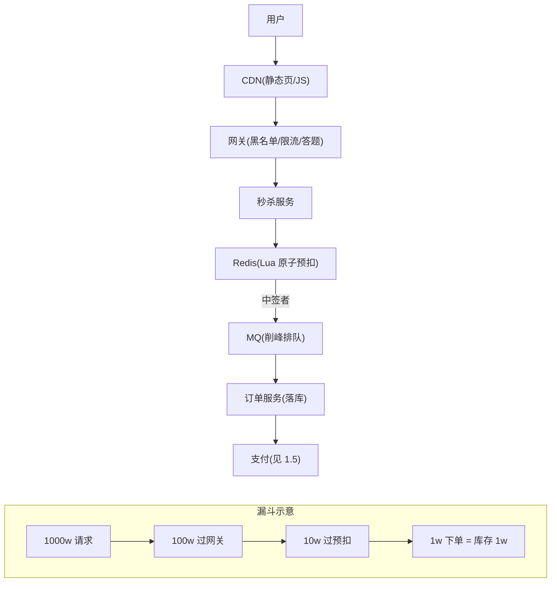

# 场景拆解：秒杀 / 限时抢购
> [返回：软件架构学习大纲](../软件架构学习大纲.md)

> 本篇对应主笔记 [01-第六阶段-实战与案例分析](01-实战与案例分析.md) 的 1.1 秒杀小节，原小节编号与内部结构保留，在此专项扩写；业务画像与大纲映射见[示例项目场景/05-秒杀限时抢购](../示例项目场景/05-秒杀限时抢购.md)。

## 1.1 秒杀

**场景定义**：限量商品定点开抢，瞬时流量百倍于日常，硬约束是**绝不超卖**（通用例子：1 万件手机 12:00 开抢）。**核心挑战**：① 瞬时读洪峰（1k → 100w+ QPS）；② 强一致的库存约束；③ 脚本、黄牛、重放攻击。

### 1.1.1 秒杀的本质：为什么它是教科书场景

把系统设计里的高频难点列成清单——读洪峰、写热点、脉冲流量、强一致写、对抗性流量——大多数场景只占其中一两样：

- **Feed 流**：读洪峰占满，但没有单点写热点（写是分散的用户发帖），对抗性也弱；
- **物联网采集**：写洪峰占满，但没有脉冲（上报是持续平稳的），更没有“扣一件少一件”的约束；
- **支付**：强一致占满，但流量平稳可预期，能靠排队慢慢消化；
- **日常电商**：五样都不占，所以平时根本不需要“秒杀架构”。

只有秒杀**五样全占**：

1. **读洪峰**——详情页被百万级用户反复刷新，读流量是日常的百倍；
2. **写热点**——所有扣减挤在同一条库存记录上，写流量不是“大”，而是“挤在同一行”；
3. **脉冲**——流量不是持续的高，而是开抢后三五秒内的尖刺，几分钟后归零；临时扩容根本来不及反应，只能提前设计；
4. **防超卖**——高并发之上叠加强一致约束，多扣一件就是资损加舆情；
5. **黄牛与机器人**——流量里混着对抗者，你不能假设请求都来自真实用户。

所以秒杀成了教学与面试的教科书：缓存体系（读洪峰）、原子性与一致性（写热点加防超卖）、限流削峰（脉冲）、风控对抗（黄牛），在同一个系统里全部到场，任何一层单独拎出来都是一道大题。

更深一层：秒杀架构的本质**不是“把日常电商扩容一百倍”，而是“在流量到达核心资源之前，把一百倍消掉百分之九十九”**。前者按峰值扩容，成本爆炸且峰值过后全部闲置；后者做漏斗，用便宜的层（CDN、网关）挡住贵的层（缓存、数据库）。这是理解本节所有设计的主线——后面每一张表、每一段代码，都在回答同一个问题：怎么让最贵的资源只处理非它不可的流量。

### 1.1.2 流量画像的数字推演：漏斗是怎么算出来的

架构设计的第一步永远是容量推演：流量有多少、每一层能扛多少、差多少。数字不必精确，量级必须正确（[第五章·性能工程](../05-第五阶段/05-性能工程-容量规划与压测.md)的“先估算、后压测、再校准”正是从这里开始）。设定：100 万人预约、1 万件库存、开抢瞬间 80% 的用户在 3 秒内点击下单按钮、开抢前后 20 秒人均刷新详情页 10 次（倒计时自动刷新加手动狂刷）。

推演过程：

- **详情页读请求**：100w 人 × 10 次 ÷ 20 秒 ≈ **50w QPS** 打向详情页——这就是“1k → 100w+ QPS”读洪峰的来源；
- **下单写请求**：100w × 80% ÷ 3 秒 ≈ **27w QPS**，取整按 30w QPS 涌向网关；
- **总请求量**：50w QPS × 20 秒 + 30w QPS × 3 秒 ≈ **1000w 次**——正是下文总体架构漏斗示意图里第一档“1000w 请求”的出处。

逐层漏斗表（每层“进来多少、靠什么拦、流出多少”）：

| 层 | 进来多少（峰值 QPS） | 靠什么拦 | 流出多少 |
|---|---|---|---|
| CDN / 页面静态化 | 详情页 ~50w | 静态化 + CDN 边缘命中（约 97% 的请求在边缘节点就结束了） | 回源 ~1.5w |
| 网关 | 下单 ~30w | 黑名单 + 答题 + 令牌桶限流（阈值按下游容量反推为 3w） | ~3w |
| 秒杀服务 → Redis | ~3w | Lua 原子预扣 + 分桶（集群扛 3w 毫无压力） | 中签 1w（恰等于库存），其余毫秒级返回“售罄” |
| MQ | 1w 条建单消息 | 队列削峰 | 订单服务按 1k QPS 匀速消费，约 10 秒清空 |
| DB | 1w 笔订单 | 只承受“中签流量” | 峰值 < 1k QPS，日常容量绰绰有余 |

读这张表的三个要点：

1. **每一层都要“快速失败”**。被拦下的几十万 QPS 不是排队等待，而是立刻拿到一个静态页或售罄页——让请求挂起等待，洪峰会变成洪灾：连接堆积把网关自己先压垮（限流与熔断的完整机制见[第三章·高可用与稳定性](../03-第三阶段/06-高可用与稳定性-限流熔断与多活.md)）。
2. **容量按“上一道防线失守”来设计**。推演里网关把 30w 削到 3w，单库存 key（单分片约 10w QPS 上限）似乎够用；但答题一旦被脚本识破、或限流阈值配置失误，Redis 将直面 30w QPS——所以后文的热点 key 分桶不是锦上添花，而是给防线失守买的保险。
3. **漏斗每一层都比上一层便宜一个量级**。CDN 按流量计费几乎无感，网关是几百台无状态机器，Redis 集群是几台，DB 是一主多备。让贵的资源只处理便宜的层拦剩的流量，这就是“漏斗逐层拦截”的成本含义。

推演还可以再往前走一步：把**读、写两条路径分开看**。详情页是读路径，它的敌人是“量”，解法是缓存与静态化，允许秒级陈旧（库存数字晚一秒刷新无伤大雅）；下单是写路径，它的敌人是“挤”，解法是限流与原子扣减，不允许任何陈旧。两条路径在“抢购按钮”处交汇：按钮的可用状态由前端定时拉一个轻量接口（走缓存）控制，真正的下单请求才走写路径——很多秒杀事故源于把按钮状态判断和下单扣减混在同一个重接口里，读洪峰直接灌进了写路径。

**总体架构**：漏斗逐层拦截，让越少的请求触达越贵的资源。



**关键设计点**：

1. **动静分离 + 多级缓存**：详情页/按钮全静态化上 CDN，未命中的走“本地缓存 → Redis”多级缓存；网关做令牌桶限流、黑名单、答题打散峰值。权衡：误伤真人 vs 系统存活——秒杀永远选后者（第一阶段：可用性优先级排序）。
2. **Redis 预扣库存（Lua 原子）+ DB 乐观锁兜底**：“GET 再 DECR”两步并发下会扣成负数；数据库行锁洪峰下必死。Lua 把“查 + 扣 + 记已购”合成一个原子操作；落库时数据库再用乐观锁兜最后一道：`UPDATE stock SET n = n - ? WHERE id = ? AND n >= ?`——即便 Redis 与 DB 短暂不一致，超卖也被这道闸拦住。
3. **MQ 削峰排队**：预扣成功 ≠ 下单成功，订单服务按自身能力消费落库。用户此刻应看到“排队中”而非“已抢到”——把最终一致性如实表达给用户。
4. **防重复下单与防黄牛**：同一用户限购 → 预扣时记已购集合；网络重试 → requestId 幂等；防黄牛是军备竞赛——设备指纹、答题、黑名单、收货地址风控，目标是抬高作弊成本而非根绝。
5. **热点 key 拆分**：所有请求打同一个库存 key，而单 key 只能落在一个 Redis 分片（单分片约 10w QPS 上限）。做法：库存分桶 `seckill:stock:{itemId}:{0..N}`，请求随机路由到一桶扣减，桶不足再向其他桶“借”；活动信息等读热点配本地缓存。
6. **对账与回补**：Redis 扣成功但 MQ 丢消息/落库失败 → 定时对账 + 超时未支付释放库存回补，形成闭环。

**容易被忽略的一步：库存预热与活动前检查单**。漏斗设计假定“库存已经在 Redis 里”，而这个假定本身要靠流程保证：活动开始前 30 分钟，把库存数量从 DB 预热进 Redis（`SET seckill:stock:{itemId} 10000`）、预建已购集合并设置过期时间（活动结束自动清理）、核对分桶数与借调逻辑、确认限流阈值配置、演练一遍 L1~L4 降级开关。判据：预热动作写进活动检查单，由非值班同学逐项核对——大促事故的相当一部分源于“以为预热了”，而不是方案本身错了。预热还要留重试窗口：预热失败的 key 宁可让活动延后一分钟，也不能开抢后第一秒就把流量打进一个不存在的 key——Lua 片段里返回 -1 的“活动未初始化”分支，正是为这一刻准备的兜底。

上面第 2 条的 Lua 预扣代码（片段，需 Redis 环境执行）：

```kotlin
val deductLua = """
    local stock = tonumber(redis.call('GET', KEYS[1]) or '-1')
    if stock < 0 then return -1 end                 -- 活动未初始化
    if stock < tonumber(ARGV[1]) then return 0 end  -- 库存不足
    redis.call('DECRBY', KEYS[1], ARGV[1])
    redis.call('SADD', KEYS[2], ARGV[2])            -- 已购集合：一人一单
    return 1
""".trimIndent()

// Lua 原子执行"查+扣+记已购"（第三阶段：原子操作）；返回 1 即中签，发 MQ 异步建单
val won = redis.eval(deductLua,
    keys = listOf("seckill:stock:$itemId", "seckill:bought:$itemId"),
    args = listOf("1", userId.toString())) as Long == 1L
```

### 1.1.3 防超卖的五道防线：逐道判据

超卖不是“可能出现”的 bug，而是“必然出现”的 bug——只要存在并发、且扣减动作不原子。防线设计的思路是纵深防御：任何一道失守，下一道还能兜住；最后用对账兜住所有意外。

**防线一：页面静态化与前端节流（分流）**。商品详情、库存展示、抢购按钮全部静态化上 CDN，让大多数请求根本不进机房；按钮点击后置灰、防抖，消掉无意的重复点击。判据：静态资源命中率 ≥ 95%，命中率上不去说明页面里混进了动态接口，要逐个剥出去。同时必须认清：前端手段只是体验优化——置灰挡不住脚本重放，服务端幂等才是唯一防线（见下文常见错误第 4 条）。

**防线二：网关限流与准入（挡人）**。黑名单挡已知机器人，答题/验证码区分人机并打散脉冲，令牌桶按下游容量放行。判据一：限流阈值不能凭主观判断写“10w 应该没问题”，必须由下游容量反推——Redis 预扣能力 3w 就放 3w，多放的都是给下游埋雷。判据二：被限流的请求要在毫秒级拿到兜底页，绝不能挂起等待。判据三：限流维度要多维叠加（IP、设备指纹、账号行为分，详见 1.1.5），单靠 IP 一维会误伤同一出口下的真实用户。

**防线三：Redis 预扣的原子性（扣准）**。这是整套方案的心脏。“先 GET 判断库存、再 DECR 扣减”在并发下必然超卖：一万个请求同时 GET 到 100，各自判断“还有货”，各自 DECR——库存被扣成负数。Lua 脚本把“查 + 扣 + 记已购”合成一个原子命令，Redis 单线程执行期间不会插入其他命令，超卖从原理上被排除。判据：任何“先读后写”的库存逻辑都必须收敛进单个原子操作（Lua 或等价机制）；代码评审时只要看到“GET 之后、DECR 之前”存在窗口，一律按超卖漏洞处理。下面的可运行示例用 Kotlin 单线程队列模拟这个思想，两版对照验证。

Lua 写法上还有一层辨析：**先判后扣**（本文片段的写法）与**先扣后判**（`DECR` 后看结果是否为负、为负则 `INCR` 回补）都能保证不超卖，但前者语义更干净——失败请求完全无副作用，不产生“扣了又补”的中间态；后者少一次读，却会短暂出现负数，监控上容易误报。判据：团队内统一一种写法并写进评审清单，两种写法混用的可读性损失大于任何性能差异。

**防线四：DB 行锁/乐观锁兜底（最后一道闸）**。Redis 与 DB 是两套系统，短暂不一致永远可能存在（Redis 扣成功但建单失败，或反向）。落库时用条件更新 `UPDATE stock SET n = n - ? WHERE id = ? AND n >= ?`，影响行数为 0 即判失败——即便上游全部失守，只要库存行还在 DB 里，超卖就到不了业务层。判据：正常情况下这道闸几乎不该被触发；监控它的触发次数，就是在监控 Redis 与 DB 不一致的频率，触发率突增说明上游出问题，先告警再处理。

**防线五：对账与回补（闭环）**。前三道防线都是概率意义上的可靠，只有对账是确定性兜底：定时核对“Redis 剩余与已售记录、MQ 消息数、DB 订单数”三方数据，发现偏差以 DB 为准修正 Redis；超时未支付的订单释放库存回补，回补动作本身要幂等——对账任务重跑不能把同一单补两次。判据：对账周期要短于“库存错误被用户发现”的时间，秒杀场景以分钟级跑，而不是像普通交易那样按天批处理。

五道防线的分工收拢成一张表：

| 防线 | 防的是什么 | 失守后果 | 盯哪个指标 |
|---|---|---|---|
| 静态化 / 前端节流 | 无意义流量进机房 | 回源放大，带宽与网关承压 | CDN 命中率 |
| 网关限流准入 | 超容量流量进下游 | 下游被打满，全站拖垮 | 限流触发数、黑名单命中数 |
| Redis 原子预扣 | 并发扣减错账 | 超卖（资损） | 预扣 RT、售罄返回比例 |
| DB 条件更新 | Redis 与 DB 不一致 | 业务层超卖 | 条件更新失败次数（突增即告警） |
| 对账回补 | 一切未被捕获的偏差 | 差错累积成资损与客诉 | 对账偏差笔数、回补笔数 |

**可运行示例：1000 人并发抢 100 件，非原子 vs 原子对照**。版本 A 模拟“先查再扣”（GET 与 DECR 之间隔着一次网络往返加线程调度，用 `sleep(2)` 模拟这段间隙）；版本 B 把“查 + 扣”合并成一条命令放进单线程队列串行执行——这正是 Redis 单线程跑 Lua 的思想：原子性不靠锁，靠的是“同一时刻只有一个命令在执行”。

```kotlin
import java.util.concurrent.CountDownLatch
import java.util.concurrent.LinkedBlockingQueue
import java.util.concurrent.CompletableFuture
import java.util.concurrent.atomic.AtomicInteger

const val STOCK = 100
const val USERS = 1000

// ── 版本 A（反例）：先查再扣，两步之间允许插队 —— 对应"GET 完再 DECR"
class UnsafeStock(start: Int) {
    private var left = start
    fun deduct(): Boolean {
        if (left <= 0) return false   // 1) 查库存
        Thread.sleep(2)               //    两步之间的"间隙"：真实系统里是一次网络往返 + 线程调度
        left--                        // 2) 扣库存（与 1) 不构成原子操作）
        return true
    }
    fun left(): Int = left
}

// ── 版本 B（正解）：查+扣合成一条命令，由单线程串行执行 —— 模拟 Redis 单线程跑 Lua 脚本的思想
class SafeStock(start: Int) {
    private val left = AtomicInteger(start)
    private val queue = LinkedBlockingQueue<CompletableFuture<Boolean>>()

    init {
        Thread({
            while (true) {
                val cmd = queue.take()
                // 单线程内"判断 + 递减"一次做完，中间不可能插入别人
                val prev = left.getAndUpdate { if (it > 0) it - 1 else it }
                cmd.complete(prev > 0)
            }
        }, "redis-sim").apply { isDaemon = true; start() }
    }

    fun deduct(): CompletableFuture<Boolean> {
        val cmd = CompletableFuture<Boolean>()
        queue.put(cmd)   // 所有扣减命令先排队，同一时刻只有一个在执行——这就是原子性的来源
        return cmd
    }

    fun left(): Int = left.get()
}

fun main() {
    val open = CountDownLatch(1)   // "开抢"发令枪：1000 个请求同一瞬间涌入
    val n = USERS

    // 版本 A：1000 人并发扣 100 件
    val unsafe = UnsafeStock(STOCK)
    val okA = AtomicInteger(0)
    val doneA = CountDownLatch(n)
    repeat(n) {
        Thread {
            open.await()
            if (unsafe.deduct()) okA.incrementAndGet()
            doneA.countDown()
        }.start()
    }

    // 版本 B：同样的 1000 人、同样的 100 件
    val safe = SafeStock(STOCK)
    val okB = AtomicInteger(0)
    val doneB = CountDownLatch(n)
    repeat(n) {
        Thread {
            open.await()
            if (safe.deduct().get()) okB.incrementAndGet()
            doneB.countDown()
        }.start()
    }

    open.countDown()   // 开抢！
    doneA.await()
    doneB.await()

    println("库存 ${STOCK} 件，${n} 人同一瞬间并发抢购：")
    println("版本 A（先查再扣）: 成功 ${okA.get()} 人，剩余库存 ${unsafe.left()} 件 → ${if (okA.get() > STOCK) "超卖 ${okA.get() - STOCK} 件！" else "正常"}")
    println("版本 B（原子扣减）: 成功 ${okB.get()} 人，剩余库存 ${safe.left()} 件 → ${if (okB.get() == STOCK) "精确扣完，零超卖" else "异常"}")
}
```

实际运行输出（kotlinc 2.2.20 编译，JRE 21）：

```text
库存 100 件，1000 人同一瞬间并发抢购：
版本 A（先查再扣）: 成功 135 人，剩余库存 -35 件 → 超卖 35 件！
版本 B（原子扣减）: 成功 100 人，剩余库存 0 件 → 精确扣完，零超卖
```

对照读法：版本 A 的 135 个“成功”里有 35 个是无效的——这些请求都通过了“还有货”的判断，但等它们真正扣下去，商品早已不存在，库存被扣成 -35。注意这个超卖只发生在 2ms 的间隙里，且并发数“只有”一千；放大到真实场景（几十毫秒的网络抖动、百万并发），失守幅度只会更大。版本 B 的 1000 条扣减命令在队列里排成一条线，第 101 条命令看到的一定是扣完之后的库存，失败得明明白白。真实系统的 Redis Lua 方案与此同构：单线程执行保证了脚本运行期间没有并发插入，本节开头的 Lua 片段就是这条队列的“工业版”。

### 1.1.4 热点 key 拆分的可运行示例：分桶与借调

关键设计点 5 说的“分桶 + 借调”，值得用代码跑一遍感受：把 100 件库存拆进 8 个桶（对应 Redis 的 8 个 key），故意分布不均（30/5/15/0/20/10/0/20，含两个空桶），1000 个请求随机路由——首选桶没货就顺延向下一桶“借调”。

```kotlin
import java.util.concurrent.CountDownLatch
import java.util.concurrent.ThreadLocalRandom
import java.util.concurrent.atomic.AtomicInteger
import java.util.concurrent.locks.ReentrantLock
import kotlin.concurrent.withLock

/** 库存分桶：8 个桶对应 Redis 的 8 个 key；请求随机选一桶扣，本桶不足则顺延"借调"下一桶 */
class BucketedStock(initial: IntArray) {
    private val stock = initial.copyOf()
    private val locks = Array(stock.size) { ReentrantLock() }   // 每桶一把锁 = 每个 Redis key 独立原子
    val sold = AtomicInteger(0)
    val borrowed = AtomicInteger(0)   // 首选桶没货、借调其他桶成功的次数
    val rejected = AtomicInteger(0)

    fun deduct(): Boolean {
        val start = ThreadLocalRandom.current().nextInt(stock.size)  // 请求随机路由到一个桶
        var i = start
        repeat(stock.size) {                       // 最多把所有桶试一遍
            val hit = locks[i].withLock {
                if (stock[i] > 0) { stock[i]--; true } else false
            }
            if (hit) {
                sold.incrementAndGet()
                if (i != start) borrowed.incrementAndGet()
                return true
            }
            i = (i + 1) % stock.size               // 本桶已空 → 试下一桶（借调）
        }
        rejected.incrementAndGet()                 // 所有桶都空 = 真售罄
        return false
    }

    fun leftTotal(): Int = stock.sum()
}

fun main() {
    // 总库存 100，故意分布不均（含两个空桶）：30+5+15+0+20+10+0+20
    val shop = BucketedStock(intArrayOf(30, 5, 15, 0, 20, 10, 0, 20))
    val users = 1000
    val open = CountDownLatch(1)
    val done = CountDownLatch(users)

    repeat(users) {
        Thread {
            open.await()
            shop.deduct()
            done.countDown()
        }.start()
    }
    open.countDown()   // 开抢！
    done.await()

    println("总库存 100 件（8 桶分布 30/5/15/0/20/10/0/20），$users 人并发抢购：")
    println("成交 ${shop.sold.get()} 件，其中借调成交 ${shop.borrowed.get()} 件；售罄被拒 ${shop.rejected.get()} 人")
    println("各桶剩余合计 ${shop.leftTotal()} 件 → ${if (shop.sold.get() == 100 && shop.leftTotal() == 0) "对账一致，零超卖" else "出现偏差，需要对账修正"}")
}
```

实际运行输出（kotlinc 2.2.20 编译，JRE 21）：

```text
总库存 100 件（8 桶分布 30/5/15/0/20/10/0/20），1000 人并发抢购：
成交 100 件，其中借调成交 47 件；售罄被拒 900 人
各桶剩余合计 0 件 → 对账一致，零超卖
```

三个观察：① **借调不是可有可无**——100 件成交里有 47 件是“首选桶已空、借调别桶”才成交的；没有借调，这 47 位用户会在“别的桶里明明还有货”的情况下被告知售罄，库存卖不完还要挨投诉。② **分桶摊薄了竞争**——每个桶独立原子（这里每桶一把锁，对应每个 Redis key 独立执行 Lua），锁竞争被分散到 8 个 key 上，这正是把单分片 10w QPS 上限变成“集群总吞吐 = 分片数 × 单分片上限”的做法。③ **全局保证没有被分桶稀释**——依然零超卖、对账一致；分桶改变的是热点分布，不改变原子性承诺。代价也要认清：分桶让“全局库存”变成 N 个局部库存，售罄判断从“看一眼总数”变成“逐桶试”，极端时序下可能出现“某桶还剩几件但请求已放弃”的边缘体验——这正是关键设计点 6 对账与回补存在的理由。

分桶数怎么定：经验做法是“预期预扣 QPS ÷ 单 key 安全水位”向上取 2 的幂（8、16），便于按位运算路由；桶数不是越多越好——桶多了借调路径变长、全局售罄判断变慢，桶少了又回到热点问题。桶数是典型的“压测定初值、复盘调参”的参数，与 1.1.7 的复盘视角呼应。

**常见错误**：

- ❌ 直接 `UPDATE stock SET n = n - 1`：行锁串行化，数据库被打死。
  ✅ 预热进 Redis，Lua 预扣，MQ 异步落库，DB 只承受“中签流量”。
- ❌ 全部请求挤同一个库存 key：单分片 CPU/带宽先于库存达到瓶颈。
  ✅ 分桶拆 key + 不足借调。
- ❌ 预扣成功就展示“已抢到”：MQ 积压或消费失败时客诉爆炸。
  ✅ 展示“排队中”，订单落库后推送真实结果。
- ❌ 以为前端按钮置灰就挡住了重复提交。
  ✅ 服务端幂等是唯一防线（第三阶段：永远不信任客户端）。

### 1.1.5 黄牛与机器人：一场持续的对抗

**对抗的本质是抬高成本，不是根绝**。黄牛是理性经济人：抢一台转手加价 500 元的手机，值得写脚本、租代理 IP、批量养号；防御的目标不是“让脚本不可能”，而是让脚本成本高于黄牛利润、让攻击不划算。“军备竞赛”这个词的准确含义是：每上一道防御，对方就升级一次手法，这条战线没有终局，只有动态平衡。

**限流维度设计**——单一维度必然误伤或漏放，需要多维叠加，每一维回答“谁在发请求”：

| 维度 | 回答什么 | 判据与陷阱 |
|---|---|---|
| IP | 请求从哪个网络来 | 粗粒度兜底。陷阱：NAT 与移动基站出口让成百上千真实用户共享一个 IP，阈值必须放宽（如单 IP 每秒 50 次以上才拦），只用来打“单 IP 每秒上千次”的裸脚本；代理 IP 池可轻松绕过，所以 IP 只能当第一道筛子 |
| 设备指纹 | 是不是真机、是不是一台设备反复注册 | 拦模拟器与改机工具。陷阱：指纹可伪造，要校验一致性——同一指纹出现在上千个账号上、或同一账号的指纹频繁漂移，直接进黑名单；正常换机也要给申诉出口 |
| 账号行为分 | 这个账号“像不像真人” | 综合注册时长、历史浏览与下单、预约行为、收货地址聚类。判据：秒杀资格前置到“已预约且行为分达标”，把养号脚本挡在活动开始之前；误伤申诉通道必须配套，否则客诉比超卖还难看 |

**验证码的代价**。验证码一石二鸟：区分人机，并把开抢瞬间的脉冲摊开到几秒——答题通关的人不可能在同一毫秒内全部点完。但它直接收“转化率税”：题目难度每上一档，就流失一批真实用户（尤其是不熟练的散客与中老年用户）。权衡判据：客单价高、库存少、黄牛利润大的活动（旗舰手机首发）用强验证码，防刷收益大于流失损失；拉新导流类活动（1 元秒杀抽纸）用弱验证码甚至免验证——脚本抢走的低价纸巾是营销预算的合理损耗，挡走的真实用户才是增长目标的损失。形态上也在持续博弈：静态图形题早被打码平台破解，主流已转向行为式验证（滑块、点选）与设备环境检测，思路仍是加大伪造成本，而非追求不可破解。

**预约制：把脉冲变成已知数**。先预约、后开抢，是成本最低的架构手段，一条预约动作换三重收益：① **容量从猜测变成事实**——100w 预约就是 100w，1.1.2 的漏斗推演输入不再靠主观判断；② **资格前置过滤**——未预约的请求在网关直接拒绝，洪峰在开抢前就少一大截；③ **意愿过滤**——愿意提前一天点一次预约的用户，转化率与履约率显著更高，羊毛党批量注册的账号要在预约环节再付一次成本。判据：预约量是容量规划的第一输入；没有预约制的秒杀，只能按“历史峰值 × 不确定系数”扩容，成本永远更高、还未必够用。

**重放攻击：签名与时效**。黄牛脚本的另一手是抓包重放——把抢购请求原样复制，开抢瞬间用上千个连接同时发出，比真人点按钮快得多。对策是让每个请求“只此一次、过时不候”：请求带时间戳与随机数 nonce，服务端校验时间戳偏差（如 ±5 秒内）并对 nonce 去重（Redis `SETNX`，命中重复直接拒绝），参数加签名防篡改；再配合一人一单的已购集合，重放请求要么过期、要么重复、要么被幂等拦截。判据：nonce 去重的存储必须带 TTL（与时间窗一致），否则活动开一天，去重集合自己先把内存吃爆。

### 1.1.6 降级预案分级：从 L1 到 L4

限流回答“按容量放行多少”，降级回答“容量不够时先砍什么”。秒杀的降级预案必须分级、可一键执行、在压测里演练过——预案没演练过等于没有预案（[第五章·性能工程](../05-第五阶段/05-性能工程-容量规划与压测.md)与混沌工程的铁律）。

| 级别 | 动作 | 触发条件 | 用户看到 | 代价 |
|---|---|---|---|---|
| L1 | 关闭推荐、关联商品、评价等非核心读 | 详情页回源 QPS 达容量的 70% | 详情页变“简版”（只剩主图、价格、抢购按钮） | 推荐收入损失，无资损 |
| L2 | 排队页：请求进虚拟队列，前端轮询进度 | Redis 预扣 P99 > 50ms，或网关排队数持续增长 | “前方拥挤，你前面还有 N 人” | 体验变慢；脉冲被整形为匀速流，后端压力骤降 |
| L3 | 库存粗化：预扣按整百件一档放号 | Redis 分片 CPU > 60%，或 Redis/DB 对账偏差告警 | 部分用户先看到“已抢完”，稍后余量再放 | 放号节奏变粗，个别档位延迟放出；不超卖 |
| L4 | 直接售罄页：拒绝一切预扣请求 | Redis 集群不可用，或秒杀服务线程池打满且短时间无法恢复 | “已售罄” | 活动提前结束，业务损失最大；系统与下游交易链路保住 |

分级原则：从业务损失最小的开始降，逐级加码；恢复时反向逐级解除，每次解除后观察一个监控周期再降下一级。L3 的“库存粗化”值得单独解释：预扣不再每件一扣，而是一次放 100 件的“号”，Redis 操作次数砍到 1/100——这是流量压力与售卖粒度之间的再权衡。粗化期间会短暂出现“用户看到售罄、库里其实还有余量”，方向只能是“宁可晚卖、不能多卖”：任何降级动作都不允许把系统推向超卖，那是唯一不可逆的错误。

预案演练的标准动作：每次大促前在预发环境用压测流量把 L1~L4 逐级打到位——验证每个开关能一键生效、生效后用户侧表现与预期一致、恢复顺序可反向执行；生产上用影子演练（只触发动作不真放流量）或小流量灰度验证开关可用。判据：每个降级开关的触发条件、执行人、生效时长、回滚方式，写成值班同学能照着执行的卡片，而不是一篇没人读完的文档。

### 1.1.7 大促复盘视角：秒杀架构要拆还是留

大促结束，秒杀集群回到日常 QPS 接近零的状态。要不要拆？这不是二选一的题，逐维判据如下：

| 维度 | 倾向保留 | 倾向拆除/缩容 |
|---|---|---|
| 活动频率 | 高频秒杀（每周场）——重建成本反复支付不划算 | 年度大促——闲置 364 天不如缩容 |
| 资源成本 | 骨架常驻、机器弹性伸缩（平时最小规模，活动日历驱动扩容） | 几十台专用机器常年闲置，成本不可接受 |
| 重建成本 | 无基础设施即代码、无自动化压测时，重建加重新压测要数周——倾向保留 | 有 IaC 与例行压测流水线，重建就是跑一遍脚本——倾向拆 |
| 能力沉淀 | “预扣 + 排队 + 异步落库”沉淀为平台级高并发交易组件，拼团、抽奖、演出票务都能复用 | 只服务一次性活动，无人复用 |
| 数据资产 | 限流阈值、漏斗各层实测峰值、对账偏差记录——是下一次容量规划的直接输入，无论拆不拆都必须留存 | ——（同左，不存在“拆”的选项） |

结论判据：秒杀的真正遗产不是那几十台机器，而是三样东西——**漏斗容量推演的方法、演练过的降级预案、复盘出来的阈值与流量画像**。工程上的通常答案是“保留骨架、弹性伸缩、沉淀组件”：网关、Redis 预扣、MQ 落库这条骨架以最小规模常驻（它同时就是平台的高并发基础设施），机器按活动日历伸缩，风控规则与限流阈值进配置版本化管理。完全拆除只在一种情况成立：活动是一次性的，且公司没有把它产品化的计划。

复盘会上至少回答四个问题，答案直接喂给下一次活动：① 实际峰值与推演峰值的偏差——哪一层的假设错了，下次推演用什么系数修正；② 对账结果——超卖几件、少卖几件、偏差发生在哪道防线；③ 误伤率——被限流与风控拦截的请求里有多少来自真人申诉，风控规则要调几档；④ 预案触发记录——L1~L4 各触发几次、判定依据与恢复时长，一次都没触发过的预案要检查是不是阈值定得太宽。

**回指**：[第三阶段](../03-第三阶段/01-分布式系统核心技术.md)（缓存、Lua 原子性、MQ 削峰、限流、幂等）、[第一阶段](../01-第一阶段/01-架构思维与设计基础.md)（质量属性优先级）、[第五阶段](../05-第五阶段/01-工程化与运维视角.md)（压测与预案）。

**延伸回指**：限流、熔断、降级的完整机制见[第三章·高可用与稳定性](../03-第三阶段/06-高可用与稳定性-限流熔断与多活.md)；多级缓存与热点 key 的体系化讨论见[第三章·数据架构](../03-第三阶段/04-数据架构-缓存分库与选型.md)；MQ 削峰与消费语义见[第二章·事件驱动架构](../02-第二阶段/04-事件驱动架构.md)；“排队中”为什么是对最终一致性的诚实表达，见[第三章·分布式理论基础](../03-第三阶段/02-分布式理论基础-CAP共识与一致性.md)；容量推演与预案演练的方法论见[第五章·性能工程](../05-第五阶段/05-性能工程-容量规划与压测.md)；本节在主笔记中的位置与相邻场景对照见[01-第六阶段-实战与案例分析](01-实战与案例分析.md)。

**【本节自测】**（只出题不作答；作答后按批改流程逐题点评并记入章节答案档案）

1. 容量推演：把本节场景改为 200w 人预约、5000 件库存、网关限流阈值 5w QPS，重算漏斗各层峰值（写出你的假设），并指出这条链路里你最担心的一层及理由。
2. 概念辨析：“Redis 预扣成功时库存已经扣掉了，为什么不能立刻告诉用户'已抢到'？”请从最终一致性与用户预期两个角度作答。
3. 方案设计：一场客单价 9.9 元、库存 50 万件的拉新秒杀，与一场客单价 6999 元、库存 100 件的旗舰手机首发，验证码强度、限流维度侧重、是否启用降级 L3（库存粗化）分别怎么选？说明理由。
4. 架构权衡：“既然 DB 条件更新就能防超卖，为什么还要 Redis 预扣？既然 Redis 预扣是原子的，为什么还要 DB 兜底？”——这两问各错在哪里？请指出并给出正确说法。

## 替换清单

- “1.1.2 流量画像的数字推演”总体架构（漏斗逐层拦截）与漏斗示意 → `flowchart`（原图是“横排 → 向下 → 横排”的拐弯长链，Mermaid 无法拐弯排版，整链改为自上而下以免缩得过小；节点、箭头方向与“中签者”标注不变）
