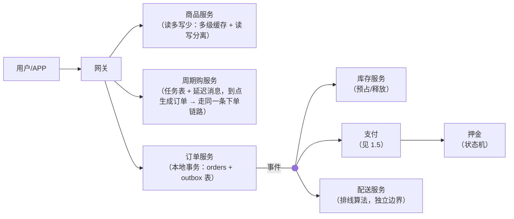
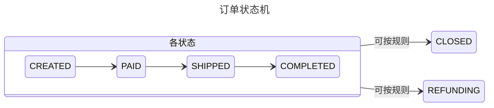
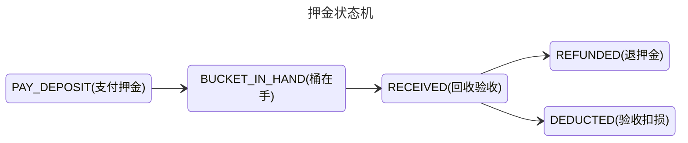

# 场景拆解：电商交易（桶装水商城·主线收官）
> [返回：软件架构学习大纲](../软件架构学习大纲.md)

## 1.2 电商交易（桶装水商城·主线收官）

**场景定义**：桶装水商城——C 端用户单次购买或周期购订阅（每周/每月自动送），水站与配送员按线路配送，水桶收押金、空桶回收退押金。它自[第二阶段](../02-第二阶段/01-经典架构模式.md)起就是贯穿主线，这里做收官拆解：长流程横跨订单、库存、支付、押金、配送。**核心挑战**：① 订单—库存—支付三者的一致性；② 周期购是“定时触发的订单”；③ 押金有完整生命周期状态机；④ 读多写少；⑤ 配送排线是独立的算法问题。

把挑战再落到业务画像上，五个挑战各有一句“大白话版”：下单那一刻钱、水、桶三本账必须对齐；订阅是“未来的订单”，今天就得为下周三的配送负责；一只桶从收押金到退押金可能跨半年、跨十几张订单；商品页被刷一百次才有一次下单；排线的问题是“明早七点前算出 200 条线路”，跟交易系统脾气完全不同。收官拆解的读法因此是：**每个挑战先推演方案，再给对比表，最后落成工程判据**——这也是全工作区反复练习的“场景 → 挑战 → 方案推演 → 权衡 → 反例 → 判据”链条的最后一次完整走步。

**总体架构**（从单体分层一路演进至今的形态）：







读这张图有三条线索。第一，**周期购服务不发明第二种下单**：它到点生成订单后走的是与用户手动下单完全同一条链路，这是“复用主链路、不造旁路”的原则——旁路每多一条，幂等、对账、退款的分支就翻一倍。第二，**订单服务是全图的脏活汇聚点**：orders + outbox 同库同事务，是全系统唯一的事实源；库存、押金、配送都只是订单事件的下游。第三，**押金状态机挂在支付侧**而不是订单侧——押金的生命周期（半年、跨多单）远长于订单生命周期（天级），绑在订单上必然错位，这正是下文挑战三要展开的聚合边界问题。

**关键设计点**：

1. **显式状态机，订单与押金各一条**：所有迁移集中校验，非法迁移拒绝。押金生命周期“支付押金→桶在手→回收验收→退押金/扣损”，验收结论（完好/破损/丢失）决定终态分支；退押金是资金操作：退款单号幂等、独立状态机、进对账（复用 1.5 套路）。❌ 用 `isPaid`、`isRefunded` 布尔字段拼状态——组合爆炸且必有矛盾态。
2. **一致性选型分级**：跨服务不强求原子——收单幂等（见下）+ 订单与下游走 Outbox 本地消息表（订单与“订单已创建”事件同库同事务写入，relay 投递 MQ）+ 长流程用 Saga：编排（中心协调器发命令收补偿，流程清晰、有中心依赖）vs 协同（各服务订阅事件自行补偿，松耦合、流程散落难排查）——钱相关的长流程通常选编排。❌ 把 2PC/XA 当默认选项：吞吐崩、耦合紧、可用性差。
3. **周期购 = 定时触发的订单**：与“超时关单”是同一类问题，通用三方案——定时扫表（简单、延迟高）/ 延迟消息（精准、依赖 MQ）/ 时间轮（海量任务、实现复杂），按订单量与精度选；更关键的是**错过处理**：调度服务宕机后重启，任务表按 `next_run_at` 把到期任务全部补跑，补跑靠 `(subscription_id, period_no)` 唯一约束幂等——“不漏送、不重送”。❌ 内存队列调度：重启即丢、即重。
4. **读多写少**：商品/水站浏览量远大于下单量——多级缓存扛读 + 读写分离；订单表按 `user_id` 分片（最高频查询是“查我的订单”，第三阶段：分片键随最高频查询选），一年以上归档冷存。
5. **配送排线独立成服务**：排线是算法重、迭代快的问题（路径优化、片区划分），与交易逻辑耦死会互相拖累——一次排线慢查询拖垮下单。独立服务只订阅“订单已支付”事件产出配送任务，失败可重放、不影响交易主链路。服务边界按“变化速率不同”切（第二阶段拆分依据）。

```kotlin
// 幂等收单：幂等键 = requestId。重试方要的是"上次的结果"，不是报错
fun createOrder(requestId: String, cmd: CreateOrderCmd): OrderResult {
    orderResultRepo.find(requestId)?.let { return it }        // 1. 先查结果表
    return try {
        tx {
            val order = orderRepo.insert(Order.from(cmd))
            outboxRepo.insert(OutboxEvent("OrderCreated", order.id))  // 同库同事务
            OrderResult.success(order)
        }
    } catch (e: DuplicateKeyException) {                      // 2. 唯一约束兜底并发
        orderResultRepo.find(requestId)!!
    }
}
```

（上面是**片段**：幂等收单的两道防线——先查结果表的快路径，与唯一约束兜底的并发路径。这个“查 + 兜底”两段式会贯穿本节所有幂等场景。）

---

### 五个核心挑战逐个击破

#### 挑战一：订单—库存—支付的一致性（对应关键设计点 2）

**为什么本地事务不行了。** 单体时代 `orders / inventory / payment` 三张表在一个库里，一个事务包住全部。拆库之后（哪怕只是模块化单体按 schema 分库），“扣库存成功但订单提交失败”就从不可能变成日常。第一反应是 2PC/XA：协调者锁住三个资源管理器，全员 prepared 再一起 commit。判据上直接否掉：桶装水下单峰值集中（大促、夏日高峰），2PC 的锁窗口把吞吐打崩；任何一个参与者短暂不可用，整条链路跟着不可用——用“最弱的可用性”换“最强的原子性”，买卖不划算。理论细节见[第三阶段分布式事务](../03-第三阶段/05-分布式事务-从2PC到最终一致.md)。

**三方案对比**：

| 维度 | 方案 A：同步 Saga（编排式） | 方案 B：本地消息表 + 幂等消费 | 方案 C：TCC 冻结 |
|---|---|---|---|
| 一致性 | 最终一致，补偿显式、流程可查 | 最终一致，事件驱动，天然削峰 | 准实时一致，Try 阶段就锁定资源 |
| 用户体感 | 提交后异步推进，失败有补偿通知 | 同 A，且下游积压时用户无感 | 下单时即感知库存冲突（Try 失败立即拒单） |
| 开发成本 | 协调器 + 每步补偿逻辑 | Outbox 表 + relay + 幂等消费框架 | 每个资源三个接口（Try/Confirm/Cancel）+ 空回滚/悬挂防护 |
| 补偿复杂度 | 中心可见全流程，补偿好编排 | 依赖消费方各自补偿，语义要靠契约管住 | Confirm 必须幂等，Cancel 必须允许“空补偿” |
| 核心风险 | 协调器单点（可集群化） | 消息积压、消费语义漂移 | 资源锁定时长可控但接口面大、渗透到每个参与方 |
| 适用 | 多步、有分支、钱相关的长流程 | 一主多从的事件扇出（订单 → 库存/积分/通知） | 单步强校验资源点（库存预占、额度冻结） |

**桶装水的选型与理由**：主链路选 B（Outbox 本地消息表 + 幂等），库存预占这一个资源点借用 C 的思想（Try = 预占、Cancel = 释放、Confirm = 支付后扣减），支付成功后的退款分账等资金长流程选 A（编排式 Saga）。理由有三：一是订单创建后的下游大多是“通知型”扇出（库存、积分、配送任务），消息表足够；二是唯一需要强校验的只有库存——“拍下时就没水了”必须让用户当场知道，所以只在库存一步做 Try 式预占，不把整条链 TCC 化（三个资源 × 三个接口 = 九个幂等点，为一个低频冲突场景付不起）；三是退款链路涉及真金白银且步骤多、有分支（部分退、押金扣损联动），编排式 Saga 的中心可见性在这里是刚需。

**反例与修正**：TCC 落地最常见的三个坑——①空回滚：Try 没到达（超时），Cancel 先到，参与方要允许“没 Try 过也 Cancel 成功”并记账；②悬挂：Cancel 执行完，迟到的 Try 才到，资源被锁死——参与方要记录事务分支状态，Try 到达时发现已 Cancel 则拒绝；③Confirm 不幂等：重试导致重复扣减——Confirm 以事务 ID 做幂等键。修正思路不是换框架，而是把每个参与方的幂等表设计出来再写业务。

**工程判据**：一致性方案按“资源点数 × 冲突频率 × 资金敏感度”分级——无资金、低冲突走消息表；单点高冲突做局部 Try/Cancel；多步资金流上编排 Saga；2PC 只出现在同一个团队管得住的短资源集里（如同一库的两个表）。

#### 挑战二：周期购 = 定时触发的订单（对应关键设计点 3）

**问题重述。** 周期购的本质是“订单的触发器”：订阅合同（每周两桶、地址、起止日期）存续期间，系统要在每个周期边界自动生成一张订单，且要求“不漏送、不重送”。它与“30 分钟未支付自动关单”是同一类问题——到点触发 + 错过处理。

**三方案对比**：

| 维度 | 方案 A：定时扫表 | 方案 B：延迟消息 | 方案 C：日历表驱动 |
|---|---|---|---|
| 触发精度 | 扫描间隔（如 5 分钟） | 秒级精准 | 扫描间隔（同 A） |
| 可靠性 | 高：任务在 DB 里，宕机后按到期时间补跑 | 依赖 MQ 的延迟能力；消息丢失需兜底扫表 | 高：任务在 DB 里，逐期物化 |
| 改期/跳过/补送 | 改 `next_run_at` 即可，但“某期跳过”要另加标记 | 长周期延迟（30 天以上）多数 MQ 不支持；改期 = 撤回重发，很难 | 每期一行任务，改期/跳过/补送 = 改那一行的状态，天然可审计 |
| 成本 | 最低：一张任务表 + 一个调度循环 | 需要 MQ 延迟特性 + 兜底扫表，双份机制 | 中：期数可预知（一年 52 期），行数可控 |
| 风险 | 扫描慢拖垮 DB（量大后要分片） | 长延迟任务不可见、不可管 | 任务表要清理归档 |
| 适用 | 关单超时等“到期就办”的短任务 | 分钟到小时级的精准延迟提醒 | 期数可预知、需要逐期管理动作的订阅类业务 |

**桶装水的选型与理由**：日历表驱动（方案 C）为主，扫表做引擎，延迟消息只做可选的“配送前提醒”。理由：周期购的期数是**可预知**的（每周一期，一年 52 期），完全可以订阅创建时就把未来每一期物化成任务行 `(subscription_id, period_no, planned_date, status)`；而“暂停一次”“这期改周三”“欠费结清后补送”全是**对某一期的操作**——物化成行之后，这些业务动作就是简单的行状态变更，还自带审计轨迹。纯延迟消息方案提供不了“一年 52 期”的可见性，改一次地址要撤回 52 条消息，不可运维。

**补单与跳过规则**（把“不漏送、不重送”拆成可执行的规则）：

- **欠费**：生成时发现用户 OVERDUE → 该期任务置 `SUSPENDED`，**不推进期号**；结清欠费后补跑，任务表里挂起的行自动重试——漏送的兜底就在任务表本身。
- **暂停**：用户按暂停 → 未来未执行的期全部置 `PAUSED`；恢复 → 从下一个完整周期继续，已过期间不追溯补送（业务规则：暂停期不占用期数）。
- **地址变更**：`planned_date` 未到的期直接更新任务行地址；已生成订单的期走订单改址流程，不改任务表——**任务表和订单表各管各的时间段**，以订单是否已生成为分界。
- **补跑幂等**：调度服务宕机重启后，按 `planned_date <= today AND status = PENDING` 全量补跑，靠 `(subscription_id, period_no)` 唯一约束去重——这就是“重送防重”的物理保证。

下面是**周期购下一期订单的完整生成流程**的可运行示例（调度触发 → 检查订阅/用户状态 → 押金校验 → 生成订单 → 同周期幂等键防重复；演示重启补跑与并发双触发都不重复下单）：

```kotlin
import java.time.LocalDate
import java.util.concurrent.Callable
import java.util.concurrent.Executors

// ============================================================
// 周期购下一期订单的完整生成流程：
// 调度触发 -> 检查订阅/用户状态 -> 押金校验 -> 生成订单
// 防重复：幂等键 (subscription_id, period_no) 唯一约束
// ============================================================

enum class SubscriptionStatus { ACTIVE, PAUSED, CANCELLED }

/** 订阅合同：periodNo = 已生成到第几期，nextRunAt = 下次生成时间 */
data class Subscription(
    val id: String,
    val userId: String,
    val product: String,
    val quantity: Int,
    val periodNo: Int,
    val nextRunAt: LocalDate,
    val status: SubscriptionStatus,
)

enum class UserStatus { NORMAL, OVERDUE } // OVERDUE = 欠费，暂停配送

data class User(val id: String, val status: UserStatus, val address: String)

/** 押金账户：桶在用户手里几个 + 押金余额多少（分） */
data class DepositAccount(val userId: String, val bucketsInHand: Int, val balanceCents: Long)

data class Order(
    val id: String,
    val idempotencyKey: String, // sub:{subscriptionId}:period:{periodNo}
    val userId: String,
    val items: List<String>,
    val periodNo: Int,
    val createdAt: LocalDate,
)

/** 内存订单表：idempotencyKey 唯一约束（模拟 DB 的 UNIQUE KEY） */
class OrderRepo {
    private val byKey = LinkedHashMap<String, Order>()
    private val lock = Any()

    /** putIfAbsent 语义：唯一约束冲突时不覆盖，返回已存在的记录 */
    fun insertIfAbsent(order: Order): Pair<Order, Boolean> = synchronized(lock) {
        val existing = byKey[order.idempotencyKey]
        if (existing != null) existing to false
        else { byKey[order.idempotencyKey] = order; order to true }
    }

    fun findByKey(key: String): Order? = synchronized(lock) { byKey[key] }

    fun all(): List<Order> = synchronized(lock) { byKey.values.sortedBy { it.createdAt } }
}

sealed class GenResult {
    data class Created(val order: Order) : GenResult()
    data class Duplicated(val order: Order) : GenResult()
    data class Skipped(val reason: String) : GenResult()
}

class PeriodicOrderGenerator(
    private val orders: OrderRepo,
    private val users: Map<String, User>,
    private val deposits: Map<String, DepositAccount>,
) {
    companion object { const val BUCKET_DEPOSIT_CENTS = 3000L } // 每桶押金 30 元

    fun idemKey(subId: String, periodNo: Int) = "sub:$subId:period:$periodNo"

    fun generate(sub: Subscription, periodNo: Int): GenResult {
        // 0. 幂等第一道：查幂等键（调度重启补跑的快路径）
        orders.findByKey(idemKey(sub.id, periodNo))?.let { return GenResult.Duplicated(it) }

        // 1. 订阅状态守卫：暂停/取消不生成（暂停恢复后从下一期继续）
        if (sub.status != SubscriptionStatus.ACTIVE)
            return GenResult.Skipped("订阅状态=${sub.status}，本期不生成，任务留在任务表")

        // 2. 用户状态守卫：欠费挂起，结清后补送（跳过不推进期号）
        if (users[sub.userId]!!.status == UserStatus.OVERDUE)
            return GenResult.Skipped("用户欠费，本期挂起待补送")

        // 3. 押金校验：手中桶数够本期用量则不另收押金；
        //    不足的桶数从押金余额抵扣新桶押金，余额不够则挂起
        val deposit = deposits[sub.userId]!!
        val needNewBuckets = (sub.quantity - deposit.bucketsInHand).coerceAtLeast(0)
        val needChargeCents = needNewBuckets * BUCKET_DEPOSIT_CENTS
        if (needChargeCents > deposit.balanceCents)
            return GenResult.Skipped(
                "押金不足：需补收 ${needChargeCents / 100} 元，" +
                "押金余额 ${deposit.balanceCents / 100} 元"
            )

        // 4. 生成订单（幂等第二道：唯一约束兜底并发双触发）
        val order = Order(
            id = "ORD-${sub.id}-P$periodNo",
            idempotencyKey = idemKey(sub.id, periodNo),
            userId = sub.userId,
            items = listOf("${sub.product} x ${sub.quantity}桶"),
            periodNo = periodNo,
            createdAt = LocalDate.of(2026, 11, 4),
        )
        val (winner, inserted) = orders.insertIfAbsent(order)
        return if (inserted) GenResult.Created(winner) else GenResult.Duplicated(winner)
    }
}

fun describe(r: GenResult): String = when (r) {
    is GenResult.Created  -> "生成订单 ${r.order.id}，明细：${r.order.items.joinToString()}"
    is GenResult.Duplicated -> "幂等命中：本期订单已存在（${r.order.id}），不重复下单"
    is GenResult.Skipped  -> "跳过：${r.reason}"
}

fun runBatch(title: String, subs: List<Subscription>, gen: PeriodicOrderGenerator) {
    println(title)
    var created = 0; var dup = 0; var skipped = 0
    for (sub in subs) {
        val nextPeriod = sub.periodNo + 1 // 任务表视角：每个到期任务都催下一期
        val r = gen.generate(sub, nextPeriod)
        println("  sub=${sub.id} 第 $nextPeriod 期 -> ${describe(r)}")
        when (r) {
            is GenResult.Created -> created++
            is GenResult.Duplicated -> dup++
            is GenResult.Skipped -> skipped++
        }
    }
    println("  批次汇总：新造 $created 单，幂等命中 $dup 次，跳过 $skipped 单")
}

fun main() {
    val today = LocalDate.of(2026, 11, 4)

    val users = mapOf(
        "U1" to User("U1", UserStatus.NORMAL, "朝阳区幸福小区 3-501"),
        "U2" to User("U2", UserStatus.OVERDUE, "海淀区学清路 8 号"),
        "U3" to User("U3", UserStatus.NORMAL, "东城区平安大街 2 号"),
    )
    val deposits = mapOf(
        "U1" to DepositAccount("U1", bucketsInHand = 2, balanceCents = 0L),    // 桶够用，不补押金
        "U2" to DepositAccount("U2", bucketsInHand = 0, balanceCents = 6000L), // 需补收 1 桶押金
        "U3" to DepositAccount("U3", bucketsInHand = 0, balanceCents = 1000L), // 押金不足
    )
    val subs = listOf(
        Subscription("S1", "U1", "19L 桶装水", 2, 8, today, SubscriptionStatus.ACTIVE),
        Subscription("S2", "U2", "19L 桶装水", 1, 3, today, SubscriptionStatus.ACTIVE),
        Subscription("S3", "U3", "19L 桶装水", 1, 2, today, SubscriptionStatus.ACTIVE),
        Subscription("S4", "U1", "15L 桶装水", 1, 5, today, SubscriptionStatus.PAUSED),
    )

    val orders = OrderRepo()
    val gen = PeriodicOrderGenerator(orders, users, deposits)

    runBatch("== 第一次调度（2026-11-04，4 个到期任务）==", subs, gen)

    println()
    runBatch("== 调度服务宕机重启，按任务表补跑同一批任务（应全部幂等命中/合理跳过）==", subs, gen)

    println()
    println("== 并发双触发：两个线程同时生成 S1 第 10 期（唯一约束兜底）==")
    val pool = Executors.newFixedThreadPool(2)
    val results = List(2) { pool.submit(Callable { gen.generate(subs[0], 10) }) }.map { it.get() }
    pool.shutdown()
    results.forEachIndexed { i, r -> println("  触发${i + 1}：${describe(r)}") }
    println("  并发下第 10 期订单实际生成数：${results.count { it is GenResult.Created }}（应为 1）")

    println()
    println("== 欠费用户 U2 结清欠费后，任务表补送第 4 期 ==")
    val u2Paid = users["U2"]!!.copy(status = UserStatus.NORMAL)
    val usersPaid = users + ("U2" to u2Paid)
    val genPaid = PeriodicOrderGenerator(orders, usersPaid, deposits)
    println("  " + describe(genPaid.generate(subs[1], 4)))

    println()
    println("== 最终订单表 ==")
    orders.all().forEach {
        println("  ${it.id}  user=${it.userId}  期号=${it.periodNo}  ${it.items.joinToString()}")
    }
    println("订单总数：${orders.all().size}（4 次到期任务中实际成交：S1-P9、S2-P4、S1-P10，共 3 单）")
}
```

实际运行输出（kotlinc 2.2.20 编译运行验证）：

```
== 第一次调度（2026-11-04，4 个到期任务）==
  sub=S1 第 9 期 -> 生成订单 ORD-S1-P9，明细：19L 桶装水 x 2桶
  sub=S2 第 4 期 -> 跳过：用户欠费，本期挂起待补送
  sub=S3 第 3 期 -> 跳过：押金不足：需补收 30 元，押金余额 10 元
  sub=S4 第 6 期 -> 跳过：订阅状态=PAUSED，本期不生成，任务留在任务表
  批次汇总：新造 1 单，幂等命中 0 次，跳过 3 单

== 调度服务宕机重启，按任务表补跑同一批任务（应全部幂等命中/合理跳过）==
  sub=S1 第 9 期 -> 幂等命中：本期订单已存在（ORD-S1-P9），不重复下单
  sub=S2 第 4 期 -> 跳过：用户欠费，本期挂起待补送
  sub=S3 第 3 期 -> 跳过：押金不足：需补收 30 元，押金余额 10 元
  sub=S4 第 6 期 -> 跳过：订阅状态=PAUSED，本期不生成，任务留在任务表
  批次汇总：新造 0 单，幂等命中 1 次，跳过 3 单

== 并发双触发：两个线程同时生成 S1 第 10 期（唯一约束兜底）==
  触发1：生成订单 ORD-S1-P10，明细：19L 桶装水 x 2桶
  触发2：幂等命中：本期订单已存在（ORD-S1-P10），不重复下单
  并发下第 10 期订单实际生成数：1（应为 1）

== 欠费用户 U2 结清欠费后，任务表补送第 4 期 ==
  生成订单 ORD-S2-P4，明细：19L 桶装水 x 1桶

== 最终订单表 ==
  ORD-S1-P9  user=U1  期号=9  19L 桶装水 x 2桶
  ORD-S1-P10  user=U1  期号=10  19L 桶装水 x 2桶
  ORD-S2-P4  user=U2  期号=4  19L 桶装水 x 1桶
订单总数：3（4 次到期任务中实际成交：S1-P9、S2-P4、S1-P10，共 3 单）
```

这个示例值得盯三处：第一，幂等是**两道防线**——先查键的快路径（补跑场景直接命中，不再走任何业务校验）加唯一约束的并发兜底（`insertIfAbsent` 冲突即返回旧记录），单靠任何一道都有窗口期；第二，“跳过”的三种原因（欠费/押金不足/暂停）**都不产生订单也不推进期号**，任务留在表里等下一次调度，这就是“漏送有兜底”的机制来源；第三，押金校验内嵌在生成流程里而不是事后补扣——生成订单时就知道要不要补收押金，避免“水送到了才发现押金没着落”。

**工程判据**：订阅类定时业务，先问“期数可预知吗？需要对单期做管理动作吗？”——两个都是，就物化任务行（日历表驱动）；只是“到期就办”的短任务（超时关单、催办），扫表即可；毫秒到小时级提醒，才轮到延迟消息。

#### 挑战三：押金状态机（对应关键设计点 1）

**为什么押金比订单难。** 一只桶的押金从收取到退还要跨半年很正常，期间用户下了十几张订单、退过几次桶。押金的生命周期跟订单生命周期完全不同构——这是聚合边界问题：押金必须是独立聚合，有自己的状态机、自己的流水，而不是订单表的几个字段（聚合设计详见[第四阶段 DDD](../04-第四阶段/03-领域驱动设计-DDD.md)）。

**状态转移表补全**（在原有六态基础上补“冻结、部分退、坏账”）：

| 当前状态 | 事件 | 下一状态 | 守卫条件 | 副作用 |
|---|---|---|---|---|
| UNCOLLECTED(未收) | 支付回调“押金已付” | BUCKET_IN_HAND(桶在手) | 收款单状态=SUCCESS；押金单号全局唯一 | 记押金流水，账户桶数 +N |
| BUCKET_IN_HAND | 用户申请退押 N 桶 | FROZEN(冻结) | 账户桶在手 ≥ N；无进行中的退款单 | 冻结 N 桶对应金额，生成退款申请单 |
| FROZEN | 空桶回收验收完成 | RECEIVED(已验收) | 验收单与退款申请单匹配 | 解冻进入待退 |
| RECEIVED | 按验收结论结算 | PARTIALLY_REFUNDED(部分退) | 完好 m 桶 < 申请 N 桶，破损/丢失已核定 | 退 m 桶金额；破损部分转 DEDUCTED |
| RECEIVED | 按验收结论结算 | REFUNDED(已退) | 全部完好，退款单终态 SUCCESS | 释放押金账户 |
| PARTIALLY_REFUNDED | 剩余桶全部退完 | REFUNDED | 冻结额清零、退款单 SUCCESS | 账户关闭 |
| BUCKET_IN_HAND | 超期 N 月无互动且三次触达失败 | BAD_DEBT(坏账) | 财务审批通过 | 核销、关账户、留流水备查 |

**非法转移的守卫代码思路**：第一，**表驱动集中校验**——把上表编码成 `Map<当前状态, Map<事件, 次态+守卫+副作用>>`，状态机只有一个入口 `transition(id, event)`，查不到的（状态，事件）组合一律拒绝并告警（可观测性见[第五阶段](../05-第五阶段/02-可观测性-日志指标与链路追踪.md)：非法迁移计数是押金域最重要的指标）。第二，**DB 层 CAS 兜底并发**——守卫通过后不是直接 UPDATE，而是 `UPDATE deposit SET status=:next, version=version+1 WHERE id=:id AND status=:cur AND version=:v`，affected rows = 0 说明有并发迁移抢先，重读后按新状态重判。支付回调这类外部事件驱动的迁移尤其要这样串行化：用户申请退款和验收回调同时到达，谁先 CAS 成功谁赢，另一方按“当前已是 FROZEN/RECEIVED”重新路由。第三，**资金动作单独幂等**——退款申请单号（`refund_request_no`）唯一约束，同一申请重复提交只产生一张退款单，退款结果独立小状态机并入对账。

**押金与订单解耦：跨订单押金余额模型 vs 订单内嵌押金模型**：

| 维度 | 订单内嵌押金模型 | 跨订单押金余额账户模型 |
|---|---|---|
| 模型 | 每张订单带 `deposit_amount / deposit_status` 字段 | `deposit_account(user)` + `deposit_flow` 流水，订单只引用 |
| 收取 | 随订单收，直观 | 首单收押金入账户，后续订单只校验余额/桶数 |
| 退押 | 只能退“这张订单的押金” | 任意时刻按账户桶数退任意数量 |
| 桶跨单流转 | 对不上账：A 单买的桶在 B 单期退，退哪张？ | 天然支持：桶与押金都在账户维度 |
| 状态机归属 | 被订单状态机绑架（订单完成但押金未退，字段挂在订单上意义不明） | 独立状态机，与订单状态机正交 |
| 部分退 | 几乎做不了 | 冻结 N 桶退 m 桶，一次结算完成 |
| 出错模式 | 订单关闭了押金字段没人管 → 押金永远退不出；或两张订单各退一次 → 重复退款 | 流水做平即可，错账可通过对账发现 |
| 适用 | 押金随单收随单退、绝不跨单的一次性业务 | 押金长生命周期、桶反复流转的租赁型业务 |

**反例与修正**：❌ 押金字段内嵌订单——用户最后一单“完成”了，桶还在手里，押金字段随订单归档，半年后用户来退押金，系统查无此账；更糟的变体是两张订单各记了一次押金、各退了一次，重复退款靠客诉才发现。✅ 押金独立聚合 + 账户流水：收取、冻结、退款全是账户操作，订单只在支付环节引用账户做校验（如上面周期购示例第 3 步“桶在手够用就不补收”），错账靠流水与日对账兜底（对账套路见[第三阶段分布式事务](../03-第三阶段/05-分布式事务-从2PC到最终一致.md)）。

**工程判据**：资金/资产的生命周期如果与订单生命周期不同构（更长、跨单、可部分结算），就必须独立聚合 + 独立状态机 + 独立流水，哪怕刚开始只有一个字段——后补的代价是把历史订单数据迁移成账户流水。

#### 挑战四：读多写少的读链路分层（对应关键设计点 4）

**量级判断。** 商品/水站详情与列表的浏览量通常是下单量的百倍以上，且浏览允许分钟级旧数据、下单不允许任何旧数据。这条判据（**浏览可旧，成交必须真**）决定了缓存怎么放：缓存只服务浏览链路，成交链路（下单时算价、校验库存）永远读库上真值。

**读链路分层**：

| 页面 | 读取特征 | 缓存设计 | 失效策略 |
|---|---|---|---|
| 商品详情页 | 单 key 读爆，改价低频 | Redis 主缓存 + 应用本地缓存（热点 SKU），下单时回库验真价 | TTL 兜底 + 改价事件主动删除 + 空值缓存防穿透，TTL 加随机抖动防雪崩 |
| 商品列表页 | 按（分类/水站/排序/页码）组合 key，键空间大、单 key 命中率低 | Redis 短 TTL 缓存（1~5 分钟），不做精确失效 | 只靠短 TTL：键太多，逐个失效的成本高于容忍几分钟旧数据 |
| 首页/活动页 | 全量用户读同一份内容，改版低频 | CDN + 网关缓存 + 应用本地缓存 + Redis 四级，逐层拦截 | 运营发布动作触发整层刷新（版本号/目录切换），不做逐 key |

**缓存失效策略对比**：TTL（最简单，容忍旧值窗口）、事件驱动删除（改价/上下架发事件删缓存，旧值窗口缩到秒级，但要求事件不丢——同样走 Outbox）、版本号 key（key 里带版本，改版换新 key 旧 key 自然过期，适合整页刷新）、定时刷新（后台定时重建热点，防某热点过期瞬间的击穿，详情页大促前常用）。桶装水的组合拳：详情页 = TTL 抖动 + 事件删除 + 空值缓存 + 大促前预热；列表页 = 纯短 TTL；首页 = 版本号整层切换。读写分离与缓存的选型细节见[第三阶段数据架构](../03-第三阶段/04-数据架构-缓存分库与选型.md)。

**反例与修正**：❌ 把缓存当唯一数据源，下单直接用详情页缓存里的价格结算——缓存与库不一致的窗口里，用户按旧价成交，财务对账立刻对不上。✅ 缓存只管浏览，下单服务收到订单请求后**回库（或回商品服务主库）校验价格与上架状态**，缓存价仅用于展示；价格变更频繁的商品干脆展示“以结算页为准”。另一反例：列表页想做精确失效，结果失效逻辑要枚举所有组合 key，漏一个就是脏数据——组合 key 空间不可枚举的页面，一律退回短 TTL。

**工程判据**：先量读写比与可容忍旧值窗口，再决定失效策略强度；读写比 > 50:1 且容忍分钟级旧值的读，短 TTL 缓存就够，不要上来就做精确失效基础设施；**凡是流入订单的价格、库存，必须来自真值源**。

#### 挑战五：配送排线为什么独立成服务（对应关键设计点 5）

**三个独立理由，一个比一个硬**：①**算法迭代节奏**——排线策略要持续调（节假日线路不同、旺季加临时水站、雨天降配），一天改三版参数很正常；交易逻辑求稳，月级变更。两种节奏耦在一个部署单元里，要么排线天天拉着交易陪发布，要么交易锁死排线迭代。②**资源画像**——排线是 CPU 密集的批处理（一次 VRP 求解秒级到分钟级），交易是 IO 密集的短请求；同进程部署时一次排线把 CPU 打满、连接池占光，下单跟着超时。③**团队边界**（康威定律：[第一阶段补充](../01-第一阶段/05-康威定律-补充.md)）——排线有独立的算法 Know-how，往往由独立小组维护；服务边界与团队边界对齐，发布、值班、性能归责才清晰。

**与订单域的接口契约设计**：排线服务**只订阅“订单已支付”事件**，产出配送任务——进向是一个事件、出向是一份任务清单，契约面极窄。契约要点：①字段显式（`orderId / address / timeWindow / bucketCount / priority`），禁止把整张订单序列化扔过去（防肥事件，事件形态辨析见[第二阶段事件驱动](../02-第二阶段/04-事件驱动架构.md)）；②schema 版本化，加字段不删字段，消费方做 Tolerant Reader；③排线失败不重试风暴——事件进重放队列，人工或定时重放，不影响交易；④排线结果（线路、顺序、配送员）回写配送任务表，供用户端查询，**不反向调用订单服务**——出向也是单向的，两个域之间没有同步 RPC，排线再慢也传染不到交易。

**反例与修正**：❌ 排线算法内嵌订单服务同库同进程：旺季一次排线 30 秒，订单服务连接池 50 个被占满，新下单全部超时；排线同学想升级算法，得跟交易一起走发布窗口。✅ 独立服务 + 事件驱动：交易只管把“已支付”事实发出去，排线快慢、算法好坏、要不要换求解器，交易一概不知。事件丢了？Outbox 保证至少一次；排线崩溃？事件在，重启重放即可。拆分方法论（绞杀者、按变化速率切）见[第二阶段微服务](../02-第二阶段/03-微服务架构.md)。

**工程判据**：一段逻辑要不要拆出去，问三个问题——变化节奏和主链路一致吗？资源画像一致吗？维护团队一致吗？三个都“不一致”才拆；只中一个（比如仅节奏不同），先用模块化单体里的独立模块隔离，部署边界等痛了再切。

---

### 常见错误

**常见错误**：

- ❌ 超时关单与支付回调并发无保护：单已关、钱才到。
  ✅ 状态迁移用 CAS（乐观锁）串行化；“已关闭却收到支付成功”走自动退款分支。
- ❌ 周期购补跑不幂等：宕机恢复后同一期送了两次。
  ✅ `(subscription_id, period_no)` 唯一约束，补跑天然去重。
- ❌ 排线算法与订单服务同进程同库：算法一慢，下单跟着超时。
  ✅ 独立服务 + 事件驱动，慢不传染。
- ❌ 各服务直接订阅订单事件、各自猜语义。
  ✅ 事件 schema 显式契约 + 版本化（第二阶段：事件演进）。
- ❌ 押金字段内嵌订单表，随订单归档：桶还在用户手里，系统里已查无此账；两张订单各退一次押金的重复退款更要靠客诉才发现。
  ✅ 押金独立聚合 + 账户流水 + 退款申请单号幂等，日对账兜底。
- ❌ 周期购“跳过的期”直接推进期号（欠费那期被静默跳过，结清后永远漏送）。
  ✅ 跳过不推进期号，任务行挂起留表，状态恢复后由补跑机制自然补送——漏送的兜底就是任务表本身。

### 收官判决：六章所学在这一个系统上的取舍

把桶装水商城从头走到尾，最值得带走的是**哪里克制**。这个系统的主力方案全是“便宜的”：订单创建用本地事务 + Outbox，不是 2PC；周期购用一张任务表 + 扫表循环，不是自研调度框架；押金用一个状态机 + 一张流水表，不是分布式工作流引擎；商品读用多级缓存 + 读写分离，不是全链路 CQRS 事件溯源；排线是“独立服务订阅事件”，不是平台化中台。每一处克制都有共同形状：**用能想清楚的最简单机制，满足当前量级与一致性要求**。呼应[第二阶段](../02-第二阶段/01-经典架构模式.md)的“主线审判”：每一步演进的合法性来自“当时的最大痛点”，不来自方案的先进程度。

真正上重武器的位置也只有四处，且各有不可替代的理由：①**支付与退款的幂等 + 独立状态机 + 日对账**（复用 1.5 套路）——钱出错没有“容忍窗口”可谈；②**资金长流程的编排式 Saga**——退款分账多步有分支，中心可见性是排查刚需；③**押金独立聚合与账户模型**——生命周期与订单不同构，字段内嵌必错账；④**贯穿全系统的唯一约束幂等**——收单 requestId、周期购 `(subscription_id, period_no)`、退款单号，三处同一个模式，是这个系统里复用率最高的一个设计。第五阶段的可观测性（[日志指标链路](../05-第五阶段/02-可观测性-日志指标与链路追踪.md)）是这套最终一致体系的兜底手段：没有非法迁移计数、消费积压告警和对账差异报表，前面所有的“最终一致”都只是“出了事没人知道”。

一句话收束：**简单方案撑骨架，重武器只放在钱、状态和幂等上**——这是桶装水商城作为主线项目留给你的判决书。

### 如果业务增长 100 倍：升级路线推演

100 倍不是均匀摊在五个模块上的：读链路先崩（商品浏览先行放大），写链路中崩（订单/库存），排线在活动日脉冲崩，周期购调度在促销拉新后数周内崩（拉新的订阅到期集中生成期单）。按崩溃顺序给升级路线表：

| 顺序 | 升级动作 | 触发信号（阈值示例） | 不升级的症状 | 出处 |
|---|---|---|---|---|
| 1 | 商品读多级缓存（本地 + Redis，详情页预热） | 商品库 CPU > 40%，详情页慢查询占比攀升，大促前压测读 QPS 顶不住 | 浏览高峰 DB 先倒，下单反而没事 | [第三阶段数据架构](../03-第三阶段/04-数据架构-缓存分库与选型.md) |
| 2 | 读写分离（订单/商品读走从库） | 主库读占比 > 70%，主库 QPS 逼近上限且缓存已拦不住剩余读 | 主库成读瓶颈，写入被读拖累 | 第三阶段 |
| 3 | 周期购调度分片（任务表按 subscription_id 分片多实例扫） | 到期任务扫描耗时 > 扫描间隔，欠费结清后的补送延迟数小时 | 拉新活动后数周，订阅到期集中生成期单，调度扫不完 | 本节挑战二 |
| 4 | 订单分库分表（`user_id` 分片 + 冷热归档） | 订单单表 > 5000 万行，索引膨胀，“查我的订单” P99 劣化 | 索引维护成本吞掉写入吞吐 | 第三阶段（分片键随最高频查询选） |
| 5 | 拆服务（先排线与商品读，再库存） | 发布互相牵连频发；某模块需独立伸缩（排线 CPU 型 vs 交易 IO 型）；团队按域分工 | 一次排线参数调优拉全站发布 | 第二阶段微服务 |
| 6 | 事件驱动化补全（Outbox + MQ 扇出，下游全部异步） | 下单同步链路依赖 > 3 个下游，任一下游抖动下单成功率跌；峰值写入需要削峰 | 同步链路可用性 = 各下游可用性连乘，越连越脆 | [第二阶段事件驱动](../02-第二阶段/04-事件驱动架构.md) |

两条提醒：第一，顺序不是教条而是**依赖链**——缓存不先上，读写分离救不了读；拆服务不放在分库分表之前，是因为先拆服务再拆库会经历两次数据迁移；每次升级都该有触发信号（适应度函数思想，见[第四阶段演进式架构](../04-第四阶段/04-演进式架构-适应度函数与绞杀者.md)），信号没到就不动，这是对抗“技术尝鲜冲动”的纪律。第二，100 倍之后真正难解的往往不是吞吐而是**押金与对账的规模**：流水量随订单平方级增长（每单至少两条流水），对账要变成流式增量核对——这条在第 4 步分库分表时就要预留流水表按时间的分区方案。

### 演进复盘（全工作区主线收束）

**演进复盘（全工作区主线收束）**：这条业务从第二阶段一路演进而来，每一步都是“当时的最大痛点 vs 引入的新复杂度”的权衡：

| 演进步骤（出处） | 解决了什么 | 付出了什么 |
|---|---|---|
| 单体分层（第二阶段） | 职责清晰、小团队快速交付 | 模块边界靠自觉，发布互相牵连 |
| 模块化单体（第二阶段） | 强制模块边界，仍是一个部署单元 | 同库跨模块查询偶有越界 |
| DDD 划限界上下文（第四阶段） | 交易/库存/押金/配送语言统一、边界明确 | 建模范式的学习与维护成本 |
| 微服务拆分（第二/三阶段） | 按负载独立伸缩（商品读、交易写）、独立发布 | 分布式税：事务、测试、运维全变难 |
| 事件驱动化（第二/三阶段） | Outbox + Saga 保一致，排线等下游彻底解耦 | 最终一致、排查复杂，靠可观测性（第五阶段）兜底 |

没有终点态，只有“当前最合适的形态”——这正是[第四阶段演进式架构](../04-第四阶段/01-架构方法论.md)的结论。

**回指**：[第二阶段](../02-第二阶段/01-经典架构模式.md)（单体→微服务演进、事件驱动、Saga）、[第三阶段](../03-第三阶段/01-分布式系统核心技术.md)（分布式事务选型、幂等、缓存与读写分离、分片）、[第四阶段](../04-第四阶段/01-架构方法论.md)（限界上下文、演进式架构）、[第一阶段](../01-第一阶段/01-架构思维与设计基础.md)（一致性级别的业务取舍）。

### 【本节自测】

1. 订单—库存—支付一致性：同步 Saga、本地消息表 + 幂等、TCC 冻结三方案各适合什么场景？桶装水为什么主链路选本地消息表 + 幂等、只在库存一步借用 TCC 思想、整链却不上 2PC？TCC 的空回滚、悬挂、Confirm 不幂等三个坑各怎么防？
2. 周期购：调度扫表、延迟消息、日历表驱动三方案的适用边界各是什么？桶装水选日历表驱动的两条决定性理由是什么？“欠费、暂停、地址变更”三种情形下，补单与跳过规则如何共同保证“不漏送、不重送”？
3. 押金状态机：画出含“冻结、部分退、坏账”的完整状态转移表（含每条迁移的守卫条件）；支付回调与用户退押申请并发到达时，守卫代码如何保证既不重复退款也不丢一次退款？押金字段内嵌订单表会出哪两类错？
4. 业务增长 100 倍：按升级路线表给出升级顺序，并解释为什么“缓存 → 读写分离 → 分库分表 → 拆服务 → 事件驱动”是这个顺序而不是反序？每次升级的“触发信号”为什么必须先于升级动作定义？

## 替换清单

- “1.2 电商交易（桶装水商城·主线收官）”总体架构 → `flowchart`（订单服务“─事件→”的三路分叉用汇合点表示）
- 同上·订单状态机 → `stateDiagram-v2`（用复合状态“各状态”表达“各状态可按规则 → CLOSED / REFUNDING”）
- 同上·押金状态机 → `stateDiagram-v2`
