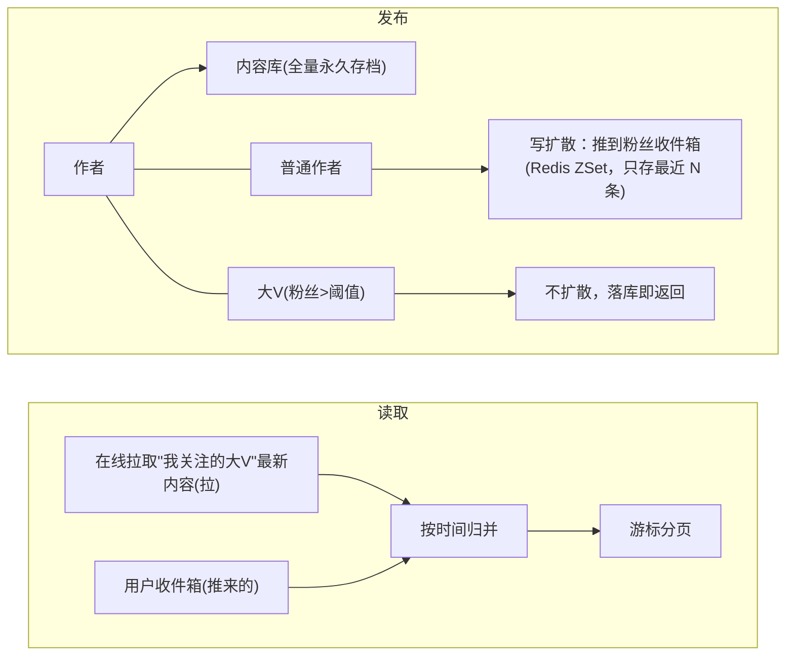
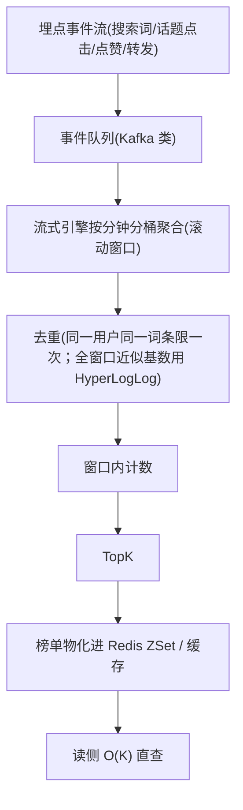

# 场景拆解：Feed 流内容社区
> [返回：软件架构学习大纲](../软件架构学习大纲.md)

> 本篇对应主笔记 [01-第六阶段-实战与案例分析](01-实战与案例分析.md) 的 1.3 Feed 流小节，原小节编号与内部结构保留，在此专项扩写；业务画像与大纲映射见[示例项目场景/08-Feed流内容社区](../示例项目场景/08-Feed流内容社区.md)。

## 1.3 Feed 流

**场景定义**：内容社区首页（微博/Twitter 同构）——“我关注的作者发了什么”按时间/算法排序聚合给每个人。**核心挑战**：① 读写比例极端（100:1 以上：刷 Feed 是读、发帖是写）；② 时效性 vs 存储成本；③ **大 V 问题**（一条内容扇出到上亿收件箱）；④ 排序不止时间序；⑤ 数据量增长后单库放不下。

本节按“生意本质 → 架构推演（含可运行对照）→ 关键设计点 → 热搜专题 → 一致性专题 → 存储判决 → 常见错误”推进。

### 1.3.1 读写比的生意本质：Feed 是一台读放大机器

先把账算清，架构的重心才知道放哪。设一个 DAU 1 亿的内容社区：写侧，人均每天发帖约 0.5 条，全天摊平约 600 QPS、峰值几千 QPS——写是“温”的。读侧，人均每天刷 30 次时间线、每次翻 2~3 页，一天 60~90 亿次读，晚高峰轻松冲到数十万 QPS——读是“烫”的。两者相除，100:1 的读写比只是下限；全屏沉浸式滑动产品（一次滑动就是一屏十条内容）能把比值推到 1000:1。

而且时间线天然是“读放大”场景，放大发生在两级：作者一次发帖是 1 次写，但这条帖子会被 N 个粉丝各自的刷新读到（1 次写 → N 次读）；读者一次刷新也不是读 1 条，而是聚合自己关注的 N 个作者的最新内容（1 次读 → 聚合 N 份）。两级放大相乘，读流量比写流量大两三个数量级是 Feed 的**稳态**而非峰值——这与秒杀（读洪峰是脉冲）和物联网采集（写洪峰是持续）都不同，Feed 的读洪峰**天天都在**，架构必须按日常态而不是活动态设计。

这决定了 Feed 的生意本质：**产品的收入几乎全部挂在“刷”这个动作上**——广告、推荐位、会员，全都来自“停留时长 = 刷新次数 × 每次看到的内容质量”。所以架构必须把“刷”做到无限便宜、流畅、亚秒级；而“发”允许慢：异步扩散晚几秒、审核耽搁片刻，作者毫无感知。读写不对称不是技术现象，是商业现象——读路径的每一毫秒都值得花钱买（多级缓存、预计算），写路径允许用秒级延迟换成本。

工程判据：读写比决定架构重心。读为主的系统做“读路径流水线化 + 多级缓存 + 预计算读模型”；写为主的系统做“写路径削峰 + 批量聚合 + 异步落库”。用错方向的典型反例：给发帖链路堆满缓存优化（写本来就不是瓶颈），却让刷新路径每次实时聚合（把最烫的流量交给最贵的计算）——钱全花错了地方。

### 1.3.2 总体架构：推模式、拉模式与推拉结合

**总体架构**：推模式（写扩散）与拉模式（读扩散）各有死穴，主流是**推拉结合**：



| 方案 | 写成本 | 读成本 | 适合 |
|---|---|---|---|
| 写扩散（推） | O(粉丝数)，大 V 爆炸 | O(1) 收件箱直读 | 普通作者、活跃用户 |
| 读扩散（拉） | O(1) 只落库 | O(关注数) 在线聚合 | 大 V、非活跃用户 |

#### 为什么不是二选一：在线推、离线拉

推拉结合不只在大 V 这一条线上分流，还可以按**粉丝状态**再切一刀：在线推、离线拉（也叫 pull-on-login，登录补拉）。粉丝在线时实时推收件箱——他马上会刷，值得为亚秒级时效付扇出写；粉丝离线时不推——推了也没人读，纯浪费写，等他下次上线那一刻，把错过的内容批量补进收件箱，或首屏直接在线聚合。僵尸粉从不登录，就永远不触发任何扇出写。这把“按粉丝数切”进一步细化为“按在线状态与活跃度切”，中 V 粉丝多但多为僵尸粉的问题（见关键设计点 2）在这里被结构性解决，而不是靠调阈值硬扛。

#### 阈值怎么定：算两笔账

推拉分界的粉丝数阈值 T 不追求精确，因为它由两本粗账夹出来：

- **存储账（推模式的底盘成本）**：收件箱截断最近 4000 条，单条（post_id 8B + score 8B，加 ZSet 节点与哈希表开销）按 100B 取整，单人收件箱约 0.4MB；1 亿用户全部推满约 40TB 内存级存储。这是推模式的地板——成立前提是收件箱**有界**，无界收件箱就是无底洞（见常见错误第 2 条）。
- **写账（分界带来的收益）**：设 T = 1 万粉。低于 T 的作者走推：素人日均 1 帖 × 平均 200 粉 = 每帖 200 次扇出写，便宜到可以忽略；而一个 500 万粉的头部账号日均 5 帖 = 2500 万次扇出写/天，单个账号就能打爆一组 Redis 分片。最顶部那层必须拦在推之外——这是“必须拉”的硬理由。
- **读账（分界付出的代价）**：头部作者改拉后，其粉丝每次刷新要额外聚合“我关注的大 V”的发件箱。人均关注的大 V 约 3~10 个，即每次刷新多 3~10 次 O(1) 点读，P99 约增加 10~30ms——在亚秒级的刷新延迟预算里完全装得下。

三笔账放在一起的结论：**阈值定在 1 万还是 10 万，对成本和体验都影响不大**。决定成本的是“最顶部那批账号有没有漏进推”，决定体验的是“人均关注几个大 V”，两者都离阈值的具体取值很远。真正值得精调的变量是活跃粉丝占比：推给僵尸粉的每一次扇出写都是纯浪费，按活跃度过滤省下的写操作比调阈值多一个量级。

#### 对照模拟：发帖洪峰与一万次刷新，两种模式各付多少

下面把推与拉各实现一遍，在同一份负载下（500 用户、人人关注大 V；大 V 连发 10 帖 + 60 个素人各发 1 帖；每人刷新 20 次）统计两边全程的读写 IO 次数。收件箱按设计截断 2000 条：

```kotlin
// 场景：500 个用户、1 个大 V（用户 1 被全员关注）；普通作者各有少量粉丝。
// 写扩散（推）：发布时扇出到每个粉丝收件箱（有界 2000 条截断），刷新 = 收件箱直读 1 次。
// 读扩散（拉）：发布只落发件箱，刷新 = 逐个关注对象取最新 K 条再在线归并 top-K。
// 统计两种模式在整个负载下的写操作与读操作次数（IO 次数，不含 CPU 归并）。

import kotlin.random.Random

const val USER_COUNT = 500
const val INBOX_CAP = 2000 // 收件箱只留最近 2000 条（真实系统常见值约 4000）
const val PAGE_SIZE = 10
const val REFRESH_PER_USER = 20 // 每个用户模拟期内刷 20 次
const val BIG_V = 1

data class Post(val id: Int, val authorId: Int, val ts: Int)

// ---------- 写扩散（推模式） ----------
class PushFeed {
    val inboxes = HashMap<Int, ArrayDeque<Int>>() // fanId -> postIds（旧在前，新在后）
    var writeOps = 0L
    var readOps = 0L
    var trims = 0L

    fun publish(post: Post, followers: List<Int>) { // 写成本 O(粉丝数)
        for (fan in followers) {
            val q = inboxes.getOrPut(fan) { ArrayDeque() }
            q.addLast(post.id)
            writeOps++ // 每个粉丝收件箱一次写入
            if (q.size > INBOX_CAP) { // 有界截断：挤出最老的一条
                q.removeFirst()
                trims++
                writeOps++ // 截断也是一次写
            }
        }
    }

    fun refresh(userId: Int): List<Int> { // 读成本 O(1)：收件箱直接按序翻页
        readOps++ // 一次 ZREVRANGE
        val q = inboxes[userId] ?: return emptyList()
        return q.toList().takeLast(PAGE_SIZE).reversed()
    }
}

// ---------- 读扩散（拉模式） ----------
class PullFeed {
    val outboxes = HashMap<Int, MutableList<Post>>() // authorId -> posts（按时间升序）
    var writeOps = 0L
    var readOps = 0L

    fun publish(post: Post) { // 写成本 O(1)：只落自己的发件箱
        outboxes.getOrPut(post.authorId) { mutableListOf() }.add(post)
        writeOps++
    }

    fun refresh(userId: Int, followees: List<Int>): List<Int> { // 读成本 O(关注数)
        val merged = ArrayList<Post>()
        for (f in followees) {
            readOps++ // 每个关注对象一次"取最新 K 条"
            val ob = outboxes[f] ?: continue
            merged.addAll(ob.takeLast(PAGE_SIZE))
        }
        return merged.sortedByDescending { it.ts }.take(PAGE_SIZE).map { it.id }
    }
}

fun main() {
    val rnd = Random(42)

    // ---- 建关注关系图：人人关注大 V，再各随机关注 10 个普通用户 ----
    val followeesOf = HashMap<Int, List<Int>>()
    var edges = 0
    for (u in 1..USER_COUNT) {
        val list = ArrayList<Int>()
        if (u != BIG_V) { list.add(BIG_V) }
        while (list.size < 11) {
            val other = rnd.nextInt(1, USER_COUNT + 1)
            if (other != u && other !in list) list.add(other)
        }
        followeesOf[u] = list
        edges += list.size
    }
    val followersOf: Map<Int, List<Int>> =
        followeesOf.entries.flatMap { (fan, fs) -> fs.map { it to fan } }
            .groupBy({ it.first }, { it.second })

    // ---- 负载：大 V 发 10 帖 + 60 个普通用户各发 1 帖；每人刷新 20 次 ----
    val posts = ArrayList<Post>()
    var pid = 0
    var ts = 0
    repeat(10) {
        posts.add(Post(pid++, BIG_V, ts++))
    } // 大 V 连发 10 条
    val normalAuthors = mutableSetOf<Int>()
    while (normalAuthors.size < 60) {
        val a = rnd.nextInt(2, USER_COUNT + 1)
        if (normalAuthors.add(a)) posts.add(Post(pid++, a, ts++))
    }

    // ---- 写扩散模拟 ----
    val push = PushFeed()
    for (p in posts) push.publish(p, followersOf[p.authorId] ?: emptyList())
    val pushRefreshes = USER_COUNT * REFRESH_PER_USER
    repeat(pushRefreshes) { i -> push.refresh(i % USER_COUNT + 1) }

    // ---- 读扩散模拟 ----
    val pull = PullFeed()
    for (p in posts) pull.publish(p)
    var pullReads = 0L
    for (u in 1..USER_COUNT) {
        val fs = followeesOf[u]!!
        repeat(REFRESH_PER_USER) {
            val page = pull.refresh(u, fs)
            check(page.size <= PAGE_SIZE)
            pullReads += fs.size // 与 refresh 内部计数一致，仅用于核对
        }
    }

    val totalPushWrites = push.writeOps
    val totalPushReads = push.readOps
    println("== 负载画像 ==")
    println("用户 ${USER_COUNT} 人，关注边 $edges 条（人人关注大 V + 各随机关注 10 人）")
    println("发帖 ${posts.size} 条（大 V 10 条 + 普通作者 ${normalAuthors.size} 条）；每人刷新 $REFRESH_PER_USER 次，共 $pushRefreshes 次刷新")
    println()
    println("== 写扩散（推模式）==")
    println("写操作：$totalPushWrites 次（扇出 ${posts.size} 帖 × 各自粉丝数；其中截断写 ${push.trims} 次——演示负载未触及 $INBOX_CAP 条上限）")
    println("  其中大 V 的 10 帖贡献 ${followersOf[BIG_V]!!.size * 10} 次写（占总写量 ${followersOf[BIG_V]!!.size * 10 * 100 / totalPushWrites}%）")
    println("读操作：$totalPushReads 次（每次刷新 1 次收件箱直读）")
    println()
    println("== 读扩散（拉模式）==")
    println("写操作：${pull.writeOps} 次（只落发件箱，一帖一次）")
    println("读操作：${pull.readOps} 次（每次刷新遍历约 10~11 个关注对象）")
    check(pullReads == pull.readOps)
    println()
    val totalW = totalPushWrites + totalPushReads
    val totalR = pull.writeOps + pull.readOps
    println("== 对照结论 ==")
    println("同一负载总 IO：写扩散 $totalW 次 vs 读扩散 $totalR 次")
    println("写扩散把成本压在写侧（发帖时一次性扇出，刷新始终便宜）；")
    println("读扩散把成本压在读侧（发帖始终便宜，刷新随关注数线性增长）。")
    println("抽样校验：用户 100 推模式首页 top3 = ${push.refresh(100).take(3)}，拉模式首页 top3 = ${pull.refresh(100, followeesOf[100]!!).take(3)}")
}```

实际运行输出（kotlinc 2.2.20 编译，JRE 21）：

```
== 负载画像 ==
用户 500 人，关注边 5500 条（人人关注大 V + 各随机关注 10 人）
发帖 70 条（大 V 10 条 + 普通作者 60 条）；每人刷新 20 次，共 10000 次刷新

== 写扩散（推模式）==
写操作：5633 次（扇出 70 帖 × 各自粉丝数；其中截断写 0 次——演示负载未触及 2000 条上限）
  其中大 V 的 10 帖贡献 4990 次写（占总写量 88%）
读操作：10000 次（每次刷新 1 次收件箱直读）

== 读扩散（拉模式）==
写操作：70 次（只落发件箱，一帖一次）
读操作：110000 次（每次刷新遍历约 10~11 个关注对象）

== 对照结论 ==
同一负载总 IO：写扩散 15633 次 vs 读扩散 110070 次
写扩散把成本压在写侧（发帖时一次性扇出，刷新始终便宜）；
读扩散把成本压在读侧（发帖始终便宜，刷新随关注数线性增长）。
抽样校验：用户 100 推模式首页 top3 = [31, 10, 9]，拉模式首页 top3 = [31, 10, 9]
```

对照读法，四个要点：

1. **写侧成本几乎全砸在头部**：5633 次扇出写里，大 V 的 10 帖独占 4990 次（88%）。粉丝分布是幂律的，写扩散的成本就按幂律砸向头部——粉丝数越不平等，推模式越亏，这就是“大 V 问题”的定量形态。真实规模下（百万粉 × 直播连发）这个比例只会更极端。
2. **读侧成本随读写比爆炸**：读扩散 110000 次读操作，是写扩散（10000 次）的 11 倍——倍数恰好约等于人均关注数（11）。刷新越频繁（读写比越高）这个倍数越致命：把刷新密度再放大 10 倍、接近真实产品的 100:1，读扩散的读操作就到百万级，而写扩散的读只随刷新次数线性走。
3. **结果语义完全一致**：两种模式对同一用户返回相同的首页 top3（`[31, 10, 9]`）——推与拉改变的只是成本落在哪一侧、由谁在什么时候支付，不改变“我的时间线”这个结果本身。这正是推拉结合在语义上安全的原因：两者可以按作者、按用户混用，用户无感。
4. **截断是写上限的保险丝**：演示负载没触发 2000 条截断（截断写 0 次），但代码路径必须一直在——它保证任何单个收件箱的扇出写入有硬上限，“写扩散成本爆炸”才被封顶在 O(粉丝数 × 4000) 而不是无界。

边界结论：**读写比是天平**。读放大越极端越往推偏——把成本锁成写侧一次性支付，用“这条帖子会被读一辈子”去摊销；写越集中（大 V 连发、直播连贴）越往拉偏——把爆炸留在事件侧，读时再摊。推拉结合的本质是让两类作者各付各的账。

### 1.3.3 关键设计点（逐条权衡）

**关键设计点**：

1. **收件箱只是索引不是存储**：截断最近约 4000 条，翻更早的页回内容库按关注关系拉——存储成本与读延迟的折中。
2. **推拉边界动态化**：静态按粉丝数切仍有坑（中 V 粉丝多但多为僵尸粉），应只推“近期活跃”粉丝（活跃度靠离线画像）。
3. **游标分页**：offset 深翻页性能崩且数据漂移；游标带 `(score, id)` 双字段避免同分抖动。
4. **删除/编辑一致性**：不做物理扇出删除，逻辑删除标记 + 读取时过滤。
5. **发布与扩散解耦**：先落内容库（成功即成功），扩散异步、失败可重放——核心链路最短化（第二阶段）。
6. **分库分表按用户 ID 路由**：收件箱与关注关系按 `user_id` 分片——最高频查询是“刷我的收件箱”，路由键随它选（第三阶段：分片键一旦定了极难改，扩容走翻倍迁移）；内容库按 `post_id` 分片，另建作者维度冗余索引。
7. **热搜是流式计算**：点赞/转发/搜索词是持续事件流 → 流式引擎滚动窗口聚合 + HyperLogLog/布隆过滤器去重，榜单结果落缓存供读。特征是“算的是数据流，不是请求流”（第二阶段：管道-过滤器）。
8. **审核与推荐管道**：发布先异步过机审再进扩散；推荐内容在读取管道中插入——发布→审核→扩散→读取，每段可替换、可加节点（管道模式的自然演示）。

**片段**（示意 API，未编译运行；可运行的缩比对照版见 1.3.2）：

```kotlin
suspend fun publish(post: Post) {
    postStore.save(post)                              // 第一步永远是落内容库
    if (userRepo.find(post.authorId).followerCount > BIG_V) return  // 大V不扩散
    fanService.activeFollowers(post.authorId)         // 只推活跃粉丝，省扇出写入
        .forEach { fanId -> redis.zAddTrim("feed:inbox:$fanId", post.publishAt, post.id, 4000) }
}

suspend fun readFeed(userId: Long, cursor: Cursor?): List<Post> {
    val pushed = redis.zRevRange("feed:inbox:$userId", cursor, limit = pageSize)
    val bigV = postStore.latest(followService.followingBigVs(userId), before = cursor)
    return mergeByTimeDesc(pushed, bigV).take(pageSize)  // 推 + 拉 在线归并
}
```

两点补注：第 1 条与第 2 条是同一枚硬币的两面——收件箱有界（4000 条）控制的是“每人存储上限”，只推活跃粉丝控制的是“每帖扇出广度”，两者合起来才把推模式的成本封顶成 O(活跃粉丝数 × 4000)。第 5 条的重放语义值得展开：扩散消息消费失败不能丢也不能堵发布链路，重放靠“按 post_id 幂等”保证重复投递不产生重复收件箱条目（第三阶段幂等的直接应用）。

### 1.3.4 热搜：滑动窗口 TopK、防刷与时间衰减

关键设计点第 7 条说“热搜是流式计算”，这一小节把整条计算路径拆开。

#### 计算路径：为什么不能每次请求实时聚合

最直觉的实现是每次打开热搜页就按全量事件日志 `GROUP BY` 求 Top——反例：热搜页是全员高频页（QPS 与 Feed 首页同量级），每次请求都扫日志聚合，读流量越大计算越贵，延迟秒级起步。正确做法是把计算从读侧搬到事件侧：



特征是“算的是数据流，不是请求流”：榜单是预计算的物化结果，读请求永远不触发统计。这对一切“榜单类”需求通用——热搜、畅销榜、热门工单类型、MES 设备告警 TopN，全是同一个形状。

#### 可运行模拟：滑动窗口计数 + 去重 + TopK + 时间衰减

```kotlin
// 热搜榜：滑动窗口计数 → TopK，附时间去重（防刷）与时间衰减。
// 思想原型：Redis ZSet（member=词条，score=热度）；窗口按分钟分桶（真实系统由流式引擎的滚动窗口完成）。
// 本模拟演示三件事：
//   1) 只统计最近 WINDOW_MINUTES 分钟的窗口计数（旧话题自然出榜）；
//   2) 同一用户对同一词条的反复上报在计数层去重（刷量失效）；
//   3) 衰减热度 score = Σ count(t) × exp(-(now-t)/τ)：刚爆的词条压过一小时前的旧爆点。

import kotlin.math.exp

const val WINDOW_MINUTES = 60 // 统计最近 60 分钟
const val TOP_K = 5
const val TAU = 20.0 // 衰减时间常数：20 分钟前的一次上报只算 exp(-1) ≈ 0.37 次

data class Entry(val topic: String, val rawCount: Long, val decayedScore: Double)

class HotSearch {
    // topic -> 窗口内每分钟一桶的计数（环形：index = minute % WINDOW_MINUTES）
    private val buckets = HashMap<String, LongArray>()
    // topic -> 每分钟一桶的"本分钟去重用户集"（真实系统用 HyperLogLog/布隆近似，这里用 Set 精确演示）
    private val seenUsers = HashMap<String, Array<HashSet<Int>>>()

    fun count(topic: String, userId: Int, minute: Int) {
        val slot = minute % WINDOW_MINUTES
        val bs = buckets.getOrPut(topic) { LongArray(WINDOW_MINUTES) }
        val su = seenUsers.getOrPut(topic) { Array(WINDOW_MINUTES) { HashSet() } }
        if (!su[slot].add(userId)) return // 同一用户同一分钟反复上报只计一次
        bs[slot]++
    }

    /** 换"分钟"时清掉被挤出窗口的那一桶 */
    fun tick(minute: Int) {
        val stale = (minute - WINDOW_MINUTES + WINDOW_MINUTES) % WINDOW_MINUTES
        for (bs in buckets.values) bs[stale] = 0
        for (su in seenUsers.values) su[stale] = HashSet()
    }

    fun snapshot(now: Int): List<Entry> = buckets.map { (topic, bs) ->
        var raw = 0L
        var decayed = 0.0
        for (m in 0 until WINDOW_MINUTES) {
            val c = bs[m]
            if (c == 0L) continue
            raw += c
            val age = now - m // 该桶距现在的分钟数（环内必然 0..WINDOW_MINUTES-1）
            decayed += c * exp(-age / TAU)
        }
        Entry(topic, raw, decayed)
    }
}

fun main() {
    val hs = HotSearch()
    val reports = HashMap<String, Long>() // 每个词条的真实上报次数（含被去重的部分）

    fun burst(topic: String, minute: Int, eventsPerMin: Int, distinctUsers: Int) {
        repeat(eventsPerMin) { i ->
            hs.count(topic, i % distinctUsers, minute) // 刷量词条 distinctUsers=1：全是同一用户
            reports[topic] = (reports[topic] ?: 0L) + 1
        }
    }

    // 时间线 0..119 分钟：
    //  A"旧爆点"：第 60~89 分钟每分钟 200 次上报（50 个真实用户轮转）
    //  B"长尾话题"：全程每分钟 30 次上报（30 个用户）
    //  C"新爆点"：第 100~119 分钟每分钟 400 次上报（80 个用户）
    //  D"刷量词条"：第 100~119 分钟每分钟 5000 次上报，但全部来自同一个用户
    for (m in 0..119) {
        hs.tick(m)
        if (m in 60..89) burst("旧爆点A", m, 200, 50)
        burst("长尾B", m, 30, 30)
        if (m in 100..119) {
            burst("新爆点C", m, 400, 80)
            burst("刷量D", m, 5000, 1)
        }
    }

    val now = 119
    val byRaw = hs.snapshot(now).sortedByDescending { it.rawCount }
    val byDecay = hs.snapshot(now).sortedByDescending { it.decayedScore }

    println("== 窗口原始计数榜（只看 60 分钟内的上报总量）==")
    byRaw.take(TOP_K).forEachIndexed { i, e ->
        println("${i + 1}. ${e.topic}：原始计数 ${e.rawCount}")
    }
    println()
    println("== 衰减热度榜（score = Σ count × exp(-Δt/τ)，τ = ${TAU.toInt()} 分钟）==")
    byDecay.take(TOP_K).forEachIndexed { i, e ->
        println("${i + 1}. ${e.topic}：衰减热度 ${"%.1f".format(e.decayedScore)}")
    }
    println()
    val d = hs.snapshot(now).first { it.topic == "刷量D" }
    println("== 防刷与衰减的两个效果 ==")
    println("刷量D 真实上报 ${reports["刷量D"]} 次，同一用户反复上报被去重后窗口计数仅 ${d.rawCount}，未进任何榜单")
    for (t in listOf("长尾B", "新爆点C", "旧爆点A")) {
        val rawRank = byRaw.indexOfFirst { it.topic == t } + 1
        val decayRank = byDecay.indexOfFirst { it.topic == t } + 1
        val e = hs.snapshot(now).first { it.topic == t }
        println("$t：原始计数 ${e.rawCount}（原始榜第 $rawRank 名）→ 衰减热度 ${"%.1f".format(e.decayedScore)}（衰减榜第 $decayRank 名）")
    }
    println("衰减让刚爆发的新爆点C 反超仍在窗口内的长尾B，也把一小时前的旧爆点A 压到只剩零头——榜单反映"此刻的 hot"，不是"过去 60 分钟的总量"")
}```

实际运行输出（kotlinc 2.2.20 编译，JRE 21）：

```
== 窗口原始计数榜（只看 60 分钟内的上报总量）==
1. 长尾B：原始计数 1800
2. 新爆点C：原始计数 1600
3. 旧爆点A：原始计数 1500
4. 刷量D：原始计数 20

== 衰减热度榜（score = Σ count × exp(-Δt/τ)，τ = 20 分钟）==
1. 新爆点C：衰减热度 51.6
2. 长尾B：衰减热度 29.1
3. 旧爆点A：衰减热度 8.8
4. 刷量D：衰减热度 0.6

== 防刷与衰减的两个效果 ==
刷量D 真实上报 100000 次，同一用户反复上报被去重后窗口计数仅 20，未进任何榜单
长尾B：原始计数 1800（原始榜第 1 名）→ 衰减热度 29.1（衰减榜第 2 名）
新爆点C：原始计数 1600（原始榜第 2 名）→ 衰减热度 51.6（衰减榜第 1 名）
旧爆点A：原始计数 1500（原始榜第 3 名）→ 衰减热度 8.8（衰减榜第 3 名）
衰减让刚爆发的新爆点C 反超仍在窗口内的长尾B，也把一小时前的旧爆点A 压到只剩零头——榜单反映"此刻的 hot"，不是"过去 60 分钟的总量"
```

解读三件事：

1. **去重让刷量失效**：词条 D 上报了 100000 次，计数层只收 20——同一用户同一分钟对同一词条只计一次。这是计数环节最便宜也最无争议的防线；没有这一层，榜单就是价目表，谁刷得多谁上榜。
2. **衰减让“新”压过“多”**：衰减公式 **score = count × exp(-Δt/τ)**，Δt 是上报距现在的时长，τ 是“记忆时长”——τ = 20 分钟意味着 20 分钟前的一次上报只值 exp(-1) ≈ 0.37 次，一小时前只值 0.05 次。输出里名次发生了翻转：原始计数榜上长尾 B 第一（1800，一小时匀速攒出来的），衰减榜被刚爆发的新爆点 C 反超（51.6 vs 29.1）；一小时前的旧爆点 A 原始计数还挂着 1500 的零头，衰减后只剩 8.8。用户对热搜的期待是“此刻什么火”，不是“过去 60 分钟总量谁大”——这就是榜单必须有衰减或滑动窗口、不能只累计总量的理由。工业实现常见的等价离散形式：每分钟把榜单分数统一乘一个小于 1 的衰减因子；Hacker News 的重力公式是它的简化版。
3. **τ 是产品参数不是技术参数**：τ 越小榜单越“情绪化”（追热点、起落快），越大越“迟钝”（稳但钝）。调 τ 是产品决策，架构的责任只是让 τ 可配置、改了能灰度生效。

#### 防刷与降权

去重之上还有两层对抗：

- **机器行为识别（计数前拦截）**：刷量流量自带行为特征——上报频率规律如钟表、无阅读行为（搜索即上报、零点击零停留）、设备指纹与 IP 高度聚集、账号注册时间集中。风控引擎在事件进入计数管道前拦截或打标降权；计数层去重只是最后一道便宜保险，真正的对抗在前置风控。
- **人工权重干预（出榜后调整）**：热搜榜从来不是纯算法产物。运营可以给词条乘人工系数（权重 0~10，违规直接置 0 下榜），时政类加权、娱乐八卦降权、营销话题打压——产品意志与算法混合。架构上体现为 TopK 之后的一道“重排过滤器”（管道模式又一段），榜单缓存里存的已是过滤后的结果。

判据：三道关卡各管一段，别把一种手段塞进三层——计数去重必须做（便宜、无争议）；行为风控在计数前做（专业团队、有误伤率要监控）；人工干预在出榜后做（灵活、留操作审计）。

### 1.3.5 新旧内容一致性：删帖、置顶与插卡

推模式把帖子 ID 复制进几亿个收件箱的那一刻，一致性问题就诞生了：原帖一变，所有副本都是脏数据。高频的三件事：删帖、置顶、插卡。

#### 删帖：收件箱里的脏数据

两个方案：

- **方案 A：软删 + 读取时过滤**。帖子表打 `deleted` 标记，物理上先进回收站（30 天可恢复）；读时间线时对页内 ID 批量点读内容库，过滤已删的。写侧零成本，删帖对一切时间线即时生效（下一页的批量点读就看不到它）；代价是每页多一次批量点读（约 10ms 级），且死 ID 继续占收件箱坑位，翻页偶发“这一页比页大小少一条”。
- **方案 B：主动 fan-out 清理**。删帖时向所有粉丝收件箱 DEL。彻底干净，但写成本 O(粉丝数)：素人删帖几百次 DEL 无所谓；大 V 删帖是上亿次 DEL，只能进异步队列慢慢清，清理完成前靠方案 A 兜底。收件箱本身有 4000 条截断，清不干净的部分最终会被新帖自然冲刷掉。

| 场景 | 时效要求 | 处理方式 |
|---|---|---|
| 用户自主删帖 | 分钟级可容忍 | 软删 + 读时过滤；收件箱不做 fan-out，靠截断自然冲刷 |
| 违规/司法要求删除 | 秒级彻底消失 | 软删立即生效（读时过滤即刻不可见）+ 异步 fan-out 物理清理收件箱 |
| 编辑改内容 | 要看到新内容 | 读时过滤不适用——收件箱只存 post_id，正文永远点读内容库，天然一致 |

判据藏在第三行里：**收件箱只存 ID、不存正文快照**。这一条让“编辑后时间线还显示旧内容”这类脏读在架构上不可能发生；剩下的脏读只剩“该消失的还没消失”一种，用读时过滤（即时生效）+ 异步清理（最终干净）分层解决。反例是收件箱存正文快照：省了一次点读，换来编辑同步的全部复杂度——用读侧一点便宜换来写侧一致性灾难，方向恰好做反。

#### 置顶与插卡：位置语义

真实的时间线不是“按时间排序的流”，而是“排序结果 + 位置注入”。三类注入，位置语义各不相同：

- **主页置顶**：用户 profile 时间线第 0 位，用户自己管理；只影响个人主页，不进关注流；
- **运营插卡**：活动卡、公告、广告，注入固定槽位（如第 4、14 位）；
- **推荐插入**：非关注内容混进关注流，带“推荐”标注（增长团队用关注流的富余注意力变现）。

实现落在读取管道末端的**重排**阶段：merge(organic, pinned, cards) 按槽位语义落位。两个工程细节：

1. **插卡需要“已曝光去重”**：同一个人不该反复看到同一张卡。曝光记录（KV 或布隆过滤器，容忍少量漏记、不能多记）在重排时过滤。
2. **注入内容不进游标**：翻页游标锚定在 organic 内容的 `(score, id)` 上（这正是关键设计点 3 要双字段的原因之一）；插卡按槽位规则注入、通常只在首屏。如果注入内容参与游标排序，翻页会漂移、卡片会重复出现——游标必须锚定在确定性排序键上，位置注入是排序之后的“修饰”，两者正交。

### 1.3.6 存储选型判决

四类核心数据，四个引擎。选型的统一逻辑是**按访问模式选存储，不按数据长得像什么选**：

| 数据 | 访问模式 | 选型 | 理由 |
|---|---|---|---|
| 收件箱（粉丝时间线索引） | 按 user_id 读最近 N 条、时间倒序、有界截断、亚毫秒 | Redis ZSet | 有界的纯 ID 索引，内存可控；按 score 排序、O(log N) 插入与截断，与“刷最新一页”完全同构 |
| 发件箱（作者帖子索引） | 按 author_id 查最新 K 条（拉模式聚合用） | 热作者 ZSet + 全量 KV/二级索引 | 头部作者读多写少、是拉模式的热点，要快；长尾作者走普通存储省成本 |
| 关注关系 | 给 user 查 following/followers、双向、判重 | 关系库主存 + Redis 集合缓存，按 user_id 分片 | 关注/取关要事务性不丢；高频点读靠缓存；与收件箱同路由键，“刷收件箱 + 查关注”不跨片 |
| 帖子内容 | 按 post_id 点读、全量永久、大字段 | 分库分表关系库或文档库，媒体走对象存储 | 主键点读、容量线性增长；内容与索引分离 |

两条注释。其一，收件箱/发件箱本质是**读模型**——第二阶段 CQRS 的思想：时间线是预计算好的物化视图，不是每次查询现场算出来的。其二，“索引可重建、内容不可丢”决定了两者的可靠性等级可以不同：收件箱丢了可以按关注关系回放内容库重建（读扩散天然是它的兜底），帖子库丢了才是真正的事故。

### 1.3.7 常见错误与修正

**常见错误**：

- ❌ 全量写扩散不分大 V：一条内容扇出上亿写，缓存集群被打爆。
  ✅ 大 V 走拉，读时合并。
- ❌ 收件箱无限增长。
  ✅ 截断 + 内容库兜底。
- ❌ offset 深分页。
  ✅ 游标分页。
- ❌ 热搜榜每次请求实时聚合全量事件。
  ✅ 流式增量计算，榜单物化进缓存，读侧 O(K) 直查。
- ❌ 收件箱存正文快照，省一次点读。
  ✅ 只存 post_id，正文永远点读内容库——编辑/删除一致性免费获得。

**回指**：[第三阶段](../03-第三阶段/01-分布式系统核心技术.md)（缓存、分库分表与用户路由、热点）、[第二阶段](../02-第二阶段/01-经典架构模式.md)（事件扇出、读写分离/CQRS、管道-过滤器）。

**延伸回指**：多级缓存与 Redis 数据结构的体系化讨论见[第三章·数据架构](../03-第三阶段/04-数据架构-缓存分库与选型.md)；读模型与 CQRS 见[第二章·经典架构模式](../02-第二阶段/01-经典架构模式.md)；事件扇出的投递语义、失败重放与幂等消费见[第二章·事件驱动架构](../02-第二阶段/04-事件驱动架构.md)；“最终一致的表现形式与用户预期”见[第三章·分布式理论基础](../03-第三阶段/02-分布式理论基础-CAP共识与一致性.md)；本节在主笔记中的位置与相邻场景对照（Feed 读洪峰 vs 物联网写洪峰）见[01-第六阶段-实战与案例分析](01-实战与案例分析.md)。

**【本节自测】**（只出题不作答；作答后按批改流程逐题点评并记入章节答案档案）

1. （主笔记“本节自测”原题）Feed 推拉边界若按粉丝数静态划分会有什么问题？给出动态化思路。
2. 概念辨析：“系统读写比 100:1，所以应该选写扩散”——这句话错在哪？什么条件下读扩散反而是对的？
3. 算账题：收件箱截断 4000 条、单条按 100B 计，1 亿用户全量推满需要多少内存级存储？若只推“最近 7 天活跃用户”（占比 20%），省下多少？这笔账支持还是反对“收件箱有界”这个设计？
4. 方案设计：合规要求某违规帖“3 秒内从所有时间线消失”。在推拉结合架构下写出处置序列（软删、读时过滤、fan-out 清理各在什么时刻触发、由谁执行），并指出哪个环节是即时生效的关键。
5. 迁移应用：把热搜的“滑动窗口计数 + 去重 + 时间衰减”三件套映射到你的 MES 设备告警场景（如“故障类型 TopN”）：哪几件要保留、哪几件可以不要？理由是什么？

## 替换清单

- “1.3.2 总体架构：推模式、拉模式与推拉结合”推拉结合总体架构 → `flowchart`（发布 / 读取两个子图）
- “1.3.4 热搜：滑动窗口 TopK、防刷与时间衰减”计算路径：把计算从读侧搬到事件侧 → `flowchart`
