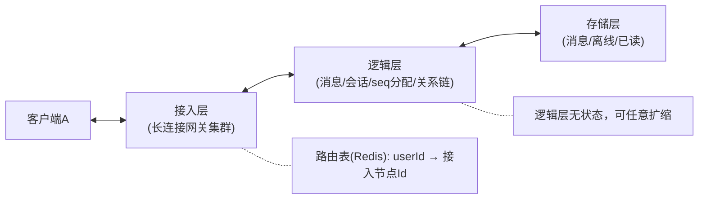

# 场景拆解：即时通讯（IM）
> [返回：软件架构学习大纲](../软件架构学习大纲.md)

> 本篇对应主笔记 [01-第六阶段-实战与案例分析](01-实战与案例分析.md) 的 1.4 IM 小节，原小节编号与内部结构保留，在此专项扩写；业务画像与大纲映射见[示例项目场景/06-即时通讯IM](../示例项目场景/06-即时通讯IM.md)。

## 1.4 IM（即时通讯）

**场景定义**：聊天 App 的单聊/群聊消息系统，难点全在“连接”与“可靠投递”。**核心挑战**：① 海量长连接的接入与路由（用户连在哪台机器）；② 可靠投递：不丢、不重、**会话内有序**；③ 离线消息与多端同步；④ 接入节点伸缩/发布时的连接迁移。

把六个场景摆在一起看，IM 的独特性一目了然：秒杀的敌人是“量”，流量过去系统就回到日常；Feed 的敌人是“读放大”，加缓存就能缓解；支付的敌人是“错账”，靠状态机与对账兜住。IM 的敌人却是三条**常态**而非异常：**连接是有状态的**（每条长连接占着一份文件描述符与内存，断掉重连的代价远高于一次 HTTP 请求）；**对端随时不在线**（你发消息的时刻，对方大概率没在盯屏幕，投递天然分成“在线推”与“离线拉”两段）；**网络必丢**（弱网、NAT 超时、基站切换、进程被杀，丢消息不是小概率事件，而是每天发生亿万次的地心引力）。所以 IM 架构的主线不是“防住异常”，而是**把异常路径设计成正常路径**：重发、去重、补拉不是事故后的兜底方案，它们就是协议本身。

### 1.4.1 场景的本质：不可靠信道上做可靠传输的公理

一条消息从 A 的手指到 B 的眼睛，完整旅程有五段：A 客户端 → A 接入层 → 逻辑层 → B 接入层 → B 客户端。这五段里任何一段都可能失败——而且注意，失败是双向的：请求可能没到达，**到达之后的响应（ACK）也可能没回来**。发送方无法区分“对方没收到”和“对方收到了但 ACK 丢了”，这两种情况的表象完全相同：超时无响应。

由此得出本节所有设计共享的一条公理：**在不可靠信道上，“恰好一次”的传输协议不存在；存在的只有“至少一次的重发”加“接收方的幂等去重”，两者叠加在业务效果上等效于恰好一次。**这个结论与消息队列的消费语义同源（[第二章·事件驱动架构](../02-第二阶段/04-事件驱动架构.md)）：MQ 的“至少一次投递 + 消费端幂等”与 IM 的“重发 + 去重”是同一个定理在两个场景的投影。反过来说，任何试图“保证只发一次”的设计——比如发送方等所有环节层层确认后才算成功——都会把可用性拖垮：一个 ACK 丢失就能让消息永远停在“发送中”，而用户重试又制造出重复消息。

工程判据：审查任何投递协议，先问三个问题——**重发带的是不是同一个 ID？去重判的是哪个字段？ACK 丢失时系统走哪条路径？**三个答案齐了，协议的可靠性边界就清楚了。1.4.4 的可运行示例会把这三个问题演示成一条完整闭环。

### 1.4.2 总体架构与长连接网关的职责边界

**总体架构**：



**关键设计点**：（原六条编号保留，逐条深化于 1.4.2~1.4.6）

1. **接入层与逻辑层分离**：接入层只管连接与转发，连接信息进路由表，节点宕机后重连任意节点即可恢复；逻辑层无状态可水平扩（第二阶段分层）——这也是第五阶段滚动发布的前提。

这一条是整个架构的地基，值得把“接入层只管连接与转发”展开成一张职责边界清单。

**接入层该管的五件事**：

1. **连接保活**：TCP/TLS 握手、协议帧编解码、心跳收发与超时断连；
2. **鉴权卸载**：连接建立时验证一次 token，之后每条帧只带连接 ID，不必每条消息都过完整认证（API 网关“认证卸载”思想的长连接版）；
3. **上行转发**：把客户端字节流解成消息对象，转交逻辑层（通常经 MQ 或 RPC）；
4. **下行推送**：从逻辑层收到“某 userId 有新消息”后，把字节写进本机对应 socket；
5. **连接元数据维护**：本机连接数、每条连接的 userId 与设备类型、路由表的注册与注销。

**接入层的禁区**：不解析消息内容（不做敏感词、不做富文本）、不写消息库、不算已读、不参与任何业务规则。一句话：**接入层认识“字节”和“连接”，不认识“消息”和“业务”。**

为什么边界要划得这么死？三条理由，每条都对应一类真实事故：

1. **发布节奏差异**。接入层的连接协议一年难改一次，业务逻辑每周都在变。混在一起的结果是：改一行活动文案也要重启网关——而重启网关意味着百万条长连接集体断开、集体重连，重连风暴本身就是一个全量流量脉冲，还伴随路由表的整表重写。职责分离后，业务层滚动发布对连接零影响；网关自身的发布也用连接排空处理：实例下线前先停掉新连接接入、通知客户端迁移到其他节点，存量连接平滑搬走，而不是硬切断（[第五章·部署与发布策略](../05-第五阶段/03-部署与发布策略-CICD与灰度.md)的滚动发布在长连接场景的落法）。
2. **故障隔离**。连接是最贵的资源：一条连接一份 fd、一份会话内存，重建要走完整握手与鉴权，用户感知是“掉线”。业务代码的内存泄漏、CPU 打满都不应殃及连接层。反例：某团队把“节日横幅下发”逻辑写进网关，横幅配置拉取的内存泄漏最终把网关进程拖到 OOM——事故面是全站掉线，而不是一个活动页。故障半径被业务代码放大到了基础设施级别。
3. **资源模型不同**。接入层是 IO 密集：单机目标是撑十万级连接，讲究事件循环、协程、直接内存、零拷贝；业务层是 CPU 密集：讲究线程池、缓存、序列化。混部署时无论按哪种模型配机器，另一半资源都在浪费。

职责边界的红利是可复用：桶装水商城的“配送即将到达”提醒、工单中心的“工单超时预警”，接的都是同一个接入层——网关不认识“水”和“工单”，它只认识连接，所以谁都能来用。**工程判据：接入层的发版频率应该是全公司最低的组件之一；如果网关每周都在发版，说明业务逻辑漏进来了，要尽快把漏进来的部分搬出去。**

**连接路由表：userId → 网关实例怎么维护**

路由表回答“用户现在连在哪台网关”，它有写、读、失效三条路径，每条都有坑：

- **写路径（注册）**：连接鉴权通过后，网关把 `userId → gatewayId` 写进路由表（Redis 按 userId 分片）；多端在线时 key 带设备维度（`userId:ios`、`userId:pc`），一个用户同时有多条注册。注销发生在连接关闭时——但**注销是靠不住的**：进程被杀、基站切换、用户直接拔网线，都来不及发注销。所以每条注册必须带 TTL、靠心跳续期，“主动注销 + TTL 过期”双保险。宁可短暂残留（推给已死连接，推送失败转重试或离线），不可提前消失（在线的人收不到推送，退化为纯拉取，延迟劣化但不丢——两种错误的代价不对称，选便宜的那种）。
- **读路径（查询）**：逻辑层投递前查表。这里有个方向性选择：为什么用“发消息时查表”而不是“连接变化时全网广播”？广播的通信量是 O(连接事件数 × 网关实例数)，十万级在线、每次上下线都广播，内网带宽先崩；查表的通信量是 O(投递次数)，且 Redis 单次查询亚毫秒。**查表是“用时付费”，广播是“人人纳税”**——几乎所有“状态通知”类设计里，查/拉模式都赢在总量上。
- **失效与不一致**：路由表一定会有短暂错误（刚注销没来得及删、TTL 还没过期人已断网）。正确的态度是**把路由表当缓存，而不是当真相**：真相是“消息已落库”，路由表只优化“在线推送”这条快路径；推失败或推错机器，走重试或离线拉取兜底，消息不丢。**判据：路由表可以错，消息不能丢——可靠性永远不押在路由表上。**

少数必须广播的场景（全员系统公告、强制踢下线）：目标不是“每个用户”而是“每台网关实例”——实例数是几十个，逐个下发，实例自己遍历本地连接；千万不要实现成“向百万用户逐个广播”。

### 1.4.3 消息 ID 与顺序：排序用 seq、去重用 msgId 的双 ID 设计

2. **消息双 ID**：客户端 `clientMsgId`（UUID）做发送方去重（幂等）；服务端按**会话维度**分配严格递增 `seq`。❌ 全局唯一 ID 或时间戳保序：全局有序 ≠ 会话有序，时钟漂移不可用。

4. **丢消息检测**：收到 seq=101 而上一条是 99 → 主动拉取 100。seq 连续性是免费的完整性校验。

这两条合起来是一个设计决策：**排序和去重是两个正交的问题，用两个 ID 分别解决。**

- **排序**要回答“谁先谁后”，需要一个**通信双方都认账**的先后标准。客户端时间戳不行：两部手机时钟差 3 秒很常见，NTP 校准还有回拨——“物理时钟不能作为顺序依据”是分布式系统的通用教训（[第三章·分布式理论基础](../03-第三阶段/02-分布式理论基础-CAP共识与一致性.md)）；全局唯一 ID（雪花类）只保证不冲突与趋势递增，**趋势递增 ≠ 严格递增**：两个发号节点完全可能给相邻两条消息发出 1002、1001。唯一可靠的顺序来源是**一个会话一个发号者**：服务端逻辑层按会话分配严格递增 seq，会话内先后由发号顺序唯一决定。
- **去重**要回答“这是不是同一条消息”，要求**每条消息一生只有一个身份证，且重发时身份证不变**。这个身份证就是客户端生成的 `clientMsgId`（UUID）：发送方本地消息表靠它索引重发状态，接收方靠它判重。注意为什么不能用服务端 seq 做去重主键——第一次到达时服务端要判断“这条我收过没有”，此刻 seq 还没分配（判重通过才发号），逻辑上先有 msgId 判重、后有 seq 分配，两者先后不可颠倒。

三种主流发号方案对比：

| 方案 | 做法 | 排序效果 | 代价与风险 | 适用场景 |
|---|---|---|---|---|
| 服务端会话内 seq + 号段模式 | 逻辑层按会话从号段服务批量取号（一次取一千个），内存中快速发号 | 会话内严格递增，可检测空洞 | 号段节点故障时残号作废（留下暂时空洞）；会话级发号是潜在热点 | 中大型 IM 的标准做法 |
| 客户端 UUID + 服务端去重 | 只保证不重，不排序，端上按本地时间展示 | 无统一顺序，可乱序 | 实现最简；乱序、丢消息无从检测 | 弱顺序场景：弹幕、房间闲聊、“正在输入”提示 |
| 雪花 ID 当 seq 用 | 全局趋势递增 ID 直接排序 | 跨发号节点会乱序，只“近似有序” | 无集中发号依赖；但会话内严格性无法保证 | 雪花适合做全局 msgId，不适合单独承担会话序 |

工程上的正解是**双 ID 并用、各司其职**：`msgId`（客户端 UUID）管去重与重发幂等，`seq`（服务端会话内分配）管排序与完整性校验。设计点 4 的“丢消息检测”就是 seq 的第二重价值：接收方发现 seq 从 99 跳到 101，不用任何额外协议就知道 100 没到——**连续性校验是严格递增 seq 免费附赠的能力**，这是客户端 UUID 方案永远买不到的。

号段模式的两个细节值得注意：

1. **为什么批量取号**：每条消息都向号段服务取一次号，等于把发号做成全局写热点外加一次网络往返；一次取一千个号在逻辑层内存里慢慢发，号段服务的 QPS 降三个数量级。
2. **号段崩溃会留空洞**：节点取了 2001~3000 之后崩溃，2001~2050 已发出、其余作废，会话 seq 出现“永久空洞”。处理方式不是消除空洞（那要引入发号共识，代价不成比例），而是**让下游容忍空洞**：接收端把“暂时空洞”（可能还在路上，等补拉）与“确认丢失”（服务端会话最大 seq 已超过它，明确触发范围补拉）区分开。判据：**seq 连续性用于触发补拉，不用于报错**——把空洞当异常告警的系统，会因号段崩溃的例行空洞而天天误报。

群聊的 seq 按**群维度**分配一份（不是按成员各发一套），群内所有成员看到同一条全局序；每个成员各自维护自己的读水位与同步位点（见 1.4.5 与 1.4.7）。

### 1.4.4 可靠投递协议：先落库、再推送、ACK、重发、去重的完整闭环

3. **投递协议：先落库再推送 + ACK**：落库成功才推送；接收端超时未 ACK 定期重推；接收端按 seq/clientMsgId 去重（重推必然重复）。

“先落库再推送”的顺序为什么不能反？因为**落库是整条链路唯一的真相锚点**：消息进了存储，后续任何一跳失败都能从存储重放补救；反过来先推送后落库，一旦推送成功而落库失败，接收方拿着一条服务端根本不存在的消息——两边各自为政，无从对账。这与支付场景“先落本地再调外部”、本地消息表的思想完全同源（[第三章·分布式事务-从2PC到最终一致](../03-第三阶段/05-分布式事务-从2PC到最终一致.md)）。

投递骨架（片段，省略存储与路由的实现细节）：

```kotlin
data class ChatMessage(
    val conversationId: Long,
    val seq: Long,            // 服务端按会话分配，严格递增
    val clientMsgId: String,  // 客户端生成，用于发送方去重（幂等）
    val content: String,
)

fun deliver(msg: ChatMessage): Ack {
    if (messageRepo.existsByClientMsgId(msg.clientMsgId)) return Ack.DUPLICATED
    val seq = seqAllocator.next(msg.conversationId)      // 会话维度集中分配保证有序
    messageRepo.save(msg.copy(seq = seq))
    val session = connRouter.lookup(msg.receiverId)       // 路由表: userId -> 接入节点
    session?.push(msg) ?: offlineStore.markNew(msg.receiverId)  // 不在线转离线
    return Ack.OK
}
```

下面把这条协议做成一个可运行的最小模拟：发送方本地消息表 + 接收方 ACK + 超时重发 + 接收方幂等去重（msgId/seq 双判），注入一次“推送丢失”和一次“ACK 丢失”，验证最终**不丢、不重、有序**。单线程推进、故障用开关注入，输出完全确定：

```kotlin
const val RESEND_AFTER = 10L // 超时重发间隔（tick）
var now = 0L                 // 模拟时钟

data class PendingMsg(val msgId: String, val convId: String, val content: String)
data class Msg(val msgId: String, val convId: String, val seq: Long, val content: String) {
    constructor(p: PendingMsg, seq: Long) : this(p.msgId, p.convId, seq, p.content)
}

/** 模拟"服务端 ⇄ 接收方"这段不可靠链路：可注入丢推送、丢 ACK 两种故障 */
class Link {
    var dropNextPush = false
    var dropNextAck = false
}

/** 接收端：幂等去重（判 msgId + 判 seq 水位），只对真正的新消息上屏一次；一切到达都回 ACK */
class Receiver {
    private val seenMsgIds = mutableSetOf<String>()
    private val waterline = mutableMapOf<String, Long>() // 会话 → 已收最大 seq
    val delivered = mutableListOf<Msg>()

    fun receive(msg: Msg) {
        if (msg.msgId in seenMsgIds) {
            println("  [接收方] msgId=${msg.msgId} 处理过 → 重复推送，去重不上屏，补发 ACK")
            return
        }
        val last = waterline[msg.convId] ?: 0L
        if (msg.seq <= last) {
            println("  [接收方] seq=${msg.seq} 不高于水位 $last → 旧包重复，去重不上屏，补发 ACK")
            seenMsgIds += msg.msgId
            return
        }
        seenMsgIds += msg.msgId
        waterline[msg.convId] = msg.seq
        delivered += msg
        println("  [接收方] 上屏 seq=${msg.seq} 「${msg.content}」（水位 → ${msg.seq}）")
    }
}

/** 服务端（逻辑层）：先落库再推送；seq 分配以 msgId 为幂等键，重发复用旧号 */
class Server(private val link: Link, private val receiver: Receiver) {
    private val stored = mutableMapOf<String, Msg>()
    private val convMaxSeq = mutableMapOf<String, Long>()

    fun accept(p: PendingMsg, onAcked: () -> Unit) {
        val existing = stored[p.msgId]
        val msg = if (existing != null) {
            println("  [服务端] msgId=${p.msgId} 已落库，复用 seq=${existing.seq}（重发不分配新号）")
            existing
        } else {
            val next = (convMaxSeq[p.convId] ?: 0L) + 1
            Msg(p, next).also { m ->
                stored[p.msgId] = m
                convMaxSeq[p.convId] = next
                println("  [服务端] 首次收到 msgId=${p.msgId}，分配 seq=$next，先落库再推送")
            }
        }
        push(msg, onAcked)
    }

    private fun push(msg: Msg, onAcked: () -> Unit) {
        if (link.dropNextPush) {
            link.dropNextPush = false
            println("  [链路] 推送 seq=${msg.seq} 在链路上丢失（接收方毫无感知，服务端也不知）")
            return
        }
        println("  [服务端] 推送 seq=${msg.seq} → 接收方")
        receiver.receive(msg)
        if (link.dropNextAck) {
            link.dropNextAck = false
            println("  [链路] ACK seq=${msg.seq} 在链路上丢失（接收方已上屏，发送方还蒙在鼓里）")
            return
        }
        println("  [接收方] 回 ACK seq=${msg.seq} → 服务端 → 发送方")
        onAcked()
    }
}

/** 发送端：本地消息表（outbox）；未拿到端到端 ACK 前超时重发，msgId 保持不变（幂等的根） */
class Sender(private val server: Server) {
    private inner class Entry(val p: PendingMsg, var sentAt: Long, var acked: Boolean = false)
    private val outbox = LinkedHashMap<String, Entry>()

    fun send(msgId: String, convId: String, content: String) {
        val entry = Entry(PendingMsg(msgId, convId, content), now)
        outbox[msgId] = entry
        println("[t=$now] [发送方] 写本地消息表 msgId=$msgId（状态=发送中），首推")
        server.accept(entry.p) { entry.acked = true }
    }

    fun resendDue() {
        for ((msgId, e) in outbox) {
            if (!e.acked && now - e.sentAt >= RESEND_AFTER) {
                e.sentAt = now
                println("[t=$now] [发送方] msgId=$msgId 超时未收到 ACK，本地消息表驱动重发（msgId 不变）")
                server.accept(e.p) { e.acked = true }
            }
        }
    }

    fun pending() = outbox.values.count { !it.acked }

    fun dump() = outbox.forEach { (id, e) ->
        println("  msgId=$id 状态=${if (e.acked) "ACKED(对方已收)" else "发送中"}")
    }
}

fun main() {
    val link = Link()
    val receiver = Receiver()
    val server = Server(link, receiver)
    val sender = Sender(server)

    fun pump(until: String) {
        var guard = 0
        while (sender.pending() > 0 && guard++ < 8) {
            now += RESEND_AFTER
            println("-- [t=$now] 时钟推进（$until）：超时重发检查 --")
            sender.resendDue()
        }
    }

    now += 1
    println("=== 场景一：正常投递 ===")
    sender.send("m1", "c1", "今晚八点老地方")
    pump("场景一收尾")

    now += 1
    println()
    println("=== 场景二：推送丢失（超时重发救回，不丢）===")
    link.dropNextPush = true
    sender.send("m2", "c1", "水到了，放门口了")
    pump("场景二收尾")

    now += 1
    println()
    println("=== 场景三：ACK 丢失（重发 + 去重补 ACK，不重）===")
    link.dropNextAck = true
    sender.send("m3", "c1", "收到，这就下来")
    pump("场景三收尾")

    println()
    println("=== 最终对账 ===")
    println("接收方实际上屏（应恰好 3 条、按 seq 有序）：")
    receiver.delivered.forEach { println("  seq=${it.seq} msgId=${it.msgId} 「${it.content}」") }
    println("上屏条数 = ${receiver.delivered.size}")
    println("发送方本地消息表终态：")
    sender.dump()
}
```

实际运行输出（kotlinc 2.2.20 编译，JVM 运行）：

```
=== 场景一：正常投递 ===
[t=1] [发送方] 写本地消息表 msgId=m1（状态=发送中），首推
  [服务端] 首次收到 msgId=m1，分配 seq=1，先落库再推送
  [服务端] 推送 seq=1 → 接收方
  [接收方] 上屏 seq=1 「今晚八点老地方」（水位 → 1）
  [接收方] 回 ACK seq=1 → 服务端 → 发送方

=== 场景二：推送丢失（超时重发救回，不丢）===
[t=2] [发送方] 写本地消息表 msgId=m2（状态=发送中），首推
  [服务端] 首次收到 msgId=m2，分配 seq=2，先落库再推送
  [链路] 推送 seq=2 在链路上丢失（接收方毫无感知，服务端也不知）
-- [t=12] 时钟推进（场景二收尾）：超时重发检查 --
[t=12] [发送方] msgId=m2 超时未收到 ACK，本地消息表驱动重发（msgId 不变）
  [服务端] msgId=m2 已落库，复用 seq=2（重发不分配新号）
  [服务端] 推送 seq=2 → 接收方
  [接收方] 上屏 seq=2 「水到了，放门口了」（水位 → 2）
  [接收方] 回 ACK seq=2 → 服务端 → 发送方

=== 场景三：ACK 丢失（重发 + 去重补 ACK，不重）===
[t=13] [发送方] 写本地消息表 msgId=m3（状态=发送中），首推
  [服务端] 首次收到 msgId=m3，分配 seq=3，先落库再推送
  [服务端] 推送 seq=3 → 接收方
  [接收方] 上屏 seq=3 「收到，这就下来」（水位 → 3）
  [链路] ACK seq=3 在链路上丢失（接收方已上屏，发送方还蒙在鼓里）
-- [t=23] 时钟推进（场景三收尾）：超时重发检查 --
[t=23] [发送方] msgId=m3 超时未收到 ACK，本地消息表驱动重发（msgId 不变）
  [服务端] msgId=m3 已落库，复用 seq=3（重发不分配新号）
  [服务端] 推送 seq=3 → 接收方
  [接收方] msgId=m3 处理过 → 重复推送，去重不上屏，补发 ACK
  [接收方] 回 ACK seq=3 → 服务端 → 发送方

=== 最终对账 ===
接收方实际上屏（应恰好 3 条、按 seq 有序）：
  seq=1 msgId=m1 「今晚八点老地方」
  seq=2 msgId=m2 「水到了，放门口了」
  seq=3 msgId=m3 「收到，这就下来」
上屏条数 = 3
发送方本地消息表终态：
  msgId=m1 状态=ACKED(对方已收)
  msgId=m2 状态=ACKED(对方已收)
  msgId=m3 状态=ACKED(对方已收)
```

对这份输出按三条主线解读：

- **不丢**：场景二推送在链路上丢失，接收方与服务端都毫无感知；发送方本地消息表发现超时未 ACK，带着**同一个 msgId** 重发，消息补齐。可靠性不来自“把链路做得更可靠”，来自“失败能被发现、由发送方补齐”。注意一个细节：重发时服务端日志是“已落库，复用 seq=2”——首推虽丢，落库已发生，重发只是把“推送”这一步重放。
- **不重**：场景三 ACK 丢失——接收方明明已上屏，发送方却不知道，重发必然造成重复推送；接收方用 msgId 判重后**只补 ACK、不再上屏**。注意这条路径是**协议的正常路径**，不是异常处理：ACK 丢失是常态，“重复到达 + 去重”每天都在发生，设计目标恰恰是让它对用户无感。
- **有序**：三条消息 seq 1、2、3 按序上屏；重发复用旧 seq（服务端以 msgId 为幂等键，重发不再分配新号）。这一条漏掉就会把同一条消息排两次号，序与重全崩——msgId 幂等键必须同时管住“去重”和“发号”两端。

三条工程判据：

1. **重发必须原样重发**：同一个 msgId、同样内容。改了任何字段，去重立即失效，“至少一次 + 幂等”的等式从根上崩塌。
2. **去重双判**：msgId 为主（端到端身份证），seq 水位兜底（防多路径重复投递）。只判 msgId，漏“换了 ID 的重投”；只判 seq，漏“同 seq 不同消息”（发号 bug 时的最后一道防线）。
3. **重发有限次 + 指数退避 + 超限转离线**：接收方长期不在线时，无限重推只会占住发送队列资源；推 N 次不 ACK 就停，等对方上线后的位点拉取兜底（见 1.4.5）——**推是优化，拉才是可靠性本身**。

### 1.4.5 推拉结合的同步协议：写扩散、读扩散与同步位点

5. **推拉结合的投递模型**：在线推、离线拉——离线不写扩散到每个离线者收件箱，上线后按会话拉最近 N 条；多端各记各的 `syncVersion` 增量同步。

先把“写扩散 / 读扩散”在 IM 语境下的形态说精确：

- **写扩散（推模式，信箱模型）**：一条消息产生时，为每个接收者在“他的收件箱”里插一条引用。收件箱天然按时间有序，接收方只读自己的信箱，读路径极简。
- **读扩散（拉模式，会话模型）**：消息只存会话一份，接收方打开时按会话逐个拉增量。写路径极简，读路径要做多会话聚合。

单聊是个特例：一条消息只有收发两个人看，**存会话一份、双方各维护同步位点**，既不必写两份（无扩散收益），也不必读时聚合（无扩散成本）——单聊天生不需要“选边”。扩散决策真正的主战场是群聊，算一笔账：**1 万人群，一条消息**：

- 写扩散：1 次消息写 + **1 万次收件箱插入** + 最多 1 万次在线推送判定。若这个群日均 5000 条消息，就是日均 5000 万次收件箱写——而其中绝大多数成员根本不会打开这个群（僵尸群的写放大最冤枉）。
- 读扩散：1 次消息写；成员打开群时按本地位点做一次范围读。写成本与群大小完全无关，读成本只在“真打开”时发生。

分界判据表：

| 群规模 | 模式 | 理由 | 代价 |
|---|---|---|---|
| 小群（几十~几百人） | 写扩散 | 消息几乎人人会读，写扩散换来“打开即得”的读体验与天然的离线收件箱 | 写放大可控 |
| 普通群（几百~几千） | 混合：活跃群写扩散、冷群降级读扩散 | 按群活跃度动态选 | 实现复杂度上升，需要迁移机制 |
| 超大群（万人以上） | 读扩散 | 写扩散的写放大是数量级灾难；大群用户天然接受“打开再拉”的延迟 | 读时按会话拉，首屏稍慢 |

这与 1.3 Feed 流的“大 V 问题”完全同构（下文设计点 6 亦点明此意）：普通用户是写扩散的时间线，大 V 百万粉丝走读扩散或混合——**同一个权衡在两个场景换了个名字**。识别这种同构，是场景拆解训练最想沉淀的能力：学会一道题，会做一类题。

**同步位点（sync seq）与增量拉取协议**——“拉”这一侧的完整设计。每个端对每个会话维护一个**同步位点**：本地已同步到的最大 seq。协议三步：

1. 客户端上线/重连/打开会话：发 `SYNC(conversationId, 本地位点)`；
2. 服务端返回 `seq > 本地位点` 的增量消息列表 + 当前会话最大 seq；
3. 客户端按 seq 插序渲染；若发现空洞（比如本地位点 99，服务端直接从 102 开始给），按 `(本地位点, 102)` 区间补拉——1.4.3 的“丢消息检测”在这里落地。

三个要点：

- **多端各记各的位点**：手机与 PC 位点互不相同、互不覆盖（原文 `syncVersion` 的含义），哪端落后哪端自己补，天然支持多端异步进度——这正是“离线消息与多端同步”挑战的解。
- **推和拉的分工要摆正**：推（在线推送）唯一的作用是**降低拉的延迟**——在线时不用等心跳或下次打开才看到新消息。可靠性完全由拉兜底：推可以丢（1.4.4 已演示丢了怎么补），拉不能丢。判据一句话：**推是通知，拉是真相；消息可以推丢，绝不能拉不到。**
- **反例**：把可靠性建立在推送上——推送失败就无限重推。弱网用户会触发重推风暴，发送队列被占满，拖累同机所有会话；正解是有限重推 + 位点拉取，把“最终一定到”的责任交给拉。

### 1.4.6 存储选型与离线消息的存储判决

6. **存储选型：KV NoSQL + 群聊扩散**：消息写多读少、按会话聚簇 → LSM 树的 KV NoSQL（HBase/Cassandra 类）扛高吞吐写，Redis 只做路由表/收件箱等热数据；群聊是缩小版 Feed——小群写扩散（推到每个成员会话）、超大群读扩散（成员拉取），与 1.3 大 V 问题同构。

消息表的物理设计直接由拉取协议决定：主键 `(conversationId, seq)`——“按会话拉 seq > x 的增量”就是一次主键范围扫描，协议与存储天然对齐。LSM 树适合这里的原因（写多读少、顺序写放大吞吐、按 key 有序天然支持范围扫）在[第三章·数据架构](../03-第三阶段/04-数据架构-缓存分库与选型.md)有完整论证；Redis 的角色要克制——只放路由表、在线状态、未读数这些**高频变更的热数据**，不放消息本体（内存成本难以承载聊天记录的体量）。

离线消息是 IM 最容易被做错的一块，判决三问：

**一问：离线期消息存哪？——答案是“没有离线消息这回事”。** 消息只有一份，就在会话历史里；所谓“离线消息”只是**一个视图**：接收方离线期间消息照常落库，上线后 SYNC 位点一拉，“离线消息”自动补齐。反例：单独建一张“离线消息表”，上线时再从离线表搬回消息表——双写一致性问题立刻上门（写两张表崩在中间怎么办？搬了一半进程死了怎么办？删除漫游消息时要删几处？），而它带来的收益为零，因为位点拉取本来就能覆盖同样的需求。**判据：设计文档里出现“离线消息表”，基本可以断定设计者没想清楚“消息只有一份”。**

**二问：存多久？——这是产品决策，不是技术决策。** 存储成本 = 日消息量 × 保留天数 × 单条大小，保留期每翻一倍，存储成本翻一倍。判据表：

| 判据 | 档位 A：即时达即弃 | 档位 B：近期漫游 | 档位 C：永久漫游 |
|---|---|---|---|
| 典型产品 | 验证码、骑手/司机沟通、阅后即焚 | 普通聊天 App、客服会话 | 协作工具、合规存档行业 |
| 保留期 | 3~7 天 | 30~180 天 | 永久 + 冷热分层（热 SSD / 温 SSD / 冷对象存储） |
| 离线补拉 | 只补未读摘要（“你有 3 条新消息”） | 位点增量全补 | 增量 + 任意时间范围检索 |
| 成本驱动 | 保留期越短越便宜 | 按会员等级差异化（免费 7 天/会员 180 天） | 合规要求数据不可删，成本让位 |

**三问：一次拉多少？——收件箱容量上限与首屏策略。** 全量拉取引导：打开会话先拉最近 N 条（比如 50 条）立刻渲染首屏，上滑翻页再按 seq 向前范围拉——绝不允许“打开一个三年老群就把全量历史拉下来”。未读数上限截断：会话列表的未读数封顶展示（999+），“打开会话清零”这个动作比精确计数重要得多；对沉睡两年的群，未读数本身没有信息量。会话列表只保留最近 M 个活跃会话，更早的按需搜索。归纳成一句：**必须“存全”的只有消息本体；列表、计数、摘要都是可再生的派生视图，全部允许截断。**

### 1.4.7 已读回执与在线状态：两个“看起来简单”的状态系统

已读回执与在线状态的共同点：都是**状态**而非消息，都容易因为“想做得精确”而把系统拖垮。

**已读回执的代价与水位线。** 单聊已读很简单：一条回执（会话 ID、读到 seq 几、谁、何时）发给对方即可。错的做法是写进消息本体（每条消息加个 `read` 字段）——下文常见错误第三条已判过：回执是独立的会话状态，与消息内容分离；写进本体的代价是每次已读触发 N 条消息的更新，写放大 N 倍，消息表从此混入状态语义。

真正会出问题的是群聊。逐条记已读的存储账：500 人群 × 日均 1000 条消息 × 每条 500 条已读记录 = **2500 万条状态记录/天**，而下游绝大多数查询只问一个问题：“这条消息还有谁没读”。正解：**水位线（watermark）**——每个成员对每个群只记一个数“我已读到 seq 几”：

- “第 101 条谁没读” = 拿 101 与各成员水位比较，水位 ≥ 101 即已读——查询 O(成员数)、存储 O(成员数)，而非 O(消息数 × 成员数)，差四个数量级；
- 代价：精度从“逐条”降为“连续区间”——读到 105 默认 101~104 也读了。对聊天场景这个精度损失无感（跳读 4 条的已读差异没有业务价值）；只有文档协作“逐段批注已读”这类场景才值得付出逐条集合的代价。**判据：先问业务要的是“读到哪了”还是“读了哪些”，前者用水位线，后者才考虑集合，两者存储差四个数量级。**

回执本身的流量也要收敛：500 人群每人每读一条就上报一次，回执自己就成了“消息洪流”。端上合并上报（500ms 窗口内的阅读聚合成一次“读到 seq=105”）能把回执量降一个数量级——水位线模型恰好天然支持这种合并。

**在线状态的误判与修正。** “在线”看似一个布尔值，实际上有三种判定来源、两个误判方向：

| 判定来源 | 机制 | 误判风险 |
|---|---|---|
| 优雅下线 | 客户端退出时主动上报 offline | 杀进程/断网/拔线时根本没机会上报——覆盖不了最常见的离线 |
| 心跳超时 | N 秒无心跳判离线 | 弱网下心跳迟到误判离线；TCP 半开连接（对端已死、连接未断）误判在线，直到心跳超时兜底 |
| 路由表 TTL | 注册带 TTL、心跳续期 | 与心跳超时同源；TTL 过期前残留“假在线” |

两个修正：一是**心跳间隔必须小于链路最短 NAT 超时**——移动网络的 NAT 表项 60 秒到几分钟不等，心跳慢于它，连接会被运营商静默掐断而客户端毫无察觉（“假在线”的最大来源；各家 IM 心跳间隔定在四五分钟这个魔数，正是“大于业务需要、小于最短 NAT 超时”的折中）。二是**多端状态合并**：userId 级状态 = 各端状态聚合（任一端在线即在线）；“手机在线/电脑在线”的展示从路由表的设备维度取；手机锁屏离线而 PC 在线时，总状态仍是在线——聚合规则要先于展示逻辑想清楚。

最后是广播代价：好友 5000 人，每次上下线向所有好友广播，高峰期的上下线风暴能把内网打满。修正三板斧：**订阅制**（只通知“订阅了你状态”的近期联系人，不是全量好友）、**延迟合并**（30 秒窗口内的反复上下线合并成一次通知）、**惰性查询**（打开会话时实时查对方状态，不靠广播维护全量好友在线表）。**判据：在线状态允许短暂不精确——它只影响界面展示，不影响消息可靠性（可靠性靠落库与位点拉取，与在没在线无关）；任何追求“强一致在线状态”的设计都值得重新审视。**

### 1.4.8 常见错误

**常见错误**：

- ❌ 先推送后落库：落库失败消息就永久丢了。
  ✅ 先存储后推送，ACK + 重推 + 去重三件套。
- ❌ 在线推送失败无限重试占住资源。
  ✅ 有限次重试后转离线，端上主动拉。
- ❌ 已读回执、消息状态直接改消息本体。
  ✅ 回执是独立的“会话状态”，与消息内容分离（状态机思想，同 1.2）。

**回指**：[第三阶段](../03-第三阶段/01-分布式系统核心技术.md)（幂等、有序性、NoSQL 选型、路由协调）、[第二阶段](../02-第二阶段/01-经典架构模式.md)（分层、事件驱动）、[第五阶段](../05-第五阶段/01-工程化与运维视角.md)（无状态化让发布与伸缩成为常规操作）。

**延伸回指**：长连接协议选型、心跳与保活的通信层细节见[第三章·远程通信](../03-第三阶段/03-远程通信-协议序列化与演进.md)；“至少一次 + 幂等 = 效果恰好一次”的语义讨论见[第二章·事件驱动架构](../02-第二阶段/04-事件驱动架构.md)（MQ 消费语义）与[第三章·分布式事务](../03-第三阶段/05-分布式事务-从2PC到最终一致.md)（发送方本地消息表与本地消息表事务同源）；物理时钟为什么不能保序见[第三章·分布式理论基础](../03-第三阶段/02-分布式理论基础-CAP共识与一致性.md)；NoSQL 选型与 LSM 写模型见[第三章·数据架构](../03-第三阶段/04-数据架构-缓存分库与选型.md)；网关连接排空与滚动发布见[第五章·部署与发布策略](../05-第五阶段/03-部署与发布策略-CICD与灰度.md)；本节在主笔记中的位置与相邻场景对照见[01-第六阶段-实战与案例分析](01-实战与案例分析.md)。

**【本节自测】**（只出题不作答；作答后按批改流程逐题点评并记入章节答案档案）

1. IM 客户端重连后如何知道自己丢了哪条消息？依赖消息 ID 的什么设计？
2. 职责边界：团队把“消息撤回”逻辑（判断发起人权限、改写消息状态、通知各端）直接写进了接入层网关。这个决定会先后引出哪三类事故？给出判断“一段逻辑该放接入层还是逻辑层”的工程判据。
3. 容量推演：一个 5000 人群日均产生 2 万条消息，分别按写扩散与读扩散估算该群的日收件箱写入量与“成员打开群时的读请求量”，给出小群/大群分界建议；并说明两种方案下，一个离线一整天的成员分别在什么时机、通过什么协议拿到漏掉的消息。
4. 协议推演：接收方明明已经上屏，发送方却因为 ACK 丢失发起了第三次重发——为什么可靠投递协议必须把这条路径设计成“正常路径”而不是“异常”？如果去重只判 msgId 不判 seq 水位，或只判 seq 水位不判 msgId，各会漏掉什么？

## 替换清单

- “1.4.2 总体架构与长连接网关的职责边界”IM 分层总体架构 → `flowchart`（⇄ 改为双向箭头，下方注记改为虚线标注）
