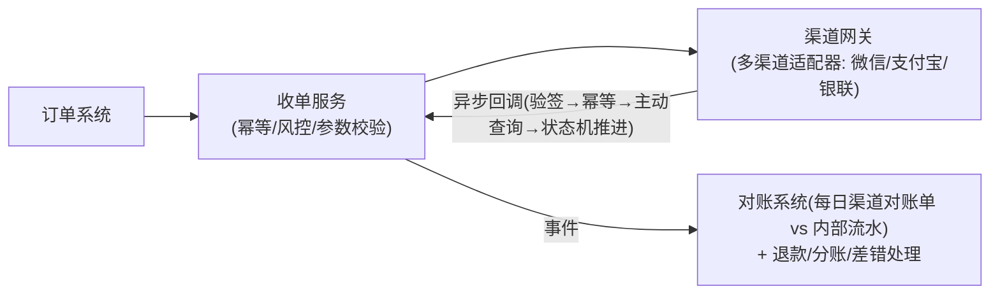

# 场景拆解：支付与清结算
> [返回：软件架构学习大纲](../软件架构学习大纲.md)

> 本篇对应主笔记 [01-第六阶段-实战与案例分析](01-实战与案例分析.md) 的 1.5 支付小节，原小节编号与内部结构保留，在此专项扩写；业务画像与大纲映射见[示例项目场景/07-支付与清结算](../示例项目场景/07-支付与清结算.md)。

## 1.5 支付

**场景定义**：用户对 1.2 桶装水商城创建的订单发起支付，对接微信/支付宝渠道，款项还要在平台、水站、配送员之间分账。钱的系统，错误容忍度为零。**核心挑战**：① 不丢钱、不多扣、不错账；② 渠道是异步世界（回调可能延迟、重复、乱序甚至伪造）；③ 对账与差错处理；④ 分账动账顺序；⑤ 安全合规。

支付与前面所有场景的底层差异在错误模型上：Feed 流丢一条消息是体验问题，秒杀少卖一件是收入问题，支付系统错一分钱就是资损、客诉与监管风险的复合体——而且钱的错误几乎不可逆：普通业务错了可以回滚重来，打出去的款追不回来，多扣的钱要反向交易才能平。所以支付系统的架构纪律可以压缩成三句话：**状态只前进不回退（状态机）、同一动作只执行一次（幂等）、每一分钱都有凭证可查（账务与对账）**。本节所有设计点都是这三句话在不同位置的展开。

**支付的领域动词表**：支付域的返工与事故，相当一部分源于动词混用——把“冲正”当“退款”提需求、把“分账记账完成”汇报成“钱已到账”、把“结算”和“分账”画在同一个流程框里。先分清动词，再谈架构：每个动词的资金流方向、数据流方向、触发时机与幂等键都不同，落到架构上就是不同的单据、不同的状态机、不同的对账口径。

| 动词 | 资金流方向 | 数据流方向 | 触发时机 | 幂等键 | 最常见误用 |
|---|---|---|---|---|---|
| 收款 | 买家 → 渠道 → 平台中间户（流入） | 创建支付单 → 等终态 → 履约事件 | 用户发起支付 | 商户单号 `outTradeNo` | 把“收款成功”当“交易完成”——履约（发货/配送）是另一条线的事 |
| 退款 | 中间户/商户户 → 渠道 → 买家原路（流出） | 创建退款单 → 独立状态机 → 独立对账 | 售后、超时关单自动退 | 商户退款单号 `outRefundNo` | 复用收款单与收款状态机——两条线搅在一起，对账必乱 |
| 冲正 | 原交易的反向镜像（撤销一笔“处理中”的交易） | 原单标记“已冲正”，通常不产生新单据 | 渠道超时未知态、重复扣款的实时挽救 | 原单号 + 冲正标记 | 与退款混用——冲正只对“未结算的未知态”可用；钱已入终态就只能走退款 |
| 分账 | 中间户 → 各参与方内部账户（平台内再分配，不出平台） | 分账单 + 各参与方账户流水 | 确认收货/履约完成 | 分账单号 | 边收边分（见关键设计点 5） |
| 结算 | 参与方账户 → 银行卡/银行账户（出平台，对外打款） | 结算单 + 打款状态机 | T+1 批量或分账后触发 | 结算单号 | 把“分账记账完成”当“钱已到账”——记账与打款是两回事（见 1.5.2） |
| 对账 | 无资金流（纯数据动作，但驱动资金修正） | 两套流水互相比对 → 产出差错单 | 日切 / 准实时滚动 | 对账批次号 + 业务单号 | 把对账当监控——对账是裁判，差错单必须有闭环（见 1.5.3） |

动词分清之后，几个架构决策几乎自动浮现：收款与退款必须是两套独立单据与状态机（关键设计点 7）；冲正只在“未知态”窗口内可用，错过窗口就是退款的需求；分账与结算必须拆开——前者是记账，后者是打款，混在一个动作里就会做出“先打款后记账”的危险系统（1.5.2）；对账本身不产生资金动作，只产出差错单，资金修正必须走挂账—核销流程（1.5.3）。

**总体架构**：



读这张图的方法是看五个挑战各被安放在哪：幂等与风控守在收单入口（挑战①）；验签、主动查询、状态机守在回调入口（挑战②）；对账系统站在所有资金流与数据流的下游当最终裁判（挑战③）；分账在确认收货后才动账，且记账与打款分离（挑战④）；加密与脱敏贯穿存储与日志两层（挑战⑤）。另一个值得注意的形状是“渠道网关”用适配器模式而非 if-else 分支——渠道会越接越多（银联、云闪付、境外卡），每家接口、回调、对账单格式都不一样，“新渠道只加适配器、不改存量代码”是这套架构能长期活着的前提（第二阶段开闭原则在支付域的具体兑现）。

**关键设计点**：

1. **多渠道收单 + 幂等**：各渠道接口、回调、对账单格式各异 → 渠道网关用适配器统一抽象，新渠道只加适配器（开闭原则）；收单以商户单号 `outTradeNo` 唯一约束，重复提交返回同一张支付单而非新建。
2. **回调处理铁律**：验签 → 幂等检查 → **不信回调信查询** → 状态机 CAS 推进 → 应答 SUCCESS。为什么必须查：回调可能伪造、重复、乱序（先到“失败”回调、钱实际成功），渠道查询接口才是权威事实源（第三阶段：跨系统一致性最终靠查询收口）。
3. **掉单治理**：回调丢失 = 用户付了钱、系统没记账。兜底：创建支付单后注册定时任务轮询渠道，查询结果与回调走同一条状态机路径。
4. **对账三步**：渠道对账单 vs 支付流水 vs 订单，日切核对；差错分类——**长款**（渠道有我无，多收了）/ **短款**（我有渠道无，疑掉单）/ 状态不一致——能自动的自动，其余转人工处理流程。对账是支付系统的最终裁判。
5. **分账“先收后分”**：买家付款先进平台中间户，确认收货/签收后再触发向水站与配送员分账；分账指令以分账单号幂等，并纳入日终对账。❌ 边收边分：买家退款时钱已分出去，账轧不平。
6. **金额用分为单位的 Long**。❌ `Double`：0.1 + 0.2 ≠ 0.3 在钱上就是事故。
7. **退款与正向对称**：退款单号幂等、独立状态机、独立对账——很多人只把正向做扎实，退款线全是洞。
8. **敏感数据与合规**：卡号/身份信息加密存储（密钥走 KMS，不写死在配置里）、全链路日志脱敏（打印明文卡号即事故）、最小化收集与留存期限（第五阶段：安全架构与合规）。

上面第 2 条的回调主流程（片段）：

```kotlin
// 渠道异步通知：验签 → 幂等 → 主动查询 → 状态机推进，必须快速应答
fun onPayNotify(notify: PayNotify): String {
    if (!signVerifier.verify(notify)) return "FAIL"             // 1. 验签防伪造
    val payment = paymentRepo.findByOutTradeNo(notify.outTradeNo) ?: return "FAIL"
    if (payment.status == PaymentStatus.PAID) return "SUCCESS"  // 2. 幂等：已处理直接应答
    if (payGateway.query(notify.outTradeNo)?.status != RemoteStatus.PAID) return "FAIL"
    payStateMachine.fire(payment, PayEvent.PAY_SUCCESS)         // 3. 不信通知，查渠道核实
    return "SUCCESS"                                            // 4. CAS 推进；履约走事件异步
}
```

### 1.5.1 收单异步回调协议：必达、防伪与幂等

关键设计点 2、3 给出了回调处理的铁律，这里把“协议”层面补完整。回调是渠道与我方之间一份事实上的契约，要回答三个问题：支付结果怎么保证最终送到（必达）、怎么确认这条消息是真的（防伪）、同一个结果来了八遍怎么办（幂等）。三个问题的答案拼在一起，才是完整的回调协议。

**回调必达 = 推与拉两条通道，缺一不可**。渠道的通知重试阶梯（典型为 15s/30s/1m/5m/30m/1h/6h，七跳用尽后转人工差错）是“推”，我方的主动查单补偿是“拉”，两条通道的能力与盲区完全不同：

| 通道 | 谁驱动 | 方向 | 覆盖什么 | 各自的失效模式 |
|---|---|---|---|---|
| 通知重试阶梯 | 渠道 | 渠道 → 我方 | 我方处理失败、应答包丢失、瞬时不可用 | 渠道回调服务自身故障；我方“假 ACK”（回了 SUCCESS 但本地事务没提交）之后渠道不再重推 |
| 主动查单补偿 | 我方 | 我方 → 渠道 | 回调彻底丢失（掉单）、渠道回调故障、假 ACK 补救 | 查单接口故障；轮询周期带来延迟；大面积掉单时查询被渠道限流 |

为什么两者都要有——任何单一通道都有盲区。只靠推：**假 ACK 是致命的**，我方收到通知、回了 SUCCESS、但本地事务因为重启或死锁没有提交，渠道认为“已送达”便永不再推，这笔钱就永远悬在半空，只有拉（查单）能救。只靠拉：所有单据都等轮询，支付结果的感知延迟从秒级劣化到轮询周期级，用户在“支付中”页面转圈的每一秒都是客诉；而且掉单批量发生与查询限流叠加时，补偿任务自己会成为瓶颈。推拉互补的正确做法：推负责“快”，拉负责“最终一定到”，两者汇聚到同一条状态机——谁先到谁推进状态，后到者被幂等吸收（下方示例里 A1004 的两个事件演示了这个竞争）。

推通道还有两个常被忽略的细节。其一，**重试阶梯的间隔是指数退避**：15s、30s、1m、5m、30m、1h、6h，前密后疏。前几跳密，覆盖的是“我方瞬时不可用”（发布重启 30 秒、GC 停顿、网络抖动）；后几跳疏，是因为到这个阶段大概率是假 ACK 或渠道侧异常，该由我方查单兜底了，继续高频重推只是浪费双方的调用配额。其二，**应答必须快**：渠道等应答有超时（通常秒级），超时按未送达处理、进阶梯重推——所以回调处理里绝不能塞发货、发短信这类重逻辑，那等于亲手把每次回调都变成一次重推（见常见错误第一条）。判据：回调处理必须“先落库、后应答”——应答 SUCCESS 之前状态必须已持久化，这一条判据直接消灭“假 ACK”这个最阴险的失效模式。

**验签失败的三种可能与排查顺序**。验签失败时不要立刻断定是攻击，三种可能的危险度与排查成本各不相同：

1. **参数被篡改**——攻击者重放或改写报文，也可能是我方网关/代理重写了参数（加了字段、改了编码、重排了参数顺序）。最危险，必须最先排除。
2. **验签算法或密钥不一致**——双方升级步调不一致：字段拼接规则变了、签名算法换了版本、密钥轮换窗口中新旧密钥并存、灰度中一部分实例还拿着旧配置。
3. **时钟偏移**——签名报文含时间戳，服务器 NTP 漂移超出渠道允许的时间窗（通常 ±5 分钟）。最无害，但最容易被当成“玄学”而屡受问责。

排查顺序固定为三步，不许跳步：

- 第一步，**本地重算比对**：取渠道原始报文（不是网关解析后的对象），按约定算法与密钥在本地重算签名，逐字节比对。本地重算与渠道签名一致 → 说明渠道签名没问题，是“报文在到达验签代码之前被改了”，直接查网关与参数解析层——用最低成本把最危险的篡改最先定位；本地重算也不一致 → 基本排除篡改，进入第二步。
- 第二步，**核对算法与密钥版本**：是否处于密钥轮换窗口、新旧密钥是否并存、灰度实例配置是否一致、字段拼接顺序与编码是否与渠道最新文档一致。这一步抓的是“变更引发的共识破裂”。
- 第三步，**查时钟**：比对双方服务器时间与 NTP 源的偏差，检查时间窗配置。

为什么是这个顺序：第一步成本最低，且能把“真攻击”与“配置问题”一刀切开；把时钟偏移放到最后，是为了防止团队形成“验签失败 = 时钟问题”的条件反射，从而放过真正的篡改。配套红线：验签失败的唯一合法动作是“应答 FAIL + 告警留证（保存原始报文）”，任何“暂时关掉验签让业务先跑”的操作都是资金事故的起点。

**可运行示例：回调乱序、重复、伪造、丢失混发，同一条状态机全部幂等吸收**。用虚拟时钟模拟四笔支付从 CREATED 到 PAID 的完整事件流：渠道先推“失败”回调后实际成功（乱序）、我方查询瞬时抖动而应答 FAIL 触发阶梯重推、伪造回调被验签拦下、我方 ACK 丢失导致渠道重推被幂等吸收、回调彻底丢失由查单补偿收口——五类事件全部汇入同一条状态机，只前进不回退。

```kotlin
// 回调处理幂等 + 重试阶梯模拟：虚拟时钟事件驱动，单线程顺序处理（真实系统以调度系统实现同一逻辑）
// 覆盖五类真实事件：渠道先推失败(乱序)、查询瞬时抖动、伪造签名、应答包丢失导致重推、回调彻底丢失(掉单)

val LADDER = intArrayOf(15, 30, 60, 300, 1800, 3600, 21600) // 渠道重试阶梯：15s/30s/1m/5m/30m/1h/6h

enum class PayStatus { CREATED, PAID }
enum class Ack { SUCCESS, RETRY, DROP }   // SUCCESS=停止重推；RETRY=渠道按阶梯重推；DROP=风控丢弃不重推

data class PayOrder(val outTradeNo: String, val amountFen: Long, var status: PayStatus)
data class Notify(val at: Int, val outTradeNo: String, val saysPaid: Boolean,
                  val amountFen: Long, val signOk: Boolean, val tag: String)

/** 渠道模拟器：查询接口是权威事实源，confirmAt 之后查询才返回 PAID（模拟渠道侧最终一致延迟） */
class ChannelSim(private val confirmAt: Map<String, Int>, private val jitter: Set<Pair<String, Int>>) {
    fun queryPaid(outTradeNo: String, now: Int): Boolean? =
        if (outTradeNo to now in jitter) null else now >= confirmAt.getValue(outTradeNo)  // null=查询瞬时超时
}

class NotifyHandler(private val repo: MutableMap<String, PayOrder>,
                    private val channel: ChannelSim,
                    private val out: MutableList<String>) {
    var cbFirst = 0; var cbDup = 0; var signBlocked = 0; var rescued = 0; var unconfirmedFail = 0

    /** 处理一笔回调：验签 → 查单据 → 金额核对 → 幂等 → 主动查询核实 → CAS 推进 */
    fun handle(n: Notify, now: Int): Ack {
        if (!n.signOk) { signBlocked++
            line(now, n.outTradeNo, n.tag, "验签失败(伪造/篡改) → 应答 FAIL + 风控告警（不安排重推）"); return Ack.DROP }
        val p = repo[n.outTradeNo]
        if (p == null) { line(now, n.outTradeNo, n.tag, "查无此单 → 应答 FAIL"); return Ack.DROP }
        if (n.amountFen != p.amountFen) { line(now, p.outTradeNo, n.tag, "金额与本地支付单不符 → 应答 FAIL + 告警"); return Ack.DROP }
        if (p.status == PayStatus.PAID) { cbDup++
            line(now, p.outTradeNo, n.tag, "验签OK · 金额一致 · 已是 PAID → 幂等应答 SUCCESS（渠道停止重推）"); return Ack.SUCCESS }
        val q = channel.queryPaid(p.outTradeNo, now)
        if (q == null) { unconfirmedFail++
            line(now, p.outTradeNo, n.tag, "渠道查询瞬时超时 → 应答 FAIL（渠道重推 + 我方查单兜底）"); return Ack.RETRY }
        if (!q) { unconfirmedFail++
            val says = if (n.saysPaid) "回调称成功但渠道未落账" else "回调称失败且渠道未落账(不凭失败回调关单)"
            line(now, p.outTradeNo, n.tag, "渠道查询未确认($says) → 应答 FAIL"); return Ack.RETRY }
        p.status = PayStatus.PAID; cbFirst++   // CAS：真实系统为 UPDATE ... WHERE out_trade_no=? AND status='CREATED'
        line(now, p.outTradeNo, n.tag, "验签OK · 金额一致 · 渠道查询PAID → 状态机 CREATED→PAID → 应答 SUCCESS（首次成功）")
        return Ack.SUCCESS
    }

    /** 主动查单补偿：每轮扫描未终态单，查询结果与回调走同一条状态机路径 */
    fun pollOnce(now: Int) {
        for (p in repo.values.toList()) {
            if (p.status == PayStatus.CREATED && channel.queryPaid(p.outTradeNo, now) == true) {
                p.status = PayStatus.PAID; rescued++
                out.add("[%5ds] %s ← 主动查单补偿 | 回调始终未到 → 查询PAID → CREATED→PAID（与回调共用状态机）".format(now, p.outTradeNo))
            }
        }
    }

    private fun line(now: Int, no: String, tag: String, what: String) {
        out.add("[%5ds] %s ← %s | %s".format(now, no, tag, what))
    }
}

fun main() {
    val out = mutableListOf<String>()
    val confirmAt = mapOf("A1001" to 4, "A1002" to 2, "A1003" to 8, "A1004" to 9)
    val channel = ChannelSim(confirmAt, jitter = setOf("A1002" to 3))
    val repo = mutableMapOf(
        "A1001" to PayOrder("A1001", 6800, PayStatus.CREATED),    // 68.00 元
        "A1002" to PayOrder("A1002", 9900, PayStatus.CREATED),    // 99.00 元
        "A1003" to PayOrder("A1003", 15800, PayStatus.CREATED),   // 158.00 元
        "A1004" to PayOrder("A1004", 4500, PayStatus.CREATED),    // 45.00 元
    )
    val handler = NotifyHandler(repo, channel, out)
    println("初始：4 笔 CREATED 支付单（A1001 68.00 / A1002 99.00 / A1003 158.00 / A1004 45.00）")
    println("规则：阶梯 15s/30s/1m/5m/30m/1h/6h；查单补偿每 30s 一轮；渠道回调乱序、重复、伪造、丢失混发")
    println()

    // 渠道推来的回调（A1004 一条也没有 = 掉单）
    val scheduled = java.util.PriorityQueue<Pair<Int, Notify>>(
        compareBy({ it.first }, { it.second.outTradeNo }))
    listOf(
        Notify(3, "A1002", true, 9900, true, "回调:SUCCESS"),
        Notify(3, "A1003", false, 15800, true, "回调:FAILED(渠道先推失败)"),
        Notify(5, "A1001", true, 6800, true, "回调:SUCCESS"),
        Notify(12, "A1001", true, 6800, false, "伪造回调:SUCCESS(签名不符)"),
        Notify(25, "A1001", true, 6800, true, "渠道重推:SUCCESS(我方ACK丢失)"),
        Notify(48, "A1004", true, 4500, true, "渠道重推:SUCCESS(我方ACK丢失)"),
    ).forEach { scheduled.add(it.at to it) }

    val ladderStep = mutableMapOf<String, Int>()
    var pollAt = 30
    var guard = 0
    while (guard++ < 200) {
        val nextCb = scheduled.peek()
        val anyCreated = repo.values.any { it.status == PayStatus.CREATED }
        if (nextCb == null && !anyCreated) break
        if (nextCb != null && (nextCb.first <= pollAt || !anyCreated)) {
            val (at, n) = scheduled.poll()
            when (handler.handle(n, at)) {
                Ack.RETRY -> {                                    // 应答 FAIL → 渠道按阶梯安排下一次重推
                    val step = ladderStep.getOrDefault(n.outTradeNo, 0)
                    if (step < LADDER.size) {
                        ladderStep[n.outTradeNo] = step + 1
                        val t2 = at + LADDER[step]
                        scheduled.add(t2 to n.copy(at = t2, tag = "阶梯重推#${step + 1}(间隔${LADDER[step]}s)",
                            saysPaid = t2 >= confirmAt.getValue(n.outTradeNo)))
                    } else out.add("[%5ds] %s ← 重试阶梯 7 跳用尽仍未确认 → 转人工差错，查单补偿加急".format(at, n.outTradeNo))
                }
                else -> {}
            }
        } else {
            handler.pollOnce(pollAt)
            pollAt += 30
        }
    }

    println()
    out.forEach(::println)
    println()
    println("处理结束：4 笔支付单全部 PAID → ${repo.values.all { it.status == PayStatus.PAID }}")
    println("处置分布：回调路径首次成功 ${handler.cbFirst} 笔 | 查单补偿收口 ${handler.rescued} 笔 | 幂等吸收重复 ${handler.cbDup} 次" +
            " | 拦截伪造 ${handler.signBlocked} 次 | 查询未确认而 FAIL ${handler.unconfirmedFail} 次")
}
```

实际运行输出（kotlinc 2.2.20 编译，JRE 21）：

```text
初始：4 笔 CREATED 支付单（A1001 68.00 / A1002 99.00 / A1003 158.00 / A1004 45.00）
规则：阶梯 15s/30s/1m/5m/30m/1h/6h；查单补偿每 30s 一轮；渠道回调乱序、重复、伪造、丢失混发


[    3s] A1002 ← 回调:SUCCESS | 渠道查询瞬时超时 → 应答 FAIL（渠道重推 + 我方查单兜底）
[    3s] A1003 ← 回调:FAILED(渠道先推失败) | 渠道查询未确认(回调称失败且渠道未落账(不凭失败回调关单)) → 应答 FAIL
[    5s] A1001 ← 回调:SUCCESS | 验签OK · 金额一致 · 渠道查询PAID → 状态机 CREATED→PAID → 应答 SUCCESS（首次成功）
[   12s] A1001 ← 伪造回调:SUCCESS(签名不符) | 验签失败(伪造/篡改) → 应答 FAIL + 风控告警（不安排重推）
[   18s] A1002 ← 阶梯重推#1(间隔15s) | 验签OK · 金额一致 · 渠道查询PAID → 状态机 CREATED→PAID → 应答 SUCCESS（首次成功）
[   18s] A1003 ← 阶梯重推#1(间隔15s) | 验签OK · 金额一致 · 渠道查询PAID → 状态机 CREATED→PAID → 应答 SUCCESS（首次成功）
[   25s] A1001 ← 渠道重推:SUCCESS(我方ACK丢失) | 验签OK · 金额一致 · 已是 PAID → 幂等应答 SUCCESS（渠道停止重推）
[   30s] A1004 ← 主动查单补偿 | 回调始终未到 → 查询PAID → CREATED→PAID（与回调共用状态机）
[   48s] A1004 ← 渠道重推:SUCCESS(我方ACK丢失) | 验签OK · 金额一致 · 已是 PAID → 幂等应答 SUCCESS（渠道停止重推）

处理结束：4 笔支付单全部 PAID → true
处置分布：回调路径首次成功 3 笔 | 查单补偿收口 1 笔 | 幂等吸收重复 2 次 | 拦截伪造 1 次 | 查询未确认而 FAIL 2 次
```

对照读法：

- **A1002 与 A1003 的首次回调都应答了 FAIL，但原因不同**：A1002 是我方查询瞬时超时——协议允许“没核实就不确认”，宁可 FAIL 让渠道重推，也不凭一条没核实的回调动账；A1003 是渠道先推“失败”回调、而查询显示尚未落账——注意处置是“不动状态”，既不标记失败也不关单：凭一次“失败”回调就关单，是真实事故高发点（关单之后钱到了，就得走更复杂的“已关单收款”差错流程）。15s 后的阶梯重推把事实补齐了。
- **A1004 是掉单**：回调彻底丢失，t=30 的查单补偿收口；t=48 渠道的迟到重推到达时状态已是 PAID，幂等应答 SUCCESS——两条通道竞争同一份状态，谁先到谁推进，后到者无害。这正是“查询结果与回调走同一条状态机路径”（关键设计点 3）的意义：不需要为查单另写一套推进逻辑，也就不存在两套逻辑打架的可能。
- **伪造回调（t=12）被验签拦在一切业务判断之前**——注意它的内容“完全正确”（单号、金额都对），只有签名不对。如果验签放在幂等检查之后，这笔回调会拿到 SUCCESS 应答，攻击者就此摸清了协议细节；验签的位置就是防线的位置。
- **两次“查询未确认而 FAIL”**（A1002、A1003 各一次）说明 FAIL 应答不是异常路径而是协议的正常组成部分：它驱动渠道的阶梯重推，与查单补偿一起构成双保险。

### 1.5.2 分账的账务模型：账户、流水与“先记账后打款”

关键设计点 5 讲了分账的时机（先收后分），这里讲分账的“账”本身长什么样。这是支付系统与普通业务系统差异最大的地方：普通业务表允许 UPDATE，账务表几乎全部 append-only。

**余额账户模型：每参与方一个账户 + 流水 append-only**。给每个资金参与方建账户：平台中间户、平台收入户、每个水站、每个骑手、渠道清算在途户、手续费科目。账户余额不是“一个可以随时 UPDATE 的字段”，而是流水的推导视图：每笔资金动作追加一条不可变流水，余额随时可以从流水全量重放重建。三重好处：① 审计天然完整——每一分钱的变动都有唯一凭证，出了差错能精确回放定位到哪一笔；② 余额算错可以重放修复，不需要“人工修数”这种高危操作；③ 追加写比更新写冲突面小，流水表天然适合按参与方或时间分库分表。在账户模型之上再加一道复式记账约束：每笔交易有借必有贷、借贷必平，全局任意时刻 Σ借 = Σ贷。这不是会计学的仪式感，而是支付系统最硬的健康指标——账平，说明每一笔资金动作都有来源有去向；账不平，系统一定出了事，而且这个信号比任何业务监控都早、都准。

**事务边界：为什么钱相关的系统都是“先记账后打款”**。分账要跨两步：内部记账（在各方账户之间落流水）与对外打款（把各方余额结算到银行卡）。这两步的顺序不能颠倒：

- ❌ **先打款后记账**的失败剧本：打款调用成功 → 进程崩溃、记账事务失败 → 钱已经出了平台，账上却没有任何记录 → 差错只能靠人工比对银行流水修复；而且此时无法区分“打款失败需要重试”和“打款成功但记账失败”，盲目重试就可能变成双倍打款——资损翻倍。
- ✅ **先记账后打款**：记账是本地事务（分账流水 + 打款指令进 outbox 表同一事务落库，第三阶段本地消息表模式），成功后异步执行打款（结算单号幂等），打款结果回填结算单状态；打款失败可以无限重试或转人工——因为账已经平了，钱只是趴在“应付”科目里“还没出门”，最坏情况是“钱晚到”，永远不会出现“钱出门了账上没有”。

一句话原理：**记账是本地可回滚操作，打款是外部不可逆操作；永远把不可逆动作放在可回滚状态确认之后**。这与“先落库后应答 ACK”（1.5.1）、“先扣减后发货”是同一条纪律的三次现身。还有一层对称性值得注意：结算打款通道自己也是异步的——打款回单同样是“回调 + 查单”协议，验签、幂等、状态机一样不少，本节 1.5.1 的整套机制在结算线上原样再用一次。判据：任何对外资金动作必须有对应的内部记账先行，两者用 outbox/最终一致衔接；绝不允许在同一个方法里“先调渠道打款接口、成功后再开事务记账”。

**可运行示例：一笔 100 元收款分给平台/骑手/水站三方**。业务规则：渠道手续费 6‰（60 分），净额 9940 分；平台服务费按净额 10%（994 分），骑手配送费 800 分（规则定价），余数 8146 分归水站。按比例取整必然产生余数，必须指定固定一方“吃余数”否则分不平——这里让水站兜底，是分账系统的经典细节（余数给平台会被质疑“抽头”，给交易另一端更站得住）。代码演示收款入账、手续费、分账三次记账，同一分账单号重放被幂等拒绝，最后校验四条不变量。

```kotlin
// 分账的账务模型：余额账户 + append-only 流水 + 复式记账不变量
// 一笔 100 元（10000 分）收款：渠道手续费 6‰ = 60 分 → 净额 9940 分
//   分配：平台服务费 10% = 994 分、骑手配送费 800 分、水站 8146 分（余数兜底归水站，保证恰好分平）

enum class DrCr { DR, CR }   // DR=借 / CR=贷

data class Posting(val txnId: String, val account: String, val drCr: DrCr, val amountFen: Long, val memo: String)

class Ledger {
    private val postings = mutableListOf<Posting>()      // 流水：append-only，只增不改不删
    private val txnIds = mutableSetOf<String>()          // 交易单号幂等（真实系统用数据库唯一索引）
    private val balances = mutableMapOf<String, Long>()  // 余额快照：每入一笔流水同步更新（贷正借负）

    /** 记一笔账：单号幂等 + 借贷必平，两条都过才落流水 */
    fun post(txnId: String, entries: List<Triple<String, DrCr, Long>>, memo: String): Boolean {
        if (!txnIds.add(txnId)) { println("× [$txnId] 重复提交 → 幂等拒绝（同一动作绝不执行两次）"); return false }
        val dr = entries.filter { it.second == DrCr.DR }.sumOf { it.third }
        val cr = entries.filter { it.second == DrCr.CR }.sumOf { it.third }
        if (dr != cr) { println("× [$txnId] 借贷不平衡（DR=$dr ≠ CR=$cr）→ 拒绝入账"); return false }
        entries.forEach { (acct, side, amt) ->
            postings.add(Posting(txnId, acct, side, amt, memo))
            balances[acct] = (balances[acct] ?: 0L) + if (side == DrCr.CR) amt else -amt
        }
        println("✓ [$txnId] $memo")
        return true
    }

    fun balance(account: String): Long = balances.getOrDefault(account, 0L)
    fun accounts(): List<String> = balances.keys.toList()

    /** 不变量 1：总账平衡——ΣDR = ΣCR，任意时刻成立 */
    fun totalBalanced(): Pair<Long, Long> {
        val dr = postings.filter { it.drCr == DrCr.DR }.sumOf { it.amountFen }
        val cr = postings.filter { it.drCr == DrCr.CR }.sumOf { it.amountFen }
        return dr to cr
    }

    /** 不变量 2：余额 = 流水推导。从流水全量重放，逐一核对余额快照 */
    fun auditReplay(): Boolean {
        val replay = mutableMapOf<String, Long>()
        postings.forEach { p ->
            replay[p.account] = (replay[p.account] ?: 0L) + if (p.drCr == DrCr.CR) p.amountFen else -p.amountFen
        }
        return replay == balances
    }
}

fun main() {
    val led = Ledger()
    val orderFen = 10000L   // 买家支付 100.00 元，一律用分为单位的 Long

    // T1 收款入账（先收）：渠道清算在途（借，资金来源）↔ 平台中间户（贷，待分负债）
    led.post("RCV-A1001", listOf(
        Triple("渠道清算在途", DrCr.DR, orderFen),
        Triple("平台中间户", DrCr.CR, orderFen),
    ), "买家支付 100.00 元收款入账（先收：进中间户，不动任何参与方）")

    // T2 渠道手续费 6‰：从中间户划出
    val fee = orderFen * 6 / 1000
    led.post("FEE-A1001", listOf(
        Triple("平台中间户", DrCr.DR, fee),
        Triple("渠道手续费支出", DrCr.CR, fee),
    ), "渠道手续费 6‰ = 60 分")

    // T3 分账（后分）：净额 9940 = 平台服务费 994 + 骑手 800 + 水站 8146（余数兜底）
    val net = orderFen - fee
    val platform = net * 10 / 100
    val rider = 800L
    val station = net - platform - rider
    led.post("SPLIT-A1001", listOf(
        Triple("平台中间户", DrCr.DR, net),
        Triple("平台服务费收入", DrCr.CR, platform),
        Triple("骑手R001", DrCr.CR, rider),
        Triple("水站S009", DrCr.CR, station),
    ), "确认收货触发分账：平台 $platform / 骑手 $rider / 水站 $station")

    // 幂等：同一分账单号因 MQ 重复投递再来一次 → 必须拒绝
    led.post("SPLIT-A1001", listOf(
        Triple("平台中间户", DrCr.DR, net),
        Triple("平台服务费收入", DrCr.CR, platform),
        Triple("骑手R001", DrCr.CR, rider),
        Triple("水站S009", DrCr.CR, station),
    ), "重复分账指令（模拟 MQ 重复投递）")

    println()
    println("各账户余额（单位：分；贷方为正 = 该方收入/应付，借方为负 = 资金来源/已耗用）")
    led.accounts().forEach { acct -> println("  %s %6d 分".format(acct, led.balance(acct))) }
    println()
    val (dr, cr) = led.totalBalanced()
    println("不变量 1 总账平衡     : ΣDR=$dr 分，ΣCR=$cr 分 → ${dr == cr}")
    println("不变量 2 余额=流水重放 : ${led.auditReplay()}")
    println("不变量 3 中间户清零    : 平台中间户 = ${led.balance("平台中间户")} 分（先收后分完成）")
    println("不变量 4 分配完整      : 手续费+三方 = ${fee + platform + rider + station} 分 = 收款 $orderFen 分 → ${fee + platform + rider + station == orderFen}")
}
```

实际运行输出（kotlinc 2.2.20 编译，JRE 21）：

```text
✓ [RCV-A1001] 买家支付 100.00 元收款入账（先收：进中间户，不动任何参与方）
✓ [FEE-A1001] 渠道手续费 6‰ = 60 分
✓ [SPLIT-A1001] 确认收货触发分账：平台 994 / 骑手 800 / 水站 8146
× [SPLIT-A1001] 重复提交 → 幂等拒绝（同一动作绝不执行两次）

各账户余额（单位：分；贷方为正 = 该方收入/应付，借方为负 = 资金来源/已耗用）
  渠道清算在途 -10000 分
  平台中间户      0 分
  渠道手续费支出     60 分
  平台服务费收入    994 分
  骑手R001    800 分
  水站S009   8146 分

不变量 1 总账平衡     : ΣDR=20000 分，ΣCR=20000 分 → true
不变量 2 余额=流水重放 : true
不变量 3 中间户清零    : 平台中间户 = 0 分（先收后分完成）
不变量 4 分配完整      : 手续费+三方 = 10000 分 = 收款 10000 分 → true
```

对照读法：

- **中间户先 +10000、再 -60、再 -9940，最终清零**——“先收后分”在账上的形状就是中间户从满到零。它清零的那一刻，分账在记账层面完成；骑手与水站什么时候真的拿到钱，是结算（打款）的事——账上他们已经各有 800 和 8146 的“应付余额”，这正好对应动词表里“分账 ≠ 结算”的区分。
- **四条不变量在每次记账后都应成立**，任何一条被打破都是立即停机排查级事故：总账平衡（每一笔都有借有贷）、余额等于流水重放（账可重建，无人能“直接改余额”）、中间户清零（先收后分闭环）、分配完整（一笔钱一分不差地有了去向）。生产上这些校验跑在对账批处理里，这里为了演示内联在 main 中。
- **幂等拒绝那一行是分账单号唯一索引在起作用**：MQ 重复投递、定时任务重跑、人工误操作重复触发，都被这个唯一约束拦下——账务表的单号唯一索引是整个支付系统里性价比最高的资损保险。

### 1.5.3 对账体系分层：三层职责与长短款闭环

关键设计点 4 讲了对账三步与差错分类，这里把“对账”从一个动作展开成一个体系。单笔交易的正确性靠状态机与幂等保证，系统级的正确性靠对账兜底；而对账本身要分层，因为不同层的误差来源、时效要求、数据口径完全不同：

| 层 | 频率 | 数据源 | 比对什么 | 能抓什么错 | 局限 |
|---|---|---|---|---|---|
| 渠道对账 | T+1（日切文件） | 渠道对账单 ↔ 支付流水 | 逐笔核对：单号、金额、状态、手续费 | 掉单、渠道侧重复扣款、金额差错、手续费误差 | 有 T+1 延迟；各渠道文件格式口径各异，解析层是持续的维护负担 |
| 内部系统间对账 | 准实时（分钟级滚动） | 支付流水 ↔ 订单/履约/分账流水 | 状态一致性：已支付未履约、已分账未结算、状态机跳变 | 事件丢失、跨服务不一致窗口、消费积压 | 只管“家内部”，抓不了渠道侧的问题 |
| 业务对账 | 日终全量 | 订单-支付-分账-结算-银行流水五方 | 端到端资金闭环：收、退、分、结四条线轧平 | 汇总级资损、科目余额异常、上游漏单 | 粒度粗，只告诉你“哪不平”，定位靠前两层 |

三层的分工可以记成一句话：**渠道对账管“外面的钱进来对不对”，内部对账管“进来的钱在家里流转对不对”，业务对账管“一整天下来总账轧不轧得平”**。时效逐层递减、粒度逐层变粗——准实时层抓高频小错（分钟级发现事件丢失），日终层兜大方向（四条资金线必须轧平）。为什么渠道对账只能 T+1：对账文件是渠道侧批处理产物，平台无法要求渠道实时提供全量核对数据；这也是“内部对账必须准实时”的理由——外部层慢，内部层就得快，否则差错发现时间被拖到 T+1。渠道对账文件解析还有三个工程细节：大文件（百万行 CSV）流式解析不整体进内存；解析入库以“文件名 + 行号”做唯一键保证重跑幂等；**日切口径**要专门校准——23:59:59 成交的单据常出现在次日文件里，核对时以渠道文件的时间窗为准做边界校准，否则每天固定产生一批“假差错”。

任何一层发现差错都只产出差错单，不直接改业务数据；三层比对脚本自身必须幂等可重跑——对账任务跑两次不能产生第二条差错单。

**长短款处理流程：挂账 → 清识别 → 核销**。长短款处理是对账发现差错之后的资金处置纪律，核心是“钱先挂起来、人再慢慢查、核销留痕迹”：

1. **挂账**：差错资金先计入“待处理”科目，业务单据一律不动。严禁两个动作：直接改业务单“抹平”差异、直接退款或打款“息事宁人”——这两种动作会把可查的差错变成不可查的黑洞，日后审计对不上时连线索都没有。挂账有时限（如 T+1 必须清完），超时自动升级到更高权限处理人。
2. **清识别**：自动分类驱动——渠道有我无（长款）→ 疑似掉单，触发补单或原路退回；我有渠道无（短款）→ 疑似状态未同步，触发主动查单；金额不符 → 差错单携带双方流水供比对；无法自动归类的转人工队列，人工队列要有优先级（金额大的先处理）。
3. **核销**：规则明确、金额可自动推导的走自动核销；其余人工核销且必须双人复核（见 1.5.4 红线三）。核销动作本身要记账留痕——核销不是“删掉差错单”，而是“给差错一个有凭证的结局”。

桶装水商城的押金退款线（1.2）每天产生大量小额退款，长短款流程同样适用：押金账户的差错若不走挂账核销、而是图省事直接改押金状态，半年后押金总账必然对不上实存桶数——押金是监管敏感资金，这条线上的“图省事”就是合规事故。

### 1.5.4 资金安全红线：三条不许破的清单

前三小节讲“把钱算对”，这一小节讲“把钱看住”。以下三条是资金系统的宪法级约束——不是最佳实践，而是底线：任何需求、任何排期压力、任何“临时先这样”都不能突破。

**红线一：任何自动化的资金操作必须有人工可审计的痕迹**。每笔资金动作（收款、退款、冲正、分账、打款、差错核销）必须能回答五个问题：谁（操作者或系统身份）、何时（精确时间戳）、对哪笔单（业务单号）、依据什么（触发来源：用户请求/定时任务/人工工单）、动了多少钱（金额与科目）。审计流水 append-only、与业务库隔离存储、不随业务数据归档删除而消失——业务单可以归档，资金凭证不可以。判据：抽查任意一笔历史资金变动，五问必须在 5 分钟内有答案；批处理脚本与规则变更（如退款规则调整、分账比例修改）同样留痕——如果查不到“谁的代码在什么时候改了退款上限”，红线一就算失守。

**红线二：退款上限与熔断**。退款是支付系统里最容易被打穿的口子：收款链路有风控层层设卡，退款链路却常常“信任内部请求”而毫无防护。必须三层设防：单笔退款上限（超过阈值转人工审核）、单日累计上限（按商户、按渠道分别设）、异常速率熔断（某商户当日退款笔数超近 30 日均值 N 倍，自动冻结该商户的新退款，已受理的走人工核查）。判据：阈值不能凭主观估计，按“该对象历史最大单日退款的 2~3 倍”设定并随业务增长定期校准；熔断的解除必须双人复核，绝不能系统到点自动解冻——攻击者最期待的就是“冻了又自动解开”的循环。桶装水商城的周期购场景尤其要注意：订阅扣款失败的自动重试如果叠加退款逻辑，一个死循环 bug 就能把水站账户打穿，速率熔断是最后一道闸。

**红线三：权限双人复核（maker-checker）**。大额退款、批量打款、差错核销、规则与阈值变更，必须由两个账号完成：一人提交、另一人审核，同一账号不能既提又审，复核记录进审计流水。判据：列出系统里全部“单账号即可完成的资金动作”清单——清单非空即违规；双人复核的绕过路径（直接调接口、脚本执行、内部工具）要在网关与服务层封死，而不是只在页面上隐藏按钮——这是第五阶段“不信任客户端”原则在资金域的投影。特别提醒内部工具：资金后台的“便捷操作”按钮是内部人作恶的主通道，便捷性与双人复核冲突时，永远选复核。

三条红线的共同哲学一句话：**自动化负责效率，人工审计与复核负责兜住自动化的错误——包括程序错误、配置错误与内部人作恶**。资金系统的信任模型从来不是“代码不会错”，而是“错了必然被发现、发现后必然可追责”。

**常见错误**：

- ❌ 回调里同步做发货、发短信等重逻辑：处理慢导致渠道认为失败而疯狂重试。
  ✅ 回调只推状态机并快速应答，后续动作事件驱动异步化（第二阶段）。
- ❌ 回调金额不校验。
  ✅ 金额、币种、商户号逐项与本地支付单核对。
- ❌ 只依赖回调不做主动查询。
  ✅ 查询轮询兜底掉单——异步世界的真理：通知会丢，查询不会。

**回指**：[第三阶段](../03-第三阶段/01-分布式系统核心技术.md)（幂等、最终一致、以查询收口）、[第二阶段](../02-第二阶段/01-经典架构模式.md)（状态机 + 事件驱动、适配器）、[第五阶段](../05-第五阶段/01-工程化与运维视角.md)（安全架构：加密、脱敏、合规）、[第一阶段](../01-第一阶段/01-架构思维与设计基础.md)（安全性质量属性）。

**延伸回指**：分账“先记账后打款”的理论基础——本地消息表、Saga 与最终一致的完整推演见[第三章·分布式事务](../03-第三阶段/05-分布式事务-从2PC到最终一致.md)；“通知会丢、查询不会”的投递语义与“至少一次 + 幂等 = 效果恰好一次”见[第二章·事件驱动架构](../02-第二阶段/04-事件驱动架构.md)；跨系统一致性为什么最终靠查询收口见[第三章·分布式理论基础](../03-第三阶段/02-分布式理论基础-CAP共识与一致性.md)；加密、脱敏、密钥管理与双人复核的体系化展开见[第五章·安全架构](../05-第五阶段/04-安全架构-认证授权与零信任.md)；上游订单与押金状态机如何衔接支付、超时关单与回调并发的 CAS 处理见[03-场景拆解-电商交易桶装水商城](03-场景拆解-电商交易桶装水商城.md)；秒杀场景里“先扣款后发货”的同款纪律见[02-场景拆解-秒杀](02-场景拆解-秒杀.md)；本节在主笔记中的位置与相邻场景对照见[01-第六阶段-实战与案例分析](01-实战与案例分析.md)。

**【本节自测】**（只出题不作答；作答后按批改流程逐题点评并记入章节答案档案）

1. （主笔记“本节自测”原题）支付分账为什么必须“先收后分”？若水站要求确认收货前就到账，这个需求该怎么回应？
2. 通道设计：“渠道已经有 15s/30s/1m/5m/30m/1h/6h 的重试阶梯，我们何必再自建主动查单补偿？”以及反过来的“既然有查单兜底，回调处理何必费劲验签加查询，全部等查单收口不就行了？”——这两问各错在哪里？请分别指出被忽略的失效模式。
3. 账务推演：用复式记账写出“水站申请退款 20 元，其中含需追回的骑手已分配送费 3 元”的全部分录（列明每笔的借贷方向与科目），并回答：哪一步必须等渠道打款结果才能落账？哪一步只能先挂账？如果骑手账户余额只剩 2 元、不够追回 3 元，账务上怎么处理？
4. 故障排查：生产上某渠道回调从某天 10:00 起批量验签失败（此前一直正常）。按“本地重算比对 → 密钥/算法版本 → 时钟偏移”的顺序写出你的具体排查动作，以及每一步的判定分支（什么结果说明问题出在哪一层）。
5. 迁移应用：给你的工单中心或 MES 加一条“自动退款/赔付熔断”机制：写出触发指标、冻结动作、解除流程三部分的设计，并说明为什么解除环节不能是单人操作、也不能是全自动。

## 替换清单

- “1.5 支付”支付总体架构（收单 → 渠道 → 异步回调 → 事件驱动对账）→ `flowchart`
