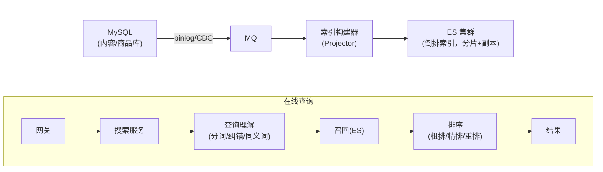
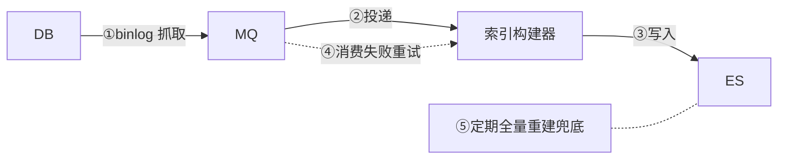

# 场景拆解：搜索
> [返回：软件架构学习大纲](../软件架构学习大纲.md)

> 本篇对应主笔记 [01-实战与案例分析](01-实战与案例分析.md) 的 1.6 搜索小节，原小节编号与内部结构保留，在此专项扩写；业务画像与大纲映射见[示例项目场景](../示例项目场景/00-导览.md)。


**场景定义**：内容社区的标配读侧——帖子与商品的搜索：关键词 + 类目/标签 + 属性 + 价格区间组合查询，按相关性排序。**核心挑战**：① 多条件全文匹配，B+ 树/哈希都无法高效支持 → 需要**倒排索引**（词 → 文档列表）；② 主库与索引的最终一致；③ 相关性排序；④ 索引体积与更新频率的平衡。

把场景落到熟悉的项目上，搜索有三个典型形态，难度依次递增：

- **桶装水商城商品搜索**：用户搜“桶装水”“订水”“周期购”，商品总量几千到几万，词表有限但用户用词五花八门（“包月送水”“水卡”其实是同一件事）——难点在**召回**（别搜不到）；
- **内容社区帖子搜索**：帖子量大（百万级以上）、更新频繁、正文长——难点在**索引管道与排序**（刚发的帖搜得到吗？搜出来的顺序用户认吗？）；
- **工单中心工单检索**：客服按工单号、手机号精确查，也按“上次送水漏了那单”这类描述模糊搜——难点在**分工判据**（哪些查询留给数据库、哪些才值得进搜索引擎），以及企业场景的权限过滤（员工只能搜到自己部门可见的工单）。

注意第四个挑战“索引体积与更新频率”的隐含信息：索引不是免费的。多一套搜索引擎集群、一条 CDC 同步管道、一个最终一致性问题，运维成本可能超过搜索本身带来的收益——所以本节最后专门有一张“用 ES 还是不用”的判决表。

## 1.6.1 搜索与数据库查询的分工：一张判据表

新手最容易犯的错误是把搜索当“高级查询”到处用，或者反过来，明明用户已经在骂“搜不到”，还继续往数据库上加索引。分工的判据只有一句话：**查询条件能不能预先枚举成有限的字段组合——能，归数据库；不能（任意词、任意组合、还要打分排序），归搜索引擎。**

B+ 树擅长的是“值已知或范围已知”的查找：等值匹配、范围扫描、最左前缀（`LIKE '手机%'` 能走索引，因为前缀确定了在 B+ 树里的位置）。而用户在搜索框里输入的是“任意词的中缀匹配”——`LIKE '%手机%'` 的 `%` 开头让前缀定位失效，只能全表逐行判断；更糟的是多个关键词组合时，每个词都要全扫一遍再取交集，代价随词数线性膨胀，而且扫完之后你依然回答不了“哪条结果更相关”——关系库没有相关性这个概念，只能按更新时间或销量排，把搜索退化成“过滤 + 固定排序”。

分工判据表：

| 查询形态 | 例子 | 归谁 |
|---|---|---|
| 主键/索引列等值 | 工单号、手机号查工单 | 数据库 |
| 范围 + 排序分页 | 近 7 天退款订单按时间倒序 | 数据库 |
| 前缀匹配 | `LIKE '农夫山泉%'` | 数据库（能走索引） |
| 中缀模糊 `LIKE '%x%'` | 商品名含“桶装” | 搜索引擎 |
| 多词组合 + 相关性排序 | “桶装水 17L 周期购” | 搜索引擎 |
| 分词、同义词、纠错 | “订水”也要命中“周期购”商品 | 搜索引擎 |
| 结构化过滤 + 全文混合 | 类目=水 + 关键词 + 价格区间 | 搜索引擎（filter 走倒排的数值位图） |

用 MES 再钉一遍这条判据：按批次号追溯物料是**精确查询**，走数据库主键/索引；而“上个月因为设备故障报废的所有批次”如果靠人工挑字段过滤，管理员会不堪重负——这种描述性检索才是搜索引擎的用武之地。反过来，把“按工单号查”也搬进 ES，就是典型的“用搜索引擎当数据库”：多了一条同步链路，却没换来任何收益，还引入了“刚建的工单搜不到”的新问题。

所以判据的另一面同样重要：**搜索引擎是读侧的专用设备，不是万能查询加速器**。结构化查询留在数据库，全文检索才进搜索——这条边界本质上是[第二阶段 CQRS](../02-第二阶段/01-经典架构模式.md) 的“命令侧主库、查询侧专用读模型”在存储选型上的具体化。

## 1.6.2 倒排索引原理：`LIKE '%x%'` 到底慢在哪

数据库慢，要先慢得明白。关系库的索引（B+ 树）是**正排思维**：按“文档 → 它的字段值”组织，树节点按值有序排列，查询靠“值定位”。一旦前缀是通配符 `%`，值的左边界未知，树无处下手，只能退化成全表扫描——每一行都读出来逐字符判断。这个代价在 10 万行时勉强能忍，百万行、每秒几十次查询时数据库直接被拖垮；而且即便扫得动，你也无法高效地回答“这批命中里，哪篇和查询最相关”。

搜索引擎换了一个方向存储：**倒排索引**。先对所有文档做分词，得到词项（term），再记录“每个词项出现在哪些文档”——词项 → 文档 id 列表（倒排链，posting list），链按文档 id 有序存放。查询的过程变成四步：

1. **分词**：把查询词切成词项（“桶装水 订水” → 桶装、装水、订水）；
2. **查词项字典**：每个词项在字典树/哈希里定位到它的倒排链——O(1) 或 O(log n)，与文档总量无关；
3. **取倒排链**：拿到的直接就是“包含这个词的所有文档”，不用扫全库；
4. **求交**：多词 AND 就是多条有序链的归并求交（双指针，或跳表加速跳过），查询成本约等于**最短链的长度**，而与文档总量无关。

这就是“搜索查询快”的本质：**它把计算从查询时挪到了写入时**——写文档时多花一次分词和建链的功夫，换来查询时按词直取、按链求交。这个“预计算换运行时”的思路，和缓存、物化视图、CQRS 读模型是同一个思想在不同层的显形。

下面的 Kotlin 示例是最小可运行的倒排索引：5 篇文档、中文 bigram 分词、有序倒排链、两词 AND 归并求交，并输出命中文档与耗时量级（真实引擎的分词是词典+统计模型、倒排链是跳表并持久化在分片上，但“分词 → 词项 → 倒排链 → 求交”这副骨架完全一样）。

```kotlin
// 内存版倒排索引最小实现：5 篇文档、中文 bigram 分词、倒排链、两词 AND 交集查询
data class Doc(val id: String, val title: String)

private fun isChinese(c: Char): Boolean = c.code in 0x4E00..0x9FFF

/** 极简分词器：英文/数字按整词（小写）；连续中文按滑动二元组（bigram）切分 */
fun tokenize(text: String): List<String> {
    val tokens = mutableListOf<String>()
    val buf = StringBuilder()
    var bufChinese = false
    fun flush() {
        when {
            buf.isEmpty() -> {}
            bufChinese && buf.length == 1 -> tokens.add(buf.toString())
            bufChinese -> for (i in 0 until buf.length - 1) tokens.add(buf.substring(i, i + 2))
            else -> tokens.add(buf.toString())
        }
        buf.clear()
    }
    for (raw in text) {
        val c = raw.lowercaseChar()
        if (!c.isLetterOrDigit()) { flush(); continue }          // 空格/标点 = 天然分隔符
        val chinese = isChinese(c)
        if (buf.isNotEmpty() && chinese != bufChinese) flush()   // 中英文边界处断开
        bufChinese = chinese
        buf.append(c)
    }
    flush()
    return tokens
}

class InvertedIndex {
    // 词项(term) -> 倒排链(posting list)。文档按 id 顺序加入，链天然按 id 有序，可直接归并求交
    private val postings = HashMap<String, MutableList<String>>()
    private val docs = LinkedHashMap<String, Doc>()

    fun add(doc: Doc) {
        docs[doc.id] = doc
        for (t in tokenize(doc.title).distinct()) {
            postings.getOrPut(t) { mutableListOf() }.add(doc.id)
        }
    }

    fun postingOf(term: String): List<String>? = postings[term]?.toList()
    fun titleOf(id: String): String = docs[id]?.title ?: "?"
    fun docFreq(term: String): Int = postings[term]?.size ?: 0

    /** 两条有序倒排链的双指针归并求交——真实引擎同款思路，只是换成跳表加速跳过 */
    private fun intersect(a: List<String>, b: List<String>): List<String> {
        val out = mutableListOf<String>()
        var i = 0; var j = 0
        while (i < a.size && j < b.size) {
            when {
                a[i] == b[j] -> { out.add(a[i]); i++; j++ }
                a[i] < b[j]  -> i++
                else         -> j++
            }
        }
        return out
    }

    /** 多词 AND：先取最短链（df 最小），再逐条与其余链求交，命中数只减不增 */
    fun queryAnd(vararg terms: String): List<String> {
        val chains = terms.map { postings[it] ?: return emptyList() }
        var acc = chains.minByOrNull { it.size }!!.toList()
        for (chain in chains.sortedBy { it.size }) {
            if (acc.isEmpty()) break
            acc = intersect(acc, chain)
        }
        return acc
    }
}

fun main() {
    val docs = listOf(
        Doc("d1", "农夫山泉 饮用天然水 17L 一次性桶装水"),
        Doc("d2", "雀巢 桶装水 18.9L 送水上门 订水热线"),
        Doc("d3", "水桶收纳架 厨房置物架 沥水篮"),
        Doc("d4", "家用净水器 直饮 RO反渗透 过滤芯"),
        Doc("d5", "周期购 包月订水 每周自动配送"),
    )
    val idx = InvertedIndex()
    docs.forEach(idx::add)

    println("== 倒排表示例（词项 -> 文档 id 有序链）==")
    for (t in listOf("桶装", "装水", "订水", "净水", "周期")) {
        println("  「$t」(df=${idx.docFreq(t)}) -> ${idx.postingOf(t) ?: "空链"}")
    }
    println()
    println("== 两词 AND 交集查询 ==")
    val queries = listOf("桶装" to "订水", "桶装" to "净水", "水桶" to "收纳")
    for ((a, b) in queries) {
        val hits = idx.queryAnd(a, b)
        val shown = if (hits.isEmpty()) "无命中（用户看到：0 结果）"
                    else hits.joinToString("；") { idx.titleOf(it) }
        println("  查「$a AND $b」-> $shown")
    }
    println()
    println("== 耗时量级（链长 2，求交成本 ≈ min(df) 量级）==")
    val n = 1_000_000
    repeat(100_000) { idx.queryAnd("桶装", "订水") }   // 预热，让 JIT 稳定
    var sink = 0
    val start = System.nanoTime()
    for (i in 0 until n) sink += idx.queryAnd("桶装", "订水").size
    val ns = System.nanoTime() - start
    println("  「桶装 AND 订水」执行 $n 次：共 ${ns / 1_000_000} ms，单次约 ${ns / n} ns（sink=$sink）")
}
```

实际运行输出（kotlinc 2.2.20，Apple Silicon；绝对数字随机器浮动，**量级**才有意义）：

```
== 倒排表示例（词项 -> 文档 id 有序链）==
  「桶装」(df=2) -> [d1, d2]
  「装水」(df=2) -> [d1, d2]
  「订水」(df=2) -> [d2, d5]
  「净水」(df=1) -> [d4]
  「周期」(df=1) -> [d5]

== 两词 AND 交集查询 ==
  查「桶装 AND 订水」-> 雀巢 桶装水 18.9L 送水上门 订水热线
  查「桶装 AND 净水」-> 无命中（用户看到：0 结果）
  查「水桶 AND 收纳」-> 水桶收纳架 厨房置物架 沥水篮

== 耗时量级（链长 2，求交成本 ≈ min(df) 量级）==
  「桶装 AND 订水」执行 1000000 次：共 90 ms，单次约 90 ns（sink=1000000）
```

三个观察值得停下来体会：

1. **查“桶装 AND 净水”返回 0 结果**——AND 语义下，两条不相交的链求交必为空。这正是电商搜索“0 结果页”的技术根源，也是 1.6.5 同义词要解决的问题之一（用户心里“桶装水和净水器”也许想表达“水相关的商品”，AND 却无情求交）。
2. **先取最短链再求交**是工程直觉：命中数只减不增，从最短的链开始能最快缩小候选集。真实引擎里热门词（如“水”）的倒排链可能有几百万个文档 id，用跳表/位图跳过无用区间，比朴素归并快一个量级。
3. **90 ns 的单次求交**发生在链长只有 2 的玩具数据上，不能外推，但成本结构是真实的：求交代价 ∝ min(df)，与全库文档数无关——对比 `LIKE '%桶装%'` 的代价 ∝ 全表行数，两者的差距正是搜索架构存在的理由。

## 1.6.3 总体架构与索引构建管道

**总体架构**：



读侧架构两行就够了，真正的工程难度全在写侧管道——五个环节，每个环节都会失败，逐个回答“失败了怎么办”：



- **① binlog 抓取器（Canal/Debezium 类）**：伪装成从库订阅 binlog。宕机就重启、从位点续传；位点彻底丢了（主从切换、binlog 被清理），靠 ⑤ 全量重建补数据。它的存在保证业务代码**不用双写**。
- **② MQ 投递**：至少一次 + 持久化，抓取器宕机期间的数据积压在队列里，恢复后继续消费。堆积量是这条管道最重要的监控指标——堆积说明消费能力跟不上变更速率，索引延迟窗口（1.6.6）就要失控。
- **③ 索引构建器消费**：核心要求是**幂等**——同一条消息处理两次、两条乱序消息先来后到，结果都必须正确。幂等靠两层：操作层面用“按 doc id upsert”（重复处理一条 Insert 只是幂等地重写同一文档）；顺序层面给每个文档带**版本号**（binlog 位点或时间戳），旧版本消息后到时不覆盖新版本——ES 的 external version 机制就是为此准备的。有了版本号，“5 秒内改两次价、消息乱序 + 重复投递”也不会把索引写坏。
- **④ 消费失败**：有限次重试，仍失败进死信队列 + 告警，人工介入；不无限重试堵死整条管道（消费语义详见[第二阶段·事件驱动架构](../02-第二阶段/04-事件驱动架构.md)）。
- **⑤ 全量重建兜底**：这是整条管道的“最终真理”——索引是主库的投影，投影脏了就重造。定时（每天低峰）全量重建一份新索引，比对无异常后切换；任何疑难不一致（死信丢失、bug 写脏、版本错乱）的终极修复手段都是全量重建。**实时增量保证新鲜度，定期全量保证可修复，双轨缺一不可**：只有增量，脏数据会永久积累；只有全量，数据永远延迟一天。

核心挑战④“索引体积与更新频率的平衡”就落在这条管道上，具体是两道裁剪：

- **索引哪些字段**：判据是“参与检索、过滤、排序、展示的字段才进索引”。帖子正文可能几万字，全文都进 `_source` 会让索引体积和堆内存失控——正文存对象存储，索引里只留分词后的文本字段与摘要，命中后按 id 回取正文；商品的价格、类目、销量要参与过滤排序，必须进；而 detailed 描述、历史评价这类低频字段能裁就裁。索引体积不是存储成本问题，是**内存与查询延迟**问题——ES 的 fielddata、段缓存都吃堆内存，索引胖一倍，查询慢一截；
- **更新频率多高**：不是所有表都值得进管道。更新极频繁且要求强准的字段（如实时库存）留在数据库，由详情页动态查——写进索引文档反而制造不一致；变更低频的维度表数据（品牌、类目名）可以在构建器里做本地缓存 join，不必每个子表都建索引。**进索引的每一秒变更都有管道成本，“不进”和“进”同样是一种设计决策**。

**关键设计点**：

1. **为什么不用主库 LIKE**：`LIKE '%手机%'` 全表扫描，组合过滤没有高效索引形态。搜索本质是**为查询专门建模的读模型**（第二阶段 CQRS：命令侧主库、查询侧索引）。
2. **同步链路 binlog → MQ → 索引**：与主库解耦、可重放、可重建（第三阶段最终一致）。权衡：秒级延迟，内容/商品搜索可接受。❌ 业务代码双写 DB 和 ES：两步写无一致性保障，除非走 Outbox。
3. **Update 回查主库**：binlog 行镜像可能缺字段 → 按 id 回查再 upsert，保证文档完整。
4. **分片与副本**：按内容 id 分片、副本扩读；超大创作者/卖家单独处理防热点（第三阶段）。
5. **索引蓝绿切换**：结构变更/数据修复时“建新索引 → 重放/全量导入 → 双读校验 → 切别名 → 删旧”，期间不中断——第五阶段蓝绿思想平移到数据资产。

```kotlin
// 索引投影器：单一事实源是主库，索引只是投影
class ProductIndexProjector(private val index: SearchIndex, private val repo: ProductRepo) {
    fun on(evt: BinlogEvent) = when (evt) {
        is Insert -> index.upsert(evt.toDoc())
        is Update -> index.upsert(repo.reloadAsDoc(evt.id))  // 行镜像不全，回查主库
        is Delete -> index.remove(evt.id)
    }
}
```

这个投影器片段（依赖未列出的接口）浓缩了管道前三条设计点：它无状态（随时可水平扩容、可重启）、幂等（upsert 语义）、以主库为唯一事实源（Update 回查）。把“重建索引”想成“换个地方再做一遍投影”，蓝绿切换就不再神秘：投影是纯函数式的推导，推导错了重推一遍就好——主库永远在那里。

## 1.6.4 相关性与排序：BM25 直觉与业务权重叠加

倒排索引解决了“**召回**”（哪些文档包含这些词），用户真正感知的却是“**排序**”（第一页给什么）。排序分两层：文本相关性打分 + 业务权重叠加。

**文本相关性：BM25 的三要素直觉**（ES 默认打分，公式不必背，直觉必须有）：

- **词频 TF**：“桶装水”在这篇文档出现 10 次比出现 2 次更相关——但收益递减，出现 100 次 ≠ 50 倍相关，所以 TF 要做饱和处理（防止长文堆词作弊）；
- **逆文档频率 IDF**：一个词越稀有，命中它越能说明“就是这篇”。全库只有 3 篇文档含“周期购”，命中就是强信号；而“水”几乎每篇都有，命中等于没说——IDF 就是对“常见词没区分度”的数学惩罚；
- **文档长度归一**：300 字的商品标题命中“桶装水”，比 1 万字的长帖顺带提到一次更有含金量——按文档长度归一，防止长文档靠“篇幅大、什么都提”占便宜。

**业务权重叠加**：纯文本分解决不了“搜'桶装水'第一屏该给谁”——文本相关性相近时，爆款和滞销品得分几乎一样。工程上最常用的是**线性融合**：

```
finalScore = w_text × normalize(textScore) + w_sales × normalize(月销) + w_ctr × normalize(点击率) + ...
```

关键不在公式而在三条纪律：

1. **各路分数先归一再加权**。文本分可能到 30，月销可能到 50000，直接相加等于销量淹没文本——归一（min-max 或分位数分桶到 0~1）之后权重才有意义；
2. **权重靠 AB 实验调，不靠主观臆断**。改一版权重 = 上一个实验：同一流量按用户维度切两份，对照组旧排序、实验组新排序，观察点击率、首屏点击占比、“无结果/换词率”。线上指标说话，而不是产品经理肉眼翻前两页；
3. **排得差要有数据可归因**。埋点记下 query、命中 id、位置、是否点击，才有 AB 的依据和 bad case 分析的原料——排序调优是数据反馈闭环，不是一次性配置。

**粗排/精排/重排**是排序的规模化形态：召回可能命中几千条 → 粗排用轻量特征截到几百 → 精排用完整打分模型取前几十 → 重排上业务规则（广告位、同类目打散、置顶/降权）。教学版判据：**先做线性融合一版，等数据反馈证明“第一页质量”是瓶颈了，再引入多级排序**——不要一开始就把推荐系统的复杂度搬进搜索。

## 1.6.5 中文分词与同义词：召回的两个杀手

**为什么中文必须分词**：英文有空格天然切词，中文“一次性桶装水 17L”是一串连续字符。切错位置，召回就会失效：切成“桶 / 装 / 水”，用户搜“桶装水”（三个词 AND）会命中所有含这三个单字的文档，包括“水桶收纳架”（它同时含桶、装、水三个字）——这就是原文反例“搜桶装水排出大量收纳架”的索引层根源之一。主流工具（如 IK）的思路一句话：**词典为主**（主词典正向最大匹配切出“桶装水”这样的词）**+ 统计兜底**（对词典外的新词用统计模型判断切分概率），再配停用词表滤掉“的、了、吗”。本节示例用的 bigram 是无词典的退化方案：牺牲词的语义完整性，换取“不依赖词典也能召回”。

分词有一条必须写进代码评审清单的纪律：**索引侧和查询侧必须用配套的分词器**。索引用 A 方案切、查询用 B 方案切，切出来的词项对不上，倒排链一个都取不到，表现为莫名其妙的 0 结果。

**同义词**是召回的第二个杀手：“周期购”“包月订水”“订水卡”在业务上是同一件事，用户只会输入其中一种；不做同义词，搜“订水”就永远漏掉“周期购”商品。同义词的代价在**词典维护**：词条靠人工和搜索日志挖掘（高无结果率的 query 是金矿），改一条就要验证一批查询——这是持续投入，不是一次性配置。

落地方案两条路，判据是词典的变动频率与查询性能敏感度：

- **查询时改写**：查询词进来后先过同义词过滤器展开（“订水” → 订水 OR 周期购 OR 包月订水），再去查索引。词典更新即时生效（可热更新）、不碰索引；代价是查询词项数膨胀，复杂组合查询的求交次数变多。**词典经常调整 → 选这条**，也是多数团队的默认起点；
- **索引时扩展**：写文档时就把同义词一并切进去（“周期购”文档同时挂上“订水”词项）。查询路径简单快速；代价是词典一变，历史文档的索引就旧了，严格说要重建索引（或等增量更新慢慢覆盖）。**词典稳定、查询性能敏感、数据量大 → 选这条**。

两条路都别忘 AND 的坑：查询“订水 桶装”展开后若全按 AND 求交，同义词越多越容易交成空集——同义词展开通常要把“原词 AND”降级为“同义词组 OR”，这是查询理解层（总体架构图里“分词/纠错/同义词”那一格）的职责。

查询理解层除了分词与同义词，还有一招**纠错**：用户输的是“通装水”“tongzhuangshui”，分词再准也查不到。常见做法是编辑距离纠错（在热门词表里找最近的候选词并提示“您是不是要搜：桶装水”）、拼音/首字母检索（tzs → 桶装水）。判据与同义词一致：**纠错词典也要有数据来源**——搜索日志里的高频无结果 query 按编辑距离聚类，就是纠错词表的原料；没有日志沉淀，纠错词典就只能凭主观估计。

## 1.6.6 索引延迟窗口与降级容灾：搜索宕机怎么办

**索引延迟的可接受窗口**。CDC 管道意味着搜索永远比主库慢几秒——这个“陈旧”是否可接受，判据是：**陈旧数据会不会直接导致错误动作或资损**。逐例看：

- 用户搜别人 5 秒前发的帖子——**无感**：他不知道那篇帖子存在，感知不到陈旧（绝大多数读流量属于此类）；
- 用户自己刚发帖、马上回搜索页找——**可感知**：缓解办法不是缩短延迟，而是绕开搜索：发帖成功页直接给详情页入口，“我的帖子”列表直查主库；
- 商家改价/下架商品后，搜索结果仍按旧价可下单——**不可接受**：资损与客诉。但解法仍在动作链路：**搜索列表只是入口，详情页与下单链路必须以主库为准**，点进详情再校验一次价格与库存，过期文档在最后一道闸前被拦住。

一句话判据：搜索系统允许秒级陈旧，**前提是所有“产生动作”的链路（详情、下单、支付）回主库校验**。做到这一点，延迟窗口就可以放心放宽；做不到，每一秒延迟都是事故隐患。

**引擎故障的降级链路**。ES 集群故障时的降级梯度（预案思想同[第五阶段·工程化与运维](../05-第五阶段/01-工程化与运维视角.md)）：

1. **L1 前端/网关**：直接隐藏搜索入口或只展示缓存的“热门词结果”——诚实地让用户知道搜索暂不可用，好过给一个永远转圈的输入框；
2. **L2 搜索服务本地缓存**：Top 热门词的查询结果短 TTL 缓存，故障期间热搜词仍可用，覆盖相当比例的流量；
3. **L3 切回 DB LIKE 兜底**：最后的手段，必须认清它的三条代价——**慢**（`LIKE '%x%'` 全表扫描，QPS 承载能力比 ES 低两三个量级）、**召回差**（不分词、无相关性，整串子串匹配）、**传染风险**（把主库拖垮，搜索故障升级成全站故障）。所以 L3 必须同时配上三道闸：只允许短词、低频词的兜底查询；严格限流（阈值按 DB 实测承受能力反推）；熔断与快速失败——兜底查询超时立即返回“搜索暂不可用”，**绝不排队压垮数据库**（限流熔断机制见[第三阶段·高可用与稳定性](../03-第三阶段/06-高可用与稳定性-限流熔断与多活.md)）。

恢复方向同样有讲究：ES 集群恢复后不能立刻切回，先核对管道消费位点、确认积压已清空、抽样比对若干文档版本，再切回引擎——否则用户看到的是“恢复后的一分钟里，搜索结果缺了故障期间变更的那批数据”，比持续故障更让人困惑。

**权限过滤：企业搜索的第一道闸**。C 端搜索人人可见，工单中心这类企业搜索则不然——员工只能搜到自己部门（或被授权）的工单。这里的经典错误是“先从 ES 召回 100 条，再逐条查权限、过滤后展示”：轻则一页只剩两三条、分页错乱，重则**越权**（总数、聚合统计在过滤前就泄露了）。正确做法是**文档级权限进召回层**：索引文档带上可见范围字段（部门 id、标签），查询时把用户可见范围作为 filter 条件与关键词一起送进引擎——权限过滤发生在求交阶段，返回的每一页天然合规，分页与总数也正确。判据一句话：**权限必须在召回层过滤，不能在展示层补**；展示层补漏只能防“看到”，防不住“数出来”。

## 1.6.7 用 ES 还是不用：判决表

把全节的判断收拢成四问，回答完结论自然浮现：

| 问题 | 怎么看 | 倾向 |
|---|---|---|
| ① 数据量多大？ | 几十万以下且增长可预期 | 倾向不用 |
| ② 查询形态是什么？ | 等值/范围/前缀即可满足 | 不用 |
|  | 中缀模糊、分词、相关性、同义词、聚合 | 用 |
| ③ 数据更新频率？ | 每秒大量变更且要求近实时可见 | 用，且管道要按 1.6.3 认真做 |
| ④ 团队运维能力？ | 没人维护过 ES 集群（分片规划、JVM 调优、慢查询治理） | 慎用或托管 |

四问对应三档结论：

- **档位一：不用**——用关系库自带全文索引当轻量替代。MySQL `FULLTEXT` + ngram 分词器能处理中文（按 N 字符滑窗切分，和本节示例的 bigram 同思路），PostgreSQL 的 `tsvector` + `pg_trgm` 更成熟。判据：数据 < 百万级、搜索 QPS 低（个位数到几十）、能接受分词质量一般（没有相关性精调，没有同义词体系）。桶装水商城的商品搜索在起步期（几千个 SKU、日搜索几千次）就属于这一档——一个 ngram FULLTEXT 索引加一个 `MATCH ... AGAINST` 查询就够；
- **档位二：用轻量/托管方案**——云厂商托管 ES/OpenSearch，或单机 ES、MeiliSearch 这类轻量引擎。判据：确实有全文需求，但没有专人运维集群。托管的代价是成本与云绑定，换来的是分片、备份、升级都不用自己管；
- **档位三：自建集群**——百万级以上文档、搜索是核心路径（高 QPS）、需要相关性调优与同义词体系。此时 1.6.3 的管道、蓝绿、监控、1.6.6 的降级预案都要配齐，这不是选型问题而是义务。

最后一个反直觉的提醒：**用“搜索失败的数据证据”驱动引入，而不是用“流行度”驱动**。“别人家都有 ES”不是理由；“无结果率 15%”“用户搜不到周期购商品”才是理由。MES 的车间检索就是典型反例：工单/批次检索九成是精确字段查询，按判据根本不需要搜索引擎——引入 ES 只会多一条管道、多一类故障，而没有换来任何用户可感知的改善。引入判据写得更极端一点：**先用数据库顶到出现真实的搜索痛点（搜不到、排不准、库被 LIKE 拖慢），再上搜索引擎**——从档位一升级到档位二/三是平滑的（FULLTEXT 时代积累的查询日志直接变成同义词词典与排序特征），反过来砍掉一个已经接入全站的 ES 则伤筋动骨。

**常见错误**：

- ❌ 搜索接口直查主库 `LIKE`。
  ✅ 独立搜索引擎 + CDC 索引管道。
- ❌ 直接删索引重建（期间搜索 404）。
  ✅ 别名切换的蓝绿重建。
- ❌ 排序只有文本匹配度：搜“桶装水”排出大量水桶收纳架。
  ✅ 相关性 = 文本相关 × 销量/质量分等业务信号组合。
- ❌ 把 ES 当第二个主库：业务双写 DB 和 ES，两边都能改数据。
  ✅ 主库唯一事实源，索引是投影；不一致靠对账与全量重建修复。
- ❌ 索引与查询用了不配套的分词器（或一边改了一边没改），召回静默变差。
  ✅ 分词器配置纳入代码评审与查询回归用例，0 结果率加监控告警。

**回指**：[第二阶段](../02-第二阶段/01-经典架构模式.md)（事件驱动、CQRS）、[第三阶段](../03-第三阶段/01-分布式系统核心技术.md)（分片、最终一致）、[第五阶段](../05-第五阶段/01-工程化与运维视角.md)（蓝绿切换思想迁移）。

**延伸回指**：用事件更新查询视图、投影与消费语义的完整讨论见[第二阶段·事件驱动架构](../02-第二阶段/04-事件驱动架构.md)（3.2 事件溯源与 CQRS）；多级缓存与读模型选型见[第三阶段·数据架构](../03-第三阶段/04-数据架构-缓存分库与选型.md)；“至少一次 + 幂等 = 效果恰好一次”与消息乱序的讨论见[第三阶段·分布式事务](../03-第三阶段/05-分布式事务-从2PC到最终一致.md)与[第三阶段·分布式理论基础](../03-第三阶段/02-分布式理论基础-CAP共识与一致性.md)（最终一致、以对账收口）；兜底查询的限流熔断见[第三阶段·高可用与稳定性](../03-第三阶段/06-高可用与稳定性-限流熔断与多活.md)；别名切换与灰度发布的操作细节见[第五阶段·部署与发布策略](../05-第五阶段/03-部署与发布策略-CICD与灰度.md)；搜索接口的容量推演与压测方法见[第五阶段·性能工程](../05-第五阶段/05-性能工程-容量规划与压测.md)；本节在主笔记中的位置与相邻场景对照见[01-实战与案例分析](01-实战与案例分析.md)。

## 【本节自测】

> 只出题不作答；作答后按批改流程逐题点评并记入本阶段答案档案。

1. 分工判据：工单中心要支持两类检索——客服按工单号/手机号精确查，以及按客户描述模糊搜（如“上次送水漏了那单”）。两类分别选什么存储与索引形态？依据是什么？如果团队把两类查询都塞进数据库用 `LIKE '%漏了%'` 实现，会依次出现哪三个问题？
2. 分词与召回：按本节 Kotlin 示例的 bigram 分词方案，查询“桶装水”会被切成哪些词项去查索引？如果用户只输入单个汉字“水”，这个 bigram 索引会发生什么？给出两种工程兜底方案并说明各自的代价。
3. 一致性推演：在“binlog → MQ → 索引构建器”管道里，同一商品 5 秒内被改两次价，消费端先收到旧版本后收到新版本，叠加 MQ 重试导致旧消息被重复投递三次。索引最终价格是对的吗？分别靠哪两层机制保证？如果去掉版本号只保留 upsert 幂等，会出现什么错误结果？
4. 选型权衡：桶装水商城商品仅 8000 条、日搜索约 3000 次，团队 3 个人都没维护过 ES。上不上 ES？给出判决、替代方案与理由。若一年后商品涨到 80 万条、无结果率升到 12%，决策要不要变？迁移路径怎么走才平滑？

## 替换清单

- “1.6.3 总体架构与索引构建管道”搜索总体架构（写侧索引管道 + 在线查询链路）→ `flowchart`
- 同上·写侧管道五个环节（①~⑤）→ `flowchart`（④画作 MQ → 索引构建器的虚线重试边，⑤画作挂在 ES 上的虚线标注）
