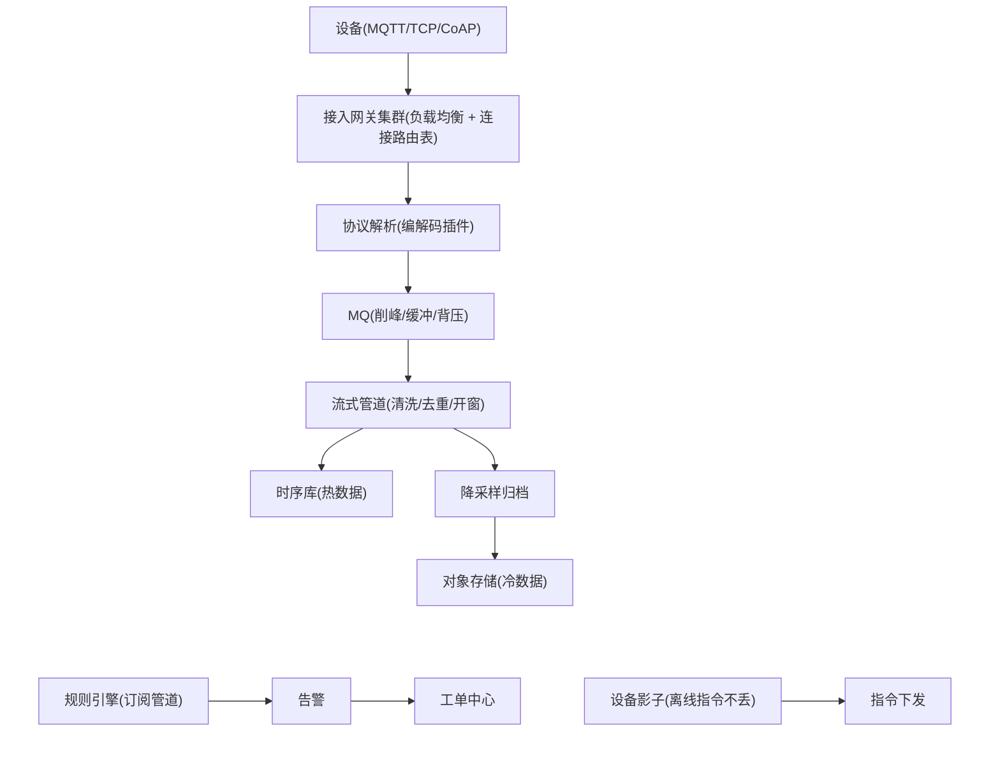

# 场景拆解：物联网数据采集平台
> [返回：软件架构学习大纲](../软件架构学习大纲.md)

> 本篇对应主笔记 [01-第六阶段-实战与案例分析](01-实战与案例分析.md) 的 1.7 物联网数据采集平台小节，原小节编号与内部结构保留，在此专项扩写；业务画像与大纲映射见[示例项目场景](../示例项目场景/01-导览.md)（物联网平台 + MES 工控扩展两个条目）。

## 1.7 物联网数据采集平台（写入型洪峰）

**场景定义**（补充场景）：售水机、智能水表、传感器等海量设备经 MQTT/TCP/CoAP/HTTP 持续上报；平台负责接入认证、解析入库、规则告警、指令下发与 OTA，规模从数万台到百万台。**核心挑战**：① 百万级长连接接入的水平扩展；② **写入型洪峰**——与秒杀的读洪峰方向相反；③ 多协议多版本接入；④ 设备不可靠（弱网断连、重复上报、乱序）；⑤ 数据体量大但价值密度低；⑥ 指令下发的可达性；⑦ 一个慢消费者拖垮整条链路（背压）。

这七个挑战可以被归并为四条主线，也是本节的展开顺序：**接入**（挑战①③，1.7.2）、**管道**（挑战②④⑦，1.7.3/1.7.4/1.7.7）、**存储**（挑战⑤，1.7.5）、**指令**（挑战⑥，1.7.6），外加一个“把一部分工作下沉到设备旁边”的边缘视角（1.7.8）。先从最容易被低估的一件事开始——把“百万设备”算成一张账。

**总体架构**：



先建立贯穿本节的坐标：这不是一个“偶尔有活动”的系统，而是一个**常态洪峰**系统——洪峰不是事故，是每天的日常。这个定位决定了它的所有架构手段都朝一个方向：不是“多挺几分钟”，而是把常态化的写入洪峰消化成可持续的管道流。

### 1.7.1 写入型洪峰的画像：把“百万设备”算成一张账

假设一套中等规模的供水物联网：**100 万台设备，每台每 5 秒上报 1 条遥测**（水位、温度、水压、阀门状态等 5~8 个字段），单条报文压缩前约 200 字节。把“100 万设备”翻译成平台侧的四行账：

| 维度 | 算法 | 结果 |
|---|---|---|
| 每秒消息数 | 100 万台 ÷ 5 秒 | **20 万条/秒**（每小时 7.2 亿条，每天 172.8 亿条） |
| 入口带宽 | 20 万条/秒 × 200 B ≈ 40 MB/s ≈ 320 Mbps；计上 TLS 与协议封装开销 ×1.5 | **约 0.5 Gbps**（摊到 20 个接入节点，每节点 5 万连接、约 16 MB/s） |
| 存储日增量 | 20 万条/秒 × 86 400 秒 = 172.8 亿条/天；未压缩约 3.5 TB/天，列存压缩后按每条 100 B | **约 1.7 TB/天** |
| 存储月增量 | 1.7 TB/天 × 30 | **约 50 TB/月** |

四行账里藏着三个反直觉的结论：

**第一，洪峰的重量在次数，不在字节。** 0.5 Gbps 的带宽，任何一台现代服务器的万兆网卡都吃得下——带宽根本不是瓶颈。真正压垮系统的是“每秒 20 万次写入事务”这个次数：普通关系库单机单行小事务的写入上限大约 2 000~5 000 行/秒（每行一个事务要过 redo/undo/binlog 三份账再 fsync），照此对账，20 万条/秒需要 **40~100 台纯写入的关系库**，还没算二级索引和备份的放大。而改成“凑满 500 条一次批量写、单次几十毫秒”，单个消费者就能写 1 万条/秒以上，十几个消费者分区接住 20 万条/秒绰绰有余——**同一份数据，事务次数差 500 倍，成本就差 500 倍**。这就是 1.7.3 批量聚合的全部动机。

**第二，洪峰是常态，不是活动。** 秒杀的洪峰持续几分钟，活动结束一切恢复原状，所以可以用“临时扩容 + 硬扛 + 事后缩容”的策略；IoT 的“洪峰”每天 24 小时不间断，172.8 亿条/天不是事故是日常。这意味着任何“挺过去就行”的手段（排队硬扛、临时限流）都不可持续，系统必须按**稳态管道**设计：入口速率、消费速率、写入速率三者长期匹配，缓冲区只吸收短时抖动，而不是长期积压。

**第三，价值密度低到要用“分级”对抗。** 172.8 亿条/天里，绝大多数是“水温 26.3℃”这类读数——单条毫无价值，聚合后才有意义；而混在其中的一天可能只有几千条告警、几百万条计费读数是高价值的。价值密度决定数据待遇，这是 1.7.5 冷热分层和 1.7.7 分级丢弃的共同前提。

**读洪峰 vs 写洪峰**（与 1.1 秒杀对照，方向相反的两类系统，秒杀详见[场景拆解：秒杀](02-场景拆解-秒杀.md)）：

| | 秒杀（读洪峰） | IoT（写洪峰） |
|---|---|---|
| 压力方向 | 百万人反复读同一处 | 百万设备持续写 |
| 第一道防线 | CDN/多级缓存扛读 | 网关只收不解，MQ 做缓冲 |
| 削峰手段 | Redis 预扣筛掉失败者 | MQ 攒批 + 消费者聚合入库 |
| 可否丢弃 | 请求可丢（用户重试即可） | 分级：遥测 QoS0 可丢，计费/控制不可丢 |

这两类系统最深的差异在最后一行：读洪峰天然“可合并”——同一件商品被百万人读，缓存一份就服务所有人，复用率越高越便宜；写洪峰天然“不可合并”——每台设备的水表读数都是唯一事实，不聚合就得一条条落盘。所以读洪峰系统的第一道防线是缓存（复用），写洪峰系统的第一道防线是管道（合并），两者没有互搬的余地。

### 1.7.2 设备接入层：百万长连接与 MQTT 的取舍

**接入网关水平扩展**：难在“连接本身就是状态”。做法与 IM 接入层同构（对照 1.4）：四层负载均衡 + 路由表（deviceId → 接入节点），节点宕机设备重连任意节点即恢复。

（“连接本身就是状态”的接入层同构展开见[场景拆解：即时通讯 IM](05-场景拆解-即时通讯IM.md)。）它值得展开：HTTP 接口是无状态的，任何节点都能服务任何请求，扩容就是加机器；而长连接不是——100 万条 TCP 连接分布在上百个接入节点上，“向设备 X 下发指令”必须先查路由表找到它挂在哪个节点。与 IM 一样，这让接入层的水平扩展多出三件功课：**连接的元数据要外置**（路由表放 Redis/注册中心，节点宕机时路由表随重连自动刷新）；**滚动发布要迁连接**（新版本上线不能一刀切断连，按节点优雅排水，让设备重连到新节点）；**重连风暴要削**（机房网络抖动 30 秒，百万设备同时重连，等效于一次接入层 DoS——broker 在拒绝/限流时给设备下发退避时长，让重连在时间轴上摊开，而不是同步撞门）。

**多协议插件化**：报文格式各异且会新增协议 → 编解码器做成插件，新协议不改核心（开闭原则的硬件版；MES 的 Modbus/OPC UA 驱动接入同构）。

（开闭原则的出处见[第一章·代码级设计能力](../01-第一阶段/01-架构思维与设计基础.md)，多协议适配层的完整讨论见[第三章·远程通信](../03-第三阶段/03-远程通信-协议序列化与演进.md)。）

插件化的判据也顺带明确：**协议适配发生在接入层，业务语义不下沉**。水表厂商 A 的报文里“累计流量”是字段 3、厂商 B 是字段 5 且要乘系数 0.1——这些差异全部消化在各自的编解码插件里，出来的统一是同一种内部事件（deviceId + 采集项 + 值 + 事件时间）。判据是：新增一种协议，只新增一个插件 + 一条配置，核心管道零改动；如果每次新协议都要改管道代码，说明抽象边界画错了。

**MQTT QoS0/1/2 的取舍：四次握手的代价**。MQTT 的三个服务质量等级，代价差异巨大：QoS1 是两报文一次往返（PUBLISH → PUBACK）；QoS2 是**四报文两次往返**（PUBLISH → PUBREC → PUBREL → PUBCOMP），且 broker 要为每条在途消息保存 packet id 与去重状态，直到四步走完才能释放。把 QoS2 放进 1.7.1 的账里算一算：20 万条/秒 × 4 报文 = 80 万报文/秒，外加随连接数与在途窗口线性膨胀的会话状态——QoS1 下这些全部减半且无状态。所以工程上的默认选择是：**大多数上报用 QoS0/1，靠上层幂等兜住 QoS1 的重复，QoS2 几乎不用**。

| 业务 | QoS 选择 | 理由 |
|---|---|---|
| 高频遥测（温度/水压，5 秒一条） | QoS0 | 丢一条只影响曲线一个点，5 秒后自然补齐；为它付 QoS1 的确认开销与重复去重成本不划算 |
| 计费读数（水表累计流量） | QoS1 + 应用层幂等 | 不能丢；重复报文靠 (deviceId, 上报序号) 去重，效果等同“恰好一次” |
| 掉线检测 | 遗嘱消息（LWT） | broker 代发，不占用业务消息的 QoS 预算 |
| 控制指令 | QoS1 + 应用层 ACK + 影子闭环 | 真正要保证的是“设备执行了”，不是“报文送到了”，详见 1.7.6 |
| QoS2 | 几乎不用 | 四报文两次往返 + 在途状态维护，多花的成本换不来 QoS1 + 幂等之外的额外价值 |

幂等兜底的完整逻辑是“**至少一次送达 + 消费端幂等 = 效果恰好一次**”（与[第三章·分布式事务](../03-第三阶段/05-分布式事务-从2PC到最终一致.md)的幂等原则同一套理论）：QoS1 在弱网下会重复投递（broker 没等到 PUBACK 就重发），与其在协议层追求精确一次（QoS2 的路线），不如在应用层用 (deviceId, seq) 把重复读数拦掉——1.7.4 的示例会实际演示这一步。

**会话保持与遗嘱消息：设备掉线检测**。两个 MQTT 会话特性在设备侧不可替代：

- **会话保持**（cleanSession=false / session 过期时间）：设备离线期间，订阅的 QoS1 指令在 broker 排队，重连后补投——这是“离线指令不丢”在协议层的底座；
- **遗嘱消息**（LWT，Last Will and Testament）：设备 connect 时登记一条遗嘱，broker 检测到 keepalive 超时或异常断连时，**代设备发布**这条遗嘱——平台由此在不轮询的情况下知道“设备 X 掉线了”，触发告警或工单。

但遗嘱的语义边界要认清：它检测的是“**连接断了**”，不是“**设备坏了**”。设备进程还活着、TCP 也连着，但传感器卡死不再产生数据——遗嘱不会响。所以关键设备要叠加第二层检测：**数据心跳超时**（超过 N 个上报周期没收到数据就告警），两层合起来才覆盖“断连”与“假活”两种故障。

### 1.7.3 写入管道：批量聚合与凑批的两个触发条件

**写入洪峰靠管道**：逐条 INSERT 无法支撑洪峰——MQ 削峰，消费者攒批聚合写时序库，按（设备、时间）分区；洪峰存进队列，落库速率由消费者自己控制。

管道的接力形态：接入层把解析后的上报**只写 MQ 不写库**（把“收”和“存”解耦），消费者从 MQ 拉取、凑批、批量写时序库。这个设计的全部好处来自一个交换：**用“每条数据多等一两百毫秒”换“数据库少写几百倍事务”**。凑批有两个触发条件，缺一不可：

1. **数量触发**：攒满 N 条（如 500 条）立即写——洪峰期它主导，保证吞吐；
2. **超时触发**：距第一批超过 T 毫秒（如 200ms）无论攒了多少都写——低峰期它主导，保证延迟有上界。

只有数量触发，夜间零星上报会攒几小时不落库；只有超时触发，洪峰期每 200ms 只写一小批，吞吐上不去。两个条件“先到先触发”，消费速率与数据延迟就都有了保障。下面的 Kotlin 示例把这条管道缩微成单机模拟：有界缓冲区（4 096 条）、凑批 500 条或 200ms 超时、批量“写库”20~60ms 抖动，先跑一段洪峰再跑一段低峰，输出两种触发的批次分布、缓冲区峰值水位与端到端延迟。

```kotlin
// 完整可运行示例：批量聚合写入模拟（洪峰/低峰两阶段）
import java.util.concurrent.ArrayBlockingQueue
import java.util.concurrent.BlockingQueue
import java.util.concurrent.TimeUnit
import java.util.concurrent.atomic.AtomicInteger
import kotlin.concurrent.thread
import kotlin.random.Random

// 上报读数：设备 ID + 序号 + 进入缓冲区的时间戳（纳秒）
data class Reading(val deviceId: Int, val seq: Long, val enqueuedAt: Long)

// 消费者：从有界缓冲区凑批——凑满 500 条，或距取到第一条超过 200ms，先到先触发
class BatchFlusher(
    private val queue: BlockingQueue<Reading>,
    private val maxBatch: Int = 500,
    private val maxWaitMs: Long = 200,
    private val rng: Random = Random(42), // 模拟批量写时序库耗时的抖动
) : Runnable {
    val sizeTriggered = AtomicInteger()
    val timeoutTriggered = AtomicInteger()
    val latencies = mutableListOf<Long>()   // 入队 → 写库完成的端到端延迟
    val batchSizes = mutableListOf<Int>()
    var maxQueueDepth = 0; private set
    @Volatile var done = false

    override fun run() {
        while (!done || queue.isNotEmpty()) {
            val first = queue.poll(20, TimeUnit.MILLISECONDS) ?: continue
            val windowStart = System.nanoTime()          // 凑批窗口从取到第一条算起
            val batch = ArrayList<Reading>(maxBatch)
            batch.add(first)
            while (batch.size < maxBatch) {
                val waitedMs = (System.nanoTime() - windowStart) / 1_000_000
                val remainMs = maxWaitMs - waitedMs
                if (remainMs <= 0) break                  // 条件二：200ms 窗口到期
                val r = queue.poll(remainMs, TimeUnit.MILLISECONDS) ?: break
                batch.add(r)
            }
            val triggeredBySize = batch.size >= maxBatch
            if (triggeredBySize) sizeTriggered.incrementAndGet() else timeoutTriggered.incrementAndGet()
            batchSizes.add(batch.size)
            if (queue.size > maxQueueDepth) maxQueueDepth = queue.size
            Thread.sleep(20 + rng.nextLong(40))           // 模拟一次批量写库 20~60ms
            val t = System.nanoTime()
            for (r in batch) latencies += (t - r.enqueuedAt) / 1_000_000
        }
    }
}

fun percentile(sorted: List<Long>, p: Double): Long =
    sorted[((sorted.size - 1) * p).toInt().coerceAtMost(sorted.size - 1)]

fun phase(name: String, queue: BlockingQueue<Reading>, producers: Int, perProducer: Int, sparse: Boolean) {
    println("== 阶段：$name ==")
    val ts = List(producers) { p ->
        thread {
            for (i in 1..perProducer) {
                // put：缓冲区满则阻塞——背压把"生产过快"挡在生产者一侧，而不是丢数据
                queue.put(Reading(p, i.toLong(), System.nanoTime()))
                if (sparse) Thread.sleep(4)              // 低峰：每台设备约 250 条/秒
                else if (i % 40 == 0) Thread.sleep(1)    // 洪峰：近乎连续突发
            }
        }
    }
    ts.forEach { it.join() }
}

fun main() {
    val queue = ArrayBlockingQueue<Reading>(4096)        // 有界缓冲区：4 万条读数
    val flusher = BatchFlusher(queue)
    val worker = thread { flusher.run() }

    phase("洪峰（2 台网关 × 5000 条，突发的写入型洪峰）", queue, 2, 5000, sparse = false)
    phase("低峰（2 台网关 × 1000 条，夜间零星上报）", queue, 2, 1000, sparse = true)

    flusher.done = true
    worker.join()

    val lat = flusher.latencies.sorted()
    val total = flusher.sizeTriggered.get() + flusher.timeoutTriggered.get()
    println("\n== 结果 ==")
    println("总读数 = ${lat.size} 条，总批次 = $total")
    println("SIZE 触发批次（凑满 500 条）= ${flusher.sizeTriggered.get()}，平均批大小 = " +
            "%.0f".format(flusher.batchSizes.take(flusher.sizeTriggered.get()).average()))
    println("TIMEOUT 触发批次（200ms 到期）= ${flusher.timeoutTriggered.get()}，平均批大小 = " +
            "%.0f".format(flusher.batchSizes.drop(flusher.sizeTriggered.get()).average()))
    println("缓冲区峰值深度 = ${flusher.maxQueueDepth} / 4096")
    println("入队→落库延迟：avg = %.1f ms, p50 = %d ms, p95 = %d ms, max = %d ms".format(
        lat.average(), percentile(lat, 0.50), percentile(lat, 0.95), lat.last()))
}
```

实际编译运行输出（kotlinc 2.2.20）：

```
== 阶段：洪峰（2 台网关 × 5000 条，突发的写入型洪峰） ==
== 阶段：低峰（2 台网关 × 1000 条，夜间零星上报） ==

== 结果 ==
总读数 = 12000 条，总批次 = 42
SIZE 触发批次（凑满 500 条）= 20，平均批大小 = 500
TIMEOUT 触发批次（200ms 到期）= 22，平均批大小 = 91
缓冲区峰值深度 = 3660 / 4096
入队→落库延迟：avg = 290.6 ms, p50 = 336 ms, p95 = 450 ms, max = 650 ms
```

逐行解读这份输出：

- **两个触发条件各管一段**：洪峰期 20 个批次全部是 SIZE 触发（缓冲区始终非空，500 条即刻凑满，每批不多不少正好 500）；低峰期 22 个批次全部是 TIMEOUT 触发，200ms 窗口平均只等来 91 条。生产节奏不同，主导的触发条件就不同——这就是“两个条件缺一不可”的直接证据。
- **有界缓冲区吸收突发**：洪峰瞬间灌入 1 万条，消费速率约 1.2 万条/秒，缓冲区水位冲到 3 660/4 096——突发先存在队列里而不是砸向存储。如果没有这个缓冲，1 万次单条 INSERT 会直接把数据库压垮。
- **延迟分布是交换的价签**：p50 = 336ms、p95 = 450ms——每条数据平均多等约 300ms（排队 + 凑批窗口），换来的是批次只有 42 个而不是 12 000 个事务。max = 650ms 是洪峰期排在队列深处的消息。对遥测数据来说，亚秒级落库延迟完全无感。
- **背压内建在 `queue.put` 里**：本例缓冲区没满（3 660 < 4 096），生产者没有被压；若把容量缩到 1 024，就能看到生产者线程被阻塞拖慢——缓冲区满的信号通过阻塞生产者向上传导，压力挡在生产侧而不是悄悄丢数据（背压的系统级讨论见 1.7.7 与[第三章·高可用与稳定性](../03-第三阶段/06-高可用与稳定性-限流熔断与多活.md)）。

参数判据：凑批窗口取上报周期的量级（设备 5 秒一报，200ms 窗口对延迟无感）；批大小不是越大越好——单批过大，失败重试的代价和批内延迟都变大，500~5 000 条/批、100~500ms 窗口是常见起步值，最终以压测定。

### 1.7.4 设备不可靠：重复、乱序与迟到

**设备不可靠的对策**：重复上报 →（deviceId, 上报序号）幂等去重；乱序/迟到 → 按**事件时间**（设备端时间戳）开窗而非处理时间，迟到数据走侧输出流补算（第三阶段：幂等与乱序处理）。

为什么设备侧的“脏”是结构性的：弱网下 TCP 断连重传制造**重复**；设备本地攒一批数据断网补传制造**乱序**（先到的是新数据、后到的是旧数据）；休眠设备唤醒后批量补传制造**迟到**。这三件事不是偶发 bug，是上报链路的常态。对策三件套——去重、按事件时间开窗、迟到侧输出——各挡一类。

下面的 Kotlin 示例把三件套缩微成单机模拟：两台水表 16 条读数 + 1 条重复上报 + 1 条断网补传的旧读数，窗口 10 秒、容忍乱序 5 秒（水位 = 已见最大事件时间 − 5s），逐条打印入窗/触发/去重/迟到的走向。

```kotlin
// 完整可运行示例：事件时间开窗——乱序重排 + (deviceId, seq) 去重 + 迟到数据侧输出
data class Reading(val deviceId: String, val seq: Long, val eventTimeSec: Long, val value: Double)

// 事件时间开窗：乱序重排 + (deviceId, seq) 去重 + 迟到数据侧输出
class EventTimeWindower(
    private val windowSec: Long = 10,      // 10 秒一个滚动窗口
    private val allowedLatenessSec: Long = 5, // 水位 = 已见最大事件时间 - 5 秒
) {
    private val seen = HashSet<Pair<String, Long>>()               // 幂等去重
    private val windows = HashMap<Long, MutableList<Reading>>()    // 窗口起点 -> 未触发数据
    private val emitted = HashSet<Long>()
    private var maxEventTime = Long.MIN_VALUE
    private val watermark: Long get() = if (maxEventTime == Long.MIN_VALUE) Long.MIN_VALUE else maxEventTime - allowedLatenessSec
    val sideOutput = mutableListOf<Reading>()                      // 迟到数据
    var dedupCount = 0; private set

    fun onEvent(r: Reading) {
        // ① 幂等去重：弱网重传/QoS1 重复投递，同一读数只算一次
        if (!seen.add(r.deviceId to r.seq)) { dedupCount++; println("  [去重] ${r.deviceId} seq=${r.seq} 重复上报，丢弃"); return }
        // ② 乱序重排：只要还没晚过水位，就塞回它的事件时间所属窗口
        if (r.eventTimeSec <= watermark) {
            sideOutput += r
            println("  [迟到] ${r.deviceId} seq=${r.seq} 事件时间=${r.eventTimeSec}s ≤ 水位=${watermark}s，进侧输出流（单独补算）")
            return
        }
        maxEventTime = maxOf(maxEventTime, r.eventTimeSec)
        val start = (r.eventTimeSec / windowSec) * windowSec
        windows.getOrPut(start) { mutableListOf() } += r
        println("  [入窗] ${r.deviceId} seq=${r.seq} t=${r.eventTimeSec}s → 窗口[$start,${start + windowSec})，水位推进到 ${watermark}s")
        // ③ 水位推进：窗口结束时间 ≤ 水位才触发——宁可等 5 秒，也不把正常乱序当迟到
        for (s in windows.keys.sorted()) {
            if (s + windowSec <= watermark && emitted.add(s)) {
                val list = windows[s]!!
                println("  [触发] 窗口[$s,${s + windowSec}) 共 ${list.size} 条，均值 = " +
                        "%.1f".format(list.sumOf { it.value } / list.size))
            }
        }
    }

    fun flushRemaining() {
        println("  [兜底] 处理结束，未触发窗口直接输出（水位未及、不允许无限等待）")
        for (s in windows.keys.sorted()) if (emitted.add(s)) {
            val list = windows[s]!!
            println("  [触发] 窗口[$s,${s + windowSec}) 共 ${list.size} 条，均值 = " +
                    "%.1f".format(list.sumOf { it.value } / list.size))
        }
    }
}

fun main() {
    val w = EventTimeWindower()
    // 到达顺序刻意构造：乱序、重复、迟到混杂——这正是弱网设备的真实到达形态
    val arrivals = listOf(
        Reading("水表A", 1, 0, 10.0), Reading("水表A", 2, 5, 11.0), Reading("水表B", 1, 2, 20.0),
        Reading("水表B", 2, 7, 21.0), Reading("水表B", 3, 14, 22.0), Reading("水表A", 3, 12, 12.0),
        Reading("水表A", 4, 18, 13.0), Reading("水表B", 4, 21, 23.0),
        Reading("水表B", 1, 2, 20.0),                      // 重复上报（去重拦截）
        Reading("水表B", 5, 29, 24.0), Reading("水表A", 5, 25, 14.0),
        Reading("水表A", 6, 33, 15.0), Reading("水表B", 6, 36, 25.0),
        Reading("水表A", 9, 6, 11.5),                      // 断网补传：seq 是新的，事件时间却早于水位（迟到）
        Reading("水表A", 7, 41, 16.0), Reading("水表B", 7, 44, 26.0),
        Reading("水表A", 8, 48, 17.0), Reading("水表B", 8, 51, 27.0),
    )
    println("== 事件时间开窗（窗口 10s，容忍乱序 5s）==")
    for (r in arrivals) w.onEvent(r)
    w.flushRemaining()
    println("\n== 结果 ==")
    println("幂等去重 ${w.dedupCount} 条，迟到侧输出 ${w.sideOutput.size} 条（${w.sideOutput.joinToString { "${it.deviceId} seq=${it.seq}" }}）")
    println("正窗正常触发，均值按事件时间归位——处理顺序乱不乱不重要，事件时间才重要")
}
```

实际编译运行输出（kotlinc 2.2.20，节选关键行）：

```
== 事件时间开窗（窗口 10s，容忍乱序 5s）==
  [入窗] 水表A seq=1 t=0s → 窗口[0,10)，水位推进到 -5s
  [入窗] 水表A seq=4 t=18s → 窗口[10,20)，水位推进到 13s
  [触发] 窗口[0,10) 共 4 条，均值 = 15.5
  [入窗] 水表B seq=4 t=21s → 窗口[20,30)，水位推进到 16s
  [去重] 水表B seq=1 重复上报，丢弃
  [触发] 窗口[10,20) 共 3 条，均值 = 15.7
  ...
  [迟到] 水表A seq=9 事件时间=6s ≤ 水位=31s，进侧输出流（单独补算）
  ...
  [兜底] 处理结束，未触发窗口直接输出（水位未及、不允许无限等待）
  [触发] 窗口[40,50) 共 3 条，均值 = 19.7
  [触发] 窗口[50,60) 共 1 条，均值 = 27.0

== 结果 ==
幂等去重 1 条，迟到侧输出 1 条（水表A seq=9）
正窗正常触发，均值按事件时间归位——处理顺序乱不乱不重要，事件时间才重要
```

四个值得钉住的点：

- **到达顺序 ≠ 事件时间顺序**：水表A seq=3（t=12）比水表B seq=3（t=14）晚到，但两条都精确落进各自的 10 秒窗口——窗口归属看事件时间，与到达顺序无关。
- **去重先于迟到判定**：重复的水表B seq=1 在去重层就被拦下，不占用迟到路径——所以去重键必须用 (deviceId, seq)，只用 deviceId 会把同设备的正常新读数误杀，只用 seq 会把不同设备的相同序号误杀。
- **水位是乱序容忍度的形式化**：容忍 5 秒意味着“晚到 5 秒内算正常乱序，归位；晚过 5 秒算迟到，侧输出”。容忍度是个纯权衡：调大，更多数据归位但窗口触发更晚（延迟换准确）；调小，触发快但更多数据被错杀成迟到。工程判据按设备上报周期与网络抖动的 p99 定——本例上报周期 5~8 秒，容忍 5 秒刚好覆盖正常抖动。
- **兜底触发不可省**：末尾两个窗口的水位一直没推进到位（水位跟着最大事件时间走，而数据流会停止），处理结束时必须把未触发窗口直接输出——对应流式任务里“作业停止/滚动重启时的 final window”机制，否则尾部数据永远悬着。

迟到数据进侧输出流后不是扔掉，而是走单独的补算链路：补写历史窗口的聚合结果、或并入下期统计——水表读数补传本就是为了计费完整，“迟到 ≠ 无效”（与[第三章·分布式事务](../03-第三阶段/05-分布式事务-从2PC到最终一致.md)对账的“迟到并入下期”同一思想）。

### 1.7.5 时序数据的存储优化：为什么不用普通关系库

**冷热分层降采样**：近期明细进时序库，历史数据降采样（秒级 → 分钟级聚合）后归档对象存储——“近期要查、历史舍不得删”的存储对策（第三阶段：NoSQL/时序选型）。

（NoSQL/时序库的完整选型判据见[第三章·数据架构](../03-第三阶段/04-数据架构-缓存分库与选型.md)。）先回答“为什么不能将就”：把 172.8 亿条/天的时序数据塞进普通关系库，会同时踩中两个结构性死穴。

**死穴一：索引膨胀。** 时序查询需要 (device_id, ts) 二级索引，而 B+ 树的每个条目都要落树——一天 172.8 亿条目，索引体积很快超过数据本身；更糟的是随机 deviceId 的写入把整棵树的树页打满（不是追加，是随机点插），缓冲池命中率崩塌，写入吞吐随之崩塌。

**死穴二：更新放大。** 关系库为“可更新”付出代价：每行事务写 redo/undo/binlog 三份账、每事务至少一次 fsync——这正是 1.7.1 里“单机 5 000 行/秒”上限的来源。而时序数据**只追加、从不更新**，为不需要的更新能力付出三份账的代价，等于全程背着降落伞跑步。

时序库的三板斧，每一斧都精准对应上面一个死穴加一类查询形态：

| 板斧 | 机制 | 判据 |
|---|---|---|
| 时间分区 | 按（设备、时间）分区，写入永远追加到“当前热分区”，顺序写盘；查询近 N 天只碰少量分区 | 时序查询几乎必然带时间范围（“近 1 小时”“昨天全天”），分区裁剪收益接近 100%；死穴一的随机树页写变成追加写 |
| 列存压缩 | 同列连续存放：时间戳 delta-of-delta、浮点 XOR、低基数字典/RLE，压缩比常达 10 倍级 | 一列内类型一致、相邻值相近（温度缓变、时间戳等差）压缩率才高；行存字段交错存，压缩率差一个量级——50 TB/月的账就是这么砍下来的 |
| 预聚合降采样 | 写入侧/后台滚出 1min/1h/1d 级聚合，明细只留近期 | 查询时间跨度 × 点数超过交互阈值（如 10 万点）就该换粗粒度；看趋势用聚合、查故障用明细，两种查询分两条路 |

**冷热分层**把三板斧的结果落到介质上——“近期要查、历史舍不得删”的完整答案：

| 层 | 介质 | 保留时长 | 查询形态 |
|---|---|---|---|
| 热 | SSD + 时序库 | 7 天 | 实时曲线、告警回查，毫秒~秒级 |
| 温 | 压缩列存/冷热分离节点 | 90 天 | 分钟级聚合曲线、周月报表，秒级 |
| 冷 | 对象存储归档 | 按监管/合同要求（1~3 年） | 审计追溯、监管取证，异步分钟级 |

分层后查询怎么**跨层**？判据是“查询意图决定路由，不让用户请求直接打穿到对象存储”：实时曲线只查热层（7 天内的原始明细都在）；趋势报表查温层的预聚合结果（不要为画一条月曲线去扫 50 TB 明细）；审计/监管取证走异步链路——从对象存储拉回归档文件、还原后查询，分钟级返回，用户界面明确显示“历史查询已提交”。反向纪律同样重要：**禁止把跨层明细查询做成在线同步接口**，一个“查去年今天的全城水压”的同步请求就能把热集群拖垮——冷数据的查询价值在“能查到”，不在“查得快”。

降采样还顺带回答了“数据保留策略”：7 天前明细可以从热层删除（温层已有分钟级聚合兜底），90 天前温层块归档到对象存储后删除——每一层的数据量都被上一板斧预先缩小过，存储成本曲线从“线性爬升”变成“阶梯饱和”。

### 1.7.6 指令下发的不对称：上行易、下行难

**指令下发与设备影子**：设备离线时指令不能丢——先写影子（desired 期望态），设备上线对比 desired/reported 补下发；MQTT QoS 按业务分级（遥测 QoS0 可丢、计费 QoS1、控制 QoS1 + 应用层 ACK）。

先把“不对称”摆上台面——同一根物理链路，上行和下行是两种完全不同的工程问题：

| | 上行（数据采集） | 下行（指令下发） |
|---|---|---|
| 量级 | 20 万条/秒，恒定洪峰 | 低频，人工/规则触发 |
| 单条价值 | 分级：遥测可丢、计费不可丢 | 基本都不可丢（发指令就是要它生效） |
| 可否凑批 | 可，凑批是核心手段 | 难，指令常常等不得凑批 |
| 对端状态 | 设备主动来，平台永远在线 | 设备可能离线/休眠/弱网 |
| 连接谁发起 | 设备 → 平台 | 平台只能复用设备建的长连接 |

上行的“易”在于三点可批：量大但每条独立、可以丢（分级）、可以等（排队凑批），平台侧还永远在线。下行的“难”根源在最后一行：**连接是设备建立的**——设备在 NAT/防火墙后面，平台无法主动拨通一台不在线的设备；MQTT 长连接在线时 broker 能实时下发，设备一离线，平台手里只剩“等它回来”这一个选项。所以下行设计的三段判据：

1. **先排队**：指令先持久化（设备影子 desired / 离线指令表），带 commandId 与 TTL；持久化成功才向调用方返回“已受理”——绝不“在线就推、离线就丢”。
2. **在线即推**：会话在线直接下发，设备执行后把结果写回 reported，影子闭环；离线则等上线补推（影子 diff）。
3. **超时失效**：TTL 到期仍未执行 → 指令作废并告警。

第三段最容易被漏掉，也最致命：用户在 App 点了“关阀”，设备恰好离线两小时——如果指令无限期排队，设备上线后“忠实地”执行了一个迟到的关阀，而现场早已人工处理完毕，这次执行轻则白做、重则出事。**过期指令必须死在队列里，而不是迟到执行**——“宁可不到，不可迟到”是控制类指令与数据类消息的本质区别。

指令还有一层幂等要做：QoS1 意味着平台侧可能重复投递（重连后 broker 补发），设备端要按 commandId 去重——维护一张最近执行过的 commandId 表（持久化，防重启丢失），重复指令只回 ACK 不重复执行。这仍是“至少一次送达 + 消费端幂等 = 效果恰好一次”的设备版。设备影子机制的核心动作（片段，展示 desired/reported/version 三元组如何让离线指令不丢；`Command`/`shadowStore`/`gateway` 为示意接口）：

```kotlin
// 设备影子：desired = 平台期望态，reported = 设备上报态，version 做乐观锁（片段）
data class DeviceShadow(
    val deviceId: String,
    val desired: Map<String, Any?>?,   // 下发"远程关阀"指令写这里
    val reported: Map<String, Any?>?,  // 设备最新上报态
    val version: Long,                 // 并发下发/上报不互相覆盖
)

fun applyCommand(shadow: DeviceShadow, cmd: Command): DeviceShadow {
    val next = shadow.copy(
        desired = cmd.patch,                      // 覆盖式更新期望态
        version = shadow.version + 1,
    )
    shadowStore.save(next)                        // 设备离线也没关系：先落影子
    if (gateway.isOnline(cmd.deviceId)) gateway.push(cmd.deviceId, cmd)  // 在线顺手推
    return next
}

// 设备上线：对比 desired 与 reported，把差异补下发——离线指令不丢的关键
fun onDeviceOnline(evt: DeviceOnline) {
    val s = shadowStore.find(evt.deviceId) ?: return
    val delta = shadowStore.diff(s.desired, s.reported) ?: return
    gateway.push(evt.deviceId, delta)
}
```

影子的精髓是把“下发指令”这个瞬态动作改写成“维护期望态”这个持久状态：指令不再是一次性消息，而是 desired 与 reported 之间的一段“待收敛差异”——设备什么时候上线无所谓，差异在就能补下发；version 乐观锁保证并发下发与设备上报互不冲突。

### 1.7.7 背压与流控全景：存储抖动时谁先扛

**背压与流控**：存储抖动时接入层继续无节制接收会导致内存耗尽，全拒收又丢数据 → MQ 天然缓冲 + 消费 lag 监控 + 分级丢弃（低价值遥测先丢），把故障隔离在管道内消化。

单点结论展开成全景，先看链路每一段各自的流控手段：

| 链路段 | 手段 | 触发信号 | 丢什么/挡什么 |
|---|---|---|---|
| 设备 → 接入 | 边缘合并上报与限速；遗嘱/心跳检测掉线；重连退避协商 | 接入节点连接数/内存水位 | 单连接超速先拒 QoS0 遥测 |
| 接入 → MQ | 有界持久队列天然缓冲；broker in-flight 窗口 | MQ 生产受阻、broker 磁盘水位 | 不丢（QoS1 持久化排队） |
| MQ → 消费 | 拉取模型按写入速率匀速拉；批量聚合自适应批大小 | 消费 lag 及其增速 | 不丢，lag 是管道水位的刻度 |
| 消费 → 存储 | 写入限速（令牌桶）+ 失败退避重试 | 存储 p99 延迟、错误率 | 超速部分在队列里排队而非硬写 |
| 全局兜底 | 分级丢弃 + 设备端退避指令 | lag 破告警阈值、队列逼近上限 | 先丢 QoS0 遥测，保计费/告警/指令回报 |

背压（backpressure）的本质是让“下游处理不过来”的信号**逐级向上传导**，每一段用自己的手段消化，而不是假装没看见地无限积压。对照表：读洪峰的限流在入口挡（429/排队页，秒杀模式），写洪峰的流控在管道排（设备数据拒绝不得，水表读数丢了就永远丢了）——同一主题的展开见[第三章·高可用与稳定性](../03-第三阶段/06-高可用与稳定性-限流熔断与多活.md)（5.1.6 写洪峰对照）与[第二章·事件驱动架构](../02-第二阶段/04-事件驱动架构.md)（推拉模型与背压来源）。

**推演一遍“存储抖动时谁先扛”**。设时序库写入 p99 从 50ms 恶化到 2s（磁盘抖动或合并压缩与写入打架）：

1. **消费层先感知**：写入限速（令牌桶按实测写入能力配额）生效，消费速率下降，lag 开始上升——第一道反应是“减速”，不是“硬写”；
2. **MQ 扛住缓冲**：lag 上升期数据在 MQ 里排队，不丢失也不崩溃。MQ 能撑多久是一笔可以预先算清的账：20 万条/秒 × 200 B ≈ 40 MB/s，若 broker 有 1 TB 余量，理论上限约 7 小时——这就是“修复窗口”的长度，监控上要显示的不是裸 lag，而是“按当前增速还能撑 X 小时”；
3. **lag 破阈值，分级丢弃启动**：按“价值密度 × 可恢复性”排序丢弃——先丢标记“可丢”的 QoS0 遥测（价值密度最低，且下一条 5 秒后就补上），其次是实时曲线明细（温层聚合可部分恢复）；计费读数、告警、指令回报一律不丢。丢弃要计数并暴露指标，恢复后能说清丢了什么；
4. **队列逼近上限，背压传回源头**：接入层对部分设备下发退避指令（上报间隔 5s → 60s），让百万设备的写入速率整体降档——源头降速比平台硬扛体面得多；
5. **绝对禁止项**：接入层把未解析报文堆在自己进程内存里“等存储恢复”——堆到 OOM，接入重启、百万连接全断、设备风暴式重连，一次存储抖动升级成全平台停摆。这就是“入口不断、管道可涨、下游可慢”的保命原则（舱壁隔离与慢消费者治理的完整展开见[第三章·高可用与稳定性](../03-第三阶段/06-高可用与稳定性-限流熔断与多活.md)）。

一句话总结这段推演：**故障要被隔离在管道内消化**——每一层都提前写清楚“我扛多久、先丢什么、什么时候向上传”，故障来临时按预案降级，而不是现场发挥。

### 1.7.8 边缘计算：什么放边缘，什么必须上云

前面所有小节都默认“数据全量上云再处理”，但 1.7.1 的账已经暗示了另一条路：172.8 亿条/天里大量数据在源头就注定无用（重复读数、静止传感器的恒定值）。把它们在边缘裁掉，是比云端任何优化都便宜的优化。边缘计算不是把云架构搬到设备旁，而是按一条判据重新分工——**时间尺度与数据作用域决定位置**：

| 逻辑 | 放哪 | 判据 |
|---|---|---|
| 无效读数过滤、本地去重 | 边缘 | 数据在源头就能判对错，传上去再扔是白花带宽 |
| 高频采集降采样（1s 采集 → 5s 上报均值/极值） | 边缘 | 上报量的成本发生在全网每一段链路，源头裁 80% 就是全链路省 80% |
| 断网续传（本地环形缓冲，恢复后补传） | 边缘 | 弱网是常态不是异常；MES 车间断网产线照转、恢复补传完全同构 |
| 协议转换（Modbus/OPC UA → MQTT） | 边缘网关 | 老设备不会说云的协议，翻译必须发生在它们旁边（1.7.2 插件化的边缘形态） |
| 毫秒级安全联锁（超温停机） | 现场控制层，**绝不上云** | 时间尺度决定位置：云上一轮 RTT 就超了控制回路的时间预算；急停权永远归现场 |
| 跨设备聚合、全城诊断 | 云 | 单台边缘网关看不见全局，作用域出车间就得上来 |
| 模型推理、大模型分析 | 云 | 模型与算力集中在云，边缘只传特征或告警结果 |
| 设备管理、OTA 编排 | 云 | 灰度编排需要全局设备视图与统一状态机 |

判据收拢成三问：**这个逻辑的反应时间是多少？**（毫秒级闭环 → 现场；秒级以上 → 云）**它需要看多大数据范围？**（单设备/单车间 → 边缘；全局 → 云）**断网时它还必须工作吗？**（必须 → 边缘自治；可以等 → 云端补算）。三问答完，位置自然浮现。工控场景对这条判据有更严格的分层版本——ISA-95/Purdue 模型里“毫秒级控制归 PLC、秒级协同归 MES”，见[示例项目场景](../示例项目场景/01-导览.md)的工控扩展小节：IoT 拼规模，工控拼约束，两者在边缘网关这一层会师。

### 1.7.9 常见错误

- ❌ 每条上报一次 HTTP 请求直写数据库。
  ✅ 长连接接入 + MQ 削峰 + 批量聚合入库。
- ❌ 按到达时间（处理时间）开窗统计，网络抖动让统计失真。
  ✅ 事件时间开窗，迟到数据侧输出补算。
- ❌ 指令只做在线推送，设备离线即丢。
  ✅ 设备影子 + 上线对比补发。
- ❌ 慢消费者靠接入层内存无限堆积硬扛。
  ✅ MQ 缓冲 + lag 告警 + 分级丢弃。
- ❌ 指令不带 TTL，无限期排队等设备上线。
  ✅ 排队 + 在线即推 + 超时失效三段判据——过期指令必须死在队列里。
- ❌ 时序数据塞普通关系库单表，三个月后单表二十亿行，靠每月手工归档维持。
  ✅ 时间分区 + 列存压缩 + 预聚合降采样的时序库，冷热分层自动沉降。
- ❌ 所有上报一律 QoS2“图个安心”。
  ✅ QoS 按业务分级：遥测 QoS0、计费 QoS1 + 幂等、指令 QoS1 + 应用层 ACK。

### 1.7.10 与你的真实项目联动

**与你的真实项目联动**：① 桶装水商城的售水机/智能水表就是典型接入设备——水表读数驱动周期购自动续订与结算，售水机缺水/故障上报经规则引擎自动生成工单中心的维修工单（事件驱动 + 1.2 的幂等收单防重复工单）；② MES 的设备采集本质上是 IoT 在工厂内的一个特例：协议换成 OPC UA/Modbus、实时性与 OT/IT 隔离要求更高，但“接入—管道—存储—指令”的骨架完全同构（详见[示例项目场景](../示例项目场景/01-导览.md)的分工说明）。

再补两处这个场景特有的联动点：水表读数是计费数据，走 QoS1 + (deviceId, seq) 幂等去重 + 补传并入下期账单，一分钟一报甚至一天一报——它与每 5 秒一报的遥测在同一平台但不同 QoS 与保留策略，正对应 1.7.2 的分级表；售水机缺水告警的规则引擎消费的是管道里同一条事件流——管道不只是写给存储，规则引擎/告警/计费是同一份流的多个订阅者（一套接入，多路消费），这正是[第二章·事件驱动架构](../02-第二阶段/04-事件驱动架构.md)发布订阅的典型形态。

**回指**：[第二阶段](../02-第二阶段/01-经典架构模式.md)（消息队列、事件驱动）、[第三阶段](../03-第三阶段/01-分布式系统核心技术.md)（远程通信、NoSQL/时序选型、幂等、背压与高可用）、[第五阶段](../05-第五阶段/01-工程化与运维视角.md)（海量设备数据的可观测性）。

**延伸回指**：多协议适配层与编解码插件化的完整展开见[第三章·远程通信](../03-第三阶段/03-远程通信-协议序列化与演进.md)；宽表/时序库选型判据与冷热分层见[第三章·数据架构](../03-第三阶段/04-数据架构-缓存分库与选型.md)；写洪峰限流与背压、慢消费者隔离见[第三章·高可用与稳定性](../03-第三阶段/06-高可用与稳定性-限流熔断与多活.md)；“至少一次 + 幂等 = 恰好一次”与消息语义见[第二章·事件驱动架构](../02-第二阶段/04-事件驱动架构.md)与[第三章·分布式事务](../03-第三阶段/05-分布式事务-从2PC到最终一致.md)；消费 lag 与设备数据的可观测性指标见[第五章·可观测性](../05-第五阶段/02-可观测性-日志指标与链路追踪.md)；容量推演与压测方法（凑批参数怎么定）见[第五章·性能工程](../05-第五阶段/05-性能工程-容量规划与压测.md)；IM 接入层同构见[场景拆解：即时通讯 IM](05-场景拆解-即时通讯IM.md)、读洪峰对照见[场景拆解：秒杀](02-场景拆解-秒杀.md)；本节在主笔记中的位置与相邻场景对照见[01-第六阶段-实战与案例分析](01-实战与案例分析.md)。

**【本节自测】**（只出题不作答；作答后按批改流程逐题点评并记入章节答案档案）

1. 数字推演：把“10 万台设备、每 30 秒上报一条、单条 300 字节”算成四行账（每秒消息数 / 入口带宽 / 存储日增量 / 月增量，写出算式）。据此判断：这套规模起步时用“关系库 + 攒批插入”还是直接上时序库？依据哪条判据？两年后设备涨到 80 万台，决策要不要变？
2. QoS 取舍：水表计费读数为什么选 QoS1 + 应用层幂等而不是 QoS2？把 QoS2 在“20 万条/秒”下要多付的两笔代价各算一遍。有同学提议“QoS0 + 应用层补偿：每条读数携带上一条读数，丢了靠下一条追补”——这个方案在什么前提下成立？对水表计费适用吗？边界在哪？
3. 背压推演：时序库集群写入抖动持续 30 分钟。请按“存储 → 消费 → MQ → 接入 → 设备”的顺序，逐段写出每一层先后发生什么、触发信号是什么、丢什么保什么；最后说明为什么“接入层把报文堆在进程内存里等恢复”是最坏的选项，它会引发什么次生故障？
4. 边缘判据：你的 MES 车间要新增四个功能——① OPC UA 转 MQTT 的协议接入；② 质量参数超标的毫秒级联锁停机；③ 全厂设备 OEE 周报；④ 断网时本地缓存报工数据、恢复后补传。各放边缘还是云？逐一给出判据（时间尺度 / 数据作用域 / 断网可用性）。

## 替换清单

- “1.7 物联网数据采集平台（写入型洪峰）”总体架构 → `flowchart`（原图主链因过长折成两行，Mermaid 无法折行，主链改为自上而下；规则引擎、设备影子两条支链仍横排置于下方，箭头方向不变）
