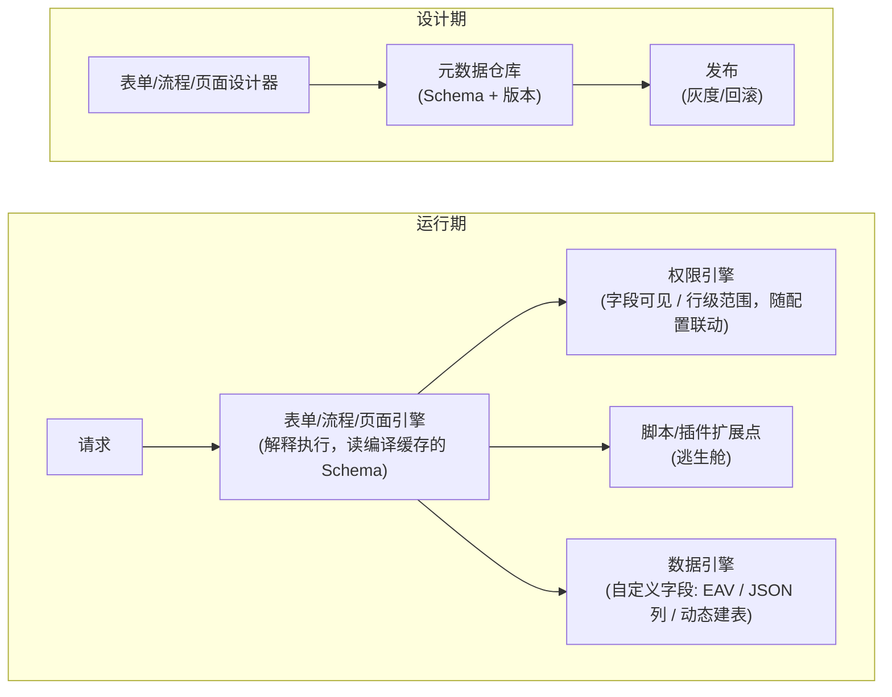
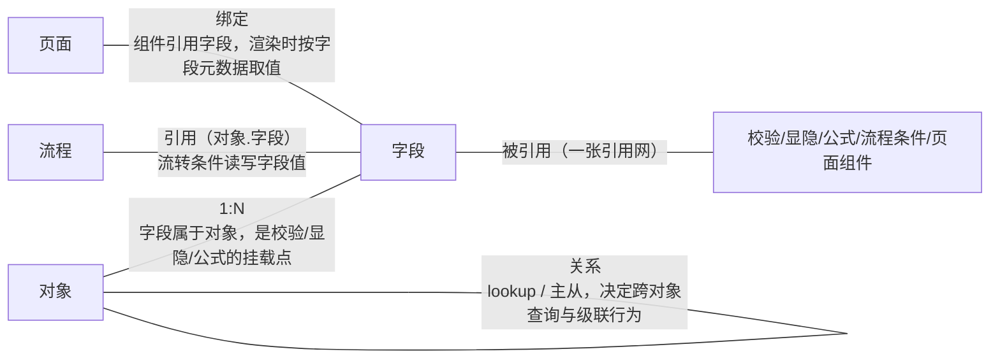

# 场景拆解：低代码开发平台
> [返回：软件架构学习大纲](../软件架构学习大纲.md)

本文是主笔记《[第六阶段：实战与案例分析](01-实战与案例分析.md)》`### 1.8 低代码开发平台（元数据驱动）`小节的完整展开：小节编号不变，原小节内容全部保留（“关键设计点”八条原文照录，常见错误与回指原文照录），在其下按“场景 → 挑战 → 方案推演 → 权衡 → 反例/修正 → 工程判据”逐条深化。场景取材见[示例项目场景/10-低代码开发平台](../示例项目场景/10-低代码开发平台.md)；入口建议从工单中心切进去——“新增工单类型只配表单不改代码”是内嵌的低代码，先理解单体里这口小井，再延伸到独立平台的整片矿脉。文中两段 Kotlin 完整示例（带 `main`）均在 Kotlin 2.2.20 下实际编译运行，引用的输出为真实运行结果。


## 场景定义

**场景定义**（补充场景）：业务/实施人员通过拖拽配置而非编码搭建应用：表单（字段、校验、联动）、流程（审批、分支、会签）、页面（列表、报表、大屏）、数据建模；运行时引擎解释执行元数据。典型产物：OA 审批、报修登记、巡检打卡——工单中心“新增工单类型只配表单不改代码”的能力，本质就是内嵌的低代码。**核心挑战**：① 一切皆元数据；② 用户自定义字段怎么存；③ Schema 版本演化；④ 流程引擎通用性陷阱；⑤ 解释执行性能；⑥ 字段/行级权限；⑦ 配置发布治理；⑧ 逃生舱。

这八个挑战背后只有一条主线：**低代码平台的产物不是业务数据，而是“搭建能力”本身**。秒杀、IM、支付拆解的对象是“一条业务链路怎么扛住流量与故障”；这里拆解的对象是“一条生产元数据的流水线怎么治理”。业务数据错了影响一单，元数据错了影响该表单/流程下**全部**历史与在途单据——爆炸半径按量级放大，所以版本化、灰度、回滚、引用完整性这些“软件工程自身的纪律”在这里从加分项变成生死线。这也是它被放进第六阶段收官部分的原因：前五个阶段学到的治理手段，在这里被应用到“配置资产”上，是对全程的一次综合检验。

## 总体架构

**总体架构**：



读这张图先抓两条时间线。**设计期**是“元数据的 IDE”：设计器只是编辑器，真正的主人是元数据仓库——Schema 带版本地存进去，经发布（灰度/回滚）才生效；设计器再花哨，也只是往仓库里写数据。**运行期**是“元数据的虚拟机”：请求进来，引擎按当前生效版本解释执行，三个下行箭头是引擎的三只手——数据引擎管“自定义字段存哪”，权限引擎管“谁能看哪些”，扩展点管“配置表达不了的例外”。设计期与运行期唯一的耦合点是**元数据仓库里的版本约定**：引擎读到的必须是不可变、带版本、经过发布确认的 Schema，而不是设计器草稿。这条约定一旦被绕过（比如为了“改完立即生效”让引擎直读草稿），版本化、灰度、回滚三条治理全部作废——后面“配置版本化与发布”一节会专门推演。

## 关键设计点（原文八条照录，逐条深化见后续小节）

**关键设计点**：

1. **元数据解释执行 vs 代码生成**：解释执行——即时生效、可灰度回滚、平台控制力强，代价是性能；代码生成——性能好、产物可脱离平台，代价是失去运行时控制与统一治理。多数平台选“解释 + 热点编译缓存”（解释器模式，第一阶段）。
2. **自定义字段存储三方案**：EAV（最灵活，多表 JOIN 查询爆炸）、JSON 列（折中，MySQL/PG 的 JSON 索引能力决定上限）、动态建表（查询最好，DDL 治理是噩梦）——按查询需求选型，数据架构的经典 trade-off（第三阶段）。
3. **Schema 版本化向后兼容**：历史单据必须按**提交时的旧版结构**渲染与校验——单据钉住 schemaVersion，旧版 Schema 只追加不修改（事件溯源的“不可变历史”思想，第二阶段）。
4. **流程引擎通用性陷阱**：分支/并行/会签/撤回/加签越做越像通用 BPM，复杂度失控。YAGNI：明确平台边界——配置覆盖 80% 常见流程，剩下的交给逃生舱（第四阶段：通用性的代价）。
5. **解释执行性能**：Schema 解析结果编译缓存（解析一次、渲染 N 次），高频页面预渲染；性能预算反过来限制元数据模型能有多复杂。
6. **权限与元数据联动**：字段可见性、行级数据范围是配置的一部分，由权限引擎在渲染管道统一执行，不散落在各组件（管道-过滤器）。
7. **配置即代码**：改表单直接生效会击穿在途流程——配置变更走版本化 + 灰度 + 回滚（第五阶段发布治理平移到配置资产）。
8. **逃生舱设计**：复杂业务逻辑不硬塞进配置，留脚本/插件扩展点——平台管骨架，代码管例外（开闭原则与平台边界）。

## 元数据驱动的本质：从“写代码”到“写数据”

“一切皆元数据”不是口号，它是三个具体的转变。**逻辑载体的转变**：原来行为写在类与方法里（编译期固化），现在写在 Schema 记录里（运行时解释）——“必填”“数字类型”“硬件故障才显示重启次数”，从 `if` 语句变成了字段定义表的行。**变更单位的转变**：改行为不再走“改码 → 测试 → 构建 → 部署”的发布流水线，而是走“改配置 → 发布版本”的配置流水线，从天级降到分钟级。**变更主体的转变**：动手的人从工程师换成实施/业务人员，这意味着配置界面必须把工程概念（类型、约束、依赖）翻译成业务语言（字段、校验、显示条件）。三个转变层层递进，前一个是后一个的前提：正因为逻辑变成了数据，变更才能快，快了才轮得到非工程师来动手。

但“写数据”不等于没有逻辑——逻辑没有被消灭，而是被**沉降**了：把可枚举的共性逻辑（表单渲染、类型校验、显隐判断、流程流转）一次性沉淀进引擎，把变化的部分抽成数据。哪些逻辑值得沉降？判据与 [DDD 通用性边界](../04-第四阶段/03-领域驱动设计-DDD.md)一脉相承：**变化必须同构且高频**。工单中心的工单类型月月加、表单字段月月变，同构（都是“字段 + 校验 + 流转”的变奏）且高频，值得抽成元数据；而“押金退还金额必须等于押金原值扣掉折损”这类规则，全平台可能只有一处、语义特异，写死在代码里反而是对的。

**80 分界与逃生舱判据**。“配置覆盖 80%、逃生舱兜 20%”是一个经验分界而不是精确统计，它真正的含义是：配置语言的表达力必须覆盖该领域大多数常见场景，剩下表达不了的部分必须有**不经过配置的出口**。一个没有逃生舱的平台会被逼死，三个信号可以自查：

1. **需求逃逸率攀升**：客户定制需求里“平台做不了”的比例持续走高，实施团队开始绕过平台直接改代码、改库，元数据与代码两套事实并存——元数据模型名存实亡的第一个征兆。
2. **配置复杂度触及上限**：为了表达复杂逻辑，实施人员把配置搭成天书——流程图几百个节点、条件嵌套七八层、靠复制粘贴维护。配置的认知成本超过等价代码时，“低代码”已经变成“低可读性代码”。
3. **交付周期无差异**：同样一个定制需求，配置路线的实施周期与纯编码持平。平台只剩学习成本，没有交付杠杆，客户为什么用它？

三个信号命中任何一条，正确动作都是补逃生舱（或承认该场景不该进平台），而不是继续给配置语言加能力——给配置语言加 `if/else`、加循环、加函数调用，等于重新发明一门劣质编程语言，且没有编程语言的工具链。反方向同样是反例：**逃生舱大开、来者不拒**，实施人员图省事什么都写脚本，引擎退化成“带界面的 IDE”，版本化/灰度/权限等治理全部被旁路。所以逃生舱必须**收口**：注册、审核、版本化，与元数据走同一套发布管线（详见“逃生舱设计”一节）。

## 元数据建模：五类元数据与引用完整性

平台内部真正流转的元数据通常归为五类，职责边界要切清楚：

- **对象（Object）**：业务实体类型，如“报修工单”“押金单”——它是自定义字段存储的挂载点，也是权限与流程的归属单位。
- **字段（Field）**：属性名 + 类型 + 校验规则 + 显隐规则。数量最多、变更最频繁的一类，公式与表达式的直接消费者。
- **关系（Relationship）**：对象之间的查找引用（lookup）与主从（master-detail），决定跨对象查询、级联删除与从表归属。
- **页面（Page）**：布局 + 组件，组件绑定字段。是元数据的视图层，本身不含业务语义，只做“哪个字段摆在哪、以什么控件呈现”。
- **流程（Process）**：节点、流转条件、参与人规则；条件里引用字段值（“金额 > 5000 转总监审批”）。

五类元数据的引用关系（文字版）：



这张网立刻引出一个经典完整性问题：**页面绑定了一个字段，实施人员把这个字段删了，怎么办？**不做防御的后果是运行时爆炸——渲染时取不到字段元数据直接报错白屏；更隐蔽的是流程条件引用了被删字段，流转判断悄悄走错分支。方案推演按三步走，缺一不可：

1. **删除前引用检查**：引擎反查该字段被多少处引用（页面绑定、流程条件、公式、其他字段的显隐规则、关系定义）。有引用则拒绝删除并返回引用清单，引导先迁移——这一步把“删除”从随手操作变成显式决策。
2. **软删（废弃）**：检查通过也不物理删除，先打 `deprecated` 标记：停止新建引用，存量数据与历史单据仍按原结构渲染。给一个版本周期的废弃期，让潜在引用方暴露出来。
3. **两阶段收尾**：废弃期满再做物理删除，且只删元数据行；提交数据里的历史值不动（JSON 列方案天然如此，历史值只是留在了旧单据的 JSON 里；EAV 方案则连数据行一并保留为死数据）。

工程判据：**引用计数是元数据平台的一等公民**，地位相当于垃圾回收里的 root set——没有它，任何“删除”按钮都是埋在生产里的雷。实现上通常是一张独立的引用边表（引用方类型、引用方 ID、被引用元数据 ID），删除操作先查这张表；它同时还是“影响面分析”的数据源——改一个字段前，能直接列出哪些页面、流程会受影响，这是配置资产才有的治理福利。

## 最小元数据驱动表单引擎（Kotlin 可运行示例）

下面把“元数据定义 → 运行时校验 → 条件显隐 → 改元数据不改代码”压缩成一个可运行的最小示例。真实平台的字段类型有几十种、条件用表达式 AST（见下一节），这里裁剪到最小可理解集：三种字段类型、四种比较算子、一条显隐规则。注意示例刻意保留了 Schema 的 `version` 字段——它是“单据钉住版本”的钩子，展开见版本化一节。

```kotlin
// 最小元数据驱动表单引擎：改元数据不改代码（已编译运行验证：Kotlin 2.2.20）
// 元数据 = 表单定义（字段 / 类型 / 必填 / 显隐规则）；引擎 = 解释执行 + 校验 + 显隐决策

enum class FieldType { TEXT, NUMBER, ENUM }

// 显隐/校验共用的最小条件：字段 与 常量 比较（真实平台会换成表达式 AST，见表达式引擎一节）
enum class CondOp { EQ, NEQ, GT, NOT_EMPTY }

data class Cond(val field: String, val op: CondOp, val value: Any? = null) {
    fun eval(input: Map<String, Any?>): Boolean = when (op) {
        CondOp.EQ -> input[field] == value
        CondOp.NEQ -> input[field] != value
        CondOp.GT -> (input[field] as? Number)?.toDouble()?.let { it > (value as Number).toDouble() } == true
        CondOp.NOT_EMPTY -> !input[field].toString().isBlank() && input[field] != null
    }
}

data class FieldMeta(
    val name: String,
    val label: String,
    val type: FieldType,
    val required: Boolean = false,
    val visibleWhen: Cond? = null,   // null = 恒可见
    val options: List<String> = emptyList(),  // 仅 ENUM 用
)

data class FormSchema(val form: String, val version: Int, val fields: List<FieldMeta>)

// 校验结果 = 每个字段的显隐决策 + 错误列表
data class FieldDecision(val name: String, val visible: Boolean, val error: String?)
data class ValidationResult(val decisions: List<FieldDecision>, val ok: Boolean) {
    override fun toString(): String {
        val body = decisions.joinToString("\n") { d ->
            "  ${d.name.padEnd(14)} ${if (d.visible) "显示" else "隐藏"}" +
                (d.error?.let { "  [未通过: $it]" } ?: "  [通过]")
        }
        return (if (ok) "校验通过" else "校验未通过") + "\n" + body
    }
}

class FormEngine {
    // 编译缓存：真实平台在这里把 Schema 解析成中间表示；本例 Schema 本身就是结构化对象，直接复用
    private val cache = mutableMapOf<String, FormSchema>()
    fun compile(schema: FormSchema): FormSchema {
        cache["${schema.form}@${schema.version}"] = schema
        return schema
    }

    fun validate(schema: FormSchema, input: Map<String, Any?>): ValidationResult {
        val s = cache["${schema.form}@${schema.version}"] ?: compile(schema)
        val decisions = s.fields.map { f ->
            val visible = f.visibleWhen?.eval(input) ?: true
            val error = when {
                !visible -> null                                   // 隐藏字段不参与校验
                f.required && input[f.name] == null -> "必填字段缺失"
                input[f.name] == null -> null
                f.type == FieldType.NUMBER && input[f.name] !is Number -> "应为数字"
                f.type == FieldType.ENUM && input[f.name] !in f.options -> "取值不在枚举范围内"
                else -> null
            }
            FieldDecision(f.name, visible, error)
        }
        return ValidationResult(decisions, decisions.all { it.error == null })
    }
}

fun main() {
    val engine = FormEngine()

    // ===== v1 元数据：报修登记表单 =====
    val v1 = FormSchema("报修登记", 1, listOf(
        FieldMeta("issueType", "故障类型", FieldType.ENUM, required = true,
            options = listOf("HARDWARE", "NETWORK", "SOFTWARE")),
        FieldMeta("description", "故障描述", FieldType.TEXT, required = true),
        // 显隐规则：只有硬件故障才显示"重启次数"
        FieldMeta("rebootCount", "重启次数", FieldType.NUMBER,
            visibleWhen = Cond("issueType", CondOp.EQ, "HARDWARE")),
    ))

    // 用例 A：网络故障，漏填描述、"断网时长"字段在 v1 里还不存在
    println("== 用例 A（v1 元数据）==")
    println(engine.validate(v1, mapOf("issueType" to "NETWORK", "rebootCount" to "三次")))
    println()

    // 用例 B：硬件故障，重启次数为非数字
    println("== 用例 B（v1 元数据）==")
    println(engine.validate(v1, mapOf("issueType" to "HARDWARE", "description" to "打印机不出纸", "rebootCount" to "三次")))
    println()

    // 用例 C：软件故障，隐藏字段误填了值也不校验（显隐决定校验范围）
    println("== 用例 C（v1 元数据）==")
    println(engine.validate(v1, mapOf("issueType" to "SOFTWARE", "description" to "登录白屏", "rebootCount" to 5)))
    println()

    // ===== v2 元数据：只加不改——新增 NETWORK 专属必填字段 + 新增枚举值 =====
    // 引擎一行代码未改，只是换了一份元数据
    val v2 = FormSchema("报修登记", 2, listOf(
        FieldMeta("issueType", "故障类型", FieldType.ENUM, required = true,
            options = listOf("HARDWARE", "NETWORK", "SOFTWARE", "PERIPHERAL")),
        FieldMeta("description", "故障描述", FieldType.TEXT, required = true),
        FieldMeta("rebootCount", "重启次数", FieldType.NUMBER,
            visibleWhen = Cond("issueType", CondOp.EQ, "HARDWARE")),
        FieldMeta("outageHours", "断网时长(小时)", FieldType.NUMBER, required = true,
            visibleWhen = Cond("issueType", CondOp.EQ, "NETWORK")),
    ))

    println("== 用例 D（v2 元数据：网络故障漏填断网时长）==")
    println(engine.validate(v2, mapOf("issueType" to "NETWORK", "description" to "全楼断网")))
    println()

    println("== 用例 E（v2 元数据：新增枚举值 PERIPHERAL 正常通过）==")
    println(engine.validate(v2, mapOf("issueType" to "PERIPHERAL", "description" to "扫描仪离线")))
}
```

实际运行输出：

```
== 用例 A（v1 元数据）==
校验未通过
  issueType      显示  [通过]
  description    显示  [未通过: 必填字段缺失]
  rebootCount    隐藏  [通过]

== 用例 B（v1 元数据）==
校验未通过
  issueType      显示  [通过]
  description    显示  [通过]
  rebootCount    显示  [未通过: 应为数字]

== 用例 C（v1 元数据）==
校验通过
  issueType      显示  [通过]
  description    显示  [通过]
  rebootCount    隐藏  [通过]

== 用例 D（v2 元数据：网络故障漏填断网时长）==
校验未通过
  issueType      显示  [通过]
  description    显示  [通过]
  rebootCount    隐藏  [通过]
  outageHours    显示  [未通过: 必填字段缺失]

== 用例 E（v2 元数据：新增枚举值 PERIPHERAL 正常通过）==
校验通过
  issueType      显示  [通过]
  description    显示  [通过]
  rebootCount    隐藏  [通过]
  outageHours    隐藏  [通过]
```

三个值得盯住的细节。**其一，显隐决定校验范围**：用例 A 里 `rebootCount` 填了 `"三次"`（类型非法），但因为 `issueType=NETWORK` 使其隐藏，校验照样通过——隐藏字段不渲染、不校验是表单引擎的必备语义，否则用户会在界面上看不到的字段上被拦住提交，形成死锁；用例 C 验证的是同一语义的对称面：隐藏字段被恶意塞了值也不参与校验。**其二，“改元数据不改代码”是真的**：v2 换了一整份 Schema（新增字段、新增枚举值、新增显隐规则），`FormEngine` 一行未动——引擎的价值就等于它覆盖的变化面，这正是“沉降共性、外置变化”的收益。**其三，显隐决策与校验结果同构输出**：每个字段一行“显示/隐藏 + 通过/未通过”，实施人员排障时可以逐字段对账——配置系统的可运维性，很大程度上取决于引擎输出的**可解释性**。

## 公式/表达式引擎：AST、沙箱与编译缓存

结构化条件对象（上面的 `Cond`）走不了多远：实施人员要配“金额 > 5000 且（VIP 或 近 90 天无投诉）”，嵌套组合一出现，条件对象的字段数和构造复杂度都会爆炸。条件长成表达式是必然，而表达式意味着平台开始需要**语法、解析、沙箱**——这是低代码平台工程量的核心台阶，跨过去就是“配置语言”，跨不过去就卡死在简单条件。最小实现思路是教科书三段式：**词法分析**（把字符串切成 token）→ **递归下降解析**（每条产生式一个函数，运算优先级由函数调用链的深度天然表达：`parseOr` 调 `parseAnd` 调 `parseCmp` 调 `parseAdd` 调 `parseMul` 调 `parsePrimary`）→ **AST**（sealed interface 的一棵树），求值就是对树递归。这正是[第一阶段解释器模式](../01-第一阶段/03-代码级设计能力.md)的低代码落地：2.3.1 讲“为什么表单与流程天然适合解释器 + 组合”，[设计模式使用场景](../01-第一阶段/07-设计模式使用场景.md)的 3.11 与“组合二：低代码表单引擎”给出模式级骨架；本例补上它们没有展开的两件事——沙箱与编译缓存。造轮子警报仍然有效：真要自己写分词器和语法分析器之前，先评估 SpEL / Aviator / QLExpress 这类现成引擎。

```kotlin
// 最小公式/表达式引擎：递归下降解析 → AST → 编译缓存求值（已编译运行验证：Kotlin 2.2.20）
// 语法（无循环、无赋值、无函数调用——沙箱靠语法保证）：
//   orExpr  := andExpr ('||' andExpr)*
//   andExpr := cmpExpr ('&&' cmpExpr)*
//   cmpExpr := addExpr (('='|'!='|'>'|'>='|'<'|'<=') addExpr)?
//   addExpr := mulExpr (('+'|'-') mulExpr)*
//   mulExpr := primary (('*'|'/') primary)*
//   primary := NUMBER | IDENT | 'true' | 'false' | '(' orExpr ')'

sealed interface Expr
data class NumLit(val v: Double) : Expr
data class BoolLit(val v: Boolean) : Expr
data class VarRef(val name: String) : Expr
data class BinOp(val op: String, val l: Expr, val r: Expr) : Expr

class ExprException(msg: String) : RuntimeException(msg)

// ---------- 词法 ----------
private fun tokenize(src: String): List<String> {
    val tokens = mutableListOf<String>()
    var i = 0
    while (i < src.length) {
        val c = src[i]
        when {
            c.isWhitespace() -> i++
            c.isDigit() || (c == '.' && i + 1 < src.length && src[i + 1].isDigit()) -> {
                val start = i
                while (i < src.length && (src[i].isDigit() || src[i] == '.')) i++
                tokens.add(src.substring(start, i))
            }
            c.isLetter() -> {
                val start = i
                while (i < src.length && (src[i].isLetterOrDigit() || src[i] == '_')) i++
                tokens.add(src.substring(start, i))
            }
            src.startsWith("<=", i) || src.startsWith(">=", i) || src.startsWith("!=") ||
                src.startsWith("&&", i) || src.startsWith("||", i) -> {
                tokens.add(src.substring(i, i + 2)); i += 2
            }
            c in "+-*/()<>=" -> { tokens.add(c.toString()); i++ }
            else -> throw ExprException("无法识别的字符: '$c'")
        }
    }
    return tokens
}

// ---------- 递归下降解析（括号深度受限，防表达式膨胀）----------
private const val MAX_DEPTH = 32

class Parser(private val tokens: List<String>) {
    private var pos = 0
    private var depth = 0
    private fun peek(): String? = tokens.getOrNull(pos)
    private fun eat(t: String): String {
        if (peek() != t) throw ExprException("期望 '$t'，实际 '${peek() ?: "输入结束"}'")
        pos++; return t
    }

    fun parseOr(): Expr {
        var e = parseAnd()
        while (peek() == "||") { eat("||"); e = BinOp("||", e, parseAnd()) }
        return e
    }
    private fun parseAnd(): Expr {
        var e = parseCmp()
        while (peek() == "&&") { eat("&&"); e = BinOp("&&", e, parseCmp()) }
        return e
    }
    private fun parseCmp(): Expr {
        val e = parseAdd()
        val op = peek()
        if (op != null && op in listOf("=", "!=", ">", ">=", "<", "<=")) { pos++; return BinOp(op, e, parseAdd()) }
        return e
    }
    private fun parseAdd(): Expr {
        var e = parseMul()
        while (peek() == "+" || peek() == "-") { val op = eat(peek()!!); e = BinOp(op, e, parseMul()) }
        return e
    }
    private fun parseMul(): Expr {
        var e = parsePrimary()
        while (peek() == "*" || peek() == "/") { val op = eat(peek()!!); e = BinOp(op, e, parseMul()) }
        return e
    }
    private fun parsePrimary(): Expr {
        val t = peek() ?: throw ExprException("表达式意外结束")
        return when {
            t == "(" -> {
                if (++depth > MAX_DEPTH) throw ExprException("嵌套深度超过 $MAX_DEPTH，拒绝解析")
                eat("("); val e = parseOr(); eat(")"); depth--; e
            }
            t == "true" -> { pos++; BoolLit(true) }
            t == "false" -> { pos++; BoolLit(false) }
            t[0].isDigit() -> { pos++; NumLit(t.toDouble()) }
            t[0].isLetter() -> { pos++; VarRef(t) }
            else -> throw ExprException("此处不期望 token: '$t'")
        }
    }
}

// ---------- 求值（步数预算 + 只读上下文）----------
class ExpressionEngine(private val maxSteps: Int = 100_000) {
    // 编译缓存：解析一次，求值 N 次
    private val cache = mutableMapOf<String, Expr>()
    fun compile(src: String): Expr = cache.getOrPut(src) { Parser(tokenize(src)).parseOr() }

    fun eval(src: String, vars: Map<String, Any?>): Any? {
        val ast = compile(src)
        var steps = 0
        return evalNode(ast, vars) { if (++steps > maxSteps) throw ExprException("求值步数超出预算 $maxSteps") }
    }

    private fun evalNode(e: Expr, vars: Map<String, Any?>, budget: () -> Unit): Any? {
        budget()
        return when (e) {
            is NumLit -> e.v
            is BoolLit -> e.v
            is VarRef -> if (vars.containsKey(e.name)) vars[e.name]
                         else throw ExprException("引用了未提供的变量 '${e.name}'")
            is BinOp -> {
                // && 与 || 短路：右侧可能根本不求值
                if (e.op == "&&") {
                    val l = truthy(evalNode(e.l, vars, budget))
                    if (!l) false else truthy(evalNode(e.r, vars, budget))
                } else if (e.op == "||") {
                    val l = truthy(evalNode(e.l, vars, budget))
                    if (l) true else truthy(evalNode(e.r, vars, budget))
                } else {
                    val l = evalNode(e.l, vars, budget); val r = evalNode(e.r, vars, budget)
                    when (e.op) {
                        "+" -> num(l) + num(r); "-" -> num(l) - num(r)
                        "*" -> num(l) * num(r); "/" -> num(l) / num(r)
                        "=" -> if (l is Number && r is Number) num(l) == num(r) else l == r
                        "!=" -> if (l is Number && r is Number) num(l) != num(r) else l != r
                        ">" -> num(l) > num(r); ">=" -> num(l) >= num(r)
                        "<" -> num(l) < num(r); "<=" -> num(l) <= num(r)
                        else -> throw ExprException("未知运算符 ${e.op}")
                    }
                }
            }
        }
    }

    private fun num(v: Any?): Double = (v as? Number)?.toDouble()
        ?: throw ExprException("算术运算要求数字，实际: $v")
    private fun truthy(v: Any?): Boolean = when (v) {
        is Boolean -> v
        null -> false
        else -> throw ExprException("逻辑运算要求布尔值，实际: $v")
    }
}

fun main() {
    val engine = ExpressionEngine()

    // 同一份表达式编译一次，用不同上下文求值 N 次（编译缓存的意义）
    val rule = "amount > 1000 && level >= 2 || vip = true"
    println("表达式: $rule")
    println("  首次编译并求值(amount=1500, level=1, vip=false): ${engine.eval(rule, mapOf("amount" to 1500, "level" to 1, "vip" to false))}")
    println("  第2次求值(amount=800,  level=3, vip=false): ${engine.eval(rule, mapOf("amount" to 800, "level" to 3, "vip" to false))}")
    println("  第3次求值(amount=800,  level=1, vip=true):  ${engine.eval(rule, mapOf("amount" to 800, "level" to 1, "vip" to true))}")
    println("  第4次求值(amount=900,  level=2, vip=false): ${engine.eval(rule, mapOf("amount" to 900, "level" to 2, "vip" to false))}")

    // 显隐规则的典型写法：字段引用 + 比较（本例语法不含字符串字面量，枚举用数字码比较）
    println()
    println("显隐规则示例 issueType = 2（2 = 网络故障）：")
    println("  issueType=2(网络故障): ${engine.eval("issueType = 2", mapOf("issueType" to 2))}")
    println("  issueType=1(硬件故障): ${engine.eval("issueType = 2", mapOf("issueType" to 1))}")

    // 优先级验证：&& 高于 ||
    println()
    println("优先级: false || true && false 应为 false（&& 先结合）: ${engine.eval("false || true && false", emptyMap())}")

    // 沙箱与边界：未知变量被拒绝，而不是当 null 吞掉
    try {
        engine.eval("amout > 1000", mapOf("amount" to 2000))  // 拼写错误
    } catch (e: ExprException) {
        println("沙箱拦截未知变量: ${e.message}")
    }
}
```

实际运行输出：

```
表达式: amount > 1000 && level >= 2 || vip = true
  首次编译并求值(amount=1500, level=1, vip=false): false
  第2次求值(amount=800,  level=3, vip=false): false
  第3次求值(amount=800,  level=1, vip=true):  true
  第4次求值(amount=900,  level=2, vip=false): false

显隐规则示例 issueType = 2（2 = 网络故障）：
  issueType=2(网络故障): true
  issueType=1(硬件故障): false

优先级: false || true && false 应为 false（&& 先结合）: false
沙箱拦截未知变量: 引用了未提供的变量 'amout'
```

**沙箱判据三条**。表达式是租户的实施人员写的，必须按不可信输入对待，但“封”的方式有高下之分：

1. **语法封死**：语法里没有循环、没有赋值、没有函数调用——于是死循环不存在、状态篡改不存在、注入（调用系统能力）不存在。安全性靠“表达不了”而不是“运行时拦截”，这是白名单思维在语言层的落地。反例：拿 Groovy、JS `eval` 这类全功能脚本引擎当公式引擎用，全功能 = 全功能攻击面，再补多少黑名单都堵不完。
2. **资源预算**：括号嵌套深度上限（本例 32，防 AST 膨胀）+ 求值步数预算（本例 10 万步，防超长表达式耗尽 CPU）。预算要在**解析与求值两个阶段分别设**——解析阶段防“构造炸弹”，求值阶段防“执行炸弹”。
3. **上下文封闭**：引擎只读调用方传入的变量表，未声明的引用直接报错而不是当 `null` 吞掉。示例末尾故意把 `amount` 拼成 `amout`，引擎立刻拦截——这个“报错优于静默”的实施体验极其关键：如果静默返回 `false`，一条显隐规则会无声地失效，实施人员要在界面上反复点才发现“字段怎么不出现”，排障成本远高于启动时一次报错。

**性能与编译缓存**。解析（词法 + 语法）贵、求值便宜，所以把“表达式文本 → AST”做成编译缓存：同一份规则文本解析一次、每条单据求值一次，命中第 2 次起就跳过解析。缓存的失效键必须包含**元数据版本**——元数据发版即失效重编，否则新旧规则串版。更高频的路径（如列表页每行求值一次）可以再往下走一层：把 AST 预编译成字节码或原生函数（SpEL 编译模式、Aviator 的思路），代价是编译本身变重、只值得对热点做——这就是“解释 + 热点编译缓存”在表达式粒度的完整落地。

**一个真实 bug 的教学价值**。本示例初版跑出来 `issueType = 2` 对 `issueType=2` 求值为 `false`：Kotlin 里 `Int(2) == Double(2.0)` 结构相等不成立，而解析器把所有数字字面量统一存成 `Double`，变量值却是调用方传来的 `Int`——修正方式是等号两侧都是数字时先统一转 `Double` 再比较。教训超出 Kotlin：**平台级表达式引擎必须有一张明确的类型协同（coercion）规则表**（数字与数字、字符串与枚举、null 与任何值各怎么比），否则实施人员会配出“看起来对、运行时静默错”的规则。这类错误不抛异常、只悄悄走错分支，是配置系统里排查成本最高的一类故障；所以严谨的平台会在表达式**保存时**做静态类型检查与试算（拿样例数据跑一遍给实施看结果），把错误拦在设计期。

## 自定义字段存储三方案选型

关键设计点第 2 条给的三方案，选型的第一问不是“哪种技术更先进”，而是：**列表页要不要按自定义字段过滤、排序、聚合？** 录入态（表单提交一次写一条）三方案都能胜任，性能差异全在**查询态**：EAV 查询要行转列，字段一多 SQL 膨胀、索引难命中；JSON 列靠 JSON 路径索引与生成列，能力上限由数据库版本决定；动态建表是原生列原生索引，查询最好但后面跟着 DDL 治理成本。实践中常见的混合策略是“**JSON 列打底 + 热字段物化**”：全量自定义字段收进 JSON 列保灵活，把列表页高频过滤的两三个字段物化成生成列/独立列并建索引——灵活性与查询性能各取所需，物化清单本身也是元数据的一部分（由平台管理，不让业务直改库）。三方案的字段级 SQL 示例、索引写法与演进成本对比已在[第三阶段动态字段存储](../03-第三阶段/04-数据架构-缓存分库与选型.md)的 3.4 节完整展开，此处不重复；只补一条与本文强相关的判据：**存储方案一旦选定，迁出成本极高**（EAV 转 JSON 是一次全量数据搬运动作），所以选型要在第一个大租户接入前定，且在元数据仓库里记录“对象 × 存储方案”的映射——允许不同对象用不同方案（核心高频对象动态建表，长尾对象 JSON 列），但每个对象内部不混用。

## Schema 版本化与配置发布治理

关键设计点第 3 条与第 7 条合起来讲，因为它们是同一枚硬币的两面：第 3 条管“**历史怎么不被改坏**”（不可变 + 钉住），第 7 条管“**变更怎么安全上线**”（版本化 + 灰度 + 回滚）。

**版本树与不可变版本**。元数据的生命周期是一棵版本树：`draft（草稿）→ published（发布）→ 历史版本（可回滚）`。核心纪律是**已发布的版本对象不可变**：“改配置”的真实含义是基于 v(n) 派生出 v(n+1) 草稿，审核通过后把 `published` 指针从 v(n) 拨到 v(n+1)；回滚就是把指针拨回去，O(1) 操作，不影响任何已提交数据。为什么必须不可变？直接 UPDATE“当前那份”Schema 会同时破坏四件事：没有历史可回滚；在途草稿与生产共用一份对象，改到一半的数据直接击穿线上；灰度无从谈起（灰度需要新旧两版并存）；审计无从谈起（“上周三这表单长什么样”答不出来）。这四条分别是版本控制、隔离、灰度、审计的根基——配置资产需要版本控制，和代码需要 Git 是同一个道理。

原文的片段示意把“单据钉住版本”压缩成三行：

```kotlin
// Schema 解释执行：单据钉住提交时的 Schema 版本，历史单据永远按旧版渲染与校验
data class BizOrder(
    val id: Long,
    val data: Map<String, Any?>,
    val schemaRef: SchemaRef,   // 指向具体版本，而非"当前版"
)

class FormEngine(private val schemaCache: SchemaCache, private val bizRepo: BizOrderRepo) {
    fun render(order: BizOrder): RenderedForm {
        val schema = schemaCache.compiled(order.schemaRef)          // 编译缓存：解析一次，渲染 N 次
        return RenderedForm(schema.fields.map { it.render(order.data[it.name]) })
    }

    fun submit(draft: Draft, ref: SchemaRef): BizOrder {
        schemaCache.compiled(ref).validate(draft.data)              // 解释执行校验规则（解释器模式）
        return bizRepo.save(BizOrder(data = draft.data, schemaRef = ref))  // 写入即钉住版本
    }
}
```

（片段示意，未含 `main`；`SchemaRef` 保证渲染与校验都从钉住的版本取 Schema，这就是“历史单据永远按旧版渲染”的全部实现要点。）

**灰度发布元数据**。灰度的粒度按租户或按流量：同一张表单，白名单租户/灰度流量走 v2，其余走 v1。与代码灰度的机制差异值得体会：代码灰度靠多实例版本 + 网关路由（部署操作），元数据灰度靠“租户 → 版本映射表”（数据操作）——切换秒级生效、秒级回退，不需要碰任何实例。而灰度期间两版并存之所以不打架，靠的正是**单据钉住版本**：每个用户提交的数据钉住他当时看到的版本，v1 用户和 v2 用户提交的单据各按各的版本渲染，互不干扰。发布流程治理（预案、观察窗口、中止条件）与代码发布一致，直接平移[第五阶段部署与发布策略](../05-第五阶段/03-部署与发布策略-CICD与灰度.md)的灰度小节即可。

**只加不改：新版本元数据的兼容性判据**。v(n+1) 必须能正确渲染 v(n) 提交的数据，四条判据：

1. **只加字段**，不改既有字段的类型与含义；新增字段对旧数据视为空值。
2. **改名 = 新字段 + 显式数据迁移**，不做原地 rename——旧单据里的旧字段名是“发生过的事实”，不可篡改。
3. **收紧校验**（新必填、新取值范围）只作用于新提交；存量单据按各自钉住的旧版校验与渲染。这正好呼应前面表单引擎示例的用例 D/E：v2 新增的必填字段 `outageHours` 只约束 v2 的新提交，v1 期间提交的单据不需要它。
4. **删除走软删**（见元数据建模一节），不做物理删除。

违反复例：v2 把“客户等级”从文本枚举（`GOLD`）改成数字码（`2`），灰度期间按 v1 提交的单据被运营用 v2 的报表统计——枚举对不上，客户等级分布直接错乱，而且错得无声（统计不会报错，只会给出错误的数）。这类“语义改名”是配置变更里杀伤力最大的一种，因为它同时破坏数据兼容与统计口径。

**回滚的一致性**。回滚把 `published` 指针拨回 v1 之后，灰度期间用 v2 提交的单据怎么办？答案藏在钉住机制里：这些单据钉的是 v2，仍然按 v2 渲染与校验，**回滚回退的是“之后的提交形态”，不篡改“已发生的事实”**——v2 新增的字段值还在数据里，只是新提交不再要求它。这正是关键设计点第 3 条说的“事件溯源不可变历史思想”在配置资产上的应用：历史（已提交单据 + 已发布版本）只追加、不修改，现状（published 指针）随时可拨回。

## 流程引擎通用性陷阱：复杂度棘轮

关键设计点第 4 条点出的陷阱，机理是**复杂度棘轮**：每加一个流程特性——会签、加签、转办、回退、超时升级、条件跳转——都不是加一个开关，而是三重膨胀：配置语法要多一种节点/属性，引擎语义要多一套状态迁移规则，测试矩阵要多一个维度（会签 × 加签 × 回退的组合语义，没有几页规范说不清）。棘轮效应在于特性只进不退：一旦有客户用了会签，就删不掉了，下个特性还得跟会签组合——棘轮只能朝“更通用”方向紧。走到极端，流程配置图变成没人敢动的天书，实施人员靠复制粘贴上一个项目的配置改细节，配置系统的可维护性反而不如代码。

破局的两条路都通向“收口”。**其一，明确配置能力上限**：判据很朴素——当流程配置的使用文档超过几十页、实施人员要培训一周才能独立上手时，说明已经越过配置语言的表达力边界，再堆特性只会加速天书化；此时应把复杂流程退到逃生舱（服务端脚本钩子或外部服务编排），配置只管骨架。**其二，承认边界外的事不该进平台**：有些客户的流程复杂度是业务本质复杂度（ERP 级的审批矩阵、制造行业的工艺流转），那本来就不是低代码该吃下的市场——用[第四阶段“什么不该做成平台”的反例专题](../04-第四阶段/03-领域驱动设计-DDD.md)（2.8）的对照表自查：变化是否同构？是否高频？抽象的摊销者是否存在？三条有一条不满足，通用流程引擎就是负资产。这条陷阱的更底层原理（通用性的代价、YAGNI）见[第四阶段方法论](../04-第四阶段/01-架构方法论.md)。

## 解释执行性能：三级缓存与性能预算

关键设计点第 5 条的“编译缓存”值得展开成一个三级金字塔，逐级加粗粒度：

1. **Schema 解析缓存**：把 Schema（JSON/行数据）解析成内存对象图（字段列表、规则树），进程内缓存，键 = `表单@版本`。所有请求受益，元数据发版失效。这是“解析一次、渲染 N 次”的基座。
2. **编译产物缓存**：在对象图之上再编译一层——表达式 AST（上一节）、权限谓词的编译形式、渲染模板。键同样含版本。热点路径（列表页每行求值）从这里获益最大。
3. **渲染结果缓存 / 预渲染**：整页渲染结果缓存，只适合**高频 + 低个性化**的页面——工单中心 90% 的报修单是同一张表单的变体，整页缓存命中率高；而按用户权限裁剪过字段可见性的页面，每人看到的都不一样，整页缓存必失效，只能退回第 1、2 级。预渲染适用性判据就一条：缓存的键能不能稳定穷举（按表单版本缓存的可以，按“用户 × 角色 × 行数据”缓存的不可枚举）。

金字塔之外还有一条反直觉纪律：**性能预算反哺元数据建模**。单表单字段数上限（如 50）、条件嵌套深度上限（表达式引擎的 32 层不只是安全预算也是性能预算）、单租户对象数配额——这些限制表面上“限制用户”，实际是保护解释执行的 P99：解释执行的耗时与 Schema 复杂度线性甚至超线性相关，没有建模层的预算约束，一个实施人员搭出 500 字段的表单，性能团队就要在运行期为此买单。预算应该在**设计器里**就拦（保存时校验），而不是等渲染超时再查——这与第一阶段的“质量属性驱动设计”同源：性能目标先变成约束，再变成设计器里的一条校验规则。

## 权限与元数据联动：执行点唯一

关键设计点第 6 条强调“统一执行”，展开说就是**执行点唯一**原则。权限规则本身也是元数据——“角色 × 字段 × 谓词”的三元组（客服角色看不见 `内部处理备注` 字段；华东区管理员只能查华东区的单），它和表单元数据存放在同一个仓库、走同一套版本化与发布流程。执行点却必须唯一：**字段可见性由渲染管道统一过滤，行级范围由数据引擎统一注入查询谓词**——任何页面组件、任何自定义插件不得自带权限判断。为什么这么严？散落执行必然漏：平台每新增一个页面/导出功能/报表组件，都要求作者记得挂一遍权限判断，漏一处就是一次越权（最典型的泄露路径不是页面，而是“被遗忘的导出接口”）。统一执行点让“新增页面”天然继承权限语义，把安全从“记得做”变成“不做不行”。

两个落地细节。**其一**，行级范围最终要落到存储层的查询下推——共享表方案里，租户隔离谓词 + 权限范围谓词必须进索引设计（与[第三阶段数据架构](../03-第三阶段/04-数据架构-缓存分库与选型.md)的索引小节联动），否则权限正确但查询全表扫。**其二**，显隐与权限是两件事：显隐是表单元数据里的交互规则（“硬件故障才显示重启次数”），权限是安全边界（“客服角色永不显示成本字段”）——后者必须独立于表单配置生效，即使实施人员配错了显隐规则，权限引擎仍然兜底。管道-过滤器作为统一执行点的结构基础，见[第二阶段](../02-第二阶段/01-经典架构模式.md)。

## 多租户元数据隔离

元数据与业务数据的生命周期不同：**元数据是平台资产**（平台方治理、统一升级、单租户总量小——几十个表单定义），**业务数据是租户资产**（隔离与合规要求高、量大、增长快）。资产属性不同，隔离档位就应该分开选：

| 隔离档位 | 元数据（表单/流程定义）怎么放 | 业务数据（提交的数据）怎么放 |
|---------|------------------------------|------------------------------|
| 共享表 + tenant_id | **默认且几乎总是够用**：定义行数少、查询恒带 tenant_id，平台统一升级、统一治理最简单 | **默认起点**：所有查询谓词带 tenant_id 且作为索引前缀；配合行级权限引擎 |
| 独立 schema / 独立库 | **一般不拆**：元数据共享是平台统一升级的前提；只有元数据定制极端分化的大客户才考虑 | **升级档**：给强合规/超大租户——隔离与爆炸半径最小化、备份恢复可按租户操作；代价是 N 份 DDL 治理、平台运营与跨租户报表变难 |

选择判据是**隔离诉求与运维成本的正面对账**：合规要求（数据出境、行业监管）、误操作爆炸半径（一个租户的 DDL 事故不能波及他人）推着往右走，运维成本（备份、监控、升级各 N 份）拉着往左走。典型演进路线：起步全部共享表；出现强合规大客户时，**只把它的业务数据升档**到独立 schema/独立库，元数据保持共享——平台升级照样一次即可完成。另一条经验是动态建表方案（自定义字段存储的第 2 条）与独立 schema 天然组合：该租户的动态表全部落在自己的 schema 里，DDL 治理边界清晰，不会污染共享表空间。多租户在数据面的更多权衡（分片键、路由）与[第三阶段](../03-第三阶段/01-分布式系统核心技术.md)的数据分片内容衔接；控制面/数据面分离的视角则与[示例项目场景/00-导览.md](../示例项目场景/00-导览.md)的多租户 SaaS 控制平面场景互为参照——低代码平台的“元数据仓库 + 引擎”本身就是一个小型控制面。

## 逃生舱设计：契约与治理

关键设计点第 8 条说的“留扩展点”，展开为形态谱系与治理约束。**形态谱系**（按平台控制力从强到弱）：

1. **公式/表达式**：控制力最强——沙箱语法封死、资源预算、上下文封闭（本文表达式引擎一节的三条判据），能表达纯计算与判断。
2. **服务端脚本钩子**：`beforeSubmit` / `afterApprove` 这类生命周期钩子上挂脚本，运行在平台管理的沙箱脚本引擎里，能调平台白名单 API——表达有副作用的轻逻辑（写第三方、发通知）。
3. **外部代码插件**：独立部署的服务，通过平台回调或事件订阅接入——隔离最强、能力最大，治理也最重。

无论哪一档，逃生舱的交付物都是**契约**：扩展点接口 + 输入输出 DTO + 超时与重试策略——“内核提供机制，插件提供策略”正是[微内核/插件化架构](../02-第二阶段/05-其他重要架构风格.md)（第二阶段 4.6）的教义；低代码平台是微内核最典型的现代样本。**治理约束**只有一条铁律：逃生舱产物与元数据走同一套发布管线——版本化、审核、灰度、回滚一个不少。脚本不审就上线、插件不灰度就全量，等于把代码发布的全部风险从工程流程里挪到了实施流程里，而实施流程恰恰没有工程流程的那些护栏。

反例刻画边界：逃生舱给的是**裸数据库连接**——插件直接 UPDATE 业务表，绕过引擎的校验、权限、审计与版本钉住机制，平台此前所有的保证一夜归零。所以判据是：**逃生舱的能力边界 = 平台愿意为其兜底的能力边界**——提供脚本引擎而不是数据库连接，提供白名单 API 而不是任意内网访问；给不出去的能力，就别给通道。

## 常见错误（原文三条照录 + 补两条）

**常见错误**：

- ❌ Schema 只有一份“当前版”：改字段后历史单据渲染错乱、已提交数据校验不过。
  ✅ 版本化 + 单据钉住提交时版本。
- ❌ 把 ERP 级复杂逻辑硬塞进流程配置，配置图变成没人敢动的天书。
  ✅ 逃生舱：配置管流程骨架，复杂逻辑走代码/脚本。
- ❌ 自定义字段盲目选 EAV，列表页一条 SQL 打出几十个 JOIN。
  ✅ 按查询模式在 EAV/JSON/动态建表中选型。
- ❌ 拿全功能脚本引擎（Groovy / JS `eval`）当公式引擎：注入面全开、死循环没人拦，靠黑名单堵漏永远堵不完。
  ✅ 表达式沙箱三判据：语法封死（无循环/赋值/函数调用）+ 资源预算（深度/步数）+ 上下文封闭（变量白名单）。
- ❌ 删字段一点即删：引用它的页面渲染白屏、流程条件走错分支。
  ✅ 引用计数 → 拒绝或迁移 → 软删废弃期 → 两阶段物理删除，历史数据不动。

## 工程判据清单

按决策顺序收拢成十问，供评审时逐条过：

1. **什么值得元数据化**：变化同构且高频；只满足一条就不做，写代码。
2. **逃生舱三信号**：需求逃逸率攀升 / 配置天书化 / 配置交付周期追平编码——命中即补逃生舱，而不是给配置语言加能力。
3. **五类元数据边界**：对象、字段、关系、页面、流程各管各的；页面不含业务语义，流程条件只引用字段。
4. **删除即决策**：引用计数先行，软删过渡，物理删除两阶段，提交数据永不因删字段而动。
5. **显隐语义**：隐藏字段不渲染、不校验、不参与导出——三处一致，否则交互死锁。
6. **存储选型第一问**：列表页要不要按自定义字段过滤排序？热字段物化是混合解。
7. **版本纪律**：已发布版本不可变，回滚 = 指针拨回；单据钉住提交时版本。
8. **只加不改四条**：只加字段；改名即新字段 + 迁移；收紧校验只管新提交；删除走软删。
9. **表达式沙箱**：语法封死、双阶段预算、变量白名单、保存时静态检查 + 样例试算。
10. **逃生舱与元数据同管线**：脚本/插件也要版本化、审核、灰度、回滚；能力边界即兜底边界。

## 回指

**回指**：[第一阶段](../01-第一阶段/01-架构思维与设计基础.md)（解释器/组合模式、开闭、YAGNI）、[第二阶段](../02-第二阶段/01-经典架构模式.md)（管道-过滤器、事件溯源思想）、[第三阶段](../03-第三阶段/01-分布式系统核心技术.md)（动态字段存储选型）、[第四阶段](../04-第四阶段/01-架构方法论.md)（DDD 通用性边界：什么不该做成平台）、[第五阶段](../05-第五阶段/01-工程化与运维视角.md)（配置灰度与回滚）。

细化阅读（本文扩写直接依托的小节）：

- [第一阶段 · 代码级设计能力 2.3.1](../01-第一阶段/03-代码级设计能力.md)：低代码平台的解释器 + 组合场景案例（模式动机层）。
- [第一阶段 · 设计模式使用场景 3.11 与“组合二：低代码表单引擎”](../01-第一阶段/07-设计模式使用场景.md)：解释器选型信号与现成引擎提醒（模式骨架层）。
- [第二阶段 · 其他重要架构风格 4.6 微内核](../02-第二阶段/05-其他重要架构风格.md)：逃生舱插件契约的架构定位。
- [第三阶段 · 数据架构 3.4 动态字段存储](../03-第三阶段/04-数据架构-缓存分库与选型.md)：EAV / JSON 列 / 动态建表的 SQL 级对比。
- [第四阶段 · DDD 2.8 反例专题：低代码平台](../04-第四阶段/03-领域驱动设计-DDD.md)：什么不该做成平台的判定表。
- [第五阶段 · 部署与发布策略](../05-第五阶段/03-部署与发布策略-CICD与灰度.md)：灰度发布的预案与中止条件，平移到元数据发布。

## 【本节自测】

1. 元数据驱动的“80 分界”里，给出三个信号判断“没有逃生舱的平台会被逼死”；逃生舱大开又会掉进什么反例？各自怎么防？
2. 实施人员把“删除字段”当成普通操作。平台要靠哪套机制保证历史单据不受影响？写出从删除请求到物理删除的完整流程。
3. 为什么“隐藏字段不参与校验”是表单引擎的必备语义？如果隐藏字段仍按必填校验，用户会遇到什么死锁？这个语义要在哪几处保持一致？
4. 表达式引擎沙箱三条判据分别防什么？为什么说“语法封死”优于“运行时拦截”？“引用未声明变量直接报错”这个设计，在实施体验上换来了什么？
5. v3 元数据把“重启次数”的校验收紧为“必须 ≥ 0 且 ≤ 100”：按“只加不改”判据，这条收紧应作用于存量单据还是新提交？若随后回滚到 v2，灰度期间用 v3 提交的单据该怎么渲染？依据是什么？

## 替换清单

- “总体架构”设计期 / 运行期总体架构 → `flowchart`（两个子图）
- “元数据建模：五类元数据与引用完整性”五类元数据的引用关系（文字版）→ `flowchart`（带标签的无向关系边；原文只有“对象—字段”标了基数，未用 `erDiagram` 以免臆造其余基数）
