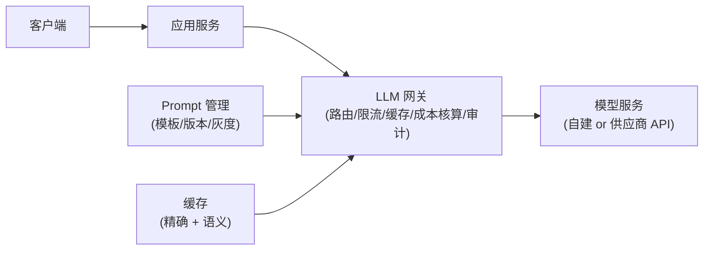
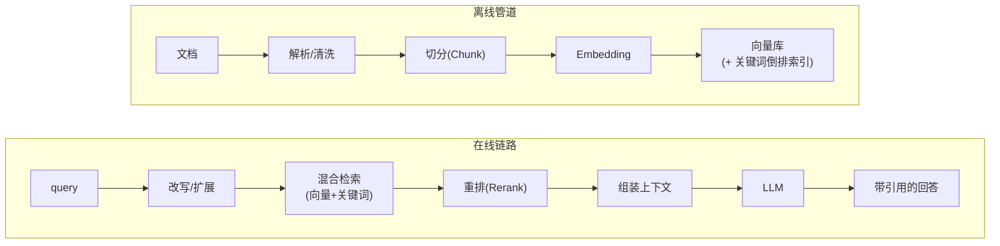
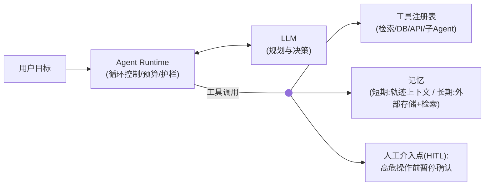

# 进阶选修：AI 应用架构

> [返回：软件架构学习大纲](../软件架构学习大纲.md)

> 本篇对应主笔记 [01-第六阶段-实战与案例分析](01-实战与案例分析.md) 的“3. 进阶选修：AI 应用架构”一节，原节内容全部保留、子节编号（3.1~3.3）不变，在此专项扩写并新增 3.4；文末自测在原题基础上接续新增。文中三个完整 Kotlin 示例均为离线确定性模拟（不调用任何外部模型 API），已用 kotlinc 2.2.20 实际编译运行验证。

## 3. 进阶选修：AI 应用架构

AI 应用没有推翻前面的知识，而是把它们放进一组新约束：**延迟秒级、输出不确定、成本按 token 计费、失败模式是“一本正经地胡说”而非报错**。三个子方向层层递进：LLM 应用（直接调模型）→ RAG（外挂知识）→ Agent（自己干活）。

先给一个定位判断，避免把这一节学成玄学：AI 应用架构里**约九成的问题是老问题**——超时、降级、限流、缓存、契约、灰度、审计，前五个阶段全部覆盖；真正新的只有一成——概率性输出带来的校验与评测、按 token 计费带来的成本工程、模型快速迭代带来的抽象与隔离。所以每遇到一个 AI 名词，先问一句“它的传统对应物是什么”：LLM 网关对应 API 网关加熔断降级，RAG 对应搜索引擎加数据管道，Agent 对应工作流引擎加幂等调用方。三个子方向就是三道综合题：3.1 考“网关 + 降级 + 成本”，3.2 考“搜索 + 数据管道 + 评测”，3.3 考“编排 + 幂等 + 权限 + 人机协同”。

### 3.1 LLM 应用架构

**场景**：业务系统集成大模型，如“AI 生成商品标题”“智能客服首答”。**核心挑战**：① 延迟高且方差大（首 token 秒级）；② 成本与调用量成正比；③ 输出不确定；④ 模型迭代快，必须保留供应商可替换性。

**总体架构**：



**关键设计点**：

1. **LLM 网关是必备组件**：统一鉴权、限流、多模型路由、成本核算、内容审计——就是第三阶段“网关 + 熔断降级”的 AI 翻版，供应商在网关后面可随时替换。
2. **流式输出**：逐 token 返回（SSE），首 token 时间（TTFT）决定体验；总延迟秒级可接受，“干等完整答案”不可接受。
3. **降级链**：主模型超时/限流 → 小模型（裁剪上下文）→ 缓存/规则兜底。AI 同样必须设计降级，“模型一宕机业务就不可用”是设计失败。
4. **Prompt 即代码**：模板版本化、灰度、可回滚——把 Prompt 变更当成第五阶段的发布对待，而非改配置随手上线。
5. **成本控制**：精确缓存（同问直返）、上下文裁剪（历史摘要化）、简单请求分流小模型。

以下为片段示意（协程 Flow 风格，突出“缓存→主模型→超时降级”三步；完整可运行版本见 3.1.3）：

```kotlin
// LLM 网关：缓存 → 主模型 → 超时降级小模型（第三阶段：超时/降级/缓存的 AI 变体）
class RoutingLlmGateway(
    private val primary: LlmClient,
    private val fallback: LlmClient,
    private val cache: PromptCache,
) : LlmGateway {
    override suspend fun stream(prompt: PromptContext): Flow<Chunk> {
        cache.exactHit(prompt.signature())?.let { return it.text.chunkedFlow() }  // 1. 缓存直返
        val buffer = StringBuilder()
        val flow = withTimeoutOrNull(8.seconds) { primary.stream(prompt) }
            ?: return fallback.stream(prompt.trimmed())   // 2. 超时降级：小模型+裁剪上下文
        return flow.onEach { buffer.append(it.text) }
            .onCompletion { cache.put(prompt.signature(), buffer.toString()) }   // 3. 回填缓存
    }
}
```

**常见错误**：

- ❌ 业务代码直连某家模型 SDK 写死在服务里。
  ✅ 网关 + 适配层，供应商可替换。
- ❌ 等完整回答再一次性返回。
  ✅ 流式，首 token 优先。
- ❌ Prompt 改动不经测试直接上线（改一个词可能让其他 case 全崩）。
  ✅ 评测集回归 + 灰度（第五阶段）。

**回指**：[第三阶段](../03-第三阶段/01-分布式系统核心技术.md)（超时、降级、限流、缓存）、[第五阶段](../05-第五阶段/01-工程化与运维视角.md)（灰度与发布治理）、[第一阶段](../01-第一阶段/01-架构思维与设计基础.md)（成本也是质量属性）。

#### 3.1.1 LLM 应用的架构特殊性：四条

上面的关键设计点回答“怎么搭”，这一小节回答“为什么 AI 应用非这样搭不可”。四条特殊性，每条都是一条传统假设的失效：

**一、输出不可靠，必须有校验层。** 传统服务的输出由代码决定，是确定值——测试通过就能上线，运行期不必怀疑返回值。LLM 的输出是概率采样的产物：同样的输入两次调用可能给出不同结果，格式可能不合法，事实可能是错的（幻觉），而失败模式不是抛异常，是“一本正经地胡说”。架构含义：**把 LLM 当成一个不可信的外部系统**对待——比第三方支付接口还不可信，因为第三方至少错了会报错。于是在 LLM 与业务之间加一层校验：结构校验（JSON schema、枚举值合法性）、业务规则校验（金额上限、日期合法性、该商品是否存在）、事实校验（RAG 场景核对答案是否被引用片段支撑）。校验失败的处理是带错误提示重试（让模型自我修正）或降级，而不是把输出直接透给用户。判据：**凡是 LLM 输出直接驱动写操作或资金操作的地方，中间必须有确定性代码做校验**。

**二、延迟高且方差大，必须流式与异步。** 传统接口 P99 几十毫秒；LLM 首个 token 就要秒级、完整回答十秒级，且方差大——长上下文、模型繁忙时更慢。架构含义分两条路：交互式场景用**流式输出**，让用户在首 token 后就开始阅读，体感延迟从“总时长”变成“首 token 时间”；非交互场景（如“给全量历史工单批量生成摘要”）用**异步任务化**——提交任务、后台跑、完成后通知，绝不能让“秒级 × 万次”的批任务挂在 HTTP 请求上等超时。超时也分开设：首 token 超时管“模型活着吗”，总时长超时管“会话别拖死”（第三阶段超时思想的两级化）。

**三、成本按 token 计费，预算控制是一等公民。** 传统服务的边际成本约等于零，LLM 的每次调用都有真金白银的边际成本，且与调用量、上下文长度**双线性相关**——大促流量洪峰直接变成账单洪峰。架构含义：成本必须进入限流与预算体系——按场景/租户设 token 配额，预算烧尽自动降档到小模型或关闭非核心功能；缓存与上下文裁剪不是“优化技巧”而是成本刚需（成本是质量属性，见[架构质量属性](../01-第一阶段/04-架构质量属性.md)）。判据：**每个 AI 功能上线前先算账——单次调用成本 × 预期日调用量 = 日成本，再决定这个功能配什么档位的模型**；算不平的功能，用规则或小模型实现，别硬上旗舰模型。

**四、模型会变，必须用网关抽象隔离。** 模型供应商迭代极快：今天的最优模型，半年后可能降价、升级、下线或被竞品超越；供应商还可能静默升级底座版本导致线上行为漂移。架构含义：业务代码依赖“LLM 能力接口”而不是具体供应商 SDK——依赖倒置的老规则用在新场景；所有调用收口到网关，供应商在网关后面可替换、可并存、可按流量灰度切换。判据：**换模型供应商时业务代码零改动，只改网关配置**——做不到就是耦合，迟早被供应商绑架。

#### 3.1.2 LLM 网关：职责清单与 API 网关的异同

| 职责 | 做什么 | 传统对应物 |
|---|---|---|
| 多模型路由 | 按“场景 × 成本 × 能力 × 可用性”把请求路由到不同模型端点，支持按流量灰度切换供应商 | 负载均衡与服务发现 |
| 限流与预算 | 按 API key / 租户 / 场景限流；token 配额熔断（预算烧尽降档或拒绝） | 限流与配额 |
| 重试与降级 | 区分可重试错误（超时、限流）与不可重试错误（内容审查拒绝）；维护级联降级链 | 熔断与降级 |
| 缓存 | 精确缓存（同 prompt 直返）；语义缓存（相似问题直返——错配风险高，慎用）；Prompt 前缀稳定可命中供应商的前缀缓存 | 读缓存 |
| 审计日志 | 全量记录 prompt / 输出 / 模型版本 / token 数 / 成本，可回放可追责 | 访问日志与审计 |
| 内容安全 | 输入侧防 Prompt 注入与敏感内容，输出侧过合规审查 | WAF 与内容安全 |

与[第二阶段 API 网关](../02-第二阶段/01-经典架构模式.md)的异同，用“一同三异”记：

- **同在骨架**：两者都是系统边界上的横切关注点收口——鉴权、限流、审计、路由，设计逻辑同源，API 网关那一章的知识几乎原样适用。
- **异在路由键**：API 网关按“哪个服务”路由（静态映射）；LLM 网关按“哪个模型 × 哪个价位 × 哪个可用档位”路由，多出能力与成本两个维度——同一个请求可以路由给旗舰模型（贵、好）或轻量模型（便宜、快），路由决策本身成为成本优化点。
- **异在职责线**：API 网关后面是确定性服务，无状态转发即可；LLM 网关必须增加 token 成本核算与概率性输出审计——这两条是 API 网关没有的新职责。
- **异在降级语义**：API 网关的降级是“拒绝”（返回错误页或默认值）；LLM 网关的降级是“降质”——换一个更弱的智能继续答，功能降级但服务不中断。
- 落地建议：不必从零造轮子，不少团队在既有 API 网关的插件体系上扩展 LLM 路由能力；关键是把“模型端点”当成一种特殊的上游服务注册进去，再把表格里 API 网关没有的职责（成本核算、语义缓存、输出审计）作为插件补上。

#### 3.1.3 可运行示例：模拟 LLM 网关的多模型降级路由

场景取**工单中心 AI 助手**（客服首答）：主模型是旗舰模型，备用是二线供应商，本地小模型是私有化部署的蒸馏模型，最后是固定话术兜底。降级链的每一级预算递减（8s → 6s → 4s）。延迟与故障全部确定性注入，不联网。以下为完整可运行代码（已用 kotlinc 2.2.20 编译运行验证）：

```kotlin
// 模拟 LLM 网关的多模型降级路由：精确缓存 → 主模型 → 备用模型 → 本地小模型 → 固定话术兜底
// 不联网：延迟与故障均为确定性注入，输出每条请求的路由决策
sealed class ModelOutcome {
    data class Ok(val text: String, val latencyMs: Long, val costFen: Int) : ModelOutcome()
    data class Fail(val reason: String) : ModelOutcome()
}

/** 一个可路由的模型端点（供应商模型 / 本地小模型的统一抽象） */
class ModelEndpoint(
    val name: String,
    val tier: String,             // 档位：主模型 / 备用模型 / 本地小模型
    private val latencyMs: Long,  // 模拟的正常延迟（毫秒）
    private val costFen: Int,     // 模拟的单次调用成本（分），本地小模型接近 0
) {
    var down: Boolean = false       // 故障注入：端点不可用（宕机 / 限流拒绝）
    var overloaded: Boolean = false // 故障注入：延迟放大，必然超出本级预算（超时）

    fun call(prompt: String, budgetMs: Long, trimContext: Boolean): ModelOutcome {
        if (down) return ModelOutcome.Fail("端点不可用(down)")
        val latency = if (overloaded) budgetMs + 5_000 else latencyMs
        if (latency > budgetMs) return ModelOutcome.Fail("超时 ${latency}ms > 本级预算 ${budgetMs}ms")
        val body = if (trimContext) "（已裁剪上下文后生成）" else "（完整上下文生成）"
        return ModelOutcome.Ok("[${tier}·$name]$body", latency, costFen)
    }
}

/** LLM 网关：缓存 → 降级链 → 兜底，并做成本核算 */
class LlmGateway(
    private val chain: List<Triple<ModelEndpoint, Long, Boolean>>, // 端点 + 本级预算 + 是否裁剪上下文
) {
    private val cache = mutableMapOf<Int, String>()
    var totalCostFen = 0; private set

    fun handle(reqId: String, prompt: String): String {
        val steps = mutableListOf<String>()
        // ① 精确缓存：同问直返，0 成本 0 延迟
        cache[prompt.hashCode()]?.let {
            steps.add("精确缓存命中 → 直接返回，成本 0")
            return report(reqId, steps, it)
        }
        steps.add("精确缓存未命中")
        // ②③④ 逐级降级，本级预算递减（给低档模型的时间更少，防止降级链总延迟失控）
        for ((endpoint, budget, trim) in chain) {
            when (val r = endpoint.call(prompt, budget, trim)) {
                is ModelOutcome.Ok -> {
                    totalCostFen += r.costFen
                    steps.add("${endpoint.tier}(${endpoint.name}) 成功：${r.latencyMs}ms，成本 ${r.costFen} 分")
                    cache[prompt.hashCode()] = r.text // 回填缓存
                    return report(reqId, steps, r.text)
                }
                is ModelOutcome.Fail -> steps.add("${endpoint.tier}(${endpoint.name}) 失败[${r.reason}] → 降级")
            }
        }
        // ⑤ 固定话术兜底：本地规则生成，0 成本、不依赖任何模型
        steps.add("固定话术兜底 → 0 成本，提示用户转人工")
        return report(reqId, steps, "（固定话术）您好，智能客服暂时繁忙，已为您转人工客服。")
    }

    private fun report(reqId: String, steps: List<String>, answer: String): String =
        "请求 $reqId：\n  " + steps.joinToString("\n  ") + "\n  => 答案：$answer"
}

fun main() {
    val primary = ModelEndpoint("chat-pro-32k", "主模型", latencyMs = 3_200, costFen = 30)
    val backup  = ModelEndpoint("chat-plus-16k", "备用模型", latencyMs = 4_800, costFen = 45)
    val local   = ModelEndpoint("local-1b", "本地小模型", latencyMs = 900, costFen = 3)

    // 降级链：主模型预算 8s → 备用 6s → 本地小模型 4s（预算递减）
    val gateway = LlmGateway(listOf(
        Triple(primary, 8_000L, false),
        Triple(backup, 6_000L, false),
        Triple(local, 4_000L, true),   // 降级到小模型时裁剪上下文
    ))

    // 请求1：一切正常 → 主模型成功，回填缓存
    println(gateway.handle("R1", "桶装水押金怎么退？"))
    // 请求2：同问题再次出现 → 精确缓存直返
    println(gateway.handle("R2", "桶装水押金怎么退？"))
    // 请求3：主模型宕机 → 备用模型接管
    primary.down = true
    println(gateway.handle("R3", "周期购如何暂停一周？"))
    // 请求4：主模型恢复但过载（超时），备用也过载 → 本地小模型 + 裁剪上下文
    primary.down = false; primary.overloaded = true; backup.overloaded = true
    println(gateway.handle("R4", "今天的配送时间窗可以改约到晚上吗？我下班比较晚。"))
    // 请求5：全链故障（主过载 / 备过载 / 本地小模型宕机）→ 固定话术兜底
    local.down = true
    println(gateway.handle("R5", "发票抬头能开公司名称吗？"))
    println("网关累计成本：${gateway.totalCostFen} 分")
}
```

运行方式（kotlinc 2.2.20 实测通过）：`kotlinc GatewayRouting.kt -include-runtime -d gateway.jar && java -jar gateway.jar`，实际输出：

```
请求 R1：
  精确缓存未命中
  主模型(chat-pro-32k) 成功：3200ms，成本 30 分
  => 答案：[主模型·chat-pro-32k]（完整上下文生成）
请求 R2：
  精确缓存命中 → 直接返回，成本 0
  => 答案：[主模型·chat-pro-32k]（完整上下文生成）
请求 R3：
  精确缓存未命中
  主模型(chat-pro-32k) 失败[端点不可用(down)] → 降级
  备用模型(chat-plus-16k) 成功：4800ms，成本 45 分
  => 答案：[备用模型·chat-plus-16k]（完整上下文生成）
请求 R4：
  精确缓存未命中
  主模型(chat-pro-32k) 失败[超时 13000ms > 本级预算 8000ms] → 降级
  备用模型(chat-plus-16k) 失败[超时 11000ms > 本级预算 6000ms] → 降级
  本地小模型(local-1b) 成功：900ms，成本 3 分
  => 答案：[本地小模型·local-1b]（已裁剪上下文后生成）
请求 R5：
  精确缓存未命中
  主模型(chat-pro-32k) 失败[超时 13000ms > 本级预算 8000ms] → 降级
  备用模型(chat-plus-16k) 失败[超时 11000ms > 本级预算 6000ms] → 降级
  本地小模型(local-1b) 失败[端点不可用(down)] → 降级
  固定话术兜底 → 0 成本，提示用户转人工
  => 答案：（固定话术）您好，智能客服暂时繁忙，已为您转人工客服。
网关累计成本：78 分
```

三条解读：

1. **本级预算递减（8s→6s→4s）**：降级链的总延迟以各级预算之和为上限。若给每级同样的 8 秒，“三级降级才成功”意味着用户干等 24 秒——**降级链成功不等于体验成功**，给低档模型的预算必须更小。
2. **缓存命中的经济学**：R2 零成本零延迟。客服场景 20%~40% 的问题高度重复（押金怎么退、配送范围），精确缓存是整条链里投入产出比最高的一层——这也是网关“成本核算”能算清账的前提。
3. **兜底话术是业务安全的固定文案**：它答不了问题，只诚实承认并转人工。这是比幻觉**安全得多**的失败模式——架构目标从来不是“AI 永远能答”，而是“AI 答不了时体面地认输”。

### 3.2 RAG（检索增强生成）

**场景**：企业知识问答（如客服知识库）：私有数据训练不进模型、模型知识有截止日期、直接让它答会出现幻觉。

**总体架构**：



**关键设计点**：

1. **离线管道决定上限，在线链路决定下限**：切分策略（按结构/语义边界、带 overlap）对召回质量影响最大；检索与重排决定“找到了能否排上来”。
2. **混合检索**：向量管“语义相近”（怎么退货 ≈ 如何退款），关键词（BM25）管“专有名词/型号精确匹配”（错误码、SKU 编号）——只用向量是最常见的失误。
3. **重排**：召回 100 条，轻量 rerank 精排取 top 5 进上下文——上下文是稀缺预算，塞得多又贵又稀释注意力。
4. **引用与拒答**：回答标注来源；检索置信度低时明确答“知识库中没有”——**拒答路径是抑制幻觉的架构手段**，不是提示词技巧。
5. **增量更新复用事件驱动**：文档变更事件 → 只重建该文档向量（第二阶段思路平移到向量库）。
6. **评估先行**：建评测集（召回率、忠实度、答案质量）——没有评测的 RAG 调参是玄学（第五阶段：可观测与回归测试思想）。

**常见错误**：

- ❌ 把整篇文档塞进 Prompt。
  ✅ 切分 + 检索 + 重排，控制在预算内。
- ❌ 只做向量检索，型号/编号查不到。
  ✅ 混合检索。
- ❌ 无引用无拒答，用户无从校验。
  ✅ 结构化引用 + 显式拒答分支。

**回指**：[第二阶段](../02-第二阶段/01-经典架构模式.md)（事件驱动更新）、[第三阶段](../03-第三阶段/01-分布式系统核心技术.md)（索引与缓存思想、最终一致）、[第五阶段](../05-第五阶段/01-工程化与运维视角.md)（评测与可观测）。

#### 3.2.1 为什么需要 RAG：三条判据

RAG 是一套不便宜的架构（向量库 + 离线管道 + 混合检索 + 评测体系），动手前先用三条判据过一遍，**三条全中才考虑上**：

| 判据 | 问的问题 | 典型命中 |
|---|---|---|
| 知识新鲜 | 答案是否依赖训练截止后会变化的知识（政策、价格、规则版本） | 押金规则、SLA 条款、促销政策 |
| 知识私有 | 语料是否从未进过公网模型的训练数据 | 企业制度、产线 SOP、内部错误码字典 |
| 可控引用 | 答错是否有业务后果、是否要求答案可溯源 | 客服答复、合规咨询、工艺参数核对 |

命中不足三条时，便宜的替代往往更好：通用常识直接问模型；少量文档（几十页内）直接塞长上下文；关键词能精确命中的查库或搜索引擎就够。两条边界辨析防止方案性浪费：

- **RAG 管静态知识，API 管动态数据**。问“这个工单的 SLA 还剩多久”是查实时数据——该走 API/工具调用，塞进知识库也答不对，因为数据每秒都在变，检索到的永远是旧值。这条边界划错是最常见的方案浪费。
- **MES 产线知识问答是三条全中的典型**：SOP 与工艺参数是私有知识（判据 2）、会随工艺改版更新（判据 1）、师傅要求答错时能翻出手册依据（判据 3）。而“今天产量多少”就不属于 RAG——那是查产线实时数据。

#### 3.2.2 检索质量的坑：四个高频坑的症状与解法

RAG 效果差时，按这张表逐项排查，比“调调 Prompt 试试”靠谱得多：

| 坑 | 典型症状 | 根因 | 解法 |
|---|---|---|---|
| 切分粒度不对 | 来源对但答非所问；或召回片段只有半句话 | 按固定字符数硬切，把条款/表格切断 | 按结构边界（标题、条款、表格行）切，带 10%~20% overlap；表格整块保留 |
| Embedding 与业务语言不匹配 | “工单”搜不到“案件”，行业黑话互相查不到 | 通用 Embedding 模型不认识领域词与缩写 | 领域同义词表 + 查询扩展；用业务语料微调 Embedding 或换领域模型 |
| Top-K 召回噪音 | 上下文塞 20 条后模型串味、漏读中间内容、token 成本飙升 | “多塞点总没错”的错觉 | K 控制在 3~5：宁可漏（模型会说不知道），不可错（模型会编） |
| 重排序缺失 | 正确片段排在召回第 7 位，被 Top-5 截掉 | 只靠向量相似度排序 | 召回放宽到 50~100，轻量 rerank 精排取 Top-5 进上下文 |

四个坑的共同点是：**它们全是数据问题与检索问题，不是模型问题**——换更贵的模型救不了切分质量差的知识库。存储侧的选型思路（索引形态、异构同步、容量推演）与[数据架构](../03-第三阶段/04-数据架构-缓存分库与选型.md)同源：向量库不是银弹，小知识库用“内存/插件级向量索引 + 倒排”就够，先算清量级再选型。

#### 3.2.3 可运行示例：内存版向量检索最小实现

用 Kotlin 把 RAG 在线链路的最小骨架写出来：6 条桶装水商城客服知识、手写二维向量（dim1=售后/退款语义，dim2=交易/购买语义）、余弦相似度、Top-2 召回 + 关键词重排 + 拒答分支。真实系统里向量由 Embedding 模型生成、维度上千、用向量库做 ANN 检索，但**相似度计算、召回排序、重排翻转、拒答阈值这些架构逻辑是同一个**。以下为完整可运行代码（已用 kotlinc 2.2.20 编译运行验证）：

```kotlin
// RAG 内存版向量检索最小实现：6 条工单知识、手写二维向量、余弦相似度、Top-2 召回 + 关键词重排 + 拒答分支
// 不联网：向量是手工标注的示意值，模拟 Embedding 模型的输出
import kotlin.math.sqrt

data class Chunk(
    val id: String,
    val title: String,
    val text: String,
    val vec: DoubleArray,        // 手写二维向量：dim1=售后/退款语义，dim2=交易/购买语义
    val keywords: List<String>,  // 关键词倒排（混合检索的"关键词侧"）
)

data class Query(val question: String, val vec: DoubleArray, val keywords: List<String>)

fun cosine(a: DoubleArray, b: DoubleArray): Double {
    var dot = 0.0; var na = 0.0; var nb = 0.0
    for (i in a.indices) { dot += a[i] * b[i]; na += a[i] * a[i]; nb += b[i] * b[i] }
    return if (na == 0.0 || nb == 0.0) 0.0 else dot / (sqrt(na) * sqrt(nb))
}

/** Top-K 向量召回 */
fun recall(chunks: List<Chunk>, q: Query, topK: Int): List<Pair<Chunk, Double>> =
    chunks.map { it to cosine(q.vec, it.vec) }
        .sortedByDescending { it.second }
        .take(topK)

/** 简单重排：相似度 × (1 + 关键词命中加成 0.5)——关键词精确匹配在重排阶段"救回"专有名词问题 */
fun rerank(q: Query, recalled: List<Pair<Chunk, Double>>): List<Triple<Chunk, Double, Boolean>> =
    recalled.map { (c, sim) ->
        val hit = q.keywords.any { kw -> c.keywords.any { it.contains(kw, ignoreCase = true) || kw.contains(it, ignoreCase = true) } }
        Triple(c, sim * (if (hit) 1.5 else 1.0), hit)
    }.sortedByDescending { it.second }

const val REFUSE_THRESHOLD = 0.45  // 拒答阈值：重排后 Top-1 仍低于此分数 → 明确拒答

fun answer(q: Query, chunks: List<Chunk>): String {
    val recalled = recall(chunks, q, 2)
    val reranked = rerank(q, recalled)
    val sb = StringBuilder("问题：「${q.question}」\n")
    sb.append("  向量召回 Top-2：")
    sb.append(recalled.joinToString("；") { "${it.first.id}·${it.first.title}=%.3f".format(it.second) })
    sb.append("\n  重排后 Top-2：")
    sb.append(reranked.joinToString("；") { (c, s, hit) -> "${c.id}·${c.title}=%.3f${if (hit) "(关键词加权)" else ""}".format(s) })
    val (top, score, hit) = reranked.first()
    if (score < REFUSE_THRESHOLD) {
        sb.append("\n  决策：Top-1 分数 %.3f < 阈值 $REFUSE_THRESHOLD → 拒答：「知识库中没有找到相关内容，建议转人工」".format(score))
    } else {
        sb.append("\n  决策：采纳 ${top.id}·${top.title}（%.3f）进上下文 → 带引用回答「${top.text}」（来源：${top.id}）".format(score))
    }
    return sb.toString()
}

fun main() {
    val kb = listOf(
        Chunk("c1", "退款时效政策", "订单退款 1~7 个工作日原路退回。", doubleArrayOf(0.95, 0.10), listOf("退款", "时效")),
        Chunk("c2", "水桶押金规则", "水桶押金 30 元，空桶回收后 3 个工作日内原路退还。", doubleArrayOf(0.85, 0.35), listOf("押金", "水桶")),
        Chunk("c3", "电子发票开具", "在订单详情页申请电子发票，24 小时内开出。", doubleArrayOf(-0.10, 0.95), listOf("发票", "开具")),
        Chunk("c4", "配送范围与时间窗", "三环内当日达，可预约晚间时间窗。", doubleArrayOf(0.15, 0.75), listOf("配送", "范围")),
        Chunk("c5", "周期购暂停", "周期购可暂停，当期自动顺延下一周。", doubleArrayOf(0.55, 0.60), listOf("周期购", "暂停")),
        Chunk("c6", "错误码E-4021", "E-4021 = 配送锁单失败，通常为地址超出配送范围，请联系客服改址。", doubleArrayOf(0.05, -0.55), listOf("E-4021", "锁单")),
    )
    val queries = listOf(
        Query("水桶押金怎么退？", doubleArrayOf(0.90, 0.30), listOf("押金")),                 // 语义命中
        Query("E-4021 报错怎么处理？", doubleArrayOf(0.25, -0.20), listOf("E-4021")),        // 专有名词：重排翻转
        Query("你们公司老板是谁？", doubleArrayOf(-1.00, 0.05), listOf("老板")),             // 语义不沾边 → 拒答
    )
    for (q in queries) println(answer(q, kb))
}
```

运行方式（kotlinc 2.2.20 实测通过）：`kotlinc RagSearch.kt -include-runtime -d rag.jar && java -jar rag.jar`，实际输出：

```
问题：「水桶押金怎么退？」
  向量召回 Top-2：c2·水桶押金规则=0.998；c1·退款时效政策=0.977
  重排后 Top-2：c2·水桶押金规则=1.496(关键词加权)；c1·退款时效政策=0.977
  决策：采纳 c2·水桶押金规则（1.496）进上下文 → 带引用回答「水桶押金 30 元，空桶回收后 3 个工作日内原路退还。」（来源：c2）
问题：「E-4021 报错怎么处理？」
  向量召回 Top-2：c1·退款时效政策=0.711；c6·错误码E-4021=0.693
  重排后 Top-2：c6·错误码E-4021=1.039(关键词加权)；c1·退款时效政策=0.711
  决策：采纳 c6·错误码E-4021（1.039）进上下文 → 带引用回答「E-4021 = 配送锁单失败，通常为地址超出配送范围，请联系客服改址。」（来源：c6）
问题：「你们公司老板是谁？」
  向量召回 Top-2：c3·电子发票开具=0.154；c6·错误码E-4021=-0.140
  重排后 Top-2：c3·电子发票开具=0.154；c6·错误码E-4021=-0.140
  决策：Top-1 分数 0.154 < 阈值 0.45 → 拒答：「知识库中没有找到相关内容，建议转人工」
```

三条解读：

1. **Q1 演示语义命中的价值**：“水桶押金怎么退”词面与知识条目不完全一致，向量相似度 0.998 直接命中押金规则——这是向量检索相对关键词匹配的优势。
2. **Q2 演示专有名词的失误与重排救回**：只看向量，错误码问题的召回第一名叫“退款时效政策”（0.711），正确的“错误码 E-4021”只排第二（0.693）——如果只取 Top-1 进上下文，正确答案直接被截掉，模型拿着退款政策去答错误码问题，就是一个典型的幻觉温床。关键词加权重排把顺序翻转过来——这正是“只用向量是最常见的失误”的微缩演示，也是混合检索存在的理由。
3. **Q3 演示拒答分支**：Top-1 只有 0.154，低于阈值 0.45，系统明确说“没有找到”并转人工，而不是让模型自由发挥。注意拒答阈值是**架构参数**：调低幻觉风险升高，调高拒答率升高——它应该进评测集（3.4）调优，而不是凭主观判断定。

### 3.3 Agent 系统

**场景定义**：给 LLM 一个目标、一组工具和一个循环：**感知 → 规划 → 调用工具 → 观察结果 → 再规划**，直到产出最终答案（例子：自动排查工单中心的客服工单——查订单 → 查物流 → 判定责任方 → 生成回复草稿）。

**总体架构**：



**关键设计点**：

1. **预算控制是生命线**：最大步数、总 token、总时长、单工具超时——Agent 最大的风险是循环失控烧钱（第三阶段：超时与配额思想）。
2. **工具契约**：工具必须**幂等**（Agent 天然会重试）、入参 schema 强校验、错误信息写成“LLM 能读懂的提示”——与 1.5 支付回调“幂等 + 可理解应答”同款要求。
3. **权限最小化 + HITL**：只读工具自动执行；写操作、花钱操作默认人工确认后放行。
4. **轨迹可观测**：每步决策、工具出入参全落 trace，可回放审计——第五阶段可观测的单位从“一次请求”细化到“一步决策”。
5. **记忆分层**：短期 = 本轮上下文窗口（会溢出，定期摘要压缩）；长期 = 外部存储 + 检索（复用 RAG）。

```kotlin
class Agent(private val llm: LlmGateway, private val tools: ToolRegistry,
            private val memory: AgentMemory) {
    suspend fun run(goal: String): AgentResult {
        repeat(MAX_STEPS) {                          // 预算1：步数上限，防循环失控
            when (val d = llm.decide(goal, memory, tools.descriptions())) {
                is FinalAnswer -> return AgentResult.Done(d.answer)
                is ToolCall -> {
                    val result = withTimeoutOrNull(tools[d.name].timeout) {
                        tools[d.name].invoke(d.args)  // 工具必须幂等：Agent 会重试
                    } ?: ToolResult.error("tool timeout, try another way")
                    memory.observe(d, result)        // 轨迹：可回放、可审计
                }
                is NeedHuman -> return AgentResult.Escalated(d.question)  // HITL：高危暂停
            }
        }
        return AgentResult.BudgetExceeded            // 止损退出，而不是永远跑下去
    }
}
```

**常见错误**：

- ❌ 给 Agent 无限循环 + 一把生产库写权限的扳手。
  ✅ 步数/token/时长预算 + 最小权限 + 高危操作 HITL。
- ❌ 工具失败就盲目重试，不管副作用。
  ✅ 幂等键 + 可重试/不可重试错误分类（第三阶段原样适用）。
- ❌ 只评估最终答案，中间步骤黑盒。
  ✅ 全链路 trace + 分步评估。

**回指**：[第三阶段](../03-第三阶段/01-分布式系统核心技术.md)（幂等、超时、配额）、[第五阶段](../05-第五阶段/01-工程化与运维视角.md)（可观测、权限、审计）、[第二阶段](../02-第二阶段/01-经典架构模式.md)（工具/事件即接口契约）。

#### 3.3.1 Agent 的架构组成：五件套

把上面总体架构图的五类组件拆开看，每件都有“什么时候值得上”的判据：

1. **规划器（Planner）**——Agent 的大脑，目前通常就是 LLM 本身（ReAct 式“思考→行动→观察”循环），复杂任务可拆“先全量规划、再逐步执行”两段式。判据：**能预定义流程的绝不用自由规划**——固定流程（接单→查订单→查物流→生成回复草稿）用工作流代码写死步骤、LLM 只在步骤内填空，可控性和成本都好一个量级；只有真正开放的目标（“排查这个客户为什么投诉”）才值得让 LLM 自由规划。“能不用 Agent 就不用 Agent”是第一判据。
2. **工具接口（Tools）**——Agent 的手和眼，设计要求见 3.3.3。
3. **记忆（Memory）**——短期记忆 = 本轮上下文窗口（有限、贵、会溢出，所以要定期摘要压缩）；长期记忆 = 外部存储 + 检索（复用 RAG 那一整套）。判据：**跨会话还需要的才进长期记忆**，别把聊天记录当数据库堆进上下文。
4. **反思循环（Reflection）**——执行后自查一轮（结果是否达成目标？有没有更优路径？再试一次？），能显著提升质量，但每轮反思都成倍烧 token。判据：**高价值低频任务才开**（写分析报告、复杂故障排查）；高频即时任务（客服首答）开不起——一个每天十万次的客服 Agent 加一轮反思，账单翻倍。
5. **护栏（Guardrails）**——预算（步数/token/时长）、权限（工具白名单、只读/写分级）、HITL（高危暂停）、输出过滤（敏感内容、格式）。判据：**护栏必须用确定性代码实现，不能只写进提示词**——提示词会被“请忽略你之前的限制”这类诱导绕过，代码不会。

#### 3.3.2 Agent 不可靠性来源：症状与护栏

Agent 的失败模式可以穷举成四类，每类配一道确定性护栏（而不是“多写两句提示词”）：

| 不可靠性来源 | 典型症状 | 护栏 |
|---|---|---|
| 规划错误 | 该查物流却直接发起退款；步骤顺序颠倒 | 高危动作白名单；“先读后写”顺序约束（没查过订单就不许退款） |
| 工具失败 | 超时/参数错后盲目重试，副作用不断放大 | 幂等键；可重试/不可重试错误分类；重试上限 |
| 上下文溢出 | 轨迹太长，早期关键观察被挤出窗口，Agent“失忆”后重复劳动 | 定期摘要压缩；关键事实外置存储（查询结果落库，轨迹里只留引用） |
| 循环空转 | 反复调用同一工具、同一参数，烧预算无进展 | 重复动作检测（同工具+同参数哈希）；步数熔断止损退出 |

四类来源的共同点：**单看每一步都合理，连起来是事故**——这就是为什么护栏必须建在 Runtime 层（代码），而不是交给 LLM“自我约束”。

#### 3.3.3 工具接口设计：工具描述即契约

LLM 看不到工具的代码，只看得到描述文本——描述写得含糊，调用就出错，所以**工具描述就是 Agent 与工具之间的接口契约**。一份合格的工具契约至少承诺三件事：

1. **参数 schema 强校验**：Runtime 在执行前校验参数（必填项、类型、格式），校验不过不执行，并把错误信息写成“LLM 能读懂的修正提示”（缺什么参数、正确格式长什么样），让模型下一步自我修正——3.3.4 示例的步骤 1→2 完整演示了这条路径。
2. **返回可序列化且有界**：返回值必须是 JSON 化的结构化数据；大结果集必须分页、截断或摘要——把 10 万行查询结果直接塞回上下文，既是 token 灾难，也会把真正关键的信息挤掉。
3. **幂等性声明**：Agent 天然会重试（超时了换个说法再来一次），所以每个工具必须显式声明是否幂等；不幂等的写操作强制要求幂等键参数，或声明“高危、需人工审批”。这与支付清结算里“幂等 + 可理解应答”的要求同源（见[支付与清结算](06-场景拆解-支付与清结算.md)）。

与[第二阶段微服务契约管理](../02-第二阶段/03-微服务架构.md)（2.6）呼应：工具契约就是消费者驱动契约，只不过消费方从“别的服务”换成了 LLM——而 LLM 是最“宽容的读者”也是最危险的读者：它会尽力理解含糊的描述并自作主张。因此工具契约的向后兼容纪律必须比微服务执行得更严：加可选参数是安全变更，改必填参数的语义是破坏性变更——因为**所有在跑的 Agent 的提示词都可能是旧版**，你没有办法一次性重新部署一个 LLM 对契约的“理解”。片段示意：

```kotlin
// 片段：工具契约声明式写法（schema 校验 + 幂等声明 + 高危声明三件套）
class ToolSpec(
    val name: String,               // 工具名：动词短语，LLM 按名选工具
    val description: String,        // 给 LLM 读的说明书：能做什么、不能做什么、参数含义
    val requiredParams: List<String>, // 简化 schema：真实系统用 JSON Schema 全量声明
    val idempotent: Boolean,        // 幂等性声明：不幂等的工具不能被 Agent 自动重试
    val requiresApproval: Boolean,  // 高危声明：true = 执行前必须 HITL 暂停
)
```

#### 3.3.4 可运行示例：契约校验、预算与 HITL 的工具循环

场景取**工单中心排障 Agent**：目标“处理客户 T-1001 的退款诉求”，规划器替身按真实排障路径产出确定性决策（查配送 → 修正参数 → 发起退款）。完整可运行代码（已用 kotlinc 2.2.20 编译运行验证）：

```kotlin
// Agent 工具循环最小模拟：工具契约(参数校验) + 预算(步数上限) + 高危操作 HITL + 全轨迹可回放
// 不联网：LLM 规划器用确定性脚本替身（按预定顺序产出决策），工具结果是固定模拟值
sealed class Decision {
    data class ToolCall(val tool: String, val args: Map<String, String>) : Decision()
    data class Final(val answer: String) : Decision()
}

/** 工具描述即契约：给 LLM 读的说明书 + 给 Runtime 校验的 schema */
class ToolSpec(
    val name: String,
    val description: String,
    val requiredParams: List<String>,
    val idempotent: Boolean,        // 幂等性声明：Agent 天然会重试，不幂等的工具不能自动执行
    val requiresApproval: Boolean,  // 是否高危：true = 执行前必须 HITL
    private val mockResult: String,
) {
    fun validate(args: Map<String, String>): String? {   // 返回 null = 合法，否则是"LLM 能读懂的"错误提示
        for (p in requiredParams) if (!args.containsKey(p))
            return "参数校验失败：缺少必填参数「$p」。$description（必填：$requiredParams）"
        return null
    }
    fun invoke(): String = mockResult
}

fun main() {
    val registry = mapOf(
        "queryOrder" to ToolSpec(
            "queryOrder", "按工单号查询订单信息", listOf("orderId"),
            idempotent = true, requiresApproval = false, mockResult = "订单 T-1001：桶装水周期购月卡，金额 29 元，状态已支付"),
        "queryLogistics" to ToolSpec(
            "queryLogistics", "按工单号查询配送记录", listOf("orderId"),
            idempotent = true, requiresApproval = false, mockResult = "配送记录：10-31 14:00 送达，空桶未回收"),
        "refund" to ToolSpec(
            "refund", "按工单号发起退款，需写幂等键", listOf("orderId", "idempotencyKey"),
            idempotent = true, requiresApproval = true, mockResult = "退款受理"),
    )
    // 确定性规划器替身：模拟"查订单 → 查配送 → 发起退款"的真实排障路径
    val script = listOf(
        Decision.ToolCall("queryLogistics", mapOf("order_id" to "T-1001")), // 第1步：参数名写错 → 契约校验拦截
        Decision.ToolCall("queryLogistics", mapOf("orderId" to "T-1001")),  // 第2步：读懂错误提示后改对
        Decision.ToolCall("refund", mapOf("orderId" to "T-1001", "idempotencyKey" to "t1001-refund-1")), // 第3步：高危 → HITL
        Decision.Final("已完成退款确认"), // 第4步（演示用，实际运行到第3步即暂停）
    )
    val maxSteps = 6            // 预算：步数上限，防循环失控
    val trace = mutableListOf<String>()
    var step = 0
    var result = "（预算耗尽止损退出）"
    for (d in script) {
        if (step >= maxSteps) { result = "（预算耗尽止损退出）"; break }
        step++
        when (d) {
            is Decision.Final -> { result = "最终答案：${d.answer}"; break }
            is Decision.ToolCall -> {
                val tool = registry[d.tool] ?: error("注册表中不存在工具 ${d.tool}")
                val err = tool.validate(d.args)
                if (err != null) {
                    trace += "步骤$step 调用 ${d.tool}(${d.args}) → 被契约拦截：$err"
                } else if (tool.requiresApproval) {
                    trace += "步骤$step 调用 ${d.tool}(${d.args}) → 高危操作，暂停等待人工确认（HITL）"
                    result = "升级人工：请确认对工单 T-1001 发起退款（幂等键 t1001-refund-1）"
                    break
                } else {
                    trace += "步骤$step 调用 ${d.tool}(${d.args}) → 成功：${tool.invoke()}（幂等=${tool.idempotent}）"
                }
            }
        }
    }
    println("Agent 轨迹（共 $step 步，预算上限 $maxSteps 步）：")
    for (t in trace) println("  $t")
    println("  => $result")
}
```

运行方式（kotlinc 2.2.20 实测通过）：`kotlinc AgentSim.kt -include-runtime -d agent.jar && java -jar agent.jar`，实际输出：

```
Agent 轨迹（共 3 步，预算上限 6 步）：
  步骤1 调用 queryLogistics({order_id=T-1001}) → 被契约拦截：参数校验失败：缺少必填参数「orderId」。按工单号查询配送记录（必填：[orderId]）
  步骤2 调用 queryLogistics({orderId=T-1001}) → 成功：配送记录：10-31 14:00 送达，空桶未回收（幂等=true）
  步骤3 调用 refund({orderId=T-1001, idempotencyKey=t1001-refund-1}) → 高危操作，暂停等待人工确认（HITL）
  => 升级人工：请确认对工单 T-1001 发起退款（幂等键 t1001-refund-1）
```

三条解读：

1. **步骤 1→2 演示“契约拦截 + 自我修正”**：规划器把参数名写成 `order_id`，Runtime 靠 schema 校验拦住并返回“LLM 能读懂的”错误提示，下一步模型自己改对了——错误提示面向读者写，是工具契约最容易被忽视的一条。
2. **只读工具幂等且自动放行**：查询类工具自动执行，Agent 才有速度；写操作另走护栏——权限最小化的具体分工。
3. **步骤 3 演示 HITL**：`refund` 工具带幂等键且声明高危，Runtime 在执行前暂停，把完整上下文（对哪个工单、用什么幂等键）交给人工确认——资金操作永远停在人来按下确认键的这一格。

#### 3.3.5 人机协同：审批点怎么设

HITL 不是“处处人工确认”，也不是“全自动跑到底”，而是**在正确的地方放正确宽度的闸门**。先划底线——三类操作必须人审：

- **资金操作**：退款、赔付、改价——错一次就是真金白银（工单中心：小额自动退款可以放，但必须限额 + 幂等，超限升级人工）。
- **不可逆删除与批量写**：删数据、批量更新——回滚不了或回滚成本极高。
- **对外发消息**：发给客户的短信、邮件、公告——说错话是公关事故，且发出去收不回。

边界例子：MES 里 Agent 向产线下发停机指令属于“物理世界高危”，永远人审——工控安全没有渐进放权的余地。

审批点设计三判据（防止 HITL 本身变成事故源）：

1. **频率**：每天上万次审批 = 没有人认真看 = 事实上没有 HITL。审批点必须少而准（只拦真高危），“审批疲劳”会让最贵的护栏形同虚设。
2. **延迟容忍**：人工确认引入分钟级延迟。实时链路要拆分设计：“先自动做安全的部分（查询、草稿生成），高危部分挂起待审”，而不是整条链停下来等审批。
3. **审批人上下文**：给审批人看 Agent 的完整轨迹——做了什么、依据是什么、影响范围多大——而不是一个孤零零的“确认/取消”按钮。没有上下文的审批是橡皮图章，出错时审批人还要担责。

最后，放权是渐进的、有据的：新 Agent 从“全人工审批”起步，凭评测数据与在线指标逐步放权到“抽样审批 → 仅高危审批 → 全自动”。**每一步放权都是一次发布行为**，要走 3.4 的评测门禁，不是凭主观判断。

### 3.4 AI 应用的评测与上线

前面三节反复说“评测先行”，这一节把评测与上线闭环讲清楚：评测集是 AI 应用的“测试用例”，三层门禁是它的“发布流水线”，成本监控是它的“容量与配额管理”——全是第五阶段的老三样，只是被测对象从代码变成了模型与 Prompt。

#### 3.4.1 评测集构建：金标集与“LLM 当裁判”的偏差

**金标集**是评测的地基：一批“问题 + 标准答案要点 + 应引用的知识来源”。三类题都必须有：常规题（答对即可）、边界题（知识库没覆盖的，考会不会正确拒答）、对抗题（换说法、错别字、诱导编造）。规模不求大求覆盖，50~100 条即可起步；上线后把线上 badcase 持续回填进评测集——这就是回归测试集的 AI 版，没有它，每次调 Prompt 都是盲改。

人工评测太贵，于是流行“LLM 当裁判”（LLM-as-judge）：让另一个模型按评分细则打分。可以用，但要知道它的系统性偏差：

| 偏差 | 表现 | 缓解 |
|---|---|---|
| 位置偏差 | 一对答案里偏爱排在前面的那个 | 换序重测，只取两次一致的结论 |
| 长度偏差 | 偏爱更长的答案，无论对错 | 评分细则（rubric）按要点清单打分，不按“好不好”打分 |
| 自我偏好 | 偏爱与自家模型文风相似的输出 | 裁判模型与被评模型异源 |
| 打分不稳定 | 同一份答卷两次打分不同 | 固定评分细则 + 低温度采样 + 抽样人审校准 |

判据一句话：**裁判可以放大人力，但不能替代金标集与人审抽检**——只拿裁判分当发布门禁，迟早被某类偏差集体骗过一次。

#### 3.4.2 三层门禁：离线评测 → 灰度上线 → 在线指标

发布治理与[第五阶段部署与发布策略](../05-第五阶段/03-部署与发布策略-CICD与灰度.md)同构，只是“发布单元”从代码版本扩展到了 Prompt 版本、模型版本、知识库版本：

1. **离线评测门禁**：Prompt 或模型变更 → 金标集回归，指标（准确率、拒答正确率、引用命中率）达标才允许发布。Prompt 变更就是发布，走流程——“改一个词”引发全量行为漂移是 AI 应用最常见的回归事故。
2. **灰度上线**：按流量/租户/场景切 1% → 10% → 50% → 100%，灰度期新旧版本在线上对比；任何一步指标劣化即回滚。
3. **在线指标门禁**：采纳率（用户点了“有用”）、转人工率、拒答率、平均 token 成本、负反馈率——作为持续门禁，劣化自动告警并可自动回滚。

一条 AI 特有的坑：**供应商静默升级底座模型也是“发布事件”**——它没走你的流程，却改变了线上行为（上一周还好好的拒答，这一周开始编）。唯一防御是网关锁定模型版本号（用具体版本而不是“latest”），把供应商的变更显式化为你可评测、可灰度的一次升级。

#### 3.4.3 成本监控：token 预算与告警

成本监控的目标是**让成本突增像故障一样被发现**，而不是月底看账单吓一跳：

- **分账**：按场景/租户记录 token 消耗与成本——数据源就是 LLM 网关的审计日志（3.1.2）。没有分账就没有人对成本负责，“哪个功能在烧钱”会永远靠猜。
- **告警**：单请求 token 突增（上下文泄漏或 Agent 循环失控的前兆）、日成本超预算（缓存失效、流量异常、新功能烧钱）、成本环比涨幅超阈值——每条告警都对应一类可定位的故障模式。
- **进可观测体系**：LLM 链路的 trace 记录模型名、版本、token 数、成本与评测标签（见[可观测性](../05-第五阶段/02-可观测性-日志指标与链路追踪.md)），让每一条回答可追溯、可算账、可回放——排障时你能回答“这条幻觉回答当时用的是哪个 Prompt 版本、检索到了哪几条知识”。

### 本节自测（AI 应用架构）

1. LLM 网关的降级链如何设计？每一级降级的代价是什么？
2. RAG 效果差，如何系统化定位问题出在离线管道还是在线链路？
3. Agent 的工具为什么必须幂等？举一个不幂等工具造成事故的具体例子。
4. “把 Prompt 当代码管理”意味着哪些具体工程实践？
5. 工单中心要加“AI 总结工单”：哪类工单适合缓存直返？评测集怎么建、灰度怎么切？
6. 桶装水商城要做 AI 客服答售前咨询（商品、配送范围、押金规则）：列出 RAG 的知识来源清单，并设计知识库未覆盖时的拒答分支。
7. 桶装水商城的 AI 客服要支持“帮我查一下这个月喝了多少桶水”：这个需求该走 RAG 还是工具调用？用本节的边界判据说明理由。
8. 你团队的客服 Agent 每天产生上千条人工审批，审批员开始机械地点“同意”。用审批点三判据分析问题出在哪，并给出收敛审批点的具体改法。
9. 供应商半夜把底座模型从 v2 静默升级到 v3，第二天客服 AI 的拒答率暴跌、幻觉投诉翻倍。这说明架构里缺了什么？用三层门禁的语言写出补法。

### AI 应用架构决策清单

八条速查，每条一句判据：

1. **要不要 RAG**：知识新鲜、私有、需可控引用三条全中才上；否则先试长上下文直塞或普通关键词检索。
2. **要不要 Agent**：流程能预定义就用工作流 + LLM 填空，只有真正开放的目标才用自由规划；“能不用 Agent 就不用 Agent”。
3. **模型自研还是调用**：默认调用 API + 网关抽象；只有数据敏感到不能出门、且养得起团队时才自研，微调只在通用模型确实不够时做。
4. **流式还是同步**：交互式场景一律流式（TTFT 优先），后台批任务一律异步化。
5. **缓存策略**：精确缓存兜底 FAQ 类重复问题；语义缓存错配风险高、慎用；Prompt 前缀保持稳定以充分利用前缀缓存。
6. **评测门禁**：没有金标集不上线；Prompt/模型/知识库任何变更必须过离线回归 + 灰度切流。
7. **降级路径**：每一级降级（旗舰 → 小模型 → 缓存 → 固定话术）预算递减，且兜底的失败模式必须比幻觉安全。
8. **成本上限**：按场景/租户设 token 预算与熔断，分账到功能；成本突增按故障响应，不当账单意外。

## 替换清单

- “3.1 LLM 应用架构”总体架构 → `flowchart`
- “3.2 RAG（检索增强生成）”离线管道与在线链路 → `flowchart`（两个子图）
- “3.3 Agent 系统”总体架构 → `flowchart`（“工具调用”主干的三路分叉用汇合点表示）
