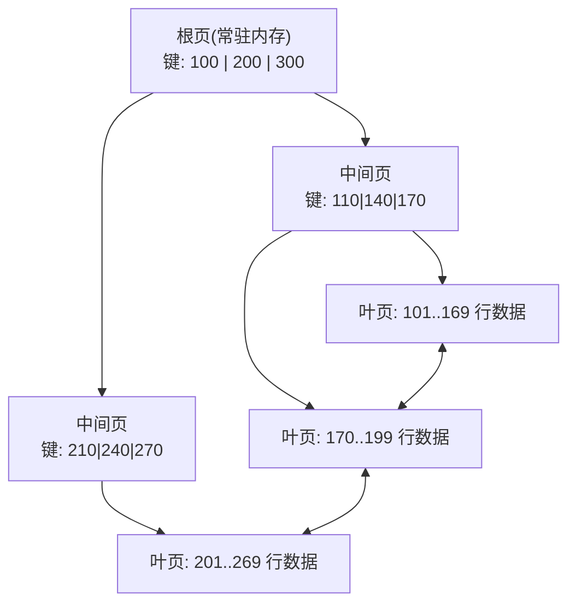
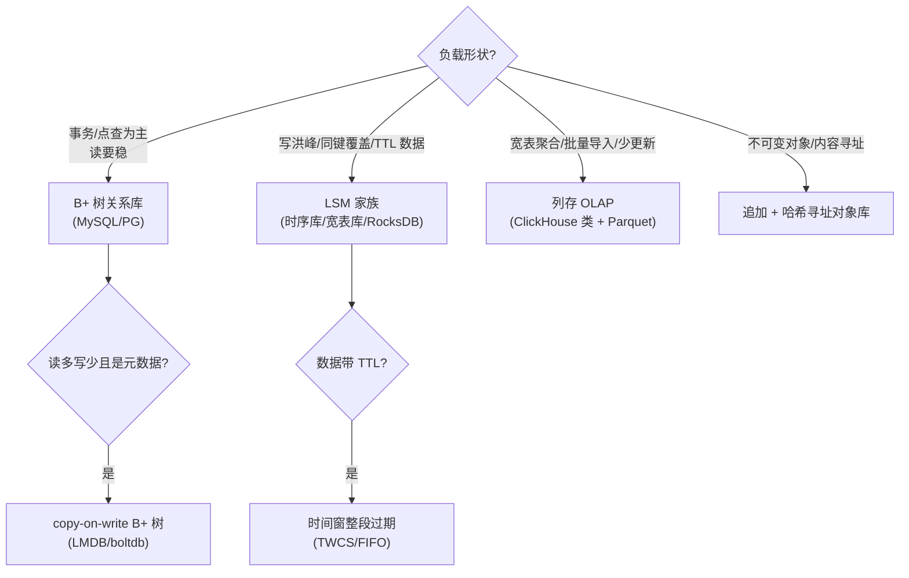

# 存储引擎与索引
> [返回：软件架构学习大纲](../软件架构学习大纲.md)｜[专题导览](01-导览.md)

本册是[数据系统内核专题](01-导览.md)第 2 册，对应《数据密集型应用系统设计》（DDIA）第 3 章“存储与检索”的完整展开。第三阶段的[数据架构分册](../03-第三阶段/04-数据架构-缓存分库与选型.md)回答“数据放哪种产品、怎么分片”；本册往下钻一层，回答“进了同一个进程，一次写入/读取在内存与磁盘上到底发生了什么”。配套可运行示例：[02a-示例-storage-engines/MiniLsm.kt](02a-示例-storage-engines/MiniLsm.kt)（LSM 引擎）与 [02a-示例-storage-engines/MiniBTreeSplit.kt](02a-示例-storage-engines/MiniBTreeSplit.kt)（B+ 树页分裂对照），均经 kotlinc 2.2.20 编译运行验证。

## 0. 本册要回答的问题

先看三个架构评审里真实会遇到的场面：

- **场面一**：物联网平台水表上报涨到每秒 5 万条，MySQL 主库 IO 打满。DBA 说“换时序库”，业务问为什么换了就快——回答“人家是 LSM”等于没回答，LSM 到底省掉了什么？
- **场面二**：工单中心把主键从自增 ID 换成随机 UUID，写入吞吐掉了三分之一。原因藏在 B+ 树的页分裂里——不读页分裂的机械，这个三分之一永远解释不清，也预测不了下一个受害者。
- **场面三**：订单库掉电重启，重启后部分事务“提交了却不见了”。复盘报告写“WAL 未刷盘”——WAL 是什么、什么时候刷、为什么提交要等它？这是本册第 4 节的全部内容。

资深架构师与“会选型表的架构师”的差距就在这里：**能从负载形状推出存储引擎的行为，而不是背产品对比表**。本册的路线：先从最简单的追加文件推演出 LSM 全家（第 1、2 节），再讲 B+ 树（第 3 节），把两者的公共命门——崩溃恢复——单独抽出来（第 4 节），补上分析型负载的列存（第 5 节），最后用场景选型推导把全部机械拧成一把螺丝刀（第 6 节）。

## 1. 索引是什么代价：从“最简单的数据库”说起

### 1.1 追加文件：世界上最简单的数据库

DDIA 开篇给了两行 shell 的数据库：

```bash
#!/bin/bash
db_set () { echo "$1,$2" >> database; }   # 写：追加一行
db_get () { grep "^$1," database | tail -n 1 | cut -d ',' -f2; }  # 读：找最后一次出现
```

写极快（追加一行），读是 O(n) 全文件扫描。它不是玩具笑话——**写入路径的“追加”正是所有日志结构存储（LSM 族、Kafka、Raft 日志、binlog）的公共内核**；读路径的“找最新”则是它们必须偿还的债。本节沿着“怎么把读变快”逐步加机构，加到头就是工业级 LSM。

**索引的定义先立住**：索引是“以写与空间的代价换读的代价”的附属结构。世上没有免费的读——每多一种索引，写入就多维护一份；这个交换关系（RUM 猜想，Athanassoulis & Ailamaki 2016：读开销、更新开销、空间开销三者不可能同时最优）是本册反复出现的总纲。

### 1.2 为什么追加快：顺序写与随机写的物理差

- **机械盘（HDD）**：一次随机写 = 寻道（磁臂移动）+ 旋转等待 + 写；顺序写省掉前两者。机械盘的顺序吞吐与随机 IOPS 差一两个数量级是公开常识（不同盘具体数值不同，量级判断足够）。
- **SSD**：没有机械臂，但**写必须按“页”（通常数 KB）、擦除必须按“块”（数百 KB 到数 MB）**：改一个字节也要把所在擦除块读出、擦除、连同新数据写回。随机小写在 SSD 上仍然比顺序写贵——贵的位置从机械结构挪到了控制器（FTL）内部。这就是为什么“顺序写更快”跨介质成立，而 LSM 的优势不依赖 HDD 时代。
- **原地更新为什么是随机写**：改 B+ 树一页，这页在磁盘上的位置是数据决定的，不是新来的——磁盘磁头（或 FTL 映射）必须奔向它。追加写永远写在文件尾，“下一个位置”是现成的。

### 1.3 内存哈希索引：Bitcask 模型

给追加文件配一个内存 hash 表（键 → 文件偏移），读就从 O(n) 扫描变成一次内存查找 + 一次磁盘定位读。Riak 的 Bitcask 存储引擎是这个模型（描述见 DDIA 第 3 章；出处性质：公开论文与文档）：

```kotlin
// 片段（骨架示意，不可直接运行）：Bitcask 的全部机械就这么短
class Bitcask(val log: AppendFile) {
    private val keydir = HashMap<String, Long>()      // 键 → 最近一次写入的文件偏移
    fun put(key: String, value: ByteArray) {
        val offset = log.append(key, value)           // 永远追加，永远顺序写
        keydir[key] = offset                          // 内存表指到最新一条
    }
    fun get(key: String): ByteArray? =
        keydir[key]?.let(log::readAt)                 // 一次内存查找 + 一次定位读
}
```

代价与边界一眼可见：

1. **keydir 必须全内存**——键总量超过内存就失效。适合键少值大（如对象的元数据索引、消息系统的“每个 key 只存最新值”）。
2. **没有范围查询**——hash 不保序，`扫描 meter-2024-11 的所有读数`做不了。
3. **文件无限增长**——旧版本靠 compaction 回收：另起一个文件，把每个键的最新值依次拷入，然后旧文件整体删除。
4. **崩溃恢复**——keydir 在内存，重启丢了就要全量重放日志文件重建（或者把 keydir 做成快照落盘）。日志越大，重启越慢。

### 1.4 删除、崩溃恢复与校验和：追加文件的三件配套

- **删除 = 写一条墓碑（tombstone）**。追加文件里没有“抹掉第 37 行”这个动作——原地抹掉就是随机写，破坏了整个模型。删除写一条特殊记录，读路径碰到它就返回“不存在”。墓碑后面还会在 LSM 里继续纠缠我们（2.5 节）。
- **崩溃恢复 = 重放**。追加是原子的粒度只有“一次 append 调用”，掉电可能留下半行。配套是**每条记录带校验和**（如 CRC），重放时半行/坏行跳过或中止——这是 Kafka、LevelDB 日志记录格式的公共做法（带 CRC 的记录格式，出处：两者公开的文件格式文档）。
- **写一条就 fsync 一次吗**——不。掉电不丢的粒度由 fsync 决定，fsync 很贵（4.3 节），所以日志系统普遍提供“多久 fsync 一次”的旋钮（Kafka 的 `log.flush.interval.messages`/`flush.messages`、LevelDB 的 `sync` 写选项）。默认通常是“交给操作系统页缓存，不保证掉电不丢”，要用这个语义（比如 binlog、消息队列的持久化）就得显式换旋钮——**“写成功了”在日志系统里永远要追问一句：fsync 了吗？

### 1.5 从哈希到有序：SSTable 登场

把追加的每段数据在落盘前**排好序**，得到 SSTable（Sorted String Table，LevelDB 的叫法）：一段文件内按键有序、文件不可变。排序带来四个连锁收益：

1. **稀疏索引**：内存不必记每个键，只记每隔 N 个键的一个路标（DDIA 的比喻：像书的章节目录，不必每页一个目录项）——内存压力骤减。
2. **范围扫描免费**：文件本身有序，顺序读就是答案。
3. **多段归并像归并排序**：有序段合并是线性代价，这是 compaction 的可行性基础。
4. **压缩按块进行**：有序数据相邻键有公共前缀，按块（如 4KB）压缩效率高。

排序的代价搬到了写路径：内存里维护有序结构（跳表或红黑树，LevelDB/RocksDB 的 memtable 用跳表，公开文档），满了整体刷成一个有序文件。把“memtable + 有序刷盘 + 后台归并”组装起来，就是下一节的 LSM 树。LSM 的学术出处：O'Neil 等人 1996 年的论文 *The Log-Structured Merge-Tree (LSM-Tree)*。

## 2. LSM 树：读写路径与三大放大

### 2.1 写路径五步


逐条说清楚每步为什么长这样：

1. **WAL 先行**：MemTable 是易失内存，掉电即失。写前先把操作追加到 WAL（write-ahead log）， MemTable 丢了重放即可。**WAL 在这里是追加文件，不是性能负担的随机写**——LSM 连崩溃恢复都保住了顺序写。
2. **MemTable 是“内存里的有序表”**：新值直接覆盖旧值（内存里，覆盖免费），所以“同键反复写”在内存里只占一份。
3. **冻结切换**：MemTable 攒满（RocksDB 默认量级是数十 MB，具体可配，出处：RocksDB 官方文档的 write_buffer_size）就切成只读的 immutable memtable，新写进入新 MemTable——写路径永不等待刷盘。
4. **刷盘 = 顺序写一个文件**：immutable memtable 本身有序，整体写出即为 SSTable。注意 L0 的各文件**键区间互相重叠**（每个文件都是全键范围的抽样），这是 L0 读放大大的根源。
5. **Compaction 把“有序段森林”归并成阶梯**：后台任务把 L0 的几个文件与 L1 归并，去重（同键只留最新版本），产出键区间**互不重叠**的 L1 文件；L1 攒到阈值再向 L2 归并，逐层放大（每层约为上一层的 T 倍，LevelDB 风格 T≈10）。

**一句话**：写路径上没有任何原地修改——追加 WAL、追加内存表、顺序写新文件、后台归并。全部物理写都是顺序的。

### 2.2 读路径：从 memtable 到最底层

点查 `get(k)` 的完整顺序：

1. 查 MemTable（含冻结的那个）——命中即返回（墓碑也返回“不存在”）；
2. **从新到旧**逐个查 L0 文件——L0 文件互相重叠，不幸时全查；
3. L1 起每层键区间不重叠，每层最多一个文件候选：先二分该层的键区间元数据定位文件，再在文件内二分稀疏索引定位块；
4. **布隆过滤器挡在文件访问前面**（Bloom 1970）：它能确定性地回答“这个键**肯定不**在这个文件里”（否定才确定，肯定有误判率）。被挡掉的文件连磁盘都不用碰；误判（小概率）才继续下探。

读放大由此可见：**一次点查要触碰的结构数 = memtable 数 + L0 文件数 + 每层一个候选文件**。层数 6、L0 有 4 个文件时，最坏要摸 10 个左右的结构——每个都被布隆挡住才便宜。这就是“LSM 写快读慢”的机械根源：**同一个键的最新版本可能在任何一层**，读必须从新到旧找过去；B+ 树则一次树走到底。

范围查询没有布隆可挡，要用“合并迭代器”把所有涉及文件做成一个归并流（多路归并，堆顶取最新），代价比点查更依赖 compaction 的整洁程度。

### 2.3 三大放大：定义与推导

存储引擎评审的通用货币是三个放大，先把口径定义写死（定义参考 RocksDB 官方文档对三放大的界定，出处性质：官方文档）：

| 放大 | 定义 | 在 LSM 里由谁贡献 |
|---|---|---|
| **写放大 WA** | 物理写入字节 ÷ 逻辑写入字节 | WAL 一份 + 每层归并重写 |
| **读放大 RA** | 一次逻辑读触发的物理访问数 | memtable + L0 全查 + 每层一文件 |
| **空间放大 SA** | 磁盘占用 ÷ 有效数据 | 各层未合并的旧版本与墓碑 |

**leveled compaction 的写放大推导（简化模型，假设键均匀分布、稳态）**：层间大小比 T（LevelDB 风格取 10），一条新数据要沉降 L 层才能“安息”；每次沉降触发一次归并，归并要把目标层中被波及的既有数据一起重写——新数据键区间均匀铺开时波及范围约为自身的 T 倍，故每层物理写 ≈ (T+1)× 新数据，总写放大 ≈ **(T+1)×L**。T=10、L=3 时量级约 40 倍上下；真实引擎还要叠 WAL、块索引、过滤器页脚，且与负载键分布强相关——**这是推导口径，不是实测承诺**。反方向验证 MiniLsm 实测（2.7 节）：教学引擎只有两层、键只有 40 个、触发合并频繁，写放大仅约 2.4 倍——层数少 T 小时放大自然小，方向与模型一致。

**空间放大**发生在合并间隙：同一键的新版本在 L0、旧版本还在 L1……最坏同一份数据存 T 倍。**读放大**已如上节。三者是跷跷板（RUM 猜想的具体化）：

| 拧这个旋钮 | WA | RA | SA |
|---|---|---|---|
| 层间比 T 调大 | ↓（层数少） | ↑ | ↑（每层更胖） |
| L0 触发阈值调高 | ↓（合并更攒批） | ↑（L0 文件更多） | ↑ |
| 更频繁 compaction | ↑ | ↓ | ↓ |

### 2.4 compaction 策略：三个家族与选择

| 策略 | 机械 | 代表 | WA | RA/SA | 适合 |
|---|---|---|---|---|---|
| **tiered / size-tiered**（按大小分堆） | 同量级的小文件攒一批再合并 | Cassandra SizeTiered（历史默认）、RocksDB Universal | 低（每层只重写一遍） | 高（同键旧版本在各堆并存，SA 可达数倍） | 写极多、读少、空间不敏感 |
| **leveled**（按层递增） | 上层向 T 倍大的下层归并、层内不重叠 | LevelDB、RocksDB 默认、Cassandra Leveled | 高（如上推导） | 低（每层最多一个候选文件、SA≈1） | 读多、空间敏感、点查为主 |
| **FIFO / 时间窗** | 到期整文件丢弃 | RocksDB FIFO、Cassandra TimeWindow（TWCS） | 近零 | —— | 纯 TTL 时序（水表读数、日志缓冲） |

三句判断词：**写怕 leveled、读怕 tiered、有时限的数据根本不该进 compaction**（整文件过期是免费的空间回收，让 TTL 数据去参与归并是纯浪费——这正是 Cassandra 为时序负载引入 TWCS 的动机，出处：Cassandra 官方文档对 TWCS 的说明）。

### 2.5 墓碑的麻烦

LSM 的删除写墓碑，麻烦在墓碑自己也要被“删除”：

- 墓碑只有在确认“压住的数据已经低于所有还含旧值的层”之后才能在 compaction 中丢弃。MiniLsm 的简化是“一次合并覆盖 L0+L1 全部，墓碑可以丢”；真实引擎多层，L0 的墓碑必须**逐层下推**到能盖住最旧版本的那一层（RocksDB 的 bottommost 概念）。
- **删除洪峰的隐藏代价**：批量删除 1 亿个键，写 1 亿条墓碑，这些墓碑还要被 compaction 一层层搬运、直到最底层与旧值同归于尽——**删除 LSM 里的数据本身是一次大型写入**。常见事故：压测只测写不测删，上线后夜间清理任务把 compaction 打爆。
- **范围删除**（drop 一段时间前全部数据）单独用 range tombstone 记录，否则一个区间删除要写天文数字的单键墓碑。

### 2.6 LSM 的工程补丁清单

真实引擎与本册模型的差距，评审时要能点到：

1. **布隆挡不住范围查询**——范围扫描退化为全层归并迭代。点查为主的负载（IM 消息按会话拉取）与范围扫描为主的负载（Feed 时间线翻页）在 LSM 上的表现差距远大于 B+ 树。
2. **write stall**：L0 文件堆太多、compaction 跟不上时，RocksDB 会主动**拒绝/延迟写入**让合并追进度（出处：RocksDB 官方文档 Write-Buffer Manager 与 stall 相关章节）。这是 LSM 的“反压”形态——写吞吐的顶不是磁盘写满，而是 compaction 带宽先满。
3. **compaction 与前台抢 IO/ CPU**：后台合并是实打实的磁盘带宽，限速器（rate limiter）几乎是必配；容器里对 LSM 引擎做 IO 限流时忘了给 compaction 留配额，是时序库卡顿的常见根因。
4. **块缓存与索引/过滤器的内存预算**：mmap 或 block cache 装多少，直接决定读放大里有多少次真去了磁盘。

使用 LSM 的系统（面试要能报全）：**LevelDB/RocksDB**（嵌入式，RocksDB 出自 Facebook 对 LevelDB 的 fork，广泛用作 MyRocks 存储引擎、TiKV 底座、Flink 的 RocksDB 状态后端——第三阶段与第 4 册都会回头用到这条）、**Cassandra/HBase**（分布式宽表，memtable + WAL + SSTable/HFile + compaction 的同构机械）、**InfluxDB 的 TSM**（时序特化）、Kafka 的日志段（追加 + 按时间/大小整段删，是“没有 memtable 的半个 LSM”）。

### 2.7 动手：MiniLsm 实测

[02a-示例-storage-engines/MiniLsm.kt](02a-示例-storage-engines/MiniLsm.kt)（约 250 行，kotlinc 2.2.20 编译运行验证）把本节全部机械实现一遍：WAL、MemTable、布隆过滤器、SSTable、L0×4 触发的简化 leveled 合并、WAL 重放恢复、以及**用引擎自己实际写入的字节数实测三大放大**。运行方式与真实输出（实测口径）：

```text
240 条写入 → 8 次刷盘 → 2 次合并。当前布局：L1#9(40键)
get(meter-25) = readings=225   ← 命中唯一的 L1 文件
点查共翻开 SSTable 1 次；布隆过滤器挡掉无效下探 1 次
delete(meter-07) 后 get → null（墓碑在 MemTable，挡住了 SSTable 里的旧版本）
[恢复] 重放 WAL 8 条——MemTable 虽丢，未刷盘的写一条不少
有效载荷（业务写入）    12998 字节
WAL 追加               13812 字节
SSTable 刷盘           13525 字节
Compaction 重写         4145 字节
写放大 = 总写入/有效载荷 = 31482/12998 ≈ 2.4 倍
空间放大（合并间隙最差）= 3485/2415 ≈ 1.4 倍；合并刚结束时 = 2415 字节 ≈ 理想值
读放大 = 单次点查最多翻开 3 个结构（MemTable + 2 个 SSTable）
```

值得动手改的三个实验：把 `memTableLimit` 调大（合并更攒批，观察写放大下降、L0 间隙的空间放大上升）；把 L0 触发阈值从 4 改成 2（合并更频繁，观察 Compaction 重写字节上涨）；把布隆误判撞出来（换成批量顺序键重复跑点查）。

## 3. B+ 树：原地更新的世界

### 3.1 页、扇出与树高推导

B+ 树（Bayer & McCreight 1970 年代初提出 B 树；工程实现几乎都是内节点不存数据的 B+ 变体——InnoDB 官方文档也称其索引为 B-tree）的三个前提：

- **固定大小的页**（page）：磁盘与内存交换的单位。InnoDB 默认 16KB（初始化可改），PostgreSQL 8KB（编译期常量）——两者均为公开文档事实。
- **页内有序 + 页间指针**：每页存一批有序键；内节点的每个键分隔左右子树的键区间，指针指向子页的**页号**。
- **根页常驻内存**：树顶一两层常年热在缓冲池里。

**树高推导（口径展示，不背结论）**：设 InnoDB 页 16KB，内节点每项 = 主键（bigint 8B）+ 页号指针（6B）≈ 14B，一页约放 16KB/14B ≈ 1170 个分叉；叶页每行按 1KB 算放 16 行。三层（根 + 中间 + 叶）≈ 1170 × 1170 × 16 ≈ **2100 万行**。这个推导出自 InnoDB 内部的经典分析口径（中文圈常见转述，出处性质：MySQL 内幕类公开资料），数字会随行宽变化，但结论稳定：**亿级行约三到四层，一次点查 = 三四次页访问，且顶部两层基本在内存**。对比 LSM 的“memtable + 每层一文件”，B+ 树的读路径是**结构对数级、深度极浅且确定**——这是它读延迟稳定（P99 不飘）的机械根源。



（叶子双向链表支撑范围扫描：定位起点后顺序翻页即可，不必回树。）

### 3.2 写路径：页分裂与填充率

插入一个键：走到叶页 → 页内还有空位就**原地**插入 → 页满则**分裂**（新页、各拿一半、中间键上提到父页，父页可能级联分裂）。三个后果：

1. **随机写回归**：改的页在磁盘哪里是数据决定的，一次插入至少写回一个页（16KB），哪怕只插一行——B+ 树的写放大单位是**页**，LSM 的写放大单位是“归并批次”。
2. **页分裂把顺序性变成了判断写入性能的关键变量**。键递增插入（自增主键、雪花 ID）时永远填最右侧页——真实引擎（如 InnoDB）对这种模式做**最右侧分裂优化**：新页空开张、旧页保持全满，树最紧凑；键随机（UUID、无序哈希）时插到任意页，满了只能从中间劈成两半再慢慢填，B 树的经典分析结论是随机插入下页平均填充率收敛到 **ln2 ≈ 69%**（Yao 1978 的 B 树空间分析，教科书级结论）——**同样的行数，随机键的树要多占约 1.4 倍页数，且分裂更频繁**。这正是第三阶段 3.2“雪花 ID 天然对 B+ 树友好”的机械解释，也是场面二（UUID 主键吞吐掉三分之一）的完整答案。
3. **填充率（fill factor）可调**：预留页内空间减少未来分裂（写多读少留多），代价是同样数据占更多页、缓存命中率降——又是一个 RUM 三角。

小实验：[02a-示例-storage-engines/MiniBTreeSplit.kt](02a-示例-storage-engines/MiniBTreeSplit.kt)（kotlinc 2.2.20 编译运行验证，只统计分裂次数与页占用，不真写盘）三种姿势插同一批键量：

```text
① 顺序键（带最右侧优化，真实引擎行为）：页数=466，分裂=465 次，叶页平均填充率 100%
② 随机键（同样带优化，但优化救不了它）：页数=635，分裂=634 次，叶页平均填充率 71%
③ 顺序键（朴素中点分裂，无优化）      ：页数=932，分裂=931 次，叶页平均填充率 50%

随机键比顺序键多占 1.36 倍页（1/ln2 ≈ 1.44，经典 B 树分析的收敛值）
```

三行输出三个结论：①与②的差距就是“主键选型影响 B+ 树行为”的机械根源；③值得单独一看——**没有最右侧优化时，连顺序插入也只有 50% 填充**（每次劈半、左半冻结），说明“自增主键友好”不是免费的，是引擎做了定向优化换来的。

### 3.3 读路径：缓冲池

页式引擎的读性能主角是**缓冲池（buffer pool）**：内存里缓存页的哈希表，读页先查池，未命中才读盘；修改只标记脏页，脏页由后台按 LRU 变种与“脏刷”策略写回。工程含义三条：

- 命中率就是性能。缓冲池大小的调优本质是“热数据集放进内存了吗”——工作集远超内存时，B+ 树读退化为磁盘随机读，**点查多的负载此时要按“热键集大小”而不是“总行数”做容量规划**。
- **脏页写回是随机的**（哪个页脏取决于负载），所以 B+ 树的写磁盘流量天然碎片化——这是它写吞吐输给 LSM 的机械根源。
- LRU 的坑：一次大范围扫描会把整个缓冲池冲干净（全表扫一遍、每页只用一次却把常驻热页挤出去）。所以 InnoDB 用改良的中点插入 LRU（新页先进年轻区与老区的交界）、PG 用环形缓冲区处理大扫描——两库官方文档均有记载，属于“知道就叫得出名字”级别的机制。

### 3.4 聚簇与非聚簇：二级索引的机械

- **聚簇索引（索引组织表）**：表本身就是按主键组织的 B+ 树，叶页就是数据行——InnoDB 的形态。主键查询一步到位。
- **堆表 + 索引**：数据按插入顺序堆放（或带回收空间），索引叶页存“指向行的位置”（PostgreSQL 的 ctid；Oracle 的 rowid）。PostgreSQL 的 HOT 更新（更新的列没有索引、新行在同一页）可以避免二级索引跟着改——出处：PG 官方文档。
- **InnoDB 二级索引的叶页存主键值而不是物理位置**：行随页分裂移动，物理位置会失效，主键值不会。代价是**二级索引查询要“回表”**（先查二级索引拿主键，再查主键树拿行）；**覆盖索引**（要查的列全在二级索引里）就是为了免掉这第二趟——工单中心按状态+创建时间建联合索引、把列表页要展示的少量列也纳入索引，是这一机械的标准应用。

### 3.5 B+ 树 vs LSM：对照与定性结论

| 维度 | B+ 树 | LSM |
|---|---|---|
| 写 | 原地改页 + WAL，随机写；单位是页 | 追加 + 后台归并，全顺序写；单位是批 |
| 点查 | 树高 3~4 次页访问，稳定 | memtable + 逐层下探，靠布隆救；深层数据点查更贵 |
| 范围扫描 | 叶子链表顺序读 | 归并迭代器，涉及文件多时代价高 |
| 空间 | 页内碎片（随机键下 ~2 倍） | 合并间隙的旧版本（策略决定，tiered 可达数倍） |
| 崩溃恢复 | 复杂：脏页半写 + WAL + torn page 防护（第 4 节） | 简单：WAL 重放 + 不可变文件 |
| 写吞吐 | 随机写限制 | 通常显著更高（顺序写的收益，DDIA 第 3 章的定性对比，未给统一数字） |
| 代价暗面 | 页分裂、碎片 | compaction 抢 IO、write stall、墓碑、读放大 |

DDIA 第 3 章的结论是定性的：**写吞吐 LSM 占优（顺序写），读路径与空间紧凑 B+ 树占优；LSM 的账单在后台**（compaction 带宽、前台抖动）。选型时要追问的不是“谁快”，而是“这份负载的账单想在前台付还是后台付”。

## 4. WAL 与崩溃恢复：让“提交”变成承诺

### 4.1 没有 WAL 会发生什么

页式引擎改一行 = 改内存页（缓冲池）+ 某刻写回磁盘。两个危险窗口：

- **提交了但数据页还没写盘** → 掉电后事务消失（违反持久性 D）；
- **写页写了一半**（掉电时 16KB 只落了 8KB，torn page）→ 页结构损坏，连带未提交事务的痕迹污染了物理结构。

解法只有一个方向：**先把“要做什么”写到别处（顺序追加），再做“实际修改”**。这就是预写日志（write-ahead log；WAL 协议的系统化出处可追溯到 Gray & Reuter《Transaction Processing》1993 对 redo/undo 规则的整理）。第三阶段的 Raft 日志、2PC 的 prepare/commit 记录，本质都是这个协议在多节点的推广——**先写日志再动作，是全数据系统最通用的一条纪律**。

### 4.2 WAL 记什么：物理、逻辑与生理日志

- **物理日志**（physical）：记录“某页某偏移改成了什么字节”。精确、重放简单，但记录量大（改一行也要记整段页偏移）。
- **逻辑日志**（logical）：记录“事务 T 把行 x 的 col 改为 v”。紧凑、与页布局解耦（页可以重组重放仍有效），但重放要重新执行操作，中间状态可能撞上并发时序。
- **生理日志**（physiological，物理到页、逻辑到页内）：记录“对页 P 做了什么逻辑操作”。InnoDB 的 redo log 与 PostgreSQL 的 WAL 都采用这一路线（描述见两库官方文档与《MySQL 技术内幕》类公开资料）。B+ 树页分裂这种“改了多个页”的操作，生理日志还要配套逻辑性的补偿记录——内部实现细节，评审不需要背，但要知道**日志格式的设计空间是“精确 vs 紧凑”的连续谱**。

崩溃恢复流程随之定型：**从检查点之后重放 redo 日志**，把已提交事务的修改补齐到数据页；未提交事务的处理引出 undo（第 3 册的事务主场，这里先按下）。

### 4.3 fsync、组提交：提交的真实价格

“提交”的物理含义 = **WAL 的这条记录 fsync 到盘**。fsync 是强制刷盘调用，机械盘上至少一次盘旋转周期量级的等待，SSD 上也要穿过控制器落 NAND——具体毫秒数因介质与阵列差异极大，不引用统一数字；要建立的直觉是：**fsync 是数据库事务延迟里最贵的那一项，而且是掉电安全的唯一保证**（操作系统页缓存不算数）。

**组提交（group commit）**是标配解法：多个并发事务的提交记录攒在同一批，一次 fsync 捎带全部。并发越高摊得越薄——这解释了一个反直觉现象：**数据库单线程压测的 TPS 常常远低于高并发压测**，因为单线程每次提交独享一次 fsync。LSM 也一样（WAL 攒批），Kafka 的“多条消息一个批次一次刷盘”同理——第 4 册讲吞吐的地方还会遇到它。

配套旋钮与风险（以 MySQL 为例，均为公开文档内容）：`innodb_flush_log_at_trx_commit`（1=每次提交 fsync；2=刷到 OS 页缓存；0=每秒）与 binlog 的 `sync_binlog`——**双一配置是掉电不丢的承诺，改松任何一个都是拿持久性换吞吐**。评审里看到“我们库 TPS 低，把 flush 参数调到 0 提了一倍”，要先问业务接不接受“宕机丢最近一秒事务”。

### 4.4 检查点：让重放别太长

WAL 无限增长则恢复时间无限长。**检查点（checkpoint）**定期把脏页刷盘、记下“此刻 WAL 位置”，恢复只需重放其后部分。模糊检查点（fuzzy checkpoint）不暂停业务：渐进刷脏、推进检查点 LSN——InnoDB 与 PG 的实际做法（官方文档可查）。工程上关注的连锁：**脏页积压 → 检查点被迫激进刷盘 → IO 尖刺**，是页式数据库“周期性卡顿”的经典根因（写洪峰把 redo 写太快，刷脏追不上）。

### 4.5 torn page 的两味药

fsync 保证日志落了盘，但**数据页本身**半写怎么办（redo 说“这个页应该是 X”，可页结构已经烂了，重放无从谈起）：

- **InnoDB doublewrite**：脏页写回前先把页拷到一块连续的“双写区”，成功后再写回原位置。原位置烂了就从双写区拿完整副本。代价：每页写两次（公开机制，MySQL 官方文档）。
- **PostgreSQL full_page_writes**：每个检查点之后某页**第一次**被修改时，把整页镜像写进 WAL——恢复时先用镜像把页修好再重放 redo（官方文档）。

两者都是拿写放大换“页永远可修复”。这再次呼应 RUM：**崩溃安全的每一档提升都是真实的写放大换的**。

### 4.6 另一条路：copy-on-write B+ 树

不写 WAL 也能崩溃安全：**改页不原地改，拷一份新页改，父页指向新页也要拷……一路拷到根，根指针原子切换**（shadow paging）。掉电时旧树完好、新树要么完整可见要么不可见。代表：LMDB（OpenLDAP 出品的内存映射库）与 boltdb（etcd v3 的底层，官方仓库文档）——etcd 多版本键值（第三阶段 09 档案讲过 MVCC revision）就建立在“旧版本页自然存在”之上。代价：**改一个键要重写一条根到叶的路径**，写放大高；适合读极多写很少的元数据负载。ZFS、WAFL 等文件系统的 copy-on-write 是同一思想在文件系统层的重现——第 3 册讲 MVCC 时会看到“不覆盖旧版本”这个思想第三次出现。

## 5. 列式存储：分析型负载的形状

### 5.1 行存 vs 列存：一次查询的 IO 推导

MES 要算“本月每条产线的良品率”，查询只碰 5 列，表有 80 列：

- **行存**（MySQL/PG 的堆与 B+ 叶页）：一行连续存放，读 5 列也必须把整行（80 列）从盘上读出来——**IO ≈ 全表字节数 × (1)**，浪费 94%。
- **列存**：每列单独连续存放，读 5 列只读 5 个列文件——**IO 按列数比例直接缩减**。这不是性能数字，是定义级的推导。

### 5.2 压缩与编码

同一列的数据类型相同、取值域窄、常常相邻重复，压缩效率远高于混合行：

- **游程编码（RLE）**：`状态列 = [合格,合格,合格,不合格,...]` 连续相同值只存 (值,长度)；
- **字典编码**：状态列只有 5 种取值 → 存 1 字节代号，位图可再压；
- 列存的压缩不只是省空间：**压缩后单页能装更多值，扫描的页数同比例下降**——空间优化直接就是速度优化。

### 5.3 排序、zone map 与谓词下推

分析表批量导入时按键排序（如按 日期, 产线），存储层为每个列块记录 min/max（zone map / Parquet 的 statistics）。查询“11 月 3 日的数据”时，日期列块 min/max 不相交的整块**直接跳过不读**——数据越按查询维度排序，跳过率越高。配合**谓词下推**（把 WHERE 条件推进存储层在读出前过滤）与**投影下推**（只读涉及列），现代 OLAP 引擎的大量查询在“扫”之前就已经把 IO 裁掉了大半。Parquet（出自 Twitter/Cloudera 合作，2013 开源）与 ORC（Hive 生态）是 Hadoop 时代定型的两个开源列存格式，均以元数据块 + 列块编码为骨架（格式文档公开）。

### 5.4 列存的写困境与两个高频混淆

- **写困境**：插入一行，行存写一处，列存要在 N 个列文件各追加一段——**单行写被放大成 N 次小写**。所以列存系统的写路径几乎都批量化：攒够一批/一个时间窗再整段落盘（ClickHouse 的 MergeTree 按 parts 批量落盘、后台合并，形态上与 LSM 同宗）。**列存天然不擅长小事务更新**，更新型负载要么“列存副本 + 定期重灌”，要么走“删除标记 + 后台合并重写”。
- **混淆一：列族 ≠ 列式**。Cassandra/HBase 的“列族（column family）”是**宽表行存**——一行仍是连续存储、按 rowkey 查，只是每行可以动态地稀疏列；它们与 ClickHouse/Parquet 的“按列连续存储”完全两回事。面试与评审中这是高频混淆点，务必分清“数据模型宽”（列族）与“物理布局按列”（列式）。
- **混淆二：分析跑得快不是因为“数据库产品新”**，而是列布局 + 压缩 + 跳块 + 向量化的叠加。拿行存数据库硬扛分析负载（在 MySQL 上全表 GROUP BY）输的是机械，不是调参。

### 5.5 向量化执行

列连续存放后，执行器可以**一次处理一列的一批值**（如 1000 个值同做比较、聚合），把解释器循环开销摊薄、把分支预测做平、让 CPU SIMD 指令用得上。这一路线的公开源头是 MonetDB/X100（Zukowski 等，CIDR 2005 论文 *MonetDB/X100: Hyper-Pipelined Query Processing*）；C-Store（Stonebraker 2005，商业化为 Vertica）则奠定了列式 OLAP 库的工程骨架。现代 OLAP（ClickHouse、DuckDB 等）执行模型皆源于此。

## 6. 场景选型推导：把机械拧成螺丝刀

### 6.1 五个场景逐个推

**场景一：物联网水表上报（写洪峰、同键覆盖、偶发点查）**。写读比悬殊，键 = 设备 ID 被反复覆盖，查询是“某设备最近读数/某时段曲线”。推导：写洪峰首先排除 B+ 树（随机页写 + 脏页刷盘会在 IO 上先死）；同键覆盖意味着空间放大可控（compaction 顺手去重）；偶发点查配布隆可接受。结论：LSM 家族——时序库（InfluxDB/TDengine 类）本质是 LSM 的时序特化（第三阶段 12 档案已有产品对照），或 Cassandra/HBase + TWCS 式 TTL 管理。**进阶推导**：数据带 TTL（只留 N 天）时，选支持“整文件按时窗过期”的形态，把删除成本降为零。

**场景二：MES 报工与工单查询（中等写、点查与短范围、读到即最新）**。写入每秒几百条，查询按工单号/工序号定位，业务要求“查到就是当前状态”。推导：点查多且延迟要稳 → B+ 树的常数级树高正合适；写入量远未触及页式引擎的随机写天花板（这个天花板在机械盘时代的经验量级是每秒数千次随机页写，SSD 上高得多——量级常识，非具体承诺）；聚合看板不做在主库（5.2 列存副本或物化）。结论：关系库（MySQL/PG）+ 合理索引，报表另走列存副本。**反例预警**：把工序报工也灌进时序库，查询按订单号聚合时序库并不擅长（tag 索引反查）——写合适的引擎做它擅长的事。

**场景三：桶装水商城订单（OLTP 标准）**。事务（下单扣库存）+ 按用户/状态/时间索引 → B+ 树 + ACID 事务（第 3 册的主角）。分库分表后每个分片仍是 B+ 树——第三阶段 3.2 已做分片推导，本册补充的机械判断是：分库分表的“翻页跨分片归并”代价，与 B+ 树叶链表的范围扫描是两码事，别混。

**场景四：多租户 SaaS 用量与账单分析（宽表聚合、批量导入、少更新）**。租户事件按天批量落地、出账周期聚合、几乎不回改 → 列存（ClickHouse 类）+ 按租户/日期排序的 zone map；明细可回刷，账单可重算（幂等），不追求秒级。

**场景五：Git 托管平台的对象库**（[示例项目场景/13](../示例项目场景/13-Git托管平台.md)）。对象一旦写入不可变、按键（内容哈希）寻址、整对象读。推导：不可变 + 无覆盖写 → compaction 也不需要；内容寻址天然去重；顺序批量写 + 偶尔整库打包（git gc 即“手动 compaction”）。这是“追加 + 不可变 + 哈希寻址”的第三种形态——B+ 与 LSM 都不是唯一答案。

### 6.2 决策树



### 6.3 反例集

- ❌ **拿 MySQL 扛水表上报洪峰**：每秒数万小事务 → 每次提交一次 fsync + 随机页写 + redo 段争抢；✅ 换 LSM 接洪峰（或前置 Kafka 削峰再批量落库——第三阶段 5.1 的削峰与本册机械各解决一半）。
- ❌ **拿 ClickHouse 做订单主库**：小事务更新弱、点查延迟形状不对（批式执行）、并发点查吞吐差——它是扫描器不是索引机；✅ 主库 B+ 树，ClickHouse 做 CDC 下游分析副本（第 4 册 8 节 CDC 讲管道）。
- ❌ **“Redis 也是存储引擎，用它替 MySQL”**：Redis 是内存数据结构服务器，持久化（RDB 快照/AOF 追加）是尽力而为的附属能力，数据集受内存约束——它解决的是“热数据低延迟”，不承担“权威数据的持久化与事务”（第三阶段 08 档案已展开）。
- ❌ **“换 LSM 就一劳永逸”**：不配 compaction 限速、不预估写放大，上线后 write stall 把写入 P99 打穿——LSM 的账单在后台，选它就要管它的后台。

### 6.4 选型核对清单（评审可直接抄）

1. 写读比与键分布（同键覆盖 or 每次新键）？——决定 LSM/B+ 的第一刀；
2. 读是点查、短范围还是大扫描？各占比？——点查看布隆与树高，扫描看叶子链表/列裁剪；
3. 数据有没有 TTL / 冷热分层？——TTL 优先时间窗过期，冷数据要归档路径而不是靠删除；
4. 崩溃恢复预算：能接受恢复多久（WAL 重放量级）、能接受丢多少（fsync 档位）；
5. 写放大的容量账：磁盘写入带宽 ≥ 峰值写入 × 预估写放大（leveled 按 (T+1)×L 口径先估，再实测校准）；
6. 更新模式：小事务更新（B+ 优势）还是批量导入（列存优势）；
7. 运维面：compaction 监控、write stall 告警、缓冲池命中率、checkpoint 抖动——每个引擎有自己的暗面指标。

## 【本节自测】

1. 1.1 的两行 shell 数据库，写 O(1) 读 O(n)。分别给出把它改造成读 O(1)（哈希索引）与读 O(log n) 且支持范围查询（有序索引）的最小改动，并说明每种改动给写路径增加了什么。
2. 为什么“顺序写快于随机写”在 SSD 上依然成立？从页/擦除块的结构解释 FTL 内部发生了什么。
3. MiniLsm 实测写放大 2.4 倍，而推导模型说 leveled 可达 (T+1)×L 倍。两者差在哪里？至少说出三个使教学引擎放大偏小的因素。
4. 水表每 15 分钟上报一次、数据保留 90 天、查询主要是“单设备近 7 天曲线”与“全网昨日聚合”。给出存储选型与 TTL 管理方式，并推导为什么不该用“逐条 DELETE 清理过期数据”。
5. InnoDB 一页 16KB、主键 bigint、行 1KB，推导三层 B+ 树约容纳多少行；行宽变 100B 时容纳量怎么变？树高变吗？
6. 为什么 InnoDB 二级索引叶子存主键值而不是行物理位置？这个设计带来的代价是什么、“覆盖索引”为什么能消掉这个代价？
7. 工单中心把主键从自增换成 UUID 后写入变慢。用页分裂与填充率解释完整因果链；再解释为什么“定期重建索引”能短期缓解。
8. `innodb_flush_log_at_trx_commit=2` 与 `sync_binlog=0` 的组合下，哪类故障会丢数据、丢多少？给出一个不能接受它的业务例子和一个可以接受的业务例子。
9. doublewrite 和 full_page_writes 分别防什么？为什么两者都宁可增加写放大？它们与 RUM 猜想是什么关系？
10. LSM 的墓碑为什么不能在 L0→L1 的第一次合并里直接丢？什么条件下才能安全丢弃？批量删除一亿个键时，LSM 的真实成本是多少？
11. “Cassandra 是列式数据库”——指出这句话的错误，并分别给出 Cassandra 与 ClickHouse 的物理布局一句话描述。
12. MES 看板要算“本月各产线良品率”，源表 80 列只查 5 列。用 IO 推导说明列存的收益从哪来；再说明为什么这个查询在 MySQL 上再怎么加索引也快不到同一个量级。
13. 用 RUM 猜想解释：为什么“读、写、空间三者都最优”的存储引擎不可能存在？各举 B+ 树与 LSM 在三轴上的偏向。

## 延伸与动手路线

- **对照 DDIA 第 3 章**读本册第 1~3 节：DDIA 的顺序是“从最简数据库推演到 B 树与 LSM”，本册同路线但把推导口径（扇出、写放大公式、IO 比例）显式化了；DDIA 第 3 章末尾的“事务处理还是分析”一节对应本册第 5 节的列存动机。
- **动手**：跑 [02a-示例-storage-engines/MiniLsm.kt](02a-示例-storage-engines/MiniLsm.kt) 的三个改参实验（2.7 节）；有精力再读 LevelDB 源码的 `db/dbformat.h`（内部键 = user_key + 8 字节序号，理解“版本”怎么混进键序）。
- **衔接**：下一册[事务与并发控制](03-事务与并发控制.md)从“单条记录怎么存”升级到“多个事务怎么并发”——WAL 是那册 undo/redo 的前半场；第 4 册[批处理与流处理](04-批处理与流处理.md)会把本册的 LSM 机械在 Flink 的 RocksDB 状态后端里再遇到一次。
