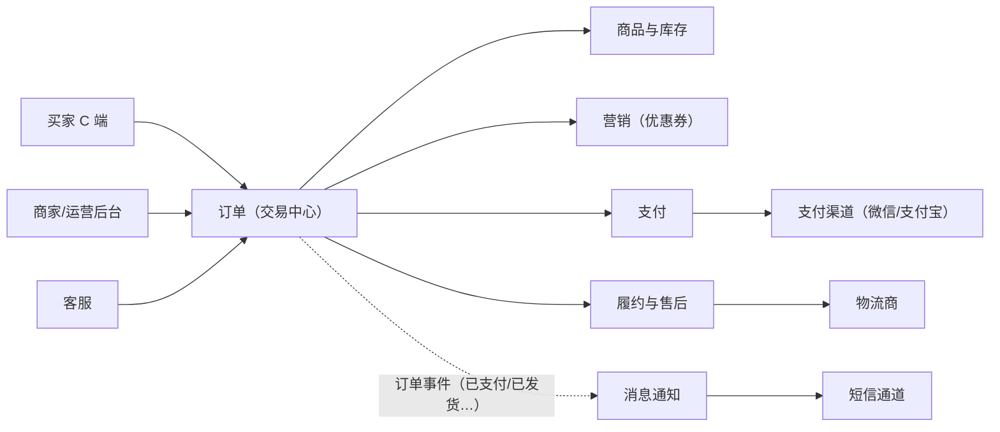

# 订单系统：通用贯穿示例

> 返回：[示例项目场景](00-导览.md) · [软件架构学习大纲](../软件架构学习大纲.md)
> 定位：教学默认贯穿例子——业务人人熟悉、无需解释背景，各阶段讲通用概念（分层、SOLID、状态机、事务、幂等、缓存）时优先使用；涉及行业化细节时切换到其他场景。主要对应大纲：全阶段通用。

## 业务画像

最小但完整的电商交易闭环：买家挑商品、下单、付款、收货，商家发货、处理售后。

**用户角色**：

- 买家（C 端）：浏览、加购、下单、支付、确认收货、发起售后。
- 商家/运营：商品上下架、改价、库存补给、活动配置。
- 客服：查单、改地址（发货前）、协助退款、备注跟进。
- 仓储/配送：拣货打包、发货、物流轨迹回传。

**核心业务流（正向）**：

1. 买家浏览商品详情页（读）；
2. 加入购物车或直接购买；
3. 提交订单：锁价格、算优惠、预占库存、生成待支付订单；
4. 跳转收银台完成支付，渠道异步回调通知支付结果；
5. 订单转为已支付，仓储拣货发货，回传物流单号；
6. 买家确认收货（或 N 天后自动确认），订单完成；
7. 可选逆向：申请仅退款/退货退款，审核通过后原路退回。

**教学量级假设**（全书容量推演统一用这套数字，讲到哪个阶段都不用重新设定）：日订单 5 万，峰值下单 500 QPS，浏览与下单比约 100:1，商品 SKU 1 万个。这三个数字足以推演出“读多写少要缓存”“下单链路每步预算多少毫秒”“库存行热点在哪”等结论。

**外部交互系统**：支付渠道（微信/支付宝，异步回调）、短信通道、物流商（下单与轨迹查询）。

## 模块总览

| 模块 | 一句话职责 | 关键数据 |
|---|---|---|
| 商品与库存 | 商品信息与可售数量的管理 | SPU/SKU、库存表 |
| 购物车 | 意向暂存与合并结算 | 购物车条目 |
| 订单 | 交易事实记录与状态推进 | 订单主表、订单明细 |
| 支付 | 对接渠道、支付单与回调处理 | 支付单 |
| 营销（优惠券） | 券发放、核销与回滚 | 券模板、用户券 |
| 履约与售后 | 发货执行与逆向退款 | 发货单、售后单 |
| 消息通知 | 关键节点触达用户 | 通知记录 |

模块间依赖：订单处于中心，向下依赖商品/营销做校验与计价，向右驱动支付与履约，通知与报表订阅订单事件即可——这个“中心辐射”形态正是单体分层时代最自然的划分，也是后期微服务拆分时争吵最多的地方。

## 系统上下文与服务边界

先画边界图（谁驱动订单系统、订单系统依赖谁），模块内部再细谈：



读图口径（讲二-2 服务边界时逐条回收）：

- **订单是交易中心，不是“什么都管的模块”**：它编排校验与计价，但商品、库存、券的事实归各自模块所有，订单只持快照与结果——“事实所有权”与“流程编排权”分离，是后面拆分时判断“这段代码该归谁”的依据。
- **虚线都是事件下游**：通知、报表不在主链路上，订单事件发出即算完成，它们的失败不影响交易正确性（只影响体验）——单体内用 Spring 事件即可模拟这个边界，微服务化后换成消息队列，代码结构不用变。
- **支付渠道是第一个“不可控外部依赖”**：异步回调、不保证时序、可能重复——订单侧对它的全部假设都要写进防御代码（验签、幂等、金额核对），这也是六边形架构“驱动侧适配器”最标准的落点。

## 核心模块

### 商品与库存

**职责**：管理商品展示信息与可售数量，回答“这个 SKU 现在多少钱、还有几件”。

**关键实体与数据**：

- SPU（标准产品单元）：`spu_id`、`title`、`category_id`、`attrs`——“农夫山泉 18.9L 桶装水”这一层。
- SKU（库存单元）：`sku_id`、`spu_id`、`specs`（规格组合）、`price`（现价）、`status`（在售/下架）——“18.9L×1 桶”与“18.9L×10 桶箱装”是两个 SKU。
- 库存表：`sku_id`、`available`（可售）、`locked`（已预占未支付）、`sold`（已售）。三者满足恒等式 `总库存 = available + locked + sold`，任何扣减路径都必须维持它。

**典型流程**：商家上架商品→运营审核→改价生效（只影响之后的订单）→库存预警提醒补给。

**设计要点与典型陷阱**：

- **反例（价格漂移）**：订单明细不存价格，展示订单时实时 join 商品表取“当前价”。商品改价或促销结束后，用户历史订单金额跟着变，客诉与对账灾难。**修正**：下单时把 `unit_price`、`sku_title` 快照进订单明细，订单成为不可变的历史事实。
- **库存扣减时机二选一**：下单时预占（坏处：恶意下单占库存，需要超时释放）vs 支付成功后扣减（坏处：支付成功却无货，要走退款）。主流选择是“下单预占 + 超时自动释放”，因为它把最坏情况留在“无金钱往来”阶段。
- 扣减实现从“读—改—写”三步并发（必然超卖）换成 `UPDATE stock SET available = available - ? WHERE sku_id = ? AND available >= ?` 原子条件更新，是讲并发正确性的入门案例。

### 购物车

**职责**：暂存购买意向，支持多条目合并结算。

**关键实体与数据**：`cart_item`：`user_id`、`sku_id`、`qty`、`checked`（是否勾选）、`added_at`。未登录暂存本地、登录后与服务端合并，是“有状态放哪”的轻量讨论素材。

**典型流程**：加购→改数量/勾选→勾选项合并生成一张订单（多明细）→ 下单成功后删除已购条目。

**设计要点与典型陷阱**：购物车展示的价格必须实时取商品现价（与订单快照相反）——用户要基于“现在买多少钱”做决策；勾选合并成一单还是拆成多单（同商家/同仓拆单）是履约侧的边界问题，教学时用最简模型即可。

### 订单

**职责**：记录交易事实，驱动状态推进——全书最常被“开刀”的模块。

**关键实体与数据**：

- 订单主表 `orders`：`order_id`（对外单号，与自增主键分离）、`buyer_id`、`status`、`total_amount`（商品总额）、`discount_amount`（优惠总额）、`pay_amount`（实付）、`pay_channel`、`paid_at`、`receiver_name`/`receiver_phone`/`receiver_address`（收货信息快照，同样不实时 join 用户表）、`created_at`、`version`（乐观锁）。
- 订单明细 `order_items`：`item_id`、`order_id`、`sku_id`、`sku_title`（快照）、`unit_price`（快照）、`qty`、`subtotal`。

**状态机**：待支付 →（支付成功）→ 已支付 →（发货）→ 已发货 →（确认收货）→ 已完成；待支付 →（超时/用户取消）→ 已取消；已支付/已发货 →（售后成功）→ 已关闭。状态只进不退，逆向走单独的售后单而不是把订单改回历史状态——“重开”语义另建新单并关联原单。

状态机骨架（第一阶段讲状态模式、后续讲领域模型时反复引用）：

```kotlin
enum class OrderStatus { PENDING_PAYMENT, PAID, SHIPPED, COMPLETED, CANCELLED, CLOSED }

// 合法迁移表：唯一事实来源，转移逻辑不再散落在各个 Service 里
private val transitions = mapOf(
    OrderStatus.PENDING_PAYMENT to setOf(OrderStatus.PAID, OrderStatus.CANCELLED),
    OrderStatus.PAID to setOf(OrderStatus.SHIPPED, OrderStatus.CLOSED),
    OrderStatus.SHIPPED to setOf(OrderStatus.COMPLETED, OrderStatus.CLOSED),
    OrderStatus.COMPLETED to emptySet(),
    OrderStatus.CANCELLED to emptySet(),
    OrderStatus.CLOSED to emptySet()
)

fun transfer(from: OrderStatus, to: OrderStatus): OrderStatus {
    require(to in transitions.getValue(from)) { "非法迁移: $from -> $to" }
    return to
}
```

**典型流程（提交订单）**：①参数校验与收货地址校验 → ②逐明细取现价与优惠计算 → ③原子预占库存（任一失败整体回滚）→ ④落订单主表与明细（同库事务）→ ⑤投递“超时未支付自动取消”延迟任务 → ⑥返回订单号。前四步在单体里是一个本地事务，微服务化后每一步都可能变成跨服务协调问题——这正是三-4 分布式事务的教学切入点。

把六步展开成**事件时序逐步表**（每步的触发、数据变更、失败与并发行为），它是后续逐阶段拆解的底稿：

| 步 | 动作 | 数据变更 | 失败与并发时的行为 |
|---|---|---|---|
| ① | 校验请求参数、收货地址快照 | 无写 | 地址失效/商品下架直接拒绝，无副作用，天然幂等 |
| ② | 逐明细取现价、计算优惠（锁券） | 券 `status→已锁定` | 改价与本步并发的，以本步读到的值为准，并落为快照 |
| ③ | 原子预占库存 | `available-qty, locked+qty` | 任一明细不足→整体回滚已预占部分与已锁券 |
| ④ | 落订单主表与明细 | insert `orders`、`order_items` | 价格/标题/地址全部来自快照字段，不回读源表 |
| ⑤ | 投递超时取消延迟任务 | 延迟消息（带 `order_no`） | 中间件不可用→落本地任务表，由补偿扫描兜底 |
| ⑥ | 返回订单号 | 无 | 客户端超时重试→按幂等键拦截，返回同一订单 |

这张表的讲法：单体阶段①~④在同一个数据库事务里，⑤⑥在事务外；讲到三-4 时逐行追问“这行拆到别的服务后怎么保持原子性”——②变商品/营销服务调用、③变库存服务调用、⑤变跨中间件的消息，答案从“本地事务”逐步换成“Saga 补偿/最终一致”，表格不用换。

**设计要点与典型陷阱**：

- 对外订单号不用自增主键：自增号暴露单量、可被遍历爬取；订单号通常是“时间戳 + 分片位 + 序列”的组合，兼具分库分表路由能力（三-3 取材）。
- 超时关单两种实现对比：定时全表扫描（简单但扫不动）vs 延迟消息/时间轮（精准但要引入中间件）——与工单中心“SLA 超时检测”是同一道题的两次出现，讲课时值得互相引用。
- 状态更新并发（用户点取消与支付回调同时到达）：乐观锁 `version` 或条件更新 `WHERE status = 'PENDING_PAYMENT'`，谁抢到算谁的，另一方收到明确的失败而非静默覆盖。

### 支付

**职责**：对接支付渠道，管理支付单，处理异步回调。

**关键实体与数据**：`payments`：`pay_id`、`order_id`、`channel`、`amount`、`status`（待支付/成功/失败/已退款）、`channel_trade_no`（渠道交易号）、`callback_raw`（回调报文留档）。支付单与订单是 1:N——用户可能第一次用支付宝失败、第二次换微信成功，两次尝试各生成一张支付单。

**典型流程**：订单创建支付单→唤起收银台→用户付款→渠道异步回调→验签→幂等处理→推进订单状态；回调迟迟不来时，定时任务主动向渠道查询补齐（查询补偿）。

回调链路同样给一张**事件时序逐步表**（与“回调+查询双通道”的口径对齐，见支付与清结算场景的深化版）：

| 步 | 动作 | 数据变更 | 失败与重复时的行为 |
|---|---|---|---|
| ① | 接收回调，原文落档 | insert `callback_raw` | 落档成功才继续；验签失败也留档并应答失败 |
| ② | 幂等检查：`channel_trade_no` 是否已终态 | 无 | 已处理→直接应答成功（吞掉重发） |
| ③ | 金额与订单核对（回调金额 = 支付单金额） | 无 | 不符→挂差错人工处理，绝不自动推进 |
| ④ | 同事务推进支付单与订单状态 | `payments.status`、`orders.status`（条件更新） | 与用户取消竞态：`WHERE status='PENDING_PAYMENT'`，输方走退款 |
| ⑤ | 投递“已支付”事件（发货、通知、核销券） | 事件表/消息 | 投递失败→本地消息表重试，主流程已提交 |

注意④⑤的分工：④是强一致内核（一个本地事务），⑤是最终一致外延（事件可靠投递）——“一个事务只改一个聚合，跨聚合靠事件”在这里第一次出现，桶装水与支付场景会反复回收这个口径。

**设计要点与典型陷阱**：

- **反例（重复回调）**：渠道回调至少投递一次，直接按回调更新订单会造成一次付款两次发货。**修正**：以 `channel_trade_no` + `status` 做幂等判断，处理过的回调直接返回成功应答。
- 回调验签不过的报文也要留档（`callback_raw`），差错处理与对账时它是唯一证据。
- 支付单独立于订单存在的原因：退款挂在支付单上（原路退回必须知道当初从哪条渠道扣的），对账按支付单与渠道流水核对。

幂等回调处理骨架：

```kotlin
class PaymentCallbackHandler {
    private val handled = mutableSetOf<String>() // 生产中是数据库唯一约束/Redis setNX

    fun onCallback(channelTradeNo: String, orderId: String, amount: Long) {
        if (!handled.add(channelTradeNo)) return  // 重复回调：直接吞掉并应答成功
        // 首次处理：事务内推进支付单与订单，任何一步失败整体回滚后可安全重放
        markPaymentSuccess(channelTradeNo, orderId, amount)
        orderService.onPaid(orderId)
    }
}
```

### 营销（优惠券）

**职责**：券模板管理、发放、核销与回滚。

**关键实体与数据**：券模板 `coupon_template`：`threshold`（使用门槛）、`amount`（面额）、`valid_from/valid_to`、`total/issued`（预算控制）；用户券 `coupon`：`user_id`、`template_id`、`status`（可用/已锁定/已核销/已过期/已回滚）。

**典型流程**：活动发券→下单选中券（锁定）→支付成功（核销）→订单取消/退款（回滚为可用）。

**设计要点与典型陷阱**：**反例（券消失事故）**：下单即核销，用户未支付取消订单后券直接作废。**修正**：锁定/核销/回滚三态两阶段——锁定发生在下单，核销发生在支付成功，取消时回滚。超发控制（`issued < total` 的原子判断）是库存扣减的又一次变形出现。

### 履约与售后

**职责**：发货执行、物流跟踪、逆向退款。

**关键实体与数据**：发货单 `shipments`（`order_id`、`logistics_no`、`status`）；售后单 `aftersales`：`order_id`、`type`（仅退款/退货退款）、`status`（申请中/同意/拒绝/买家退货/验货/已退款）、`refund_amount`。

**典型流程**：已支付订单推入仓储→拣货发货回传单号→物流轨迹查询；售后走独立状态机，成功后触发原路退款、库存回补、优惠券回退三个补偿动作。

**设计要点与典型陷阱**：逆向链路（退款+回补库存+回退券）跨多个模块，单体里可以一个事务包住，微服务化后就是标准的 Saga/最终一致素材；库存回补时机（售后同意时 vs 验货完成时）取决于是否允许“退回即可再卖”，业务上必须二选一并写清。

### 消息通知

**职责**：支付成功、发货、售后进展等关键节点触达用户。

**关键实体与数据**：`notifications`（`user_id`、`channel`、`template_code`、`payload`、`status`、`sent_at`）。

**典型流程**：订阅“订单已支付/已发货”等事件→渲染模板→选择通道（站内/短信）→发送与重试。

**设计要点与典型陷阱**：通知永远不该出现在下单/支付的主链路里同步调用（短信通道抖动拖垮下单）——它是“事件驱动解耦”最不需要说服力的小案例，讲二-3 时当入门引子。

## 架构挑战与知识点映射

| 挑战 | 方案要点 | 对应大纲小节 |
|---|---|---|
| 订单—库存—支付三者一致性 | 单体本地事务 → 拆分后分布式事务 | 三-4 分布式事务 |
| 重复回调、重复提交 | 幂等键设计（渠道单号/业务唯一约束） | 三-2、三-4 |
| 状态流转规则硬编码腐烂 | 状态模式、迁移表集中化 | 一-2 设计模式 |
| 读多写少（100:1） | 缓存、读写分离 | 三-3 缓存体系 |
| 超时未支付自动取消 | 延迟消息 vs 定时扫描 | 二-3、三-5 |
| 单体长大后怎么拆 | 先按模块边界模块化，再论证拆分 | 二-1、二-2 |
| 价格/收货信息随源数据漂移 | 快照字段 | 一-1（数据不变性讨论） |

## 关键数据表设计与取舍

把上文散在各模块的表设计收拢成一张决策清单——每个字段“取 A 还是取 B、为什么”，比贴完整 DDL 更接近架构推演（DDL 只是结论的落款）：

```sql
-- 交易主表（教学简化版，只列有取舍的字段）
CREATE TABLE orders (
    id             BIGINT PRIMARY KEY AUTO_INCREMENT,  -- 内部主键，永不出库
    order_no       VARCHAR(32) NOT NULL,               -- 对外单号：时间戳+分片位+序列
    buyer_id       BIGINT NOT NULL,
    status         TINYINT NOT NULL,                   -- 枚举：状态机唯一事实
    version        INT NOT NULL DEFAULT 0,             -- 乐观锁
    total_amount   BIGINT NOT NULL,                    -- 商品总额（分）
    discount_amount BIGINT NOT NULL,                   -- 优惠总额（分）
    pay_amount     BIGINT NOT NULL,                    -- 实付（分）
    receiver_name  VARCHAR(64) NOT NULL,               -- 收货信息快照，非外键
    receiver_phone VARCHAR(20) NOT NULL,
    receiver_address VARCHAR(255) NOT NULL,
    created_at     DATETIME NOT NULL,
    UNIQUE KEY uk_order_no (order_no),
    KEY idx_buyer_created (buyer_id, created_at)
);
```

| 设计点 | 选项 A | 选项 B | 本场景结论与理由 |
|---|---|---|---|
| 主键与对外单号 | 自增主键直接对外 | 双号并存 | 双号：自增号暴露单量、可被遍历爬取；`order_no` 还要能反解出分片位（三-3） |
| 金额类型 | DECIMAL / 浮点 | BIGINT 存分 | 分整数：浮点必出错，DECIMAL 在跨语言序列化上仍有精度坑 |
| 明细价格/标题 | 展示时 join 商品表 | 下单快照 | 快照：订单是不可变历史事实（上文反例的修正） |
| 状态表达 | 一排布尔列 | 单枚举 + 迁移表 | 枚举：布尔组合出非法状态，迁移表集中定义合法路径 |
| 买家查询索引 | 只建 `order_no` 唯一索引 | 追加 `(buyer_id, created_at)` | 后者：“我的订单”按时间倒序翻页是最高频查询 |
| 支付单幂等 | 应用层 Set 去重 | `(channel, channel_trade_no)` 唯一约束 | 数据库唯一约束：重启不丢、并发天然安全——“最便宜的分布式锁” |
| 明细的 `subtotal` | 读取时算 | 落库冗余 | 冗余：`unit_price × qty` 永不重算，对账时三值互相校验 |

分片预留（本阶段不做，先留位）：未来按 `buyer_id` 分片，买家维度查询路由单分片；商家/运营侧的全量查询走 binlog 同步的异构读库，**不在交易库上硬扛跨分片扫描**——这个“读路径分离”决定要在建表时就想到，不然索引会先长歪。

## 容量与失败模式推演

以下推演全部基于业务画像的量级假设（日订单 5 万、峰值下单 500 QPS、浏览与下单 100:1、SKU 1 万），是教学口径的演算，不是实测数据：

- **读侧**：峰值浏览 = 500 × 100 = 5 万 QPS。商品详情若直查数据库，单库（假设数千 QPS 的量级）必然先死——结论前置：读必须挡在缓存/静态化之后，数据库只承接穿透部分。
- **写侧**：峰值 500 单/秒 × 每单 5~7 行写（主表 1 + 明细 2 + 库存 1 + 券 1 + 支付单 1）≈ 3000 行/秒——单实例关系库可承载，但要评估 binlog 量、备份窗口与慢查询预算。**推论：这个量级不需要分库分表，“过早分片”反而成为这一阶段更常见的事故源**（跨分片查询、分布式事务、双写一致性都是自找的）。
- **热点**：1 万 SKU 中真正热的通常集中在头部少数——促销商品的单行 `UPDATE stock` 会在这里排队。解法阶梯：先靠行级锁扛 → 不够再单 SKU 内存排队合并扣减 → 再不够分段库存（届时切到秒杀场景的方案）。

失败模式清单（每行都有对应的预设对策，缺一项就是隐患）：

| 失败模式 | 触发场景 | 后果 | 预设对策 |
|---|---|---|---|
| 回调重复/乱序到达 | 渠道重发 | 一次付款两次发货 | `(channel, channel_trade_no)` 幂等 |
| 取消与回调竞态 | 用户点取消瞬间回调到达 | 状态互相覆盖 | 条件更新，输方明确失败并走退款 |
| 延迟取消任务丢失 | 消息中间件故障 | 订单悬挂、库存被占 | 补偿扫描：`status=待支付 AND created_at < now-30min` |
| 预占后进程崩溃 | ③④之间宕机 | 库存锁死无订单 | 同库事务保证不出现；拆分后要换 Saga |
| 通知阻塞主链路 | 短信通道抖动 | 下单变慢甚至失败 | 事件下游异步化 |
| 库存账实漂移 | 释放/回补逻辑缺陷 | 可售越卖越少 | 恒等式对账任务：`available+locked+sold` 与流水核对 |

## 演进路线：每一步的迁移与回滚

订单系统是“同一条链路逐阶段改造”的通用底版，每步都先说迁移、再说怎么退回来（回滚预案不是补丁，是上线条件）：

| 阶段 | 改造动作 | 迁移方式 | 回滚方式 |
|---|---|---|---|
| 1. 单体分层 | 三层 + 模块包 | 起步形态 | — |
| 2. 模块化单体 | 包 → 独立构建模块，依赖走公开接口 | 渐进搬包，一个模块一个迭代 | 模块退回普通包（无部署形态变化，零风险） |
| 3. 拆库存服务 | 库存独立部署与库表 | 双写期（旧库存表为准）→ 读切流量 → 观察对账 → 停写旧表 | 切回旧表读写（旧表双写期一直活着，回滚即切指针） |
| 4. 拆支付服务 | 支付单与回调独立 | 先共库拆服务（同库不同进程），再拆库（CDC 同步历史） | 进程回并；拆库后按支付单号路由回旧库 |
| 5. 事件驱动化 | 状态同步调用 → 订单事件 | 每个消费方单独切换：先双消费（新旧都执行、以旧为准），对齐后停旧 | 停新消费、恢复旧同步调用 |

两条纪律贯穿：**双写/双消费期内永远以旧链路为准**，新链路只对拍不发号令；**每步停留一个观察期**（对账连续 N 天无差异）才允许动下一步——连续跳两步的改造，回滚时找不到安全落点。

## 面试官追问点

- “订单和支付为什么分表甚至分库？”——生命周期（订单终态后只读，支付单永远追加）、变更方（退款改支付单不改订单）、失败域（渠道抖动不能拖垮下单）三者都不同。
- “扣库存为什么不用 Redis 分布式锁？”——锁是串行化工具不是正确性工具；原子条件更新 `WHERE available >= ?` 用数据库行锁天然防超卖，锁反而引入锁服务自身的可用性问题。
- “延迟消息丢了怎么办？”——任何“调度”都不能只依赖单一触发器，补偿扫描是第二道闸；更根本的答案是“不重复、不错过”双保险（订阅触发同款）。
- “乐观锁与条件更新，用哪个？”——本场景两者等价（都靠单条 UPDATE 的原子性）；`version` 通用性强，条件更新语义直白，别混用两套即可。
- “为什么不把售后做成订单状态？”——逆向是新的业务流程（有自己的状态机与审批），订单状态只进不退；把“已关闭”改回“退款中”会毁掉时效统计与幂等键。
- “订单号为什么自带分片位？”——分库分表后免查路由表：从单号直接反解目标分片，否则每次请求多一次路由查询。
- “库存回补在售后哪个时点做？”——“售后同意”与“验货完成”二选一，取决于是否允许“退回即可再卖”——这是业务决策不是技术决策，但必须写清并全链路一致。

## 如果规模再大十倍

假设日订单 50 万、峰值下单 5000 QPS、峰值浏览 50 万 QPS，逐层推演瓶颈与对策：

- **读侧先死**：50 万 QPS 浏览必须 CDN + 页面静态化 + 多级缓存，数据库只服务缓存未命中——未命中率每降 0.1% 都是 500 QPS 的数据库流量。
- **热点库存**：头部 SKU 单行更新冲突加剧，进入“分段库存 + 段间调拨”的方案（正是秒杀场景的主菜，两个场景在此合流）。
- **订单库分片**：按 `buyer_id` 分库分表（8~16 分片起步），`order_no` 携带分片位免查路由表；商家侧报表整体搬到异构数仓，交易库不再服务分析。
- **回调洪峰**：大促后回调集中到达，消费按 `order_no` 哈希分区、幂等键挡重；渠道查询补偿任务的扫描窗口按分钟级分片。
- **历史归档**：已完成订单滚动归档到冷存（在线只留 3~6 个月），主表体积决定备份窗口与索引深度——归档不是运维问题，是建表时就要定的保留策略。
- **对账升级**：本地事务表对账演化为 binlog CDC → 流式对账 + 日终批兜底（07 数据系统内核专题的批流分工在这里落地）。

## 与其他场景的联动

- **桶装水商城**：本场景的行业化版本——加上周期购、押金、配送排线后就是它；讲演进主线时以桶装水商城为准。
- **秒杀/限时抢购**：订单系统在瞬时洪峰下的极端形态，只保留“浏览—下单—扣库存”主干。
- **支付与清结算**：本场景支付模块的全面深化（渠道对接、分账、对账、差错处理）。
- **Feed 流内容社区**：读侧的镜像极端（读系统 vs 写系统对照）。
- **多租户 SaaS 控制平面**：把订单系统 SaaS 化卖给多家企业时，控制面要补的东西。

## 取材指引

- 第一阶段已大量使用：认识架构的分层样例、SOLID 中策略（优惠计算）与状态（订单流转）、质量属性中可用性与可扩展性的例子均取自本场景。
- 第二阶段讲单体分层/模块化/微服务拆分时，直接以模块总览表的七个模块作为初始切分候选。
- 第三阶段讲事务与幂等时，用“提交订单六步”逐段推演：哪步在本地事务内、哪步拆出去后会怎样。
- 容量推演统一用业务画像中的量级假设，避免每次举例重新编数字。
- 讲数据设计时用“关键数据表设计与取舍”的决策清单：先问“取 A 还是 B”，再揭晓本场景结论——比直接给 DDL 更能训练取舍意识。
- 讲灰度与演进时用“演进路线”表：每一步先指认“旧链路为准的双写期”，再问学生“回滚落点在哪”。
- 可出思考题方向：为什么订单明细要存价格快照；库存扣减放在下单还是支付后，各自的坏情况是什么；超时关单选延迟消息还是定时扫描，判断依据是什么；“如果规模再大十倍”一节逐条追问瓶颈顺序为什么是读、热点、分片而不是反过来。
