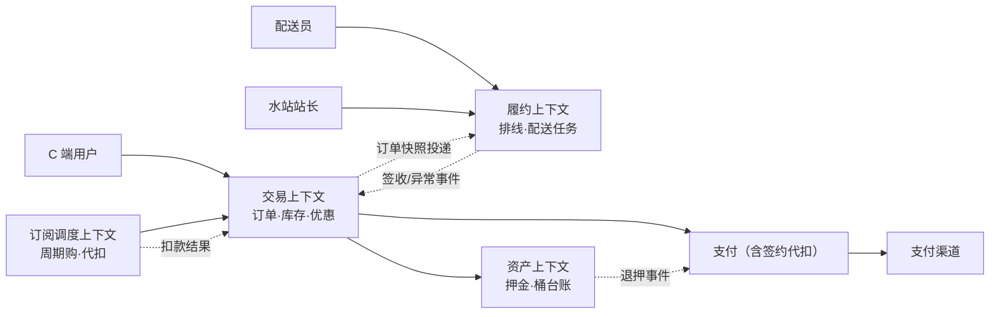

# 桶装水商城：主线演示场景

> 返回：[示例项目场景](00-导览.md) · [软件架构学习大纲](../软件架构学习大纲.md)
> 定位：全书主线演示业务——第二阶段起贯穿使用，同一业务从单体分层逐步改造为模块化单体、DDD、微服务、事件驱动，逐阶段对比得失。主要对应大纲：二-1/二-2 单体与微服务、二-4 DDD 与六边形、三-3 缓存、三-4 分布式事务、四-2 DDD 战略设计。

## 业务画像

C 端用户线上购买桶装水：单次购买或周期购订阅（每周/每月自动送）；配送员按线路配送；水桶收押金、空桶回收退押金；有会员与优惠券。

**与普通电商的本质差异**（讲架构演进时反复强调的三点）：

1. **高频低客单**：一桶水十几元，用户一周一到两单——订单密度高、单笔金额低，配送成本与履约效率是生死线。
2. **商品是循环资产**：桶要收押金、用完回收，“桶”既是商品载体又是资产台账，通用电商模型装不下它。
3. **自有运力排线配送**：不是快递发货，而是水站自有配送员按线路批量送，“排线”是一个独立的算法问题。

**用户角色**：C 端用户、配送员、水站站长（库存与排线管理）、客服、运营（商品与活动）。

**教学量级假设**：一个城市 50 个水站，日订单 2 万，活跃订阅 10 万，在押桶 80 万个，SKU 约 50 个（品牌×规格，极浅）。

**核心业务流**：

- 单次购：选商品→选配送时段（今日/明日 + 上午/下午/晚间）→下单支付→水站截单聚类→排线→配送员送桶→用户签收。
- 周期购：订阅（选 SKU、周期、地址）→到期自动生成订单→自动扣款或通知支付→随线配送。
- 回收退押：用户预约回收→配送员上门取空桶→逐桶验收（完好/破损）→按验收结果退押金或扣损。

## 模块总览

| 模块 | 一句话职责 | 相对通用订单系统的差异 |
|---|---|---|
| 商品与库存 | 商品与各水站库存管理 | 库存按站点维度，非全城共享 |
| 订单 | 交易记录与状态推进 | 必带预约配送日期与时段 |
| 周期购订阅 | 定期自动生成订单 | 本场景新增模块 |
| 支付 | 渠道对接与回调 | 增加签约代扣（周期购自动扣款） |
| 配送排线 | 订单聚类成线路与配送任务 | 本场景新增模块 |
| 押金管理 | 桶押金全生命周期 | 本场景新增模块 |
| 营销（券/会员） | 优惠与会员体系 | 周期购专属券、会员折扣 |
| 用户 | 账户与地址簿 | 地址决定归属水站 |

## 系统上下文与服务边界

先看整体边界：外部角色、四个候选限界上下文与外部系统（演进主线第 3 步的雏形）：



读图口径（第二阶段拆分论证的底稿）：

- **四条边界先以模块存在，再论证服务化**：交易、履约、资产、订阅调度——其中“订阅调度”最容易漏画：它没有任何用户界面，却是系统里最需要独立可靠性的部分（错了就是“多送一桶水/少扣一次款”）。
- **虚线全是异步事件**：订单快照投递给排线、签收结果回传给交易、退押事件驱动支付——同步调用只存在于图里没画的读路径（查订单、查任务）。这个形态在单体内部用“模块间事件”模拟，微服务化后原样换成消息队列。
- **外部系统只有一个半**：支付渠道（含代扣签约）是完整的外部依赖；短信通道算半个（失败可容忍）。供应商越少，防腐层越好守。

## 核心模块

### 商品与库存

**职责**：管理极浅的商品目录与**按水站分布**的库存。

**关键实体与数据**：SKU 数量少（品牌×规格约 50 个），库存表却是三元的：`station_id` + `sku_id` → `available`/`locked`/`sold`。另有“水票”形态（预购次卡，一次买十张送十次）可作扩展讨论，教学主线先不引入。

**典型流程**：总仓调拨至水站→水站可售→低于安全库存预警补货。

**设计要点与典型陷阱**：**反例（全城共享库存）**：库存只按 SKU 记总量，用户下单后才分配水站，结果热门站点超卖、偏远站点积压，配送跨区成本爆炸。**修正**：下单时先按收货地址定水站（地址→站点映射），再在该站点库存上原子扣减。“先路由后扣减”的顺序是模块内的关键约束。

### 订单

**职责**：记录交易事实，携带履约所需的预约信息。

**关键实体与数据**：在通用订单字段（见[01-订单系统](01-订单系统.md)）之上增加：`station_id`（履约水站）、`delivery_date`（预约配送日）、`time_slot`（时段）、`order_source`（手动/订阅生成）、`subscription_id`（订阅单来源，可空）。多数购买是“单品直购”，购物车弱化为可选。

**典型流程**：与通用订单一致，差异在第①步后立即执行“地址→水站”路由，且明细仅含水类商品与押金类商品两类（押金随桶走，见押金管理）。

**设计要点与典型陷阱**：预约时段是**资源**（每站每时段配送员运力有限），高峰时段要限额——这就是一个小型“库存”问题（时段库存），讲三-3 限额与扣减时可以复用；订阅生成的订单必须有 `subscription_id + trigger_date` 唯一约束，防止一次触发生成两张单（见下）。

### 周期购订阅（本场景的灵魂模块之一）

**职责**：按用户配置的周期，可靠地自动生成订单。

**关键实体与数据**：`subscriptions`：`sub_id`、`user_id`、`sku_id`、`period_type`（周/月）、`period_value`（如每 2 周）、`next_trigger_date`、`status`（活跃/暂停/已取消/已到期）、`remaining_issues`（期数制订阅剩余期数，次卡型）、`address_snapshot`、`auto_deduct`（是否签约代扣）。

**典型流程**：

1. 每日凌晨调度扫描 `status = 活跃 AND next_trigger_date <= today` 的订阅；
2. 对每条订阅生成订单（幂等键 `sub_id + trigger_date`）；
3. 成功后推进 `next_trigger_date += period_value`；
4. 自动扣款：代扣成功→已支付；失败→降级为待支付并通知用户（不阻塞批量）；
5. 失败重试：单条失败进重试队列（指数退避，3 次），连续 N 期无人处理则通知客服。

**设计要点与典型陷阱**：

- **不重复**：调度器与补偿扫描可能同时看到同一条订阅，靠唯一约束兜底，插入冲突即放弃——“数据库唯一约束是最便宜的分布式锁”在这里是最佳注脚。
- **不错过**：不能只依赖“当天扫当天”，要有补偿扫描（`next_trigger_date < today` 的漏网之鱼），停机一天后能补触发。
- **暂停与跳过**：用户“这周不在家”要能跳过一期（`next_trigger_date` 平移一次但不改周期）或暂停到指定日期——状态与时间的组合远比“定时任务”四个字复杂，是讲调度可靠性的好材料。
- **反例（地址漂移）**：订阅存 `user_id`，每次生成订单时实时取用户默认地址，用户改地址后历史轨迹全乱。**修正**：订阅自带 `address_snapshot`，改地址显式修改订阅，与订单快照原则一致。

**典型流程（每日触发）的时序逐步表**——把上面五步展开成“动作、数据变更、失败行为”，它同时是三-4“一个事务只改一个聚合”的教学底稿：

| 步 | 动作 | 数据变更 | 失败与并发时的行为 |
|---|---|---|---|
| ① | 调度扫描到期订阅 | 无 | 调度器与补偿扫描并发看到同一条→靠②的唯一约束兜底 |
| ② | 生成订单（幂等键 `sub_id + trigger_date`） | insert 订单 + 明细 | 唯一冲突→判为重复触发，跳过并按已存在订单继续 |
| ③ | 推进 `next_trigger_date` | update 订阅（条件：仍为旧值） | 进程在②③间崩溃→订单已建但日期未推进，次日重复触发被②拦截、再推③ |
| ④ | 自动扣款（签约代扣） | 支付单、渠道代扣 | 单条失败只标记该订单待支付并通知，绝不阻塞批量 |
| ⑤ | 订单进入履约流程 | 事件投递 | 与手动订单同链路，无差别 |

注意②③的次序不能反：先推进日期再建订单，崩溃窗口里这一期会被**静默跳过**（用户少送一次水）；先建订单后推进日期，最坏情况是多一次可被幂等拦截的重复尝试——“宁可重复触发，不可静默漏单”是调度类系统的一致取向。

订阅触发幂等骨架：

```kotlin
fun triggerOnce(sub: Subscription, date: LocalDate): TriggerResult {
    // 唯一约束 (subscription_id, trigger_date) 是幂等的最后防线：
    // 调度器、补偿扫描、人工重放同时到达时，只有一个能插入成功
    val inserted = try {
        orderDao.insertFromSubscription(sub, date, idempotencyKey = "${sub.id}:$date")
        true
    } catch (e: DuplicateKeyException) {
        false
    }
    if (inserted) subscriptionDao.advanceNextTriggerDate(sub.id, date, sub.periodValue)
    return if (inserted) TriggerResult.CREATED else TriggerResult.SKIPPED_ALREADY_EXISTS
}
```

### 支付

**职责**：通用渠道对接之外，增加**签约代扣**能力。

**关键实体与数据**：支付单结构与通用一致；增加 `deduct_contracts`（`user_id`、`channel`、`contract_no`、`status`）——用户签约一次，周期购到期从渠道代扣。

**典型流程**：代扣请求→渠道异步扣款结果通知→成功推进订单/失败通知用户转为主动支付。退款原路退回，押金退款同样走支付单体系。

**设计要点与典型陷阱**：代扣失败绝不能阻塞批量调度（一个用户余额不足拖住一万条订阅），必须逐条隔离失败、异步补偿；代扣同样要幂等（渠道侧以 `contract_no + 期次` 去重）。

### 配送排线（本场景的灵魂模块之二）

**职责**：把“明天上午要送的 3000 张订单”按水站聚成线路与配送任务。

**关键实体与数据**：`routes`（`station_id`、`route_no`、`capacity`）；`delivery_tasks`（`route_id`、`task_date`、`time_slot`、`courier_id`、`status`）；`task_items`（`task_id`、`order_id`、`seq`（线路内顺序）、`drop_result`（签收/不在家/改约/拒收））。

**典型流程**：

1. 截单（如配送日前一日 20:00）冻结该站该时段订单集合；
2. 按收货地址聚类，贪心/启发式求解近似最优路径（TSP 近似，人工可微调）；
3. 生成配送任务并指派配送员（按运力与排班）；
4. 配送员 APP 逐单导航、逐单打卡签收，异常单（不在家）改约或二次配送；
5. 全部完成后任务关闭，触发对账（签收数量 vs 出库数量）。

**设计要点与典型陷阱**：

- **算法与交易解耦**：排线是“批处理 + 算法”世界，下单是“在线低延迟”世界。**反例**：下单同步调用排线服务占线路，排线算法一次跑几秒，把下单拖到超时；排线服务升级重启，全站不能下单。**修正**：两者只通过“订单快照投递 + 排线结果回写”的异步边界交互——这是讲服务边界（二-2）最有说服力的案例：**边界不仅按业务能力划，还按工作负载性质划**。
- 截单后改地址、退单怎么办：任务内允许剔除并回补库存，但要在对账环节闭环。

**截单到签收的时序逐步表**（履约上下文内部的主链路，签收结果再以事件回传交易上下文）：

| 步 | 动作 | 数据变更 | 失败与例外行为 |
|---|---|---|---|
| ① | 截单：冻结该站该时段订单集合 | 生成“截单快照”（只读副本） | 截单后新订单自动落到下一时段 |
| ② | 地址聚类 + 贪心求解线路 | insert `routes`、`delivery_tasks` | 求解超时→降级为“按小区顺序”的朴素线路 |
| ③ | 指派配送员 | update `courier_id` | 运力不足→溢出任务回池，人工调度 |
| ④ | 逐单配送打卡 | update `drop_result` | 不在家→改约或二次配送，不回滚已冻结库存 |
| ⑤ | 任务关闭，触发对账 | 签收数 vs 出库数核对 | 差异单回补/生成工单（联动[03-工单中心](03-工单中心.md)） |

### 押金管理（本场景的灵魂模块之三）

**职责**：桶押金的全生命周期——收押金、桶在手、回收验收、退押金/扣损。

**关键实体与数据**：

- `deposit_orders`（押金单，按用户）：`deposit_id`、`user_id`、`buckets`（押桶数）、`amount`、`status`（待支付→已收押→退押申请→验收中→已退清/部分退/扣损关闭）。
- `bucket_ledger`（桶资产台账）：`user_id`、`in_hand`（在手桶数）、`deposited`（在押金额）；每次收/退/损一条流水 `bucket_ledger_entries`。
- 可选进阶：桶身条码/RFID 到桶号的“一桶一档”（`bucket_no` 维度），回收验收时逐桶核对。

**典型流程**：随单付押金（押金单与水单可同支付）→桶在手（台账 +1）→用户预约回收→配送员上门取桶逐桶验收（完好/破损/丢失）→按验收结果退押金（原路退回）或按标准扣损→台账清零。

押金状态机骨架：

```kotlin
enum class DepositStatus {
    PENDING_PAYMENT, HELD,            // 待支付 → 已收押（桶在用户手上）
    REFUND_REQUESTED, INSPECTING,     // 退押申请 → 回收验收中
    REFUNDED, PARTIALLY_REFUNDED, LOST_CLOSED // 已退清 / 部分退 / 扣损关闭
}

private val depositTransitions = mapOf(
    DepositStatus.PENDING_PAYMENT to setOf(DepositStatus.HELD),
    DepositStatus.HELD to setOf(DepositStatus.REFUND_REQUESTED),
    DepositStatus.REFUND_REQUESTED to setOf(DepositStatus.INSPECTING),
    DepositStatus.INSPECTING to setOf(
        DepositStatus.REFUNDED, DepositStatus.PARTIALLY_REFUNDED, DepositStatus.LOST_CLOSED
    )
)
```

**设计要点与典型陷阱**：

- **押金不是收入**：会计上押金是负债科目，不能计入营收、不能挪用——涉及监管红线。**反例**：押金直接进营收账户花掉，回收潮时无钱可退。**修正**：押金单独账户/科目，报表上单列。讲数据建模时对应“押金流水与订单流水分账”。
- 验收纠纷：破损判定标准必须产品化（破损扣多少、丢失怎么算），验收拍照留证据链——业务规则外置为配置而非硬编码。
- 台账一致性：`in_hand = 累计收 - 累计退 - 累计损`，任何路径都要维持恒等式；回收验收与退押金跨系统（回收在水站端、退款走支付），是本地消息表/事务消息的标准素材（三-4）。

**回收退押的事件时序逐步表**——四阶段 DDD 册“画出押金聚合的边界并给出‘支付成功激活押金单’的事件时序”的配套底稿（“一个事务只改一个聚合”逐行可见）：

| 步 | 动作 | 事务内只改的聚合 | 对外发出的事件 / 失败行为 |
|---|---|---|---|
| ① | 用户申请退押 | 押金单：`HELD → REFUND_REQUESTED` | 发“退押已申请”；重复申请被状态机拒绝 |
| ② | 配送员上门逐桶验收 | 押金单：`→ INSPECTING`，写验收明细 | 验收拍照留证；中断可续验 |
| ③ | 验收定损，算出应退金额 | 押金单：`→ REFUNDED / PARTIALLY_REFUNDED / LOST_CLOSED` + 本地消息 | 同一事务写“待退款”消息（本地消息表） |
| ④ | 可靠投递“应退款 X 元” | 支付上下文：创建退款单 | 幂等键=押金单号+验收批次；重复消息不重复退 |
| ⑤ | 渠道原路退款结果回传 | 桶台账：`in_hand - n`、`deposited - 金额` | 渠道失败→退款单重试/人工，押金单状态不回退 |

为什么不把“配送任务”放进押金聚合（四阶段思考题的追问）：两者生命周期与一致性边界都不同——配送任务一天内完成并关闭，押金单要活几个月；押金的不变量（恒等式）不依赖任务状态。跨聚合的联系靠“验收完成”事件，而不是一个大事务。

### 营销（券/会员）

**职责**：优惠券与会员折扣，叠加规则清晰。

**关键实体与数据**：在通用券体系上增加会员（`membership`：`user_id`、`level`、`discount_rate`、`valid_to`）与周期购专属券（绑定 `subscription_id`，首次订阅立减）。水站层面还有“满 X 桶赠 1 桶”的活动库存。

**设计要点与典型陷阱**：会员折扣、券、满赠三者的**叠加顺序**必须固定（先会员价、再满赠、后券，还是别的顺序，业务定死并写进计算器）——优惠计算是讲策略模式的常驻例子，叠加顺序不确定是真实事故高发区。

### 用户

**职责**：账户、地址簿与水站归属。

**关键实体与数据**：`addresses`（`user_id`、`detail`、`is_default`、`geo`（经纬度或小区编码））；`user_station_binding` 由地址 `geo` 匹配最近/所属水站。

**设计要点与典型陷阱**：地址→水站映射变更（新开站点、重新划片）影响存量订阅，需要“改片迁移”工具——边界数据变更的涟漪效应，讲演进式架构（四-4）可引用。

## 架构挑战与知识点映射

| 挑战 | 方案要点 | 对应大纲小节 |
|---|---|---|
| 订单—库存—支付一致性 | 本地事务起步，拆分后幂等 + 最终一致 | 三-4 分布式事务 |
| 周期购定时触发的可靠性 | 幂等键 + 补偿扫描 + 失败隔离 | 二-3、三-5 |
| 押金生命周期状态机 | 迁移表集中化、台账恒等式 | 一-2 状态模式 |
| 读多写少（商品浏览远大于下单） | 缓存、读写分离 | 三-3 缓存体系 |
| 排线与交易解耦 | 按负载性质划服务边界、异步交互 | 二-1、二-2 |
| 押金退款跨系统一致 | 本地消息表/事务消息 | 三-4 |
| 优惠叠加规则多变 | 策略模式 + 计算顺序固定 | 一-2 策略模式 |

## 关键数据表设计与取舍

本场景比通用订单多出的三张“灵魂表”，各有一次结构性取舍：

| 表 | 取舍点 | 结论与理由 |
|---|---|---|
| `stock`（站点×SKU×数量） | 库存维度带不带 `station_id` | 必须带：全城共享库存的反例已在商品模块给出；代价是“总库存”变成聚合值，运营报表要走汇总 |
| `subscriptions` | 订阅存地址引用还是快照 | 快照（`address_snapshot`）：与订单快照原则一致，改地址显式改订阅；`UNIQUE(sub_id, trigger_date)` 是防重的最后防线 |
| `bucket_ledger` | 台账存余额还是流水 | 流水（`entries`）+ 余额投影：恒等式可对账、任意时点可重算——与账务“分录是事实”同构（[07](07-支付与清结算.md)） |
| `delivery_tasks` / `task_items` | 任务内订单列表怎么存 | 明细表（一对多）而非 JSON 列：排线要按订单维度改状态（剔除/改约），JSON 内改单条目代价高且不可索引 |
| 时段限额 | 时段库存建模 | `(station_id, delivery_date, time_slot) → remaining`：与 SKU 库存同构，只是“货物”换成了运力 |

## 容量与失败模式推演

基于教学量级假设（50 站、日订单 2 万、活跃订阅 10 万、在押桶 80 万）的推演，非实测：

- **订阅触发的日批量**：10 万活跃订阅 ÷ 7~30 天周期 ≈ 每日凌晨 3000~14000 单集中生成——短时写入洪峰但总量温和，逐条串行也只需分钟级；真正的风险从来不是量，是**单条慢（代扣同步等渠道）拖住整批**，所以失败隔离（逐条 try-catch + 异步补偿）是第一设计。
- **订单 vs 排线的负载形状**：下单是全天均匀的在线负载（峰值几百 QPS 量级），排线是每晚一次的批处理（每站几千单聚类求解）——两种形状放在一个部署单元里，批处理会把在线服务的 GC/CPU 打出毛刺，这是“按负载划边界”的量化注脚。
- **押金台账的写量**：随送桶/回收流水增长，日均几万条 entries——单表数年无忧；但“在押桶 80 万 × 押金”的资金体量决定了**对账必须日终跑**（台账余额 vs 押金单状态 vs 支付流水三方核对），不能等客诉才发现漂移。

失败模式清单（每行对应预设对策）：

| 失败模式 | 触发 | 后果 | 预设对策 |
|---|---|---|---|
| 订阅重复触发 | 调度器与补偿并发 | 用户收到两单水 | `(sub_id, trigger_date)` 唯一约束 |
| 订阅漏触发 | 停机/漏扫 | 少送一期，用户流失 | 补偿扫描 `next_trigger_date < today` |
| 代扣单条卡死 | 渠道同步等待 | 整批订阅被拖住 | 逐条隔离 + 异步补偿队列 |
| 排线服务重启 | 算法升级 | 下单被拖垮（若同步耦合） | 异步边界：订单照收，排线结果晚到 |
| 台账与押金单漂移 | 退款路径缺陷 | 退款金额错误 | 恒等式日终对账 |
| 改片迁移误伤 | 水站划片变更 | 存量订阅路由错站 | 迁移工具先模拟跑（dry-run）再生效 |

## 演进主线：每一步的迁移与回滚

演进主线概览给出五步的“改造点与得失”，这里补齐每步的**迁移方式与回滚落点**（绞杀者改造的排期表，四阶段思考题的参考答案骨架）：

| 步 | 迁移方式（怎么过去的） | 回滚方式（怎么退回来） |
|---|---|---|
| ①→② 模块化 | 包改构建模块，一次一个模块；先立“公开接口”再收内部依赖 | 模块退回普通包，部署形态未变，随时可退 |
| ②→③ 限界上下文 | 先统一语言重命名（代码与库表随迭代改），不改部署 | 命名可保留，无运行时风险 |
| ③→④ 拆配送排线 | 订单照旧落库，排线消费 binlog/事件“读”订单；对拍新旧线路 N 天 | 停新消费者，回到本地调用排线模块 |
| ③→④ 拆订阅调度 | 调度独立部署，双跑期新旧调度同时扫（靠唯一约束幂等）、以旧为准 | 停新调度进程，旧调度一直在跑 |
| ④→⑤ 事件驱动化 | 每个下游单独切换：双消费（新旧并行、旧为准）→ 对齐 → 停旧 | 恢复同步调用（事件发布方保留旧路径一个版本周期） |

排序的理由再强调一遍：先拆排线因为它**负载性质差异最大**（同步转异步收益立现）、**算法独立**（伸缩自主）、**故障隔离收益最高**（排线挂了不影响下单）；先拆支付反而是坏选择——支付强一致要求最高，跨服务化最早吃到分布式事务的苦。

## 演进主线概览（第二阶段取材核心）

本场景是“同一业务逐阶段改造”的载体，每一步的改造点与得失：

1. **单体分层**（起步）：Controller/Service/Dao 三层 + 模块包；本地事务包住下单链路。得失：交付最快，但模块边界只靠包名自觉。
2. **模块化单体**：按模块总览表拆 Gradle 模块，依赖只能走公开接口；排线先以独立模块隔离“算法依赖不污染交易”。得失：不引入分布式就获得大部分边界收益——模块化单体常常就够了，这是二-1 的核心论点。
3. **DDD 限界上下文**：交易（订单/库存/优惠）、履约（排线/配送）、资产（押金/桶台账）、订阅调度四个上下文，统一语言重新命名（“订单”在交易上下文是交易事实、在履约上下文是配送目标）。得失：模型更准确，但要防过度设计（四-2）。
4. **微服务拆分**：先拆**配送排线**（负载性质差异最大、算法独立伸缩、故障隔离收益最高），再拆**订阅调度**（调度稳定性独立演进）。得失：每拆一个就多一类跨服务一致性问题——正好逐个引出三-4 的方案谱系。
5. **事件驱动化**：订单事件（已支付/已签收/已取消）作为事实广播，排线、通知、积分、押金台账全部订阅；订阅生成改为事件触发 + 调度兜底。得失：最终一致带来延迟与对账需求，换来自由扩展消费者。

## 面试官追问点

- “订阅触发为什么不能只靠定时任务？”——定时任务给“何时跑”，不给“不重复、不错过”；后者要唯一约束 + 补偿扫描双保险，任务调度只是触发器之一。
- “先拆排线还是先拆支付？”——先拆排线：负载性质差异大、无强一致要求、故障隔离收益高；支付留在最后拆，跨服务一致性的代价要等能力成熟再付。
- “押金为什么不能记收入？”——负债科目，监管红线；数据建模上对应“押金流水与订单流水分账”，报表单列。
- “时段限额为什么是库存问题？”——“每站每时段运力有限 + 高峰要抢”与“SKU 数量有限 + 要抢”结构相同——同一模式的三次出现（SKU 库存、券超发、时段限额）。
- “配送任务为什么不进押金聚合？”——生命周期与不变量都不同（见押金模块的时序表），跨聚合靠事件不靠大事务。

## 如果规模再大十倍

假设扩到 10 城 500 站、日订单 20 万、活跃订阅 100 万、在押桶 800 万，逐层推演：

- **订阅调度**：日触发量上到 3~10 万，调度本身仍不重，但代扣的渠道并发限制成为新瓶颈——按渠道分队列、错峰批次（按 `sub_id` 哈希分散到小时级窗口）。
- **排线**：每站订单数不变但站点数×10，排线天然按站分片并行，算法无需重写——这是当初“按站聚类”设计的复利。
- **库存**：三元组表从 50×50 行涨到 500×50 行，仍然小；压力在“总仓→站点调拨”的补货决策从人工变算法（安全库存 + 销量预测）。
- **押金资金**：在押资金体量上探监管敏感区——存管银行、备付金比例、日终三方对账从“应该做”变“必须做”（[07](07-支付与清结算.md) 的完整装备进场）。
- **多租户想象**：把系统卖给多个水品牌（[12](12-多租户SaaS控制平面.md)），站点/商品/押金规则全部加租户维度——隔离三选一的决策现场。
- **组织**：单城一个交付团队的结构撑不住，按城/按域的团队划分与四上下文的映射要对齐——康威定律在这里兑现（[01-第一阶段/05](../01-第一阶段/05-康威定律-补充.md)）。

## 与其他场景的联动

- 订单系统（[01](01-订单系统.md)）：本场景的通用底版，通用概念先在那边讲清。
- 物联网平台（[09](09-物联网平台.md)）：智能水表抄表、售水机接入取数于本场景的真实延伸。
- 工单中心（[03](03-工单中心.md)）：配送异常（不在家二次配送失败、破损纠纷）自动生成售后工单。
- 支付与清结算（[07](07-支付与清结算.md)）：押金退款、平台/水站/配送员分账的深化。
- 多租户 SaaS 控制平面（[12](12-多租户SaaS控制平面.md)）：把“水站商城系统”做成 SaaS 卖给多个水品牌的想象空间。

## 取材指引

- 二-1 单体与模块化：用演进主线第 1~2 步；二-2 微服务：第 4 步的拆分顺序论证。
- 二-4 DDD：第 3 步的限界上下文划分与统一语言辨析。
- 三-3 缓存：商品读多写少 + 时段限额；三-4 分布式事务：押金退款与订阅扣款逐方案对比。
- 四-2 DDD 战略设计：押金/桶台账是“通用电商模型装不下的领域概念”的正面例子。
- 四-4 演进式架构：改片迁移工具是“边界数据变更的涟漪”案例；演进路线表是绞杀者排期的参考答案。
- 讲跨聚合一致性时用押金退押时序表逐行问“这行拆成两个服务后怎么保证”；讲容量时先让学生自己算“订阅日批量、排线负载形状”再对答案。
- 可出思考题方向：押金为什么不能记成收入；订阅触发为什么必须“幂等 + 补偿”双保险而不是只靠定时任务；先拆排线还是先拆支付，判断依据是什么；时序表②③为什么不能换序；十倍规模下最先到达瓶颈的是调度、排线还是资金合规。
