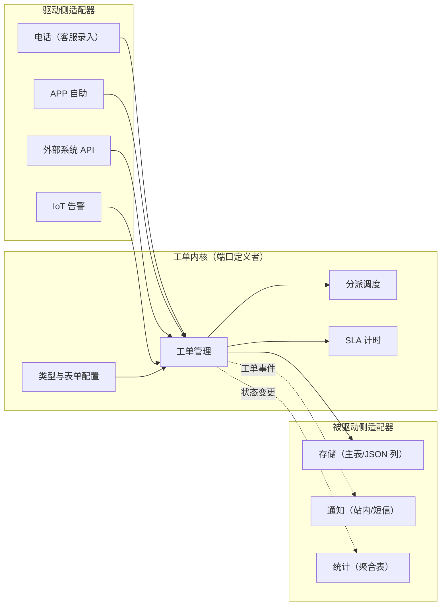

# 工单中心：企业内部服务平台

> 返回：[示例项目场景](00-导览.md) · [软件架构学习大纲](../软件架构学习大纲.md)
> 定位：用户熟悉的真实项目——多渠道接入、按类型流转、SLA 约束的企业内部服务平台；设计模式（策略/状态）、六边形架构、模块划分与扩展性设计的首选案例。主要对应大纲：一-2 设计模式、二-1 模块化单体、二-4 六边形架构、三-3 动态字段存储、四-2 DDD。

## 业务画像

企业内部服务平台：多渠道（电话、APP、IoT 告警、外部系统）产生工单，自动/手动分派给处理人，按类型流转状态，受 SLA 时限约束，超时催办升级，关单后满意度回访。

**用户角色**：

- 报障人/申请人：一线员工或外部用户，提交与补充信息、确认解决。
- 受理客服：接电话建单、首次响应、简单问题直接解决。
- 处理人（二线工程师）：按技能组接单、处理、转派、挂起。
- 组长/经理：改派、升级、超时督办、人力调配。
- 系统管理员：配置工单类型、表单、流程与 SLA 策略。

**教学量级假设**：日新建工单 5000，在途工单 20 万，工单类型 30+，处理人 800 名（分 40 个技能组）。“20 万在途 × 每条都要盯着超时”这个组合是 SLA 模块一切设计的出发点。

**核心业务流**：

1. 渠道接入（电话录入/APP 自助/系统 API/IoT 告警自动创建）；
2. 建单：按类型渲染表单，填关键字段，生成工单号；
3. 自动分派（规则匹配技能组与处理人）或转人工分派；
4. 处理：受理响应→处理中（可挂起等外部、可转派、可升级）→ 填写解决方案→ 解决；
5. 报障人确认，关单；未确认超时自动关单；
6. 关单后触发满意度回访；解决后 N 天内同问题重现可重开。

## 模块总览

| 模块 | 一句话职责 | 关键数据 |
|---|---|---|
| 工单管理 | 工单实体与状态流转 | 工单主表、流转记录 |
| 分派调度 | 把工单交给合适的人 | 技能组、分派规则、负载 |
| SLA 计时与催办 | 时限计算、超时检测、催办升级 | SLA 策略、计时时钟 |
| 工单类型与表单配置 | 类型定义与元数据驱动表单 | 类型、表单 Schema |
| 通知 | 关键节点触达相关人 | 通知模板与记录 |
| 统计报表 | 受理量、按时率、满意度 | 聚合表/报表 |

## 系统上下文与服务边界（六边形的骨架）

工单中心是站内讲六边形架构的标准案例，先把“端口与适配器”画出来：



读图口径（二-4 取材时逐条回收）：

- **四个渠道是四个驱动侧适配器，内核不感知渠道差异**：渠道报文归一化全部发生在适配器里，内核只认统一的“建单请求”。新接一个渠道（如邮件进单）= 新增一个适配器，内核零改动——开闭原则在架构边界的版本。
- **内核向外只有“端口”（接口），适配器实现端口**：存储、通知、统计都是被驱动侧——存储三方案换型（见下文）不动内核代码，正是“存储选型是模块内部决策”的结构保证。
- **虚线仍是事件**：通知与统计订阅工单事件，不进主链路——与订单场景的通知同一条纪律，第三次出现。

## 核心模块

### 工单管理

**职责**：工单实体的创建、查询与状态流转——一切模块都围着它转的“内核”。

**关键实体与数据**：

- 工单主表 `tickets`：`ticket_no`（对外编号）、`type_code`（类型编码，决定一切行为）、`title`、`description`、`reporter_id`、`assignee_id`（当前处理人）、`group_id`（当前技能组）、`status`、`priority`（紧急/高/中/低）、`source_channel`（电话/APP/API/IoT）、`sla_policy_id`、`created_at`、`first_response_at`（首次响应时间）、`resolved_at`、`closed_at`、`reopen_count`（重开次数）、`custom_fields`（元数据字段，JSON 或 EAV 存储）。
- 流转记录 `ticket_transitions`：`ticket_id`、`from_status`、`to_status`、`operator`、`comment`、`created_at`——审计与追责的唯一事实来源，谁在何时把单子派给了谁，事后必须可回答。

**状态机**：待受理 →（首次响应）→ 处理中 →（填方案）→ 已解决 →（确认/超时）→ 已关闭；旁路：待受理/处理中 → 已挂起（等外部反馈，SLA 暂停计时）→ 恢复处理中；处理中 → 转派（换人，回处理中初始）；已关闭 →（N 天内重现）→ 重开（生成新流转周期，`reopen_count`+1）。

**典型流程（建单）**：渠道适配器归一化报文→按 `type_code` 加载表单 Schema 校验必填→生成工单号→初始化状态与 SLA 时钟→投递分派请求。

建单链路的**事件时序逐步表**（四阶段思考题“订阅到期生成订单”的姊妹题：每行只改一个聚合，跨聚合靠事件）：

| 步 | 动作 | 事务内只改的聚合 | 对外发出的事件 / 失败行为 |
|---|---|---|---|
| ① | 渠道适配器归一化报文 | 无（纯翻译） | 报文不合法→适配层拒绝，内核不知情 |
| ② | 加载类型四件套，校验必填字段 | 无（读配置） | 校验失败→返回渠道方明确的错误码 |
| ③ | 落工单主表（含 `custom_fields` 与 `form_version`） | 工单聚合：insert + 初始状态 | 唯一约束挡重复建单（渠道重发） |
| ④ | 同事务写 SLA 时钟初值 | （同库，同事务） | 拆服务后本行变成订阅“工单已创建”事件 |
| ⑤ | 投递分派请求（事件/消息） | 无 | 投递失败→本地消息表重试，工单绝不丢 |
| ⑥ | 分派策略选人，写指派与流转记录 | 工单聚合：`assignee_id` + 流转记录 | 无人可派→升级人工池并告警 |

注意③⑤的边界：工单落库与分派执行不在一个事务里——建单成功的那一刻，工单可以短暂处于“待受理且无人处理”，由分派的最终一致补齐；“宁可单子在池子里多待十秒，不能建单事务里同步调用分派”是内核解耦的代价与选择。

**设计要点与典型陷阱**：

- **反例（状态硬编码）**：`if (status == "处理中" && type == "报修") { ... } else if ...` 散落几十处，新增类型加一种“待审批”状态要改 17 个文件。**修正**：状态迁移表集中定义 + 类型级差异用策略/配置外置——这是第一阶段讲开闭原则最有体感的反例。
- 重开不是“把状态改回去”：已关闭→处理中会让时效统计失真（这单到底用了多久）；重开记录新一轮流转周期，统计按时率时按首轮口径。
- `custom_fields` 的引入动机：30+ 类型的专属字段（报修要设备编号、投诉要订单号）不可能都建列，元数据存储是必然选择——具体存法见下文“工单类型与表单配置”的存储三方案，并延伸到[10-低代码开发平台](10-低代码开发平台.md)。

### 分派调度

**职责**：为新工单选择技能组与处理人——业务上调整最频繁的规则。

**关键实体与数据**：`groups`（技能组：`group_id`、`skills`、`members`）；`group_members`（`user_id`、`group_id`、`capacity`（每日接单上限）、`working`（当前在途数））；分派规则 `dispatch_rules`（`type_code`、`priority`、`strategy`（轮询/最少负载/技能匹配/优先级加权）、`condition`（表达式）、`enabled`）。

**典型流程**：建单事件→规则引擎按类型/优先级/条件匹配策略→策略从候选组内选人（负载实时查询）→指派并通知→无人接单/超时未响应→升级人工或转下一候选组。

**设计要点与典型陷阱**：

- **反例（分派 if-else 腐烂）**：分派逻辑半年改十几轮（先按区域、又按技能、再叠加负载、大客户直通……），没人敢动。**修正**：规则外置为可配置数据 + 策略模式实现算法，新规则上线不改代码——策略模式的教科书案例。
- 分派的“指派”与“认领”两种模型（系统派 vs 抢单池）对负载均衡与积极性的影响不同，业务选型而非技术选型。
- 负载快照的实时性：用缓存在途数而不是每次 COUNT 全表。

分派策略骨架（策略模式的落点）：

```kotlin
interface DispatchStrategy {
    fun select(candidates: List<Handler>, ticket: Ticket): Handler
}

class LeastLoadStrategy : DispatchStrategy {
    override fun select(candidates: List<Handler>, ticket: Ticket) =
        candidates.filter { it.working < it.capacity }
            .minByOrNull { it.working }            // 在途最少者优先
            ?: throw NoAvailableHandlerException(ticket.ticketNo)
}

class RuleBasedDispatcher(private val strategies: Map<String, DispatchStrategy>) {
    fun dispatch(ticket: Ticket, rule: DispatchRule): Handler {
        val candidates = groupService.candidates(rule.groupId)
        return strategies.getValue(rule.strategy).select(candidates, ticket) // 新算法=注册新策略，分派主干零改动
    }
}
```

### SLA 计时与催办

**职责**：按时限策略计算到期时间、检测超时、催办与逐级升级。

**关键实体与数据**：

- `sla_policies`：按 `type_code × priority` 的矩阵定义两级时限——`response_mins`（首次响应时限）与 `resolve_mins`（解决时限），如“高优先级网络故障：响应 15 分钟、解决 4 小时”。
- `sla_clocks`：每张在途工单一条——`ticket_id`、`respond_deadline`、`resolve_deadline`、`paused_total`（累计暂停毫秒）、`status`（计时中/暂停/已达标/已超时）。
- 暂停规则：挂起等外部（等用户回话、等备件）期间计时应暂停，否则处理人会被不可控的外部因素拖成超时——**暂停语义是 SLA 模块最容易被轻视的复杂度**。

**典型流程（超时检测）**：时钟推进→到期未响应/未解决→第一级催办（提醒处理人）→仍超时→升级组长→再超时→升级经理+标记严重超时→所有动作写流转记录。

**设计要点与典型陷阱**：

- **检测机制二选一（高频考题）**：定时扫描全表（20 万在途每分钟扫一遍，数据库压力与延迟不可接受）vs 延迟消息/时间轮（每个时钟一条到期消息，精准触发）。工程常用折衷：**分层扫描**——把 `resolve_deadline` 建索引，每次只扫“未来 5 分钟内到期”的窄区间，配合延迟消息兜底。这道题与订单“超时关单”同构，讲课时互相引用。
- 升级链的“升级”是流程动作不是状态：升级后工单仍在处理中，只是督办对象变了——把升级建模成状态会让状态机爆炸。
- 时区与节假日：`resolve_deadline` 按工作时间还是自然时间计算必须明确，跨时区团队更复杂。

SLA 时钟骨架（暂停语义的落点——存“已消耗的计时量”而不是写死的到期时间，挂起中的时钟没有到期时间）：

```kotlin
// SLA 时钟骨架：暂停语义的核心——存“已消耗的计时毫秒”，而不是一个写死的到期时间
class SlaClock(private val resolveMillis: Long, startedAt: Long) {
    private var consumed = 0L                      // 已消耗的计时毫秒（不含暂停期）
    private var runningSince: Long? = startedAt    // null 表示暂停中

    fun pause(now: Long) {
        val since = runningSince ?: return         // 已暂停：重复暂停幂等
        consumed += now - since
        runningSince = null
    }

    fun resume(now: Long) {
        if (runningSince == null) runningSince = now   // 恢复后从 now 重新计时
    }

    fun remaining(now: Long): Long {               // 剩余可计时毫秒：暂停期间不变
        val running = runningSince?.let { now - it } ?: 0L
        return resolveMillis - consumed - running
    }

    // 暂停中的时钟没有到期时间——不能被超时扫描命中
    fun deadline(now: Long): Long? = runningSince?.let { now + remaining(now) }

    fun isBreached(now: Long) = remaining(now) <= 0
}

fun main() {
    val hour = 3_600_000L
    val clock = SlaClock(resolveMillis = 4 * hour, startedAt = 0)    // 解决时限 4 小时
    clock.pause(now = 1 * hour)                                       // 处理 1 小时后挂起等备件
    println("挂起中（第 6 小时查看）：剩余 ${clock.remaining(6 * hour) / hour}h，到期时间=${clock.deadline(6 * hour)}")
    clock.resume(now = 6 * hour)                                      // 备件到货，恢复计时
    println("恢复后：到期时间=第 ${clock.deadline(6 * hour)!! / hour} 小时（暂停的 5 小时不计入）")
    println("第 9.5 小时是否超时：${clock.isBreached(9 * hour + hour / 2)}")
}
```

骨架对应的两条落库结论：`sla_clocks` 要存 `paused_total`（或等价的“已消耗量”）而非只存一个 `resolve_deadline`；恢复计时时**重算并重投**到期消息（旧的延迟消息作废——消息体带时钟版本号，消费时版本不符即丢弃）。

**超时催办升级的事件时序逐步表**（四阶段思考题“SLA 超时 → 催办升级跨了上下文”的参考时序）：

| 步 | 动作 | 事务内只改的聚合 | 对外发出的事件 / 幂等手段 |
|---|---|---|---|
| ① | 到期消息/窄区间扫描命中时钟 | 无 | 消息带 `ticket_id + 时钟版本 + 级别`，版本不符直接丢弃 |
| ② | 复核：工单是否仍在途、是否已暂停 | 无（读） | 已解决/已挂起→本次命中作废（最常见的“假超时”来源） |
| ③ | 时钟置“已超时”，记录升级级别 | SLA 时钟聚合 | 条件更新 `WHERE level = 旧级别`，重复消息只生效一次 |
| ④ | 发“SLA 已超时（级别 N）”事件 | 无 | 本地消息表保证与③原子 |
| ⑤ | 工单上下文消费：写流转记录、改督办人 | 工单聚合 | 幂等键=`ticket_id + level`；工单状态不变（升级不是状态） |
| ⑥ | 通知上下文消费：催办/汇总 | 通知记录 | 同组多单超时→合并成一条汇总，防催办风暴 |

三个上下文（SLA、工单、通知）各自一个事务，靠事件串起来；②的“复核”是整条链最容易漏的一步——延迟消息到期时的世界与投递时已经不同。

### 工单类型与表单配置

**职责**：让“新增一种工单类型”尽量只改配置不改代码。

**关键实体与数据**：`ticket_types`：`type_code`、`name`、`form_schema`（表单元数据：字段、类型、校验、联动规则）、`state_machine_template`（该类型的状态机变体，如审批类多一个“待审批”）、`dispatch_rule_binding`、`sla_policy_binding`。表单数据落在工单 `custom_fields`。

**典型流程**：管理员新建类型→配置表单/状态机/分派/SLA 四件套→发布版本→新渠道报文即可使用；在途旧单仍按提交时的旧版 Schema 渲染。

**设计要点与典型陷阱**：

- **Schema 版本演化**：历史单据必须按提交时结构渲染与校验（存量工单的“设备编号”字段被删了，回看详情怎么办）——与低代码平台“Schema 版本化”是同一道题。
- 类型配置的四件套彼此引用，发布要整体一致（引用了不存在的 SLA 策略就是配置事故）——配置版本化与校验的话题，延伸见[11-API 网关](11-API网关.md)的配置治理。
- 通用性陷阱：越做越像通用 BPM，回撤线在“状态机变体 + 字段配置”，别往完整流程引擎走（见[10-低代码开发平台](10-低代码开发平台.md)的通用性讨论）。

**表单数据的存储三方案（`custom_fields` 到底怎么存）**：30+ 类型各有专属字段，主表不可能逐类型建列——自定义字段怎么存，是表单配置落地的第一个架构决策。先立一个历史反例，再看三个正经候选（SQL 级对照与“同一条查询的三种写法”在[03-第三阶段/04 §3.4 动态字段存储](../03-第三阶段/04-数据架构-缓存分库与选型.md)完整展开，这里只看工单中心的决策现场）：

- **反例（预留列宽表）**：老工单系统常见的 `ext1..ext50`——加字段零 DDL 看似省事，但字段语义全靠文档约定（“ext7 在报修类型里是设备编号、在投诉类型里是订单号”），第 51 个字段一到就全表 ALTER，稀疏列还把行宽撑满。它是宽表家族的退化形态，新系统直接排除。

| 方案 | 做法 | 在工单中心的代价 | 适用 |
|---|---|---|---|
| EAV 键值行 | 每字段值一行 `(ticket_id, field_code, value_str)` | 详情页整行取走要聚 N 行；“P0 且 A1 产线”筛选变成每个条件一次子查询再求交集，条件越多越慢；值全是字符串，排序与按时率聚合失真 | 字段极多、几乎不按字段查 |
| JSON 列（默认解） | `custom_fields` JSONB 收全量 + `form_version` 锚定 Schema | 按字段过滤依赖生成列/JSON 索引，能力上限由数据库版本决定 | 读多写少、详情整行取走、常筛字段集中——工单负载画像正对口 |
| 动态建表 | 每类型一张专表，字段即列 | 30+ 类型 30+ 张异构表：月度报表 UNION 失控；新增类型要 DDL 审批，与“只改配置不改代码”的目标正面冲突 | 单类型数据量极大且字段稳定的定制场景（逃生舱） |

工单中心的负载恰好站在 JSON 列一边：日建 5000、读多写少；详情页整行取走；按自定义字段的高频筛选集中在 `priority`、`device_line` 等少数字段——提升为生成列索引即可。结论：**JSON 列打底 + 热字段提升 + 专表逃生舱**；提升哪个字段由慢查询埋点决定，不由“以后可能想按这个筛”决定（治理红线见03-第三阶段/04）。

存储骨架——三方案藏在统一门面后，建单/详情/列表只认接口，存储选型是模块内部决策、可整体替换：

```kotlin
interface CustomFieldStore {
    fun save(ticketId: Long, typeId: String, schemaVersion: Int, values: Map<String, Any?>)
    fun load(ticketId: Long): Map<String, Any?>                    // 详情页：整行取走
    fun filter(conds: Map<String, String>): List<Long>             // 列表页：按自定义字段筛
}

// 方案一 EAV：一个字段值一行——查询 = 每个条件各扫一批行再求交集，值统一转字符串、类型失真
class EavStore : CustomFieldStore {
    private val rows = mutableListOf<Triple<Long, String, String>>()   // (ticket_id, field_code, value_str)
    private val meta = mutableMapOf<Long, Pair<String, Int>>()         // type/version 只能另行记录
    override fun save(ticketId: Long, typeId: String, schemaVersion: Int, values: Map<String, Any?>) {
        meta[ticketId] = typeId to schemaVersion
        values.forEach { (k, v) -> rows += Triple(ticketId, k, v.toString()) }
    }
    override fun load(ticketId: Long) =
        rows.filter { it.first == ticketId }.associate { it.second to it.third }   // 整行取走 = 聚 N 行
    override fun filter(conds: Map<String, String>): List<Long> {
        var hit: Set<Long> = meta.keys                                  // 每个条件一次全行扫描 + 交集
        conds.forEach { (k, v) ->
            hit = hit intersect rows.filter { it.second == k && it.third == v }.map { it.first }.toSet()
        }
        return hit.sorted()
    }
}

// 方案二 JSON 列：一行一单，高频字段提升为生成列——工单中心的默认解
class JsonColumnStore(private val promoted: Set<String> = setOf("priority")) : CustomFieldStore {
    private data class Row(val typeId: String, val ver: Int, val fields: Map<String, Any?>)
    private val rows = mutableMapOf<Long, Row>()
    override fun save(ticketId: Long, typeId: String, schemaVersion: Int, values: Map<String, Any?>) {
        rows[ticketId] = Row(typeId, schemaVersion, values)             // custom_fields JSON 列 + form_version
    }
    override fun load(ticketId: Long) = rows.getValue(ticketId).fields  // 一次取整行
    override fun filter(conds: Map<String, String>): List<Long> {
        val (byCol, byJson) = conds.entries.partition { it.key in promoted }  // 提升列清单也是元数据
        return rows.filter { (_, r) ->
            byCol.all { (k, v) -> r.fields[k]?.toString() == v } &&    // 提升列 → 走索引的平面条件
            byJson.all { (k, v) -> r.fields[k]?.toString() == v }      // 其余 → JSON 取值表达式
        }.map { it.key }.sorted()
    }
}
// 方案三动态建表不给骨架：它就是"每类型一张普通表"，新增类型 = 建表 DDL——恰是与"只改配置"冲突的那一环
```

同一条“priority=P0 且 device_line=A1”的列表查询，两个实现结果相同、成本形状不同：EAV 是“每个条件扫一批行 + 交集”，JSON 列是提升列走索引、其余走 JSON 取值表达式——正是03-第三阶段/04“同一条查询三种写法”的接口层映像。平台级完整版（数据引擎把三方案做成多租户能力）见[10-低代码开发平台](10-低代码开发平台.md)。

### 通知

**职责**：建单、指派、转派、超时、关单等节点触达相关人。

**关键实体与数据**：`notify_templates`（`event_code`、`channel`（站内/短信/邮件）、`template`）；`notifications` 记录发送与重试。

**典型流程**：订阅工单事件→模板渲染（含变量）→按人选择通道（处理人站内+短信，报障人可选）→发送，失败重试。

**设计要点与典型陷阱**：超时催办风暴——某技能组集体超时会瞬间发出几百条短信，通道限流与聚合（合并为一条汇总催办）必须有；通知永远在事件链下游，不进主流程。

### 统计报表

**职责**：受理量、按时率、超时率、满意度、人员绩效。

**关键实体与数据**：明细在 `tickets`/`ticket_transitions`，聚合在按天的 `stats_daily`（`group_id`、`date`、`created`、`resolved`、`on_time_rate`、`csat`）。

**典型流程**：实时看板（今日受理、在途、临期）走聚合表或缓存；月度全员报表走离线批处理。

**设计要点与典型陷阱**：**负载完全不同的两类读**——运营看板要秒级刷新的聚合，财务月末要全量明细重算；硬用一套查询兼顾两头，一边慢另一边不准。这是 CQRS 的天然苗头（在工单场景点到为止，深化见[04-MES](04-MES制造执行系统.md)与三-3）。

## 架构挑战与知识点映射

| 挑战 | 方案要点 | 对应大纲小节 |
|---|---|---|
| 状态多且随类型变化，硬编码腐烂 | 迁移表 + 类型级策略外置 | 一-2 状态/策略/开闭 |
| 分派规则频繁调整 | 规则配置化 + 策略模式 | 一-2 策略模式 |
| 多渠道接入、内核稳定 | 渠道适配器 + 防腐层 | 二-4 六边形架构 |
| SLA 超时检测（20 万在途） | 延迟消息/分层扫描 | 三-5、二-3 |
| 新类型“只加配置不改代码” | 元数据驱动表单与流程 | 一-2 解释器、[10-低代码](10-低代码开发平台.md) |
| 30+ 类型的专属字段怎么存 | JSON 列打底 + 热字段提升 + 专表逃生舱 | 三-3 动态字段存储 |
| 看板与报表负载分离 | 读写分离 / CQRS 苗头 | 三-3 |
| 模块化单体够不够 | 先模块化再论证拆分 | 二-1 |

## 关键数据表设计与取舍

| 表 | 取舍点 | 结论与理由 |
|---|---|---|
| `tickets` 主表 | `custom_fields` 的三方案 | JSON 列打底 + 热字段提升（上文已完整论证），`form_version` 锚定 Schema |
| `ticket_transitions` | 只记“最新处理人”还是全量流转记录 | 全量：审计与追责的唯一事实来源，“谁在何时把单子派给谁”事后必须可回答 |
| `sla_clocks` | 存写死的 `deadline` 还是“已消耗量” | 已消耗量（见骨架）：暂停/恢复语义天然成立；`deadline` 变成可推导的投影 |
| `dispatch_rules` | 规则进代码还是进数据 | 进数据：半年改十几轮的高频变化；代价是规则要有版本、生效校验与回滚（配置即代码） |
| 索引 | 按展示列建还是按查询模式建 | 三条主查询：处理人待办 `(assignee_id, status)`、技能组队列 `(group_id, priority, created_at)`、SLA 窄扫 `(resolve_deadline) WHERE status=计时中`——其余靠慢查询埋点驱动 |

## 容量与失败模式推演

基于量级假设（日建 5000、在途 20 万、30+ 类型、800 处理人）的推演，非实测：

- **SLA 检测的扫描面**：20 万在途若每分钟全表扫一遍，等于每分钟 20 万行的稳定读压力且延迟最差一分钟——所以窄区间扫描（索引命中“未来 5 分钟内到期”）+ 延迟消息兜底的折衷不是优化项，是唯一可行解。20 万×平均生命周期算下来每秒只需处理个位数到几十个到期事件，延迟消息量完全可控。
- **建单峰**：IoT 告警批量进单（一台网关掉线触发一片设备告警）是真实的写入峰——渠道适配器侧先聚合（同源告警合并为一张工单），比下游扛重复单便宜。
- **看板读**：组长看板（我的组今日/在途/临期）每分钟刷新 × 40 组，实时 COUNT 是最容易被忽视的慢查询——聚合表或缓存承接，明细表不服务看板。

失败模式清单：

| 失败模式 | 触发 | 后果 | 预设对策 |
|---|---|---|---|
| 延迟消息丢失 | 中间件故障 | 超时无人催 | 窄区间扫描兜底（双通道） |
| 旧版本到期消息迟到 | 挂起/恢复后旧消息才到 | 假超时误催 | 消息带时钟版本，复核现态 |
| 重复建单 | 渠道重发 | 同一故障两张单 | 建单幂等键（渠道 + 外部单号） |
| 催办风暴 | 整组超时 | 短信通道被打爆、处理人被淹 | 按组聚合为一条汇总催办 |
| 规则配置错误 | 上线未校验 | 新工单全部派错人 | 规则版本化 + 灰度生效（先 1 个类型） |
| 暂停语义漏实现 | 等外部时间被计入 | 处理人被冤枉超时 | `paused_total` 字段与挂起状态联动、统计侧按时效口径豁免 |

## 面试官追问点

- “超时检测为什么不全上延迟消息？”——精准但要中间件与消息版本治理；全表扫描简单但扛不住 20 万在途——真实答案是双通道折衷，且扫描天然兜底消息丢失。
- “重开为什么不是把状态改回去？”——时效统计按首轮口径、状态机只进不退、重开是新一轮生命周期（`reopen_count` 只是计数）。
- “分派规则配置化的边界在哪？”——变化频率高且业务方可理解的进配置；涉及资金/安全或需要事务保证的留代码——配置的代价是执行环境弱化（无事务、难测试）。
- “JSON 列方案什么情况下会死？”——高频按任意字段过滤且字段集发散时（每个条件一次 JSON 取值表达式）——那时要么提升热字段，要么认输换专表（逃生舱）。
- “工单中心要不要拆微服务？”——默认模块化单体：内部系统、团队规模有限、四件套配置天然共享事务边界；拆的触发器是“配置模块要独立给多产品复用”（SaaS 化，见[12](12-多租户SaaS控制平面.md)）。

## 如果规模再大十倍

假设日建 5 万、在途 200 万、类型 100+、处理人 5000：

- **SLA 检测**：延迟消息量上到每秒数百条，按 `ticket_id` 分区消费即可；窄扫索引仍是 `(resolve_deadline)`，只是要按月分区表控制索引深度。
- **主表分片**：按 `ticket_no`（内含分片位）或 `group_id` 分片——前者均衡、后者让“组队列”查询路由单分片；典型的分片键辩论题（答案倾向 `ticket_no`，组队列走异构读库）。
- **配置复杂度**：100+ 类型 × 四件套版本矩阵，人工发布已经管不住——类型配置引入灰度与对拍（新配置在 1 个类型上跑一天再放量），这是长成低代码平台的时刻（[10](10-低代码开发平台.md)）。
- **看板/报表**：实时看板走流式聚合（变更事件 → 增量物化），月报整体进离线数仓——CQRS 从“苗头”变成必选项。
- **多渠道**：渠道数翻倍后，适配层的归一化规则本身要版本化（同一渠道的报文也会升级）——防腐层自己的防腐。

## 与其他场景的联动

- **六边形架构标准案例**：电话/APP/API/IoT 四个渠道就是四个驱动侧适配器，工单内核不感知渠道差异——第二阶段讲六边形时的主案例。
- MES（[04](04-MES制造执行系统.md)）：设备告警/质量异常自动生成维修工单。
- 物联网平台（[09](09-物联网平台.md)）：规则引擎判定设备异常后调工单 API 建单。
- 低代码平台（[10](10-低代码开发平台.md)）：“表单/流程可配置化”就是内嵌的低代码，先讲本场景的单体实现再延伸到独立平台；表单存储三方案在此是单体选型现场，在彼升级为数据引擎的核心模块。
- 多租户 SaaS 控制平面（[12](12-多租户SaaS控制平面.md)）：工单中心 SaaS 化卖给 50 家企业的完整改造清单。

## 取材指引

- 一-2 设计模式：状态（工单流转）、策略（分派/优惠同构）、开闭（新增类型不改内核）。
- 二-1 模块化单体：以“内核稳定 + 外围多变”论证模块边界；二-4 六边形：多渠道适配器案例。
- 四-2 DDD：工单是天然聚合根，流转记录是实体，`custom_fields` 引出值对象与通用性边界讨论。
- 三-3 数据架构：`custom_fields` 三方案（EAV / JSON 列 / 动态建表）在工单量级下的选型现场，SQL 级对照见[03-第三阶段/04](../03-第三阶段/04-数据架构-缓存分库与选型.md)。
- 三-5 高可用：SLA 检测的分层扫描是“定时扫描 vs 延迟消息”的折衷案例。
- 可出思考题方向：重开为什么不是改回状态；SLA 计时暂停语义漏掉会发生什么；分派规则外置配置的边界在哪（什么规则不该配置化）；三方案各死于工单中心的哪条查询或哪条约束。
