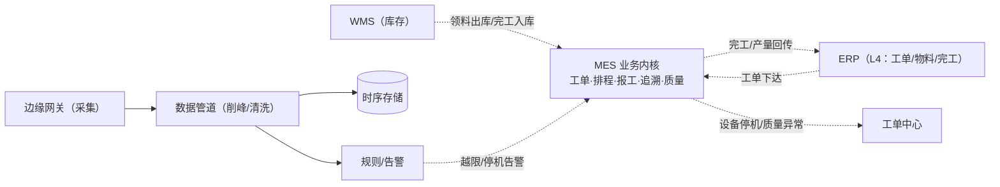
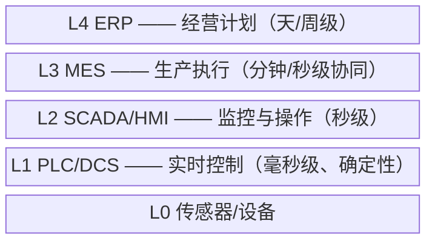

# MES 制造执行系统：工厂车间的执行层

> 返回：[示例项目场景](00-导览.md) · [软件架构学习大纲](../软件架构学习大纲.md)
> 定位：用户熟悉的真实项目——讲事件驱动、事件溯源、高可用、系统集成、可观测性（海量设备数据）的首选载体；分层架构用 ISA-95/Purdue 模型讲“时间尺度决定架构层次”。主要对应大纲：一-1 分层思想、二-3 事件驱动与事件溯源、三-5 高可用、五-1 可观测性、五-3 安全架构。

## 业务画像

工厂车间执行层系统：接收 ERP 下达的生产工单，按工艺路线排程到工序，工人/扫码枪报工，设备（PLC/传感器）联网实时采集数据，物料按批次追溯，质量检验拦截不良品。

**一句话定位**：MES 管的是“这单活怎么干”（分钟/秒级协同）；真正毫秒级控制设备的是 PLC/DCS，两者之间隔着 SCADA/HMI 与边缘网关——这段交界就是下方“工控扩展场景”。

**用户角色**：

- 计划员/调度员：接收 ERP 工单、排产、调整工序顺序。
- 车间工人：接单作业、扫码报工、首检送检。
- 质检员：按检验项判定合格/不良、处置不良品。
- 设备/工艺工程师：维护工艺路线、设备点检、采集点位配置。
- 厂长/管理层：实时生产看板、产量与良率报表。

**教学量级假设**：一条产线 20 台设备，每台秒级 1~3 条采集点位（温度、压力、转速、计数），全厂 200 台设备 → 峰值约 500 条/秒；日生产工单 200 张，批次 2000 个，追溯链要求保存 2 年以上。

**核心业务流**：

1. ERP 下达生产工单（做什么、多少、什么时候要）；
2. MES 按工艺路线（工序序列 + 每工序的设备/工位与标准工时）排程；
3. 领料出库（对接 WMS），物料批次与工单绑定——追溯链起点；
4. 工人按工序作业，扫码报工（产量、工时、人员）；
5. 首检/巡检/完工检，不良品拦截与处置（返工/报废/让步接收）；
6. 完工入库（对接 WMS），工单关闭；
7. 全程设备数据自动采集，异常（超限、停机）实时告警甚至触发工单。

## 模块总览

| 模块 | 一句话职责 | 关键数据 |
|---|---|---|
| 生产工单 | ERP 工单接收、拆分与跟踪 | 生产工单、工序任务 |
| 工艺路线与排程 | 工序定义与排产 | 工艺路线、排程计划 |
| 报工 | 工序产出的采集 | 报工记录 |
| 设备接入与数据采集 | 协议接入与高频采集 | 采集点位、采集流水 |
| 批次追溯 | 正反向批次谱系 | 批次、谱系边 |
| 质量管理 | 检验与不良处置 | 检验单、不良记录 |
| 指令下发与安全联锁 | 参数下发与安全边界 | 下发指令、联锁状态 |
| 集成（ERP/WMS） | 上下游系统集成 | 集成接口/消息 |

## 系统上下文与服务边界

MES 在工厂系统链里的位置（IT 侧视角；与设备的 OT 侧交界见文末“工控扩展场景”）：



读图口径：

- **MES 的三个上游、两个下游**：ERP 给计划（工单）、WMS 给物流（料）、边缘网关给事实（采集数据）；下游回传完工与产量、向工单中心派维修单。全部交互都是异步事件/接口，没有共享库表——这是“集成靠事件骨干 + 各自防腐层”的正确起点。
- **数据管道独立于业务内核**：采集数据的洪峰由管道与时序存储承接，不经过 MES 业务库——“事实洪峰”与“业务事实”分两条存储路径，是本场景最重要的边界。
- **虚线到工单中心**：设备停机/质量异常生成维修工单（联动[03](03-工单中心.md)），MES 只发事件不管工单生命周期。

## 核心模块

### 生产工单

**职责**：接收 ERP 工单，拆解为车间可执行的工单与工序任务，跟踪进度。

**关键实体与数据**：`production_orders`：`po_no`、`erp_order_no`、`material_code`（产品物料）、`qty_planned`、`date_due`、`status`（已接收/已排产/生产中/已完工/已关闭）；`operation_tasks`：`po_no`、`op_seq`（工序号）、`workcenter_id`、`qty_done`、`status`。工单状态推进依赖报工数据回填——“状态是事实的投影”在 MES 里的具象。

**典型流程**：ERP 工单同步（接口/消息）→校验物料工艺路线是否存在→生成工序任务序列→排程→逐工序报工推进→完工回传 ERP。

**设计要点与典型陷阱**：ERP 与 MES 的工单是一对“同源不同命”的数据——ERP 关单但车间还有在制品怎么算；拆单（一张大单拆批次生产）后 ERP 侧怎么对齐。集成侧的口径对齐永远比接口技术难，这是讲系统集成（防腐层）的常驻例子。

### 工艺路线与排程

**职责**：定义产品怎么造（工序序列），并把工单安排到设备与时间。

**关键实体与数据**：`routings`：`material_code`、`version`（工艺版本——产品工艺改版后历史批次仍按旧版解释）；`routing_operations`：`op_seq`、`op_name`、`workcenter_type`、`std_hours`、`inspection_flag`；`schedules`：工单×工序×设备×计划时间窗。

**典型流程**：工艺工程师维护路线并版本化→排程员按交期、设备产能、换型时间排产（有限产能排程是约束求解，工程上常用启发式+人工调整）→下达锁定的排程。

**设计要点与典型陷阱**：工艺版本与批次绑定（这批产品按哪版工艺做的必须可回溯）；插单（急单插入）引发的全局重排——排程是“计划世界”，现场执行是“事件世界”，两者用“下达/反馈”事件流衔接，讲事件驱动时是好例子。

### 报工

**职责**：采集工序产出——产量、合格数、工时、操作人。

**关键实体与数据**：`work_reports`：`operation_task_id`、`qty_ok`、`qty_ng`、`worker_id`、`workcenter_id`、`report_time`、`source`（扫码/自动）。

**典型流程**：工人完成一道工序→扫码（工单+工序+人员）→录入数量→即时校验（不能超工单数）→写入并推进任务。

报工链路的**事件时序逐步表**（含断网补传分支——车间网络的常态而非异常）：

| 步 | 动作 | 数据变更 | 失败与并发行为 |
|---|---|---|---|
| ① | 扫码：工单+工序+人员 | 无 | 工单已关闭/工序不存在→现场直接报错，不进暂存 |
| ② | 录入数量，即时校验（≤工单剩余数） | 无 | 超数→拒绝；此处校验是提示性的，最终以后端为准 |
| ③ | 在线：直接提交 | insert `work_reports` | 重复扫码（同人同时段同工序）幂等去重 |
| ③' | 断网：本地暂存（终端本地队列） | 本地文件 | 网络恢复按事件时间补传，服务端按 `report_time` 归位 |
| ④ | 推进工序任务 `qty_done` | update `operation_tasks` | 并发报工同一工序→原子累加，剩余数复核 |
| ⑤ | 触发下游：检验任务、谱系产出边、看板 | 事件投递 | 投递失败重试；下游各自幂等消费 |

补传的两条铁律：**事件时间为准**（补传的报工算它发生那天的产量，不算恢复那天的——与物联网补传同一条纪律）；**幂等去重**（暂存队列与已入库的记录按业务键对齐，重复补传不重复计数）。

**设计要点与典型陷阱**：报工是车间网络环境下的高频写操作，且现场可能断网——本地暂存、恢复补传（与工控“边缘自治”同一思路，只是粒度更粗）；重复扫码要幂等（同一工单+工序+人员+时段去重）。

### 设备接入与数据采集（高频写的源头）

**职责**：通过边缘网关/上位机以 OPC UA/Modbus 等协议采集设备数据，汇入平台。

**关键实体与数据**：`devices`（`device_id`、`station`、`protocol`、`point_list`）；采集点位 `points`（`point_code`、`device_id`、`type`（温度/压力/计数/状态字）、`plc_address`）；采集流水海量，按设备+时间分区存储。

**典型流程**：边缘网关轮询/订阅 PLC 寄存器→本地缓冲→批量上行（如每秒一批）→平台清洗（量纲换算、越限判断）→批量入库与时序存储→越限生成告警事件。

**设计要点与典型陷阱**：

- **反例（逐条同步写库）**：500 条/秒直接 INSERT 关系库，数据库先于产线“宕机”。**修正**：接入层只做接收与确认（削峰），消费者批量聚合写入——消息队列的经典用法（二-3、三-5）。
- 点位配置（加一台新设备不改代码）是“驱动/编解码器插件化”的软硬结合案例。
- 采集数据的价值分层：实时监控要最近 5 分钟、追溯要 2 年、分析要聚合值——冷热分层与降采样（延伸见[09-物联网平台](09-物联网平台.md)，两边同构）。

### 批次追溯（事件溯源的天然素材）

**职责**：回答“这批产品用了哪几批料、经过哪些工序、谁操作的、设备参数如何”，以及反向“这批原料流入了哪些成品”。

**关键实体与数据**：`batches`（`batch_no`、`material_code`、`qty`、`produced_at`、`routing_version`）；谱系边 `genealogy_edges`：`from_batch`（投入的物料批次）、`to_batch`（产出的批次）、`op_seq`、`workcenter_id`、`worker_id`、`report_id`——**追溯链就是一张以批次为节点的 DAG**，每条边是一次投料/产出事件。

正反向追溯骨架：

```kotlin
data class GenealogyEdge(val from: String, val to: String, val opSeq: Int)

class TraceService(private val edges: List<GenealogyEdge>) {
    private val byChild = edges.groupBy { it.to }   // 正向追溯：成品用了哪些料（沿边向上）
    private val byParent = edges.groupBy { it.from } // 反向追溯：原料流向哪些批次（沿边向下）

    fun upstreamMaterials(batchNo: String): Set<String> {   // 层层向上，收集全部投入批次
        val seen = mutableSetOf(batchNo)
        val queue = ArrayDeque(listOf(batchNo))
        while (queue.isNotEmpty()) {
            val cur = queue.removeFirst()
            byChild[cur]?.forEach { if (seen.add(it.from)) queue.add(it.from) }
        }
        return seen - batchNo
    }

    fun downstreamProducts(batchNo: String): Set<String> {  // 召回时用：这批不良原料波及哪些成品
        val seen = mutableSetOf(batchNo)
        val queue = ArrayDeque(listOf(batchNo))
        while (queue.isNotEmpty()) {
            val cur = queue.removeFirst()
            byParent[cur]?.forEach { if (seen.add(it.to)) queue.add(it.to) }
        }
        return seen - batchNo
    }
}
```

**典型流程**：领料时记录“投入边”、报工时记录“产出边”→追溯查询沿边遍历→召回场景按反向遍历圈定受影响成品。

**设计要点与典型陷阱**：**反例（快照式追溯）**：只存“批次表 + 当前关联批次”字段，工艺调整/补录后历史谱系被覆盖，追溯失真。**修正**：谱系边只增不改（事件溯源思想——追加事实，不更新事实），任何时点的谱系都可重放。这一对照是二-3 讲事件溯源时最有说服力的工业案例。

**召回演练（把上面的机械串成一次完整推演）**：假设某日供应商通知一批原料（批次 `RM-0817`）含水率超标，需要圈定受影响成品——

1. 以 `RM-0817` 为起点做**反向遍历**（`downstreamProducts`）：沿 `from → to` 向下走到全部成品批次——注意中间产物的复用：一批中间品可能同时流入多张工单，遍历必须是图搜索而非单链回溯；
2. 遍历结果按“是否已完工入库”分叉：在制品**就地隔离**（工序任务挂起），已入库成品**冻结库存**（联动 WMS）；
3. 对冻结批次做**风险评估分级**：关键工序参数（从时序库按 `batch_no + 时间窗` 回捞）是否越限，决定“召回/让步/降级”处置；
4. 全程动作写审计（谁在何时基于哪段谱系做了什么决定）——监管检查时“怎么圈的、圈了哪些、为什么”都要有答案。

这个演练里三类存储各就其位：谱系边（图遍历）、时序库（参数回捞）、审计链（合规）——**一次召回同时压测三个模块**，是检验 MES 数据模型完整性的最好沙盘。

### 质量管理

**职责**：检验计划执行、不良判定与处置。

**关键实体与数据**：`inspection_plans`（`material_code`、`inspection_type` 首检/巡检/完工检、`items` 检验项及标准值上下限）；`inspection_records`（`batch_no`、`plan_id`、`results`、`verdict` 合格/不合格）；`nonconformances`（处置：返工/报废/让步接收、审批链）。

**典型流程**：报工触发检验任务→质检员录入实测值→按标准自动判定→不合格生成不良品处置流程（可联动返工工序）。

**设计要点与典型陷阱**：判定规则（上下限、计数抽样）配置化；SPC 控制图需要滑动窗口统计——实时统计与明细查询分库的又一例证。

### 指令下发与安全联锁

**职责**：向设备/产线下发参数与作业指令（如配方参数下发），并守住安全边界。

**关键实体与数据**：`commands`（`target_device`、`payload`（参数集）、`status` 待下发/已确认/已执行/失败、`operator`、`issued_at`）；联锁状态（设备侧反馈的安全门、急停状态字）。

**典型流程**：工艺参数变更审批→下发到 PLC（经边缘网关）→设备确认回执→记录执行结果。

**设计要点与典型陷阱**：**MES 只能“请求”，不能“命令”**——下发指令须经现场安全联锁校验，急停等关键控制权永远归现场（Fail-Safe：宁可停线不可伤人）。指令要有完整的审计链（谁在何时给哪台设备下发了什么参数）——出事故时这是法律证据。

### 与 ERP/WMS 集成

**职责**：工单、物料、库存、完工回传的数据流打通。

**关键实体与数据**：集成接口表/消息映射（ERP 工单→MES 工单字段映射、批次→WMS 库存变动）。

**典型流程**：ERP→MES 工单下达；WMS→MES 领料出库；MES→WMS 完工入库；MES→ERP 工单关闭与产量汇报。

**设计要点与典型陷阱**：**反例（点对点直连）**：ERP、WMS、MES、三套 PLC 网关两两直连，N 个系统长出 N×(N-1) 条接口，改一处牵全身。**修正**：以事件/消息为骨干的集成架构 + 各自防腐层；字段口径差异（ERP 的“完工数量”按工单、MES 按报工）在防腐层翻译，不污染内核模型。

## 架构挑战与知识点映射

| 挑战 | 方案要点 | 对应大纲小节 |
|---|---|---|
| 设备数据高频上报，同步写库撑不住 | 消息队列削峰、批量入库、时序存储 | 二-3、三-3 |
| 产线 7×24 不能停 | 可用性设计、断网本地续采、降级 | 三-5 高可用 |
| 与 ERP/WMS/PLC 集成，协议各异 | 集成架构、防腐层 | 二-4、三-2 |
| 追溯要回答批次谱系 | 谱系事件链（事件溯源思想） | 二-3 事件溯源 |
| 看板（高频写+聚合读）与月报负载分离 | CQRS | 二-3、三-3 |
| 指令下发安全边界 | Fail-Safe、控制权归属、审计 | 五-3 安全架构 |
| 实时性分层 | ISA-95/Purdue、时间尺度决定层次 | 一-1 分层思想 |

## 关键数据表设计与取舍

| 表 | 取舍点 | 结论与理由 |
|---|---|---|
| 采集流水 | 关系库行存 vs 时序库（LSM+分区+压缩） | 时序库：日增亿级行的写入画像，B+ 树先崩；按 `device_id + 时间` 分区滚动 |
| `genealogy_edges` | 快照字段（批次表存“当前关联”）vs 追加式边表 | 追加式边表：谱系只增不改，任意时点可重放（事件溯源思想的落点） |
| `routings` | 工艺版本怎么绑 | 版本号进批次：`batches.routing_version` 记“这批按哪版工艺做的”，工艺改版后历史批次仍按旧版解释 |
| `work_reports` | 报工事实的可信源 | 以报工为准推进 `qty_done`（状态是投影）；补传按 `report_time` 落位 |
| 看板聚合 | 实时聚合查询 vs 物化聚合表 | 物化：实时看板读聚合表，报工事件增量维护——高频写+聚合读不共用一条查询路径（CQRS） |

## 容量与失败模式推演

基于量级假设（200 台设备、峰值 500 条/秒、日工单 200、批次 2000、追溯保存 2 年）的推演，非实测：

- **采集写入**：500 条/秒 ×（假设单条约 200 字节，与物联网场景同口径）= 100 KB/秒，带宽上看不大，但逐条 INSERT 的索引维护与事务开销会先于带宽崩溃——批量聚合写入（攒 500 条或 1 秒一批）把事务数压低两个数量级，代价是秒级可见延迟，监控场景完全可接受。
- **存储体积**：500 条/秒 ≈ 日增 4300 万行、按上述单条假设约 8.6 GB/天（未压缩）——两年原始保存约 6 TB，列式压缩与降采样（分钟级聚合后体积降一个数量级）让“热数据原始值、温数据降采样、冷数据归档”成为必选项而非优化项。
- **追溯查询**：召回场景的反向遍历要跨多层级联（原料→多道工序→多批次成品），边表规模 = 日批次 2000 × 平均边数（数十条）≈ 日增数万行——单库可扛，但遍历深度大时要用图式递归查询或预计算“成品→全部上游”的闭包表（召回窗口分钟级的要求下）。
- **排程的计算量**：有限产能排程是约束求解，200 张工单 × 数十工序的规模下启发式算法分钟级可解——但它吃 CPU 且与在线服务争资源，独立进程跑（负载分离的又一个理由）。

失败模式清单：

| 失败模式 | 触发 | 后果 | 预设对策 |
|---|---|---|---|
| 车间断网 | 网络抖动 | 报工/采集中断 | 终端暂存补传、边缘网关本地缓冲（边缘自治） |
| 采集堆积 | 存储抖动 | 网关无法投递 | 接收与存储解耦：队列缓冲、消费降级 |
| 重复报工 | 补传重放 | 产量虚高 | 业务键幂等（工单+工序+人员+时段） |
| ERP 口径错位 | 完工数量对不齐 | 财务与车间互相指责 | 防腐层统一翻译：ERP 按工单、MES 按报工，映射规则显式化 |
| 告警风暴 | 网关掉线一片设备离线 | 值班被淹没 | 按网关/产线聚合告警（根因抑制） |
| 指令误下发 | 参数配错 | 安全事故 | 审批 + 联锁校验 + 完整审计链（Fail-Safe） |
| 工艺版本错绑 | 改版后旧批次按新版解释 | 追溯结论错误 | 批次落库即绑定 `routing_version`，只读不改 |

## 演进：从一体化到读写分离的迁移与回滚

MES 的演进主线不是“拆微服务”而是“洪峰路径与业务路径分离”，每步同样先迁移后回滚。车间 7×24 运转决定了改造窗口稀缺：**每一步都必须能“不停机进入、按原路退回”**——这是比互联网系统更严格的演进约束。

| 步 | 改造动作 | 迁移方式 | 回滚方式 |
|---|---|---|---|
| 1 | 单体：采集、报工、追溯同库 | 起步形态 | — |
| 2 | 采集管道独立（队列+消费者） | 网关改投队列（双投期：旧直写为准）→ 对拍一致 → 停旧写 | 切回直写（旧路径保留一个版本周期） |
| 3 | 时序存储独立 | 新旧双写（关系库为准）→ 历史回填 → 查询切读时序库 → 停旧写 | 查询切回关系库（数据仍在，双写期未停） |
| 4 | 看板走物化聚合 | 聚合表与实时查询并跑（对拍）→ 看板切聚合表 | 切回实时查询 |
| 5 | 谱系/质检事件化 | 逐消费方切换（双消费、旧为准） | 恢复同步调用 |

第 3 步最值得讲：**“双写 + 以旧为准 + 查询最后切”** 是一切存储迁移的安全模板——回滚之所以便宜，是因为旧库在双写期一直活着。

## 面试官追问点

- “为什么给 PLC 下发指令的链路不能经过消息队列？”——控制链路要求毫秒级确定性，消息队列的投递延迟与重排会破坏时序确定性与安全联锁的实时性；“时间尺度决定层次”在此一票否决。
- “追溯为什么不存‘当前关联批次’字段？”——工艺调整/补录会覆盖历史谱系，追溯失真；追加式边表保证任意时点可重放。
- “看板和月报为什么不能共用查询？”——秒级刷新的聚合读与全量明细重算是两种负载，共用则一边慢另一边不准；CQRS 的工业现场版。
- “报工以什么时间为准？”——事件时间（扫码时刻）；补传算回发生日，否则日产量报表永远差一截（与物联网补传、流处理事件时间同一原则）。
- “ERP 说完工 1000、MES 报工 998，信谁的？”——两个口径都“对”（ERP 按工单整批、MES 按报工累计），差异必须在防腐层的映射规则里显式定义，而不是靠对账时吵架。
- “断网时产线停不停？”——不停：报工与采集走本地暂存，控制根本不经过 MES（L1 自治）；MES 恢复后补齐的是“事实记录”，不是“控制能力”——分层各自独立的可用性预算。

## 如果规模再大十倍

假设 2000 台设备、峰值 5000 条/秒、日批次 2 万、多厂区：

- **接入**：边缘网关按产线分片，平台侧接入无状态水平扩展（与物联网平台合流——[09](09-物联网平台.md) 的完整装备：多协议插件、认证本地化、背压）。
- **存储**：时序库按 `device_id` 哈希分片或按厂区分集群；降采样链路前移到边缘（网关出分钟级聚合值，原始值本地留存）。
- **追溯**：边表日增数十万行，遍历要闭包表或图引擎；批次号全局发号带厂区位。
- **多厂区**：每厂区一套边缘+管道、中心聚合报表——数据主权与网络分区现实（厂区间带宽有限）决定“边缘自治、中心汇总”的拓扑。
- **指令安全**：下发链路的审计与联锁从“制度”升级为“硬隔离”（OT/IT DMZ、单向网闸）——规模越大，安全边界的代价越值得。
- **与 ERP 的集成**：工单量上探后，接口同步改为事件骨干（ERP 发布工单事件、MES 订阅），字段映射规则版本化——“N×(N-1) 条点对点”在系统数增长时的必然回收。
- **人员与组织**：IT 团队与工控团队的接缝上长出专职“边缘平台组”的趋势——康威定律在工厂组织里的又一次显形（[01-第一阶段/05](../01-第一阶段/05-康威定律-补充.md) 的 MES 判读正好回收）。

## 工控扩展场景（MES 与设备的交界）

工控（Industrial Control）指直接监测与控制物理设备的层次：PLC（可编程逻辑控制器）、DCS（分布式控制系统）、SCADA（数据采集与监控）、HMI（人机界面）。按 ISA-95/Purdue 参考模型分层：



工控侧特有的架构挑战：

- **实时性分层**：控制回路要求毫秒级确定性响应，绝不能绕道云或消息队列；MES 只做秒级以上的协同。“时间尺度与可靠性要求决定某段逻辑放在哪一层”——讲分层架构时最有说服力的案例之一。
- **OT/IT 网络隔离**：生产网（OT）与管理网（IT）之间隔离，数据经 DMZ/单向通道汇聚上来；工控被攻击的后果是物理性的（产线停机、设备损坏），对应五-3 安全架构与零信任。
- **协议繁杂且老旧**：Modbus、OPC UA、Profinet、厂商私有协议甚至串口设备，现场还常见多年不升级的上位机（边缘协议网关、驱动插件化——开闭原则的硬件版）。
- **指令下发的安全边界**：MES 只能“请求”设备动作，须经现场安全联锁校验；急停等关键控制权永远归现场（Fail-Safe 设计、控制权归属）。
- **边缘自治**：车间网与 MES 断连时产线照常生产、数据本地缓存、恢复后补传（与 IoT 场景的弱网补传呼应，但更强调本地闭环自治）。

**OT/IT 隔离的纵深推演（五-3 安全架构取材）**：生产网（OT）与管理网（IT）之间不是“开个防火墙端口”而是分层缓冲区——

```text
IT 管理网（办公/ERP）
   │  仅允许经 DMZ 的历史数据服务单向取数
▼
DMZ 缓冲区（历史库副本 / OPC 路由）
   │  数据经网闸/工业防火墙汇聚上行；指令经审批后下行
▼
OT 生产网（PLC/DCS/SCADA，独立地址段，禁外联）
```

三条推演结论：**上行数据在 DMZ 落副本再服务 IT**，IT 侧的查询洪峰与故障被挡在 OT 之外；**下行指令必须经 DMZ 的受控通道**（审批 + 白名单 + 联锁校验），不存在“IT 直连 PLC”的路径；**OT 内部横向隔离按产线/单元划分**——一台 HMI 被攻陷不能横移到全厂。工控被攻击的后果是物理性的（产线停机、设备损坏、人身安全），安全预算的量级逻辑与 IT 完全不同。

## 与其他场景的联动

- 工单中心（[03](03-工单中心.md)）：设备停机/质量异常自动生成维修/处置工单。
- 物联网平台（[09](09-物联网平台.md)）：MES 设备采集本质上是 IoT 数据管道在工厂内的特例；分工——IoT 讲海量连接与数据管道（拼规模），工控讲实时性、确定性与安全隔离（拼约束）。
- 订单系统（[01](01-订单系统.md)）：MES 的生产工单与销售工单是“计划/执行”两级同构。
- 低代码平台（[10](10-低代码开发平台.md)）：检验单配置、采集点位配置是元数据驱动的轻量案例。

## 取材指引

- 一-1 分层架构：ISA-95/Purdue 模型——“毫秒级逻辑放 L1、秒级放 L3”比任何软件例子都直观。
- 二-3 事件驱动与事件溯源：批次谱系（追加式事件链 vs 覆盖式快照）与采集管道（削峰、批量）双案例。
- 三-5 高可用：产线不能停——降级（断网续采）、故障隔离（慢消费者不拖垮接入）。
- 五-1 可观测性：海量设备数据与告警风暴；五-3 安全：OT/IT 隔离、指令审计。
- 数据表取舍与容量推演两节是“用数字说话”的样板：让学生先按量级假设自己算“日增多少行、几年多少 TB、扫描面多大”，再对答案。
- 召回演练可整段做课堂沙盘：给一组谱系边数据，让学生画出反向遍历结果并指出三类存储各承担什么。
- 可出思考题方向：为什么追溯链不能存“当前关联批次”而要存事件边；实时生产看板和月底报表为什么不能共用一套查询；给 PLC 下发指令的链路里，哪一段绝不允许经过消息队列；断网时哪些能力必须保住、哪些可以事后补齐——依据是什么。

## 替换清单

- “工控扩展场景（MES 与设备的交界）”ISA-95/Purdue 五层分层图 → `block-beta`（块图，单列自上而下分层）
