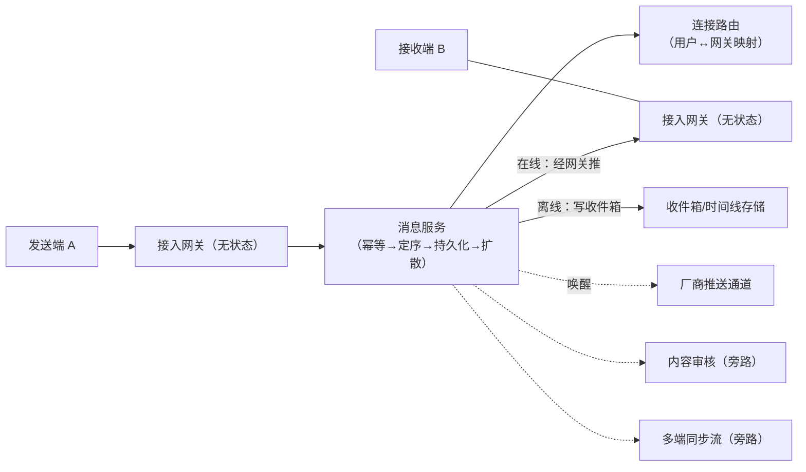

# 即时通讯（IM）：海量长连接与消息可达

> 返回：[示例项目场景](00-导览.md) · [软件架构学习大纲](../软件架构学习大纲.md)
> 定位：讲发布订阅、NoSQL 选型、消息中间件投递语义（至少一次/恰好一次）的最佳载体；架构深度拆解见[06-第六阶段/05-场景拆解-即时通讯IM](../06-第六阶段/05-场景拆解-即时通讯IM.md)，本文聚焦业务画像与核心模块底料。主要对应大纲：二-3 发布订阅、三-3 NoSQL 选型、六-1 场景拆解。

## 业务画像

单聊与群聊：在线实时收发、离线补拉、多端同步、已读回执、消息漫游。

**IM 的四个本质约束**：

1. **长连接**：客户端与服务端保持 TCP/WebSocket 常连，在线状态与消息推送都建立在连接上——与 HTTP 请求-响应模型完全不同的接入形态。
2. **必达且不重**：消息丢了是事故，重复了是困惑；“至少一次投递 + 端侧去重”是行业共识，“恰好一次”在分布式下是幻觉（讲消息队列语义时的高频辨析题）。
3. **顺序**：同一会话内的消息顺序必须一致——“你好”在“再见”之后到达能把天聊死。
4. **多端一致**：手机、平板、电脑同时登录，消息、已读状态要跨端同步。

**用户角色**：C 端用户（单聊/群聊）、群主/管理员（群管理）、运营（敏感内容审核）、客服（IM 化客服场景）。

**教学量级假设**：同时在线 100 万，日消息 1 亿条，单条消息端到端目标延迟 P99 < 500ms，消息漫游保存 1 年，万人群 500 个。

**核心业务流（发一条消息）**：

1. A 端发送消息（带客户端消息 ID 与时间戳）；
2. 接入网关收到，路由到 A 所属的消息服务；
3. 消息服务做序号分配（会话级）、持久化、敏感词审核；
4. 按收件人在线状态投递：B 在线→找到 B 的连接所在网关推送；B 离线→写离线队列+触发厂商推送；
5. B 端收到回 ACK；超时未 ACK 服务端重推；
6. A 端收到“已送达/已读”回执更新消息状态。

## 模块总览

| 模块 | 一句话职责 | 关键数据 |
|---|---|---|
| 接入层（长连接网关） | 维持连接、收发投递 | 连接 Session |
| 连接路由 | 用户↔网关的映射查询 | 路由表 |
| 消息服务 | 序号分配、持久化、扩散 | 消息、会话 |
| 离线与推送 | 离线消息与厂商推送 | 离线队列、推送 token |
| 多端同步 | 跨端消息与状态同步 | 同步序列号 |
| 已读回执 | 已读状态广播 | 回执 |
| 内容审核 | 敏感内容拦截 | 审核任务 |

模块间的静态依赖极浅——这是 IM 架构形态的第一个观察点：接入层与消息服务之间只靠“连接路由 + 消息投递”两个接口耦合，审核、回执、同步都是消息流上的旁路消费者，不进入必达主链路。

## 系统上下文与消息投递全景图

先画边界图（谁连着 IM、消息在系统内怎么流动），模块内部再细谈：



读图口径（讲二-3 发布订阅、六-1 场景拆解时逐条回收）：

- **实线是必达主链路**：网关→消息服务→投递，每一跳都有 ACK 与重试——主链路上任何一跳“尽力而为”，“必达”就不成立。
- **虚线全是旁路**：审核、同步流、厂商推送都不在必达语义内（推送只是“提醒上线”的信使），它们的失败不影响消息到达，只影响体验与合规时效——“主链路/旁路”的区分是投递语义设计的第一个决策。
- **网关无状态、路由是唯一的状态枢纽**：消息服务自己不记“谁在哪”，一律问路由表——这让接入层可以随时扩缩容，也让“路由表错了怎么办”成为失败模式清单的固定条目。

## 核心模块

### 接入层（长连接网关）

**职责**：维持百万级 TCP/WebSocket 长连接，承担心跳保活、鉴权、上下行消息的收发。

**关键实体与数据**：连接 Session（`conn_id`、`user_id`、`device_id`、`gateway_node`、`last_heartbeat`）；单机连接数 10 万~50 万量级（受内存与文件句柄约束）。

**典型流程**：建连→鉴权（token）→绑定用户与设备→注册路由→心跳保活（如 30 秒一次，超时判死）→消息下行经网关送达→断线清理路由。

**设计要点与典型陷阱**：

- **网关必须无状态化**：连接状态与业务状态分离，路由信息外置到路由模块——这样网关才能水平扩展、随时重启（重启前主动断线让客户端重连别的节点，是“优雅退场”设计）。
- **反例（网关里写业务）**：在网关里做消息存储、好友关系判断，网关变得又重又难扩展。**修正**：网关只做“字节搬运 + 鉴权”，业务全部下沉消息服务——接入层/逻辑层分离是 IM 的第一刀切分。
- 心跳间隔是耗电与存活检测灵敏度的权衡（移动端心跳 4.5 分钟是绕运营商 NAT 超时的经典经验值，讲“约束影响参数”时可引用）。

接入层容量推演（假设口径，全部由教学量级假设推出）：

```text
在线 100 万连接，单机承载假设 10 万（受内存与文件句柄约束）
  → 网关集群 ≈ 10 节点起步，按 2~3 倍冗余部署 ≈ 20~30 节点
心跳：100 万 × 每 30 秒一次 ≈ 3.3 万次/秒，单次几十字节 → 心跳带宽 MB/s 量级，可忽略
真正的洪峰在“下行”：一条万人群消息 × 万人在线 ≈ 1 万次推送扇出
  ——是单条消息投递成本的万倍放大
```

推论：接入层的容量规划不看心跳、看**下行扇出**——群消息把“一条消息”放大成“N 次投递”，网关与路由层的压力全部来自这个放大系数（与写扩散是同一个数字在两处的显影）。

### 连接路由

**职责**：回答“用户 X 现在连在哪台网关上”。

**关键实体与数据**：路由表 `user_route`：`user_id` + `device_id` → `gateway_node`（多端登录是多行）；存于 Redis/内存缓存，随上下线增删。

**典型流程**：消息服务投递前查路由→有路由则转发到对应网关→无路由走离线；用户重连异节点时路由覆盖旧记录（旧连接被踢或并存按端型策略）。

**设计要点与典型陷阱**：路由表的更新与消息投递的竞态——用户恰好在“换网关节点重连”的瞬间，消息可能投到旧节点失败；投递失败要回落到离线逻辑而不是丢掉；多端同登录策略（手机+电脑并存、手机互踢）是产品策略，路由表结构要能支撑。

### 消息服务（序号分配与扩散）

**职责**：消息的定序、持久化、按会话类型扩散。

**关键实体与数据**：

- 消息 `messages`：`msg_id`（服务端全局 ID）、`client_msg_id`（端侧去重键，唯一约束）、`conversation_id`（会话：单聊 `A|B`、群聊 `group_id`）、`seq`（**会话级序列号**，单调递增）、`sender`、`content`、`timestamp`。
- 会话 `conversations`：`conversation_id`、`type`、`members`、`last_seq`。
- 时间线（收件人维度）`inbox`：`user_id`、`conversation_id`、`last_read_seq`、`last_recv_seq`——读位置与收位置的游标。

**典型流程**：收消息→按 `client_msg_id` 幂等去重→会话内分配 `seq`→持久化→单聊写双方收件箱/群聊按扩散策略分发→推在线、存离线。

会话级序列号分配骨架：

```kotlin
class SeqAllocator {
    // 每个会话一个区间段：从全局发号器批量取一段，本地分配，避免每条消息一次远程调用
    private val segments = java.util.concurrent.ConcurrentHashMap<String, LongRange>()
    private val nextSegmentStart = java.util.concurrent.atomic.AtomicLong(0)

    fun nextSeq(conversationId: String): Long {
        while (true) {
            val seg = segments[conversationId]
            if (seg != null) {
                synchronized(seg) {
                    val cursor = segments[conversationId]
                    if (cursor === seg && cursor.last >= cursor.first) {          // 段内还有余量
                        val value = cursor.first
                        segments[conversationId] = (cursor.first + 1)..cursor.last
                        return value
                    }
                }
            }
            refill(conversationId) // 段耗尽：再取一段（生产中来自全局发号服务）
        }
    }

    private fun refill(conversationId: String) {
        val start = nextSegmentStart.getAndUpdate { it + 1000 }
        segments[conversationId] = start until (start + 1000)
    }
}
```

**设计要点与典型陷阱**：

- **为什么必须会话级 seq 而不是全局时间戳**：不同服务器时钟有漂移，接收端按时间戳排序可能乱序；会话级连续递增的 `seq` 让端侧“补洞”成为可能——收到 seq=7 而缺 6，立即定向拉取。**seq 连续性同时服务于排序与完整性检测**，这是 IM 存储设计的核心洞察。
- 端侧去重靠 `client_msg_id` 唯一约束——重发与重推在服务端就是同一条消息。
- 消息 ID 的单调性需求与分库分表的路由需求冲突（连续 ID 集中写热点）——发号器分段预取是标准折衷，与秒杀库存分段同思想。

一次单聊消息从 A 到 B 的**事件时序逐步表**（每步的触发、数据变更、失败行为——“必达不重”不是口号，是每一步的防御设计）：

| 步 | 动作 | 数据变更 | 失败与并发时的行为 |
|---|---|---|---|
| ① | A 端发送，携带 `client_msg_id` | 无 | 客户端本地先落地“发送中”，超时重发同 ID |
| ② | 网关转发至消息服务 | 无 | 网关崩溃→客户端重连后重发，靠 ① 的重发兜住 |
| ③ | 按 `client_msg_id` 幂等去重 | 无写（重复时） | 唯一约束命中→返回既有 `msg_id`，不重复入库 |
| ④ | 会话内分配 `seq` | `conversations.last_seq+1` | 同会话并发到达→串行分配保证单调；不同会话互不阻塞 |
| ⑤ | 消息持久化 | insert `messages` | 落库失败→返回发送失败，A 端保留重发资格 |
| ⑥ | 投递：查路由→在线推 B | 网关推送 | 路由失效/推送超时→重推；仍失败→转离线语义 |
| ⑦ | B 端 ACK | 更新投递状态 | 超时未 ACK→服务端重推（B 端按 `client_msg_id` 去重） |
| ⑧ | 已读回执回流 A | `last_read_seq` 上报 | 回执丢了由下次同步补齐——回执允许延迟，不允许错误 |

表的教学用法：⑥⑦⑧的失败都“不阻断⑤”——持久化成功即消息事实已定，投递是可重试的最终一致外延；这条分界线与订单系统“④强一致内核 / ⑤最终一致外延”的口径完全同构，跨场景回收。

### 会话与存储（写扩散 vs 读扩散）

**职责**：消息落库与时间线生成策略。

**关键实体与数据**：写扩散=发消息时给每个成员复制一份收件箱条目（`inbox` 按 `user_id` 分区）；读扩散=只存会话消息一份，读时按会话拉取+聚合。

**典型流程**：写扩散——群消息扇出 N 份写入；读扩散——刷消息列表时逐会话拉最新 seq 段。

**设计要点与典型陷阱**：这是“架构本质是权衡”的教科书题——写扩散读快写放大（万人群一条消息写一万条收件箱，存储与写入成本爆炸），读扩散写省读贵（每次打开聚合多会话）。**生产主流是混合**：单聊与小群写扩散、大群读扩散、超大群（直播弹幕式）只保最近 N 条不落收件箱。判定输入是群规模与活跃度分布。讲三-3 NoSQL 选型与容量估算时用这套数字推演（日消息 1 亿×平均扇出 → 写扩散存储量）。

存储容量推演（假设口径，把教学量级假设的数字一步步算到底）：

```text
日消息 1 亿条；假设单聊:群聊 = 7:3，群平均 20 人
  写扩散收件箱写入 ≈ 0.7 亿 × 2（单聊写双方）+ 0.3 亿 × 20（群扇出）
                  ≈ 7.4 亿行收件箱写/日
  按收件箱条目 200 字节估算 → 日增 ≈ 150 GB 量级，一年 ≈ 50 TB
  读扩散对照：只存消息本体 1 亿条/日（≈ 20 GB/日），读取时才聚合
```

三个推论：

- **写扩散的账是收件箱付的**：存储与写入成本随“消息数 × 平均扇出”线性放大，扇出 20 就是 20 倍成本——万人群进写扩散，一天就是百亿行写，直接否决；混合策略的本质是把扇出上限锁死在“小群”档位。
- **分区键的辩论**（三-3 课堂辩论题）：收件箱按 `user_id` 分区（“拉我的收件箱”单分片完成）vs 按 `conversation_id` 分区（会话数据聚在一起）。写扩散主流选前者——最高频查询决定分区键；会话维度的查询交给消息本体表（按 `conversation_id` 分区），两套数据各答各的查询——又是“按查询模式冗余”。
- 消息本体与收件箱不必同库同引擎（本体 KV/宽表、收件箱 ZSet/列表皆可）——“一个系统多种存储各司其职”在 IM 的落点。

### 离线与推送

**职责**：离线用户的消息保全与触达。

**关键实体与数据**：离线游标即收件箱本身（拉模式没有“离线队列”实体，`last_recv_seq` 之后的都是未收）；厂商推送 token（APNs/FCM/国内厂商通道）。

**典型流程**：投递时查不到在线路由→写收件箱（本来就要写）→触发厂商推送唤醒→用户上线后按 `seq` 断点续拉。

**设计要点与典型陷阱**：**推拉结合**——在线推、离线拉，推送只是“提醒上线”的信使而非可靠通道（厂商推送不保证到达）；断点续拉以 seq 为锚，比按时间戳可靠；推送文案的隐私策略（锁屏显示“你有一条新消息”vs 显示内容）。

### 多端同步

**职责**：手机/电脑/平板的消息、已读、会话列表一致。

**关键实体与数据**：用户级同步序号 `sync_seq`（账号维度的变更流）；每端记录各自的同步位点。

**典型流程**：任一端发生变更（收到消息、已读、删会话）→ 变更写账号同步流 → 其他端上线/活跃时按位点增量拉取。

**设计要点与典型陷阱**：同步流要涵盖“状态变更”不只是新消息（已读、撤回、删会话都是变更）；撤回消息的实现是“撤回指令”覆盖展示而非删除记录（同步流只增不删）；端上本地库 + 增量同步的模型与 Git 有趣同构，可作类比记忆。

同步流的事件类型清单（缺任何一类，某端就有一个“不一致”的死角）：

| 变更类型 | 同步载荷 | 对端的可见效果 |
|---|---|---|
| 新消息 | `conversation_id + seq` | 会话列表未读 +1、消息落本地库 |
| 已读 | `conversation_id + last_read_seq` | “已读”标记更新、未读数清零 |
| 撤回 | `msg_id + 撤回标记（操作人与时间）` | 消息展示替换为撤回占位（原始记录保留） |
| 会话操作 | 置顶/免打扰/删除（用户级，不广播他人） | 本端会话列表状态对齐 |

推演口径：同步流是“账号级变更日志”，设计时逐类检查“这类变更走不走同步流”，比事后修角落可靠——每一类遗漏都对应一个具体的可复现 bug 场景。

### 已读回执

**职责**：单聊已读（“对方已读”）、群聊已读数（“已读 23/50”）。

**关键实体与数据**：会话成员的 `last_read_seq`；群已读计数按成员读位聚合。

**典型流程**：用户切到会话读到 seq=N → 上报 `last_read_seq = N` → 服务端更新并通知对端/群成员 → 群已读数 = 成员中 `last_read_seq ≥ N` 的计数。

**设计要点与典型陷阱**：群已读数的实时聚合代价（万人群每次读都广播）→只对活跃成员增量通知或降级为抽样；“已读不回”的社交压力是产品问题，但“已读功能可关闭”的技术支撑是配置化开关——小功能体现“策略与机制分离”。

### 内容审核

**职责**：敏感词、图片视频违规的拦截与事后处置。

**典型流程**：消息先发后审（先送审再投递，延迟敏感时“先投后审 + 撤回”）→命中则拦截或撤回。

**设计要点与典型陷阱**：**先审后发 vs 先发后审**是延迟与风险的权衡——先审后发加几十毫秒延迟，先发后审有泄出窗口；审核与消息主链路异步化，审核服务故障时降级策略（宁可放过不可阻断聊天？还是相反？业务定）。

两种口径的对比（延迟与风险的权衡落在一张表上看）：

| 口径 | 时延代价 | 泄出窗口 | 适用场景 |
|---|---|---|---|
| 先审后发 | 几十毫秒到秒级 | 无 | 陌生人会话、群公告、高风险行业 |
| 先发后审 + 事后撤回 | 无感知 | 秒级到分钟级 | 好友/熟人场景（信任假设强） |
| 分级混合 | 按信任分档 | 可控 | 新注册账号从严、老账号从宽——风控画像决定档位 |

推演结论：口径不是全局二选一，而是按“信任档位”路由——与秒杀风控“灰度区间放行 + 事后回溯”同一思想：不确定的流量走更重的检查。

## 架构挑战与知识点映射

| 挑战 | 方案要点 | 对应大纲小节 |
|---|---|---|
| 海量长连接 | 无状态接入网关、连接路由 | 二-2、六-1 |
| 消息必达不重 | 至少一次 + 幂等去重 | 二-3 投递语义 |
| 会话内顺序 | 会话级 seq、端侧补洞 | 六-1 |
| 在线推离线拉 | 推拉结合投递模型 | 六-1 |
| 海量消息写入 | KV NoSQL、写/读扩散取舍 | 三-3 NoSQL 选型 |
| 发布订阅结构 | 群消息扇出 | 二-3 发布订阅 |

## 关键数据表设计与取舍

把散在各模块的表设计收拢成决策清单——每个点“取 A 还是取 B、为什么”：

| 设计点 | 选项 A | 选项 B | 本场景结论与理由 |
|---|---|---|---|
| 排序依据 | 全局时间戳 | 会话级 `seq` | `seq`：时钟漂移不可信，且 seq 连续性兼做排序与补洞检测（上文核心洞察） |
| 去重键 | 只靠服务端 `msg_id` | `client_msg_id` 唯一约束 + `msg_id` | 两者都要：`client_msg_id` 挡重发重推，`msg_id` 服务全局引用与漫游 |
| 消息本体存储 | MySQL 行存 | KV/宽表，按 `conversation_id` 分区 | KV/宽表：日增亿级追加写、按会话范围读，负载画像天生匹配；MySQL 留给配置类数据 |
| 收件箱形态 | 数据库表 | Redis ZSet（`score=seq`）+ 定长截断 | ZSet：按 seq 范围拉取天然有序；定长（如 3000 条）控制成本，深翻页回落本体聚合 |
| 离线消息 | 独立离线队列表 | 收件箱即离线（拉模式） | 收件箱即离线：没有第二份事实，`last_recv_seq` 之后都是未收 |
| 路由表存储 | 各网关持有全量内存副本 | 集中式 Redis + 本地缓存 | 集中式：路由必须全局一份事实；本地缓存容忍秒级陈旧（陈旧→投递失败→回落离线，可自愈） |
| 已读状态 | 每消息一个已读位 | 会话级 `last_read_seq` 游标 | 游标：一个数字表达“读到哪”，群已读数只是游标比较，存储 O(1) |

## 容量与失败模式推演

容量口径上文已推（接入层看下行扇出、存储看收件箱放大），这里收拢失败模式——IM 的失败模式几乎全部围绕“必达”与“有序”两条底线：

| 失败模式 | 触发场景 | 后果 | 预设对策 |
|---|---|---|---|
| 路由表陈旧 | 用户换节点重连瞬间投递 | 推到旧节点失败 | 投递失败回落离线语义，重连后按 seq 补拉——永不丢，只延迟 |
| 消息重复到达 | 重发/重推/重试叠加 | B 看到两条一样的 | `client_msg_id` 端侧去重 + 服务端唯一约束双层拦截 |
| seq 断号 | 分配后落库失败 | B 端发现缺号，误判丢消息 | 分配与落库同事务；已消耗未落库的 seq 由补偿任务回收或标记空洞 |
| 厂商推送通道失效 | token 失效/通道抖动 | 离线用户收不到唤醒 | 多通道互备 + 收件箱兜底（上线必拉），推送只承诺“尽力” |
| 审核服务故障 | 审核依赖不可用 | 先审后发链路停摆 | 降级为“先发后审 + 事后撤回”，风险口径业务预先定死 |
| 群消息扇出延迟 | 万人群写扩散堆积 | 大群消息迟到分钟级 | 大群切读扩散/只推在线，扇出预算按群规模上限设计 |
| 多端同步流断裂 | sync_seq 位点丢失 | 某端漏变更 | 位点以服务端为准下发，端上只存缓存不存事实 |
| 重连风暴 | 机房网络抖动大批连接掉线 | 海量客户端同时重连压垮网关 | 重连指数退避 + 随机抖动，建连入口单独限流 |

## 演进路线：每一步的迁移与回滚

| 阶段 | 改造动作 | 迁移方式 | 回滚方式 |
|---|---|---|---|
| 1. 单体 IM（HTTP 轮询） | 无长连接 | 起步形态 | — |
| 2. 引入长连接网关 | WebSocket 接入独立部署 | 新老并存：老客户端轮询、新客户端长连，服务端双通道投递 | 下线长连入口退回轮询（功能等价、实时性降级） |
| 3. 消息服务独立 + seq 定序 | 定序从网关剥离 | 双写期：老时间戳排序与新 seq 排序并存，端上以 seq 为准对拍 | 停 seq 发放退回时间戳（存量 seq 已落库不回滚，仅增量失效） |
| 4. 存储切 KV/宽表 | MySQL→KV 双写迁移 | 双写（旧库为准）→存量批量搬迁→读切新→停写旧 | 读切回旧库（双写期内旧库一直是全量事实） |
| 5. 万人群切读扩散 | 扇出策略按群规模分档 | 新群生效、存量群灰度迁移（双读对拍） | 单群粒度切回写扩散 |

纪律与订单系统一致：双写/双消费期以旧链路为准、每步停留观察期。IM 特有的一条是**端上协议兼容**——服务端任何一步回滚，老版本客户端必须仍然可用（协议版本字段从第一天就进报文头）。

## 面试官追问点

- “为什么不用时间戳排序？”——分布式时钟不可信，且时间戳无连续性，中间丢一条发现不了；seq 一石二鸟（排序 + 完整性检测）。
- “恰好一次投递到底能不能实现？”——投递层面只能做到至少一次；“恰好一次”是“至少一次 + 端侧幂等去重”的合成效果——语义在接收侧闭环，不在传输侧承诺。
- “万人群为什么不能写扩散？”——一条消息写一万条收件箱，写入与存储同时爆炸；读扩散的代价只由“真正打开这个群的人”支付——成本归宿不同是决策的本质。
- “路由表用的 Redis 挂了怎么办？”——路由不可用时全部按离线处理（消息进收件箱），用户重连即补拉——降级方向是“延迟”而不是“丢失”。
- “消息漫游一年，存储怎么算？”——本体一年 ≈ 7 TB 量级（假设口径），KV 按时间分区 + 冷热分层即可；漫游查的是“会话内范围读”，恰好是本体表的天然查询。
- “seq 全局单调在多活下怎么保证？”——按会话哈希到固定定序域（同一会话永远在同一域定序）：域内单调即可满足需求，“全局有序”本来就是伪需求。

## 如果规模再大十倍

假设同时在线 1000 万、日消息 10 亿、万人群 5000 个：

- **接入层分域**：千万连接下单一路由表成为写热点——按用户分域（域内路由、跨域经消息服务转发），路由表缩小一个数量级；连接与流量按域隔离，爆炸半径同步变小。
- **收件箱分片爆炸**：日增百 GB 级收件箱写入——按 `user_id` 哈希到上千分片，ZSet 换成专用时间线存储（LSM 类追加写），深翻页与漫游全部走本体表。
- **推送扇出分级**：万人群消息只推“活跃在线”子集，其余靠上线补拉——扇出预算从“全量在线”降一个数量级（活跃判定本身是新的画像数据）。
- **同城多活**：消息服务按地域部署、收件箱按用户就近写入，跨地域异步复制——聊天是弱地域亲和业务，跨域延迟可容忍，但 seq 全局单调要求定序点唯一（按会话哈希到固定定序域）。
- **端到端加密的架构代价**：服务端不可读内容时，审核只能做元数据风控与端侧举报——合规模型与技术模型的冲突要在架构期拍板，不是后补。

## 与其他场景的联动

- 架构深度拆解见[06-第六阶段/05-场景拆解-即时通讯IM](../06-第六阶段/05-场景拆解-即时通讯IM.md)。
- 工单中心（[03](03-工单中心.md)）：IM 化客服——客服坐席的会话分派就是工单分派的变形。
- 物联网平台（[09](09-物联网平台.md)）：同为长连接接入，IoT 是设备端弱网+高频小包，IM 是人端稳定+中频消息，接入层设计可对照。
- 消息队列档案（03-第三阶段/07-技术工具档案-消息队列.md）：“至少一次/恰好一次”语义辨析以 IM 投递为案例。
- Git 托管平台（[13](13-Git托管平台.md)）：Webhook 至少一次投递 + 签名校验与 IM 投递语义同源，可对照讲“投递语义的通用性”。
- Feed 流内容社区（[08](08-Feed流内容社区.md)）：收件箱/发件箱与时间线推拉是同一组概念的两个业务外壳，讲一侧引另一侧。

## 取材指引

- 二-3 发布订阅与投递语义：以“必达不重”的需求倒推“为什么恰好一次是幻觉、端侧去重才是正解”。
- 三-3 NoSQL 选型：用“日消息 1 亿×扇出”的容量数字推演 KV 选型与分区键选择（user_id 还是 conversation_id）。
- 六-1 场景拆解：以本文模块底料为基础做全链路设计推演。
- 可出思考题方向：为什么不用时间戳做会话内排序；写扩散的存储成本怎么估算、何时必须切读扩散；多端同步为什么要覆盖状态变更而不只是新消息。
- 讲长连接接入时用“接入层容量推演”的扇出结论开场：心跳带宽可以忽略、下行扇出才是容量主体——纠正“长连接必然高成本”的直觉偏差。
- 讲存储选型时先让学生算“写扩散的账”（扇出 × 消息量），再揭晓混合策略——数字自己会说话。
- “单聊消息事件时序逐步表”与订单系统的提交订单六步表同构，讲二-3/三-4 时可并列投影：问学生“哪一步在强一致内核、哪几步是最终一致外延”。
