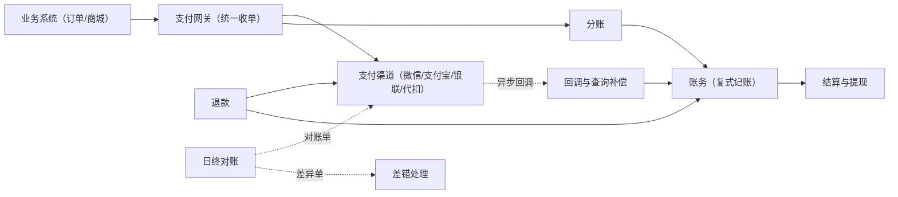

# 支付与清结算：资金零差错的舞台

> 返回：[示例项目场景](00-导览.md) · [软件架构学习大纲](../软件架构学习大纲.md)
> 定位：分布式事务的完整舞台——2PC/TCC/Saga/本地消息表全部用这一条业务链串起来对比；架构深度拆解见[06-第六阶段/06-场景拆解-支付与清结算](../06-第六阶段/06-场景拆解-支付与清结算.md)，本文聚焦业务画像与核心模块底料。主要对应大纲：三-4 分布式事务、五-3 安全架构、六-1 场景拆解。

## 业务画像

平台收款（对接多个支付渠道）、退款、分账（平台/商户/配送员分成）、日终对账（与渠道对账单核对）、差错处理（长款/短款/重复支付）。

**支付系统的第一性约束**：

1. **资金零差错**：多收一分要退、少收一分要追；重复回调必须幂等拦截——任何“大概没问题”都不被接受。
2. **多方异步协作**：支付结果是渠道异步通知的，平台内部又有订单、账务、商户多系统——处处是最终一致。
3. **可解释性**：每个余额数字都要能回溯到原始凭证（渠道流水、回调报文、对账单）——客服、审计、监管三方都要问。
4. **强合规**：敏感数据（卡号、密钥）加密脱敏，操作留痕，反洗钱与二清红线（平台不得以自身名义归集商户资金再结算）。

**用户角色**：C 端付款用户、商户（收款方，看结算与账单）、平台财务（对账、差错处理、资金划拨）、运营（渠道配置）。

**教学量级假设**：日交易 50 万笔、金额 2000 万元，渠道 4 个（微信/支付宝/银联/代扣），退款率 3%，日终对账单最大百万行。

**核心业务流**：

1. 收款：业务下单→创建支付单→渠道支付→异步回调→账务记账（用户→平台监管户）；
2. 分账：交易成功后按分账规则拆分（平台佣金/商户/配送员），记待结算；
3. 结算：D+1 或 T+1 把商户应得划入其账户，可提现；
4. 退款：原路退回，分账同步冲正；
5. 日终对账：拉渠道对账单与平台流水逐笔核对，差异进差错处理；
6. 差错处理：长款（渠道有平台无）补单、短款（平台有渠道无）核查、重复支付自动退回。

## 模块总览

| 模块 | 一句话职责 | 关键数据 |
|---|---|---|
| 渠道接入 | 多渠道统一收单 | 渠道配置、支付单 |
| 回调与查询补偿 | 异步结果落账 | 回调报文、查询任务 |
| 账务（记账引擎） | 复式记账、余额与流水 | 会计分录 |
| 分账 | 按规则拆分资金 | 分账规则、分账单 |
| 退款 | 原路退回与冲正 | 退款单 |
| 对账 | 渠道单与平台流水核对 | 对账批次、差异单 |
| 差错处理 | 差异分类与处置 | 差错单 |
| 敏感数据与密钥 | 加密脱敏与密钥轮换 | 密钥台账 |

## 系统上下文与资金流图

先画边界图（资金从哪进、账在哪里记、差错从哪发现），模块内部再细谈：



读图口径（讲三-4 分布式事务、五-3 安全时逐条回收）：

- **实线是资金与状态的主推进链路**：收单→回调→记账→结算，每一跳都有幂等键与凭证留档——主链路的正确性靠“每一步可追溯”支撑。
- **虚线是异步与批处理通道**：回调、对账单、差异单都不是同步调用——支付系统对渠道的全部交互本质上是异步协作，“强一致只存在于平台内部的单个事务里”。
- **账务是全图的记账枢纽**：收款、分账、退款最终都落成它的分录——任何资金动作若没有对应分录就是“账外资金”，支付系统的头号红线。
- **渠道是唯一的外部资金事实来源**：平台内一切数字都要能回溯到渠道流水（回调报文/对账单）——“可解释性”约束直接决定了“留档一切原始凭证”的设计。

## 核心模块

### 渠道接入（收单网关）

**职责**：把“微信/支付宝/银联/代扣”各异的接口统一成平台内一致的支付能力。

**关键实体与数据**：`channels`（`channel_code`、`merchant_no`、`cert/keys`（加密存储）、`rate`（费率）、`status`）；`payments`（`pay_id`、`biz_order_no`（业务单号）、`channel`、`amount`、`status`、`channel_trade_no`、`callback_raw`）。

**典型流程**：统一收单接口→路由决策选渠道（可用性优先级、费率、限额）→组装渠道报文（签名）→发起支付→渠道异步回调→验签落库。

**设计要点与典型陷阱**：

- **渠道适配器 + 防腐层**：各渠道报文、状态命名（微信的 SUCCESS vs 支付宝的 TRADE_SUCCESS）、金额单位（分 vs 元）差异全部在适配层翻译，内核只认统一状态机——六边形架构在支付侧的标准落地。
- **反例（金额用浮点）**：`0.1 + 0.2 != 0.3`，浮点金额对账必然出错。**修正**：全链路最小货币单位整数（分）+ 逐笔校验单位——入门第一课，也是“数据类型也是架构决策”的例证。
- 渠道路由可配置（某渠道故障自动切换）——渠道可用性是分位的，切换逻辑要幂等（同一支付单不能在两个渠道各扣一次）。

支付单状态机（渠道状态名的翻译隔离在适配层，内核只认这套状态）：

| 迁移 | 触发 | 侧效动作 | 失败与并发时的行为 |
|---|---|---|---|
| 待支付 → 支付中 | 唤起收银台成功 | 发起渠道下单 | 渠道超时→可重试（幂等：同一 `pay_id` 复用同一渠道单号） |
| 支付中 → 成功 | 回调或查询确认 | 事务内推进 + 记账分录 + 发支付成功事件 | 与关单竞态→条件更新，输方走退款 |
| 支付中 → 已关闭 | 业务超时关单 | 停止查询任务 | 关单后回调到达→生成“关单后到账”差错单（自动退款） |
| 支付中 → 失败 | 渠道明确失败 | 允许换渠道重新发起（新支付单） | 失败与成功乱序并发→以“成功”为准，失败只留痕 |
| 成功 → 部分/全部已退款 | 退款单终态 | 冲正分账 + 记账 | 重复退款→幂等键拦截 |

推演口径：状态机的价值在“翻译隔离”与“可追溯”——微信 SUCCESS、支付宝 TRADE_SUCCESS 进门即归一；内核任何一次迁移都能指向原始凭证（`callback_raw` 或查询响应留档），没有“无凭证的状态变化”。

### 回调与查询补偿

**职责**：确保支付结果最终被平台知晓——不信任回调，也不只依赖回调。

**关键实体与数据**：回调报文留档 `callback_raw`（验签前后原文）；主动查询任务 `query_tasks`（对“创建支付单超时未收到回调”的订单轮询渠道）。

**典型流程**：回调到达→验签→幂等检查（`channel_trade_no` 已处理则直接应答）→事务内推进支付单与业务订单→应答成功；回调丢失时查询任务扫“超时未终态”支付单主动查渠道。

**设计要点与典型陷阱**：**回调与查询双通道**都可能给出结果，两路都要幂等，终态以先到者为准、后到者只做核对（不一致即告警——两路结果不同本身就是差错信号）；应答渠道失败会触发重发，处理逻辑必须可重入。

一次收款从创建支付单到账务记账的**事件时序逐步表**：

| 步 | 动作 | 数据变更 | 失败与并发时的行为 |
|---|---|---|---|
| ① | 业务创建支付单（幂等键=业务单号+尝试序号） | insert `payments` | 重复提交→按幂等键返回既有支付单 |
| ② | 渠道路由决策 | 无 | 首选渠道不可用→按可用性/费率切备选；切换幂等（同一支付单只在一个渠道有效） |
| ③ | 组装报文、签名、发起渠道下单 | 渠道侧交易号登记 | 渠道超时→状态未知的“在途单”，只能查询对齐、不能重复下单 |
| ④ | 用户付款，渠道回调到达 | insert `callback_raw` | 验签失败也留档并应答失败，等查询通道兜底 |
| ⑤ | 幂等检查与金额核对 | 无写 | 已终态→吞掉；金额不符→差错单挂人工，绝不自动推进 |
| ⑥ | 事务内：推进支付单 + 记账分录 + 落本地消息 | `payments.status`、分录、消息表 | 借贷不平→整个事务拒绝 |
| ⑦ | 事件外发：分账、通知业务方 | 事件/消息 | 投递失败→本地消息表重试，主流程已提交 |

⑥⑦的分界与订单/IM 同口径：⑥是强一致内核（一个本地事务），⑦是最终一致外延——三-4 讲“本地消息表”时，这张表的⑥→⑦就是标准案例。

### 账务（记账引擎）

**职责**：以复式记账记录每笔资金变动——支付系统的“总账”。

**关键实体与数据**：会计科目（用户备付金、平台佣金收入、商户待结算、手续费支出……）；`accounting_entries`（`entry_id`、`biz_voucher_no`（业务凭证号，幂等键）、`debit_account`、`credit_account`、`amount`、`created_at`）——每笔交易一组借贷平衡的分录；账户余额是分录的聚合视图。

**典型流程**：支付成功→记“用户备付金（借）← 渠道在途（贷）”；结算完成→“商户待结算（借）← 商户可提现（贷）”。

**设计要点与典型陷阱**：

- **反例（只记余额）**：只维护账户余额字段加减，余额变成无法解释的黑洞数字——差一分钱查三天。**修正**：流水（分录）是事实、余额是投影，任何余额可由分录重算——与事件溯源“事件是事实、状态是投影”完全同构，讲二-3 时的高级类比。
- 借贷必须平衡（每组分录 debit 合计 = credit 合计），不平衡的事务整体拒绝——把不变量做成硬约束。

一笔 100 元收款在账务里的分录示例（教学简化）：

```text
支付成功：
  借：用户备付金      100.00
  贷：渠道在途        100.00        （钱还在渠道侧，尚未落地确认）
渠道资金落地：
  借：渠道在途        100.00
  贷：平台监管户      100.00
分账（假设商户 80 元 / 平台佣金 20 元）：
  借：平台监管户      100.00
  贷：商户待结算       80.00
  贷：平台佣金收入     20.00
```

每一步借贷合计相等；任何余额（如“商户待结算 80 元”）都能由分录累加重算——讲复式记账时现场把这三步算一遍，比文字描述有说服力。

### 分账

**职责**：交易金额按规则拆分给多方（平台佣金/商户/配送员/服务商）。

**关键实体与数据**：分账规则 `split_rules`（`merchant_id`、`type`（比例/固定）、`receivers`（接收方与比例）、`priority`）；分账单 `split_orders`（`source_payment`、`receiver`、`amount`、`status` 待分/已分/已冲正）。

分账计算骨架（含尾差处理——分钱必须分干净）：

```kotlin
data class Receiver(val id: String, val permille: Int) // 千分比

fun split(totalFen: Long, receivers: List<Receiver>): Map<String, Long> {
    require(receivers.sumOf { it.permille } == 1000) { "比例合计必须为 1000‰" }
    val result = LinkedHashMap<String, Long>()
    var allocated = 0L
    for ((i, r) in receivers.withIndex()) {
        val share = if (i == receivers.lastIndex) totalFen - allocated      // 最后一家兜尾差
        else totalFen * r.permille / 1000
        result[r.id] = share
        allocated += share
    }
    check(result.values.sum() == totalFen) { "分账总额必须等于原金额" }
    return result
}
```

**典型流程**：支付成功事件→匹配商户分账规则→计算各方金额（尾差归属要规则化）→生成分账单→渠道分账接口执行或内部记账→失败进入冲正/重试。

**设计要点与典型陷阱**：**尾差问题**：100.00 元按 33.33%×3 分，三家各 3300 分剩 100 分归谁？必须明确（尾差给平台/给最后一方），且分账合计必须恒等于原金额——硬校验；退款时**分账冲正**：先冲回各方分账再退用户，顺序错了平台垫资；分账比例变更只影响之后交易（规则版本化）。

分账执行的两条路径推演：走渠道分账接口（资金真实分离，依赖渠道能力与到账时延）vs 平台内记账先行、结算时一次划付（资金晚分离、灵活度高）。两者可并存：记账先行是常态，渠道分账用于强合规场景——路径选择直接影响退款冲正的成本（已真实划付的要追回，仅记账的直接冲销）。

### 退款

**职责**：原路退回与关联冲正。

**关键实体与数据**：`refunds`（`refund_id`、`source_payment`、`amount`、`status`（申请/渠道受理/成功/失败）、`idempotency_key`（业务退款单号））；退款路径上挂分账冲正记录。

**典型流程**：业务发起退款（幂等键防重）→校验可退余额（原支付额-已退额）→冲正分账→渠道退款接口→异步结果→记账。

**设计要点与典型陷阱**：**重复退款请求**必须幂等拦截（同一业务单号只退一次）；部分退款多次叠加不能超原额（可用退款余额的条件更新）；渠道退款异步失败要重试与人工兜底，退款卡在“受理中”比失败更麻烦（状态未知，只能查询对齐）。

可退余额的推演口径：`可退 = 原支付额 − Σ(成功退款 + 在途退款)`——在途退款必须计入，否则两笔并发部分退款叠加就会超退；该表达式用带余额检查的条件更新在数据库层兑现，与库存防超卖是同一手法。

### 对账（清结算的日终批处理）

**职责**：渠道对账单与平台流水逐笔核对，发现一切不一致。

**关键实体与数据**：对账文件 `recon_files`（`channel`、`date`、`downloaded_at`、`line_count`）；对账批次 `recon_batches`；差异单 `recon_diffs`（`type`（长款/短款/金额不符/状态不符）、`channel_trade_no`、`platform_pay_id`、`detail`）。

**典型流程**：次日凌晨拉取各渠道对账单（文件下载/SFTP/API）→解析标准化（各渠道格式各异）→按 `channel_trade_no` 全量外连接比对（金额、状态、手续费三项）→差异生成差错单→平账处理→出对账报告。

**设计要点与典型陷阱**：

- **口径差异是常态**：渠道按清算时点、平台按支付时点，跨日切分单（23:59 支付 00:01 清算）天然两边不同日——切日规则要先对齐再比对，否则差异单淹没在口径噪声里。
- 百万行大文件解析是典型批处理：流式解析（不能全量进内存）、按渠道分区并行、断点续跑；对账是批处理世界，交易是 OLTP 世界——又是一处负载分离的自然论据。

对账的容量推演（假设口径：日交易 50 万笔、日终对账单最大百万行）：

```text
百万行对账文件：流式解析，行级处理不全量进内存
  假设单行解析+比对 1 ms → 单线程 ≈ 17 分钟；按渠道 4 分区并行 → 4~5 分钟量级
  数据库比对按 channel_trade_no 建索引关联，避免百万行嵌套循环
窗口：渠道对账单生成有时滞（次日凌晨才就绪）
  → 对账调度必须显式处理“文件未就绪”的等待与告警，这是批处理编排的一部分
```

推论：对账是吞吐优先、时延宽松（分钟级可接受）的批处理负载，与交易的 OLTP 负载在资源画像上完全相反——两者共享数据库时必须显式隔离（从库/独立库），否则日终批会挤占交易高峰。

### 差错处理

**职责**：差异分类、自动处置与人工流程。

**关键实体与数据**：`discrepancies`（`diff_type`、`auto_action`（补单/自动退回/挂人工）、`handler`、`result`、`evidence`（关联报文与凭证））。

**典型流程**：长款（渠道有平台无）→按对账单补记支付与订单（自动补单）；重复支付→自动原路退回；短款（平台有渠道无）→核查是否掉单/抢劫态，挂人工；金额不符→人工介入并留证据链。

**设计要点与典型陷阱**：差错单是“钱的工单”——分类、SLA、升级、销单全流程与工单中心同构（讲跨场景复用时引用）；自动化处置要有金额阈值（大额差异不自动处理），自动与人工的边界写进规则。

### 敏感数据与密钥

**职责**：卡号/证件/密钥的保护与合规。

**关键实体与数据**：密钥台账（KMS 管理，应用只拿密文句柄）；脱敏规则（卡号 6230****1234）；审计日志（谁查了谁的敏感数据）。

**典型流程**：密钥定期轮换；敏感字段加密存储、展示脱敏、导出审批；访问留痕。

**设计要点与典型陷阱**：**反例（密钥进代码库）**：渠道私钥写在配置文件里提交 Git——泄露即资金风险。**修正**：KMS/密钥管理服务 + 最小权限；日志里打印完整卡号是高频事故（日志脱敏中间件统一兜底，不靠程序员自觉）——五-3 安全架构的常驻反例。

## 架构挑战与知识点映射

| 挑战 | 方案要点 | 对应大纲小节 |
|---|---|---|
| 资金零差错 | 幂等、复式记账、不变量硬校验 | 三-4、六-1 |
| 渠道异步通知 | 回调+查询双通道、状态机最终一致 | 三-4 |
| 对账批处理 | 流式解析、口径对齐、差错分类 | 六-1 |
| 扣款+发货+分账跨系统 | 2PC/TCC/Saga/本地消息表逐一对比 | 三-4 分布式事务 |
| 敏感数据与合规 | 加密、脱敏、密钥管理 | 五-3 安全架构 |

三-4 的四个小节全部可以用这条链串讲：扣款（支付）→ 发货（业务）→ 分账（多方）→ 结算（跨日），分别演示强一致的两阶段锁死可用性（2PC 反面）、TCC 的三个钩子怎么在这三步上打、Saga 的补偿事务就是退款冲正、本地消息表就是“支付成功事件可靠通知账务”。

## 分布式事务方案对比推演（三-4 串讲底稿）

同一条链路，四种方案逐一放进“扣款→发货→分账→结算”里推演坏情况：

| 方案 | 在本链路的形态 | 好处 | 坏情况（推演口径） | 结论 |
|---|---|---|---|---|
| 2PC/强一致 | 账务+业务订单+分账同步提交 | 无中间状态 | 参与方越多锁持越久，渠道慢响应阻塞全链路——可用性被最慢者绑架 | 资金内核可用，跨系统不可行 |
| TCC | Try 预冻结资金 / Confirm 扣减 / Cancel 解冻 | 资源占用显式化、性能好 | 三个钩子业务实现成本高；Cancel 未达产生“悬挂冻结”，要异步校对兜底 | 适合扣款这一步 |
| Saga | 支付→分账→结算各步配补偿（冲正） | 长链路、跨日结算天然适配 | 补偿顺序错了平台垫资；无隔离性，中间态对外可见 | 适合分账/结算链 |
| 本地消息表 | 支付成功事件可靠通知账务/业务方 | 不引入新组件，与本地事务同生共死 | 消费方最终一致有窗口；消息表扫描任务需要运维 | 事件通知的标准解 |

对比的讲法：不是选一个“最好的”，而是**按环节选型**——扣款用 TCC（或条件更新+兜底）、跨系统通知用本地消息表、分账结算用 Saga 补偿；一条链路多种方案并存是常态，“全链路统一一个方案”反而更像设计惰性。

## 关键数据表设计与取舍

| 设计点 | 选项 A | 选项 B | 本场景结论与理由 |
|---|---|---|---|
| 支付单与业务订单 | 同表加字段 | `payments` 独立分表 | 分表：生命周期（支付单永续追加、订单终态只读）、变更方、失败域三者都不同 |
| 金额类型 | DECIMAL / 浮点 | BIGINT 存分 | 分：浮点必错；DECIMAL 跨语言序列化仍有精度坑 |
| 回调报文 | 只存解析后字段 | 原文留档 `callback_raw` | 留档：差错与审计的唯一证据，解析字段可随时重算 |
| 分账尾差 | 各家四舍五入 | 顺序分、最后一家兜尾差 | 后者：`分账合计 = 原金额` 硬校验，尾差归属规则化 |
| 对账差异 | 直接人工处理 | 差异单分类 + 自动处置规则 | 后者：长款补单/重复支付自动退、短款挂人工——“钱的工单” |
| 幂等键 | 应用层 Set 去重 | 数据库唯一约束 | 唯一约束：重启不丢、并发天然安全——“最便宜的分布式锁” |
| 密钥存储 | 配置文件 | KMS 台账 + 密文句柄 | KMS：泄露面最小化，轮换不改代码 |

## 容量与失败模式推演

容量口径上文已推（对账批处理窗口、交易 OLTP 隔离），这里收拢资金链路的失败模式：

| 失败模式 | 触发 | 后果 | 预设对策 |
|---|---|---|---|
| 关单后到账 | 关单瞬间用户完成支付 | 钱到了、订单已关 | 固定差错类别“关单后到账”，自动原路退款 |
| 回调与查询结果矛盾 | 渠道乱序/重发 | 状态互相覆盖 | 终态以先到者为准，后到者只核对；矛盾即告警 |
| 切日单 | 23:59 支付 00:01 清算 | 当日对账假差异 | 先对齐清算时点口径，切日单走跨日对账窗口 |
| 退款悬挂在“受理中” | 渠道退款异步无结果 | 状态未知 | 查询补偿 + 人工兜底；T+1 对账强制对齐 |
| 分账冲正顺序错误 | 退款先退用户后冲分账 | 平台垫资 | 冲正在前、退款在后，顺序写死 + 校验 |
| 对账文件迟到/损坏 | 渠道故障 | 批处理中断 | 文件完整性校验（行数/校验和）+ 断点续跑 |
| 密钥/卡号泄露 | 配置提交、日志打印 | 资金与合规风险 | KMS + 日志脱敏中间件 + 审计留痕 |

## 演进路线：每一步的迁移与回滚

| 阶段 | 改造动作 | 迁移方式 | 回滚方式 |
|---|---|---|---|
| 1. 单体（业务内嵌支付逻辑） | 起步形态 | — | — |
| 2. 拆统一收单网关 | 渠道适配独立 | 先共库拆服务，双写期以旧逻辑为准 | 流量切回业务内嵌逻辑 |
| 3. 引入账务分录 | 余额直改 → 复式记账 | 旁路双记期：分录与旧余额并行，日终对拍（余额 = 分录聚合） | 分录降级为旁路日志，恢复旧余额直改 |
| 4. 引入日终对账 | 渠道单 vs 平台流水 | 影子跑（只报差异不处置）→ 人工确认类别 → 启用自动处置 | 停自动处置，退回纯人工核对 |
| 5. 渠道扩展/多币种 | 新渠道插件化接入 | 渠道白名单灰度（小额低风险类目先行） | 下线渠道路由规则 |

对账“影子跑”是本场景特有的一步：任何自动处置规则上线前，先以“只报告、不执行”观察若干个日终周期——把规则错误暴露在不碰钱的阶段。

## 面试官追问点

- “为什么支付单不直接复用订单表？”——生命周期、变更方、失败域三不同；支付单永远追加（含失败尝试），订单终态后只读。
- “回调先到和查询先到，信谁？”——都信：终态以先到者为准、后到者只核对，两者矛盾本身就是差错信号——双通道互为校验，不是主备。
- “余额和流水，谁是事实？”——流水（分录）是事实、余额是投影；任何余额必须能由分录重算，重算不平即数据事故（事件溯源类比）。
- “分账为什么不能先退用户？”——先退用户后冲分账，各方已结算金额追不回时平台垫资；顺序是资金安全的硬约束，不是性能优化。
- “二清红线在架构上怎么体现？”——资金归集账户必须是受监管的备付金账户，平台账务只做记账视图不做资金池——合规约束直接映射为账户模型约束。
- “幂等键怎么选？”——回调用渠道交易号、退款用业务退款单号、创建支付单用业务单号+尝试序号——幂等键跟着“谁在重试”走，不是全局一个键。
- “支付系统为什么留档一切原始报文？”——可解释性约束：客服、审计、监管问的每一个数字都要能回溯到凭证；存储成本换“说不清时的自证能力”，这是支付场景最划算的一笔交换。

## 如果规模再大十倍

假设日交易 500 万笔、金额 2 亿元、渠道 10 个：

- **对账升级为流式**：日终百万行×10 渠道的批改为 binlog CDC 实时核对 + 日终批兜底——差异发现从 T+1 提前到分钟级（07-数据系统内核专题的批流分工在此落地）。
- **账务分库与热点账户**：分录按账户维度分片；平台大账户是记账热点，用“余额分桶”（一个余额拆多桶求和）——热点账户是记账引擎的第一瓶颈。
- **渠道路由动态化**：按渠道实时成功率/费率自动路由——可用性分位从“人工配置降级”走向“自动摘除”，切换决策本身要幂等与防抖。
- **差错处理规模化**：差异单量增长后，人工只处理大额与新模式，长尾全部规则化自动处置——规则库的治理（版本、灰度、回滚）成为新的工程重心。
- **对账文件带宽与归档**：日终集中拉文件的带宽洪峰→错峰拉取 + 压缩 + 对象存储归档（按监管年限保留）。

## 与其他场景的联动

- 架构深度拆解见[06-第六阶段/06-场景拆解-支付与清结算](../06-第六阶段/06-场景拆解-支付与清结算.md)。
- 订单系统（[01](01-订单系统.md)）：支付模块的通用底版；本场景是其资金侧全面深化。
- 桶装水商城（[02](02-桶装水商城.md)）：押金退款、平台/水站/配送员三方分账取材于此。
- 差错处理的工单化流程与工单中心（[03](03-工单中心.md)）同构。
- 物联网平台（[09](09-物联网平台.md)）：对账批处理与 IoT 数据管道同为“吞吐优先、时延宽松”的批/流负载，资源隔离口径互引。
- API 网关（[11](11-API网关.md)）：开放平台回调接口的验签与防重放，五-3 安全口径的落点在网关。

## 取材指引

- 三-4 分布式事务：以“扣款→发货→分账”为唯一案例链，逐方案对比——每讲一个方案就问“这段链路用它会有什么坏情况”。
- 五-3 安全架构：密钥管理、日志脱敏、审计留痕的反例与修正。
- 二-3 事件溯源：账务分录（流水是事实、余额是投影）作高级类比。
- 可出思考题方向：为什么金额全链路用整数分；回调与查询结果不一致怎么处理；分账尾差归谁、为什么必须写进规则；长款与短款各自的自动处置为什么策略不同。
- 讲三-4 按“演进路线”第 3 步开场：先让学生解释“余额与分录双记期怎么对拍”，再引出复式记账与事件溯源的类比。
- 收款事件时序表与订单/IM 的表同构，讲幂等时三表并列投影：问“幂等键分别是什么、放在哪一层、谁在重试”。
- 讲批处理与负载分离时用对账容量推演：先问“百万行文件怎么解析、什么时候跑、跟交易库什么关系”。
- 讲安全架构时用失败模式表的最后三行收尾：关单后到账、密钥泄露、审计留痕——资金场景的“安全”最终都落到“每一步可追溯”。
