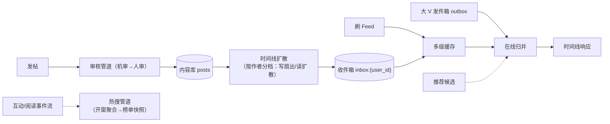

# Feed 流内容社区：读写极端的对照系统

> 返回：[示例项目场景](00-导览.md) · [软件架构学习大纲](../软件架构学习大纲.md)
> 定位：讲缓存体系、分库分表、NoSQL 选型、管道-过滤器风格的载体；写扩散 vs 读扩散是“架构本质是权衡”的最佳例证之一；架构深度拆解见[06-第六阶段/04-场景拆解-Feed流](../06-第六阶段/04-场景拆解-Feed流.md)，本文聚焦业务画像与核心模块底料。主要对应大纲：二-4 管道-过滤器、三-3 缓存/分库分表/NoSQL、六-1 场景拆解。

## 业务画像

用户发布内容、关注他人、刷时间线（关注流）、点赞评论、热搜榜。

**Feed 流的读写画像**：

1. **读写比例极端**：刷 Feed 是读，发帖是写，100:1 以上——典型读多写少，但与秒杀的“瞬时读”不同，Feed 的读是**持续、个性化**的（每个人的时间线都不一样，没有可以静态化的公共页面）。
2. **个性化聚合**：时间线 = 我关注的所有人最近内容的聚合——要么发布时算好（写扩散），要么阅读时算（读扩散）。
3. **数据持续膨胀**：内容、互动、关系三类数据都随时间无限增长，单库放不下是常态而非意外。

**用户角色**：普通用户（消费与发布）、创作者（看数据面板）、大 V（百万粉丝的特殊存在）、运营（审核与热搜治理）。

**教学量级假设**：日活 1000 万，人均日刷 20 次 → 日读 2 亿次；日发帖 200 万条（读写比 100:1）；关注关系人均 200，大 V 粉丝百万级；热搜统计窗口 10 分钟滑动。

**核心业务流**：

1. 发布：编辑内容→审核（机审→人审队列）→入库→时间线扩散（推或拉）；
2. 消费：打开首页→拉取个性化时间线（缓存命中或聚合计算）→无限下滑翻页；
3. 互动：点赞/评论/转发→计数更新→通知作者；
4. 热搜：全站内容实时统计（阅读、互动量）→排序出榜。

## 模块总览

| 模块 | 一句话职责 | 关键数据 |
|---|---|---|
| 内容发布 | 内容创建与审核流转 | 帖子 |
| 关注关系 | 有向图的存储与查询 | 关注边 |
| 时间线 | 关注流的生成与读取 | 收件箱/时间线缓存 |
| 互动 | 赞评转与计数 | 互动记录、计数器 |
| 热搜 | 实时统计与榜单 | 滑动窗口计数 |
| 内容审核与推荐 | 拦截与信息流插入 | 审核任务、推荐候选 |

## 系统上下文与数据流图

写侧是发布管道，读侧是缓存与归并，两侧在“收件箱”汇合：



读图口径（讲二-4 管道-过滤器、三-3 缓存与分库分表时逐条回收）：

- **写侧是一条管道**：审核→入库→扩散，各段异步衔接、由帖子状态机驱动——管道-过滤器风格在写侧的落点；每段只做一件事，扩散策略变化只动管道末端。
- **读侧是“缓存 + 在线归并”**：收件箱缓存是主体，大 V 发件箱实时拉取归并——“个性化”决定了没有可静态化的公共页面，缓存粒度只能细到“个人”。
- **热搜与互动是事件流旁路**：榜单是算好的快照，不在读写主链路上；旁路失败只影响“看榜”，不影响“刷 Feed”。

## 核心模块

### 内容发布

**职责**：内容的创建、审核流转与入库。

**关键实体与数据**：`posts`：`post_id`、`author_id`、`type`（图文/视频/转发）、`content_ref`（对象存储引用，正文不进库）、`publish_time`、`status`（草稿/审核中/已发布/已下架）、`visible_level`（公开/粉丝/仅自己）。

**典型流程**：提交→敏感内容机审（异步管道）→通过入库与置为已发布→触发时间线扩散事件；命中疑点进人审队列，通过后补扩散。

**设计要点与典型陷阱**：审核通过时间与发布时间的错位（审核 2 小时后通过，落时间线用哪个时间）必须定死规则；帖子正文放对象存储、库里放引用——大字段拖垮库表是常见新手错误；删除是逻辑删除（时间线已扩散出去，物理删要连带清理收件箱）。

一次发帖到粉丝可见的**事件时序逐步表**：

| 步 | 动作 | 数据变更 | 失败与并发时的行为 |
|---|---|---|---|
| ① | 提交内容 | 帖子 `status=审核中` | 机审服务不可用→排队重试，用户看到“发布中” |
| ② | 机审通过→入库 | insert `posts`、正文写对象存储 | 对象存储失败→整体失败（正文与元数据一起成功才算发布） |
| ③ | 置为已发布 | `status=已发布` | 命中疑点→挂人审队列，通过后补 ③④ |
| ④ | 扩散事件 | 普通作者：写粉丝收件箱；大 V：只写发件箱 | 扇出失败→事件重投（幂等：收件箱条目唯一键去重） |
| ⑤ | 粉丝刷到 | 读收件箱 | 扩散延迟→粉丝晚几秒刷到（最终一致窗口，产品接受） |

表的教学用法：④是写扩散/读扩散的分岔点——同一事件两种策略，切换只影响④的实现，①~③⑤不动——**策略隔离在管道的一段**，是管道风格给演化留的余地。

### 关注关系

**职责**：存储与查询有向关系图（我关注了谁、谁关注我）。

**关键实体与数据**：`follow_edges`：`follower_id` → `followee_id`（关注方向），附 `created_at`；两个方向的查询都要快——“我的关注列表”（出边）与“我的粉丝列表”（入边）。

**典型流程**：关注/取关（幂等，重复关注不产生重复边）→关系变更触发时间线订阅关系变化（新关注的博主的历史内容要不要进时间线？产品决策：通常不回填，只收新帖）。

**设计要点与典型陷阱**：

- 关系数据天然是图，但生产主流仍用 KV/宽表存边 + 双写两个方向的冗余（关注表 + 粉丝表），因为查询模式就这两种——**按查询模式冗余**是存储设计的第一原则，这里是最干净的例子。
- 分库分表后“判断 A 是否关注 B”的单点查询要路由（按 follower 分片则入边查询要扇出）——分片键选择跟着主查询走（三-3 分库分表的主案例）。
- 共同关注、二度关系等图计算需求出现时，再论证图数据库——“选型跟着查询模式长出来”而非“图数据库酷所以用”。

### 时间线（写扩散 vs 读扩散——本场景的灵魂）

**职责**：生成并缓存每个用户的信息流。

**关键实体与数据**：

- 写扩散形态：`inbox:{user_id}`（每人一个收件箱，按时间有序的帖子 ID 列表，定长如 1000 条）。
- 读扩散形态：`outbox:{author_id}`（每人一个发件箱），读时取我关注的 200 人的发件箱归并。

**典型流程**：

- 写扩散：博主发帖→扇出给全部粉丝收件箱各写一条→用户刷 Feed 直接读自己收件箱（一次 KV 读）。
- 读扩散：发帖只写自己发件箱→用户刷 Feed 时实时拉 200 个关注者的发件箱归并排序。

混合时间线归并骨架（在线部分：推拉结合的读取路径）：

```kotlin
class HybridTimeline(
    private val inbox: (Long) -> List<Post>,      // 写扩散：我的收件箱（普通关注）
    private val outbox: (Long) -> List<Post>,     // 读扩散：大 V 的发件箱
    private val bigVIds: Set<Long>
) {
    fun fetch(userId: Long, followees: List<Long>, cursor: Long?, limit: Int): List<Post> {
        // 在线归并：收件箱（普通博主已推送进来）+ 大 V 发件箱实时拉取，按时间序合并
        val parts = mutableListOf(inbox(userId))
        followees.filter { it in bigVIds }.forEach { parts.add(outbox(it)) }
        return parts.flatten()
            .filter { it.id < (cursor ?: Long.MAX_VALUE) }
            .sortedByDescending { it.publishTime }
            .take(limit)
    }
}
```

**设计要点与典型陷阱**：

- **教科书级权衡**：写扩散=写放大（大 V 一帖百万写）、读轻；读扩散=写轻、读放大（每次刷 Feed 归并 200 个源）。**生产主流是混合**：普通用户写扩散、大 V 读扩散、读取时在线归并（如上骨架）——讲“架构是权衡”时先给两个纯粹形态的极端，再引出混合，效果最好。
- 大 V 的判定不是粉丝数一个数字（僵尸粉、互动率），且有灰度过渡（10 万粉切读扩散，边界处双读对拍）。
- 收件箱定长截断后“翻到很深的历史”回落到读时聚合——深翻页本身是低频场景，容忍慢。

一次刷 Feed 的读取路径推演（假设口径：日读 2 亿次，人均 20 次）：

```text
打开首页 → 读收件箱缓存 inbox:{user_id}（假设命中率 90%+，登录即预热首屏）
  → 未命中/翻页 → 读存储收件箱（定长列表，按时间倒序范围读）
  → 逐条帖子 ID → 内容缓存（热帖命中率极高，冷帖回源内容库）
  → 大 V 段落 → 实时拉发件箱归并（每次刷都发生，故大 V 发件箱常驻缓存）
  → 已读过滤（布隆/位图）→ 推荐插入位 → 返回
```

推演结论：缓存层级主力是“个人收件箱 + 单帖内容”两层；命中率假设到 90%+ 后，2 亿次/日的读真正到库的只剩千万级——**库压力几乎全由写侧与冷读决定**，这是“读多写少靠缓存”在本场景的具体形状。

### 互动（赞评转）

**职责**：轻量互动行为与计数维护。

**关键实体与数据**：`likes`（`user_id`、`post_id`，联合唯一——幂等去重）；`comments`（`post_id`、`user_id`、`content`、`parent_comment_id`（楼中楼））；计数器 `counters`（`post_id`、`like_count`、`comment_count`、`read_count`）。

**典型流程**：点赞→写 `likes`（唯一约束防重）→计数 +1（Redis INCR）→异步刷库→通知作者；评论同理并触发楼中楼关系。

**设计要点与典型陷阱**：

- **计数的最终一致**：Redis 计数快但可能丢，数据库慢但是准——标准做法是 Redis 扛实时、定时对账校准（对账思想又见支付场景，第三次出现，可强调“模式复用”）。
- **反例（计数实时 COUNT）**：每次展示 `SELECT COUNT(*) FROM likes WHERE post_id = ?`，热帖百万赞直接拖垮库。**修正**：计数器冗余 + 异步累加。
- 高频小写入（点赞）是 KV/缓存擅长的负载画像，与帖子的存储选型可以不同——“一个系统多种存储各司其职”的引子。

### 热搜

**职责**：全站维度的实时统计与榜单生成。

**关键实体与数据**：滑动窗口计数（关键词/话题维度，10 分钟窗口的阅读量与互动增量）；`hot_rank`（`topic`、`score`、`window_start`）。

**典型流程**：行为事件流（阅读/互动带话题标签）→流式聚合（窗口内按话题计数）→加权打分排序→生成榜单快照（分钟级）→客户端拉快照。

**设计要点与典型陷阱**：**热数据的管道-过滤器形态**——事件流→过滤（去机器人）→聚合（开窗计数）→打分→排序→快照，一条管道串到底，讲二-4 管道-过滤器风格的标准样例；榜单是“算好缓存住的”而不是实时查（读的 QPS 远大于算）；突发热点（明星官宣）的单话题洪峰要按话题分片聚合——又是热点 key 拆分的变体。

榜单计算口径的推演（假设：10 分钟滑动窗口、榜位 50）：

```text
滑动窗口的代价：窗口滑动一次要对“窗口内”话题重新聚合排序
  → 每分钟一次快照 = 每 10 分钟窗口重算 1 次，候选话题数远小于全站话题数
排序口径：阅读增量与互动增量加权（互动权重高）——权重是运营参数，改权重不用改管道
抗刷：管道前段过滤（设备指纹/频率）+ 出榜后回溯（榜单回滚是快照的版本回退）
```

推论：榜单的“新鲜度”（分钟级）与“正确性”（抗刷）都由管道的两个不同段负责——前段管正确、后段管新鲜；把两件事混在一段做，抗刷规则变更就会牵动整个聚合逻辑。

### 内容审核与推荐插入

**职责**：先审后发的拦截与信息流的算法插入。

**关键实体与数据**：审核任务（机审结果、人审队列）；推荐插入位（信息流里每 N 条自然内容插 1 条推荐，`insert_policy`）。

**典型流程**：发布链路的机审/人审（与 IM 审核同构，但 Feed 的审核压力主要在图片视频）；推荐服务产出候选→按插入策略混入时间线。

**设计要点与典型陷阱**：**自然流与推荐流的合并策略**是产品与技术共建的边界（插入密度、位置、已读过滤）；推荐不可用时要降级为纯自然流（熔断降级的温和案例）；“已读过滤”需要已读位图/布隆过滤器——海量状态位的空间优化素材（三-3）。

## 架构挑战与知识点映射

| 挑战 | 方案要点 | 对应大纲小节 |
|---|---|---|
| 读写 100:1 的持续个性化读 | 多级缓存、时间线预计算 | 三-3 缓存体系 |
| 时间线生成策略 | 写扩散/读扩散/混合 | 六-1（权衡专题） |
| 数据量无限增长 | 分库分表、路由与扩容 | 三-3 分库分表 |
| 热搜实时统计 | 流式计算、管道-过滤器 | 二-4 |
| 内容审核与推荐插入 | 管道模式、降级 | 二-4、三-5 |
| 关系图查询 | KV 存边双写冗余、按查询模式选型 | 三-3 NoSQL 选型 |

## 关键数据表设计与取舍

先补一个贯穿读路径的时序推演——"关注了一个大 V 的新用户，首刷信息流"逐步表（假设口径）：

```text
步骤  请求/动作                          系统侧发生什么
 1   客户端请求 /timeline?cursor=0      网关 → 时间线服务
 2   鉴权与关注列表读取                  follows KV：取关注 200 人（含 1 个大 V）
 3   收件箱合并                          新用户 inbox 为空 → 触发"冷启动路径"（未命中合并）
 4   普通作者帖拉取                      按 user_id 分片批量拉 199 人的近期帖（缓存）
 5   大 V 帖拉取                         读扩散：按 author_id 分片直接拉该作者最新 N 帖
 6   归并排序                            两路结果按时间戳归并（merger 是读扩散的固定成本）
 7   已读过滤                            布隆过滤器批量判重（新用户：全未读，过滤器为空）
 8   推荐插入                            插入策略服务返回本屏插入位与候选
 9   返回 + 异步                         客户端渲染；同时该用户 inbox 异步预热（下次直接读收件箱）
```

三个读法：步骤 3~5 正是"混合策略"在一条请求里的实物——普通作者走收件箱、大 V 走读时合并，**同一条响应里两条路径并存**；步骤 9 是冷启动的闭环——首刷最贵（多走了 4、5 两步），但为下次刷买好了缓存；步骤 6 的归并点就是大 V 判定错误的兜底位置——就算白名单漏了某个大 V，第 5 步按作者拉取退化为分页拉取，正确性不受影响，只慢。

## 关键数据表设计与取舍

以“日发帖 500 万、日读 2 亿、注册用户 1 亿（假设口径）”为背景，核心表的关键决策：

| 表 | 决策 | 取舍理由 |
|---|---|---|
| `posts` | 主键全局唯一（雪花 ID），冗余 `author_id` 索引 | 帖子要被任意用户读，按 `post_id` 分片；作者主页按 `author_id` 走二级索引 |
| `posts` 正文 | 正文与元数据分离，正文走对象存储/KV，元数据留库 | 时间线只需元数据（作者/摘要/图 URL），正文只在点开详情时取——读路径减负 |
| `inbox`（收件箱） | 按 `user_id` 分片，`(user_id, post_time)` 聚簇索引；仅收“普通作者”的帖 | 大 V 帖不落收件箱（读时合并），收件箱行数与粉丝规模解耦 |
| `follows` | 关注边存 KV（`user_id → 关注列表`）与反向边（粉丝列表）各一份 | 写扩散用关注列表、读扩散用粉丝列表，两个方向的查询都要 O(1) |
| `likes` | 联合唯一 `(user_id, post_id)` 幂等；计数冗余进 `counters` | 防重靠约束，展示靠计数器，实时 COUNT 是反例（见互动节） |
| `counters` | Redis 实时累加 + 定时对账刷库 | 快与准各归其位（对账思想，与支付场景第三次同构） |
| 已读状态 | 布隆过滤器/位图按用户分片，定期重建 | 精确“已读集合”成本高；容忍少量误判（偶尔重见已读帖）换空间 |

分片键的课堂辩论（取材指引第一条的展开）：`inbox` 按 `user_id` 分片天经地义；`posts` 若按 `author_id` 分片，热门作者的帖子挤在一个分片上、而按 `post_id` 分片则随机均匀但作者页要跨片查——**谁在“详情页”读得更多**决定选哪个。本场景详情读远多于作者页翻页，选 `post_id`。

## 容量与失败模式推演

按上述假设做量级推演（教学口径，数字用于建立直觉而非工程依据）：

```text
写侧：日发 500 万帖 ≈ 平均 58 帖/秒，峰值按 5 倍 ≈ 300 帖/秒
  → 写侧压力本身不大；压力全在“写扩散扇出”：普通作者粉丝中位数假设 200
  → 每帖扇出 200 条收件箱写入 ≈ 平均 1.2 万行/秒，峰值 6 万行/秒（推演）
  → 大 V（粉丝千万级）一帖 = 千万行——这就是“混合策略”的数字证据

读侧：日读 2 亿 ≈ 平均 2300 QPS，峰值万级 QPS
  → 收件箱缓存 + 帖子内容缓存命中率 90%+ 后，到库读降至千级 QPS
  → 缓存击穿点：新用户首刷（收件箱未热）与热点事件（同一批帖子）——两类穿透不同解法

存储：收件箱上限假设人均 800 条 × 200B ≈ 160KB/人 × 1 亿 ≈ 16TB（推演）
  → 可控；真正无限增长的是 posts 正文——对象存储 + 生命周期分层
```

失败模式清单（按“必然发生”口径设计兜底）：

| 失败模式 | 兆头 | 兜底 |
|---|---|---|
| 大 V 发帖触发写扩散雪崩 | 扇出队列积压暴涨 | 大 V 走读扩散白名单（在线判定），扇出服务限流 |
| 收件箱缓存失效风暴 | 同一批量用户同时未命中 | 缓存重建加随机 TTL 抖动；未命中请求合并（singleflight） |
| 热搜管道上游洪峰（突发热点） | 事件流消费延迟报警 | 话题分片聚合 + 管道段间积压监控，快照允许延迟一个周期 |
| 计数器 Redis 与库漂移过大 | 对账差值超阈值 | 定时全量校准 + 差值明细落表人工抽检 |
| 推荐服务不可用 | 信息流插入位空转 | 降级为纯自然流（熔断的温和案例），插入策略开关化 |
| 审核积压 | 待审队列长度持续上涨 | 先发后审的白名单作者通道 + 人审扩容预案 |

## 演进路线：每一步的迁移与回滚

| 阶段 | 触发条件 | 动作 | 回滚方案 |
|---|---|---|---|
| 1 单体 | 初创期 | 一切在库，时间线实时 SQL 拼装 | ——（无历史包袱） |
| 2 缓存引入 | 读 QPS 打到库上限 | 收件箱/帖子内容两层缓存 | 缓存可整体旁路（降级直查库，短期顶得住） |
| 3 时间线服务化 | 团队扩到多组、时间线逻辑多端复用 | 独立服务 + inbox 表 | 双读对账一段时间后切流 |
| 4 写扩散（推模式） | 读扩散聚合延迟不可接受 | 引入扇出服务与收件箱写入 | 按作者灰度：出问题切回读扩散（两条路径并存是前提） |
| 5 混合策略 | 大 V 出现 | 在线判定 + 大 V 读扩散 | 白名单开关，误判影响限于个别作者 |
| 6 热搜/推荐管道 | 产品需要榜单与插入 | 流式管道与插入策略服务化 | 管道独立降级，主信息流不受影响 |

每步的共同纪律：**新旧两条路径并存一段期、按维度灰度、回滚是开关不是工程**。第 4→5 步尤其典型——纯写扩散在最早期是简洁的，大 V 一出现才逼出混合；不要在还没有大 V 的阶段预建混合复杂度。

## 面试官追问点

1. “写扩散、读扩散、混合”三选一，你的判据是什么？——答作者粉丝分布与读延迟要求，不是“哪个高级”。
2. 收件箱为什么设 800 条上限？溢出策略是什么？——滑动窗口丢弃 + 归档，本质是“缓存不是存储”的边界。
3. 大 V 在线判定误判了怎么办？——离线大 V 被当在线 → 扇出雪崩（限流兜底）；在线被当离线 → 该帖延迟可见（可接受）——两类错误的代价不对称。
4. 点赞计数为什么不实时 COUNT？——展示频率 >> 写入频率，读路径聚合是反模式。
5. 已读过滤用布隆，误判了用户体验如何？——偶尔重见已读帖，可接受；反向（未读被吞）不可接受——布隆只判“可能见过”。
6. 热搜榜单能实时到秒级吗？——能但没必要：榜单新鲜度需求是分钟级，秒级计算成本×60。
7. 时间线服务化后，个性化推荐插入为什么不做进时间线服务？——插入策略变更频率远高于时间线逻辑，变更频率不同的东西不该耦合。
8. 帖子正文为什么不放 MySQL？——时间线读不需要正文；大字段会把缓冲池与备份带宽吃光。

## 如果规模再大十倍

- 读 QPS 到十万级：缓存命中率从 90% 提到 97%+（本地缓存加一层），到库 QPS 增幅远小于 10 倍——读侧靠层级不靠机器；
- 写扩散到日均亿级行：扇出服务按作者分片、收件箱写入改批量攒刷；此时“是否还要写扩散”重新成为问题——混合策略的判定阈值动态化；
- 收件箱存储到百 TB：按热度分层（近期内存/中期 SSD/远期归档），上限压到 500 条；
- 热搜候选话题涨到百万级：聚合前加“预筛”段（只有存量热度过线的候选进窗口重算）——管道加一段而不是把一段做重；
- 推荐插入到千人千面：插入决策从“规则”迁“模型”，插入服务与时间线服务之间改批量候选下发——接口从“每帖一问”变“每屏一批”；
- 多机房成为硬需求：收件箱按用户归属机房写，跨机房只同步帖子元数据不同步收件箱——写扩散的扇出天然本地化，这是推模式在多机房下的隐藏红利。

## 与其他场景的联动

- 架构深度拆解见[06-第六阶段/04-场景拆解-Feed流](../06-第六阶段/04-场景拆解-Feed流.md)。
- 秒杀（[05](05-秒杀限时抢购.md)）：同为高并发，秒杀是瞬时读洪峰（可静态化），Feed 是持续个性化读（不可静态化）——两种“读”的对照。
- 即时通讯（[06](06-即时通讯IM.md)）：写扩散与 IM 群消息扇出同构（大 V≈大群），存储与归并手法可互相引用。
- 物联网（[09](09-物联网平台.md)）：Feed 的读放大 vs IoT 的写放大，读写两侧的镜像。
- 搜索场景（06-第六阶段/07-场景拆解-搜索.md）：帖子检索的内容侧深化。

## 取材指引

- 三-3：以“日读 2 亿、个性化、无限增长”三条件推演缓存层级与分库分表（分片键选 user_id 还是 post_id 的课堂辩论）。
- 二-4 管道-过滤器：热搜管道与审核管道两个样例。
- 六-1：写扩散 vs 读扩散作为“架构本质是权衡”的开场案例——先极端后混合的讲法。
- 可出思考题方向：为什么不能把帖子正文直接存库；大 V 判定的边界与灰度切流怎么做；点赞计数为什么不能实时 COUNT；新关注的人要不要回填历史内容，各自的代价是什么。

## 自测

1. 写扩散、读扩散、混合三种时间线策略各自的成本公式是什么？用"每帖扇出 × 帖频"与"每次读的合并量"两个量纲推演。
2. 首刷时序表的步骤 3~5 里，哪两步在大 V 判定翻转（在线↔离线）时会互换？互换的代价分别落在哪个资源上？
3. 收件箱 800 条上限为什么不是存储问题而是缓存问题？溢出丢弃的应该是哪一类帖（提示：时间序与互动序的取舍）？
4. 点赞计数"Redis 扛实时、对账校准"的对账周期怎么定？周期过长与过短各出什么问题？
5. 已读过滤选布隆而不选精确集合，牺牲了什么、保住了什么？哪类误判绝对不能发生？
6. 热搜管道"前段管正确、后段管新鲜"——把抗刷规则从后段挪到前段会破坏什么？
7. 推荐服务熔断降级为纯自然流后，插入策略的哪些状态必须保持（已读过滤的位图还在被谁用）？
8. 帖子正文与元数据分离后，详情页多了一次网络往返——用什么手段把这个代价藏住？
9. 时间线服务化（演进路线第 3 步）时"双读对账"要对哪些字段？哪一类不一致可以放行、哪一类必须阻塞切流？
10. 推演"如果所有作者都成了大 V"：混合策略退化为纯读扩散——此时该回到哪个设计原点重新开始？
