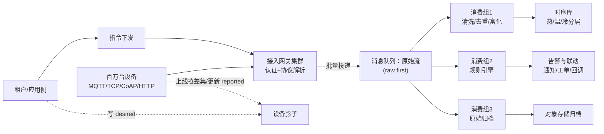

# 物联网平台：海量设备数据上报采集

> 返回：[示例项目场景](00-导览.md) · [软件架构学习大纲](../软件架构学习大纲.md)
> 定位：写入型洪峰的代表场景，与秒杀（读洪峰）对照讲“两类洪峰架构差异”；讲消息队列（削峰、消费语义、背压）、NoSQL 与时序库选型、高可用的最佳载体；架构深度拆解见[06-第六阶段/08-场景拆解-物联网数据采集](../06-第六阶段/08-场景拆解-物联网数据采集.md)，本文聚焦业务画像与核心模块底料。主要对应大纲：二-3 消息队列与事件驱动、三-2 远程通信、三-3 NoSQL 选型、三-5 高可用、六-1 场景拆解。

## 业务画像

海量终端设备（水表、电表、传感器、车载终端、售水机等）通过 MQTT/TCP/CoAP/HTTP 等协议持续上报数据；平台负责设备注册认证、数据解析入库、规则判断与告警、指令下发、固件 OTA 升级；规模从数万台到百万台设备。

**与互联网系统的三点倒置**：

1. **客户端不可靠**：设备弱网断连、重连补传、重复上报、乱序是常态——“信任客户端”的互联网直觉在这里全部失效。
2. **写洪峰而非读洪峰**：百万设备按分钟级心跳+事件上报，洪峰方向与秒杀/Feed 相反，数据库逐条 INSERT 必死。
3. **数据海量而价值密度低**：一条温度上报本身几乎无价值，价值在聚合与异常——存储成本模型与互联网内容完全不同。

**用户角色**：设备（机器客户端，数量最大的“用户”）、租户/企业主（设备资产主人）、运维人员（告警处理）、平台管理员（协议插件与规则配置）。

**教学量级假设**：接入设备 100 万台，心跳间隔 60 秒（常态 1.7 万条/秒），事件类上报峰值 10 万条/秒（整点抄表洪峰），单条数据 200 字节，热数据保留 7 天、温数据 90 天降采样、冷数据归档对象存储 2 年。

**核心业务流**：

1. 设备侧：上电→联网→平台认证（三元组/证书）→上线注册→周期心跳与数据上报→接收指令/升级通知；
2. 平台侧：接入网关认证鉴权→协议解析→数据管道（清洗、去重、富化）→规则引擎判定→存储与告警；
3. 下行：应用下发指令→设备在线直发/离线排队→设备回执。

## 模块总览

| 模块 | 一句话职责 | 关键数据 |
|---|---|---|
| 设备接入网关 | 海量长连接与协议解析 | 连接、协议插件 |
| 设备管理与影子 | 设备档案与状态镜像 | 设备档案、设备影子 |
| 数据管道 | 上报数据的清洗与分发 | 原始流、清洗流 |
| 规则引擎与告警 | 条件判定与告警分发 | 规则、告警 |
| 指令下发 | 下行可达性保障 | 指令、离线队列 |
| 时序数据存储 | 时序写入与分层保留 | 测点时序 |
| OTA 升级 | 固件灰度升级 | 升级任务、版本 |

## 系统上下文与写洪峰管道

先画边界图（谁在上报、管道怎么分层、下行怎么回去），模块内部再细谈：



读图口径（讲二-2 服务边界、二-3 消息队列时逐条回收）：

- **网关与存储之间永远隔着一个队列**：图里没有一条线从网关直连数据库——“接收能力”与“落库能力”就此解耦，时序库抖动只表现为消费堆积，网关照常接收（三-5 故障隔离的标准画法，数据管道小节反例的图上修正）。
- **三条消费组是三个故障域**：清洗、规则、归档互不等待——归档慢不拖垮告警延迟，反过来也一样；“一个慢消费者拖垮全链路”的反例，解法就是这张图的分叉。
- **上行与下行的承诺不同**：上行洪峰可容忍秒级延迟与批量聚合，下行指令要求“送达或明确告知失败”——同一条管道两个方向的 SLA 不同，是与 IM（[06](06-即时通讯IM.md)）对照讲接入层时的第一个分叉。
- **影子是控制面数据**：desired/reported 低频且要可靠，不走遥测洪峰管道——控制面与数据面分离，与 API 网关（[11](11-API网关.md)）的管理面/数据面同构。

## 核心模块

### 设备接入网关

**职责**：终结百万级长连接，完成认证、协议解析，把五花八门的报文归一化。

**关键实体与数据**：连接会话（`device_id`、`gateway_node`、`protocol`、`connected_at`、`keepalive`）；协议插件（MQTT/TCP 私有协议/CoAP/HTTP 的编解码器，插件化注册）；设备凭证（ProductKey/DeviceName/Secret 三元组或 X.509 证书）。

**典型流程**：设备发起连接→网关查凭证验签（本地缓存凭证摘要，避免每连接回源）→解析首包确认设备身份→注册会话与路由→后续报文解码为统一数据模型（`device_id`、`metric`、`value`、`event_time`、`report_time`）→投递数据管道。

**设计要点与典型陷阱**：

- **多协议插件化**：新增一种厂商私有协议不改网关内核——编解码器接口 + 插件注册，开闭原则的硬件版案例（与 MES 驱动插件化互相引用）。
- **反例（网关直写数据库）**：解析完直接 INSERT，10 万条/秒峰值下数据库先崩溃，连接也无法确认（写失败要不要 ACK 设备？）。**修正**：网关只做“接收—解析—投递队列”，写入异步化——削峰填谷的核心案例。
- 认证的本地化：百万设备高频重连时验签不能回源集中式鉴权（缓存凭证摘要/一次性票据）；MQTT 的 QoS 等级选择（0/1/2）逐级付出性能与复杂度代价，抄表数据 QoS1 足够、指令下发才考虑 QoS2——“按业务选 QoS”而非默认最高。

### 设备管理与设备影子

**职责**：设备档案管理（静态）+ 设备状态的镜像缓存（动态）。

**关键实体与数据**：

- 设备档案 `devices`：`device_id`、`product_id`（产品/型号）、`tenant_id`、`firmware_version`、`tags`（位置、分组）、`status`（在线状态由会话推导，不存储事实）。
- 设备影子 `device_shadow`：`desired`（期望状态，应用侧写入）与 `reported`（上报状态，设备侧写入）两份 JSON 文档 + `version`（乐观并发）。

设备影子合并骨架：

```kotlin
data class Shadow(val desired: Map<String, Any?>, val reported: Map<String, Any?>, val version: Long)

class ShadowService {
    // 影子的核心：desired 与 reported 的差集 = 待下发/待同步的部分
    fun applyReported(cur: Shadow, reported: Map<String, Any?>): Shadow {
        require(reported.isNotEmpty())
        return Shadow(cur.desired, reported, cur.version + 1) // 设备上报只更新 reported，desired 不动
    }

    fun applyDesired(cur: Shadow, desired: Map<String, Any?>): Shadow {
        return Shadow(desired, cur.reported, cur.version + 1)  // 应用设置只更新 desired，等设备来取
    }

    fun pendingDelta(cur: Shadow): Map<String, Any?> {        // 设备上线后拉取差集，对齐期望
        return cur.desired.filter { (k, v) -> cur.reported[k] != v }
    }
}
```

**典型流程**：设备上线→读取影子差集（desired 与 reported 不一致的部分）→执行并对齐 reported；应用改配置→写 desired→设备下次上线拉差集生效。

**设计要点与典型陷阱**：**影子解决“设备离线时怎么改配置”**——把“命令设备”变成“改期望状态、设备来对齐”，弱网设备的下行可靠性的标准答案；影子的合并冲突（应用连改两次 vs 设备旧版本上报）靠 `version` 乐观锁；不是所有设备都需要影子（常供电在线设备可直发指令，省一份存储与同步复杂度）——“模式也要按约束选用”。

### 数据管道（接收→清洗→存储）

**职责**：上报数据的清洗、去重、富化、分发——削峰填谷的主战场。

**关键实体与数据**：原始流（网关投递的原始报文，先落 Kafka 再处理——“raw first”便于重放）；清洗流（去重、量纲统一、富化租户/位置标签后的标准数据）；消费组按存储与规则引擎分别订阅。

**典型流程**：网关批量投递→队列缓冲→消费者组1：清洗去重后写时序库（批量聚合写入）；消费者组2：喂规则引擎；消费者组3：原始流归档。存储抖动时消费堆积，网关照常接收。

**设计要点与典型陷阱**：

- **上报幂等去重**：设备重连补传导致同一 `(device_id, metric, event_time)` 重复到达——窗口内按键去重或依赖时序库的相同时间戳覆盖语义；**按事件时间开窗**而不是处理时间（迟到数据归入其发生时间的窗口）。
- **反例（一个慢消费者拖垮全链路）**：归档消费者处理慢导致消费堆积、再到 Kafka 分区阻塞，最终网关无法投递、无法接收新数据——单一下游故障向上游传染。**修正**：按用途拆分 topic/消费组隔离故障域 + 背压（消费 lag 超阈值降级/网关限流保护）——背压与流控的核心案例。
- 批量聚合写入：攒批（如 500 条或 1 秒）落库，吞吐提升一个数量级，代价是秒级延迟——监控场景完全可接受，讲“延迟换吞吐”的权衡。

### 规则引擎与告警

**职责**：对数据流做条件判定（阈值/持续时间/离线），产生告警与联动动作。

**关键实体与数据**：规则 `rules`（`product_id`、`expr`（如 `temperature > 80 持续 60s`）、`actions`（告警/联动开关/回调 URL）、`enabled`）；告警 `alarms`（`device_id`、`rule_id`、`level`、`first_at`、`last_at`、`status`（触发/恢复/已确认））。

**典型流程**：数据流进入规则引擎→SQL 匹配或窗口计算→命中触发动作（告警通知、HTTP 回调、联动生成工单）→告警去重合并（同一设备同规则持续超限只保持一条活动告警）→恢复检测自动闭环。

**设计要点与典型陷阱**：**告警风暴**——网关故障断连会让一片设备同时“离线告警”，必须聚合成一条（按网关/产品维度合并），否则值班被淹没——告警也是要有“体验设计”的；“持续 60 秒才告警”需要流式窗口状态，不是简单 if——引出流式计算与状态存储；联动动作（自动断电）要有安全边界与人工确认档位（引工控场景“指令安全”对照）。

### 指令下发

**职责**：把应用的下行指令可靠送达设备。

**关键实体与数据**：指令 `commands`（`command_id`、`device_id`、`payload`、`ttl`、`status` 待下发/已送达/已执行/超时/失败）；离线指令队列。

**典型流程**：应用下发→设备在线：网关直推，等设备 ACK（超时重推）→设备离线：入离线队列，上线后按 TTL 决定补发或作废→设备回执更新状态。

**设计要点与典型陷阱**：**指令 TTL**：开灯指令迟到一小时就是事故，离线队列必须带过期；指令幂等（设备重收同一 command_id 只执行一次）；QoS 选择——遥测 QoS1、指令 QoS1+业务层幂等、计费/控制类才 QoS2，逐档讲“可靠性代价”。

### 时序数据存储

**职责**：海量时序测点的高吞吐写入、分层保留与降采样查询。

**关键实体与数据**：测点序列（`device_id + metric` 为序列键，按时间存值）；保留策略（热 7 天原始值、温 90 天分钟级降采样、冷归档对象存储）。

**典型流程**：批量写入→自动滚动/压缩→近实时查询（监控曲线）→降采样任务定时聚合→冷数据归档。

**设计要点与典型陷阱**：

- **为什么不用 MySQL**：100 万设备 × 每 60 秒一条 = 日增 14 亿行，B+ 树随机写与索引膨胀先崩；时序库的 LSM 类追加写 + 时间分区压缩（列式+delta 编码可到 1/10 体积）是为这个负载画像而生的——NoSQL/时序库选型的标准论证（三-3）。
- 降采样不是删数据：分钟级均值/最值是另一份派生数据，原始与降采样并存，查询按时间范围自动路由——冷热分层讲法的核心案例。
- “删除”需求罕见但出现时（合规）要确认时序库的 TTL/分区删除能力——选型时的非功能检查清单素材。

### OTA 升级

**职责**：固件包分发与灰度升级。

**关键实体与数据**：固件包 `firmwares`（`product_id`、`version`、`package_ref`（对象存储）、`signature`（完整性校验））；升级任务 `ota_tasks`（`task_id`、`target_devices`（全量/分组/指定）、`strategy`（静默/确认）、`batch_percent`（灰度批次））。

**典型流程**：上传固件与签名→创建灰度任务（先 1% 观察）→设备分批拉取（差分包优先）→校验签名→安装→上报新版本→失败自动回滚上一版→逐步放大到全量。

**设计要点与典型陷阱**：**灰度批次与失败熔断**（批次失败率超阈值自动暂停，否则一夜“变砖”百万设备——物联网版发布事故）；升级失败回滚要固件双分区（设备侧能力，平台只能约定协议）——软硬协同边界的例子；断点续传与差分升级省流量（NB-IoT 设备流量费钱）。

## 架构挑战与知识点映射

| 挑战 | 方案要点 | 对应大纲小节 |
|---|---|---|
| 百万长连接接入 | 无状态网关 + 连接路由、水平扩展 | 二-2、六-1 |
| 写入型洪峰 | 消息队列削峰、批量聚合写入 | 二-3 消息队列 |
| 多协议多版本 | 协议适配层、编解码插件化 | 一-2 开闭原则 |
| 设备不可靠（重传/乱序/迟到） | 上报幂等、事件时间开窗 | 二-3 消费语义 |
| 海量低价值密度数据 | 时序库、冷热分层、降采样归档 | 三-3 NoSQL 选型 |
| 指令可达 | 设备影子、离线队列、QoS 取舍 | 二-3、三-2 |
| 慢消费者拖垮链路 | 背压、流控、故障隔离 | 三-5 高可用 |

## 核心用例事件时序逐步表

与订单系统的“提交订单六步”、秒杀的“一次抢购点击”同口径，把两条核心链路展开成逐步表：一条遥测数据从设备到存储与告警，一条指令从应用回到设备——后续讲消费语义、背压、时序写入时逐行回收。

**一条遥测上报（整点抄表洪峰中的一条）**：

| 步 | 动作 | 数据变更 | 失败与并发时的行为 |
|---|---|---|---|
| ① | 连接/复用长连接，网关验证凭证摘要（本地缓存优先） | 会话路由 `device_id→gateway_node` | 凭证失效→断连退避重试；缓存未命中回源并限速（防重连风暴打垮鉴权） |
| ② | 设备 publish 遥测（QoS1），网关解码为统一数据模型 | 无落库 | 报文非法→死信计数，不回 ACK（避免重传风暴） |
| ③ | 网关攒批投递原始流（如 100 条/50ms 一批） | 原始 topic 追加 | 队列不可用→本地缓冲+按优先级丢弃遥测、保留事件类，丢弃率暴露指标 |
| ④ | 消费组1 清洗：按键去重、量纲统一、富化租户/位置标签 | 清洗流追加 | 重复上报→窗口内去重；时钟漂移（event_time 异常）→钳位+打标 |
| ⑤ | 消费组1 攒批聚合写时序库（如 500 条或 1 秒一批） | 时序库批量写 | 写失败→重试→超限侧输出/堆积，堆积触发背压信号 |
| ⑥ | 消费组2 规则引擎：条件匹配（`temperature > 80 持续 60s`） | 窗口状态更新 | 已有活动告警→合并更新 `last_at`，不重复建条 |
| ⑦ | 告警动作分发：通知/工单/HTTP 回调 | `alarms` 落库 | 动作失败→重试+人工兜底；分发不阻塞存储链路 |
| ⑧ | 消费组3 原始报文归档对象存储 | 归档文件 | 慢→独立 topic 堆积不传染④⑤，到期整段清理 |

三个回收点：③与⑤之间隔着消息队列——“削峰”的全部含义就是这段缓冲，10 万条/秒的瞬时写入被摊成下游能承受的批量写；④⑤的“至少一次投递 + 幂等去重 + 攒批写”是二-3 消费语义的完整落地；⑧与⑤的隔离就是“慢消费者拖垮全链路”反例的修正版。另注意表里 `event_time` 与 `report_time` 两个字段都保留——事后区分“设备迟报”还是“平台晚处理”的唯一证据（时间口径语义详见 07 数据系统内核专题第 4 册）。

**一条指令下发（应用 → 设备）**：

| 步 | 动作 | 数据变更 | 失败与并发时的行为 |
|---|---|---|---|
| ① | 应用下发指令（携带 `command_id` 幂等键） | `commands` insert（待下发） | 重复提交→唯一约束拦截，返回同一指令 |
| ② | 会话路由查询：设备在线、连在哪台网关 | 无 | 在线→③；离线/查不到→⑤ |
| ③ | 网关直推设备，等待 ACK | `status→已送达` | ACK 超时→指数退避重推 N 次 |
| ④ | N 次重推仍失败 | `status→超时` | 按业务类型转⑤排队或直接作废 |
| ⑤ | 设备离线：入离线队列（带 `ttl`） | 离线队列追加 | TTL 已过→作废并回调应用“不可达” |
| ⑥ | 设备上线：拉取 TTL 内未过期指令按序补发 | 按序补发 | 补发仍带幂等键，设备侧同 `command_id` 只执行一次 |
| ⑦ | 设备执行并回执 | `status→已执行` | 回执丢失→指令查询补偿，避免状态悬空 |
| ⑧ | TTL 到期仍未执行 | `status→超时/失败` | 回调应用失败→差错队列人工处理 |

指令表与设备影子是互补而非替代：要“确认执行过”走指令+回执（⑦的已执行状态），只要“最终状态对齐”走影子差集（desired 与 reported 收敛）——“影子能不能替代离线指令队列”这道题从分工回答，不从性能回答。

## 关键数据表设计与取舍

把散在各模块的表设计收拢成决策清单——“取 A 还是取 B、为什么”（与订单系统的同款口径）：

| 设计点 | 选项 A | 选项 B | 本场景结论与理由 |
|---|---|---|---|
| 在线状态 | `devices.status` 字段落库 | 由会话连接事实推导 | 推导：连接事实在网关会话表，落库必然漂移（断连瞬间、网关重启）；状态是视图不是事实 |
| 档案与影子 | 一张表混存 | 分开存储 | 分开：档案低频写、影子高频读写，混存把档案表拖成热点 |
| 影子载体 | MySQL JSON 列 | Redis/KV 文档 + `version` | KV：影子生命周期跟会话走、单文档原子覆盖、以读为主，画像匹配；乐观并发不变 |
| 时序序列键 | `device_id` 一条大序列 | `device_id + metric` 序列键 | 序列键：不同 metric 的频率与保留策略不同，混在一条序列里降采样互相牵制 |
| 原始数据 | 只留清洗后的 | raw first：原始与清洗并存 | raw first：清洗逻辑有 bug 时可重放重算——拿存储换“可重复”（与批处理的价值观同宗） |
| 告警存储 | 单表全历史 | 活动告警小表 + 历史大表 | 分离：活动告警高频读（值班页），历史只有查询与合规需求，量级差数量级 |
| 离线指令队列 | 只存 Redis | 持久化队列 + 状态对账 | 持久化：指令是承诺不是缓存，缓存故障不能让“欠设备的指令”消失 |
| 设备凭证 | Secret 明文落库 | 摘要存储 + 证书轮换 | 摘要：网关只存校验用摘要（与 API 网关 AppKey 同口径），泄漏面最小 |

设备档案的落款（教学简化版，只列有取舍的字段）：

```sql
CREATE TABLE devices (
    device_id        VARCHAR(64) PRIMARY KEY,  -- 设备唯一标识（三元组之一）
    product_id       VARCHAR(64) NOT NULL,     -- 产品/型号：认证与灰度的分组单位
    tenant_id        BIGINT      NOT NULL,     -- 租户：配额、计费、隔离的贯穿键
    firmware_version VARCHAR(32) NOT NULL,
    tags             JSON        NULL,         -- 位置、分组等富化标签
    secret_digest    CHAR(64)    NOT NULL,     -- 凭证摘要，不存明文
    created_at       DATETIME    NOT NULL,
    KEY idx_tenant_product (tenant_id, product_id)
);
```

分片预留（本阶段不做，先留位）：数据面（时序测点）按 `device_id` 哈希分片、写入路由天然分散；控制面（档案、告警、指令）按 `tenant_id` 分片服务租户隔离——两张面用不同分片键是 IoT 多租户的常规落法。“`tenant_id` 贯穿所有表”的直觉会把数据面也按租户切——单租户百万设备会把该租户分片打成热点，建表前就要想清楚。

## 容量与失败模式推演

以下推演全部基于业务画像的教学量级假设（100 万台、心跳 60 秒、事件峰值 10 万条/秒、单条 200 字节），是教学口径的演算，不是实测数据；完整全链路拆解以[06-第六阶段/08](../06-第六阶段/08-场景拆解-物联网数据采集.md)为准。

**接入与连接（推演）**：

- 100 万长连接，假设单节点稳定承载 5 万~10 万连接（受报文频率、内存与句柄预算影响，量级判断足够）→ 网关集群 10~20 节点；
- 心跳底噪：100 万 ÷ 60 秒 ≈ 1.7 万次/秒的保活报文——容量评估要把洪峰叠加在底噪之上，而不是只算事件量。

**消息量与削峰（推演）**：

- 常态 1.7 万条/秒 × 200B ≈ 3.4MB/s；整点洪峰 10 万条/秒 ≈ 20MB/s——对消息队列是小数字，**瓶颈从不在队列吞吐，而在消费侧的计算与落库**；队列的价值是把瞬时洪峰摊成下游能承受的速率。
- 削峰的定量口径（假设）：洪峰持续 5 分钟、落库平稳承受 3 万行/秒 → 积压 ≈（10万 − 3万）× 300 秒 = 2100 万条 ≈ 4.2GB——队列磁盘要按“洪峰总量”而非“每秒速率”预留；消费延迟上限 ≈ 积压 ÷ 消费速率 ≈ 700 秒，这就是“抄表数据晚十来分钟可见”的定量出处。

**存储分层（推演，原始 200B/条）**：

- 日增 ≈ 100 万 × 86400/60 = 14.4 亿行/天，原始体积 ≈ 288GB/天（洪峰日更高）；
- 列存 + delta/字典编码常压到 1/10 量级 → ≈ 30GB/天；热 7 天原始值、温 90 天分钟级降采样（条数按降采样率缩减）、冷 2 年归档——三层各记各的账，混算必然高估或漏算；
- 结论前置：**逐条 INSERT 的关系库在这个写入画像下必然先死**（日增 14 亿行的索引维护与随机页写），时序库/LSM 的选型论证由此成立（三-3；机械详见 07 数据系统内核专题第 2 册）。

**补传洪峰的推演（假设）**：假设 1% 设备经历一次断网 24 小时后集中重连补传——1 万台 × 1440 条/台 ≈ 1440 万条瞬时追加，折合每秒数十万条量级的短时尖峰（叠加在常态之上）。两条结论：①补传数据的事件时间是昨天，按事件时间开窗才不会把昨天的用量算进今天（口径语义见 07 专题第 4 册）；②补传洪峰与整点抄表洪峰是同一类缓冲问题，但**不可预测**——队列的预留余量与去重窗口的时长都要按“最坏叠加”来定，而不是按整点洪峰的单峰画像。

失败模式清单（每行都有对应的预设对策，缺一项就是隐患）：

| 失败模式 | 触发场景 | 后果 | 预设对策 |
|---|---|---|---|
| 队列不可用 | 消息集群故障 | 接收停摆 | 网关本地缓冲 + 优先级丢弃 + 丢弃率告警 |
| 时序库写入抖动 | 合并/刷盘停顿 | 消费堆积、可见性延迟 | 背压：lag 超阈值网关限流；写侧加大攒批 |
| 慢消费者传染 | 归档作业变慢 | 全管道堆积 | topic 按用途拆分、消费组隔离 |
| 重复上报风暴 | 设备重连补传 | 重复入库、统计虚高 | 窗口去重 + 时序库同时间戳覆盖语义 |
| 设备时钟漂移 | event_time 未来/久远 | 数据落错窗口 | 钳位 + 打标 + 侧输出人工核对 |
| 告警风暴 | 网关故障一片设备同时离线 | 值班被淹没 | 按网关/产品维度聚合 + 分级通知 |
| 凭证泄漏 | 明文落库或日志外泄 | 伪造设备接入 | 摘要存储 + 轮换 + 异常接入审计 |
| OTA 失败率超阈 | 固件缺陷 | 大批设备变砖 | 灰度批次失败熔断 + 双分区回滚 |
| 重连风暴 | 网络抖动后集中重连 | 鉴权回源被打垮 | 指数退避 + 凭证摘要本地缓存 |

## 演进路线：从万台到百万台的迁移与回滚

每一步先说迁移、再说怎么退回来（回滚预案不是补丁，是上线条件；口径与订单系统的演进表一致）：

| 阶段 | 改造动作 | 迁移方式 | 回滚方式 |
|---|---|---|---|
| 1. 单体直写 | 设备→网关→数据库逐条写 | 起步形态（万台以内够用） | — |
| 2. 队列削峰 | 网关与落库之间插入消息队列，批量聚合写 | 按产品维度灰度切流（新产品先进队列） | 切回同步直写（旧路径在灰度期保持可用） |
| 3. 时序库替换 | 落库目标从关系库换时序库 | 双写对比期（以旧库为准）→读切流→对账→停写旧库 | 切回旧库读写（双写期旧库一直活着，回滚即切指针） |
| 4. 协议插件化 | 编解码器插件化，私有协议逐个迁入 | 每种协议单独灰度（先测试产品） | 协议回退旧解码路径 |
| 5. 冷热分层 | 降采样任务 + 冷归档 | 降采样数据双算对拍（聚合口径核对）后才作唯一读源 | 查询路由切回原始值（热层原始数据仍在） |
| 6. 接入层水平扩展 | 无状态网关 + 连接路由 | 按产品/租户分批迁移连接（低峰期） | 路由表版本回退，连接切回原节点 |

两条纪律与订单场景同款：双写/双算期永远以旧链路为准；每步停留一个观察期（对账连续无差异）才动下一步。IoT 特有的第三条：**设备侧不能强制升级**——服务端任何演进必须兼容最旧固件的报文格式（协议版本协商），回滚不只回服务端，还要保证“设备什么都不改也连得上”。

## 面试官追问点

- “为什么网关不直接写数据库？”——两层原因：写路径（10 万条/秒的逐条写没有数据库能接）与 ACK 语义（写失败要不要告诉设备失败？队列把“接收成功”与“落库成功”解耦，设备只对“接收”负责）。
- “遥测为什么不用 QoS2？”——QoS2 的两阶段确认把每条消息的往返成本翻倍，抄表数据重一条被幂等去重消化，可靠性买在消费端比买在协议端便宜。
- “Kafka 堆积了先动哪里？”——先看是哪个消费组 lag：慢消费者单独治（扩容/拆分），存储写不动调攒批，最后才动网关限流——顺序反了就是把故障向上游传染。
- “设备影子与离线指令队列怎么选？”——要“确认执行过”用指令+回执，只要“最终状态对齐”用影子差集；常供电在线设备两者都可以省。
- “时序库怎么‘删数据’？”——TTL/分区整段删除，不是逐条 DELETE（与 LSM 墓碑的代价对照，07 专题第 2 册）。
- “event_time 和 report_time 为什么都要存？”——事后区分“设备迟报”与“平台晚处理”的唯一证据；只有处理时间时，断网补传会把昨天的用量算进今天。
- “告警聚合的维度怎么选？”——跟爆炸半径走：网关级故障按网关聚合、产品级故障按产品聚合；聚合维度错了一样淹没值班。
- “网关节点怎么优雅退场？”——先停止接收新连接、等存量连接迁移或自然重连（连接路由表版本化 + 客户端退避），最后摘除节点；直接杀节点等于自造一次重连风暴。
- “降采样后原始数据还能删吗？”——先由合规与审计定结论，再选 TTL/分区整段删除——先定保留策略再选引擎，顺序反了就是返工。

## 如果规模再大十倍

假设 1000 万设备、常态 17 万条/秒、整点洪峰 100 万条/秒，逐层推演：

- **接入分域**：1000 万长连接单地域接入的内存、句柄与带宽都不现实——按地域/运营商分接入机房，就近终结 TLS 与协议解析（与秒杀多机房开抢同一思路：宁可分域少放，不做跨域调拨）。
- **洪峰错峰**：整点抄表洪峰放大 10 倍后，削峰队列的积压时间线性拉长——把“整点”改成“按产品分片错峰上报”（服务端下发采集时刻表），**平滑洪峰比扩容硬扛便宜**，这是写洪峰独有的杠杆（读洪峰没有“错峰读”这个选项）。
- **存储分区滚动**：日增 144 亿行要求时序库按时段分区滚动 + 预聚合下推——“昨日全网用量”不再查询时算，而是流式聚合任务直接产出（07 数据系统内核专题第 4 册的流式物化在此落地）。
- **规则引擎分片**：规则数与数据量同涨，规则匹配按租户/产品分片，热租户独立资源池——多租户隔离（[12](12-多租户SaaS控制平面.md)）在数据面的延伸。
- **降采样升级为分层聚合**：分钟级不够时加小时级/天级多级降采样，查询按时间范围自动路由到对应层级——OLAP“物化分级”思想在时序上的同构。
- **计量与对账**：设备数 × 时长的计量准确率要求提高——流式实时计量 + 日终批对账兜底分工（流管快、批管准，07 专题第 4 册的分工表）。

## 与其他场景的联动

- 架构深度拆解见[06-第六阶段/08-场景拆解-物联网数据采集](../06-第六阶段/08-场景拆解-物联网数据采集.md)；时序库选型详见[06-第六阶段/12-技术工具档案-搜索与时序数据库](../06-第六阶段/12-技术工具档案-搜索与时序数据库.md)。
- 秒杀（[05](05-秒杀限时抢购.md)）：读洪峰 vs 写洪峰的对照组，讲三-3 时成对出现。
- MES（[04](04-MES制造执行系统.md)）：MES 设备采集是 IoT 管道的工厂特例；IoT 拼规模，工控拼实时性与安全隔离——讲“相似问题、不同约束导致不同架构”。
- 即时通讯（[06](06-即时通讯IM.md)）：同为长连接接入与消息可达（影子差集 ≈ IM 离线补拉），可对照讲接入层设计。
- 桶装水商城（[02](02-桶装水商城.md)）：智能水表定期上报用水量驱动周期购结算、售水机接入——真实项目延伸。
- 工单中心（[03](03-工单中心.md)）：告警自动生成运维工单（规则引擎 action 之一）。
- 多租户 SaaS（[12](12-多租户SaaS控制平面.md)）：IoT 平台本身就是多租户系统（`tenant_id` 贯穿所有表），设备配额与隔离取材于此。

## 取材指引

- 二-3 消息队列：削峰（写洪峰）、消费语义（至少一次+幂等）、背压三连——一个场景覆盖消息队列教学的全部主知识点，优先用本场景。
- 三-2 远程通信：MQTT QoS 等级、CoAP/HTTP 的取舍。
- 三-3：时序库 vs 关系库 vs KV 的选型论证（用日增 14 亿行的数字推演）；冷热分层与降采样。
- 三-5 高可用：接入层与存储解耦（存储抖动不影响接收）、消费隔离、网关优雅退场。
- 可出思考题方向：为什么遥测数据不选 QoS2；设备影子与离线指令队列各适合什么场景；告警风暴怎么聚合；降采样后原始数据还能删吗、依据是什么。
