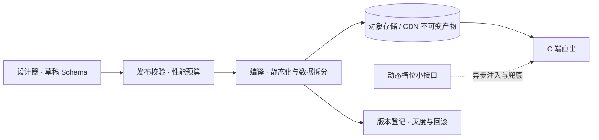

# 低代码开发平台：搭建类系统

> 返回：[示例项目场景](01-导览.md) · [软件架构学习大纲](../软件架构学习大纲.md)
> 定位：讲解释器/组合模式、元数据驱动设计、“EAV vs JSON vs 动态建表”数据选型的最佳载体；讲 DDD 时用作“过度通用化”的反例讨论。工单中心里“新增工单类型只配表单不改代码”的能力，本质就是内嵌的低代码——先讲工单场景的单体实现，再延伸到本场景的完整挑战。架构深度拆解见[章节6/09-场景拆解-低代码平台](../06-第六阶段/09-场景拆解-低代码平台.md)；C 端特化方向“店铺装修”（页面搭建的高性能运行时：编辑态/运行态分离、发布时静态化）见“核心模块”末节，与章节6/09 的 B 端解释执行路线互为对照。主要对应大纲：一-2 设计模式（解释器/组合）、三-3 动态字段存储与缓存静态化、四-2 DDD 通用性边界、五-2 配置灰度发布。

## 业务画像

让业务/实施人员通过拖拽配置而非编码搭建应用：表单搭建（字段、校验、联动）、流程搭建（审批节点、分支、会签）、页面搭建（列表、报表、大屏）、数据建模。典型产物：OA 审批、报修登记、巡检打卡、工单类型表单。

**低代码平台的本质**：

1. **一切皆元数据**：用户“开发”的产物不是代码而是配置数据（Schema），运行时引擎解释执行——平台卖的是“解释器”，不是“生成器”（这是与代码生成器流派的第一分野）。
2. **搭建者不是程序员**：用户体验的敌人从“编译错误”变成“配置出歧义”——配置的校验、预览与可解释性比实现功能的野心更重要。
3. **通用性是滚下坡的雪球**：分支/并行/会签/撤回/加签，每满足一个客户就离通用 BPM 更近一步，复杂度失控是常态——通用性的代价在本场景有最完整的展现。

**用户角色**：搭建者（业务/实施人员，核心用户）、使用者（提交表单、走流程的普通员工）、平台管理员（组件市场、租户与权限）、专业开发者（写逃生舱插件）。

**教学量级假设**：单租户应用 200 个，表单 Schema 平均 40 个字段，流程平均 8 个节点，表单日提交 2 万次，单表单数据 10 万行级。

**核心业务流**：

1. 搭建：新建应用→拖拽设计表单→编排流程→配置列表/报表页→预览调试→发布；
2. 运行：使用者打开表单→引擎按 Schema 渲染并校验→提交入库→流程引擎按定义流转→审批/通知→数据在报表页可视化；
3. 演进：改表单/流程→新版本发布（在途单据不受影响）→必要时回滚。

## 模块总览

| 模块 | 一句话职责 | 关键数据 |
|---|---|---|
| 表单设计器 | 产出表单元数据 Schema | 表单 Schema |
| 流程设计器 | 编排审批流（状态机/BPMN） | 流程定义 |
| 页面与报表设计器 | 列表/报表/大屏配置 | 页面定义 |
| 数据引擎 | 动态字段存储与查询 | 表单数据 |
| 权限体系 | 字段级/行级动态权限 | 权限规则 |
| 发布与版本管理 | Schema 版本化与灰度 | 版本快照 |
| 组件/物料市场 | 组件复用与分发 | 组件包 |
| 店铺装修引擎 | C 端页面搭建：发布时编译静态产物，CDN 直出 | 楼层 Schema、页面产物 |

## 核心模块

### 表单设计器

**职责**：可视化拖拽产出表单的元数据 Schema——平台的“源代码编辑器”。

**关键实体与数据**：表单 Schema（JSON）：`form_id`、`version`、`fields[]`（`field_key`、`type`（文本/数字/日期/附件/子表/引用）、`required`、`validators[]`（正则/区间/自定义表达式）、`linkages[]`（字段联动规则，如“A 选是则显示 B”）、`layout`（分组与栅格））。

**典型流程**：拖入组件→配置属性→配置校验与联动→预览（引擎实时解释）→保存版本。

**设计要点与典型陷阱**：

- Schema 本身是**解释执行**的对象而非生成代码的中间产物——同一份 Schema 在 PC 渲染器、移动渲染器、导出 PDF 上解释出不同形态，这是解释器模式收益的最佳展示。
- 联动规则的表达能力边界：声明式（“显示/隐藏/必填”）能覆盖 80%，剩下 20%（提交前算个运费）靠表达式或逃生舱脚本——**边界的克制决定平台的寿命**。
  - **反例（Schema 无版本）**：字段被删除后历史单据渲染报错。**修正**：数据写入时记录 `form_version`，读取时按提交时刻的 Schema 解释（详见“发布与版本管理”）。

Schema 校验的解释器骨架——引擎逐字段执行校验器组合，新增校验器只需扩展一种类型，解释循环零改动：

```kotlin
interface Validator { fun validate(value: Any?): String? }      // 返回错误提示，null 表示通过

data class Required(val label: String) : Validator {
    override fun validate(value: Any?) =
        if (value == null || value.toString().isBlank()) "$label 不能为空" else null
}
data class RegexRule(val label: String, val pattern: Regex) : Validator {
    override fun validate(value: Any?) =
        if (value != null && !pattern.matches(value.toString())) "$label 格式不正确" else null
}

data class Field(val fieldKey: String, val validators: List<Validator>)
data class FormSchema(val version: Int, val fields: List<Field>)

fun validateEntry(schema: FormSchema, entry: Map<String, Any?>): List<String> =
    schema.fields.flatMap { f -> f.validators.mapNotNull { it.validate(entry[f.fieldKey]) } }
```

### 流程设计器

**职责**：编排审批/流转逻辑，产出流程定义，由流程引擎执行。

**关键实体与数据**：流程定义（节点图）：`nodes[]`（`type`：审批/会签/或签/条件分支/并行分支/抄送/自动节点，`assignee`（角色/部门/发起人上级/表达式）、`timeout`、`actions`）；`transitions[]`（条件表达式）；`version`。

**典型流程**：拖节点→连线配条件→绑定表单字段（分支条件引用字段值）→模拟试跑→发布；运行时：提交触发实例→引擎按定义逐节点推进（审批/超时自动通过或转办/驳回回到指定节点）→全部完成归档。

**设计要点与典型陷阱**：

- **通用性陷阱（本场景最大的坑）**：客户要“会签中一人驳回但其他人已批的作废吗”“加签后已批的人要重批吗”“撤回到第三步改个字段再重走吗”——每一条都把引擎推向通用 BPM（Activiti/Camunda 的完整复杂度）。**修正**：明确平台的能力清单（如支持到“会签+条件分支+驳回重走”），清单外需求引导到逃生舱或专业 BPM——讲“通用性的代价、YAGNI”时最完整的案例。
- 流程实例必须与**流程定义版本**绑定（在途流程按启动时的定义走完，新定义只影响新实例）——与表单 Schema 版本化同构，两者合起来是“配置即代码、发布即版本”的完整叙事。
- 引擎实现讲状态机迁移表即可起步（与工单中心的状态机是同一机制、更大规模）。

### 页面与报表设计器

**职责**：配置列表页（筛选/列/操作按钮）、统计报表、大屏。

**关键实体与数据**：页面定义：`data_source`（表单/聚合查询）、`filters[]`、`columns[]`、`charts[]`（图表类型与聚合维度）。

**典型流程**：选数据源（某表单数据）→配筛选与列→配图表与聚合口径→发布为菜单入口。

**设计要点与典型陷阱**：报表查询的负载与表单提交完全不同（聚合扫描），大数据量下要落独立的聚合表/物化视图——低代码平台内部也会长出 CQRS；**用户自定义查询的安全性**：配置转化为查询语句时必须参数化与权限过滤（配置也是输入，防“配置注入”）。

### 数据引擎（动态字段存储——数据架构的经典 trade-off）

**职责**：存储“字段由用户定义”的表单数据，支撑按任意字段查询。

**关键实体与数据**：表单数据行（`entry_id`、`form_id`、`form_version`、动态字段集合、`submitted_by`、`submitted_at`）。

三种存储方案的对比（三-3 数据选型的经典考题）：

| 方案 | 做法 | 优势 | 代价 |
|---|---|---|---|
| EAV | 行存键值对：每字段一行 | 加字段零 DDL | 查询多表 join/自连接，性能差；类型弱 |
| JSON 列 | 整行存 JSONB | 读写整行快、加字段零 DDL | 按字段条件查询/索引依赖数据库 JSON 能力 |
| 动态建表 | 每表单真实建表 | 查询性能与普通表一致 | DDL 权限与变更管理、字段数上限、迁移复杂 |

工程主流是 **JSON 列 + 关键字段提升**（常筛字段抽取为生成列/冗余索引列），兼得灵活与性能——“没有银弹，只有混合”的标准结论。

**典型流程**：提交→按 `form_version` 的 Schema 校验→写入 JSON 列→命中的提升字段同步冗余列→查询走 JSON 索引或提升列。

**设计要点与典型陷阱**：**反例（纯 EAV 支撑报表）**：一个五条件筛选的列表页变成五层自连接，页面 30 秒打不开。**修正**：JSON 列+提升列，或重查询场景落到独立的聚合表；字段类型变更（文本改数字）的历史数据处理策略必须在引擎层定死（旧值保持原样/强制转换失败置空，产品要给提示）。

### 权限体系

**职责**：随配置动态变化的权限——字段级、行级、按钮级。

**关键实体与数据**：权限规则：`resource`（应用/表单/字段/行范围）、`subject`（角色/部门/用户/发起人相关人）、`effect`（可见/可编辑/隐藏值）。

**典型流程**：页面渲染时按当前人与权限规则计算字段可见性；查询时注入行级过滤（“只看本部门的”）。

**设计要点与典型陷阱**：权限与元数据联动（新增字段默认谁能看，必须有默认策略而非漏配）；**行级过滤必须引擎强制注入**，不能靠前端隐藏或搭建者在每个页面记得配——与多租户“串租户”同款道理：安全属性靠机制不靠自觉（五-3 默认拒绝的案例）。

### 发布与版本管理

**职责**：Schema 的版本化发布、灰度与回滚——“配置即代码”的治理面。

**关键实体与数据**：版本快照（表单/流程/页面的不可变版本，`version`、`published_at`、`publisher`）；数据行携带 `form_version`。

**典型流程**：保存草稿→差异对比（与线上版本逐字段 diff）→发布（新实例用新版）→异常回滚（旧版本重新置为当前）。

**设计要点与典型陷阱**：

- **在途流程不受影响**：发布新版流程后，已启动的实例按旧版走完——数据与实例都锚定版本，这是“向后兼容”在配置世界的形态。
- **反例（改表单直接生效）**：删掉“预算金额”字段直接保存，在途审批单打开报错、已批数据展示缺列。**修正**：版本化发布 + 删除字段的级联检查（该字段被流程条件/报表引用时禁止删除或强提示）——讲 expand-contract 三阶段（先加后停再删）时，数据库列的故事与低代码字段的故事可以互为注解（章节4/05）。
- 灰度：新表单先对部分人群可见（按组织架构分流），配置灰度与代码灰度同构（五-2）。

### 组件/物料市场

**职责**：组件（表单控件、流程节点模板、页面区块）的复用与分发。

**关键实体与数据**：组件包（`component_id`、`version`、`schema`、`runtime_dep`（依赖的引擎版本））。

**典型流程**：开发者上传组件→审核→上架→租户安装→搭建者拖入使用→升级兼容性检查。

**设计要点与典型陷阱**：组件的版本兼容矩阵（组件 v2 要求引擎 ≥1.8）——生态依赖管理的迷你版，讲供应链/依赖治理可引用；第三方组件的安全审查（组件能执行脚本就是攻击面）——逃生舱的代价。

### 店铺装修引擎（C 端出页——运行时高性能方向）

**职责**：面向商家的 C 端页面可视化装修（店铺首页、大促会场、活动落地页）——楼层 Schema 在**发布时**编译为静态产物，C 端高并发与大促脉冲下由 CDN 直出，运行时只异步补极少量动态槽位。这是低代码思想在“读多写少、首屏苛刻”流量形态下的特化方向。

**方向定位（与 B 端搭建的分野）**：同一套元数据思想，两种执行模型。B 端表单/流程流量低、交互重，解释执行加三级缓存即可（[章节6/09](../06-第六阶段/09-场景拆解-低代码平台.md)的“解释执行性能：三级缓存与性能预算”）；店铺装修页流量高几个数量级，**解释器必须从请求路径上消失**——解释挪到发布时，运行时只剩“返回静态产物 + 槽位注入”。一句话：B 端低代码卖解释器，C 端低代码卖编译器。两相对照，是“执行模型跟着流量形态走”的最佳教材。

**关键实体与数据**：装修页 Schema（`page_id`、`status`（draft/published）、`floors[]`）；楼层（`floor_type`（banner/商品横滑/券包/秒杀/图文/视频）、`props`（静态内容：文案、图片、跳转链接）、`data_binding`（动态数据声明：`source`/`params`/`fallback`/`ttl`）、`lazy`（非首屏懒加载））；页面产物（`artifact_id`（内容哈希，URL 不可变）、`static_html`（静态内容固化的直出 HTML）、`dynamic_slots[]`（编译期收集的槽位清单）、`asset_manifest`（按容器尺寸裁图、JS/CSS 按楼层分包））；发布版本（`version_id`、`artifact_id`、`gray_ratio`、`status`）。

**典型流程**：编辑（商家拖楼层→预览：预览服务用**解释渲染**跑草稿 Schema，低流量路径慢点无妨→存草稿）→ 发布（校验性能预算→编译：静态化与数据拆分→产物按内容哈希入对象存储→登记版本）→ 运行（CDN 按版本化 URL 命中直出；价格/库存/倒计时/个性化推荐等槽位由客户端并行拉小接口注入，失败落兜底）→ 回滚（切版本指针，秒级生效）。



**设计要点与典型陷阱**：

1. **编辑态/运行态分离是第一决策**：设计器与 C 端渲染器是两套代码、两种性能模型。**反例（复用设计器的组件渲染器跑 C 端）**：组件代码带着编辑态的拖拽、选中、属性面板逻辑上线，包体翻倍、运行时开销双杀。**修正**：设计器面向搭建体验，运行时渲染器只保留“纯展示”子集，两个包从构建期就分开。
2. **发布即编译，运行时零解释**：**反例（运行时解释 DSL）**：每次 C 端请求都把 Schema 反序列化→递归解释楼层→逐层取数拼装，大促 QPS 上来后 CPU 全部耗在解释与临时对象上，GC 压力拖垮 P99。**修正**：发布时编译为静态 HTML（或预构建组件树），运行时只剩“返回产物 + 槽位注入”。与章节6/09 的三级缓存对照着讲最清楚：缓存优化的是“每次解释的成本”，静态化消灭的是“解释这件事本身”。
3. **静态/动态数据拆分**：装修页九成内容是静态的（文案、图、跳转），编译时固化；动态的只有价格、库存、倒计时、个性化——拆成槽位异步补。**反例（一个聚合大接口串全部楼层数据）**：首屏被最慢楼层（通常是推荐系统）拖死。**修正**：槽位级小接口 + 并行请求 + 超时落兜底——BFF 按楼层拆，而不是按页聚合。
4. **不可变版本 + CDN 长缓存**：产物 URL 带内容哈希，`Cache-Control: immutable` 长缓存；发布 = 换版本号，回滚 = 切回旧版本。**反例（同一 URL 原地覆盖内容）**：CDN 各节点内容不一致，用户端缓存的脏数据无法失效。
5. **个性化与缓存的冲突**：整页缓存键只有“页 × 版本”，个性化内容绝不能进整页——坑位级异步注入，“页面千人一面、坑位千人千面”。**反例（按用户出整页）**：缓存命中率跌到地板，源站被打穿——Feed 流“推拉模型”决策在页面维度的重演（[08](08-Feed流内容社区.md)）。
6. **首屏预算进发布校验**：首屏楼层数、图片总体积、懒加载标记在**发布时**拦截——性能预算反哺元数据建模，与章节6/09 的预算纪律同源：预算在设计器里拦，而不是等线上慢了再查。
7. **兜底与降级**：槽位失败显示兜底（券过期显示“已领取”而不是空白）；装修错误在发布校验拦住，线上不存在“坏 Schema”——错误左移到低流量路径。

店铺装修编译引擎骨架——发布时把楼层 Schema 编译为不可变产物（静态 HTML + 槽位清单 + 内容哈希版本），版本回滚只切指针；末尾用同一份页面对比“每请求解释”与“直出产物”的单次成本：

```kotlin
import java.security.MessageDigest

// ===== 编辑态：商家拖出的楼层 Schema（低频写路径，只服务设计器） =====

/** 动态数据声明：编译期拆成"槽位"，运行时异步补数，失败落 fallback */
data class DataBinding(
    val source: String,                  // price / coupon / seckill / rec（个性化推荐）
    val params: Map<String, String>,
    val fallback: String,
    val ttlSeconds: Int
)

data class Floor(
    val floorType: String,               // banner / productRow / coupon / seckill / video / richtext
    val props: Map<String, String>,      // 静态内容：文案、图片、跳转链接——发布时直接固化进 HTML
    val dataBinding: DataBinding? = null,
    val lazy: Boolean = false            // true = 非首屏，客户端按曝光懒加载
)

data class ShopPageSchema(val pageId: String, val floors: List<Floor>)

// ===== 发布时：Schema 编译为不可变产物（一次性成本，与 C 端流量无关） =====

data class DynamicSlot(val slotId: String, val source: String, val params: Map<String, String>,
                       val fallback: String, val ttlSeconds: Int)

data class PageArtifact(
    val artifactId: String,              // 内容哈希：URL 不可变，CDN 可长缓存
    val staticHtml: String,              // 静态内容已固化的直出 HTML（含槽位占位符）
    val dynamicSlots: List<DynamicSlot>, // 运行时只需并行拉取的小接口清单
    val firstScreenFloorCount: Int
)

/** 发布校验：性能预算在发布时拦，而不是线上慢了再查 */
fun validate(schema: ShopPageSchema): List<String> {
    val errors = mutableListOf<String>()
    val firstScreen = schema.floors.count { !it.lazy }
    if (firstScreen > 5) errors += "首屏楼层 $firstScreen 个，超出预算 5"
    schema.floors.forEachIndexed { i, f ->
        if (f.floorType == "banner" && f.props["image"] == null) errors += "楼层 $i banner 缺少 image"
        if (f.dataBinding?.fallback?.isBlank() == true) errors += "楼层 $i 动态槽位缺少兜底文案"
    }
    return errors
}

/** 发布即编译：静态内容固化成 HTML 片段，动态数据拆成槽位清单 */
fun compile(schema: ShopPageSchema): PageArtifact {
    val html = StringBuilder()
    val slots = mutableListOf<DynamicSlot>()
    schema.floors.forEachIndexed { index, f ->
        html.append("<div class=\"floor ").append(f.floorType)
            .append(if (f.lazy) " lazy" else "").append("\">")
        when (f.floorType) {
            "banner" -> html.append("<a href=\"").append(f.props["link"])
                .append("\"></a>")
            "productRow" -> {
                html.append("<h3>").append(f.props["title"]).append("</h3><ul>")
                val count = (f.props["count"] ?: "6").toInt()
                repeat(count) { i ->                      // 价格是动态槽位：编译期只留占位
                    html.append("<li data-slot=\"").append(index).append('-').append(i)
                        .append("\"><span class=\"price\">--</span></li>")
                }
                html.append("</ul>")
            }
            "coupon", "seckill" -> html.append("<div class=\"").append(f.floorType)
                .append("\" data-slot=\"").append(index).append("\">")
                .append(f.props["title"]).append("</div>")
            "video" -> html.append("<video data-src=\"").append(f.props["src"])
                .append("\" poster=\"").append(f.props["cover"]).append("\"></video>")
            "richtext" -> html.append(f.props["html"])
        }
        f.dataBinding?.let { slots += DynamicSlot("slot-$index", it.source, it.params, it.fallback, it.ttlSeconds) }
        html.append("</div>")
    }
    val artifactId = MessageDigest.getInstance("SHA-256").digest(html.toString().toByteArray())
        .joinToString("") { "%02x".format(it) }.take(12)
    return PageArtifact(artifactId, html.toString(), slots, schema.floors.count { !it.lazy })
}

// ===== 版本登记：发布/回滚都是切指针，与产物内容无关 =====

class PageRegistry {
    private val versions = mutableMapOf<String, MutableList<Pair<String, PageArtifact>>>()
    private val active = mutableMapOf<String, Int>()
    fun publish(pageId: String, artifact: PageArtifact): String {
        val list = versions.getOrPut(pageId) { mutableListOf() }
        list += artifact.artifactId to artifact
        active[pageId] = list.size - 1
        return artifact.artifactId
    }
    fun rollback(pageId: String) { active.merge(pageId, -1, Int::plus) }
    fun activeVersion(pageId: String) = versions.getValue(pageId)[active.getValue(pageId)].first
}

// ===== 运行时：反例（每请求解释一遍）与正解（直出产物） =====

/** 反例：每次 C 端请求都把 Schema 解释一遍——反序列化后递归拼装 */
fun interpretRender(schema: ShopPageSchema): String = buildString {
    append("<div class=\"page\">")
    for (f in schema.floors) {
        append("<div class=\"floor ").append(f.floorType).append("\">")
        for ((k, v) in f.props) append("<span data-").append(k).append("=\"").append(v).append("\"></span>")
        if (f.dataBinding != null) append("<span class=\"slot pending\"></span>")
        append("</div>")
    }
    append("</div>")
}

/** 槽位注入：取数失败落兜底——动态部分挂了，页面永不出洞 */
fun renderSlot(slot: DynamicSlot, fetch: (DynamicSlot) -> String?): String = fetch(slot) ?: slot.fallback

fun main() {
    val schema = ShopPageSchema("shop-home", listOf(
        Floor("banner", mapOf("image" to "//cdn.example.com/a.jpg?w=750", "link" to "/act/nov11")),
        Floor("productRow", mapOf("title" to "本周热销", "count" to "8"),
            DataBinding("price", mapOf("skus" to "s1..s8"), "询价", 60)),
        Floor("coupon", mapOf("title" to "新手礼包"),
            DataBinding("coupon", mapOf("act" to "newbie"), "已领取", 300)),
        Floor("seckill", mapOf("title" to "整点秒杀"),
            DataBinding("seckill", mapOf("session" to "20:00"), "已抢完", 10)),
        Floor("video", mapOf("cover" to "//cdn.example.com/v.jpg", "src" to "//cdn.example.com/v.mp4"), lazy = true),
        Floor("richtext", mapOf("html" to "<p>会员规则略</p>"), lazy = true)
    ))

    val errors = validate(schema)
    check(errors.isEmpty()) { "发布校验未通过: $errors" }
    println("发布校验：通过（首屏楼层 ${schema.floors.count { !it.lazy }} 个，动态槽位 ${schema.floors.count { it.dataBinding != null }} 个）")

    val artifact = compile(schema)
    println("产物版本：${artifact.artifactId}（不可变 URL：/shop/${schema.pageId}/${artifact.artifactId}.html）")
    println("动态槽位：${artifact.dynamicSlots.joinToString { it.source + "(ttl=" + it.ttlSeconds + "s)" }}")

    val registry = PageRegistry()
    registry.publish(schema.pageId, artifact)
    val v2 = compile(schema.copy(floors = schema.floors +
        Floor("banner", mapOf("image" to "//cdn.example.com/b.jpg?w=750", "link" to "/act/nov12"))))
    registry.publish(schema.pageId, v2)
    println("发布两次后当前版本：${registry.activeVersion(schema.pageId)}")
    registry.rollback(schema.pageId)
    println("回滚后当前版本：${registry.activeVersion(schema.pageId)}")

    val priceSlot = artifact.dynamicSlots.first()
    println("价格槽位正常：${renderSlot(priceSlot) { "¥19.9" }} ／ 失败：${renderSlot(priceSlot) { null }}")

    val n = 200_000
    var sink = 0
    val t0 = System.nanoTime()
    repeat(n) { sink += interpretRender(schema).length }
    val interpretMs = (System.nanoTime() - t0) / 1_000_000
    val t1 = System.nanoTime()
    repeat(n) { sink += artifact.staticHtml.length }
    val directNsPerOp = (System.nanoTime() - t1).toDouble() / n
    println("解释渲染 $n 次：$interpretMs ms（约 ${"%.1f".format(interpretMs * 1000.0 / n)} µs/次）")
    println("直出产物   $n 次：约 ${"%.1f".format(directNsPerOp)} ns/次（读预编译 HTML 引用，零解释）")
    if (sink == 0) println()
}
```

运行输出（kotlinc 2.2.20 编译运行零告警）：

```text
发布校验：通过（首屏楼层 4 个，动态槽位 3 个）
产物版本：90799e45c44d（不可变 URL：/shop/shop-home/90799e45c44d.html）
动态槽位：price(ttl=60s), coupon(ttl=300s), seckill(ttl=10s)
发布两次后当前版本：3f49a76fe2e7
回滚后当前版本：90799e45c44d
价格槽位正常：¥19.9 ／ 失败：询价
解释渲染 200000 次：341 ms（约 1.7 µs/次）
直出产物   200000 次：约 27.6 ns/次（读预编译 HTML 引用，零解释）
```

单机微基准里解释渲染一次仅约 1.7 µs，看似无害——但这还没算上每请求的 Schema 反序列化、动态取数与拼装，以及大促 QPS 把这些成本与 GC 一起放大的效应；更本质的差距是架构性的：解释路径的 CPU 成本随流量线性增长，静态化路径的热路径只剩一次引用读取。

## 架构挑战与知识点映射

| 挑战 | 方案要点 | 对应大纲小节 |
|---|---|---|
| 一切皆元数据 | 元数据建模 vs 代码生成取舍、解释器模式 | 一-2 解释器 |
| 用户自定义字段怎么存 | EAV/JSON/动态建表三方案对比 | 三-3 数据架构 |
| Schema 版本演化 | 版本快照、数据锚定版本、向后兼容 | 五-2、四-4 |
| 流程引擎通用性失控 | 能力清单与克制、YAGNI | 四-2 |
| 解释执行性能 | Schema 编译缓存、预渲染 | 三-3 |
| 动态权限 | 引擎强制注入、默认拒绝 | 五-3 |
| 发布治理 | 配置即代码、灰度回滚 | 五-2 |
| 逃生舱 | 脚本/插件扩展点、平台边界 | 一-2 开闭原则 |
| C 端大促流量下的装修页直出 | 编辑态/运行态分离、发布时静态化、不可变版本 + CDN | 三-3、五-2 |
| 个性化推荐与整页缓存的冲突 | 页面共享缓存、坑位异步注入 | 三-3 |
| 装修页性能预算与线上兜底 | 预算进发布校验、槽位兜底降级 | 五-2 |

## 与其他场景的联动

- 工单中心（[03](03-工单中心.md)）：天然递进——先讲工单表单可配置化的单体实现（一个类型 + 表单 Schema），再延伸到本场景的完整平台挑战。
- 架构深度拆解见[章节6/09-场景拆解-低代码平台](../06-第六阶段/09-场景拆解-低代码平台.md)。
- 桶装水商城（[02](02-桶装水商城.md)）：店铺首页与活动页就是装修系统的第一批客户——商城 C 端门面的读路径取材于此。
- 秒杀/限时抢购（[05](05-秒杀限时抢购.md)）：大促会场页由装修系统静态化直出扛住读洪峰，秒杀楼层是典型动态槽位（倒计时、实时库存），坑位接口单独限流。
- Feed 流（[08](08-Feed流内容社区.md)）：“页面共享缓存、坑位千人千面”与时间线推拉模型是同一类“个性化 vs 缓存”决策。
- API 网关（[11](11-API网关.md)）：配置热更新与版本化发布是同一类问题（配置即代码）。
- 多租户 SaaS（[12](12-多租户SaaS控制平面.md)）：低代码平台天然多租户（应用按租户隔离），租户级功能开关取材于此。

## 取材指引

- 一-2 解释器/组合模式：表单 Schema 的渲染与校验解释器；组合模式在子表/分组字段的树形结构。
- 三-3：EAV vs JSON vs 动态建表的完整对比表与混合方案，是数据选型教学的保留节目。
- 四-2 DDD：用作“什么不该做成平台”的反例讨论——通用性的代价与 YAGNI。
- 五-2 灰度发布：配置版本化、按人群灰度、回滚；店铺装修方向再加“发布即编译、切版本即回滚”——配置发布治理的 C 端镜像。
- 三-3 缓存（店铺装修方向）：发布时静态化 + 不可变版本长缓存 + 坑位个性化注入，是缓存键设计的 C 端完整案例（与秒杀的缓存取材互为补充）。
- 可出思考题方向：为什么在途流程要锚定旧版定义；三种动态字段存储各死于什么场景；逃生舱放太多会怎样、放太少又会怎样；新增字段的默认权限为什么必须是策略而不是空白；为什么 B 端表单可以解释执行而 C 端装修页必须发布时编译；个性化推荐坑位怎样不打穿 CDN 缓存；装修页回滚为什么能做到秒级；哪些内容绝不能编译进静态产物（提示：价格、倒计时与“还剩 3 件”）。
