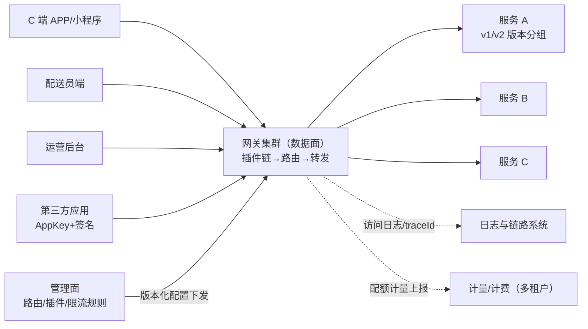

# API 网关：统一流量入口

> 返回：[示例项目场景](00-导览.md) · [软件架构学习大纲](../软件架构学习大纲.md)
> 定位：责任链模式最有说服力的工程案例；讲网关层职责边界（该做什么/不该做什么）、限流位置选择、认证卸载、灰度分流的核心载体。可以是自研，也可以基于开源网关（Nginx/Kong/APISIX/Envoy）二次开发——重点不在选哪个产品，而在“这一层该做什么、绝不该做什么”。主要对应大纲：一-2 责任链、二-2 微服务（网关与服务治理）、三-5 限流熔断（限流位置）、五-2 灰度发布（分流）、五-3 安全架构（认证卸载）；工具对比见[05-第五阶段/08-技术工具档案-网关与服务网格](../05-第五阶段/08-技术工具档案-网关与服务网格.md)。

## 业务画像

后端几十个服务，对外却只有一个入口：C 端 APP/小程序、配送员端、运营后台、开放平台的第三方调用，全部经网关进出。网关负责路由转发、认证鉴权卸载、限流与配额执行、协议转换（外部 HTTP → 内部 gRPC）、灰度分流与统一日志链路。

**网关的位置决定它的三个身份**：

1. **流量总闸**：所有进出流量必经之地——天然的全局限流、审计、切流位置。
2. **策略执行点**：控制平面定义的规则（谁能调、调多快、打到哪个版本）在网关落地执行。
3. **协议翻译官**：外部世界的 HTTP/JSON 与内部世界的 gRPC/内部协议在网关换装。

**用户角色**：C 端/配送员端/后台的最终用户、第三方开发者（开放平台）、后端服务团队（路由与策略的“用户”）、平台/SRE（网关自身运维）。

**教学量级假设**：全站峰值 5 万 QPS 从网关过，网关集群 10 节点（每节点承载 5000~10000 QPS），后端服务 60 个，路由规则 300 条，第三方应用 200 个。

**核心业务流**：

1. 请求到达网关（携带 JWT/AppKey）；
2. 插件链依次处理：访问日志埋点 → 认证（JWT 校验/AppKey 签名）→ 授权 → 限流配额 → 灰度标记；
3. 路由引擎按 Host/Path/Header 匹配目标服务与版本分组；
4. 协议转换与上游转发（负载均衡、重试、超时）；
5. 响应回写（脱敏、压缩）并记录访问日志与链路。

## 模块总览

| 模块 | 一句话职责 | 关键数据 |
|---|---|---|
| 路由引擎 | 请求到目标服务的匹配 | 路由表 |
| 插件链 | 认证/限流/审计等横切能力 | 插件与顺序 |
| 协议适配 | 内外协议与报文转换 | 转换规则 |
| 灰度与流量调度 | 按规则分流到版本 | 分流规则 |
| 管理面 | 配置管理与热更新下发 | 配置版本 |
| 访问日志与链路 | 全量访问留痕与 traceId | 访问日志 |

## 系统上下文与控制面/数据面边界

先画边界图（流量从哪来、请求送哪去、谁在背后改规则），模块内部再细谈：



读图口径（讲二-2 服务边界、三-5 限流、五-2 灰度时逐条回收）：

- **数据面无状态、管理面有状态**：网关节点随时可替换，配置的权威副本只有管理面一份——“谁能调、调多快、打到哪个版本”在管理面定义、在数据面执行，两面的变更频率与可靠性要求完全不同。
- **虚线全是旁路**：日志与计量的失败不影响转发（与订单系统“通知不进主链路”同一纪律）；但计量上游连着多租户计费（[12](12-多租户SaaS控制平面.md)），它丢的是钱——所以计量走可靠上报，不是顺手打一条日志。
- **管理面→网关是图里唯一的反向链路**：它是“生产拓扑的写入路径”，改错等于全站 404——审批、校验、灰度下发、一键回滚都为这条线服务（管理面小节展开）。
- **四类客户端同一入口、不同策略集**：第三方流量挂更严的策略（签名、配额、审计），内部流量挂性能优先的策略——“同一位置、不同策略集”正是插件两级配置（全局默认 + 路由级覆盖）存在的理由。

## 核心模块

### 路由引擎

**职责**：把“这个请求该去哪个服务”从几十个服务里查出来。

**关键实体与数据**：路由表 `routes`：`match`（Host、Path 前缀/正则、Header、Method 的组合条件）、`upstream`（目标服务/服务发现集群）、`priority`（匹配优先级）、`plugins`（该路由启用的插件与参数）。

**典型流程**：请求到达→按优先级匹配路由（Host 精确 → Path 最长前缀 → 通配）→命中则加载该路由的插件配置→未命中返回 404 或走默认路由。

**设计要点与典型陷阱**：

- 匹配性能：300 条规则不能线性扫——按 Host 分桶 + 前缀树（Radix Tree）把匹配降到微秒级；路由表编译为内存结构，配置变更时原子替换整个路由表（不是逐条改）。
- **反例（路由表热改不加版本）**：改路由逐条生效，一半节点新表一半旧表，请求随机打到两个方向。**修正**：配置整体版本化、节点间快速收敛（对齐“管理面”小节）。
- 路由变更的发布纪律：路由是“生产拓扑”，改错等于全站 404——变更走审批 + 灰度（先改一个 Canary 节点观察）。

### 插件链（网关的骨架）

**职责**：每个请求按序穿过一串可插拔过滤器，任一环可拦截放行；新增能力以插件接入，内核零改动。

**关键实体与数据**：插件（`plugin_id`、`phase`（认证前/路由前/转发前/响应后）、`order`、`config`）；全局插件与路由级插件两级生效。

**典型流程**：认证 → 限流 → 审计 → 路由 → 转发；任一环拒绝即短路返回（401/429/403）。

插件链骨架（责任链的工程形态）：

```kotlin
interface GatewayPlugin {
    val order: Int
    fun handle(ctx: RequestContext): PluginResult // CONTINUE 或 REJECT(status, body)
}

class PluginChain(private val plugins: List<GatewayPlugin>) {
    init { require(plugins.map { it.order } == plugins.map { it.order }.sorted()) { "插件必须按 order 有序装配" } }

    fun execute(ctx: RequestContext): PluginResult {
        for (p in plugins.sortedBy { it.order }) {          // 认证 → 限流 → 审计 → ……逐环推进
            when (val r = p.handle(ctx)) {
                is PluginResult.Reject -> return r          // 任一环拦截即短路，后续插件不再执行
                PluginResult.Continue -> Unit
            }
        }
        return PluginResult.Continue                        // 全部放行，进入路由与转发
    }
}
```

**设计要点与典型陷阱**：

- 责任链/管道模式的工程级样本：每环单一职责、顺序显式（认证必须在限流前？还是先粗限再认证省认证开销——顺序本身是架构决策，可作课堂辩论）。
- **业务逻辑渗入防腐**：聚合、编排一变复杂就下沉 BFF，网关只做策略不做业务——“上帝层网关”是微服务最常见的腐化形态（02-第二阶段/03 的反例）。判断题：“在网关里给 VIP 用户加个积分翻倍”，答案永远是“不”。
- 插件的故障隔离：单个插件（如审计写 Kafka）卡住不能拖慢整条链——插件超时与异步化（审计转后台队列）。

### 协议适配

**职责**：外部 HTTP/JSON ↔ 内部 gRPC/内部协议的翻译。

**关键实体与数据**：转换规则（外部字段 → 内部字段映射、Header 透传白名单、编码转换）。

**典型流程**：HTTP 请求 → 协议适配器转 gRPC（JSON→Protobuf 映射）→ 上游 gRPC 服务 → 响应回转 JSON。

**设计要点与典型陷阱**：**报文转换的“一个半”问题**——协议好换（HTTP↔gRPC），语义难译（内外字段口径、错误码体系）；错误码翻译表要集中维护，否则每个插件各翻译一遍口径分裂；Header 透传默认拒绝、白名单放行（防止外部伪造内部头——`X-Internal-User` 被外网请求直接带上就是越权漏洞）。

### 灰度与流量调度

**职责**：按规则把流量分到不同版本（金丝雀发布、多活切流）。

**关键实体与数据**：分流规则（按比例 5%/95%、按 Header/Cookie/用户 ID 尾号、按地域）；版本分组（upstream 的 v1/v2 分组）。

**典型流程**：新版本 v2 上线 → 规则设“内部员工 Header 标记 100% 到 v2” → 扩大到 “1% 用户” → 观察指标 → 逐步放大 → 全量。

**设计要点与典型陷阱**：**粘性**——同一用户始终命中同一版本（按用户 ID 哈希而非纯随机），否则会话/缓存抖动；切流要有“一键回切”（规则版本化，回滚=切回上一版规则）；灰度观测配套（按版本分维度的错误率/延迟指标，不然灰了个寂寞）——五-2 灰度发布的执行面在网关。

### 管理面（配置下发与热更新）

**职责**：路由/插件/限流规则的配置管理、版本化、秒级下发且不断流。

**关键实体与数据**：配置版本（全量配置快照 + 增量变更）、下发状态（每节点的配置版本号）、灰度下发批次。

**典型流程**：管理面保存配置→生成版本→先下发 Canary 节点→健康检查通过→全量下发→节点热加载（原子替换路由表/插件链，长连接不断）。

**设计要点与典型陷阱**：

- **改配置不重启**：改路由规则、调限流阈值不能靠重启（重启=全站抖动）——配置热更新 + 版本化是管理面的生命线；与低代码“配置发布治理”、多租户“策略下发”是同一类问题：**配置即代码，要有与代码同级的发布纪律**（diff、审批、灰度、回滚）。
- 配置校验前置：下发前做语义校验（路由冲突、插件依赖、引用的上游存在），坏配置在管理面被拦住而不是在线上炸开。
- 配置回滚的速度就是故障恢复的速度（MTTR 的组成部分）——一键回退上一版本。

### 访问日志与链路埋点

**职责**：全量访问留痕（谁、何时、调了什么、结果、耗时）与 traceId 生成/透传。

**关键实体与数据**：访问日志（`trace_id`、`client_ip`、`route`、`status`、`latency`、`upstream`）；traceId 生成（入口无则生成，有则透传）。

**典型流程**：入口生成 traceId→请求全链路透传→访问日志异步批量写（Kafka→日志系统）→按 trace_id 串起跨服务调用链。

**设计要点与典型陷阱**：日志异步化（同步写日志直接拖慢转发）；敏感信息脱敏（URL 里的 token、手机号——网关是统一脱敏的最佳位置，也是最大泄露面）；全量日志的存储成本（采样策略：错误全量、成功抽样）——五-1 可观测性的入口素材。

## 架构挑战与知识点映射

| 挑战 | 方案要点 | 对应大纲小节 |
|---|---|---|
| 横切能力可插拔 | 插件链/责任链、开闭原则 | 一-2 责任链 |
| 配置秒级热更且不断流 | 版本化下发、原子替换 | 五-2 灰度发布 |
| 网关自身高可用低延迟 | 无状态水平扩展、性能预算 | 三-5 高可用 |
| 限流放哪层 | 网关粗限 + 服务细限分层 | 三-5 限流熔断 |
| 认证卸载边界 | 网关第一道闸而非唯一一道 | 五-3 默认拒绝 |
| 开放平台治理 | AppKey/签名、配额计量、API 版本 | 三-5、五-3 |
| 业务渗入防腐 | 策略不下沉业务，编排归 BFF | 二-2 微服务反例 |

给网关层定**性能预算**是讲容量规划的好例子：新增一个插件平均增加 5ms 延迟 × 全站 5 万 QPS，就是全站用户体验与成本的真实代价——“每一毫秒都要付钱”。

## 核心用例事件时序逐步表

把“一个请求穿过网关”与“一次配置热更新下发到全部节点”展开成逐步表——前者是数据面主干，后者是管理面主干，两条链路的失败行为分开记。

**一个请求穿过网关（数据面主干）**：

| 步 | 动作 | 数据变更/开销 | 失败与并发时的行为 |
|---|---|---|---|
| ① | TLS 终结、连接复用 | 连接建立 | 握手失败→连接拒绝（不进插件链，不计路由） |
| ② | 访问日志埋点：traceId 生成（入口无则生成、有则透传） | 请求上下文 | 无失败面（内存操作） |
| ③ | 认证：JWT 本地验签 / AppKey 签名核对 | 凭证缓存查询 | 验签失败 401；凭证缓存未命中→回源并限速（防打垮鉴权源） |
| ④ | 授权：scope 与路由权限核对 | 无 | 越权 403，留审计记录 |
| ⑤ | 限流与配额：令牌桶扣减（按路由/应用维度） | 计数器增减 | 超限 429；计数依赖抖动→降级本地兜底配额（策略显式选定，见失败模式表） |
| ⑥ | 灰度标记：按分流规则决定上游版本分组 | 分流规则查询 | 规则未命中→默认组（全量版） |
| ⑦ | 路由匹配：Host 精确→前缀树→正则兜底 | 路由表内存查询 | 未命中 404 或走默认路由（语义要写清，两种都合法但不能两可） |
| ⑧ | 协议转换：HTTP/JSON → gRPC | 报文转换 | 字段映射失败→4xx；错误码按集中翻译表回转 |
| ⑨ | 上游转发：负载均衡、超时预算、重试 | 在途请求 | 重试只对幂等请求（或带幂等键）；上游全挂→熔断/静态降级响应 |
| ⑩ | 响应回写：脱敏、压缩 | 无 | 上游超时→504，访问日志标超时供追溯 |
| ⑪ | 异步批量写访问日志 | 日志缓冲 | 日志后端抖动→本地缓冲采样丢弃，绝不阻塞转发 |

两个回收点：②与⑪的“轻的在链路上、重的去后台上”是网关性能预算的前提——任何同步动作都直接乘以全站 QPS；⑤的“计数依赖抖动怎么办”是限流算法之外的第二个必答题，答案（放行还是拒绝）是业务决策不是技术决策，必须显式配置、显式演练。

**一次配置热更新（管理面主干）**：

| 步 | 动作 | 数据变更 | 失败与并发时的行为 |
|---|---|---|---|
| ① | 变更入库（草稿态） | 配置草稿 | 并发编辑→乐观锁，后到者基于新版本重做 |
| ② | 语义校验：路由冲突、插件依赖、上游存在性 | 无 | 校验不过→拦截在管理面，绝不线上炸 |
| ③ | 审批通过，生成版本快照 | 配置版本 + checksum | 快照不可变；回滚指针指向上一版本 |
| ④ | 下发 Canary 节点 | 节点配置版本号更新 | 健康检查不过→停止下发并告警 |
| ⑤ | 观察窗口：Canary 指标与全量对齐 | 无 | 指标异常→一键回退上一版本 |
| ⑥ | 分批全量下发 | 各节点版本号推进 | 节点超时未确认→重试；新旧版本并存期有界 |
| ⑦ | 节点热加载：原子替换路由表/插件链 | 内存结构整体替换 | 长连接不断；加载失败→节点摘除流量、带旧版本退出 |
| ⑧ | 全网收敛确认 | 下发状态核对 | 超时未收敛节点→告警 + 按 checksum 比对 |

③的“快照不可变 + 回滚指针”就是“配置回滚速度 = MTTR 的组成部分”的机械实现：回滚不是反着改一遍，是把不可变的旧快照原样再下发一次。

两条主干链路的价值观对照：数据面追求“每步都便宜”（微秒级预算、能异步的绝不同步），管理面追求“每步都可回退”（快照、观察期、一键回退）——同一种逐步表、两种截然不同的验收标准，这正是网关区别于普通服务的地方。

## 限流位置与阈值推演

三-5 讲限流时，“放在哪一层”与“阈值是多少”是两道分开的题。用教学量级假设（全站峰值 5 万 QPS、网关 10 节点、后端 60 个服务）推演（演算口径，非实测）：

| 层 | 保护对象 | 阈值依据（假设口径） | 挡不住什么 |
|---|---|---|---|
| 边缘（CDN/WAF） | 公网恶意流量 | 黑产画像与边缘容量 | 合法用户的洪峰 |
| 网关粗限 | 网关自身与全局容量 | 集群容量 × 安全系数：假设单节点 1 万 QPS → 全局粗限设 7~8 万（洪峰留余量） | 单个服务的内部雪崩 |
| 路由级配额 | 单个上游服务 | 按该服务压测容量倒推：如服务 C 只能接 8000 QPS | 服务内部依赖的雪崩 |
| 服务内细限 | 服务的某个依赖 | 按“该依赖挂掉时服务还能活着”的预算 | 已进到服务内部的过载 |

推演结论三条（定性）：

- **网关粗限与路由级配额不可互相替代**：网关只看全局总量，60 个服务共享 5 万 QPS 时，一个变慢的服务会占住带宽把别的服务挤死（服务间挤兑）——这只能在路由级/服务级配额解决，正是“限流位置选择”的标准论证；
- **阈值从下游倒推，不从上游拍脑袋**：路由级阈值 = 该上游的压测容量；全局阈值 = 各上游容量之和 × 折算系数。把阈值设成“下游给不了的量”，限流就从保护变成了灾难放大器；
- **分布式限流的精度与成本**：10 个节点各自独立令牌桶，总放行 ≈ 10 × 单机阈值，不精确但零依赖；集中式计数精确但引入依赖与毫秒级往返。折中做法是**配额分段预分配**（全局配额切成节点本地配额，节点间不实时同步）——与秒杀库存分段、发号器分段预取是同一族思想（[05](05-秒杀限时抢购.md)）。

阈值从下游倒推的完整演算（假设口径，与教学量级假设一致）：

```text
路由级配额 = 该上游压测容量（如服务 C = 8000 QPS，超出部分在网关快速失败）
全局粗限   = min( 网关集群容量 10 × 1 万 , 各上游容量之和 × 折算系数 ) ≈ 7~8 万
边缘层     = 黑产画像过滤，不设业务阈值
分层检查   ：边缘挡恶意 → 粗限保全局容量 → 路由配额保单服务 → 服务内细限保依赖
反例自检   ：任何一层的阈值若大于下游能给的能力，该层就从保护变成了传令灾祸
```

## 关键数据表设计与取舍

网关的“数据”是配置与流水的混合体，决策清单（与订单场景同款口径）：

| 设计点 | 选项 A | 选项 B | 本场景结论与理由 |
|---|---|---|---|
| 路由规则存放 | 散在节点的本地配置文件 | 管理面集中 + 版本化快照 | 集中：整体版本替换才有“全网一致”与“一键回滚”（逐条改的反例见路由引擎小节） |
| 匹配语义 | 纯正则 | 精确 + 前缀树 + 正则兜底 | 组合：正则表达力强但性能与可读性差，只做兜底 |
| 插件配置粒度 | 每路由全量声明 | 全局默认 + 路由级覆盖 | 两级：同一策略（如审计）不必每路由重复，路由级只写差异 |
| 凭证存储 | Secret/AppKey 明文 | 摘要或 KMS 托管 | 摘要：与 IoT 设备凭证同口径，网关只存校验材料 |
| 访问日志字段 | 全字段全量 | 最小集 + 扩展头按需 | 最小集：全量字段 × 5 万 QPS 的存储成本先算再定（见容量推演） |
| 配额计量 | 纯离线账单 | 实时预扣 + 日终对账 | 预扣+对账：实时预扣止超额于当下，日终批对账修误差（流管快、批管准） |
| 分流规则 | 存百分比随机 | 按 user_id 哈希分桶 | 哈希分桶：粘性（同一用户同一版本）+ 可复现（复盘能重放） |

配置版本快照与下发状态的结构示意（管理面小节的落地形态）：

```text
config_version_20240501_003          ← 不可变全量快照（路由+插件+限流规则）
  ├── checksum: sha256(全量内容)      ← 节点间一致性的比对依据
  ├── canary: node-01                ← 先行节点，指标达标才继续
  ├── rollout: node-02..node-10      ← 分批下发，批间设观察期
  └── rollback_ptr: ..._20240430_002 ← 一键回退目标（旧快照仍完整）
```

## 容量与失败模式推演

以下推演基于教学量级假设（全站峰值 5 万 QPS、网关 10 节点、插件链 11 步），是教学口径的演算，不是实测数据：

- **在途请求与内存（推演）**：5 万 QPS × 平均单请求驻留 20ms（Little's Law 口径）→ 在途 ≈ 1000 个请求；连接数与内存预算按“在途 + keep-alive 连接池”合计，keep-alive 池通常比在途请求大一个量级，是网关内存的主要占用；
- **插件链延迟预算（推演）**：11 步插件链假设每步均摊 1~2ms → 链上开销 10~20ms，占全站延迟预算相当份额——**新增一个同步插件 = 全站 5 万 QPS × 新增毫秒数**，性能预算表要跟着插件清单滚动更新（模块小节“每一毫秒都要付钱”的定量版）；
- **访问日志量（推演）**：5 万 QPS × 假设 1KB/条 ≈ 50MB/s ≈ 日均 4TB 量级——这就是“错误全量、成功抽样”采样策略的定量出处，也是日志系统成本与网关设计联动的例证。

把网关自身的延迟预算逐环拆开（假设口径，讲性能预算时的配套表）：

| 环节 | 预算（假设口径） | 说明 |
|---|---|---|
| TLS/连接处理 | 1~2ms | 会话复用后摊薄到接近零 |
| 插件链（日志埋点→认证→授权→限流→灰度） | 10~20ms | 11 步均摊；新增插件必须从别处省回来 |
| 路由匹配 + 协议转换 | 1~3ms | 报文越大越贵 |
| 上游等待 | 下游延迟 + 超时预算 | 网关可控的只有“排队、重试、熔断” |
| 访问日志 | 0ms（异步化） | 同步化的瞬间，预算从 0 变成全链路卡顿 |

失败模式清单（网关自身也是分布式系统，它的故障模式要单独列）：

| 失败模式 | 触发场景 | 后果 | 预设对策 |
|---|---|---|---|
| 坏配置全量下发 | 校验漏网的坏路由 | 全站 404/错转发 | 语义校验前置 + Canary 批次 + 一键回退快照 |
| 凭证/鉴权源抖动 | 回源鉴权服务变慢 | 全站 401 或延迟飙升 | 凭证摘要本地缓存 + 回源限速 + 降级策略显式化 |
| 限流计数依赖故障 | 集中式计数不可用 | 要么全放（雪崩）要么全拒（拒真用户） | 本地兜底配额 + fail-open/close 按业务分级 |
| 插件卡死 | 审计同步写后端慢 | 全链路延迟 | 插件超时 + 异步化（后台队列） |
| 上游雪崩 | 某服务全挂 | 请求堆积拖垮网关线程 | 每路由熔断 + 静态降级响应 + 隔离舱 |
| 连接打满 | 慢上游占住连接 | 新连接被拒 | 连接空闲超时 + 连接数告警 + 上游超时预算 |
| 日志反压 | 日志后端抖动 | 转发线程被拖慢 | 异步 + 缓冲上限 + 采样丢弃 |
| 灰度规则失效 | 分流规则配置错 | 版本间跳变、会话抖动 | user_id 哈希粘性 + 规则版本化回切 |
| 证书过期 | TLS 证书轮换遗漏 | 全站握手失败 | 证书到期监控 + 轮换演练 |

## 演进路线：从静态反代到插件化网关

| 阶段 | 改造动作 | 迁移方式 | 回滚方式 |
|---|---|---|---|
| 1. 静态反代 | Nginx 配置文件路由 | 起步形态（服务少、变更低频） | — |
| 2. 动态路由 | 配置中心 + 热更新 | 域名逐个迁入（先内部后外部） | 单域名回切静态配置 |
| 3. 插件化 | 认证/限流/审计以插件接入 | 逐插件灰度启用（先上只读的审计类） | 插件下线即恢复直通行为 |
| 4. 开放平台 | AppKey/签名/配额/计量 | 第三方逐个接入，策略集独立 | 单第三方下线，不影响内部流量 |
| 5. 协议转换 | 外部 HTTP → 内部 gRPC | 按服务逐个开启（转换前后响应体对比验证） | 路由切回 HTTP 上游 |
| 6. 与服务网格衔接 | 东西向流量交给网格，南北向留在网关 | 明确边界：网关管入口，网格管服务间 | 网格侧流量回退网关直连 |

每步的纪律：**入口流量切换必须可按域名/路由粒度回退**——网关是全站入口，任何一步迁移的回滚不能依赖“全量回滚”，要能只回滚出问题的那一条路由。

## 面试官追问点

- “认证和限流谁先执行？”——先限流省认证开销（无效流量不配验签），先认证让限流可按用户/租户维度计数——两种顺序都对，错的是没意识到这是一个要显式决策的顺序问题（插件链小节的课堂辩论）。
- “网关限流了为什么服务还是雪崩了？”——网关只懂全局不懂服务内部：单服务被自己的慢依赖拖垮，全局粗限挡不住服务间挤兑，必须有路由级/服务级配额。
- “网关挂了怎么办？”——无状态水平扩展（节点随时可替换）+ 配置回滚速度（MTTR 主项）+ 客户端多入口兜底；网关单点的解法不是“造一个不挂的网关”，是“挂了能在一分钟内恢复”。
- “为什么网关不做业务编排？”——编排一复杂就要懂业务，改业务就要发网关（全站级风险）——策略与业务的变更频率完全不同，“上帝层网关”的腐化从第一段业务 if 开始。
- “traceId 为什么在网关生成？”——入口是全链路唯一公共点，在这里补齐才能保证跨服务日志可串；晚一步生成，日志就永远缺一段。
- “配置热更新为什么不逐条生效？”——逐条生效 = 一半节点新规则一半旧规则，请求随机分叉；整体版本快照才有“要么全生效、要么全不生效”的原子性。
- “网关加了 5ms 延迟，什么量级下变成必须优化？”——算两笔账：用户体验账（全站 P99 上浮）与成本账（延迟 × QPS 折算的容量损失）——两笔都算完才知道这笔钱该不该花。

## 如果规模再大十倍

假设全站峰值 50 万 QPS、网关节点 100+、路由规则 3000 条、第三方应用 2000 个：

- **网关分域**：单集群 100+ 节点的配置收敛时间与故障爆炸半径都不可接受——按业务域拆网关集群（交易域/内容域/开放平台各自独立），故障域与配置域同步切小；代价是全局策略（如全站限流）要在域间协调。
- **两级网关**：边缘层（TLS 终结、粗限、静态就近）+ 核心层（认证、路由、精细策略）——边缘层用便宜的大吞吐组件，核心层承载复杂插件链；分层后要重新分配延迟预算，每一层都要付钱。
- **配置下发增量化的临界点**：3000 条路由的全量快照在 100+ 节点上的下发与加载时间变长——增量下发 + 节点版本核对（checksum）成为必选项，但“增量出错”的兜底仍是全量快照重推。
- **限流的配额分片**：全站配额切到机房/集群再切到节点（两级分段），全局精确性让位于“每层都留余量”——分段预分配思想的规模化形态。
- **日志与观测的采样升级**：50 万 QPS 的全量访问日志不可承受——错误全量、成功抽样、头部路由细采样；traceId 与采样联动（尾部采样保完整链路）。
- **网关自身的容量画像**：异步 IO 模型下瓶颈从线程转向 CPU（TLS/压缩/转换）与带宽——扩容评估要区分“转发型流量”与“转换型流量”两种画像的成本差。

## 与其他场景的联动

- **与多租户 SaaS 控制平面（[12](12-多租户SaaS控制平面.md)）成对出现**：控制面定义策略（套餐、配额、租户身份），网关在数据面第一线执行（认证、限流、计量上报）——两者合起来才是完整的“控制面/数据面”结构。
- 秒杀（[05](05-秒杀限时抢购.md)）：第一层限流（网关粗限保全局容量）的执行点。
- 订单系统（[01](01-订单系统.md)）：对外 API 的统一入口；开放平台 AppKey 治理的取材对象。
- 工具对比（Nginx/Kong/APISIX/Envoy、Istio 服务网格）见[05-第五阶段/08-技术工具档案-网关与服务网格](../05-第五阶段/08-技术工具档案-网关与服务网格.md)。

## 取材指引

- 一-2 责任链：插件链是第一阶段“网关鉴权→限流→日志→路由”伏笔的完整工程化回收。
- 二-2 微服务：网关/BFF/服务治理的职责边界；“上帝层网关”反例。
- 三-5 限流：限流位置的分层选择（网关粗限 vs 服务内细限）与算法落点。
- 五-2 灰度发布：分流规则的执行细节（粘性、回切、按版本观测）；五-3 安全：认证卸载与纵深防御。
- 可出思考题方向：认证和限流谁先执行、各自的理由；为什么配置热更新必须整体版本化而不是逐条生效；哪些功能绝不该进网关，判断标准是什么；网关多花的 5ms 在什么量级下变成必须优化的瓶颈。
