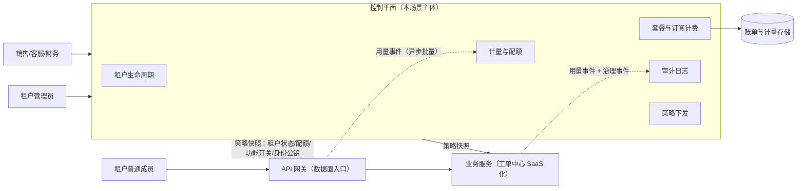

# 多租户 SaaS 控制平面：管生意运营的系统

> 返回：[示例项目场景](00-导览.md) · [软件架构学习大纲](../软件架构学习大纲.md)
> 定位：同一套产品订阅制卖给多家企业客户的“运营面”——租户、套餐、计费、配额、审计；与[11-API 网关](11-API网关.md)成对出现：控制面定义策略，数据面（网关与业务服务）执行。工单中心 SaaS 化后同时服务几十家企业就是现成画像。主要对应大纲：一-3 质量属性（隔离/安全）、三-3 数据架构（租户路由）、三-4 分布式事务（计费）、三-5 限流（配额执行）、五-3 安全架构（租户隔离与审计）。

## 业务画像

同一套产品以订阅制卖给多家企业客户，每家是一个租户——工单中心 SaaS 化后同时服务几十家企业就是现成画像。控制平面**不承载租户的业务流量**，管的是“这门生意的运营本身”：租户开通/冻结/销户、套餐订阅与计费、用量计量与配额管控、租户级配置与功能开关、管理员操作审计。业务流量由数据平面（各业务服务、API 网关）承载，控制平面为数据平面提供身份、策略与账单。

**控制面/数据面分离的心智模型**：

- 控制面：低频、管理动作、强一致（改套餐、冻结租户）——它宕机，生意不能正常卖新单，但已有客户的业务照跑。
- 数据面：高频、业务流量、可用性优先——它实时依赖的只是控制面**下发的策略快照**，不是控制面本身。
- 这与 Kubernetes 的 apiserver（控制面）与节点 kubelet（数据面）是同一个结构——讲基础设施时的通用模型。

**用户角色**：租户管理员（企业管理员配置组织与权限）、租户普通成员（业务使用者）、SaaS 平台运营（开通/冻结/套餐）、SaaS 财务（账单）、销售/客服（协助升级、答疑）。

**教学量级假设**：租户 50 家，租户规模 10~2000 席位不等，套餐三档（基础/专业/旗舰），计费维度=席位月费+用量超额，日计量事件 2000 万条，配额判断延迟预算 <5ms（在网关热路径上）。

**核心业务流**：

1. 开通：销售签单→创建租户→选择套餐→初始化数据与策略→下发网关/服务；
2. 使用：租户用户经网关认证→配额实时判断→业务服务处理→用量计量上报；
3. 计费：月初出账（席位费+超额用量）→客户支付→额度重置；
4. 变更：升级/降级套餐→差价计算→策略切换下发；
5. 治理：冻结违规租户→审计查询→（极端）销户与数据清理。

## 模块总览

| 模块 | 一句话职责 | 关键数据 |
|---|---|---|
| 租户生命周期 | 开通/冻结/销户与状态管理 | 租户 |
| 套餐与订阅计费 | 套餐定义、订阅与出账 | 套餐、订阅、账单 |
| 计量与配额 | 用量采集、实时配额、超额 | 用量事件、配额 |
| 租户配置与功能开关 | 租户级差异化配置 | 配置/开关 |
| 组织与权限 | 租户内组织与 RBAC | 组织、角色 |
| 审计日志 | 管理操作可回溯 | 审计事件 |
| 策略下发 | 控制面→数据面的快照分发 | 策略版本 |

模块间依赖：租户生命周期是根（一切订阅、配额、配置都以活跃租户为前提），套餐与订阅计费消费计量结果并向策略下发提供配额定义，审计是横切所有管理动作的旁路——没有一条业务主链路会串行穿过全部模块，控制面各模块之间的低耦合正是“低频管理面”该有的样子。真正的高频耦合都发生在它与数据面的两条异步通道上（下发、上报）。

## 系统上下文与服务边界

先画边界图（谁驱动控制面、控制面驱动谁、两条通道在哪里握手），模块内部再细谈：



读图口径（把后面的模块收拢成三条边界判断）：

- **控制面与数据面之间只有两条异步通道**：下行“策略快照下发”（推或拉皆可）、上行“用量事件上报”。任何“业务请求实时穿透到控制面”的设计——比如网关每次限流都调控制面查配额——都是把低频管理面拖进高频业务路径，架构上直接判负：控制面的任何抖动会立刻放大成全租户故障。
- **审计是横切面，不是某个模块的附属功能**：租户管理员改配置要审计，SaaS 自己的运营动租户更要审计——它在图中单独占一个方框，因为它是唯一既吃控制面管理动作、又吃数据面治理事件的消费者。
- **账单存储画成圆柱而不是服务**：出账是低频批动作，账单的“可解释性”完全由计量明细支撑，数据流向是 usage_events → 日终聚合 → 月度账单，方向永远从明细到账单——绝不允许反过来从账单里“反推”用量，那是不可回溯的开始。

## 核心模块

### 租户生命周期管理

**职责**：租户从开通到销户的状态管理。

**关键实体与数据**：`tenants`：`tenant_id`、`name`、`status`（开通中/活跃/欠费冻结/违规冻结/销户流程中/已销户）、`created_at`、`plan_id`、`data_mode`（隔离模式：共享库/独立 Schema/独立库）。

**典型流程**：创建租户→初始化（建组织根、管理员、默认配置、数据结构）→开通完成进入活跃；欠费/违规→冻结（网关策略生效：全租户请求被拦）→补款/整改解冻；销户→数据保留期（如 30 天可恢复）→到期物理清除并出具删除证明。

把开通流程展开成**事件时序逐步表**——开通是控制面里唯一“要凭空建出一堆东西”的流程，每一步的失败处理决定它能不能重入：

| 步 | 动作 | 数据变更 | 失败与并发时的行为 |
|---|---|---|---|
| ① | 创建租户记录（status=开通中） | insert `tenants` | 重名/重复提交按销售侧外部单号幂等拦截 |
| ② | 按 `data_mode` 初始化数据结构 | DDL（建库/Schema/表） | 半途失败→停在开通中可重入，DDL 全写成幂等形式（if not exists） |
| ③ | 建组织根、管理员、默认角色 | insert 组织/用户/角色 | 邀请通知失败不阻塞开通，重发即可 |
| ④ | 绑定套餐订阅 | insert `subscriptions` | (tenant_id, plan_id, period) 唯一约束兜底并发重复 |
| ⑤ | 生成初始策略快照 | insert `policy_snapshots` | 生成失败→数据面对未收敛租户按兜底策略处理（默认拒绝/默认免费档） |
| ⑥ | 快照下发网关与业务服务 | 快照版本递增 | 节点分批收敛；收敛前该租户请求按旧快照或兜底策略处理 |
| ⑦ | status→活跃，通知销售 | update + 事件 | 通知是事件下游，失败重试不影响开通完成 |

这张表的讲法：单体阶段①~④可以包进一个本地事务，⑤⑥天然在事务外；一旦大客户走独立库模式，②变成跨库动作，本地事务保不住，只能靠“开通中状态 + 每步幂等重入”把事务问题降级为补偿问题——三-4 里“没有分布式事务银弹时，先选可重入”的活案例。②也是整个流程里唯一的“重活”（DDL），所以真正的平台会把它做成异步步骤：先落租户记录，初始化在后台跑完再回写状态——销售签单到可用之间的分钟级等待，就是这一步。

**设计要点与典型陷阱**：

- **隔离三选一是全书最经典权衡之一**：

  | 方案 | 隔离性 | 成本 | 运维 |
  |---|---|---|---|
  | 共享表 + `tenant_id` | 弱（漏过滤即泄漏） | 最低 | 简单 |
  | 独立 Schema | 中 | 中 | 中（迁移要按租户遍历） |
  | 独立数据库 | 强 | 最高 | 重（每租户一套） |

  主流从共享表起步，大客户单独独立库（混合模式）。**共享表最大的事故源是“串租户”**：任何一条查询忘了带租户条件，A 公司看到了 B 公司的工单。**修正**：数据访问层强制注入租户过滤（ORM 拦截器/中间件自动拼 `tenant_id = ?`），不靠程序员自觉——一-3 讲安全性的活教材。
- 销户的尾巴比开通长：数据保留多久、个人信息怎么删干净（合规要求“可证明的删除”）、备份里的残留怎么办（备份到期自然滚动覆盖即可满足大多数合规，但要写进制度）——生命周期终点设计常被遗漏。
- 租户状态变更（冻结）通过策略下发生效，不能让业务服务实时查控制面（见“策略下发”）。

### 套餐与订阅计费

**职责**：套餐定义（功能与额度）、订阅关系与账单生成。

**关键实体与数据**：`plans`：`plan_id`、`price_monthly`、`features`（功能开关集）、`quotas`（各资源配额：席位 50、工单 1 万/月、存储 10GB）；`subscriptions`：`tenant_id`、`plan_id`、`period_start/end`、`status`；`bills`：`tenant_id`、`period`、`items[]`（席位费、超额用量项）、`total`、`status`。

**典型流程**：订阅/变更套餐→生效判定（升级立即生效按天折算差价，降级下期生效——产品规则但影响实现）→月初出账（席位费 + 上月超额用量）→支付→额度重置。

月初出账同样值得一张**事件时序逐步表**——出账是“重跑无害”设计的试金石，每一步都按可重算来写：

| 步 | 动作 | 数据变更 | 失败与重复时的行为 |
|---|---|---|---|
| ① | 账期锁定：圈定计费周期与活跃租户集合 | 写账期任务记录 | 重跑按“同账期同租户只允许一张有效账单”幂等 |
| ② | 席位费：订阅期内席位 × 天数折算 | 内存计算 | 以订阅变更流水为准，参数修正可整体重算 |
| ③ | 用量明细聚合：日终去重结果的月度汇总 | 读聚合 `usage_events` | 按 `event_id` 去重后聚合，重跑结果一致 |
| ④ | 超额项：超配额部分 × 单价 | 内存计算 | 配额口径取“账期内生效的策略版本序列”，不是当前值 |
| ⑤ | 落账单与明细项 | insert `bills`/`bill_items` | (tenant_id, period) 唯一约束防重复出账 |
| ⑥ | 出账事件 → 通知/进入支付流程 | 事件下游 | 通知失败不影响账单有效性，重发即可 |

④是容易被忽略的坑：账期中途降级套餐，超额部分按哪个配额算？答案只能是“按天分段的配额序列”——这反过来要求配额变更本身留版本流水，否则账单解释不清（客服对不上数的最常见根因）。把这条与审计的 before/after 快照对照：**控制面里凡是会影响钱的、会影响行为的变更，都必须带版本**——前者给账单解释用，后者给行为回滚用。

**设计要点与典型陷阱**：

- **升降级的一致性**：变更套餐 = 改订阅 + 改策略 + 算差价，跨控制面多模块与账务——做不到强一致，走本地消息表/事件驱动最终一致（三-4）；**账单必须可解释**：每个数字能回溯到用量明细（席位×天数、超额单价×量），客服才有得答——与支付场景“分录可回溯”同构。
- 按天折算的精度（比例分，整数运算）——金额计算的老朋友。
- 试用转正式、续费失败的宽限期策略（宽限期内只读？停用？）都是状态机 + 配置。

### 计量与配额（本场景的灵魂模块）

**职责**：用量采集与实时配额判断——“实时防超用、离线算准钱”两条链路。

**关键实体与数据**：用量事件 `usage_events`（`tenant_id`、`resource`（工单数/存储量/API 调用）、`quantity`、`occurred_at`、`event_id`（幂等键））；实时配额 `quota_counters`（Redis：`tenant:resource:period` 计数器）；配额策略快照（下发给网关/服务本地的套餐额度）。

**典型流程**：

- 实时链路：请求经网关→查本地配额快照 + Redis 计数（INCR 后与额度比较，超限即 429）→放行的同时记录用量事件（异步批量）；
- 准确链路：用量事件流→日终按 `event_id` 去重聚合→月度账单按明细重算。

双链路配额骨架：

```kotlin
class QuotaGate(
    private val counter: (String) -> Long,                    // Redis INCR 后的当前值
    private val snapshotQuota: (String) -> Long               // 本地策略快照里的套餐额度
) {
    // 实时链路：快（毫秒级），容忍少量误差——Redis 计数丢一点不致命，账单以明细为准
    fun checkAndReserve(tenantId: String, resource: String): QuotaResult {
        val key = "$tenantId:$resource:2026-11"               // 计费周期的计数器
        val used = counter(key)
        val quota = snapshotQuota("$tenantId:$resource")
        return if (used < quota) QuotaResult.ALLOW            // 未超额：放行，用量事件异步上报
        else QuotaResult.REJECT_429                           // 超额：网关直接挡回，不打业务服务
    }
}
```

**设计要点与典型陷阱**：

- **为什么必须拆成两条链路**：实时判断要快（在网关热路径，5ms 预算内），账单要准（差一分钱就是客诉）——目标不同就不能共用一套逻辑；实时链路容忍误差（Redis 重启计数少一截），账单链路按明细重算兜底校正，周期性对账（Redis 计数 vs 明细聚合）发现漂移。这与支付场景“实时记账+日终对账”是同一个模式的两次出现。
- **用量上报天然不可靠**：业务侧重复、迟到、乱序（服务重启重发、跨天补报）——`event_id` 幂等去重、按 `occurred_at` 归入正确账期、迟到数据并入下期账单并注明——与物联网上报治理同款手法（可互引）。
- 配额判断的执行点在网关/服务本地快照（不实时调控制面），额度变更靠下发刷新——与“控制面宕机业务照跑”呼应。
- 超额策略是产品决策：硬限（429）、软限（放行但计超额费）、降级（限制新功能只读）三档，配额执行机制要能支撑全部三档。
- **配额判断的并发细节推演**：为什么 INCR 后比较、而不是先 GET 再 SET？假设额度 1000、当前计数 999，两个并发请求同时到达：GET-then-SET 口径下两者都读到 999、都判定未超额、各自写回 1000——超额 1 次；INCR 是原子递增，第一个请求得到 1000、第二个得到 1001 直接拒绝。另外“used < quota 放行”还是“used <= quota 放行”取决于配额语义是“最多 N 条”还是“最多 N-1 条”，实现时必须显式选择并写进测试——一读一算一写之间被并发插队，正是第 3 册丢失更新异常在配额热路径的再现，异常动物园在任何“读—算—写”结构里都会重演。

### 租户配置与功能开关

**职责**：租户级差异化——同款产品不同租户看到的 功能集/参数 不同。

**关键实体与数据**：`tenant_configs`（`tenant_id`、`key`、`value`、`version`）；`feature_flags`（`feature`、`tenant_scope`（全开/白名单/灰度百分比）、`enabled`）。

**典型流程**：运营/租户管理员改配置→版本化保存→下发数据面→业务服务读取本地快照生效。

**设计要点与典型陷阱**：配置的版本化与回滚（改错配置=全租户故障）；大功能上线用租户维度灰度（先 3 家试点租户）——五-2 灰度发布的租户维度版本；配置项的命名与所有权（谁定义、谁能改、默认值是什么）要有台账，否则一年后没人知道某个开关干嘛的。

### 组织与权限

**职责**：租户内部的组织架构与 RBAC 权限。

**关键实体与数据**：`org_units`（租户内部门树）、`users`（`tenant_id`、`user_id`——用户归属于租户）、`roles`/`grants`（角色与授权，角色模板随套餐，租户可自定义扩展）。

**典型流程**：租户管理员建组织→分配角色→成员按角色访问功能；权限判断在业务服务（数据面），角色定义随策略同步。

**设计要点与典型陷阱**：**用户与租户的关系是 SaaS 建模第一题**——一个自然人是否可以是两个租户的成员（企业微信/钉钉模型 vs 每租户独立账号），影响登录、计席位、数据归属全部下游设计；权限模型要预留“数据范围”维度（本部门/全公司——与低代码平台行级权限同构，可互引）。席位计费口径也在这里定死：按“注册用户数”还是“月活跃用户数”计——注册口径实现简单（count users），但邀请了大量离职员工的企业觉得亏；活跃口径更公平，但要做活跃判定（时间窗、去重），且口径必须与计量维度、订阅条款三处一致——模糊的席位定义在续费谈判时会变成商务纠纷，这不是技术问题，但技术实现决定了它能不能说清楚。

### 审计日志

**职责**：“谁在何时对哪个租户的配置做了什么改动”必须可回溯。

**关键实体与数据**：审计事件 `audit_events`（`operator`、`tenant_id`、`action`、`target`、`before/after`（变更前后快照）、`source_ip`、`timestamp`）；留存期限按合规设定（如 3 年）。

**典型流程**：管理动作（改配置/冻结/改套餐）→ 拦截器自动记录 before/after → 异步落审计存储 → 查询界面按租户/人/时间检索。

**设计要点与典型陷阱**：审计记录**不可篡改**（追加写、权限分离——DBA 也不能改）；before/after 快照比只记“改了配置项 X”可解释得多；平台运营（SaaS 方自己员工）对租户的操作更要审计——内部威胁与合规检查的硬需求；企业客户采购时审计报告常是硬性验收项（导出能力）。容量上顺手推演一笔（假设口径）：管理动作是低频事件，假设每租户日均 200 条管理操作，50 租户 = 日 1 万条审计事件——存储量级极小，真正的量在数据面的治理事件（登录、权限变更、导出动作）。所以审计要分两类定留存策略：**管理审计**（低频、高价值、留存最长）、**行为审计**（高频、低单价、可聚合归档）——混在一套策略里，要么钱花在低价值事件上，要么合规检查时发现关键动作早就滚没了。

### 面向数据面的策略下发

**职责**：把控制面的决策（租户状态、配额、配置、身份公钥）以快照形式推到网关与业务服务。

**关键实体与数据**：策略快照 `policy_snapshots`：`version`、`content`（全量或增量）、`target`（网关集群/服务）；每节点的已应用版本号。

**典型流程**：控制面变更→生成新版本快照→推（或数据面轮询拉）→节点原子替换本地快照→版本回报→控制面看到全网收敛。

**设计要点与典型陷阱**：

- **数据面不实时依赖控制面**：网关判断配额查本地快照，控制面短暂宕机业务照跑——可用性与耦合的权衡落到一个具体机制上；快照带 TTL 与兜底策略（长时间拉不到新快照用旧的并告警，而不是拒绝服务）。
- 下发有灰度（先 Canary 节点）与回滚（版本回退），与网关配置热更新、Kubernetes 控制器模式同构——“控制面/数据面”作为通用心智模型的三次出现（本场景、网关、K8s），讲课时串起来。

## 架构挑战与知识点映射

| 挑战 | 方案要点 | 对应大纲小节 |
|---|---|---|
| 租户隔离三选一 | 共享表/Schema/独立库权衡、强制注入租户条件 | 一-3 质量属性 |
| 控制面/数据面分离 | 策略快照下发、数据面自治 | 二-2、五-1 |
| 计量又快又准 | 双链路：实时计数 + 明细重算 | 三-4、三-3 |
| 用量上报不可靠 | 幂等去重、按事件时间归期 | 二-3 消费语义 |
| 计费一致性 | 最终一致、账单可解释 | 三-4 分布式事务 |
| noisy neighbor | 按租户限流、大客户独立资源池 | 三-5 限流 |
| 审计完整不可抵赖 | 追加写、before/after、留存合规 | 五-3 安全架构 |
| 销户尾巴 | 软删除+保留期、物理清除 | 五-3、四-4 |

## 关键数据表设计与取舍

把散在各模块的表设计收拢成一张决策清单——每个字段“取 A 还是取 B、为什么”（DDL 只是结论的落款）：

```sql
-- 租户主表（教学简化版，只列有取舍的字段）
CREATE TABLE tenants (
    id          BIGINT PRIMARY KEY AUTO_INCREMENT,
    tenant_id   VARCHAR(32)  NOT NULL,          -- 对外租户标识：数据面全按它路由
    name        VARCHAR(128) NOT NULL,
    status      TINYINT      NOT NULL,          -- 开通中/活跃/欠费冻结/违规冻结/销户中/已销户
    plan_id     BIGINT       NOT NULL,
    data_mode   TINYINT      NOT NULL,          -- 0 共享表 / 1 独立 Schema / 2 独立库
    shard_key   VARCHAR(32)  NULL,              -- 混合模式：大客户独立库的路由位
    created_at  DATETIME     NOT NULL,
    UNIQUE KEY uk_tenant_id (tenant_id),
    KEY idx_status_plan (status, plan_id)
);
```

| 设计点 | 选项 A | 选项 B | 本场景结论与理由 |
|---|---|---|---|
| 租户身份进数据面的形式 | 信请求参数里的 `tenant_id` | JWT/证书携带租户声明，网关校验 | 后者：租户 ID 是身份的一部分，从令牌解出而不是信参数——信参数等于把“串租户”的钥匙发给前端 |
| 隔离模式的表达 | 每种隔离一套代码分支 | `data_mode` 字段 + 同一套代码 | 字段：隔离是数据布局差异不是产品差异，分支会裂变出 N 个产品 |
| `tenant_id` 类型 | 自增 BIGINT 直接对外 | 对外字符串标识 + 内部映射 | 对外标识：租户 ID 会出现在子域名、导出文件、审计报告里，自增号暴露租户序位 |
| 共享表的租户过滤 | 靠各处 SQL 自觉带条件 | ORM 拦截器/行级策略强制注入 | 强制注入：人会忘，拦截器不会——“串租户”的根治位置在数据访问层 |
| 用量数据 | 实时 upsert 汇总表 | 明细追加 + 日终聚合 | 明细：账单可回溯可重算（与订单快照同哲学），汇总表只是缓存 |
| 计量事件幂等 | 应用层 Set 去重 | `event_id` 唯一约束 | 唯一约束：重启不丢、并发安全——“最便宜的分布式锁”又一次出现 |
| 配额计数 | 只存 Redis | Redis 计数 + 明细可重算 | Redis 快但会漂移，漂移靠周期对账（计数 vs 明细聚合）发现校正 |
| 账单粒度 | 只存汇总金额 | 每个计费项一行明细 | 明细行：账单每个数字可回溯到用量（席位×天、超额单价×量），客服才有得答 |
| 策略快照内容 | 全量快照每次下发 | 增量变更事件流 | 全量：节点自愈简单（丢一轮拉下一轮就齐）；增量省带宽但要处理丢事件——控制面规模下带宽不是瓶颈 |
| 审计记录内容 | 只记字段名与操作类型 | 记 before/after 完整值快照 | 完整快照：审计要能回答“当时是什么”，否则无法复原现场 |

分片预留：`tenant_id` 之外留 `shard_key`，是为混合隔离准备的——大客户迁独立库后，控制面的计量聚合要按库遍历，路由信息必须落在控制面自己的表里，否则“哪些租户在哪”会变成口头传说。

## 容量与失败模式推演

以下推演全部基于业务画像的量级假设（租户 50 家、日计量事件 2000 万条、配额判断 <5ms），是教学口径的演算，不是实测：

- **计量事件流**：日 2000 万 ÷ 86400 秒 ≈ 平均每秒 230 条；按办公时段集中假设 5 倍系数，峰值约每秒 1200 条——单分区日志（第三阶段 07 档案：单分区吞吐每秒数千到数万条量级）足以承接；**分区数按租户数而不是峰值定**：分区键 = 租户 ID（保同租户有序），50 租户起 8~16 分区，留扩容余量。
- **配额热路径**：每次数据面请求都过配额判断（<5ms 预算）——本地快照 + Redis 计数一次内网往返即可达成；控制面数据库绝不出现在这条路径上。还要预设 Redis 整体不可用时的退化姿态：放行并计超额，还是拒绝写操作——这是产品决策，但必须在设计期写死，不能等事故现场再吵。
- **出账批**：50 租户 × 月聚合一次，最重的是用量明细按账期扫描——事件表按账期分区（或按 `occurred_at` 建索引），聚合走离线副本，不与实时计量链路抢库。
- **策略下发**：快照全网收敛目标分钟级；50 租户的配置总量 KB~MB 量级，瓶颈在“变更频率 × 数据面节点数”的扇出，不在数据大小。
- **审计与配置存储**：管理审计日 1 万条、配置版本按日均百次变更假设——都是小体量；控制面的容量故事几乎全部集中在计量链路，其余部分按“可回溯”设计而不是按吞吐设计——这正是“控制面低频”定位的量化注脚。

失败模式清单（每行都要有预设对策，缺一项就是隐患）：

| 失败模式 | 触发场景 | 后果 | 预设对策 |
|---|---|---|---|
| 串租户 | 一条查询漏带租户条件 | A 公司看到 B 公司数据——最重级事故 | ORM 强制注入 + 定期审计“无租户条件的 SQL 日志” |
| 计数器漂移 | Redis 重启/主备切换丢计数 | 超额没拦住、账单对不平 | 明细聚合为准 + 周期对账校正计数 |
| 用量事件重复/迟到 | 服务重发、跨天补报 | 重复计量或归错账期 | `event_id` 幂等 + 按 `occurred_at` 归期 + 迟到并入下期并注明 |
| 策略快照未收敛 | 网关拉取失败、节点滞后 | 冻结租户仍能访问、新配额没生效 | 版本回报可观测 + 兜底策略 + 收敛超时告警 |
| 出账重复 | 批任务重跑 | 同租户同账期两张账单 | (tenant_id, period) 唯一约束 |
| 冻结误伤 | 配额快照改错（如配额=0） | 好租户全站 429 | 快照变更走灰度 + 版本秒级回滚 + 全局暂停下发开关 |
| 计费口径漂移 | 账期中途变更套餐却无版本流水 | 账单解释不清、客诉 | 配额/价格变更留版本流水，账单按分段序列计算 |
| 审计缺口 | 管理动作走了一次性运维通道 | 变更不可回溯 | 控制面只允许经 API 操作（拦截器才能记录），数据库直连收紧 |
| 销户残留 | 备份/异构副本未清 | 合规风险 | 保留期制度 + 删除证明流程 + 备份滚动覆盖写入制度 |

## 演进路线：从单租户到多租户

“把工单中心 SaaS 化”不是一次重构，而是一条每步都可回滚的改造链——每步先说迁移、再说怎么退回来：

| 阶段 | 改造动作 | 迁移方式 | 回滚方式 |
|---|---|---|---|
| 1. 单租户单体 | 现有工单中心 | 起步形态 | — |
| 2. 加租户字段 | 全部业务表补 `tenant_id` + 访问层强制注入 | 双写期（新旧查询并存、以旧为准对拍）→ 切读 | 移除拦截器回归旧查询（字段留存无害） |
| 3. 认证与租户上下文 | JWT 带租户声明、网关解析注入上下文 | 先并行透传（header），业务逐个消费 | 网关停注入，退回单租户默认值 |
| 4. 配额与计量 | 网关挂配额判断 + 用量事件上报 | 观察模式先开（只记不拦）→ 切硬限 | 切回观察模式（只记不拦） |
| 5. 控制面独立 | 租户/套餐/计费拆为独立服务与库 | 先共库拆服务 → CDC 同步历史 → 拆库 | 进程回并；拆库后按 tenant_id 路由回旧库 |
| 6. 混合隔离 | 大客户迁独立库 | 按租户逐个搬（停写窗口 + CDC 追平 + 切路由） | 路由切回共享库（共享库在双写期一直活着） |

三条纪律贯穿：**双写期永远以旧链路为准**，新链路只对拍不发号令；**每步停留一个对账观察期**再动下一步；以及 SaaS 化特有的第三条——**租户字段改造必须在任何 SaaS 功能（配额/计费/审计）之前**，没有租户上下文，配额与审计无处附着。

每一步交付时的自查清单（缺一项就不算完成该步）：

- 串租户回归测试：用两个测试租户互查数据，任何一步改造后都要跑；
- 对账口径：改造前后的用量/账单数字可对拍，差异可解释为零；
- 回滚演练：真的执行一次回滚（而不是只在文档里写了回滚方式）；
- 数据面自治验证：拔掉控制面，业务流量与配额判断应完全无感。

## 面试官追问点

- “共享表、独立 Schema、独立库，判断依据是什么？”——客户结构决定成本结构：中小客户密集→共享表起步；出现合规硬要求的金融/政务客户→独立库。两边代价不对称：共享表泄漏是事故，独立库过度只是成本——所以判断拿不准时先偏保守（隔离更强的一侧）。
- “控制面挂了，哪些操作做不了、哪些照常？”——照常：已有租户的业务请求、配额判断（本地快照）、用量上报（堆积重试）；做不了：开通/冻结/改套餐/出新快照。追问“冻结能即时生效吗”——生效靠下发链路，控制面宕机时冻结指令发不出去，这正是快照 TTL 与兜底策略要回答的问题。
- “实时配额为什么可以容忍误差，账单为什么不行？”——下游不同：配额错了下一秒就能纠正，账单错了是客诉与信任问题、必须明细可回溯。快与准分两条链路是目标决定的，不是技术偏好。
- “怎么防一个租户把共享资源吃光？”——三道闸：入口按租户限流（网关）、存储按租户配额（用量触发）、计算按租户隔离（大客户独立资源池）——与三-5 限流、集群 namespace 配额同构。
- “审计为什么连自己的运营也要记？”——内部操作绕过了租户权限体系，是唯一不受租户约束的变更源；企业采购的合规验收也常把“供应商内部访问可审计、可导出”列为硬项。
- “销户为什么不能直接 DELETE？”——“可证明的删除”是合规要求：保留期（误销可恢复）→ 物理清除 → 删除证明，三段各有时间窗；直接删等于同时放弃“撤销误操作”与“自证已删除”两个能力。
- “配额判断为什么放在网关而不是业务服务里？”——执行点越靠前，超额请求消耗的资源越少（429 不必进业务服务）；但越靠前越只能做粗粒度判断（按租户/资源），业务内的细粒度配额（单工作空间级）只能下沉到服务——两层配额是分工不是二选一。

## 如果规模再大十倍

假设租户 500 家、日计量事件 2 亿条、席位总量 20 万，逐层推演瓶颈与对策：

- **计量链路升级**：峰值约每秒 1.2 万事件，分区扩到 64~128；聚合从“日终批”前移为流式键控聚合 + 日终批核对（[07 数据系统内核专题](../07-数据系统内核专题/04-批处理与流处理.md)的批流分工在此落地）——但**账单仍以批口径为准**，流只是更快地逼近它，两套结果定期对平。
- **共享表的尽头**：500 家混在一个共享库，行数与连接数未必是问题，**大客户的报表与导出查询会互相拖累**——演进不是“全拆独立库”，而是把头部 5%~10% 大客户迁出，共享库服务长尾；租户路由表随之从配置文件升级为控制面数据库 + 策略快照下发。
- **配额计数热点**：头部租户的计数器成为热键（网关每秒数千次对同一键 INCR）——分段计数（租户内按网关节点分段、周期合并）是秒杀场景分段库存的复用。
- **出账时长**：2 亿条月明细的单机聚合跑不动，上列存/数仓（07 专题第 2 册第 5 节列存的形状）；账单“可解释”的要求不变——任何时候以明细为准。
- **审计检索**：审计事件按租户分片存储，检索界面限定租户范围；全局检索是合规部门的需求，走异构副本而不是打生产库。
- **组织侧**：控制面团队按生命周期/计费/计量拆分后，留意康威定律的信号——计费逻辑的改动开始需要两个团队排期时，就是把“套餐定义”与“计费执行”的边界重新对齐的时候（[康威定律补充册](../01-第一阶段/05-康威定律-补充.md)的判据在这里落地）。

## 与其他场景的联动

- **与 API 网关（[11](11-API网关.md)）成对**：控制面定义（套餐、配额、租户身份）——网关执行（认证、限流、计量上报），合起来是完整的控制面/数据面； Kubernetes 的 apiserver/节点是同构的第三次出现。
- 工单中心（[03](03-工单中心.md)）：最佳联动——把工单中心 SaaS 化，“卖给 50 家企业后系统要补哪些东西”，从单体到多租户的全部挑战自然浮现（租户字段、隔离改造、配额、审计、按租户报表）。
- 物联网平台（[09](09-物联网平台.md)）：IoT 平台本身多租户（设备按租户归属、配额按租户执行）；用量上报治理与 IoT 上报同款。
- 低代码平台（[10](10-低代码开发平台.md)）：低代码的应用按租户隔离；功能开关与配置版本化同构。
- 支付与清结算（[07](07-支付与清结算.md)）：账单可解释、幂等去重、日终对账的手法复用。

## 取材指引

- 一-3 质量属性：隔离性与安全性的活教材——“串租户”事故推演（一条忘了过滤的查询能走多远）。
- 三-4：计费最终一致与账单可解释；三-5：配额限流的执行位置（网关快照 + 计数器）。
- 五-3：租户隔离、审计不可抵赖、内部操作审计。
- “控制面/数据面分离”作为微服务治理与基础设施系统的通用心智模型，与 K8s 对照讲。
- 可出思考题方向：隔离三选一在什么客户结构下必须混合；实时配额为什么容忍误差、误差如何被纠正；控制面宕机时哪些操作做不了、哪些照常——为什么这样设计；审计日志为什么连平台自己的运营也要记。
