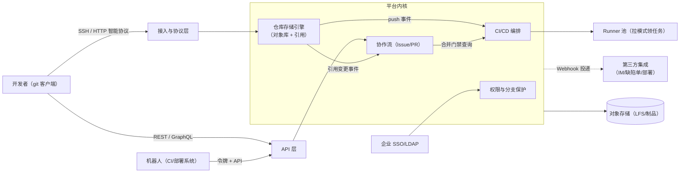

# Git 托管平台（GitHub / GitLab / Gitea）：代码怎么存、协作怎么管

> 返回：[示例项目场景](00-导览.md) · [软件架构学习大纲](../软件架构学习大纲.md)
> 定位：研发团队的“代码资产与协作中枢”——仓库存储、PR/MR 评审、CI/CD、Webhook 事件外发。三家代表同一业务的三种架构形态：GitHub（SaaS 巨型服务）、GitLab（自托管全家桶）、Gitea（轻量单体二进制），是“架构形态跟着规模走”的最佳对照组。它宕机，全公司研发停摆——一-3 可用性最硬核的活教材。主要对应大纲：一-2 设计模式（状态机/观察者/策略/责任链）、一-3 质量属性、二-1/2/3 模块化单体与微服务形态对照、二-3 事件驱动（消费语义）、三-2 最终一致、三-3 分片、三-5 限流与队列、五-3 安全架构（Webhook 签名）。

## 业务画像

Git 托管平台管理的是研发组织的“生产资料”：源码、提交历史、评审记录、流水线与制品、Issue 讨论，全部沉淀在这里。业务看似只有“存代码”一件小事，拆开看是四个域：**存**（Git 对象库与复制）、**管**（权限、分支保护）、**协作**（Issue/PR/MR 评审流）、**联动**（CI 触发与 Webhook 外发）——每个域都是一类典型架构问题的化身。

**三家对照（本场景独有的教学价值）**：

| 平台 | 形态 | 技术画像 |
|---|---|---|
| GitHub | SaaS 多租户巨型服务 | 从 Rails 单体起步，随规模把存储、认证、搜索等逐步拆为独立服务；仓库按分片集群多副本存储 |
| GitLab | 自托管“全家桶”单体 | Rails 单体应用 + Gitaly（存储服务化，gRPC）+ Sidekiq（后台任务队列）+ Workhorse（HTTP 前置代理）+ PostgreSQL/Redis |
| Gitea | 轻量自托管单体 | Go 单二进制 + SQLite/PostgreSQL，内置 SSH 服务，一个进程跑完全部功能 |

同一个业务域，三种规模的三个答案：Gitea 是模块化单体的教科书（二-1），GitLab 是“单体 + 存储服务化 + 任务队列”的渐进拆分样本（二-2 绞杀者思想的温和版），GitHub 是演进到大规模服务化的远端形态。讲“什么时候该拆”时，三家就是现成的对照实验。

**用户角色**：开发者（clone/push/发 PR）、评审者（code review）、机器人消费者（CI/CD、部署系统，经 API 与 Webhook 驱动，是流量占比最高的“用户”）、平台管理员（权限、配额、存储运维）、合规审计（企业版需求）。

**教学量级假设**：组织 1000 个、仓库 5 万个、日 push 10 万次、日流水线 5 万条、日 Webhook 投递 100 万次；单仓库中位数 50MB、最大 10GB；push 响应 P99 < 5s；API 限流数千次/小时量级。

**核心业务流**：

1. 写：clone（协议协商）→ 分支开发 → commit → push（上传对象 + 钩子检查 + 引用原子更新）；
2. 协作：发 PR/MR → 评审（approve / changes requested）→ CI 检查全绿 → 合并（merge/squash/rebase）→ 删分支；
3. 集成：push/PR 事件触发流水线 → Runner 领任务执行 → 状态回报挂到 PR 上作为合并门禁；
4. 外发：平台事件按订阅生成 Webhook 投递 → 第三方系统（IM 机器人、缺陷单、部署系统）消费；
5. 治理：权限与分支保护规则变更、仓库归档/转移、存储扩容与灾备演练。

**外部交互系统**：企业 SSO/LDAP（认证源）、对象存储（LFS 大文件与制品）、第三方集成（Webhook 消费者）、容器镜像仓库（CI 产物）。

## 模块总览

| 模块 | 一句话职责 | 关键数据 |
|---|---|---|
| 仓库存储引擎 | Git 对象读写、引用管理、分片与复制 | blob/tree/commit、ref |
| 接入与协议层 | SSH / HTTP(S) 智能协议接入、认证卸载 | 凭证、协议会话 |
| 权限与分支保护 | 谁能读谁谁能推、什么分支过什么门禁 | 协作权限、保护规则 |
| 协作流（Issue/PR） | 评审与讨论的状态机 | PR、评审、评论 |
| CI/CD 编排 | 流水线解析、任务队列、Runner 调度 | 流水线、任务、制品 |
| Webhook 事件外发 | 平台事件可靠投递给第三方 | 投递任务、签名密钥 |
| API 层 | REST/GraphQL 出口、令牌与配额 | 访问令牌、限流配额 |

模块间依赖：仓库存储引擎是全平台的地基（协作、CI、Webhook 全部由它的事件驱动），协作流消费存储事件并生产“合并门禁”约束，CI 编排与 Webhook 外发都是存储/协作事件的下游——整个平台的事件源只有“引用变更”与“协作状态变更”两类，这是它事件驱动架构特别干净的原因。

## 系统上下文与服务边界

先画边界图（谁在驱动这个平台、平台内各域在哪里交接、事件往哪里流）：



读图口径（把七个模块收拢成三条边界判断）：

- **到存储的路径与到协作的路径是两条独立入口**：Git 协议入口（clone/push）与 HTTP API 入口（PR/Issue/流水线）各走各的接入层——权限判断必须在两个入口都执行且口径一致，“能读仓库”的判断全平台只写一次、两处共用，否则 Git 协议读得到、API 读不到（或反向）的诡异工单迟早出现。
- **机器人是流量占比最高的“用户”**：CI 触发、状态回报、部署系统轮询，全部经 API 层进来——认证与限流的设计主角是机器人账号与令牌，不是人；这直接决定 API 层按“主体（用户/令牌/应用）”配额而不是按 IP。
- **事件箭头全是异步链路**：push → CI → Webhook 一路都是“发事件不等结果”——存储引擎只管把引用变更事件可靠入队，push 的响应时间不被 CI 的命运、更不被第三方 Webhook 的命运绑架（反例的代价见 Webhook 一节）。

## 核心模块

### 仓库存储引擎（本场景的灵魂模块）

**职责**：Git 四类对象（blob 文件内容、tree 目录快照、commit 提交、tag 注解标签）的内容寻址存储，引用（分支/标签）的原子更新，仓库的分片存放与多副本复制。

**关键实体与数据**：Git 对象按内容哈希寻址——对象标识 = 哈希（类型 + 长度 + 内容），同名必同内容；引用 `refs/heads/main` → commit id，是全库唯一的“可变指针”；仓库元数据 `repositories`（`repo_id`、`storage_node`（所在存储分片）、`default_branch`、`size_bytes`）。

**典型流程**（一次 push 的内幕）：客户端本地算出新增对象 → 打包上传（receive-pack）→ 服务端解包写入对象库 → pre-receive 钩子做权限与规则检查 → 引用更新（compare-and-swap：预期旧 commit id 对上才提交）→ post-receive 触发下游（PR 刷新、CI 触发、Webhook 入队）→ 响应客户端。

把这次 push 展开成**事件时序逐步表**——它是全平台事件的源头，每步的失败行为决定下游的世界观：

| 步 | 动作 | 数据变更 | 失败与并发时的行为 |
|---|---|---|---|
| ① | 协议协商与认证 | 无写 | 凭证无效即拒绝，无副作用，天然幂等 |
| ② | 客户端上传新增对象包 | 解包写入对象库（不可变追加） | 中断→残留无引用对象，无害，后台 gc 回收 |
| ③ | pre-receive 钩子链检查 | 无写 | 权限/规则不过→整体拒绝（对象已在库但无引用指向，等同无效） |
| ④ | 引用 CAS 更新 | ref: 旧 commit id → 新 commit id | 与他人并发 push 同分支→CAS 失败方收到 reject（非快进），需先拉后推 |
| ⑤ | post-receive 发事件 | 事件入队：PR 刷新、CI 触发、Webhook | 队列不可用→先落本地事件表补偿；事件比延迟更不能丢 |
| ⑥ | 应答客户端 | 无 | 客户端只等④完成；⑤失败不改变 push 成功的事实 |

④是整条链路的原子内核：Git 引用更新天然是 compare-and-swap，与“乐观并发合并 PR”是同一机制在两个层次的两次出现——底层（引用）由 Git 模型免费赠送，上层（PR 合并）要平台自己实现。②的“残留对象”值得多说一句：不可变追加世界里“写了一半”不会损坏任何已有数据，最坏只是垃圾——这是第 2 册“追加优于原地改”在分布式存储场景的又一次胜利。

Kotlin 骨架（内容寻址 + 引用 CAS）：

```kotlin
import java.security.MessageDigest

// Git 对象模型骨架：内容寻址——哈希即身份，同名必同内容、写入后不可变，只有引用是可变状态
class GitObj(val type: String, private val body: ByteArray) {
    val oid: String = run {
        val md = MessageDigest.getInstance("SHA-1")
        md.update("$type ${body.size}".toByteArray())   // 对象头：类型 + 长度
        md.update(byteArrayOf(0))
        md.update(body)
        md.digest().joinToString("") { "%02x".format(it) }
    }
}

class ObjectStore {
    private val map = HashMap<String, GitObj>()
    fun put(obj: GitObj): String { map.putIfAbsent(obj.oid, obj); return obj.oid }  // 同哈希=同内容，天然去重
    val count: Int get() = map.size
}

fun main() {
    val store = ObjectStore()
    val oidA = store.put(GitObj("blob", "fun hello() {}\n".toByteArray()))
    val oidB = store.put(GitObj("blob", "fun hello() {}\n".toByteArray()))  // 内容相同 → oid 相同
    println("两次写入相同内容：oid 相等=${oidA == oidB}，对象库实际存储=${store.count} 份")

    val tree = GitObj("tree", "main.kt -> $oidA".toByteArray())
    val c1 = GitObj("commit", "tree=${tree.oid} parent=none  msg=init".toByteArray())
    val c2 = GitObj("commit", "tree=${tree.oid} parent=${c1.oid} msg=fix typo".toByteArray())
    listOf(tree, c1, c2).forEach(store::put)
    println("追加 tree + 两个 commit（内容各不相同）后对象库 = ${store.count} 份")

    var refMain = c1.oid
    if (refMain == c1.oid) refMain = c2.oid   // push 的本质：引用以旧值比对（CAS）方式前移
    println("main 引用 CAS 前移 → ${refMain.take(8)}…（对象本身从未被修改）")
}
```

**设计要点与典型陷阱**：

- **内容寻址是存储设计的降维打击**：相同内容全平台只存一份（去重不需要发明任何机制）；对象一旦写入永不修改（缓存、复制、完整性校验全都因此变简单）；把“不变的大头”（对象）和“可变的针尖”（引用）分开——不可变数据设计的一号范本。
- **反例——“把 Git 仓库当普通文件存”**：早期自建服务把所有裸仓库放一块 NFS 共享盘：仓库一多 IO 互相争抢，全量备份时所有人都 push 不动；仓库数据在文件系统、权限与 PR 在数据库，两个世界靠约定同步，删库后两边对不上。**修正**：仓库按分片集群存放（repo → `storage_node`），分片内多副本；对象库与元数据以 `repo_id` 关联，删除走两阶段（先标记、确认无引用后物理清理）。
- **为什么按“仓库”分片、而不是按“对象”分片**：一个 push 的事务边界是仓库——引用更新要求本次 push 的对象全部就位；对象图彼此引用把仓库内对象绑成一个整体，按对象打散会让每次 push 跨多个节点。分片键选“聚合根”的原则在这里再次出现（与 Feed 流按用户分片同构，三-3 分库分表）。
- 复制走最终一致：引用更新以主副本为准，向从副本异步复制；读从副本可能落后几秒，对 Git 场景完全可接受——非交易场景选最终一致的典型案例（三-2）。
- 大文件治理：视频、模型、设计稿塞进 Git 对象库会把仓库拖到 GB 级——LFS 的解法是“指针进仓库、内容外置对象存储”，浅克隆/部分克隆则救 CI（只拉最近 N 层）。教学点：不是所有数据都该进同一个存储引擎，先分型再选型。

### 协作流：PR/MR 评审状态机

**职责**：以 PR（GitHub/Gitea）/MR（GitLab）为中心的评审与合并生命周期管理。

**关键实体与数据**：`pull_requests`（`pr_id`、`source_branch`、`target_branch`、`state`（draft/open/merged/closed）、`merge_base`）；评审 `reviews`（`reviewer_id`、`state`（approved/changes_requested/commented）、`commit_sha`（评审针对哪个提交））；状态检查 `check_runs`（`pipeline_id`、`conclusion`——CI 结果挂回 PR 作门禁）。

**典型流程**：开 PR（draft → open）→ 评审人提交意见（changes requested → 作者修改 → 重新 approve）→ 保护规则校验（必需评审数 + 必需检查项全绿）→ 合并（merge commit 保留拓扑 / squash 压成一个 / rebase 拉直）→ state=merged，触发下游（部署、通知、自动关单）。

合并动作再给一张**事件时序逐步表**——它的并发问题（两人同时合并）是三-2 乐观并发在非数据库场景的标本：

| 步 | 动作 | 数据变更 | 失败与并发时的行为 |
|---|---|---|---|
| ① | 保护规则校验（评审数/必需检查） | 无写 | 规则以“合并时刻”的配置为准，中途改规则不追溯已开 PR |
| ② | 校验目标分支头未漂移（merge_base == 当前 HEAD） | 无写 | 他人已先合并→CAS 失败，PR 转“需更新”，重新校验冲突 |
| ③ | 创建合并提交并 CAS 前移目标分支 | 新 commit 对象 + 引用更新 | 合并提交与引用更新必须原子（同一存储事务内完成） |
| ④ | PR 状态 → merged | update `pull_requests` | ③成功④失败（进程崩溃）→恢复后按引用事实对齐 PR 状态 |
| ⑤ | 触发下游（部署/通知/自动关单） | 事件入队 | 异步重试；与 Webhook 共用“先落盘再投递” |

③④的组合值得停下来看：合并的“真相”是引用前移（③，对象库世界），PR 状态只是这个事实的投影（④，元数据世界）——崩溃恢复时永远以事实为准修补投影，方向从对象库到元数据，绝不反过来。这与多租户场景“账单由用量明细支撑、方向从明细到账单”是同一条纪律。

**设计要点与典型陷阱**：

- **PR 状态是状态机，不是一堆布尔标记**——反例：用 `is_open`、`is_approved`、`is_merged` 三个布尔字段表达状态，“approved 之后又 push 了新提交还算不算 approved”全靠读代码猜，组合出一堆非法状态。**修正**：显式状态机 + 迁移表，并加一条显式规则：新 push 使已有评审失效（stale）——评审记录里的 `commit_sha` 就是失效判定的依据（一-2 状态模式的完整舞台；与工单中心流转状态机同构，可对照）。
- 分支保护规则是“机制与策略分离”的好例子：机制固定（合并前必须满足的条件检查引擎），策略可配（几个评审、哪些检查必需、是否禁止 force push）——用策略引擎实现，而不是在合并代码里硬编码 if。
- 三种合并策略没有对错，只有团队约定：squash 让主线历史线性干净但丢细粒度回滚点——历史形状是产品决策，写入 ADR（四-2）。
- 并发合并同一目标分支：第二个 PR 合并时 merge_base 已前移，需重新校验冲突——对目标分支头做乐观并发控制（compare-and-swap），失败即“请更新后重试”（三-2 乐观并发的非数据库版本）。

### CI/CD 编排与 Runner 调度

**职责**：解析流水线定义（GitHub Actions workflow / .gitlab-ci.yml）、编排阶段与任务、把任务派发给 Runner、回收状态与制品。

**关键实体与数据**：`pipelines`（`pipeline_id`、`trigger`（push/schedule/api/manual）、`commit_sha`、`status`）；`jobs`（`stage`、`runner_tag`、`status`（pending/running/success/failure）、`attempts`）；`runner_pools`（`runner_id`、`tags`、`concurrency_limit`）。

**典型流程**：push → 触发判定（哪些流水线该跑）→ 任务入队 → 空闲 Runner 主动领取（拉模式）→ 执行步骤 → 回报状态挂到 PR → 上传制品与缓存。

**设计要点与典型陷阱**：

- **触发去抖（幂等的第一课）**：连推 3 个 commit，正确行为通常不是跑 3 条流水线——按分支收敛只跑最新 commit 的那条（旧的取消或标记跳过）。反例：不去抖，连环 push 把 CI 队列打满，真正要验证的那个 commit 反而在排队——研发工具链里的背压问题（三-5）。
- **Runner 拉模式而非推模式**：平台不需要维护到每台 Runner 的长连接，Runner 自己来领任务——内网、NAT 后的自建 Runner 天然可达，平台侧也天然解耦（与消息队列消费者拉取同构，二-3）。
- 队列公平性：多团队共享 Runner 池时，大团队的 500 job 流水线不能饿死小团队的 2 job——按组织/仓库配额 + 多级队列（三-5 限流的队列版）。
- 制品与缓存的生命周期：产物保留期、缓存键按依赖指纹失效——存储成本与构建速度的权衡，不设保留期的制品库迟早撑爆。

### Webhook 事件外发

**职责**：把平台事件（push、PR、Issue）按订阅可靠投递给第三方系统。

**关键实体与数据**：`webhook_endpoints`（`scope`（仓库/组织）、`url`、`secret`（签名密钥）、`events[]`、`active`）；投递记录 `deliveries`（`delivery_id`（幂等键）、`event`、`request_body`、`attempt`、`status`、`next_retry_at`）。

**典型流程**：平台事件 → 匹配订阅（范围 + 事件类型过滤）→ 生成投递任务（带 `delivery_id`，附 HMAC 签名头）→ 投递 → 失败按指数退避重试 → 重试窗口耗尽转死信并告警。

Kotlin 骨架（签名 + 幂等 + 指数退避）：

```kotlin
import javax.crypto.Mac
import javax.crypto.spec.SecretKeySpec

// Webhook 投递骨架：HMAC 签名 + delivery_id 幂等 + 指数退避——至少一次投递，消费方必须幂等
class MiniWebhookDispatcher(private val secret: String) {
    data class Delivery(val id: String, val event: String, val body: String,
                        val attempt: Int = 0, val nextRetryAt: Long = 0L)

    private val seen = HashSet<String>()            // 平台侧幂等：同一 delivery_id 只入队一次
    private val queue = ArrayDeque<Delivery>()

    fun sign(body: String, ts: Long): String = Mac.getInstance("HmacSHA256").run {
        init(SecretKeySpec(secret.toByteArray(), "HmacSHA256"))
        update("$ts.".toByteArray()); update(body.toByteArray())
        "sha256=" + doFinal().joinToString("") { "%02x".format(it) }
    }

    fun enqueue(d: Delivery): Boolean =
        if (!seen.add(d.id)) false else { queue += d; true }   // 重放/重复事件：同 id 直接丢弃

    fun pump(now: Long, transport: (Delivery) -> Boolean) {    // transport 返回 false = 消费方报 5xx
        val retries = ArrayDeque<Delivery>()                   // 重试任务迭代后批量重新入队
        val iter = queue.iterator()
        while (iter.hasNext()) {
            val d = iter.next()
            if (d.nextRetryAt > now) continue                  // 指数退避：还没到下一次投递时间
            iter.remove()
            if (transport(d)) {
                println("投递成功：${d.id} ${d.event}（第 ${d.attempt + 1} 次尝试）")
            } else if (d.attempt + 1 >= 4) {
                println("重试耗尽：${d.id} 转入死信并告警")
            } else {
                val backoff = 1000L shl d.attempt              // 1s → 2s → 4s
                println("投递失败：${d.id} 于 ${backoff}ms 后重试")
                retries += d.copy(attempt = d.attempt + 1, nextRetryAt = now + backoff)
            }
        }
        queue += retries
    }
}

fun main() {
    val dispatcher = MiniWebhookDispatcher("hook-secret-2026")
    val body = """{"ref":"refs/heads/main","after":"3f2a…"}"""
    println("投递签名 X-Hub-Signature-256: ${dispatcher.sign(body, 1_700_000_000L)}")

    var remainingFailures = 2                                   // 模拟消费方故障：前两次返回 500
    var received = 0                                            // 消费方实际收到的请求数
    val transport: (MiniWebhookDispatcher.Delivery) -> Boolean = { _ ->
        received++
        val ok = remainingFailures <= 0
        if (!ok) remainingFailures--
        ok
    }

    val event = MiniWebhookDispatcher.Delivery("d-1", "push", body)
    dispatcher.enqueue(event)
    if (!dispatcher.enqueue(event.copy())) println("重复事件 d-1 被幂等丢弃（delivery_id 已在投递中）")

    var clock = 0L
    repeat(4) { dispatcher.pump(clock, transport); clock += 1000 }
    println("消费方累计收到 $received 次同一 delivery_id → 处理副作用必须按 id 幂等")
}
```

**设计要点与典型陷阱**：

- **至少一次投递 + 消费方幂等，是一对**：投递方保证“发了就重试到成功或窗口耗尽”，但不保证“只发一次”；更要命的是，消费方超时后投递方判失败重试，而消费方其实已经处理成功——同一 `delivery_id` 可能触发两次副作用。消费方必须按 id 去重（二-3 消费语义的最小完整案例；与多租户计量的用量上报治理同款手法）。
- **签名是信任边界**：消费者不能“收到 webhook 就信”——用共享密钥重算 HMAC 比对签名 + 校验时间戳防重放，否则知道 webhook URL 的人就能伪造“代码已合并”触发一次生产部署（五-3 安全架构：不信任调用方，凭据与消息本身都要验）。
- **绝不能同步调 webhook**：push 主流程里串行调 20 个第三方 URL，任何一个慢 10 秒，全公司的 push 都被拖住——事件外发必须异步队列化，主流程只入队（这也是“事件驱动”的正确用法：外发通知是出口，不是主路径）。
- 重试风暴：第三方故障恢复的瞬间，积压投递一起涌入把它二次打垮——退避之外还要有全局投递速率上限（背压，三-5）。

### API 层与限流配额

**职责**：REST/GraphQL 对外出口，令牌认证、配额执行。

**设计要点与典型陷阱**：限流按“主体”（用户/令牌/应用安装）计而不按 IP——机器人的正当高频访问与攻击者必须区别对待；读、写、昂贵端点（搜索）分开配额；列表接口强制分页（一个不翻页的“列出全部仓库”就是一次全表扫描）。限流位置、配额建模与 [API 网关](11-API网关.md)场景完全同构，可对照讲。

## 架构挑战与知识点映射

| 挑战 | 方案要点 | 对应大纲小节 |
|---|---|---|
| 存储可靠与去重 | 内容寻址、对象不可变、只有引用可变 | 一-3、一-2 |
| 存储水平扩展 | 按仓库分片（分片键=聚合根）、存储服务化 | 二-2、三-3 |
| 多副本一致性 | 引用主副本 + 异步复制，读容忍秒级滞后 | 三-2 最终一致 |
| PR 协作流转 | 显式状态机、新 push 使评审失效 | 一-2 状态模式 |
| CI 触发去抖 | 按分支收敛只跑最新、旧任务取消 | 三-5 |
| Runner 调度 | 拉模式领任务、组织配额多级队列 | 二-3、三-5 |
| Webhook 可靠投递 | 至少一次 + 幂等键、HMAC 签名、退避与死信 | 二-3、五-3 |
| API 滥用防护 | 按主体限流、读写与昂贵端点分配额 | 三-5、六 API 网关 |
| 大文件拖垮仓库 | LFS 指针外置、浅/部分克隆 | 三-3 |
| 平台宕机=研发停摆 | 分片多副本、故障降级只读 | 一-3、三-5 高可用 |

## 关键数据表设计与取舍

```sql
-- PR 主表（教学简化版，只列有取舍的字段）
CREATE TABLE pull_requests (
    id             BIGINT PRIMARY KEY AUTO_INCREMENT,
    pr_no          BIGINT       NOT NULL,       -- 仓库内序号（对外展示 #123）
    repo_id        BIGINT       NOT NULL,
    state          TINYINT      NOT NULL,       -- draft/open/merged/closed
    source_branch  VARCHAR(255) NOT NULL,
    target_branch  VARCHAR(255) NOT NULL,
    head_sha       CHAR(40)     NOT NULL,       -- 评审针对的最新提交（评审失效判定依据）
    merge_base     CHAR(40)     NULL,           -- 合并时的基准提交（CAS 校验依据）
    merged_sha     CHAR(40)     NULL,           -- 合并产生的提交（结果事实）
    author_id      BIGINT       NOT NULL,
    created_at     DATETIME     NOT NULL,
    UNIQUE KEY uk_repo_pr (repo_id, pr_no),
    KEY idx_repo_state (repo_id, state, created_at)
);
```

| 设计点 | 选项 A | 选项 B | 本场景结论与理由 |
|---|---|---|---|
| PR 状态表达 | `is_open/is_approved/is_merged` 布尔三件套 | 单枚举 `state` + `head_sha` 判失效 | 枚举：布尔组合出非法状态；“新 push 使评审 stale”要靠 head_sha 判定 |
| 元数据与对象库 | 塞进同一存储 | 元数据库表 + 对象库文件分片 | 分开：对象库是不可变内容寻址文件，元数据是可变关系数据——先分型再选型（07 专题第 2 册） |
| `pr_no` 生成 | 全局自增 | 仓库内自增（与 Issue 共用序号） | 仓库内：避免全局计数器热点，且平台惯例 PR/Issue 共用一个仓库内序列 |
| 评审记录 | 只存最终结论 | 每次评审带 `commit_sha` | 带 sha：push 后旧评审自动失效的判定是数据比较，不靠时间不靠记忆 |
| Webhook 投递记录 | 只存状态不存原文 | 请求原文落档 | 落档：排障与重放都靠原文，“消费方说没收到”时有据可查 |
| 对象去重 | 平台层维护引用计数 | 内容寻址天然去重 | 天然去重：Git 对象模型自带，不需要发明任何机制 |

分片预留：元数据表按 `repo_id` 分片（仓库是聚合根，协作数据的查询几乎全在仓库范围内）；对象库按 `storage_node` 分片集群放置——两层分片键一致（repo_id → storage_node），路由一次到位。

## 容量与失败模式推演

以下推演基于业务画像的量级假设（组织 1000、仓库 5 万、日 push 10 万、日流水线 5 万、日 Webhook 100 万），是教学口径的演算，不是实测：

- **push 链路**：日 10 万次 push，按工作时段集中假设 10 倍系数 ≈ 峰值 30 次/秒——单存储分片轻松承接；真正要算的是**大仓库**：中位 50MB 是存量，push 增量通常 KB~MB 级，但 10GB 级仓库的首次全量推与全量 clone 会打满单盘——大仓库单独标记、限速、放独立存储节点。
- **对象库膨胀**：日 10 万次 push × 每次几十个对象 ≈ 日百万级对象追加；不可变追加只进不出，gc（打包、去重、清无引用对象）必须作为例行后台任务，且按仓库/分片调度——全平台一个 gc 窗口等于定时自残。
- **Webhook 投递**：日 100 万次投递、失败率假设 1% = 日 1 万次重试——指数退避 + 全局投递速率上限是必须项；投递记录按天分区，到期归档。
- **CI 队列**：日 5 万条流水线 × 平均假设 5 个 job = 日 25 万 job，峰值每秒数十个入队——瓶颈不在入队而在 Runner 容量与触发去抖（不去抖时队列被无效流水线挤满，见下表）。

失败模式清单（每行都要有预设对策，缺一项就是隐患）：

| 失败模式 | 触发场景 | 后果 | 预设对策 |
|---|---|---|---|
| 存储节点故障 | 分片节点宕机 | 该节点仓库不可读写 | 分片内多副本 + 副本提升 + 仓库级故障迁移（repo → 新 storage_node） |
| 引用更新竞态 | 两人并发 push 同分支 | 后推覆盖前推（非快进强推） | 引用 CAS：旧值不匹配即拒绝，客户端先拉后推 |
| push 后事件丢失 | post-receive 入队失败 | CI 没跑、PR 不刷新、Webhook 没发 | 先落本地事件表再转发 + 补偿扫描 |
| Webhook 重试风暴 | 第三方故障恢复瞬间 | 积压一起涌入二次打垮 | 指数退避 + 全局投递速率上限 + 死信告警 |
| CI 队列被无效流水线挤满 | 连环 push 不去抖 | 真正要验证的 commit 在排队 | 按分支收敛只跑最新、旧流水线取消/跳过 |
| 大仓库拖垮共享存储 | 10GB 级仓库全量 clone | 同盘其他仓库 IO 饿死 | 大仓库标记 + 独立节点 + 带宽限速 |
| 权限两入口不一致 | Git 协议与 API 权限口径漂移 | API 能读、Git 协议读不到（或反向） | 权限判断收敛单一模块，两个入口共用同一实现 |
| 元数据与对象库漂移 | 删除/迁移只动一边 | PR 指向不存在的提交 | 两阶段删除 + 按 repo_id 定期一致性核对 |

## 演进路线：三家形态是一条演进链

Gitea → GitLab → GitHub 的形态差异可以读成同一家平台长大的三个阶段——每步都先说迁移、再说怎么退回来：

| 阶段 | 形态动作 | 迁移方式 | 回滚方式 |
|---|---|---|---|
| 1. 单二进制（Gitea 形态） | 一个进程 + 单库 | 起步形态 | — |
| 2. 存储服务化（Gitaly 形态） | 对象库读写抽为 gRPC 服务，存储独立分片 | 先抽象接口（应用无感）→ 逐仓库切换存储节点 | 每仓库独立回切（数据布局没变，只是访问路径变了） |
| 3. 任务队列化（Sidekiq 形态） | Webhook/PR 刷新/CI 触发从进程内调用改为队列任务 | 影子执行：进程内照旧 + 队列并行，对齐后停进程内 | 停队列消费、恢复进程内调用（事件表里还找得到任务） |
| 4. CI 规模化（Runner 池形态） | 内置执行改为拉模式 Runner 池 + 多级队列 | 先共享池试点一个团队 → 按组织扩池 | 回退到内置执行（流水线定义不变，执行位置变了） |
| 5. 全面服务化（GitHub 形态） | 认证、搜索、网关独立部署 | 绞杀者模式逐功能迁移 | 新服务回退到单体模块实现（对外契约不变） |

三条纪律：**存储先行**（最难拆也最值得先拆——存储服务化之后其余拆分都不再阻塞在“数据在哪”）；**按仓库/按团队灰度**（Git 平台的全量切换等于全公司研发停摆演练）；**契约先于拆分**（先把对象读写与事件发布抽象成接口再谈拆，否则拆出去的只是代码，不是边界）。

## 面试官追问点

- “为什么按仓库分片而不是按对象分片？”——push 的事务边界是仓库：引用更新要求本次 push 的对象全部就位；对象图彼此引用把仓库内对象绑成一个整体，按对象打散会让每次 push 跨多个节点——分片键选聚合根的原则（三-3）。
- “Git 平台宕机为什么等于研发停摆？怎么缓解？”——源码读写绕不开它：缓解靠分片多副本（爆炸半径=单仓库）、只读降级（副本可读、拒绝写入）、以及把“平台整体不可用”与“单仓库不可用”的告警与预案分开。
- “Webhook 至少一次投递，消费方两次收到同一事件怎么办？”——按 `delivery_id` 幂等；更微妙的是投递超时后投递方判失败重试、消费方实际已处理成功——所以“失败”的投递也可能已经产生了副作用，幂等键必须以投递方给的 id 为准（二-3 消费语义的最小完整案例）。
- “CI 为什么拉模式领任务而不是推模式？”——内网/NAT 后的自建 Runner 天然可达，平台不用维护到每台 Runner 的长连接；代价是任务可见性有轮询延迟，用长轮询优化，不改变拉的本质。
- “评审失效（stale）判定为什么可靠？”——评审带 `commit_sha`，新 push 改变 `head_sha`，两者不匹配即失效——判定是数据驱动的事实比较，不依赖时间戳猜测，也不靠人记得。
- “LFS 为什么指针进仓库、内容外置？”——对象库为文本去重与小对象优化，大对象进去会让 gc、clone、diff 全链路变慢；指针（小对象）走 Git、内容走对象存储，各用各的引擎——先分型再选型。

## 如果规模再大十倍

假设组织 1 万个、仓库 50 万个、日 push 100 万次、日 Webhook 1000 万次，逐层推演瓶颈与对策：

- **存储分片自治**：按仓库哈希分到百级存储集群，集群内自主副本选主；仓库迁移（负载均衡/坏盘维修）成为常态后台任务，迁移期间只暂停该仓库写入（秒级），不再是全平台写禁。
- **gc 分布式化**：按存储集群滚动 gc；引用可达性计算增量做（只判新增对象的可达性，不全图遍历）——gc 的调度公平性直接决定“某天夜里某些仓库特别慢”的噪声。
- **事件总线分层**：push/PR/CI 事件统一进内部分区日志（按 repo_id 分区保序），Webhook 投递与 CI 触发降级为这个日志的两个消费组——平台内事件从“进程内调用 + 队列”演进为“日志为事实源”（[07 专题第 4 册](../07-数据系统内核专题/04-批处理与流处理.md)的 CDC 思想反向用于平台自身）。
- **API 配额计费化**：机器人流量占绝对大头后，简单限流升级为按“应用安装”维度的读写与昂贵端点分配额——平台成为被依赖的基础设施，配额就是它的多租户治理（与[多租户 SaaS 控制平面](12-多租户SaaS控制平面.md)合流）。
- **权限的历史化**：仓库 50 万后，合规审计要回答“去年某天谁能读到这个仓库”——权限快照本身需要版本化，权限模型从“当前态”演进为“带历史”（审计册的 before/after 纪律在这里从配置扩展到权限）。

## 与其他场景的联动

- **工单中心（[03](03-工单中心.md)）**：双胞胎——工单管“事”、代码平台管“码”，PR 评审状态机与工单流转状态机同构；两者还常互相集成：commit 消息关联工单、PR 合并自动关单（事件打通两个系统）。
- **API 网关（[11](11-API网关.md)）**：API 限流按主体计、读写分配额，与网关的配额执行同构；Git 平台的 SSH/HTTP 接入层本质是“协议专用网关”。
- **多租户 SaaS 控制平面（[12](12-多租户SaaS控制平面.md)）**：GitHub.com 本身就是巨型多租户 SaaS——组织即租户、私有仓库即租户隔离数据、API 配额即租户配额。
- **低代码开发平台（[10](10-低代码开发平台.md)）**：都在维护“定义”并解释执行——流水线 YAML vs 页面元数据，配置的版本化与回滚是同款问题。
- CI/CD 的深度内容以第五阶段为准：流水线示例、DORA 四指标见[05-第五阶段/03-部署与发布策略-CICD与灰度](../05-第五阶段/03-部署与发布策略-CICD与灰度.md)（其 GitHub Actions 示例正是跑在本场景的 CI 编排模块上）。

## 取材指引

- 一-2 设计模式：PR 评审状态机（状态模式）、Webhook 订阅分发（观察者）、分支保护规则（策略）、push 钩子链 pre-receive（责任链）。
- 一-3 质量属性：可用性的最高档活教材——Git 平台宕机等于全公司研发停摆；可靠性的底线是“提交历史一个字节都不能丢”。
- 二-1/2/3：三家形态对照讲“架构形态跟着规模走”（Gitea 单二进制 → GitLab 单体 + 存储服务化 → GitHub 服务化）；Webhook 讲事件驱动消费语义（至少一次 + 幂等 + 签名）。
- 三-2：非交易场景的最终一致（复制滞后、乐观并发合并）；三-3：分片键选聚合根（按仓库分片）；三-5：触发去抖与队列公平性。
- 五-3 安全架构：Webhook 验签与重放防护、令牌最小权限；五-2/05-第五阶段/03：CI 触发链路与 DORA 指标起点。
- 可出思考题方向：为什么按仓库而不是按对象分片；连推三个 commit 为什么只跑一条流水线、旧的怎么处理；消费方为什么既要验签又要幂等——两次“失败”的投递可能意味着什么；Gitea 单二进制与 GitHub 数百个服务，各自的适用边界在哪里。
