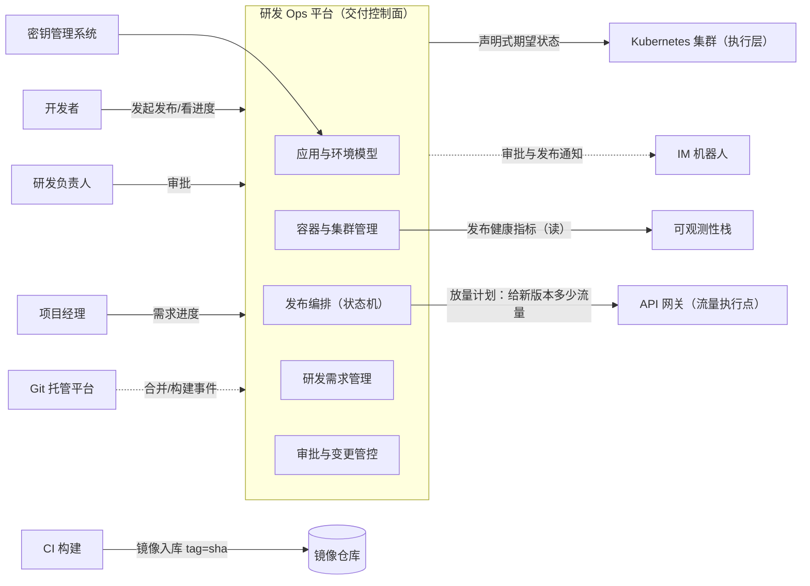

# 企业研发 Ops 平台：从需求到生产的交付控制台

> 返回：[示例项目场景](00-导览.md) · [软件架构学习大纲](../软件架构学习大纲.md)
> 定位：研发组织内部的“交付控制面”——应用与三环境（开发/预发/生产）模型、容器管理、发布编排（灰度/蓝绿/滚动）、研发需求管理、审批与变更管控。它管住“代码合并到用户可用”的最后一段路：上游是 [13-Git 托管平台](13-Git托管平台.md)（代码与 CI），灰度流量的执行点在 [11-API 网关](11-API网关.md)。主要对应大纲：一-2 设计模式（状态机/策略/责任链）、一-3 质量属性（可回滚）、二-3 事件驱动（交付事件链）、五-1 可观测性（发布健康判定）、五-2 部署发布（三环境/灰度/蓝绿，深度内容以[05-第五阶段/03](../05-第五阶段/03-部署与发布策略-CICD与灰度.md) 为准）、五-3 安全架构（生产访问控制）。

## 业务画像

企业自建的研发交付平台（常叫“发布系统”“运维平台”或 DevOps 平台）：开发者不直接碰生产集群，一切变更——代码上线、配置修改、扩缩容——都通过平台以“发布单”的方式发生。平台的价值主张一句话：**让发布变成例行动作，让回滚变成一个按钮，让每一次生产变更可追溯**。

**三环境模型**：

| 环境 | 定位 | 部署频率 | 关键约束 |
|---|---|---|---|
| 开发 dev | 功能联调、自测 | 每天多次 | 配置宽松、数据可造假、可用性要求最低 |
| 预发 staging | 发布前最后一道验证 | 每次发布前 | 与生产同构（同一镜像、近似配置、脱敏数据），但流量规模远小于生产——“最像生产的非生产环境”的悖论 |
| 生产 prod | 真实用户 | 受控发布 | 审批 + 灰度 + 可观测 + 回滚预案，一切变更留痕 |

**铁律——一次构建、多环境晋升**：镜像在 dev 构建一次、打上不可变 tag（git commit sha），从 dev 一路晋升到 prod，每个环境变的只是配置。反例：“每个环境重新构建”——构建过程本身引入差异，dev 测过的不是 prod 跑的，出了问题两边根本对不齐。

**用户角色**：开发者（发起发布、看进度）、测试（预发验证）、研发负责人（审批）、SRE/平台管理员（集群与配额运维）、项目经理（需求进度与排期）。

**教学量级假设**：应用 200 个、服务实例 3000 个、日发布 50 次、日配置变更 100 次；发布 P99 耗时 < 15 分钟，回滚 P99 < 3 分钟（蓝绿秒级）。

**核心业务流**：

1. 需求进入：需求单创建 → 拆任务 → 关联分支与 PR（Git 托管平台）→ 开发；
2. 持续交付：合并触发构建 → 镜像入库（tag=commit sha）→ 自动部署 dev → 预发验证；
3. 发布：创建发布单（应用/版本/环境/策略）→ 审批 → 按策略放量（灰度批次或蓝绿切流）→ 健康观察 → 完成/回滚；
4. 配置变更：生产配置修改走同一条发布单链路（配置变更也是变更）；
5. 治理：封网窗口（大促冻结）、发布审计、集群资源配额、漂移检测。

**外部交互系统**：Git 托管平台（代码与 CI 事件）、Kubernetes 集群（执行层）、镜像仓库、密钥管理系统、IM 机器人（审批与发布通知）。

## 模块总览

| 模块 | 一句话职责 | 关键数据 |
|---|---|---|
| 应用与环境模型 | 应用登记、三环境拓扑、分环境配置 | 应用、环境、配置 |
| 容器与集群管理 | 镜像构建入库、工作负载编排、资源与漂移治理 | 镜像、工作负载、配额 |
| 发布编排（灵魂模块） | 发布单状态机、灰度/蓝绿/滚动、健康判定与回滚 | 发布单、放量计划 |
| 研发需求管理 | 需求到上线的状态流转与全链路追溯 | 需求单、关联关系 |
| 审批与变更管控 | 生产审批、封网窗口、变更审计 | 审批单、变更记录 |

模块间依赖：发布编排站在舞台中央（它消费环境模型给出的“部署到哪”、指挥集群管理执行“怎么部署”、受审批管控约束“能不能发”），需求管理旁挂在事件链上（一切工程事件的投影汇到需求单）——五个模块只有一条粗主干（发布链），旁支全部异步。

## 系统上下文与服务边界

先画边界图（谁驱动这个平台、平台指挥谁、在哪里握手）：



读图口径（把五个模块收拢成四条边界判断）：

- **平台是决策面，集群是执行面**：Ops 平台下发的永远是声明式期望状态，怎么拉起容器、怎么重启是 K8s 控制器的事——“控制面/数据面分离”在发布域的落法，与多租户场景、API 网关是同一个模型的第三次出现。
- **灰度的决策权在发布编排，执行权在网关/入口层**：编排决定“给新版本 20% 流量”，网关执行“怎么分”（按比例、按用户标签、按机房）——两个平台用接口握手而不是互相内嵌，谁也部署不了对方。
- **健康判定是“读”可观测性栈，不是平台自建监控**：平台只消费指标并执行判定规则，否则等于在发布系统里重新发明一个监控产品——职责边界失守的第一步往往就是“顺手采个指标”。
- **需求管理是全部工程事实的投影汇**：Git 平台的合并事件、CI 的构建事件、本平台的发布事件双向回写需求单——需求状态不靠人填，靠事件推；投影与事实源的方向永远从工程事件到需求单，绝不反向。

## 核心模块

### 环境模型与应用管理

**职责**：登记应用与三环境拓扑；管理“同一镜像 + 分环境配置”的渲染与下发。

**关键实体与数据**：`apps`（`app_id`、`owner_team`、`repo_url`）；`environments`（`env`（dev/staging/prod）、`cluster`、`config_ref`）；配置分三层：base 基线 + 环境覆盖（overlay）+ 密钥引用。

Kotlin 骨架（base + overlay + 密钥引用，差异键白名单）：

```kotlin
// 三环境配置骨架：同一镜像 + base 基线 + 环境覆盖（overlay）；密钥只留引用占位
class MiniEnvConfig(private val base: Map<String, String>) {
    private val diffable = setOf("log.level", "replicas", "db.url")   // 允许按环境覆盖的差异键

    fun render(env: String, overlay: Map<String, String>, secretRef: Map<String, String>): Map<String, String> {
        val merged = base.toMutableMap()
        overlay.forEach { (k, v) ->
            require(k in diffable) { "环境 $env：键 $k 不允许按环境覆盖——行为性配置各环境必须一致，否则 bug 只在生产出现" }
            merged[k] = v
        }
        secretRef.forEach { (k, ref) -> merged[k] = "ref:$ref" }      // 密钥以引用占位，运行时从密钥管理注入
        return merged.toSortedMap()
    }
}

fun main() {
    val base = mapOf(
        "log.level" to "INFO", "replicas" to "2",
        "db.url" to "jdbc:postgresql://order-db:5432/orders",
        "db.password" to "PLACEHOLDER",                       // base 里永远只有占位符，没有明文密钥
    )
    val dev = MiniEnvConfig(base).render(
        env = "dev",
        overlay = mapOf("log.level" to "DEBUG", "replicas" to "1", "db.url" to "jdbc:postgresql://dev-db:5432/orders"),
        secretRef = mapOf("db.password" to "k8s:secret/order-dev/db-password"),
    )
    val prod = MiniEnvConfig(base).render(
        env = "prod",
        overlay = mapOf("replicas" to "8"),
        secretRef = mapOf("db.password" to "k8s:secret/order-prod/db-password"),
    )
    println("dev : $dev")
    println("prod: $prod")
    println("同一镜像两环境渲染：键集合相同=${dev.keys == prod.keys}，差异全在值与密钥引用")

    runCatching { MiniEnvConfig(base).render("prod", overlay = mapOf("retry.count" to "0"), secretRef = emptyMap()) }
        .onFailure { println("被拦截：${it.message}") }
}
```

**设计要点与典型陷阱**：

- **差异要收敛、白名单管理**：跨环境不同的键必须是有限集（副本数、资源规格、域名、日志级别），行为性配置（超时、重试次数、开关默认值）各环境必须一致——“只在生产出的 bug”多半是行为性配置漂移，渲染时直接拒绝。
- **密钥不进配置仓库**：base 与 overlay 只有占位符和引用，真值由运行时从密钥管理注入（K8s Secret），泄露面与轮换成本都可控（五-3）。
- **配置变更是发布**：改一个生产配置 = 一张发布单 + 审批 + 可回滚，不能绕过——生产事故的一大来源正是“改个配置不算发布”的心态。
- 预发的定位要诚实：它验证的是“部署形态与生产一致”，验证不了“生产流量规模下的表现”——后者靠灰度观察期补（与[05-第五阶段/03](../05-第五阶段/03-部署与发布策略-CICD与灰度.md) 的三阶段迁移视角呼应）。

### 容器与集群管理

**职责**：镜像构建与入库、工作负载编排（K8s Deployment/Service）、资源配额与状态漂移治理。

**关键实体与数据**：`images`（`image_tag`（= git commit sha，不可变）、`build_id`、`scan_status`（漏洞扫描））；`workloads`（`app_id`、`env`、`replicas`、`resources`（requests/limits）、`current_image`）；`namespaces`（按环境 × 团队划分，ResourceQuota 限额）。

**典型流程**：CI 构建镜像 → 扫描（漏洞/密钥泄漏）→ 推镜像仓库 → 平台按期望状态下发到集群 → 控制器拉齐实际状态 → 漂移检测周期比对。

**设计要点与典型陷阱**：

- **反例——“手工改生产”**：排查问题时有人在生产容器里 `kubectl exec` 装了个调试包、顺手改了个环境变量，没人记录；下次 Pod 重建恢复声明状态，改动蒸发；更糟的是漂移的容器与声明的配置说不上哪边是“真相”。**修正**：声明式期望状态 + 一切变更走发布单 + 漂移检测报警（GitOps 的内核），临时排查走带审计的调试通道。
- **镜像 tag 不可变**：`latest` 是经典的坑——三台机器拉的 `latest` 可以是三个版本，回滚也回不到“刚才那个 latest”；tag 用 commit sha，一个 tag 永远指一个镜像（不可变数据思想，与 Git 对象模型同构）。
- 资源模型是隔离的起点：requests/limits 防止单应用吃光节点，namespace 配额防止团队之间挤兑——noisy neighbor 在集群层的解法（三-5，与多租户场景同构）。

### 发布编排（本场景的灵魂模块）

**职责**：把“一个版本安全地放到 100% 流量”编排为可观测、可暂停、可回滚的过程。

**关键实体与数据**：发布单 `releases`（`release_id`、`app_id`、`env`、`image_tag`、`strategy`（canary/blue-green/rolling）、`state`（draft/approving/graying/done/rolled_back）、`plan`（放量批次）、`health_gate`（健康门禁：错误率/延迟阈值与基线对比））。

**典型流程**：创建发布单 → 审批通过 → 按策略执行：灰度按批次放量（5%→20%→50%→100%），每批观察期比对健康门禁，不过即自动回滚；蓝绿则整体切流、旧版本热备待命 → 终态 done 或 rolled_back，全程留痕。

把发布全程展开成**事件时序逐步表**——发布单状态机的每一步迁移都在这张表里有落点：

| 步 | 动作 | 数据变更 | 失败与并发时的行为 |
|---|---|---|---|
| ① | 创建发布单（应用/版本/环境/策略） | insert `releases`（draft） | 前置校验（镜像存在、该应用无进行中发布）不过即拒绝，无副作用 |
| ② | 审批流 | 审批留痕 + state→approving→批准 | 并发审批按状态机拦（非 approving 不能批）；驳回是显式终态而非静默丢弃 |
| ③ | 发布前检查：schema 兼容、依赖版本、配额 | 无写 | 任一不过→发布单挂起并给出可读原因，绝不“带病放量” |
| ④ | 放量第一批（5%） | 灰度工作负载更新 | 实例未就绪→阻塞重试，不进入观察期（观察没有意义的样本） |
| ⑤ | 观察期健康判定（对比旧版本基线） | 记录健康快照 | 门禁不过→自动回滚（新版本缩 0、流量回旧版本），state→rolled_back |
| ⑥ | 逐批放量至 100% | 工作负载更新 | 每批重复④⑤；中途人工暂停是合法状态（paused），不是异常 |
| ⑦ | 终态 done，回写需求与 PR | update + 事件 | 回写失败重试（事件下游）；发布本身已完成的事实不变 |

⑤是发布编排的灵魂：输入（错误率/延迟与基线的对比）来自可观测性栈，输出（放量/回滚）写回集群——平台自己不做监控，只做“判定规则 + 执行动作”。④与⑤之间还有一个容易忽略的细节：**旧版本在整个灰度期间必须保持热备**，否则⑤的“切流回滚”无从执行——回滚能力不是回滚那一刻的事，是发布计划里就写死的资源安排。

Kotlin 骨架（灰度批次 + 健康门禁自动回滚）：

```kotlin
// 灰度发布控制器骨架：发布单状态机 + 分批放量 + 健康门禁自动回滚
enum class ReleaseState { DRAFT, GRAYING, DONE, ROLLED_BACK }

class MiniCanaryReleaser(
    private val plan: List<Int> = listOf(5, 20, 50, 100),   // 放量计划：批次比例
    private val health: (Int) -> Boolean,                    // 输入当前灰度比例，返回指标是否健康
) {
    var state = ReleaseState.DRAFT; private set
    var ratio = 0; private set                               // 当前灰度比例

    fun start() {
        check(state == ReleaseState.DRAFT) { "发布单已启动，不能重复开始" }
        state = ReleaseState.GRAYING
        for (target in plan) {
            ratio = target
            val ok = health(ratio)
            println("放量 ${ratio}% → 观察期结束：健康=${ok}")
            if (!ok) {                                       // 健康门禁不过：自动回滚
                ratio = 0                                    // 新版本缩容到 0，流量全部回旧版本
                state = ReleaseState.ROLLED_BACK
                println("自动回滚：流量 100% 切回旧版本，发布单终态 ROLLED_BACK")
                return
            }
        }
        state = ReleaseState.DONE
        println("全部批次通过 → 发布完成，终态 DONE")
    }
}

fun main() {
    MiniCanaryReleaser(health = { _ -> true }).start()       // 一切健康的正常发布
    println("---")
    // 模拟新版本有缺陷：错误率随灰度比例升高，超过 0.5‰ 门禁即判不健康
    val errorRate = mapOf(5 to 0.2, 20 to 1.4, 50 to 2.1, 100 to 2.0)
    MiniCanaryReleaser(health = { r -> errorRate.getValue(r) < 0.5 }).start()
}
```

**设计要点与典型陷阱**：

- **三种策略是一张权衡表，没有万能答案**：

  | 策略 | 止损方式 | 速度 | 成本 | 适用 |
  |---|---|---|---|---|
  | 滚动 | 反向滚动 | 中 | 无额外资源 | 内部/低风险应用 |
  | 灰度（金丝雀） | 新版本缩容到 0 | 快 | 少量灰度实例 | 流量可按比例划分的在线服务 |
  | 蓝绿 | 秒级切回旧环境 | 最快 | 双倍资源 | 流量不可分（产线/专线）、止损窗口极短的场合 |
- **健康判定看基线不看绝对值**：错误率从 0.1% 涨到 0.3%，往往比“绝对值 0.3%”更值得警惕；5% 灰度时样本太少还可能掩盖问题（观察窗口与样本量的关系）——门禁设计成“新版本 vs 旧版本基线”对比 + 最小样本量约束（五-1）。
- **回滚有两种语义，别混**：切流回滚（灰度/蓝绿把流量还给旧版本，秒~分钟级）与版本回滚（重新发布旧镜像，分钟级）。切流回滚的前提是旧版本一直活着——灰度期间旧版本不能提前销毁。
- **数据库变更先行且兼容**：schema 是新旧版本共享的，新版本跑过的迁移旧版本也必须能跑——破坏性 DDL 会废掉“秒级回滚”按钮，走“扩-迁-缩”三阶段迁移纪律（[05-第五阶段/03](../05-第五阶段/03-部署与发布策略-CICD与灰度.md) 2.1.3），schema 变更作为发布单的独立前置步骤。
- 发布单是状态机不是一排按钮：谁在什么状态下能点什么、暂停后谁能继续、回滚后能否重发——全部进状态机与权限矩阵（与工单中心状态机同构）。

### 研发需求管理

**职责**：需求从提出到上线的状态流转，以及“需求—代码—构建—发布”的全链路追溯。

**关键实体与数据**：需求单 `stories`（`story_id`、`title`、`state`（待评审/开发中/待测试/待发布/已上线/已拒绝）、`owner`）；关联关系 `story_links`（`story_id`、`link_type`（branch/pr/build/release）、`link_id`）。

**典型流程**：需求评审通过 → 开发建分支（分支名带 story_id）→ PR 合并（Git 平台回调状态）→ 构建产出版本 → 发布单关联需求 → 生产发布完成 → 需求自动流转“已上线”。

**设计要点与典型陷阱**：

- **反例——两张皮**：需求管需求、代码管代码——上线了不知道关哪个需求，临时改动没有需求单（绕过评审），排期靠口头同步。**修正**：以关联关系为骨架做事件同步——Git 平台的 push/PR/合并、Ops 平台的构建/发布事件双向回写需求状态（二-3 事件驱动在企业内部系统的应用）。
- 全链路追溯是排障与审计的双保险：“生产的这个行为是哪个需求改的”——story → release → image_tag → commit，四跳之内必达。
- 需求粒度决定追溯价值：一个需求塞三个月的工作量，追溯就退化成摆设——垂直切片，小步交付。

### 审批与变更管控

**职责**：生产变更的前置控制——审批、封网、审计。

**设计要点与典型陷阱**：审批是硬门禁（无审批的发布单状态机不允许推进，而不是“先发后补”）；封网窗口（大促/审计期）按环境 × 应用冻结发布；每一次生产变更（含配置）落审计：谁、何时、改了什么、谁批的（与多租户 SaaS 审计同款，五-3）；紧急通道要有（线上止血不能等审批），但紧急发布必须事后强制复盘补单——“紧急”成为绕过审计的后门，是管控失败的第一征兆。

## 架构挑战与知识点映射

| 挑战 | 方案要点 | 对应大纲小节 |
|---|---|---|
| 环境差异失控 | 一次构建多环境晋升、差异键白名单、密钥引用注入 | 五-2 |
| 生产手工变更漂移 | 声明式期望状态、变更全走发布单、漂移检测 | 五-2、五-3 |
| 灰度健康误判 | 对比基线、最小样本量、自动回滚门禁 | 五-1、五-2 |
| 回滚不够快 | 蓝绿秒级切流、旧版本热备、切流/版本两语义分开 | 一-3、五-2 |
| schema 与发布顺序 | 三阶段迁移先行、同时兼容新旧两个版本 | 五-2 |
| 需求与代码两张皮 | 关联关系骨架 + 事件双向回写 | 二-3 |
| 发布审批被绕过 | 状态机硬门禁、紧急通道事后强制补单、审计 | 五-3 |
| 集群资源争抢 | namespace 配额、requests/limits | 三-5、五-2 |
| `latest` 标签回不去 | 不可变 tag（commit sha） | 一-3 |
| 发布过程不透明 | 发布单状态机 + 全程留痕 + DORA 指标 | 五-1 |

## 关键数据表设计与取舍

```sql
-- 发布单（教学简化版，只列有取舍的字段）
CREATE TABLE releases (
    id           BIGINT PRIMARY KEY AUTO_INCREMENT,
    release_no   VARCHAR(32)  NOT NULL,       -- 对外发布单号
    app_id       BIGINT       NOT NULL,
    env          TINYINT      NOT NULL,       -- dev/staging/prod
    image_tag    VARCHAR(64)  NOT NULL,       -- = git commit sha，不可变
    strategy     TINYINT      NOT NULL,       -- canary/blue-green/rolling
    state        TINYINT      NOT NULL,       -- draft/approving/graying/paused/done/rolled_back
    plan         JSON         NOT NULL,       -- 放量计划 [5,20,50,100]
    health_gate  JSON         NOT NULL,       -- 门禁：指标/阈值/基线对比方式/最小样本量
    approved_by  BIGINT       NULL,
    created_at   DATETIME     NOT NULL,
    UNIQUE KEY uk_release_no (release_no),
    KEY idx_app_env_state (app_id, env, state)
);
```

| 设计点 | 选项 A | 选项 B | 本场景结论与理由 |
|---|---|---|---|
| 发布单与集群谁是真相 | 发布单即真相，反向同步集群 | 集群声明状态是真相，发布单是意图与过程记录 | 后者：运行时真相在集群；发布单记录“想做什么、做了什么”——漂移检测对齐两者，对不齐报警 |
| 放量计划表达 | 硬编码在策略实现里 | `plan` 字段数据化 | 数据化：同一策略引擎吃不同计划，审批人能看到“接下来会发生什么” |
| 健康门禁 | 固定绝对阈值 | 与旧版本基线对比 + 最小样本量 | 基线对比：绝对阈值在新版本本来就慢一档时误杀、在普遍劣化时漏放 |
| 镜像版本记录 | 存名称 + tag 字符串 | 存 image digest（内容哈希） | digest：tag 可被覆盖重推，digest 指向唯一内容——与 commit sha 同构 |
| 审批记录 | 只存最终结论 | 每个节点留痕（谁/何时/结论/意见） | 留痕：审计要复原“谁批的、依据什么”，不是只要一个 yes |
| 配置变更 | 独立于发布系统 | 走同一张发布单 + 同一套审计 | 同一张单：“改个配置不算发布”的心态是生产事故第一来源 |

分片预留：发布单数据量小（日 50 次 × 留痕），不需要分片；真正要预留的是**事件类数据**（健康快照、漂移记录）按时间分区、按保留期归档——审计要查半年前的发布过程，原始健康数据两周就够了，两类保留策略分开定。

## 容量与失败模式推演

以下推演基于业务画像的量级假设（应用 200、实例 3000、日发布 50、日配置变更 100、发布 P99<15 分钟、回滚 P99<3 分钟），是教学口径的演算，不是实测：

- **发布并发度**：日 50 次 × 每次 15 分钟 ≈ 日占用 12.5 小时发布窗口；按工作时段集中假设，峰值同时进行中的发布 3~5 个——平台吞吐压力极小，**瓶颈在环境冲突不在吞吐**：同应用同环境同时只允许一个进行中发布，是应用级互斥不是全局并发问题（这条约束要写进状态机，不能靠人记）。
- **集群读写扇出**：一次发布改 2~3 个工作负载，日写操作百次量级——远低于 apiserver 承载；要预算的是**读**：漂移检测周期比对（3000 实例 × 假设 1 分钟周期）的读扇出，走 informer 缓存而不是裸 list，否则漂移检测自己成了集群最大的“用户”。
- **健康指标查询**：假设每发布 4 批 × 每批 3 项指标 × 全部应用 ≈ 日数千次指标查询——可观测性栈无感；真正要设计的是查询口径（对比窗口、聚合粒度）与告警/门禁的一致性——门禁用的数字必须和看板上的数字同源，否则“看板全绿门禁红了”的扯皮必现。
- **审计留痕**：日 150 条变更 × 全程留痕——小体量，按“可回溯”设计而不是按吞吐设计（与多租户控制面同款结论：管理面的容量故事都很小）。

失败模式清单（每行都要有预设对策，缺一项就是隐患）：

| 失败模式 | 触发场景 | 后果 | 预设对策 |
|---|---|---|---|
| 健康误判放行 | 5% 灰度样本太少、指标抖动掩盖缺陷 | 缺陷放量到 100% | 基线对比 + 最小样本量约束 + 关键批次人工确认门 |
| 回滚按钮失效 | 旧版本实例已被销毁/镜像不可拉 | 想回滚回不去 | 灰度期间旧版本热备不缩 + 镜像保留策略 |
| schema 先行破坏 | 新版本带破坏性 DDL 上线 | 回滚目标（旧版本）跑不了 | 三阶段迁移（扩-迁-缩），schema 变更作为独立前置发布单 |
| 双发布冲突 | 两人同时给同应用发发布单 | 集群状态互相覆盖 | 应用级互斥：同应用同环境同时只允许一个非终态发布单 |
| 手工变更漂移 | 生产 kubectl exec 顺手改 | 声明状态与实际不一致 | 漂移检测报警 + 变更全走发布单 + 带审计的调试通道 |
| 审批被绕过 | “紧急”通道成为常态 | 管控失效 | 紧急发布事后强制补单复盘 + 绕过率指标化 |
| 配置渲染漂移 | 行为性配置按环境覆盖 | “只在生产出的 bug” | 差异键白名单，渲染时拒绝非白名单覆盖 |
| 预发过时 | 预发长期不更新、配置老化 | 预发验证失去意义 | 预发与生产同构纪律 + 发布前强制预发晋升 |

## 演进路线：从脚本发布到交付平台

企业自建发布平台的典型成长链——每步先说迁移、再说怎么退回来：

| 阶段 | 形态动作 | 迁移方式 | 回滚方式 |
|---|---|---|---|
| 1. 脚本 + 手工审批 | CI 产包，运维脚本部署 | 起步形态 | — |
| 2. 发布单 Web 化 | 发布动作录入系统（记录先行，执行仍是脚本） | 双轨：脚本照跑 + 系统记录，对齐后系统接管执行 | 退回脚本（脚本一直活着） |
| 3. 接入 K8s 声明式 | 部署改为期望状态下发 | 按应用逐个迁（先无状态小应用试点） | 应用退回脚本部署（模板保留） |
| 4. 灰度与门禁 | 灰度批次 + 健康自动回滚 | 门禁观察模式先开（只判定不执行）→ 切自动回滚 | 切回人工决策（门禁只报警不动手） |
| 5. 需求—发布打通 | Git 平台与需求管理事件双向回写 | 逐团队接入关联规范（分支名带 story_id） | 关联退化为手工填写（不阻塞发布） |

三条纪律：**记录先于控制**（先把变更记录下来，再谈接管执行——没有记录的变更连回滚清单都列不出）；**按应用灰度**（平台自身升级绝不能全量切换——平台挂了所有团队一起停，发布平台是全公司可用性下限的守门人）；**门禁从报警起步**（自动回滚是危险动作，先让门禁“会说不会动”，观察误报率后再授权自动执行）。

## 面试官追问点

- “为什么一次构建多环境晋升？”——“每环境重新构建”破坏了“测试过的东西 = 生产跑的东西”这一等式：依赖版本漂移、构建参数、缓存状态都可能让 dev 产物与 prod 产物不同——测试做了等于白做，出了问题两边也对不齐。
- “灰度 5% 为什么可能看不出问题？”——样本量：5% 流量下低频缺陷（千分之一概率触发的路径）可能一次都没被触发；观察期要按“需要多少请求量才足以暴露目标缺陷”倒推，而不是固定五分钟拍脑袋。
- “蓝绿回滚为什么快？拿什么换的？”——拿双倍资源换：旧环境热备待命，切流是流量指针操作；状态难双跑（产线设备、长连接会话）或资源敏感的场景付不起这个价，退回灰度或滚动。
- “数据库变更为什么必须先行且兼容？”——发布与回滚都假设新旧版本能同时跑：破坏性 DDL 让“旧版本”从可回滚目标变成不可运行状态，秒级回滚按钮直接作废——schema 迁移是发布系统的第一约束，不是附带事项。
- “紧急发布通道怎么设计才不会被滥用？”——紧急的定义写死（线上止血、影响面、超时自动升级）+ 事后强制补单复盘 + 绕过率指标化：“紧急”占比上升就是管控失败的早期信号，留给发起人自己解释“紧急”的制度一定被滥用。
- “发布平台和 K8s 的边界在哪？”——平台管“意图与过程”（发布什么、怎么放量、健康标准、审批留痕），K8s 管“运行时拉齐”（副本、探针、调度）——平台写期望状态，不绕过控制器直接操作 Pod；绕过去的每一次都在制造漂移。

## 如果规模再大十倍

假设应用 2000 个、实例 3 万、日发布 500 次，逐层推演瓶颈与对策：

- **发布并行度成为工程问题**：日 500 次 × 应用级互斥，同时进行中的发布可能 30+——发布队列按团队/环境分池 + 全局变更速率上限（防止 30 个发布同时压集群与共享依赖，变更洪峰也是一种“重试风暴”）。
- **漂移检测规模化**：3 万实例的周期全量比对改为订阅集群增量事件流（informer/事件）——漂移检测从“扫描”演进为“订阅”，与 [07 专题第 4 册](../07-数据系统内核专题/04-批处理与流处理.md)CDC 的思想同源：能订阅就不轮询。
- **健康判定个性化**：2000 个应用的基线形态各异（有的晚高峰、有的夜批驱动）——门禁配置升级为按应用画像的模板库摊薄审核成本；同时警惕“每个应用一套自定义门禁”退化成不可审计的黑箱——模板要集中评审。
- **审计检索与合规**：日 500 发布 × 多环境留痕，审计事件月百万级——按时间分区 + 异构检索副本（合规查询不打生产库），与多租户审计同款。
- **多集群/多机房**：单集群到顶后，放量计划从“应用维度”升级为“应用 × 机房维度”（机房 A 先灰度、观察、再放机房 B），切流回滚随之跨机房——回滚预案的演练成本上升，需要在预发常态化演练。
- **组织侧**：平台团队按“编排/集群/需求追溯”拆分后，用康威定律的判据自查——需求追溯功能的改动开始横跨两个团队排期时，就是边界该重新对齐的信号（[康威定律补充册](../01-第一阶段/05-康威定律-补充.md)的判据在这里落地）。

## 与其他场景的联动

- **Git 托管平台（[13](13-Git托管平台.md)）**：上下游——Git 平台产出代码、CI 结果与镜像构建触发；Ops 平台消费镜像做部署，发布结果回写需求与 PR 状态。两个平台合起来才是完整的“提交到上线”链路（DORA 四指标的观测点分布在两边）。
- **API 网关（[11](11-API网关.md)）**：灰度放量的流量执行点——发布编排决定“给新版本多少流量”，网关与入口层执行“怎么分”（按比例、按用户标签、按机房）。
- **工单中心（[03](03-工单中心.md)）**：发布单/审批单与工单是同构的状态机问题——流转、SLA（发布窗口时限）、催办（超时未审批升级）。
- **多租户 SaaS 控制平面（[12](12-多租户SaaS控制平面.md)）**：配置下发快照与策略下发同构；SaaS 平台自身的发布管控就是本场景的实例。
- **MES（[04](04-MES制造执行系统.md)）**：产线流量不可按用户划分，是蓝绿发布的典型适用场景（[05-第五阶段/03](../05-第五阶段/03-部署与发布策略-CICD与灰度.md) 用 MES 演示了完整的夜间蓝绿切流顺序）。
- 发布策略深度对比、三阶段 schema 迁移、DORA 四指标以[05-第五阶段/03-部署与发布策略-CICD与灰度](../05-第五阶段/03-部署与发布策略-CICD与灰度.md)为准；容器与 K8s 概念详见[05-第五阶段/09-技术工具档案-容器与编排](../05-第五阶段/09-技术工具档案-容器与编排.md)；发布健康判定的指标体系见[05-第五阶段/02-可观测性-日志指标与链路追踪](../05-第五阶段/02-可观测性-日志指标与链路追踪.md)。

## 取材指引

- 一-2 设计模式：发布单状态机（状态模式）、发布策略可插拔（策略模式：灰度/蓝绿/滚动实现同一接口）、审批链（责任链）。
- 一-3 质量属性：可回滚性是“修改成本”维度的直接体现；发布是生产最大的变更源——发布管控质量决定可用性下限。
- 二-3 事件驱动：需求—构建—发布事件链双向回写、配置快照下发。
- 五-1 可观测性：发布窗口的指标基线对比；五-2 部署发布：三环境模型与灰度/蓝绿选型（深度内容以05-第五阶段/03 为准）；五-3 安全架构：生产访问控制、审批与审计。
- 可出思考题方向：为什么“每个环境重新构建”是反模式、它破坏了什么前提；灰度 5% 为什么可能看不出问题、健康门禁该怎么设计；蓝绿回滚为什么快、它拿什么换的；数据库变更为什么必须先于应用、同时兼容新旧两个版本；“紧急发布”通道怎么设计才不会被滥用。
