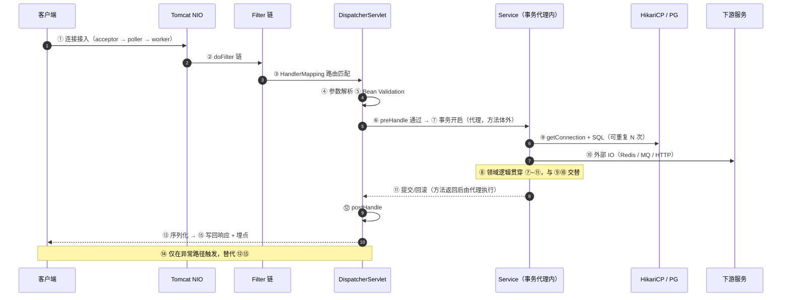

---
sources:
  - 01-第一阶段
---

# 02. 一次请求的十五站主时间线与账本

> [← 第一阶段导览](01-导览.md) · 把一次请求拆成十五段各自记账，你才可能在 CPU 只有 15% 时说出「慢在等谁」；这一册给的是账本的表结构、每站的线程归属与量级、以及从数字反推瓶颈的读法。

## 1. 为什么先建账本，而不是先优化

后端调优最常见的错误不是「优化手段选错」，而是「优化对象选错」。看到接口慢就加缓存，看到 CPU 高就加核——这两个动作都建立在一个未被验证的假设上：我知道时间花在哪。而人对耗时的直觉误差通常在一个数量级以上：你以为 800ms 里 700ms 在查数据库，实际可能是 600ms 在等连接池、50ms 在查库、100ms 在序列化一个三千条的列表。

账本的作用不是「测量」，而是**把猜测变成可核对的条目**。它有三个硬性要求，缺一条就会退化成一份好看但没用的报表：

1. **每一站有名字**。不是「服务层耗时」，而是「⑨ 取连接与 SQL」——粒度必须细到能指向一个具体的修复动作（加索引 / 改池大小 / 减少往返次数）。
2. **每一站归到线程**。同样是 500ms，「catalina-exec-7 在跑循环」和「catalina-exec-7 在 `park` 等连接」是两种完全不同的病，前者加 CPU，后者加池或改查询。
3. **每一站标注是否阻塞**。阻塞段不吃 CPU，所以 CPU 使用率这个指标对它们完全失明。这一条是账本和 APM 默认报表最大的区别。

第四章到第十二阶段，每一册都是在给其中某几站做精修。精修完必须回来核账：⑨ 从 2ms 降到 0.4ms，总 P99 应该跟着降；如果总 P99 没动，说明瓶颈已经换站了，你优化的是一个不是瓶颈的站。**没有账本，你无法判断一次优化到底有没有用**。

## 2. 全景：十五站与线程归属



**三条线程**：①②③…⑮ 默认全部跑在同一个 Tomcat worker 线程（`catalina-exec-N`，或虚拟线程下的 `tomcat-handler-N`）上——这是「一请求一线程」模型的核心事实，也是为什么任何一站阻塞都会独占一个 worker。例外只有三处：⑥ 之前的 `acceptor`/`poller` 是独立的 1~2 个线程；⑨ 的连接获取可能让 worker 停在 Hikari 的等待队列上，真正的 TCP 读写发生在数据库服务端；⑮ 之后的指标上报由 Micrometer 的定时任务在另一个线程完成。异步（`@Async`、`CompletableFuture`、WebFlux）会把 ⑧~⑬ 甩到别的线程池，届时账本要按「线程切换点」切成两段记——第八阶段会专门处理。

**三个「不是一次」的真相**，它们决定了账本不能用「一段开始、一段结束」的线性结构：

- ⑦ 和 ⑪ 不在方法体内。`@Transactional` 是代理，`BEGIN` 在进入方法前发、`COMMIT` 在方法返回后发。你在方法体里埋的任何计时点都测不到它们。
- ⑧⑨⑩ 是**交替循环**，不是顺序三段。一次业务方法里可能查 5 次库、调 2 次 Redis，账本记的是累计值 + 调用次数，不是单次值。
- ⑭ 是 ⑬ 的**异常分支**，二者互斥。异常一旦从 ⑧⑨⑪ 抛出，⑫ `postHandle` 不会执行，⑬ 序列化也不会发生，直接跳到 ⑭ 走 `@ControllerAdvice`。所以「⑭ 有值」和「⑬ 有值」在同一次请求里不可能同时成立，账本要做互斥校验。

## 3. 逐站展开

下表的耗时是**本地单机**（应用与 PG、Redis 都在同一台机器，loopback，keep-alive 复用连接）的量级，用来建立直觉；跨机器数字在 §4。

| # | 站点 | 做什么 | 线程 | 典型耗时 | 典型阻塞点 |
|---|---|---|---|---|---|
| ① | 连接接入 | acceptor 收 TCP，poller 读字节，解析请求行与头，交给 worker | acceptor/poller → worker | 复用 15µs，新建 250µs | 握手、TLS、`acceptCount` 满后排队 |
| ② | Filter 链 | 编码、CORS、Security、TraceId、日志等 `OncePerRequestFilter` | worker | 40µs（含 Security 可到 300µs） | 同步日志落盘、Security 每次查库 |
| ③ | 路由匹配 | `RequestMappingHandlerMapping` 按路径+方法+头查映射表 | worker | 8µs（首次 1ms+） | 映射表过大、正则路径、首次 JIT |
| ④ | 参数解析 | `HandlerMethodArgumentResolver` 反序列化请求体、绑定 `@PathVariable` | worker | 25µs | 请求体过大、泛型嵌套深 |
| ⑤ | 校验 | `@Valid` 触发 `Validator`，收集 `ConstraintViolation` | worker | 10µs | 正则回溯（ReDoS）、跨字段校验查库 |
| ⑥ | preHandle | 鉴权、限流、上下文注入 | worker | 20µs（JWT 验签 150µs） | 远程鉴权、Redis 限流计数 |
| ⑦ | 事务开启 | 代理向 `DataSource` 取连接、发 `BEGIN`、绑定到线程 | worker（可能停在池队列） | 120µs | **池满**——这里的等待可以到秒级 |
| ⑧ | 领域逻辑 | 你的业务代码：计算、组装、校验不变量 | worker | 200µs | 意外的大循环、`synchronized`、正则 |
| ⑨ | 取连接与 SQL | 执行 SQL、映射结果集、归还连接 | worker + PG | 600µs（3 条 SQL） | 慢查询、锁等待、N+1 |
| ⑩ | 外部 IO | Redis、MQ、下游 HTTP | worker | 300µs / 次 | 下游超时、重试放大、连接未复用 |
| ⑪ | 提交/回滚 | `COMMIT` 触发 WAL fsync；异常时 `ROLLBACK` | worker + PG | 700µs | fsync 慢盘、长事务、锁释放 |
| ⑫ | postHandle | 计时收尾、响应头加工 | worker | 5µs | 几乎不会成为瓶颈 |
| ⑬ | 序列化 | `HttpMessageConverter` 把对象写成 JSON 字节 | worker | 150µs | 返回体过大、懒加载触发额外 SQL |
| ⑭ | 异常归一 | `@ControllerAdvice` 构造 `ProblemDetail` | worker | 异常时 50µs | 异常里再查库、堆栈过深 |
| ⑮ | 写回与埋点 | 写 socket、刷缓冲、记录指标与日志 | worker + 上报线程 | 60µs | 客户端慢读导致写阻塞、同步 appender |

### 3.1 ①②：进进程之前与刚进进程

① 的耗时高度依赖「连接是不是复用的」。keep-alive 命中的请求只花十几微秒——poller 从已建立的连接上读到完整报文，把 `SocketWrapper` 交给 worker 即可。新建连接则要付 TCP 三次握手（同机房 0.5ms、跨机房 60ms+），HTTPS 再加 1~2 个 RTT 的 TLS 握手。这一站的总时间不体现在单请求账本里，而是体现为「QPS 上升时 `acceptCount` 排队」——`server.tomcat.accept-count` 默认 100，超过就拒绝。

② 是**唯一一个你完全可控、也最容易被滥用的位置**。所有 `Filter` 都在 DispatcherServlet 之前，此时还没有 handler 信息，也没有事务。这里适合放：编码、TraceId 注入、访问日志、安全认证、CORS 预检短路。不适合放：需要 body 的逻辑（`ContentCachingRequestWrapper` 会让 body 读两遍并全量进内存）、需要事务的逻辑、业务判断。

坑在于「一个 Filter 一次 IO」。见过的最典型现场：某个 Filter 里为了查灰度规则，同步调了一次配置中心；配置中心抖动 3 秒，整个服务的所有接口 P99 跟着变成 3 秒，而账本上 ⑧⑨ 全是正常的几十微秒。**② 段的任何远程调用都是全局放大器**，因为它不在业务链路的语义里，容量评估时最容易被漏掉。

### 3.2 ③④⑤：DispatcherServlet 的分发与绑定

③ 的本质是一次哈希查找：`RequestMappingHandlerMapping` 在启动时把所有 `@RequestMapping` 编译成 `PathPattern` 树，运行时按 URL 走树。它极少成为瓶颈，但有一个隐蔽的成本——**首次请求**。JIT 还没编译、类加载还没预热，第一次匹配可能花 1ms 以上。压测时的 P99 如果包含了冷启动阶段的样本，会被严重污染，这也是压测要「先预热再统计」的原因（05 册会把这个坑和 JMH 的预热坑放在一起讲）。

④ 是**参数解析器链**：Spring 默认注册二十多个 `HandlerMethodArgumentResolver`，按顺序试到第一个 `supportsParameter` 返回 true 的为止。对 `@RequestBody`，真正干活的是 Jackson 3 的 `JsonMapper`——注意，**请求体反序列化和响应体序列化用的是同一个 mapper**，所以 ④ 和 ⑬ 的耗时高度相关：一个带 200 个字段的 DTO，进出各付一次。

⑤ 的坑在 Kotlin 上比 Java 多。Bean Validation 走的是 `jakarta.validation`，约束注解加在构造器参数上；Kotlin 的默认值不会触发校验（缺省值直接填上，`@NotNull` 根本没机会跑），而 `@Valid` 加在 `data class` 的嵌套字段上需要显式 `@field:` 前缀才能落到字段而非构造器参数。这些细节第四阶段 05 册展开，这里只记一条：**校验段的耗时通常可以忽略，但校验失败率高的接口，⑤ 会变成主要成本**——因为抛异常、构造 `MethodArgumentNotValidException`、再走 ⑭ 归一，单次成本是正常路径的十倍。

### 3.3 ⑥⑦：拦截器与事务边界

⑥ `preHandle` 与 ② 的 `Filter` 分工常被搞混。判别标准很简单：**能不能拿到 handler 方法上的注解**。`HandlerInterceptor` 能拿到 `HandlerMethod`，所以「按注解决定要不要鉴权」「按注解限流」这类需求必须放这里；`Filter` 拿不到。⑥ 的另一个特性是它成对出现：`preHandle` 返回 false 就短路，返回 true 则在 ⑫ 有对应的 `postHandle`、在请求完成后有 `afterCompletion`——**`afterCompletion` 是唯一保证在异常路径也执行的收尾点**，MDC 清理、计时结束都应该放这里，而不是 `postHandle`。

⑦ 是整条链上最被低估的一站。它的成本有两部分：拿连接的等待 + 发 `BEGIN` 的往返。前者在池健康时是 20~100µs，池满时可以是**几秒**；后者在本地是 100µs，跨机房时变成 30ms，而且是每个事务一次。所以「应用和数据库跨机房部署」这件事的代价，第一个落点就是 ⑦。

一个必须记住的数字关系：**⑦ 的等待时间 ≈ 池排队长度 ÷ 连接释放速率**。当 `maximumPoolSize=10`、每个请求占用连接 5ms 时，理论吞吐上限是 2000 QPS；到了这个点，⑦ 的 P99 会突然从 100µs 跳到几百毫秒，而 ⑨ 的耗时完全不变。看到「⑦ 涨、⑨ 平」这个组合，答案就是池或持有时间，不是 SQL。

### 3.4 ⑧⑨⑩⑪：业务与 IO 的交替

⑧ 是唯一「你应该负责」的一站。它包含纯计算、对象组装、不变量检查。这一站出问题的形态通常不是「慢」，而是「不可预测」——某次请求 50µs，某次 800ms，原因是里面藏了一个 `synchronized` 块（等锁）、一个正则（回溯爆炸）、或者一个 `Stream` 里的远程调用（本该在 ⑩）。

⑨ 的正确度量方式是**每条 SQL 一条记录**，而不是「数据访问层总耗时」。因为 1 条 5ms 的慢查询和 50 条 0.1ms 的快查询在总量上等价，但修复手段完全相反：前者加索引，后者消灭 N+1。第五阶段 06 册会把 N+1 的识别方法写透，这里只强调账本要记「调用次数」这一列——**次数是发现 N+1 的唯一线索**。

⑩ 的关键判据是「在不在事务内」。事务内调下游，意味着连接被占用的时间包含了这次网络往返；下游抖动 3 秒，连接就被占 3 秒，池在几秒内耗尽，然后 ⑦ 段全面恶化。这是「一个下游慢导致整个服务雪崩」的标准传导路径，账本上表现为 ⑩ 涨 → ⑦ 涨 → 全线超时。第六阶段 03 册专门讲这件事的治理。

⑪ 的成本主要是 WAL 落盘（`synchronous_commit=on` 时的 fsync）。本地 SSD 0.5~1ms，同机房网络盘 1~3ms，跨机房 30ms+。它还有一个非线性特征：**并发提交时 fsync 会合并（group commit）**，所以 QPS 越高，单次提交的均摊成本越低。这意味着「压测时 ⑪ 反而变快」是正常现象，不要误判为优化生效。

### 3.5 ⑫⑬⑭⑮：回程

⑫ 的成本可以忽略，它的价值在语义：这是你最后一次能改响应头、能读 handler 返回值的地方。注意它**在序列化之前**，所以改返回值还有效；一旦进了 ⑬，对象已经变成字节流。

⑬ 的耗时不只取决于对象大小，还取决于**序列化时触发了什么**。最恶性的情况是：返回一个 JPA 实体，序列化器遍历关联字段，每一层关联触发一次懒加载查询——账本上表现为 ⑬ 暴涨，同时 ⑨ 的调用次数暴涨，而 ⑧ 的数字很小（业务代码什么都没干）。这就是「DTO 与实体混用」在性能上的爆炸半径，04 册会从设计角度再讲一遍。

⑭ 的工程价值不在耗时，在于**它必须只归一一次**。异常在 Filter、Interceptor、Controller、`@ControllerAdvice` 四处抛出时处理路径完全不同。合理的设计是：业务异常由 ⑭ 统一转 `ProblemDetail`，框架异常（404/405/415）由 `ResponseEntityExceptionHandler` 兜底，容器级异常（连接断开）只能靠 ⑮ 之后的日志。第四阶段 06 册展开。

⑮ 有一个容易被忽略的阻塞点：**客户端慢读**。响应体大、客户端网络差时，`socket` 写缓冲区满，worker 线程会阻塞在 write 上，此时它既不持锁也不查库，纯粹在等对端。账本上这一段的特征是 ⑮ 的 P99 远高于 P50，且与响应体大小强相关。

## 4. 三套耗时表：同一次改动在不同部署形态下结论相反

同一份代码，部署形态一变，瓶颈就换站。下表是同一个「创建订单」接口（3 条 SQL、1 次 Redis、跨机房场景下 2 次下游调用）在三种形态下的账本：

| # | 站点 | 本地（loopback） | 同机房（RTT 0.5ms） | 跨机房（下游 RTT 30ms，DB 同机房） |
|---|---|---|---|---|
| ① | 连接接入 | 15µs | 20µs | 20µs |
| ② | Filter 链 | 40µs | 45µs | 45µs |
| ③ | 路由匹配 | 8µs | 8µs | 8µs |
| ④ | 参数解析 | 25µs | 30µs | 30µs |
| ⑤ | 校验 | 10µs | 10µs | 10µs |
| ⑥ | preHandle | 20µs | 25µs | 25µs |
| ⑦ | 事务开启 | 120µs | 550µs | 550µs |
| ⑧ | 领域逻辑 | 200µs | 200µs | 200µs |
| ⑨ | 取连接与 SQL | 600µs | 2.0ms | 2.0ms |
| ⑩ | 外部 IO | 300µs | 600µs | **62ms** |
| ⑪ | 提交/回滚 | 700µs | 1.2ms | 1.2ms |
| ⑫ | postHandle | 5µs | 5µs | 5µs |
| ⑬ | 序列化 | 150µs | 150µs | 150µs |
| ⑭ | 异常归一 | 0 | 0 | 0 |
| ⑮ | 写回与埋点 | 60µs | 80µs | 80µs |
| | **合计** | **≈2.3ms** | **≈4.9ms** | **≈66ms** |

三张表要用三种方式读：

**按「受谁支配」分组**。③④⑤⑧⑬ 是计算支配——换机器、换机房都不变，只能靠改代码（更好的算法、更少的对象、更小的响应体）。⑦⑨⑩⑪ 是往返支配——本地到同机房的涨幅几乎全是「每条 SQL 从 0.1ms 变成 0.65ms」，同机房到跨机房的涨幅几乎全是「RTT × 往返次数」。①⑮ 是系统调用支配，②⑥ 是配置支配（Filter 数量和拦截器数量决定）。

**按「涨幅最大的那一格」定位**。本地→同机房只涨了 2.6ms，同机房→跨机房的 61ms 里有 61ms 来自 ⑩ 一格。这不是巧合：跨机房场景下，**每多一次同步远程调用，就多一个 30ms 起的固定税**，与调用做了什么完全无关。所以「把三个下游调用改成并行」这个优化的价值，在本地是 0，在同机房是几百微秒，在跨机房是从 62ms 变 32ms——省下来的正好是往返次数。这条推论是第八阶段「三种并发模型压测对比」的理论基础。

**按 P99 而非均值读**。上表是 P50 量级。真实账本里 P99 通常是 P50 的 3~10 倍，而尾巴的来源高度集中：⑦ 的池等待、⑨ 的锁等待与慢查询、⑩ 的下游抖动、GC 停顿（会同时抬高所有站的 P99）。**只看 P50 会得出「一切正常」，只看 P99 会得出「全都慢」**，必须两列并排看才能定位。

## 5. 账本的数据结构与埋点方式

一条账本记录不是「一次请求的时间线」，而是「一次请求里每站的聚合值」，因为 ⑧⑨⑩ 会重复。结构如下：

| 字段 | 类型 | 含义 | 为什么必须有 |
|---|---|---|---|
| `station` | 枚举 | 站点编号与名字 | 跨版本对比的稳定主键 |
| `p50` / `p99` / `p999` | 微秒 | 该站在样本窗口内的分位耗时 | P99 才是用户感知 |
| `thread` | 字符串 | 最近一次采样时的线程名 | 区分 worker / 池等待 / IO 线程 |
| `callsPerRequest` | 浮点 | 平均每请求触发次数 | 发现 N+1 的唯一线索 |
| `blocking` | 布尔 | 该站是否会主动让出 CPU | 决定「看 CPU 还是看等待」 |
| `samples` | 整数 | 参与统计的样本数 | 样本不足时分位数无意义 |

埋点方式只有两条路，取舍在于**要不要长期在线**：

| 维度 | Micrometer `Timer` | `System.nanoTime()` |
|---|---|---|
| 单次开销 | 200ns~1µs（含直方图更新） | ~25ns（两次调用一次减法） |
| 数据去向 | 直接进 Prometheus / OTLP，可跨实例聚合 | 只能自己打印或落盘 |
| 标签基数 | 受标签约束，写错会爆（见 05 册） | 无约束，但也没有维度 |
| 时间语义 | 受抓取间隔与窗口影响，看的是趋势 | 单请求精确拆段 |
| 适用 | 线上常开、告警、容量规划 | 一次性诊断、压测期拆段 |

工程上的正解是**两者并用、名字对齐**：线上长期开 `Timer`，只打低基数标签（`uri` 用模板化的 `/orders/{id}`、`status`、`method`），负责趋势与告警；压测或排障期间开 `nanoTime` 拆段，采样 1% 的请求，负责定位。两者用同一套 `Station` 枚举命名，报表才能并排看。

用 `nanoTime` 时有两个必须知道的细节。一是**它是单调时钟**，不受 NTP 校时影响，`currentTimeMillis` 会——跨机器对比时间戳必须用前者，否则会出现负耗时。二是**它测的是墙上时间（wall time），包含线程被换出和 GC 停顿**。这意味着账本里各站相加可能大于总耗时（如果统计窗口不同），也可能小于（如果某段没埋）。校验方法只有一个：所有站求和与总耗时的差值应当稳定在一个小常数内，差得多了就是漏埋。

## 6. 代码：把一次请求拆成十五段并汇总

先定义站点与账本本体。注意 `span` 的写法——它用 `try/finally` 保证异常路径也记账，否则 ⑭ 永远是 0：

```kotlin
enum class Station(val no: Int, val label: String, val blocking: Boolean) {
    ACCEPT(1, "连接接入", false),
    FILTER(2, "Filter 链", true),
    ROUTE(3, "路由匹配", false),
    ARGUMENT(4, "参数解析", false),
    VALIDATE(5, "校验", false),
    PRE_HANDLE(6, "preHandle", true),
    TX_BEGIN(7, "事务开启", true),
    DOMAIN(8, "领域逻辑", false),
    SQL(9, "取连接与 SQL", true),
    EXTERNAL_IO(10, "外部 IO", true),
    TX_COMMIT(11, "事务提交", true),
    POST_HANDLE(12, "postHandle", false),
    SERIALIZE(13, "序列化", false),
    ERROR(14, "异常归一", false),
    WRITE_BACK(15, "写回与埋点", false),
}

data class StationSample(
    val station: Station,
    val micros: Long,
    val calls: Int,
    val thread: String,
)

class RequestLedger {
    private val micros = LongArray(Station.entries.size)
    private val calls = IntArray(Station.entries.size)
    private val threads = arrayOfNulls<String>(Station.entries.size)
    var totalNanos: Long = 0
        private set

    // 非 inline：采样 1% 时这点 lambda 分配不重要；全量开时改成 inline + @PublishedApi
    fun <T> span(station: Station, block: () -> T): T {
        val t0 = System.nanoTime()
        try {
            return block()
        } finally {
            val i = station.ordinal
            micros[i] += (System.nanoTime() - t0) / 1_000
            calls[i] += 1
            threads[i] = Thread.currentThread().name
        }
    }

    fun snapshot(): List<StationSample> = Station.entries.mapNotNull { st ->
        val i = st.ordinal
        if (calls[i] == 0) null
        else StationSample(st, micros[i], calls[i], threads[i] ?: "-")
    }

    fun finish(totalNanos: Long) {
        this.totalNanos = totalNanos
        // ⑬⑭⑮ 在 handler 之外，只能用「总耗时 - 已记账之和」反推；为负说明漏埋
        val measured = micros.sum() * 1_000
        val i = Station.WRITE_BACK.ordinal
        micros[i] += ((totalNanos - measured) / 1_000).coerceAtLeast(0)
        calls[i] = 1                      // 残差也占一次，避免聚合时被当成「未发生」
        threads[i] = Thread.currentThread().name
    }
}
```

再把这套东西挂到一个真实接口上。注意代码里的注释——它们标出了「埋点位置」与「站点边界」不一致的地方，这正是 §2 那三个真相的落地：

```kotlin
@Component
class LedgerFilter(private val registry: LedgerRegistry) : OncePerRequestFilter() {
    override fun doFilterInternal(
        req: HttpServletRequest, res: HttpServletResponse, chain: FilterChain,
    ) {
        val ledger = RequestLedger()
        req.setAttribute(LEDGER_KEY, ledger)
        val t0 = System.nanoTime()
        try {
            // ② 之后到 ⑮ 之前全部包在这里：这一层拿到的是总账
            chain.doFilter(req, res)
        } finally {
            ledger.finish(System.nanoTime() - t0)
            registry.accept(ledger)          // 采样在这里决定要不要留
        }
    }

    companion object {
        const val LEDGER_KEY = "lab.ledger"
    }
}

// 让业务 Bean 能按请求注入同一个账本，而不是每个类自己 new 一个
@Configuration
class LedgerConfig {
    @Bean
    @RequestScope
    fun requestLedger(): RequestLedger =
        RequestContextHolder.currentRequestAttributes()
            .getAttribute(LedgerFilter.LEDGER_KEY) as RequestLedger
}

@RestController
@RequestMapping("/api/orders")
class OrderController(
    private val ledger: RequestLedger,        // request scope，由 Filter 注入
    private val orders: OrderService,
) {
    @PostMapping
    @ResponseStatus(HttpStatus.CREATED)
    fun create(@Valid @RequestBody body: CreateOrderRequest): OrderView {
        // ③④⑤ 已由 DispatcherServlet 走完；⑥ preHandle 也已返回
        // 这里开始的每一段都要显式记账，⑬⑭⑮ 在方法返回之后
        return ledger.span(Station.DOMAIN) { orders.create(body.toCommand()).toView() }
    }
}

@Service
class OrderService(
    private val ledger: RequestLedger,
    private val repo: OrderRepository,
    private val stock: StockClient,
) {
    @Transactional
    fun create(cmd: CreateOrderCommand): Order {
        // ⑦ 已由事务代理在进入本方法前完成，此处拿不到，改由 Hikari 的 acquire 指标提供
        val draft = ledger.span(Station.DOMAIN) { Order.draft(cmd) }
        val saved = repo.save(draft)                       // ⑨ 由 JDBC 观测记录，含 SQL 文本
        ledger.span(Station.EXTERNAL_IO) { stock.reserve(saved.sku, saved.qty) }
        return saved                                       // ⑪ 提交发生在 return 之后
    }
}
```

汇总层只做一件事：把每个站的样本排一次序取分位。生产环境用 HdrHistogram 或 Micrometer 的直方图，这里用定长环形缓冲演示语义——重点是分位数的算法必须与「窗口」绑定，否则跨时间对比没有意义：

```kotlin
class LedgerRegistry(private val capacity: Int = 8192) {
    private val buffers = Array(Station.entries.size) { LongArray(capacity) }
    private val sizes = IntArray(Station.entries.size)
    private val cursors = IntArray(Station.entries.size)
    private val calls = LongArray(Station.entries.size)
    private val threadOf = arrayOfNulls<String>(Station.entries.size)
    private var requests = 0L

    @Synchronized
    fun accept(ledger: RequestLedger) = ledger.snapshot().forEach { s ->
        val i = s.station.ordinal
        buffers[i][cursors[i]] = s.micros
        cursors[i] = (cursors[i] + 1) % capacity
        sizes[i] = minOf(sizes[i] + 1, capacity)
        calls[i] += s.calls
        threadOf[i] = s.thread
    }.also { requests++ }

    @Synchronized
    fun report(): String = buildString {
        appendLine("station            p50     p99    calls/req  thread")
        Station.entries.forEach { st ->
            val i = st.ordinal
            if (sizes[i] == 0) return@forEach
            val sorted = buffers[i].copyOf(sizes[i]).apply { sort() }
            val p50 = sorted[(sizes[i] * 0.50).toInt().coerceAtMost(sizes[i] - 1)]
            val p99 = sorted[(sizes[i] * 0.99).toInt().coerceAtMost(sizes[i] - 1)]
            val perReq = calls[i].toDouble() / requests.coerceAtLeast(1)
            appendLine("%-16s %6d %6d %9.2f  %s".format(st.label, p50, p99, perReq, threadOf[i]))
        }
    }
}
```

跑一轮固定 QPS 的压测，`report()` 出来的就是第一版账本。把它存成文件，后面每个阶段改完代码都重跑一次，两列数字并排看——**这是全站唯一一份可以贯穿十二个阶段的对照基线**。

## 7. 用账本定位瓶颈的三个例子

**例一：P99 800ms、CPU 15%、⑦ 段 650ms。** 这不是数据库慢，是池满。判别依据有三条同时成立：⑦ 远大于 ⑨（等连接的时间超过真正查库的时间）、⑨ 的 `callsPerRequest` 正常（不是 N+1）、线程名列显示 worker 停在 `HikariPool.getConnection`。修复顺序：先查连接泄漏（事务里调下游、`@Transactional` 套在长耗时方法上），再查持有时间，最后才调 `maximumPoolSize`。**直接调大池最差**——池上限受数据库 `max_connections` 约束，且池越大，排队只是从应用层转移到数据库层。

**例二：⑩ 段 P50 5ms、P99 320ms，⑨ 完全正常。** 320ms 这个数字很可疑——它接近某个整数倍的超时值。先看 `callsPerRequest`：如果它从 1.0 变成 3.0，说明重试被触发了（每次超时重试两次）；如果还是 1.0，说明是单次调用慢。前者要查重试配置（重试放大是第八阶段 06 册的主题），后者要查下游的连接复用——每次新建 HTTPS 连接要多付两个 RTT 的握手，同机房看起来只多 1ms，跨机房就是 60ms。

**例三：⑬ 从 150µs 涨到 12ms，同时 ⑨ 的 `callsPerRequest` 从 3 涨到 43。** 典型的实体直出。业务代码没变（⑧ 稳定），但返回的对象图变大了，序列化时每遍历一层关联就触发一次懒加载，43 条 SQL 里有 40 条是序列化阶段发出的——注意这些 SQL 的时间记在 ⑨，但触发点在 ⑬，账本上会看到两个站同时恶化。这种「两站联动」的模式是定位中最有价值的信号：单站恶化通常是那一站自己的问题，两站联动几乎总是「上游的操作触发了下游的开销」。修复不是调 Jackson，是加 DTO 边界（04 册）。

三个例子的共同方法论：**先看哪一站涨，再看它和谁联动，最后看 `callsPerRequest`**。次数这一列被绝大多数人忽略，但它是区分「慢」与「多」的唯一依据，而这两者的修复手段完全相反。

## 8. 自测

1. 为什么 ⑦ 事务开启和 ⑪ 事务提交在方法体内埋点测不到？你打算用什么手段分别度量它们？
2. 一个请求的账本显示 ⑧ 只有 80µs，但 ⑨ 的 `callsPerRequest` 是 47——最可能的两个原因是什么？怎么区分？
3. 本地测出「并行调用三个下游只快 0.3ms」，跨机房却快了 60ms。用「往返支配」解释这个差异，并说明为什么这个结论不能反过来用。
4. ⑭ 异常归一与 ⑬ 序列化为什么在同一次请求里不可能同时有值？如果一个账本里两列都非零，说明埋点出了什么问题？
5. 用 `System.nanoTime()` 拆段时，为什么各站之和可能大于总耗时？举两个具体原因。
6. 你的接口 P50 是 12ms、P99 是 340ms，账本里只有 ⑨ 的 P99 明显偏高。你会先怀疑「慢查询」还是「锁等待」，用什么数据区分？

## 9. 延伸

- 下一册：[03-技术基线与本地环境](03-技术基线与本地环境.md)——把 JDK 25 / Kotlin 2.2 / Gradle 9 / Boot 4.1 钉死，用 Compose 起一套可复现的 PG + Redis + Kafka，账本才有可对比的基线。
- ① ② 的容器内细节在[第四阶段 02 册](../04-第四阶段/02-Tomcat线程模型与Servlet6.1.md)；②⑥ 的顺序与职责划分在[第四阶段 03 册](../04-第四阶段/03-Filter-Interceptor-AOP的执行顺序.md)。
- ③④⑤ 的分发与绑定在[第四阶段 04 册](../04-第四阶段/04-DispatcherServlet分发与参数解析.md)，⑬⑭ 在[第四阶段 06 册](../04-第四阶段/06-错误模型-ProblemDetail与错误码.md)与[07 册](../04-第四阶段/07-Jackson3序列化.md)。
- ⑦⑨ 的池与 SQL 真相在[第五阶段 02 册](../05-第五阶段/02-连接池与JDBC真相.md)、[03 册](../05-第五阶段/03-SQL与索引-执行计划与慢查询.md)；⑩ 的爆炸半径在[第六阶段 03 册](../06-第六阶段/03-编程式事务与事务边界设计.md)。
- ⑮ 的指标落地与压测方法论在[第十阶段 05 册](../10-第十阶段/05-可观测性落地-指标-日志与链路.md)与[08 册](../10-第十阶段/08-压测与调优方法论.md)。
