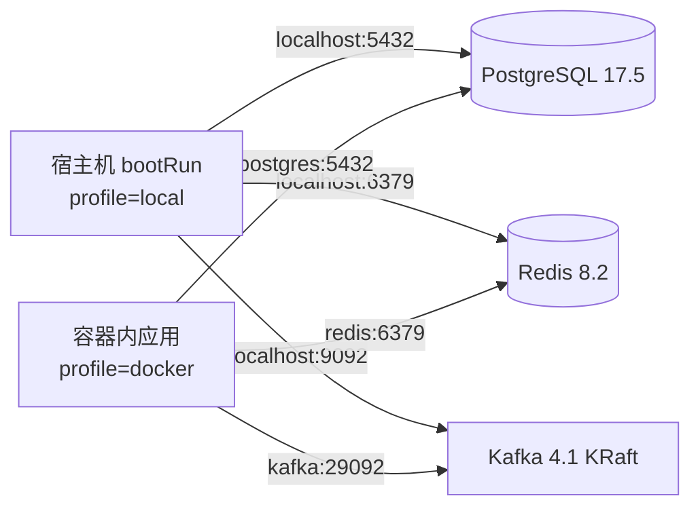

---
sources:
  - 01-第一阶段
---

# 03. 技术基线与本地环境

> [← 第一阶段导览](01-导览.md) · 版本不是细节而是结论的一部分：Boot 4 换了 starter 名、换了 JSON 库、删了 Undertow，照抄 3.x 教程会得到「能编译、行为不对」的结果；这一册把基线钉死，并给出一套 `docker compose up -d --wait` 就能复现的本地环境。

## 1. 为什么把版本钉死，而不是「用最新」

版本在这个站里不是背景信息，而是**实验可复现性的前提**。第一阶段的账本要在后面十一个阶段被反复引用：第五阶段把 ⑨ 从 2ms 优化到 0.4ms、第八阶段把同一接口换成虚拟线程、第十阶段拿去做压测基线。如果中途换了 JDK 或 Boot 版本，前后数字就不可比，你会花大量时间争论「这次变快是因为优化还是因为换了 GC」。

三个具体的「换版本导致结论翻转」的例子：

- JDK 21 到 25 之间，虚拟线程的调度器与 pinning 行为有变化。第八阶段要证明「`synchronized` 块导致 pinning」，在旧版本上复现不出来，你会误判成「虚拟线程没有这个问题」。
- Boot 3.x 到 4.x 换掉了 Jackson 2 → 3。序列化的默认行为（null 处理、时间格式、多态类型）有差异，⑬ 段的耗时会变，第四阶段的 JSON 契约测试用例会大面积失效。
- Gradle 8 到 9 移除了不少已废弃的 API。用 8 的写法搭骨架，在 9 上会直接构建失败，而失败信息指向的是插件而不是你的代码。

所以基线是一张**契约**：这一册定下的每个版本号，后面所有册的实验都在这张契约上跑。要升级可以，但必须整套升，并重跑账本。

| 层次 | 基线版本 | 最低要求 | 为什么钉在这里 |
|---|---|---|---|
| JDK | **25 LTS** | 17 | 虚拟线程稳定、结构化并发（`StructuredTaskScope`）转正、JFR 事件更全；25 是当前 LTS，能撑过整站生命周期 |
| 语言 | **Kotlin 2.2+** | 2.0 | K2 编译器稳定、context parameters 可用、`allopen`/`noarg` 插件与 Spring 配合成熟 |
| 构建 | **Gradle 9** | 8.14 | version catalog 与构建缓存成熟；9 的配置缓存默认更严格，逼你写正确的插件代码 |
| 框架 | **Spring Boot 4.1** | 4.0 | Spring Framework 7、Jakarta EE 11、Servlet 6.1、Jackson 3 全部就位；4.1 修了 4.0 的若干自动配置边界问题 |
| 数据 | **PostgreSQL 17** | 16 | 逻辑复制 failover、`pg_stat_io` 对第五阶段的实验够用；托管服务覆盖率最高 |
| 缓存 | **Redis 8** | 7.4 | Redis Stack 的能力（JSON、Bloom）并入核心，第七阶段不用另起镜像 |
| 消息 | **Kafka 4** | 3.9 | 只支持 KRaft，compose 里少一个 ZooKeeper 容器；新消费者组协议 GA |

**JDK 25 与最低 17 的取舍**：代码层面尽量不写 17 之后才有的语法（`switch` 模式匹配在 21 转正，`StructuredTaskScope` 在 25 才转正），这样你的服务能跑在只给 17 的企业环境里；但**实验全部在 25 上做**，因为第八阶段要用的正是 21/25 才有的能力。这条规矩写进骨架的 `toolchain` 配置里，编译目标与运行目标分开钉。

## 2. 3.5 → 4.x 的五个关键差异

这五条在后续阶段会反复出现，每一条都对应一类「照抄老教程就会踩」的现场。

### 2.1 starter 改名：`spring-boot-starter-web` → `spring-boot-starter-webmvc`

Boot 4 把过去那个「一个大 `spring-boot-autoconfigure` 装下所有技术」的结构拆成了按技术划分的模块：`spring-boot-webmvc`、`spring-boot-jackson`、`spring-boot-jdbc`、`spring-boot-actuator` 各管一段，starter 则是这些模块的便利组合。名字从 `web` 改成 `webmvc` 是为了和 `spring-boot-starter-webflux` 对称——`web` 这个词在 3.x 里同时暗示了「Servlet 栈」和「Web 开发」，实际它只包含 MVC 那一套。

坑不在编译，在**依赖树**。`spring-boot-starter-web` 在 4.x 里不再是正解，混用会导致同一份自动配置被两个模块各注册一次（表现为 Bean 重复或条件装配顺序异常）。检查方式只有一条，别靠肉眼：

```bash
./gradlew dependencies --configuration runtimeClasspath | grep -E "spring-boot-starter-(web|webmvc)"
```

顺带记住几个同期改名的：`spring-boot-starter-aop` 仍在，但 AOP 自动配置已并入 `spring-boot-aop`；测试相关的 `spring-boot-starter-test` 保留了名字但内容换成了 JUnit 6 / AssertJ / Mockito 5 的新组合。**升级时不要用「改 pom 坐标」的思路做，要用「按 starter 清单重建依赖」的思路做。**

### 2.2 Jackson 3：坐标换到 `tools.jackson`，`ObjectMapper` 换成 `JsonMapper`

这是五条里影响面最大的一条。Jackson 3 把 core 与 databind 的 group id 从 `com.fasterxml.jackson.core` 改成 `tools.jackson.core`，包名同理变成 `tools.jackson.databind`；而**注解包没有搬**，仍是 `com.fasterxml.jackson.annotation`——这个不对称是迁移时最容易搞混的地方，`@JsonProperty` 不用改 import，`ObjectMapper` 必须改。

三个行为变化值得单独记：

1. **`ObjectMapper` 不再是可 `new` 的入口**，取而代之的是不可变的 `JsonMapper`，用 builder 构造：`JsonMapper.builder().build()`。Spring Boot 4 的自动配置提供的 Bean 类型就是 `JsonMapper`，注入时写 `ObjectMapper` 会拿不到（它不是同一个类型层级上的默认实现）。
2. **异常从受检改成非受检**。`JsonProcessingException` 变成 `JacksonException`（`RuntimeException` 子类），Kotlin 里那些为了满足 Java 受检异常而写的 `@Throws` 可以删掉，但**吞异常的 `try/catch` 也要重新审视**——以前编译器会提醒你，现在不会。
3. **默认行为更严格**。未知字段、`null` 与缺省值的区分、`java.time` 的格式，默认值都和 2.x 不同。第四阶段 07 册会逐项对照；现在只需要知道：**升级后必须重跑所有 JSON 契约测试**，不能只看编译通过。

在 Kotlin 里定制 `JsonMapper` 的正确姿势是加一个 `JsonMapperBuilderCustomizer`，而不是自己 `@Bean` 一个 mapper（后者会绕开 Boot 已经配好的模块注册）：

```kotlin
@Configuration
class JsonConfig {
    @Bean
    fun kotlinFriendlyJson(): JsonMapperBuilderCustomizer = JsonMapperBuilderCustomizer { builder ->
        builder
            .enable(DeserializationFeature.FAIL_ON_NULL_FOR_PRIMITIVES)   // Kotlin 非空 Int 收到 null 要报错
            .disable(SerializationFeature.WRITE_DATES_AS_TIMESTAMPS)     // 时间统一走 ISO-8601
            .disable(DeserializationFeature.ACCEPT_FLOAT_AS_INT)         // 金额不允许 1.9 悄悄变成 1
    }
}
```

三条配置都是「宁可启动/请求失败，也不要静默地给出错误数据」：非空 `Int` 收到 `null` 时默认会被填成 0，金额 `1.9` 默认会被截成 `1`——这两类默认值在业务上都是错的，但在 2.x 里是兼容性考虑。**Jackson 3 的默认值更严格，但严格不到你需要的程度，该显式打开的要显式打开。**

### 2.3 `@MockBean` → `@MockitoBean`

Spring Framework 6.2 起 `@MockBean` / `@SpyBean` 被废弃，7.0 直接移除，替代品是 `@MockitoBean` / `@MockitoSpyBean`。这不只是改名：新注解把「替换容器里的 Bean」和「Mockito 的 mock 生命周期」解耦了，`@MockitoBean` 支持按类型或按名字替换、支持在 `@Nested` 测试类里覆盖外层声明，老注解做不到。

迁移的机械部分是全局替换，**非机械的部分是判断「你真的需要 mock 吗」**。Boot 4 里 `@MockitoBean` 会强制创建完整的应用上下文（除非配合切片注解），一个被 mock 掉的 `Repository` 往往掩盖了「这个 controller 根本不该依赖 repository」的分层问题——04 册的 ArchUnit 规则就是用来在编译后、运行前抓住这件事的。

### 2.4 Undertow 不再支持

Boot 4 的内嵌容器只剩 Tomcat、Jetty、Reactor Netty 三种。Undertow 被移除的直接原因是 Jakarta EE 11 / Servlet 6.1 的适配成本，间接原因是它在 Boot 生态里的使用率已经被 Tomcat 和（响应式场景下的）Reactor Netty 挤压到很低。

对本站的影响是正面的：**你不用再纠结容器选型**，默认 Tomcat 就是唯一正解，第四阶段讲线程模型时也只需要讲一套。唯一需要注意的是那些「为了性能换 Undertow」的历史结论——在 Servlet 6.1 + 虚拟线程的前提下，容器的线程模型差异已经远小于业务代码的差异，这类优化基本失效。

### 2.5 tracing 自动配置拆成独立模块

Boot 3.x 里只要引入 `spring-boot-starter-actuator` 加上一个 bridge（`micrometer-tracing-bridge-otel`），tracing 的自动配置就跟着生效。Boot 4 把这块拆成了独立的 `spring-boot-micrometer-tracing` 模块及其变体，**只引 actuator 不再自动带上 tracing**。

表现是「代码没报错，但链路里没有 traceId」。修复方式是按需显式引入：

```bash
# 只要指标与健康检查
implementation("org.springframework.boot:spring-boot-starter-actuator")
# 要链路，额外加：桥接 + 导出器
implementation("io.micrometer:micrometer-tracing-bridge-otel")
implementation("io.opentelemetry:opentelemetry-exporter-otlp")
```

这条差异的深层含义是 Boot 4 的整体设计取向：**自动配置从「大而全」转向「按需组合」**。§2.1 的 starter 拆分、这一条的 tracing 拆分，是同一个思路的两个落点。理解了这一点，遇到「某个功能突然不生效」时你的第一反应应该是「我是不是少引了一个模块」，而不是「是不是配置写错了」。

## 3. 中间件版本：为什么是 PG 17 / Redis 8 / Kafka 4

**PostgreSQL 17**。选它不是因为最新（18 已发布），而是因为三点：托管服务的覆盖率（云上 RDS 类产品对 17 的支持最完整，18 还在陆续跟进）、17 引入的 `pg_stat_io` 让第五阶段可以按 backend type 拆解 IO 来源、逻辑复制支持 failover 使得第六阶段讲主从切换时有真实可演示的机制。18 的异步 IO 在单机实验里体现不出来，反而会引入与教程不一致的执行计划差异。

**Redis 8**。2025 年 Redis 重新以 AGPLv3 开源，并把 Redis Stack 的模块（JSON、Search、TimeSeries、Bloom）并入核心发行版。这直接决定了第七阶段的实验成本：布隆过滤器（防穿透）不需要另起 `redis/redis-stack` 镜像，`BF.ADD` 开箱可用；JSON 类型让「缓存结构化对象」不必手工序列化。选 7.4 也能跑，但你会为了一个布隆过滤器多维护一个镜像和一套版本对齐。

**Kafka 4**。4.0 移除了 ZooKeeper，只支持 KRaft。对本地环境的意义非常具体：**compose 文件从四个服务（zk + broker + 两个依赖）变成一个 broker**，启动时间从 20 秒降到 3 秒，健康检查也简单得多。代价是网上大量「ZooKeeper + Kafka」的配置示例全部作废——`KAFKA_ZOOKEEPER_CONNECT` 这类变量在 4.x 里是无效的，写错了容器会直接起不来，而不是降级运行。

## 4. 一份可直接用的 `compose.yaml`

```yaml
name: backend-lab
services:
  postgres:
    image: postgres:17.5-alpine
    environment:
      POSTGRES_USER: app
      POSTGRES_PASSWORD: app
      POSTGRES_DB: appdb
      # 本地实验用，生产绝不能这样配
      POSTGRES_INITDB_ARGS: "--data-checksums"
    ports: ["5432:5432"]
    command:
      - postgres
      - -c
      - max_connections=200
      - -c
      - shared_buffers=512MB
      - -c
      - log_min_duration_statement=200    # 慢查询日志，第五阶段直接用
    volumes: ["pgdata:/var/lib/postgresql/data"]
    healthcheck:
      test: ["CMD-SHELL", "pg_isready -U app -d appdb"]
      interval: 5s
      timeout: 3s
      retries: 12
      start_period: 10s

  redis:
    image: redis:8.2-alpine
    command:
      - redis-server
      - --appendonly
      - "yes"
      - --maxmemory
      - 512mb
      - --maxmemory-policy
      - allkeys-lru
    ports: ["6379:6379"]
    healthcheck:
      test: ["CMD", "redis-cli", "ping"]
      interval: 5s
      timeout: 3s
      retries: 12

  kafka:
    image: apache/kafka:4.1.0
    ports: ["9092:9092"]
    environment:
      KAFKA_NODE_ID: 1
      KAFKA_PROCESS_ROLES: broker,controller
      KAFKA_LISTENERS: PLAINTEXT://:9092,INTERNAL://:29092,CONTROLLER://:9093
      KAFKA_ADVERTISED_LISTENERS: PLAINTEXT://localhost:9092,INTERNAL://kafka:29092
      KAFKA_CONTROLLER_QUORUM_VOTERS: 1@kafka:9093
      KAFKA_CONTROLLER_LISTENER_NAMES: CONTROLLER
      KAFKA_LISTENER_SECURITY_PROTOCOL_MAP: CONTROLLER:PLAINTEXT,PLAINTEXT:PLAINTEXT,INTERNAL:PLAINTEXT
      KAFKA_INTER_BROKER_LISTENER_NAME: PLAINTEXT
      KAFKA_OFFSETS_TOPIC_REPLICATION_FACTOR: 1
      KAFKA_TRANSACTION_STATE_LOG_REPLICATION_FACTOR: 1
      KAFKA_AUTO_CREATE_TOPICS_ENABLE: "false"
    healthcheck:
      test: ["CMD-SHELL", "/opt/kafka/bin/kafka-topics.sh --bootstrap-server localhost:9092 --list >/dev/null 2>&1"]
      interval: 10s
      timeout: 5s
      retries: 12
      start_period: 20s

volumes:
  pgdata:
```

```bash
docker compose up -d --wait          # --wait 会等到所有 healthcheck 通过才返回
docker compose ps --format "table {{.Name}}\t{{.Status}}"
docker compose down -v               # 连数据卷一起清，重来一遍
```

把上面的文件画成图，一共四个参与者、两套地址：宿主机上的 `bootRun` 用 `localhost`，容器内的应用用 compose 服务名——这也是 profile 唯一该干的事（§5）。



三个设计要点。**一是 `--wait`**：没有它，`up -d` 返回时 PG 还在初始化，你的应用会启动失败，然后你会误以为是配置问题。**二是 `start_period`**：Kafka 首次格式化日志目录需要十几秒，`start_period` 内的失败不计入 `retries`，否则会永远起不来。**三是版本号写全**（`17.5-alpine` 而不是 `17`），次要版本变化会影响执行计划与默认参数，账本要可复现就不能让它漂。

Kafka 那段里的两个 listener 值得单独说：`ADVERTISED_LISTENERS` 是**客户端拿到后要回连的地址**，客户端从 `localhost:9092` 连上来以后，broker 会把「我的地址是 localhost:9092」告诉它。所以容器内的应用必须走 `INTERNAL://kafka:29092` 这条，否则它会拿到 `localhost` 然后连自己——这是本地 Kafka 环境最高频的故障，症状是「元数据拉到了，但一直连不上 broker」。

## 5. `application.yml` 的分层

配置的层次只有四层，优先级从低到高：**打包内的默认值 → profile 文件 → 环境变量 → 命令行参数**。设计原则是「默认值可跑、profile 只切环境差异、密钥只走环境变量」。

```yaml
# application.yml —— 所有环境共享，只放不会变的东西
spring:
  application:
    name: backend-lab
  threads:
    virtual:
      enabled: true                 # JDK 25 上直接开，第八阶段会对比开关差异
  jpa:
    open-in-view: false             # 关掉，否则 ⑬ 序列化时还会有连接持有
  datasource:
    hikari:
      maximum-pool-size: 10
      connection-timeout: 1000      # 1s 拿不到连接就失败，不要无限等
  flyway:
    enabled: true

management:
  endpoints:
    web:
      exposure:
        include: health,metrics,prometheus
  endpoint:
    health:
      probes:
        enabled: true
---
# application-local.yml —— 本地开发
spring:
  config:
    activate:
      on-profile: local
  datasource:
    url: jdbc:postgresql://localhost:5432/appdb
    username: app
    password: app
logging:
  level:
    org.springframework.jdbc.core: DEBUG
---
# application-docker.yml —— 容器内跑（服务名当主机名）
spring:
  config:
    activate:
      on-profile: docker
  datasource:
    url: jdbc:postgresql://postgres:5432/appdb
    username: ${DB_USER}
    password: ${DB_PASSWORD}
```

三条规矩。**一是不把连接串写死在各 profile 里**，生产环境用 `SPRING_DATASOURCE_URL` 环境变量覆盖（Boot 的宽松绑定会把 `SPRING_DATASOURCE_URL` 映射到 `spring.datasource.url`），这样镜像可以跨环境复用。**二是 profile 只切「地址与凭据」，不切「行为」**——如果某个 profile 会改变业务逻辑（比如本地开关某个校验），那这条逻辑永远测不到真实形态。**三是密钥不进仓库**，`${DB_PASSWORD}` 在无值时启动失败是好事，比默认值 `postgres` 静默连上生产要好。

配置项要早校验。启动时打印实际生效的版本与关键参数，是「环境就绪」最便宜的证明：

```kotlin
@Component
class EnvProbe(private val dataSource: DataSource, private val env: Environment) :
    ApplicationRunner {

    override fun run(args: ApplicationArguments) {
        val pgVersion = dataSource.connection.use {
            it.createStatement().use { st ->
                st.executeQuery("select version()").use { rs -> rs.next(); rs.getString(1) }
            }
        }
        log.info(
            "env ready: jdk={} kotlin={} boot={} profile={} pg={} pool={}",
            System.getProperty("java.version"),
            KotlinVersion.CURRENT,
            SpringBootVersion.getVersion(),
            env.activeProfiles.joinToString(","),
            pgVersion.substringBefore(","),
            (dataSource as? HikariDataSource)?.maximumPoolSize ?: "unknown",
        )
    }

    companion object {
        private val log = LoggerFactory.getLogger(EnvProbe::class.java)
    }
}
```

这段代码的价值不在日志本身，而在于它**把「我以为环境是对的」变成了一条可核对的事实**：JDK 版本、Boot 版本、生效的 profile、PG 实际版本、池大小，五个数字一次打出来。后面的实验出问题时，第一件事就是回头看这行日志。

## 6. 容器内的 JVM 参数

本地开发可以在 IDE 里随便配，容器里必须显式声明。JDK 25 的默认值是合理的（G1、容器感知已默认开启），但有四处需要覆盖：

```bash
JAVA_TOOL_OPTIONS="-XX:MaxRAMPercentage=75.0 \
  -XX:+ExitOnOutOfMemoryError \
  -XX:NativeMemoryTracking=summary \
  -XX:StartFlightRecording=filename=/tmp/boot.jfr,dumponexit=true,settings=profile \
  -Duser.timezone=UTC \
  -Dfile.encoding=UTF-8"
```

- **`MaxRAMPercentage=75.0` 而不是 `-Xmx`**：镜像的内存上限变化时不用改启动脚本。留 25% 给元空间、线程栈、JFR 缓冲和 page cache——堆占满容器的 90% 是最常见的 OOMKilled 原因，而且它表现为 `exit code 137`，看起来像被杀了，实际是自己把内存吃超了。
- **`ExitOnOutOfMemoryError`**：`OutOfMemoryError` 之后进程状态不可信，继续服务只会返回错误数据。让它死，让编排系统重启，比带病运行好。
- **`NativeMemoryTracking=summary`**：堆没满但容器 OOM 时，这是唯一能告诉你内存去哪了的开关。开销约 5%，排障期开，稳定后关。
- **`StartFlightRecording`**：这是 05 册 JFR 的入口。`dumponexit` 保证进程被杀前落盘，`settings=profile` 是低开销档（约 1%），可以长期开在生产环境。

两个额外注意：`-XX:ActiveProcessorCount` 在 CPU limit 不是整数时会算错线程池大小（JVM 读到的是宿主机核数），G1 的 GC 线程数、ForkJoinPool 的并行度都受影响；`-XX:+UseZGC` 在 JDK 25 上是分代 ZGC，适合大堆低延迟场景，但小堆（<4G）下 G1 的吞吐更好——第十阶段压测时会用到这个对比。

## 7. 环境就绪检查清单

不要靠「我觉得装好了」。下表逐条跑一遍，全绿再进 04 册。

| # | 检查项 | 命令 | 期望结果 |
|---|---|---|---|
| 1 | JDK 版本 | `java -version` | `openjdk version "25"` |
| 2 | 构建工具 | `./gradlew --version` | Gradle 9.x + JVM 25 |
| 3 | 工具链锁定 | `./gradlew buildEnvironment` | 无 toolchain 解析告警 |
| 4 | PG 可连 | `psql -h localhost -U app -d appdb -c 'select version()'` | 输出 PostgreSQL 17.5 |
| 5 | PG 参数生效 | `psql ... -c 'show max_connections'` | 200 |
| 6 | Redis 可连 | `redis-cli ping` | `PONG` |
| 7 | Redis 模块可用 | `redis-cli BF.ADD probe x` | 返回 1（不是 unknown command） |
| 8 | Kafka 可用 | `docker compose exec kafka /opt/kafka/bin/kafka-topics.sh --bootstrap-server localhost:9092 --list` | 无报错（空列表也算通过） |
| 9 | 容器健康 | `docker compose ps` | 三个服务都是 `healthy` |
| 10 | 应用启动 | `./gradlew bootRun --args='--spring.profiles.active=local'` | 日志里有 `env ready:` 且五个字段齐全 |
| 11 | Actuator 活着 | `curl -s localhost:8080/actuator/health` | `{"status":"UP"}` |
| 12 | 指标可抓 | `curl -s localhost:8080/actuator/prometheus \| head` | 出现 `jvm_memory_used_bytes` |

第 7 条最容易被跳过：很多人的 Redis 镜像来自老项目，跑的是 7.x 甚至 6.x，`BF.ADD` 直接报未知命令，等到第七阶段做布隆过滤器时才发现。第 11、12 条是 05 册的前置——Actuator 不通，后面所有度量工作都无从谈起。

## 8. 自测

1. 为什么 JDK 的「编译目标 17、运行目标 25」是可行且推荐的？哪些特性会让你在编译期就失去兼容性？
2. `spring-boot-starter-web` 在 Boot 4 里换成了什么？除了编译，你还应该用什么命令确认依赖树没有混入旧坐标？
3. Jackson 3 里 `@JsonProperty` 和 `ObjectMapper` 的 import 分别变成了什么？为什么一个变了、一个没变？
4. 为什么推荐用 `JsonMapperBuilderCustomizer` 而不是直接 `@Bean` 一个 `JsonMapper`？后者会丢掉什么？
5. Compose 里 `--wait`、`start_period`、`retries` 三者分别解决什么问题？只配 `retries` 会看到什么现象？
6. `MaxRAMPercentage=75` 里剩下的 25% 被谁用掉了？如果不留，容器层面会看到什么信号？

## 9. 延伸

- 下一册：[04-工程骨架与分层约定](04-工程骨架与分层约定.md)——环境就绪之后，把多模块边界、对象边界与 ArchUnit 守卫搭起来。
- 下一册依赖本册的度量能力：[05-度量地基-JFR-JMH与Actuator](05-度量地基-JFR-JMH与Actuator.md)——JDK 25 的 JFR、JMH 与 Actuator 端点在这里才开始真正用起来。
- Jackson 3 的完整迁移与契约细节在[第四阶段 07 册](../04-第四阶段/07-Jackson3序列化.md)；容器内 JVM 与分层镜像在[第十阶段 07 册](../10-第十阶段/07-交付-分层镜像-探针与优雅停机.md)。
- 配置分层与密钥外置的生产化做法在[第十阶段 06 册](../10-第十阶段/06-配置分层与密钥外置.md)；PG 参数与连接池的联动在[第五阶段 02 册](../05-第五阶段/02-连接池与JDBC真相.md)。
