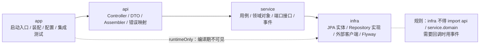

---
sources:
  - 01-第一阶段
---

# 04. 工程骨架与分层约定

> [← 第一阶段导览](01-导览.md) · 骨架的价值不在于「目录好看」，而在于让错误的依赖写不出来：这一册用 Gradle 模块边界、三类对象边界和一条 ArchUnit 规则，把「controller 依赖 repository」从「评审时靠人盯」变成「构建时直接失败」。

## 1. 单体优先：先付小钱，别提前付大钱

新项目最容易犯的架构错误是「一步到位微服务」。它的成本不在服务器，而在五笔必须立刻付的账：进程间通信（每次调用从纳秒级变成毫秒级）、分布式事务（本地事务没了，要 Outbox/Saga）、部署编排（本地开发要起 N 个进程）、链路排障（一个请求跨五个服务）、团队协作开销（接口变更要跨团队对齐）。

模块化单体把这五笔账全部推后，同时保留最值钱的那一样东西：**边界**。它用编译期的模块依赖替代运行时的网络调用——**越界的代价从「线上偶发超时」变成「编译不过」**，这是任何一种分布式架构都给不了的反馈速度。

| 形态 | 边界靠什么保证 | 一次跨边界调用的成本 | 变更成本 | 什么时候该选 |
|---|---|---|---|---|
| 分层大泥球 | 约定与自觉 | 方法调用（几十纳秒） | 改一处不知道影响谁 | 永不推荐 |
| 模块化单体 | 编译期模块依赖 + ArchUnit | 方法调用或事件（微秒级） | 改一个模块，影响面可枚举 | **默认选择** |
| 微服务 | 网络 + 契约 + 部署隔离 | 一次 RPC（同机房 1ms，跨机房 30ms+） | 改一个服务，要协调发布 | 团队规模 × 变更频率撑不住单体时 |

演进路径是单向的、可验证的：先做**模块化单体**（本册），模块间只通过接口与事件通信，不允许跨模块直接引用实现类；等到某个模块真的需要独立扩容或独立发布节奏时，把它整体挪出去——因为边界已经存在，拆分只是把「方法调用」换成「HTTP 调用」，而不是重新设计。

反过来，从微服务退回单体几乎不可能，因为数据已经分散、契约已经发布。**这就是为什么「先单体」不是保守，而是保留了双向选择权。**

## 2. Gradle 多模块骨架与依赖方向

四个模块，一条单向依赖链：



`app → api → service → infra` 是编译期的边，环被彻底禁止。`infra` 需要回调业务时不是反向依赖，而是走 Spring 的事件机制（§7），依赖边仍然指向事件类型所在的 `service` 包。

```kotlin
// settings.gradle.kts —— gradle/libs.versions.toml 会被自动识别为 libs，不用手写 catalog
rootProject.name = "backend-lab"
include("app", "api", "service", "infra")
```

```toml
# gradle/libs.versions.toml —— 全工程唯一的版本来源
[versions]
kotlin = "2.2.20"
springBoot = "4.1.0"
archunit = "1.4.1"

[plugins]
kotlin-jvm = { id = "org.jetbrains.kotlin.jvm", version.ref = "kotlin" }
spring-boot = { id = "org.springframework.boot", version.ref = "springBoot" }

[libraries]
boot-bom = { module = "org.springframework.boot:spring-boot-dependencies", version.ref = "springBoot" }
boot-starter-webmvc = { module = "org.springframework.boot:spring-boot-starter-webmvc" }
boot-starter-validation = { module = "org.springframework.boot:spring-boot-starter-validation" }
boot-starter-actuator = { module = "org.springframework.boot:spring-boot-starter-actuator" }
boot-starter-test = { module = "org.springframework.boot:spring-boot-starter-test" }
spring-tx = { module = "org.springframework:spring-tx" }
archunit-junit5 = { module = "com.tngtech.archunit:archunit-junit5", version.ref = "archunit" }
```

```kotlin
// api/build.gradle.kts —— 只认识 service，不认识 infra
plugins { kotlin("jvm"); javaLibrary }

dependencies {
    // 子模块不引 Boot 插件，靠 BOM 统一版本；否则每个坐标都要手写版本号
    implementation(platform(libs.boot.bom))
    implementation(project(":service"))
    implementation(libs.boot.starter.webmvc)
    implementation(libs.boot.starter.validation)
}
```

```kotlin
// service/build.gradle.kts —— 全工程唯一允许指向 infra 的边
dependencies {
    implementation(platform(libs.boot.bom))
    // implementation 而非 api：下游（api/app）看不到 infra 的类型，
    // 但运行期它仍然在 classpath 上，Spring 能扫到实现类
    implementation(project(":infra"))
    implementation(libs.spring.tx)
}
```

```kotlin
// app/build.gradle.kts —— 只有启动与装配，写不出业务代码
plugins { kotlin("jvm"); alias(libs.plugins.spring.boot) }

dependencies {
    implementation(platform(libs.boot.bom))
    implementation(project(":api"))
    // 冗余但明确：编译期看不见 infra，app 里写 repo.xxx 会直接编译失败
    runtimeOnly(project(":infra"))
    runtimeOnly(libs.boot.starter.actuator)
    testImplementation(libs.boot.starter.test)
    testImplementation(libs.archunit.junit5)
}
```

**`implementation` 这个关键字就是边界的一半**。Gradle 的 `implementation` 不会把依赖暴露给消费者，所以 `api` 编译时看不到 `infra` 的任何类型——不是靠自律，是根本 import 不到。`app` 里那个 `runtimeOnly` 同理：启动类只能写 `runApplication<LabApplication>(*args)`，想在里面塞一段「顺手查一下数据库」的代码都做不到。

另一半在测试里（§6 的 ArchUnit）。两层加起来才完整：模块边界拦住了「跨模块」，ArchUnit 拦住了「同模块内跨层」。

**什么时候才需要抽第五个模块**。当 `service` 需要被 `infra` 回调、而事件机制又不合适时（同步返回值、强一致要求），可以引入 `port` 模块放接口，形成 `infra → port ← service`。代价是模块数 +1、IDE 里「跳转到实现」多一次中转、新人要多理解一层。**单体内这笔钱通常不值得付**——先用事件，等到真的需要替换实现（比如同一套业务要接两套存储）再抽。

## 3. 包结构：按功能切，不按层切

同一个 feature 的四个文件（Controller、Service、Domain、Entity）放在四个平行的 `controller/`、`service/`、`domain/`、`repository/` 目录里，是 Java 时代的默认做法。它的问题在**变更半径**：产品说「订单加一个优惠券字段」，你要在四个目录之间跳，而每个目录里有三十个不相关的类。

按功能切之后，同一个 feature 的所有代码在一个包下，改动是局部的：

```text
com.example.lab
├── api
│   ├── order/                     # 一个 feature 一个包
│   │   ├── OrderController.kt
│   │   ├── CreateOrderRequest.kt  # DTO，只属于对外契约
│   │   ├── OrderView.kt
│   │   └── OrderAssembler.kt      # 领域对象 → DTO 的唯一转换点
│   └── support/                   # ProblemDetail、错误码、全局异常映射
├── service
│   └── order/
│       ├── OrderService.kt        # 用例，@Transactional 只出现在这一层
│       ├── OrderRepository.kt     # 端口：接口，不是实现
│       ├── OrderCreated.kt        # 领域事件
│       └── domain/
│           ├── Order.kt           # 领域对象，无框架注解
│           └── OrderStatus.kt
└── infra
    ├── persistence/order/
    │   ├── OrderJpaEntity.kt
    │   ├── OrderJpaRepository.kt  # 实现 service 的 OrderRepository
    │   └── OrderEntityMapper.kt
    ├── client/
    └── config/
```

| 维度 | 按层分包 | 按功能分包 |
|---|---|---|
| 一次业务改动涉及几个目录 | 3~5 个平行目录 | 1~2 个 |
| 新人理解一个功能 | 要跨目录拼图 | 一个包读完 |
| 模块拆分的准备度 | 拆分时要重新洗牌 | 包边界天然就是模块边界 |
| 跨 feature 复用 | 容易（但也容易滥用） | 需要显式提升到 `support`/`shared` |
| 包内聚性 | 低（同包类互不相关） | 高 |

唯一的代价是「复用变麻烦」，而这恰好是好事：跨 feature 复用最容易演化成隐蔽的耦合。真的需要复用时，把它提升到一个显式的共享包，等于在代码里留下一次决策记录。

## 4. 三类对象边界，与一次混用的完整复盘

| 对象 | 住哪 | 可变性 | 谁定义字段名 | 变更的成本 |
|---|---|---|---|---|
| **DTO** | `api` | 不可变 `data class` | 你自己（契约） | 破坏性变更，要版本化 |
| **领域对象** | `service/domain` | 不可变，构造即合法 | 业务语义 | 改一处，影响本 feature |
| **实体** | `infra` | 可变（JPA 需要） | 数据库表结构 | 迁移脚本 + 兼容窗口 |

三者的字段名**必须能各自独立变化**，这是它们存在的唯一理由。混用的代价可以精确到某一次事故——下面这个案例几乎每个团队都经历过一遍：

第一天，为了省事，`UserController` 直接返回 `UserJpaEntity`。JSON 里出现了 `password_hash` 字段，前端截图发到群里，改成 `@JsonIgnore`。

第三周，产品要「用户列表带最近三笔订单」。给实体加 `@OneToMany(fetch = FetchType.LAZY) val orders`。序列化时 Jackson 遍历 `orders`，每个用户触发一次查询：100 个用户 → 101 条 SQL，账本上 ⑨ 的 `callsPerRequest` 从 2 变成 102，⑬ 从 0.2ms 变成 45ms。修复方式是再加一个 `@JsonIgnore`，然后另一个接口也需要订单，于是引入 `@JsonView`。

第二个月，DBA 把 `phone` 列改成 `phone_number`（为了和大盘表对齐）。三个客户端同时解析失败——因为 **API 字段名就是数据库列名**。这不是 DBA 的错，他改的是自己的表。

第三个月，加 `@ManyToOne` 指向 `Account`，双向关联，Jackson 无限递归，接口 500，堆栈里是 `StackOverflowError`。加 `@JsonBackReference`。

到这里，这个实体上已经贴了 7 个 Jackson 注解、3 个 `@JsonView` 分组，而**每加一个字段，你都要同时回答三个问题**：DB 要不要这一列、API 要不要暴露、序列化时会不会触发懒加载。三个问题纠缠在一个类上，任何一处判断失误都直接进生产。

如果把三个对象分开，同样的需求序列是这样的：加字段只改 `infra` 的实体和 Flyway 脚本；要不要暴露给客户端是 `OrderView` 的决定；序列化永远只看到扁平 DTO，不可能触发懒加载。**代价是多写一个 Assembler**——大约十行代码，一次性成本换掉上面全部三个月的债。

```kotlin
// api/order/OrderView.kt —— 契约。字段名、类型、可空性都是对外承诺
data class OrderView(
    val id: String,
    val status: String,
    val amount: String,        // 金额用字符串：避免前端浮点精度问题（第四阶段 07 册）
    val createdAt: String,
)

// service/order/domain/Order.kt —— 不变量写在构造里，改状态只能过方法
data class Order private constructor(
    val id: OrderId,
    val amount: Money,
    val status: OrderStatus,
) {
    fun pay(paidAt: Instant): Order {
        require(status == OrderStatus.DRAFT) { "只有草稿单能支付，当前 $status" }
        return copy(status = OrderStatus.PAID)
    }

    companion object {
        fun draft(customerId: CustomerId, amount: Money): Order =
            Order(OrderId.new(), amount, OrderStatus.DRAFT)
    }
}

// api/order/OrderAssembler.kt —— 唯一同时认识领域对象与 DTO 的地方
object OrderAssembler {
    fun toView(order: Order): OrderView = OrderView(
        id = order.id.value.toString(),
        status = order.status.name,
        amount = order.amount.toPlainString(),
        createdAt = order.createdAt.toString(),
    )
}
```

Assembler 放在 `api` 而不是 `service`，方向才是对的：`api` 依赖 `service`，反过来会造出一个环，也会把「对外契约」的知识漏进业务层。

## 5. 配置分层：默认值在代码里，差异在 profile 里，密钥在环境变量里

骨架阶段的配置问题不是「怎么配」，而是「配在哪一层」。判断标准只有一句：**这个值变了，行为会不会变？**

- 变的是地址、凭据、容量（池大小、超时）→ 配置项，走 profile 与环境变量。
- 变的是业务规则（某个开关决定要不要校验）→ **不要做成配置**。它会造出「本地测过的代码和线上跑的不是同一份逻辑」，这类问题在事故复盘里出现频率极高。
- 永远不会变、只是调优参数 → 写在 `@ConfigurationProperties` 的默认值里，让代码自己就是文档。

```kotlin
@ConfigurationProperties("lab.order")
@Validated
data class OrderProperties(
    @field:Positive val maxItemsPerOrder: Int = 20,
    @field:PositiveOrZero val reservationTtlSeconds: Long = 900,
    @field:NotEmpty val defaultCurrency: String = "CNY",
)
```

配上 `@ConfigurationPropertiesScan`，启动时就会校验：`maxItemsPerOrder: -1` 会让应用起不来，而不是在第一次下单时算出个负数。**配置错误的发现时机越早越便宜**——启动失败是零成本，运行时错误是事故。

「业务规则不许做成配置」这条规矩值得举个反例。曾经很流行写 `lab.order.enable-coupon-stack=true`，本地设 false 省得算叠加逻辑。半年后线上出现「两张券叠加后金额为负」，复盘发现：本地和 CI 跑的都是 false 分支，那条 `true` 的代码路径**三年没被执行过一次**，连单测都只覆盖了默认值。配置项的隐性成本是**它让代码路径数按指数增长**，而测试只会覆盖其中一条。判断标准很简单：这个开关的两侧是不是都需要长期存在？不是的话，它是分支，不是配置。

profile 只做一件事：切换外部依赖的坐标。`local` 指向 `localhost`，`docker` 指向 compose 的服务名，`prod` 全部走环境变量注入。三层文件（`application.yml` / `application-local.yml` / `application-docker.yml`）的具体写法在 03 册 §5，这里不重复。判断一个值该不该进 profile，问一句话就够：**它变了之后，跑的是不是同一个逻辑？** 是，写进 profile；不是，写进代码。

## 6. 用 ArchUnit 守住边界

模块边界只拦得住「跨模块」，拦不住「同一个模块里 controller 直接 new 了 repository」。ArchUnit 把这类规则变成测试，跑在每次构建里：

```kotlin
@AnalyzeClasses(
    packages = ["com.example.lab"],
    importOptions = [ImportOption.DoNotIncludeTests::class],
)
class LayeringArchTest {

    @ArchTest
    val `controller 不许依赖 repository 与 infra` : ArchRule =
        noClasses()
            .that().resideInAPackage("..api..")
            .and().haveSimpleNameEndingWith("Controller")
            .should().dependOnClassesThat()
            .resideInAnyPackage("..infra..", "..repository..", "..OrderRepository")
            .because("越过 service 会绕开事务边界与不变量校验，并把表结构变成对外契约")

    @ArchTest
    val `service 不许认识 web 与 servlet 类型` : ArchRule =
        noClasses()
            .that().resideInAPackage("..service..")
            .should().dependOnClassesThat()
            .resideInAnyPackage("org.springframework.web..", "jakarta.servlet..", "..api..")
            .because("业务层一旦认识 HttpServletRequest，就再也无法在非 HTTP 场景复用，也无法纯单测")

    @ArchTest
    val `infra 不许反向依赖 api 与 service 的实现` : ArchRule =
        noClasses()
            .that().resideInAPackage("..infra..")
            .should().dependOnClassesThat()
            .resideInAnyPackage("..api..", "..service..domain..")
            .because("反向依赖会造出环；需要回调时用事件，不要 import 业务类")

    @ArchTest
    val `领域对象不许带框架注解` : ArchRule =
        noClasses()
            .that().resideInAPackage("..service..domain..")
            .should().dependOnClassesThat()
            .resideInAnyPackage("org.springframework..", "jakarta.persistence..", "tools.jackson..")
            .because("领域对象被框架注解绑死后，持久化或序列化的需要会反过来扭曲业务模型")
}
```

三条写规则的经验。**一，规则要写「为什么」**（`because`）。半年后有人想绕过它时，`because` 里的那句话是他唯一能看到的决策依据；没有理由的规则一定会被 `@ArchIgnore` 掉。**二，规则要能指出修复方向**。`controller 不许依赖 repository` 的反面不是「随便找个地方塞」，而是「加一个 service 方法」——好的规则名本身就是答案。**三，一次只加一条**。一上来写二十条规则，第一次构建就红一片，团队的本能反应是关掉插件；从最痛的那条开始，红了就修，修完再加下一条。

`ArchIgnore` 是逃生门，但每次使用都应该附一个 issue 编号。没有编号的例外，三个月后没人敢删。

## 7. 启动入口与模块装配

```kotlin
@SpringBootApplication
@ConfigurationPropertiesScan
class LabApplication

fun main(args: Array<String>) {
    runApplication<LabApplication>(*args)
}
```

启动类只有四行，这是刻意的：`app` 模块的职责是**装配**，不是实现。`@SpringBootApplication` 的组件扫描基于 `com.example.lab` 这个根包，所以 `api`、`service`、`infra` 里的 `@Component` 都会被扫到——哪怕 `app` 编译时看不见 `infra` 的类型，运行期它仍在 classpath 上。

`infra` 需要主动通知业务时，走事件而不是反向 import：

```kotlin
// service 侧：发布事实，不关心谁听
@Service
class OrderService(
    private val repo: OrderRepository,
    private val events: ApplicationEventPublisher,
) {
    @Transactional
    fun create(cmd: CreateOrderCommand): Order {
        val saved = repo.save(Order.draft(cmd.customerId, cmd.amount))
        events.publishEvent(OrderCreated(saved.id))   // 事务内发布
        return saved
    }
}

// infra 侧：监听，且只在事务提交成功后才发消息
@Component
class OrderCreatedPublisher(private val kafka: KafkaTemplate<String, String>) {
    @TransactionalEventListener(phase = TransactionPhase.AFTER_COMMIT)
    fun on(event: OrderCreated) {
        kafka.send("order.created", event.orderId.value.toString(), event.orderId.value.toString())
    }
}
```

`AFTER_COMMIT` 这个相位是这段代码的全部价值：事务回滚时消息不会发出，避免了「消息发了但数据没落库」这个经典不一致（第六阶段 06 册会讲它在分布式下的完整形态 Outbox）。依赖方向也对：`infra` 只 import `service` 的事件类，而事件类是一个纯数据类——它不会反向调用任何业务逻辑，所以这个 import 不构成环，ArchUnit 的第三条规则也因此只禁了 `..service..domain..` 而不是整个 `..service..`。

最后补一条装配自检。骨架搭完必须能证明「所有 Bean 都能创建、没有循环依赖」：

```kotlin
@SpringBootTest
class WiringTest {
    @Test
    fun `上下文可以启动`() {
        // 空测试：能跑过就说明所有构造器注入可解析、无循环依赖、
        // 所有 @ConfigurationProperties 校验通过
    }
}
```

这个空测试会在后续每个阶段救你一次。加了新模块、新 Bean、新配置项之后，它是最先红的那一个。

顺带把两个默认值陷阱钉死在 `application.yml` 里：`spring.main.lazy-initialization` 保持 `false`——懒加载会把「Bean 创建失败」从启动期推迟到第一次请求，而第一次请求通常发生在发布后的流量高峰；`spring.main.allow-bean-definition-overriding` 也保持 `false`——允许覆盖意味着同一个 Bean 有两份定义同时在容器里，谁生效取决于扫描顺序，这种不确定性在排障时几乎无法复现。

## 8. 自测

1. 模块化单体相比「分层大泥球」，边界是靠什么机制保证的？为什么这个机制比代码评审更可靠？
2. `service` 里写 `implementation(project(":infra"))` 和 `api(project(":infra"))` 有什么区别？前者为什么反而更好？
3. 为什么 `app` 模块用 `runtimeOnly(project(":infra"))` 而不是 `implementation`？这个选择在编译期阻止了哪种代码？
4. DTO、领域对象、实体三者的字段名为什么必须能独立变化？举一个「不能独立变化」导致的具体后果。
5. `@TransactionalEventListener(AFTER_COMMIT)` 与普通 `@EventListener` 的差别在哪？前者避免了哪种不一致？
6. ArchUnit 规则里 `because(...)` 有什么用？为什么说「没有理由的规则一定会被忽略」？

## 9. 延伸

- 上一册：[03-技术基线与本地环境](03-技术基线与本地环境.md)；下一册：[05-度量地基-JFR-JMH与Actuator](05-度量地基-JFR-JMH与Actuator.md)——骨架搭好之后，把度量工具接进去。
- Kotlin 侧的类型建模（值对象、密封错误、不可变集合）在[第二阶段 02 册](../02-第二阶段/02-空安全与不可变数据建模.md)与[03 册](../02-第二阶段/03-类型系统进阶.md)；Gradle 的 convention plugin 在[第二阶段 07 册](../02-第二阶段/07-Gradle构建-version-catalog与多模块.md)。
- `@Transactional` 的代理与自调用失效在[第三阶段 04 册](../03-第三阶段/04-AOP与代理-自调用的真相.md)；DTO 与 Jackson 3 的契约细节在[第四阶段 07 册](../04-第四阶段/07-Jackson3序列化.md)。
- 模块化单体是否该拆成微服务的判据，在[第十一阶段 02 册](../11-第十一阶段/02-该不该拆-单体-模块化单体与微服务判据.md)。
