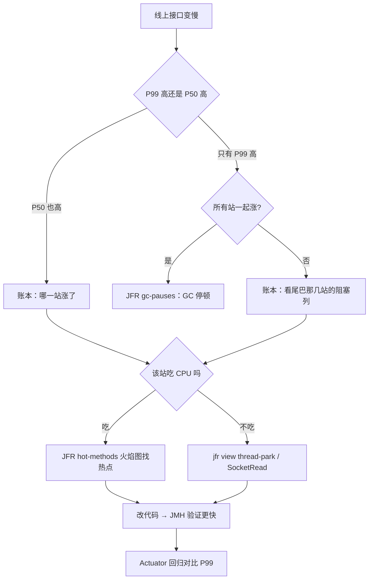

---
sources:
  - 01-第一阶段
---

# 05. 度量地基：JFR、JMH 与 Actuator

> [← 第一阶段导览](01-导览.md) · 三个工具回答三个不同的问题——JFR 回答「CPU 花在哪个方法上」、JMH 回答「这段代码到底快了多少」、Actuator 回答「线上现在怎么样」；这一册的结论是：**别用手写循环测性能，也别把采样火焰图当账本用**。

## 1. 三个工具，三种问题，别混着用

新手最常见的两个误用方向相反：用 `System.currentTimeMillis()` 包一圈 `main` 方法测性能，或者打开 JFR 火焰图去解释「为什么这个接口 P99 是 800ms」。前者测出来的是 JIT 编译时间，后者看到的是「CPU 在干什么」而不是「请求在等什么」。

| 工具 | 回答什么问题 | 时间尺度 | 开销 | 什么时候用 |
|---|---|---|---|---|
| **JFR** | CPU 花在哪些方法上？GC 停了多久？谁在等锁？ | 秒~小时（连续录制） | 约 1%（`profile` 档） | 排障、找热点、看 GC 与锁、验证「不是 CPU 的问题」 |
| **JMH** | 这个实现比那个快多少？快多少百分比？ | 微秒~毫秒（单次调用） | 极高（需独占机器） | 改算法、换序列化器、选集合类型，**需要数字结论时** |
| **Actuator + Micrometer** | 线上现在 P99 是多少？错误率多少？ | 分钟~月（持续聚合） | 极低 | 常开监控、告警、容量规划、优化前后对比 |
| 账本（02 册） | 这十五站各花了多少？ | 单请求 | 中（采样 1% 可接受） | 定位瓶颈在哪一站 |

四者的关系是**分层**而不是替代：Actuator 告诉你「哪个接口变慢了」，账本告诉你「慢在哪一站」，JFR 告诉你「那一站内部 CPU 在干什么」，JMH 告诉你「你想到的修复方案是否真的更快」。跳过任何一层都会得到错误结论——比如直接上 JFR 看到一个 `String.format` 占了 30% CPU，优化它，然后 P99 一点没变，因为真正的瓶颈是 ⑦ 段的池等待（那一段根本不产生 CPU 样本）。

## 2. JFR：三种开法，六类事件

JFR（JDK Flight Recorder）是 JDK 内置的、事件驱动的记录器，不需要额外 agent，也不做字节码增强。三种开法各有用途：

```bash
# ① 启动即录，进程退出时落盘（容器里最常用）
java -XX:StartFlightRecording=filename=/tmp/app.jfr,dumponexit=true,settings=profile -jar app.jar

# ② 运行中按需开（排障时不重启进程）
jcmd <pid> JFR.start name=load settings=profile duration=120s filename=/tmp/load.jfr

# ③ 中途抓一份快照，不打断录制（看「此刻之前发生了什么」）
jcmd <pid> JFR.dump name=load filename=/tmp/snapshot.jfr
```

`settings=profile` 是低开销档（约 1%），适合长期开；`settings=default` 更省但不采执行样本，基本没用。**不要用 `settings=debug`**，它的开销能到 10% 以上，而且会产生几百兆文件。

分析侧，JDK 21 之后 `jfr` 命令自带聚合视图，不必每次都开 JMC：

```bash
jfr summary /tmp/load.jfr              # 有哪些事件、各多少条
jfr view hot-methods /tmp/load.jfr     # 按 CPU 采样聚合的热点方法
jfr view gc-pauses /tmp/load.jfr       # GC 停顿逐次列出
jfr view thread-park /tmp/load.jfr     # 谁在 park、被谁唤醒、等了多久
jfr print --events jdk.ExecutionSample --stack-depth 64 /tmp/load.jfr | head -60
```

一次录制里真正会被用到的只有六类事件：

| 类别 | 代表事件 | 能看出什么 | 典型用途 |
|---|---|---|---|
| CPU 采样 | `jdk.ExecutionSample` | 每 10~20ms 采一次栈，只在 RUNNABLE 线程上采 | 火焰图的主体，找热点方法 |
| 锁与等待 | `jdk.JavaMonitorEnter`、`jdk.ThreadPark`、`jdk.JavaMonitorWait` | 谁阻塞、阻塞多久、被谁持有 | 「CPU 不高但很慢」的第一现场 |
| GC | `jdk.GarbageCollection`、`jdk.GCPhasePause` | 每次停顿时长、原因、堆前后大小 | 全体 P99 一起抬高的元凶 |
| 分配 | `jdk.ObjectAllocationSample` | 哪个调用点分配最多字节 | 减少 GC 压力的入口 |
| IO | `jdk.SocketRead`、`jdk.SocketWrite`、`jdk.FileRead` | 读写耗时与字节数 | 区分「等网络」与「等磁盘」 |
| 线程 | `jdk.ThreadStart`、`jdk.ThreadSleep` | 线程创建频率、`sleep` 调用点 | 线程池抖动、`Thread.sleep` 滥用 |

自定义事件可以让账本和 JFR 打在同一份文件里——这是把「十五站账本」和「CPU 火焰图」对齐的唯一办法：

```kotlin
// 注册一次，之后每条账本记录都会进 JFR，可以和 ExecutionSample 按时间轴对照
class StationEvent : Event() {
    @Label("站点") lateinit var station: String
    @Label("耗时(微秒)") var micros: Long = 0
    @Label("线程") lateinit var thread: String

    companion object {
        val TYPE: EventType = EventType.getEventType(StationEvent::class.java)
    }
}

fun recordStation(station: String, micros: Long) {
    if (StationEvent.TYPE.isEnabled) {
        StationEvent().apply {
            this.station = station
            this.micros = micros
            this.thread = Thread.currentThread().name
        }.commit()
    }
}
```

`TYPE.isEnabled` 这个判断不能省：事件未启用时 `commit()` 是空操作，但对象已经分配了。热路径上每次多一次分配，就是几千 QPS 下每秒几万个多余对象。

## 3. 火焰图怎么读

火焰图的横轴是**采样占比**（不是时间顺序），纵轴是**调用栈深度**。一张图能读出四件事：

**① 宽而平的地方就是答案。** 一个方法的框越宽，说明采样落在它上面的次数越多。如果某个业务方法自己很宽、下面却几乎没有子调用，说明时间花在它自身的循环或计算里；如果它很窄但下面挂着一个很宽的第三方方法，问题在第三方。**先找最宽的、且位于你代码里的框**，这是唯一值得优化的位置——优化一个只占 2% 的方法，收益上限就是 2%。

**② 自顶向下 vs 自底向上，回答两个不同的问题。**

| 视角 | 起点 | 读法 | 回答 |
|---|---|---|---|
| 自顶向下（top-down） | 线程栈顶（`main`/`Thread.run`） | 从根往下走，看哪条分支最粗 | 「这个请求把时间花在哪个子系统」 |
| 自底向上（bottom-up / reverse） | 叶子方法（真正干活的那个） | 从叶子往上聚合所有调用者 | 「谁在调用这个昂贵的函数」 |

排障时的顺序是**先自顶向下定位子系统，再自底向上找调用者**。举例：自顶向下看到 `DispatcherServlet.doDispatch` 下面有一条很粗的分支通向 `Jackson` 序列化；切到自底向上，按 `JsonGenerator.writeString` 聚合，会看到调用者是你的 `OrderView` 列表——答案不是「Jackson 慢」，而是「你返回了三千条」。

**③ GC 的痕迹长什么样。** 火焰图里出现 `G1Evacuate`、`G1YoungRemSetSampling`、`VMThread::run`、`GCTaskThread` 这些框，说明采样落在了 GC 线程上。注意：**这些框属于 GC 线程自己的栈，不在你的业务栈里**，所以它们只能告诉你「GC 线程忙」，不能直接告诉你「你的哪行代码导致 GC」。要联系到业务，得看 `jdk.ObjectAllocationSample` 的分配点，或者在火焰图上找「大量小对象分配」的方法（通常是 `String` 拼接、装箱、`Stream` 中间对象、JSON 序列化的临时数组）。

**④ 锁的痕迹，以及一个必须知道的陷阱。** `Unsafe.park`、`Object.wait`、`ReentrantLock.lock`、`ThreadPoolExecutor.getTask` 出现在栈顶，说明线程在等。但 `jdk.ExecutionSample` **只采 RUNNABLE 状态的线程**——一个阻塞在 `park` 上的线程根本不会被采到。所以：

> **在 JFR 的 CPU 火焰图上，「看不到」既可能是「不耗时」，也可能是「全在等」。**

这个陷阱是 02 册要坚持单独记「阻塞段」的根本原因。要得到含等待的图，只有两条路：用 `jdk.ThreadPark` / `jdk.SocketRead` 事件自己聚合（`jfr view thread-park` 可以直接看），或者用 async-profiler 的 wall-clock 模式（`-e wall`）重新采一遍。前者是 JFR 原生能力，后者需要额外工具，但图更完整。

一个具体的对照：接口 P99 是 800ms、CPU 使用率 15%。如果只看 CPU 火焰图，最宽的是 `String.format`（占 40% CPU）——于是你去优化日志格式化，P99 纹丝不动。切到 `thread-park` 视图，会看到 700ms 停在 `HikariPool.getConnection` 上。**CPU 火焰图回答的是「CPU 在哪」，不是「时间在哪」**，这是本册最贵的一句话。

## 4. JMH：三个把结论测反的坑

JMH 是 OpenJDK 官方的微基准框架，它解决的核心问题是：**JVM 会主动优化掉你的测试代码**。手写循环测性能之所以不可信，原因全在这三个坑里。

**坑一：不预热。** 前几千次调用跑在解释器里，之后 C1 编译，再之后 C2 编译并做激进优化。同一段代码，第 100 次调用可能比第 100 万次慢 100 倍。JMH 的 `@Warmup` 就是跑够这些次数再开始计分，且默认每次迭代独立计时、丢掉前几轮。**不预热的测试，测的是 JIT 编译器的进度，不是你的代码。**

**坑二：死代码消除（DCE）。** 如果你的基准方法算了一个值但没人用，JIT 会认定「这段计算没有副作用」并整段删掉，于是你测到的是「空循环有多快」。这是微基准里最隐蔽的坑，因为它**让优化看起来完全无效**——优化前后都是 0.3ns，因为两者都被删了。

**坑三：常量折叠。** 输入是编译期常量时，JIT 会在编译期把结果算出来，循环里只剩一次赋值。测一个「用固定字符串调 `hashCode`」的基准，C2 会把哈希值直接内联成常数，你测到的是 `nop`。防御手段是让输入来自 `@State` 字段或 `@Param`，JIT 无法证明它不变。

还有三个次级坑值得一提：**不 fork 会导致 profile 污染**（前一个基准把分支预测器和内联缓存训练成对后一个基准有利的状态），所以 `@Fork(2)` 起步；**单次迭代太短**（低于 1ms）时计时器误差占比过高，用 `time = 1` 秒；**Kotlin 的 `@State` 类必须是 `open`**，否则 JMH 的字节码生成器无法继承它，运行时报 `VerifyError`——这是 Kotlin 用户独有的坑，Java 教程不会提。

一个正确的骨架：

```kotlin
@State(Scope.Benchmark)
@BenchmarkMode(Mode.AverageTime)
@OutputTimeUnit(TimeUnit.MICROSECONDS)
@Warmup(iterations = 5, time = 1)          // 坑一：给 JIT 足够时间
@Measurement(iterations = 5, time = 1)
@Fork(2, jvmArgs = ["-Xms1g", "-Xmx1g"])   // 固定堆，两次独立 JVM
open class SerializationBenchmark {         // Kotlin 必须 open

    @Param("10", "100", "1000")             // 坑三：输入不可是编译期常量
    var size: Int = 0

    private lateinit var payload: List<OrderView>
    private lateinit var mapper: JsonMapper

    @Setup(Level.Trial)
    fun setup() {
        mapper = JsonMapper.builder().build()
        payload = (1..size).map { OrderView("id-$it", "PAID", "99.00", "2026-11-15T10:00:00Z") }
    }

    @Benchmark
    fun writeAsString(bh: Blackhole) {      // 坑二：结果必须被消费
        bh.consume(mapper.writeValueAsString(payload))
    }

    @Benchmark
    fun writeAsBytes(bh: Blackhole) {
        bh.consume(mapper.writeValueAsBytes(payload))
    }
}
```

跑法：`./gradlew jmh`（需要 `me.champeau.jmh` 插件）。读结果时只看两列：`Score`（`AverageTime` 模式下越小越好）和 `Score Error`（迭代间标准差）。**两组数字的差值小于误差范围时，它们就是一样快**——「优化后快了 5%」在误差 8% 的情况下没有任何意义，这类假结论是性能优化里最常见的自欺。

JMH 的正确使用姿势是**只回答一个问题**：在两个候选实现之间选一个。它不适合回答「这个接口的 P99 是多少」，因为真实请求里有网络、有锁竞争、有 GC 压力，这些都是微基准里被刻意排除的变量。

## 5. Actuator：先开三个端点

Actuator 是持续观测的唯一入口。默认只暴露 `health`，其余全部关闭——这是合理的默认值（端点会泄露内部信息），但对开发期来说太窄。骨架阶段开三个，其余留到第十阶段：

```yaml
management:
  server:
    port: 8081                     # 管理端口独立：不经过业务 Filter 链，也方便只对内网开放
  endpoints:
    web:
      exposure:
        include: health,metrics,prometheus
  endpoint:
    health:
      show-details: when-authorized  # 未授权时只回 UP/DOWN，不泄露数据库地址
      probes:
        enabled: true                # 暴露 /health/liveness 与 /health/readiness
    metrics:
      access: read-only              # Boot 3.4+ 用 access 取代 enabled
  metrics:
    tags:
      application: backend-lab       # 所有指标统一带上应用名，多服务聚合时必需
    distribution:
      percentiles-histogram:
        http.server.requests: true   # 让 Prometheus 能算分位数
      slo:
        http.server.requests: 50ms,200ms,1s   # 直接产出 SLO 桶，告警用
```

需要额外引一个依赖才有 Prometheus 端点：

```bash
implementation("io.micrometer:micrometer-registry-prometheus")
```

开完之后立刻能用三条命令验证：

```bash
curl -s localhost:8081/actuator/health | jq        # {"status":"UP","groups":["liveness","readiness"]}
curl -s localhost:8081/actuator/metrics/http.server.requests | jq '.measurements'
curl -s localhost:8081/actuator/prometheus | grep -c '^http_server_requests'   # 有输出即通
```

四个配置项值得单独记住。**`management.server.port` 独立**：管理端点不走业务端口，就不会被业务的 Filter（鉴权、限流）挡掉，也不会被外部流量打到；生产环境这个端口通常只绑内网或只给 Prometheus 抓。**`show-details: when-authorized`**：`always` 会把数据库 URL、磁盘路径、甚至连接池状态暴露给任何能访问端点的人。**`percentiles-histogram`**：不开它，Prometheus 只能拿到平均值和最大值，算不出 P99——而 P99 才是你要的。**`slo`**：显式声明 SLO 桶，让 `histogram_quantile` 有稳定的边界，否则桶是自动生成的，跨实例聚合时会对不齐。

## 6. Micrometer Timer 的标签：低基数是纪律，不是建议

Micrometer 的指标模型是「名字 + 标签集合」构成一条时间序列。**每多一个标签值组合，Prometheus 里就多一条序列**。序列数爆炸会让 Prometheus 内存打满、抓取超时，最终整片监控失效——这是可观测性领域最常见的自伤方式。

| 标签键 | 可以用 | 绝对不能用 | 原因 |
|---|---|---|---|
| `uri` | `/orders/{id}`（模板化） | `/orders/8f3a-...`（真实路径） | 每个 ID 一条序列 |
| `status` | `200`、`5xx` | 完整响应体里的错误码 | 值域可控 vs 不可控 |
| `method` | `GET` | — | 值域固定 |
| `exception` | `IllegalStateException`（类名） | 完整 message | message 里有 ID、时间戳 |
| `user_id` | 会 | 会 | 千万级基数，必然打爆 |
| `channel` | `app`、`web`、`miniapp` | — | 有限枚举，可接受 |

判断标准是一个数字：**任何一个标签键的值集合，上限应当是几十，而不是几万**。Boot 的 `http.server.requests` 已经用模板化路径做了正确示范（`uri` 标签是 `/orders/{id}` 而不是真实 URL），但你自己加的标签很容易破坏这条规矩。

```kotlin
@Component
class OrderMetrics(private val registry: MeterRegistry) {

    // 预先注册有限组合，避免热路径上 withTag() 反复查找/新建 Timer
    private val timers: Map<Pair<String, String>, Timer> =
        listOf("app", "web").flatMap { ch ->
            listOf("ok", "error").map { res ->
                (ch to res) to Timer.builder("lab.order.create")
                    .description("下单耗时，含事务与下游调用")
                    .tag("channel", ch)                 // 低基数
                    .tag("result", res)                 // 低基数
                    .publishPercentileHistogram()
                    .publishPercentiles(0.5, 0.95, 0.99)
                    .register(registry)
            }
        }.toMap()

    fun <T> timed(channel: String, block: () -> T): T {
        val sample = Timer.start(registry)
        var result = "ok"
        try {
            return block()
        } catch (e: Throwable) {
            result = "error"                            // 只记 ok/error，不记异常类名
            throw e
        } finally {
            timers.getValue(channel to result).let(sample::stop)
        }
    }
}
```

用法是 `metrics.timed("app") { orderService.create(cmd) }`。三个设计点：**预先注册**（`withTag` 每次都走一次注册表查找，热路径上是纯开销）、**结果只有两种值**（ok/error，异常类名进日志不进指标）、**`Timer.start` 用 `Sample` 而不是 `System.nanoTime`**（`Sample` 内部处理了注册表未初始化的边界，且能同时记录到多个 Timer）。

配合 02 册的账本，两者形成互补：`lab.order.create` 告诉你「下单接口的 P99 是 230ms」，账本告诉你「这 230ms 里 150ms 在 ⑦ 段等连接」。**指标负责发现，账本负责定位，JFR 负责解释，JMH 负责验证**——四件套齐了，第一阶段的度量地基才算完工。

## 7. 把它们接进骨架：落地步骤

| # | 动作 | 命令/配置 | 验收标准 |
|---|---|---|---|
| 1 | 引入 Actuator 与 Prometheus 注册表 | `boot-starter-actuator` + `micrometer-registry-prometheus` | `./gradlew dependencies` 能看到两者 |
| 2 | 打开三个端点并分端口 | 05 册 §5 的 `management` 段 | `curl :8081/actuator/prometheus` 有输出 |
| 3 | 打开 `percentiles-histogram` 与 `slo` | 同上 | `/actuator/metrics/http.server.requests` 出现 `_bucket` |
| 4 | 加一个业务 `Timer` | 05 册 §6 的 `OrderMetrics` | 指标名 `lab_order_create_seconds_bucket` 出现 |
| 5 | 埋十五站计时（采样 1%） | 02 册 §6 的 `RequestLedger` + `LedgerFilter` | 压测后账本能打出 15 行 |
| 6 | 启动参数带 JFR | `-XX:StartFlightRecording=...,settings=profile` | 进程退出后有 `.jfr` 文件 |
| 7 | 压一轮固定 QPS（如 200 QPS × 2 分钟） | `wrk` / `k6` / `hey` | 拿到 P50/P99 与账本 |
| 8 | 录制期间抓一次 `jfr view hot-methods` | `jfr view hot-methods app.jfr` | 能说出占比前三的方法 |
| 9 | 对热点写一个 JMH 基准 | 05 册 §4 的骨架 + `./gradlew jmh` | 误差范围内能区分两个实现 |
| 10 | 把以上数字存成基线文件 | `docs/lab/baseline-01.md` | 后续每个阶段回来对比 |

第 7 步的压测工具不重要，**固定 QPS 很重要**：不控速的压测测的是「系统能跑多快」，控速的压测测的是「在这个负载下的延迟分布」，后者才能和账本对上。第 10 步的基线文件是整个第一阶段的产出物——它不是作业，是后面十一册的对照物。

定位流程可以固化成一张图：



这张图的每一个分叉都对应本册的一节：B→C 是 02 册的账本，D→E 是 §2 的 GC 事件，G 是 §3 的「看不到不等于不耗时」，J 是 §4，K 是 §5。**先把这张图记住，再回头补细节**，比按顺序读十遍有用。

## 8. 自测

1. 为什么 `jdk.ExecutionSample` 采不到阻塞在 `HikariPool.getConnection` 上的线程？这会导致什么误判？
2. 自顶向下和自底向上的火焰图分别回答什么问题？排障时的使用顺序是什么？
3. JMH 里「死代码消除」为什么会让优化看起来完全无效？除了 `Blackhole` 还有别的防御手段吗？
4. Kotlin 写 JMH 基准时，`@State` 类为什么必须声明为 `open`？
5. `percentiles-histogram` 不开的时候，Prometheus 能算出 P99 吗？为什么？
6. 你把 `userId` 加成了 Timer 的标签，一周后 Prometheus 挂了。解释从「标签」到「内存」的完整链路。

## 9. 延伸

- 上一册：[04-工程骨架与分层约定](04-工程骨架与分层约定.md)；本阶段的账本用法在[02 册](02-一次请求的十五站主时间线与账本.md)，JFR 启动参数与容器 JVM 参数在[03 册](03-技术基线与本地环境.md)§6。
- 指标的命名规范、结构化日志与 OTel 链路贯穿异步与消息，在[第十阶段 05 册](../10-第十阶段/05-可观测性落地-指标-日志与链路.md)；压测场景设计与「CPU → GC → 池 → DB → 锁」的定位顺序在[08 册](../10-第十阶段/08-压测与调优方法论.md)。
- 虚拟线程下 JFR 栈的变化（`ForkJoinPool` 载体线程与 `carrier` 关系）在[第八阶段 03 册](../08-第八阶段/03-虚拟线程-pinning与适用边界.md)；切片测试与 `@MockitoBean` 在[第十阶段 02 册](../10-第十阶段/02-测试金字塔与切片测试.md)。
- 如果只想补原理而不关心 Spring 接法，看[可观测性学习站](https://yidafu.github.io/tech-learning/observability/)的 Metrics 与 Tracing 部分。
