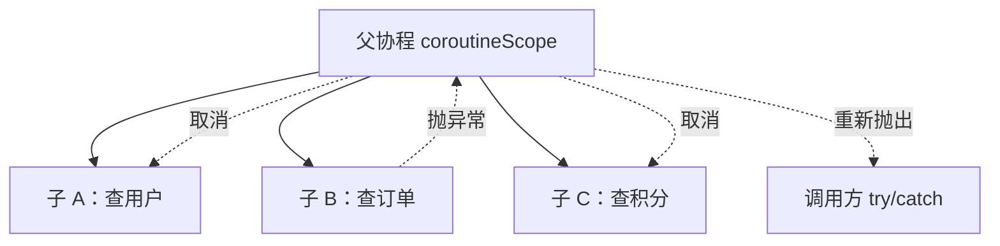

---
sources:
  - 02-第二阶段
---

# 05. 协程基础：suspend 与结构化并发

> [← 第二阶段导览](01-导览.md) · `suspend` 不是「异步」的同义词，它只是把函数改写成一台可以暂停的状态机；真正决定跑在哪个线程上的是 `Dispatcher`。本册把这两件事拆开讲清，再给出「在 Spring MVC 里用协程」的边界——多数团队在这一步用错了工具。

## 1. `suspend` 编译成什么：状态机 + Continuation

一个挂起函数在字节码里多一个参数、换一个返回值：

```kotlin
suspend fun loadUser(id: Long): User {
    val profile = fetchProfile(id)      // 挂起点 1
    val orders = fetchOrders(id)        // 挂起点 2
    return User(profile, orders)
}

// 概念上的编译产物：
// Object loadUser(long id, Continuation<? super User> cont)
//   ——返回 User 表示同步完成；返回 COROUTINE_SUSPENDED 表示已挂起
```

函数体被改写成一台状态机：一个 `label` 字段记录「恢复到第几步」，每个挂起点之前的局部变量被提升成状态机对象的字段（spill），`invokeSuspend` 里用 `when (label)` 跳回对应位置。恢复时不是重新执行整个函数，而是从 `label` 指向的那一行继续。

```kotlin
// 反编译视角（伪代码，去掉样板）
class LoadUserStateMachine(val completion: Continuation<User>) : ContinuationImpl(completion) {
    var label = 0
    var id = 0L
    var profile: Profile? = null

    override fun invokeSuspend(result: Any?): Any? {
        when (label) {
            0 -> {
                label = 1
                val r = fetchProfile(id, this)      // 把自己当回调传下去
                if (r === COROUTINE_SUSPENDED) return r
                profile = r as Profile
            }
            1 -> profile = result as Profile
        }
        // ... 继续第二步
    }
}
```

三个直接推论：

1. **挂起是「函数返回了，但没算完」**。`COROUTINE_SUSPENDED` 是一个哨兵值，调用方看到它就停止执行当前函数，把控制权交还给调度器——**线程没有被阻塞**，它可以去跑别的协程。
2. **挂起只能发生在挂起点**。如果函数体里全是阻塞调用（`Thread.sleep`、JDBC），状态机没有机会返回哨兵值，线程就一直被占着。`suspend` 关键字不会把阻塞调用变异步，它只提供了「可以暂停」的能力。
3. **局部变量生命周期变长**。被 spill 的变量活到协程结束，一个在挂起点之前创建的大对象（几 MB 的 `ByteArray`）会跨越整个挂起期。这是协程版「内存泄漏」的常见来源，尤其在 `await` 前构造大对象时。

## 2. `Dispatcher` 才是线程切换点

`suspend` 决定「能不能暂停」，`Dispatcher` 决定「恢复后在哪跑」。

| Dispatcher | 线程数 | 适合 | 误用后果 |
|---|---|---|---|
| `Dispatchers.Default` | 约 CPU 核数（最少 2） | CPU 密集：排序、序列化、加解密 | 阻塞调用会占满，其他协程排队 |
| `Dispatchers.IO` | 默认上限 64（可 `limitedParallelism` 调整） | 阻塞 IO：JDBC、文件、传统 HTTP 客户端 | CPU 密集任务挤占 IO 名额，吞吐下降 |
| `Dispatchers.Unconfined` | 不切换 | 测试、极短的回调桥接 | 恢复位置不可预测，不要用于业务 |
| `newSingleThreadContext` / 自定义 | 1 | 需要线程亲和（如某些 SDK） | 必须手动 close，否则线程泄漏 |

**「在 `Dispatchers.IO` 上跑 CPU 任务等于白切」的原因有两层**：

- 从吞吐看：IO 调度器的线程数（64）远大于核数，CPU 密集任务在上面跑只会增加上下文切换和缓存失效，不会更快。`Default` 的并行度刻意压到核数，正是为了避免这种自相残杀；
- 从隔离看：IO 线程是稀缺资源，被 CPU 任务占满后，真正需要阻塞 IO 的协程反而排不上队——你会看到「CPU 不满、QPS 上不去、P99 飙高」这种典型曲线。

```kotlin
suspend fun renderReport(rows: List<Row>): ByteArray =
    withContext(Dispatchers.Default) {     // 对：CPU 密集
        compress(serialize(rows))
    }

suspend fun loadRows(sql: String): List<Row> =
    withContext(Dispatchers.IO) {          // 对：阻塞 IO
        jdbc.query(sql) { rs -> mapRow(rs) }
    }
```

还有一个常被忽略的事实：**切线程本身有成本**。一次 `withContext` 是一次调度决策 + 可能的线程唤醒，量级在微秒。为了「保险」在每层都套一个 `withContext(Dispatchers.IO)`，在高 QPS 下会变成可测量的开销。规则是：**在真正发生阻塞的那一层切一次，不要层层切**。

`limitedParallelism` 是另一种「切」——它不换线程池，只加一道并发闸门。`Dispatchers.Default.limitedParallelism(1)` 常用来保护「必须串行」的共享状态（比如一个非线程安全的 SDK 客户端），比给每个调用点加锁更直观；`Dispatchers.IO.limitedParallelism(n)` 则在 IO 池内部再划出一块配额，避免一类任务把 64 个名额全吃掉。记住它限制的是**并发数**，不是线程数：被限流的协程会在调度器里排队，而不是占着线程等待。

## 3. 结构化并发：`coroutineScope` 与 `supervisorScope`

结构化并发的一句话版本：**父协程不会在子协程结束前结束，子协程的失败会向上传播**。这保证了「启动的协程一定有人等」，不会泄漏。



```kotlin
suspend fun loadDashboard(id: Long): Dashboard = coroutineScope {
    val user = async { userClient.get(id) }
    val orders = async { orderClient.list(id) }
    val points = async { pointClient.get(id) }
    Dashboard(user.await(), orders.await(), points.await())
}
```

`coroutineScope` 的语义：任一子协程失败 → 取消其余子协程 → 等它们真正结束 → 把异常抛给调用方。注意「等它们真正结束」这一句：如果被取消的子协程卡在阻塞调用里，父协程就得一直等——这就是第 4 节要讲的坑。

`supervisorScope` 反过来：子协程的失败不会影响兄弟，也不会让 `supervisorScope` 本身失败。代价是**失败必须自己处理**，否则异常会被静默吞掉或落到 `CoroutineExceptionHandler`：

```kotlin
suspend fun loadBestEffort(id: Long): Dashboard = supervisorScope {
    val user = async {
        runCatching { userClient.get(id) }.getOrElse { User.unknown(id) }
    }
    val orders = async {
        runCatching { orderClient.list(id) }.getOrDefault(emptyList())
    }
    Dashboard(user.await(), orders.await())
}
```

| 维度 | `coroutineScope` | `supervisorScope` |
|---|---|---|
| 子失败对兄弟 | 取消全部 | 不影响 |
| 自身是否失败 | 是，向上抛 | 否，除非自己抛 |
| `async` 未 `await` 的失败 | 仍会取消父作用域 | 不影响父作用域 |
| 适用 | 「三个都成功才有意义」 | 「尽力而为，缺一部分也能返回」 |
| 风险 | 一个慢依赖拖垮整批 | 失败被吞，返回半成品而无人知 |

最后一行是 `supervisorScope` 的真实代价：它把「部分失败」变成正常返回，调用方拿到的 `Dashboard` 里可能有 `User.unknown`、空订单列表，但接口依然 200。**要么在返回值里显式标记降级（而不是塞默认值），要么别用 supervisor**。

## 4. 取消是协作式的

`job.cancel()` 不杀线程，它只是把 Job 置为 cancelling。协程只有在**挂起点**或**主动检查**时才会响应：

```kotlin
suspend fun importAll(ids: List<Long>) = coroutineScope {
    ids.forEach { id ->
        ensureActive()               // 主动检查，否则循环里没有挂起点就取消失效
        process(id)
    }
}
```

阻塞调用不响应取消，后果是连锁的：

1. 协程「已取消」但线程仍被占着，`withTimeout` 也拦不住（第 5 节）；
2. 父协程必须等子协程真正结束才能退出（结构化并发），所以「取消」实际耗时 = 阻塞调用剩余时间；
3. 被占的是 `Dispatchers.IO` 的 64 个名额之一，取消风暴下名额耗尽，新请求全部排队；
4. 如果阻塞的是数据库连接，连接池被拖住，症状从「某个接口慢」升级为「全站超时」。

`runInterruptible` 是标准库给的桥：它把协程取消转成线程中断。

```kotlin
suspend fun readWithInterrupt(stream: InputStream): ByteArray =
    runInterruptible(Dispatchers.IO) { stream.readBytes() }
```

但它只对**响应中断**的代码有效：`Thread.sleep`、`InputStream.read` 会抛 `InterruptedException`；JDBC 驱动看具体实现（PostgreSQL 驱动会在部分阶段检查中断，但不是所有阶段），而且中断后连接可能处于不可用状态——**不要把它还回连接池**，直接丢弃重建。

还有一个与取消相关的细节：协程被取消后，`finally` 里的**挂起**调用会立刻再次抛 `CancellationException`，清理逻辑跑不完。要关连接、发补偿消息这类「必须完成」的动作，得包一层 `withContext(NonCancellable)`：

```kotlin
try {
    process()
} finally {
    withContext(NonCancellable) {   // 否则这里的挂起会被取消打断
        releaseLease()
    }
}
```

这也解释了为什么「取消」在生产里常表现为资源泄漏：不是取消没生效，而是清理代码本身被取消掉了。

## 5. `withTimeout` 对阻塞代码无效

```kotlin
suspend fun slow() = withTimeout(500) {
    Thread.sleep(2_000)    // 阻塞，没有挂起点
    "done"
}
```

实际行为：`withTimeout` 在 500ms 时把 Job 置为取消，但 `Thread.sleep` 不检查；2000ms 后 `sleep` 返回，执行到下一个挂起点（或函数返回）时才发现已取消，抛 `TimeoutCancellationException`。**总耗时仍是 2 秒，不是 500 毫秒**——超时只保证了「异常会来」，没保证「提前返回」。

所以 `withTimeout` 的正确心智模型是：**它给协程设了一个截止时间，不是给线程设了闹钟**。要让阻塞调用真的可中断，只有三条路：

1. 换成带超时参数的阻塞 API（`Statement.setQueryTimeout`、HTTP 客户端的 `timeout`）；
2. `runInterruptible` + 响应中断的库；
3. 用虚拟线程跑阻塞调用，靠 `Future.get(timeout)` 或结构化并发的超时兜底。

同样的道理适用于「取消一个正在跑 SQL 的请求」：`cancel()` 之后数据库那边还在执行，DBA 看到的仍是一条长查询。**超时必须落在驱动层，而不是协程层**。

## 6. 在 Spring 里用协程：边界在哪

Spring MVC 支持 `suspend` 控制器方法：`InvocableHandlerMethod` 发现挂起函数后，用 `CoroutinesUtils.invokeSuspendingFunction` 把它变成一个 `Mono`，交给异步请求处理——挂起期间 Servlet 线程被释放。

```kotlin
@RestController
class OrderController(private val service: OrderService) {
    @GetMapping("/orders/{id}")
    suspend fun get(@PathVariable id: Long): OrderView = service.load(id)
}
```

但这条链路有三个断点：

- **Filter 与 HandlerInterceptor 是阻塞 API**。它们跑在 Servlet 线程上，不参与协程；在里面调 `runBlocking` 会把线程堵住，协程的收益当场归零；
- **`@Transactional` 是 ThreadLocal + 阻塞拦截器**。写在 `suspend` 函数上时，事务上下文绑定在线程上，而协程可能在另一个线程恢复——轻则事务不生效，重则连接被别的协程用掉。稳妥做法是把事务留在阻塞层：`withContext(Dispatchers.IO) { txService.doWork() }`，`@Transactional` 标在 `doWork` 上；
- **`runBlocking` 绝不能出现在请求线程上**。它阻塞当前线程直到协程结束，等于用协程的写法写同步代码；更糟的是在 `Dispatchers.Default` 的线程上 `runBlocking` 等一个需要 Default 线程的任务，会直接死锁。

**WebMvc 下协程的真实价值**是「fan-out 聚合」：一个请求要调三个下游，用 `coroutineScope + async` 并发，总耗时从 `t1+t2+t3` 降到 `max(t1,t2,t3)`。如果只是「一个请求一次数据库查询」，JDK 25 的虚拟线程 + 阻塞 MVC 更简单：没有状态机、没有 `@Transactional` 的线程亲和问题、栈更好读。**别为了用协程而用协程**——这是在第八阶段会用压测数据反复验证的结论。

## 7. 错误示例：在协程里直接调 JDBC

```kotlin
// 错：阻塞 IO 跑在 CPU 调度器上
suspend fun loadOrder(id: Long): Order = withContext(Dispatchers.Default) {
    jdbcTemplate.queryForObject("select * from orders where id = ?", rowMapper, id)!!
}

// 也错：切到 IO 了，但没有限流，IO 的 64 个线程一起压向只有 10 个连接的池
suspend fun loadOrders(ids: List<Long>): List<Order> = coroutineScope {
    ids.map { async(Dispatchers.IO) { loadOrder(it) } }.awaitAll()
}
```

第一种的后果：CPU 池被阻塞调用占满，其它协程（包括定时任务、序列化）全部排队；`Default` 的并行度只有核数，几台机器上表现为「CPU 利用率不高但接口全慢」。

第二种更隐蔽：`Dispatchers.IO` 允许 64 并发，Hikari 只有 10 个连接，于是 54 个线程在 `getConnection()` 上排队，默认 30 秒的连接超时会把它们变成 `SQLTransientConnectionException`——看起来像数据库挂了，实际是自己打的。

两种正确改法：

```kotlin
// 改法 A：IO 调度器 + 信号量，把并发压到连接池大小
private val dbPermits = Semaphore(10)

suspend fun loadOrder(id: Long): Order = withContext(Dispatchers.IO) {
    dbPermits.withPermit {
        jdbcTemplate.queryForObject(SQL, rowMapper, id)
            ?: throw DomainError.NotFound("order", id.toString())
    }
}

// 改法 B：用虚拟线程做调度器，让阻塞调用不占平台线程
private val virtualDispatcher = Executors.newVirtualThreadPerTaskExecutor().asCoroutineDispatcher()

suspend fun loadOrderV(id: Long): Order = withContext(virtualDispatcher) {
    dbPermits.withPermit {
        jdbcTemplate.queryForObject(SQL, rowMapper, id)
            ?: throw DomainError.NotFound("order", id.toString())
    }
}
```

改法 A 的核心不是「换个 Dispatcher」，而是**承认并发度必须与下游容量匹配**：连接池 10，就用 10 个许可；限流的位置在取连接之前，不在 SQL 之后。改法 B 在 JDK 25 上很自然，但虚拟线程不解决连接池容量问题——`Semaphore` 仍然要在。两种改法都要保证「取消时释放许可」，`withPermit` 的 `finally` 已经做了这件事，自己手写 `acquire/release` 时别忘了。

## 8. 自测

1. `suspend fun f(): Int` 编译后的签名是什么？返回 `COROUTINE_SUSPENDED` 意味着什么？调用方看到它之后做了什么？
2. 为什么 `suspend` 函数里调 `Thread.sleep` 仍然会阻塞线程？状态机在这种情况下有没有起作用？
3. `coroutineScope` 里三个 `async`，第二个失败且你从未 `await` 它，会发生什么？换成 `supervisorScope` 呢？
4. 给一段 JDBC 调用套上 `withTimeout(2s)`，线上 P99 仍然是 30s。为什么？异常最终在什么时候抛？要让超时真正生效有哪三条路？
5. 为什么 `@Transactional` 标在 `suspend` 函数上很危险？正确的分层写法是什么？
6. 你的服务连接池 10、`Dispatchers.IO` 64 并发，压测时出现大量 `SQLTransientConnectionException`，列出两个修法并说明各自的代价。

## 9. 延伸

- 上一册：[04-扩展-委托与DSL的边界](04-扩展-委托与DSL的边界.md)——同样是「编译期改写」，扩展函数改的是调用形式，`suspend` 改的是控制流。
- 下一册：[06-Kotlin与Spring的接缝-allopen-noarg与DSL配置](06-Kotlin与Spring的接缝-allopen-noarg与DSL配置.md)——`@Transactional` 的代理前提与协程的线程亲和问题在这里汇合。
- 并发模型的横向对比（线程池 / 虚拟线程 / 响应式 / 协程）与压测数据，见[第八阶段导览](../08-第八阶段/01-导览.md)；事务传播与自调用失效见[第六阶段导览](../06-第六阶段/01-导览.md)。
