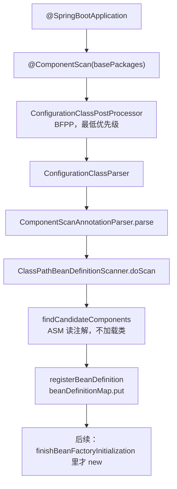
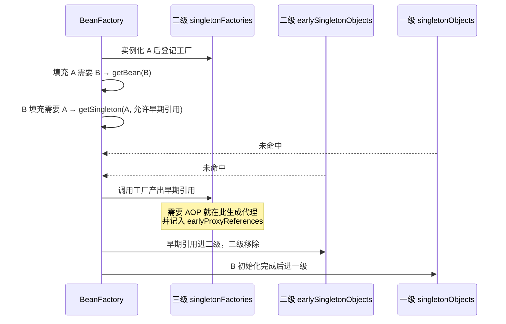

---
sources:
  - 03-第三阶段
---

# 02. IoC 容器与 BeanDefinition 注册

> [← 第三阶段导览](01-导览.md) · 容器里有两张表——「怎么造」的定义表与「造出来的」单例表；把注册与实例化彻底分开，条件装配、懒加载、AOP 与循环依赖才有落脚点。

## 1. 两阶段：为什么注册必须早于实例化

启动日志里常见这样的场面：某个 `BeanFactoryPostProcessor` 打印出三百多个 beanName，而此刻一个业务对象都还没被 `new` 出来。这不是实现细节，而是容器最核心的契约——两张表分属两个类：

| 表 | 字段 | 内容 | 谁写 |
|---|---|---|---|
| 定义表 | `DefaultListableBeanFactory.beanDefinitionMap` | `BeanDefinition`，纯元数据 | 扫描器、配置类解析器、`BeanDefinitionRegistryPostProcessor` |
| 单例表 | `DefaultSingletonBeanRegistry.singletonObjects` | 真正的对象 | `createBean` 完成之后 |

如果合成一步——扫到就 new——会一次性失去四件事：

1. **条件装配没有判定窗口**。`@ConditionalOnMissingBean` 问的是「定义表里有没有」，必须在造对象之前回答（05 册）。
2. **覆盖没有落脚点**。用户定义替换自动配置的默认定义，本质是定义表冲突时的取舍；Boot 从 2.1 起默认 `spring.main.allow-bean-definition-overriding=false`。
3. **顺序无法全局排序**。先扫到的先造，依赖关系只能边造边撞。
4. **代理没有插入位置**。AOP 靠 `BeanPostProcessor` 包装实例，而 BPP 必须全部就位之后才允许批量造业务对象（03 册）。

它们的落点在 `refresh()` 里相隔六步：注册在第 5 步 `invokeBeanFactoryPostProcessors`（`ConfigurationClassPostProcessor` 解析配置类、触发扫描、写入定义），实例化在第 11 步 `finishBeanFactoryInitialization`。中间这六步就是所有「注册后、实例化前」扩展点的生存空间（06 册逐条展开）。

**本册最贵的坑**：不要在 `BeanFactoryPostProcessor` 里 `getBean()`。目标 Bean 会在 BPP 尚未注册时提前实例化，于是绕过全部 `BeanPostProcessor`——包括 AOP。日志里那句 `is not eligible for getting processed by all BeanPostProcessors (for example: not eligible for auto-proxying)` 是永久伤疤：这个 Bean 一辈子都不会被代理，`@Transactional` 从此静默失效。

## 2. BeanDefinition 的字段构成

`BeanDefinition` 是一个接口，日常打交道的是 `RootBeanDefinition`（程序化定义）、`ScannedGenericBeanDefinition`（扫包产物）、`ConfigurationClassBeanDefinition`（`@Bean` 方法产物）。字段不多，但每一个都对应一类线上事故：

| 字段 | 对应注解/来源 | 决定什么 | 写错的表现 |
|---|---|---|---|
| `beanClass` | `@Component` | 造什么 | `NoSuchBeanDefinitionException` |
| `factoryMethodName` / `factoryBeanName` | `@Bean` 方法 | 由哪个工厂方法造 | `@Bean` 方法写成 `static` 后 `@Configuration` 增强失效 |
| `scope` | `@Scope` | 造几个、活多久 | prototype 注入单例只注入一次（§5） |
| `lazyInit` | `@Lazy` | 是否延迟到首次 `getBean` | 错误被推迟到运行期 |
| `dependsOn` | `@DependsOn` | 只保证创建顺序，**不注入** | 误当依赖声明，改不动真实依赖 |
| `primary` | `@Primary` | 同类型多候选时优选 | 与 `@Qualifier` 并存时后者优先，primary 被忽略 |
| `initMethodName` / `destroyMethodName` | `@Bean(initMethod=…)` | 回调方法名 | 与 `@PostConstruct` 顺序搞反（03 册） |
| `autowireMode` | XML 时代遗留 | byType/byName/constructor | 混用会让候选集不可预测 |
| `role` | 框架内部 | 0 业务 / 1 基础设施 / 2 支撑 | 诊断时区分「谁的定义」 |
| `qualifiers` | `@Qualifier` | 候选过滤 | 拼错名字在启动期报候选歧义 |
| `resourceDescription` | 扫描器写入 | 定义来自哪个 class 文件或 jar | 排查「这 Bean 哪来的」的唯一线索（§7） |

读法是三句话：`beanClass` 决定「造什么」，`scope` 决定「造几个、活多久」，`initMethodName`/`destroyMethodName` 决定「造完和销毁前做什么」，其余字段都是辅助信息。第一次实例化时定义会被合并成 `RootBeanDefinition` 并缓存进 `mergedBeanDefinitions`——所以 BFPP 改定义只能发生在合并之前，这也是它只能在启动早期跑的原因。

## 3. 扫描与注册的完整路径



三个值得记住的细节：

**扫描不加载类**。`ClassPathScanningCandidateComponentProvider` 用 `SimpleMetadataReader`（ASM）读 `.class` 的注解元数据，`@Component`、`@Conditional`、`@Profile` 都在这一层判断。这正是「类不在 classpath 上也不会炸」的前提——`@ConditionalOnClass` 整套设计建立在「能读元数据但不触发类初始化」上。

**默认 beanName 与扫描范围**。`AnnotationBeanNameGenerator` 把类名首字母小写（`OrderService` → `orderService`），不同包同名类会撞名并抛 `ConflictingBeanDefinitionException`；自动配置类改用全限定名避开撞车。扫描 basePackage 默认取声明类所在包，`@SpringBootApplication` 挪进子包，应用会静默少掉一半 Bean，报错却在很远的地方。

**`resourceDescription` 指向定义来源**。扫描产物指向 class 文件路径，jar 里就是 `jar:file:/app.jar!/BOOT-INF/classes!/com/acme/…`。§7 的诊断代码就靠它把「三百个定义」分解成「你的代码 20 个、某 starter 280 个」。

## 4. 构造器注入为什么是默认最优

```kotlin
@Service
class OrderService(                       // 单构造器：不需要 @Autowired
    private val repo: OrderRepository,    // final，创建即完整
    private val clock: Clock,
) {
    fun place(cmd: PlaceOrder): Order =
        repo.save(Order.of(cmd, clock.instant()))
}

// 反例：字段注入
@Service
class BadOrderService {
    @Autowired private lateinit var repo: OrderRepository
    @Autowired private lateinit var clock: Clock

    fun place(cmd: PlaceOrder): Order =
        repo.save(Order.of(cmd, clock.instant()))
}
```

两段代码功能等价，代价完全不同。四条理由，按重要性排序：

**对象创建即完整**。构造器返回时所有依赖都已就位，不存在「半成品窗口」。字段注入的对象在构造完成到 `populateBean` 之间是残缺的——如果这段时间里 `this` 逃逸（构造器里注册回调、塞进静态表、提交给线程池），别的线程会看到字段全 null 的对象，这类 bug 在并发下偶发、几乎无法复现。

**`final` 与不可变**。`final` 字段的可见性由 JMM 保证（安全发布），不需要额外同步。Kotlin 里更直接：`private val repo: T` 从编译期堵死「忘了赋值」；字段注入只能写 `lateinit var`，把编译期错误降级成运行期的 `UninitializedPropertyAccessException`，顺带放弃不可变性。

**依赖即文档，单测不需要容器**。构造器签名就是依赖清单，参数涨到 6 个时任何人都会想拆类；字段注入不给这个反馈，上帝类可以无痛长到 15 个 `@Autowired`。而 `OrderService(FakeRepo(), Clock.fixed(...))` 直接 new 就能测，字段注入必须反射或起半个 Spring——测试从 1ms 变 1s，于是没人愿意写。

**循环依赖在启动期就炸**（§6）。这不是副作用，是刻意的：能解环的注入方式会把设计问题藏到运行期。

单构造器免注解来自 `AutowiredAnnotationBeanPostProcessor.determineCandidateConstructors`（Framework 4.3+）：只有一个构造器时直接选它；多个构造器时优先带 `@Autowired` 的，否则退回无参构造器。Kotlin 的默认参数会额外生成合成构造器，多构造器场景下显式标 `@Autowired` 更稳。

**取舍**：构造器注入表达不了「可选依赖」，这时用 `ObjectProvider<T>` 或 Kotlin 默认参数，而不是退回字段注入。

## 5. 作用域与 prototype 的销毁责任

| 作用域 | 谁创建、谁缓存 | 谁销毁 | 典型误用 |
|---|---|---|---|
| `singleton` | 容器，进 `singletonObjects` | 容器（`@PreDestroy`、`DisposableBean`） | 放有状态字段，被并发请求互相污染 |
| `prototype` | 容器每次 `getBean` 新建，**不缓存** | **没人**——容器不管 | 以为 `@PreDestroy` 会执行，句柄泄漏 |
| `request` | 每请求一个，`RequestScope` | 请求结束时通过销毁回调 | 在 `@Async` 线程里访问，抛 `IllegalStateException` |
| `session` | 每会话一个 | 会话失效 | 大对象塞 session，内存随会话数线性涨 |

**prototype 的真实语义**是「容器只负责造，不负责养」。`AbstractBeanFactory.doGetBean` 在 prototype 分支走完 `createBean` 就直接返回，不注册销毁回调——`registerDisposableBeanIfNecessary` 对 prototype 跳过。结论：`@PreDestroy`、`DisposableBean.destroy` 对 prototype **不会执行**，持有连接、文件句柄、线程的 prototype Bean 必须自己管生命周期。

**第二个坑更常见：prototype 注入单例只发生一次。** 单例创建时注入的是「那一个」实例，之后永远是它：

```kotlin
@Service
class ReportService(private val provider: ObjectProvider<ReportBuffer>) {  // 每次 getObject() 都是新实例
    fun render(): String = provider.getObject().append("rows").snapshot()
}
```

三种取新实例的手段，代价依次上升：

| 手段 | 原理 | 代价 |
|---|---|---|
| `ObjectProvider<T>` | 调用时才向容器要 | 业务代码依赖 Spring 类型；可接受 |
| `@Lookup` 方法 | CGLIB 生成子类覆写该方法 | Kotlin 需要 `open` + 抽象方法，`@Lookup` 与 `final` 冲突 |
| `@Scope(proxyMode = TARGET_CLASS)` | 注入的是作用域代理，每次方法调用转发到新实例 | 字段访问不走代理；每次调用多一层间接 |

## 6. 循环依赖与三级缓存



三级缓存各自的职责（`DefaultSingletonBeanRegistry`）：

| 级别 | 字段 | 存什么 | 写入时机 |
|---|---|---|---|
| 一级 | `singletonObjects` | 完整可用的单例 | 初始化完成后 `addSingleton` |
| 二级 | `earlySingletonObjects` | 提前暴露的引用，**可能已是代理** | 从三级取到后缓存，防止生成两次代理 |
| 三级 | `singletonFactories` | `ObjectFactory`，按需产出早期引用 | 实例化后、属性填充前 `addSingletonFactory` |

**为什么需要三级而不是两级**：二级只能存「已生成好的对象」，而「要不要生成代理、生成什么代理」只有 `BeanPostProcessor` 知道。三级存的是「生成早期引用的能力」，把决策推迟到真正有人来要的那一瞬——这就是 `getEarlyBeanReference` 的理由，也是 `SmartInstantiationAwareBeanPostProcessor` 里 `Smart` 的含义。

**为什么构造器循环依赖无解**：`addSingletonFactory` 在 `doCreateBean` 里紧跟 `createBeanInstance`，必须先有对象才有东西可暴露。构造器注入要求参数在构造时就完整，A 的构造需要 B、B 的构造需要 A，两边都卡在 `createBeanInstance` 里，三级缓存连工厂都没写进去：

```text
Error creating bean with name 'a': Requested bean is currently in creation:
Is there an unresolvable circular reference?
```

判定依据是 `singletonsCurrentlyInCreation`：同一个 beanName 在创建过程中被第二次请求，直接失败。

**Boot 侧的默认值变了**：从 Boot 2.6 起 `spring.main.allow-circular-references` 默认 `false`，连 setter/字段循环也启动失败；想回到三级缓存的老行为必须显式打开。Boot 4 沿用这个默认值——它把「能跑但设计有问题」的项目挡在了启动门外。

**AOP 对解环时机的两个真实影响**：

1. **早期引用可能已经是代理**。`AbstractAutoProxyCreator.getEarlyBeanReference` 会在 L3 处生成代理并记入 `earlyProxyReferences`，后续 `postProcessAfterInitialization` 见已有记录就返回原对象，避免二次代理。所以 B 拿到的是代理，`@Transactional` 正常生效。
2. **代理在对象没填完时就存在了**。B 初始化期间调用 A 的方法，代理会把调用转给「属性还没填」的 A，读到 null 字段——「解环成功但运行期 NPE」的经典现场。同一 beanName 因此一度有两个身份，按 `==` 比较看到哪个取决于时机。

结论：**能解 ≠ 该解**。

## 7. 诊断：打印定义数量与来源

这段在 `ApplicationRunner` 里跑，此时定义表已定型、单例已就绪，数字最干净：

```kotlin
@Component
class BeanDefinitionReporter(
    private val beanFactory: ConfigurableListableBeanFactory,
) : ApplicationRunner {

    override fun run(args: ApplicationArguments) {
        val bf = beanFactory as DefaultListableBeanFactory
        val defs = bf.beanDefinitionNames.map(bf::getBeanDefinition)

        // role：0=业务，1=基础设施，2=支撑。业务定义上百，先怀疑扫描范围
        val byRole = defs.groupingBy { it.role }.eachCount()
        println("总数=${defs.size} 业务=${byRole[0]} 基础设施=${byRole[1]} 支撑=${byRole[2]}")

        // 按 class 文件所在目录聚合：一眼看出「谁贡献了 280 个定义」
        defs.mapNotNull { it.resourceDescription }
            .groupingBy { it.substringBeforeLast('/') }.eachCount()
            .entries.sortedByDescending { it.value }.take(10)
            .forEach { (src, n) -> println("%5d  %s".format(n, src)) }

        // 扫描产物能拿到原始类名；靠它认出「谁替你装配的」
        defs.filterIsInstance<ScannedGenericBeanDefinition>()
            .filter { it.beanClassName.contains("AutoConfiguration") }
            .take(20)
            .forEach { println("auto  ${it.beanClassName}  <- ${it.resourceDescription}") }
    }
}
```

**怎么读输出**：

| 现象 | 结论 | 动作 |
|---|---|---|
| 业务定义（role=0）上百 | 扫描范围过大，或 `@Component` 滥用到 DTO | 收窄 `scanBasePackages` |
| 来源 top1 是某个 jar 且数量惊人 | 该 starter 的自动配置贡献了大量定义 | `--debug` 看条件报告，必要时排除（05 册） |
| `auto` 行出现本该不生效的配置 | 条件判定与预期不符 | Actuator `conditions` 端点逐条核对 |

## 8. 取舍清单

- **注入方式**：默认构造器；可选依赖用 `ObjectProvider`。看到 `@Autowired` 打在字段上，先问「为什么不能进构造器」——答案通常是「因为有循环依赖」，而那正是该改设计的地方。
- **`@Lazy` 破环**：注入的是代理，首次调用才解析依赖。启动期错误被推迟到第一次调用，故障从「部署时」变成「流量高峰时」。
- **扫描边界**：根包要覆盖业务代码，但不能覆盖 `test` 与脚本生成的包；第三方 starter 的定义不属于你。
- **别在 BFPP 里 `getBean`**：定义阶段只碰定义。需要「实例就绪后做事」，用 `SmartInitializingSingleton` 或事件（03、06 册）。

## 9. 自测

1. 一个 Bean 被 `BeanFactoryPostProcessor` 里 `getBean()` 提前创建，日志会出现什么提示？它为什么永远不会被 AOP 代理？
2. 三级缓存里第二级的 `earlySingletonObjects` 能不能去掉、只留一三级？说说会退化出什么问题。
3. 你把 `@Bean` 方法写成 `static`，`@Configuration` 类的 CGLIB 增强失效，这对「Bean 之间的方法调用」意味着什么？
4. 一个 `@Scope("prototype")` 的 `ExpensiveResource` 注入到单例里，进程跑三天后堆内存缓慢上涨。给出三种修法和各自的代价。
5. 构造器注入时出现 `BeanCurrentlyInCreationException`，你打算改哪一层：改注入方式、加 `@Lazy`、还是拆类？说明判断依据。
6. §7 的诊断输出显示业务定义 420 个、来源 top1 是你的 `com.acme` 目录。列出两个最可能的原因和对应的验证手段。

## 10. 延伸

- 下一册：[03-Bean生命周期与十二个扩展点](03-Bean生命周期与十二个扩展点.md)——定义注册完之后，一个对象从 `new` 到 `destroy` 要经过哪些手，哪些手能把对象换掉。
- 循环依赖与代理的交汇点在[04-AOP与代理-自调用的真相](04-AOP与代理-自调用的真相.md)；`@Transactional` 在解环场景下的失效现场在[第六阶段 02 册](../06-第六阶段/02-Transactional全解与六种失效现场.md)。
- Kotlin `final` 与 CGLIB 的接缝在[第二阶段 06 册](../02-第二阶段/06-Kotlin与Spring的接缝-allopen-noarg与DSL配置.md)；Bean 定义数量的工程治理在[第十阶段 08 册](../10-第十阶段/08-压测与调优方法论.md)。
