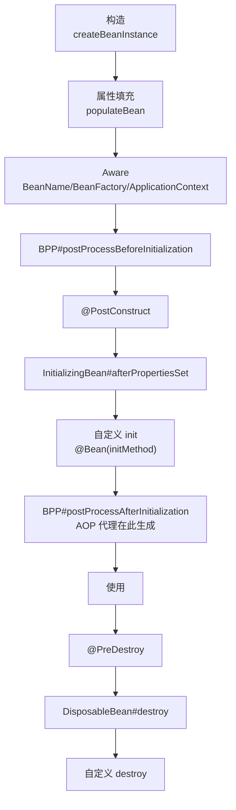

---
sources:
  - 03-第三阶段
---

# 03. Bean 生命周期与十二个扩展点

> [← 第三阶段导览](01-导览.md) · 一个 Bean 从 `new` 到 `destroy` 要经过十几道手，每一道都由不同的框架组件负责；把顺序记成一条线，你才能在正确的位置插入自定义逻辑，也才能解释「为什么我的注解在这里不生效」。

## 1. 一条主线：从构造到销毁



这条线出自 `AbstractAutowireCapableBeanFactory.doCreateBean`：`createBeanInstance` → `populateBean` → `initializeBean`（内部依次 `invokeAwareMethods` → `applyBeanPostProcessorsBeforeInitialization` → `invokeInitMethods` → `applyBeanPostProcessorsAfterInitialization`）。销毁线出自 `DisposableBeanAdapter.destroy`。

三个容易被顺序记错的地方：

- **`@Autowired` 注入发生在 Aware 之前**。字段注入由 `AutowiredAnnotationBeanPostProcessor.postProcessProperties` 在 `populateBean` 里做，早于 `BeanNameAware`。所以 `setBeanName` 里能拿到已注入的依赖，反之不成立。
- **`ApplicationContextAware` 不是 `invokeAwareMethods` 干的**。`invokeAwareMethods` 只处理 `BeanNameAware`、`BeanClassLoaderAware`、`BeanFactoryAware` 三个；`ApplicationContextAware`、`EnvironmentAware`、`ResourceLoaderAware` 等由 `ApplicationContextAwareProcessor` 这个 BPP 在 before 阶段处理。这解释了为什么它们「看起来在 Aware 阶段」，实际却在 BPP 链里。
- **`@PostConstruct` 也是一个 BPP 干的**。`CommonAnnotationBeanPostProcessor`（父类 `InitDestroyAnnotationBeanPostProcessor`）在 `postProcessBeforeInitialization` 里反射调用它，位置在 BPP 链中靠后、`afterPropertiesSet` 之前。

销毁线的顺序同样固定：`@PreDestroy` → `DisposableBean.destroy` → 自定义 destroy。而**多个 Bean 之间的销毁顺序是创建顺序的逆序**（依赖者先死、被依赖者后死），由 `DefaultSingletonBeanRegistry` 的 `disposableBeans` 逆序处理保证。这条规则对连接池尤其重要：数据源必须比使用它的 DAO 后销毁，否则关机时满屏「连接已关闭」。

## 2. 十二个扩展点清单

| # | 扩展点 | 何时 | 能做什么 | 典型用途 |
|---|---|---|---|---|
| 1 | `BeanFactoryPostProcessor` / `BeanDefinitionRegistryPostProcessor` | 定义阶段，无实例 | 增删改 `BeanDefinition` | 注册新定义、改 scope、按配置改写属性 |
| 2 | `InstantiationAwareBeanPostProcessor#postProcessBeforeInstantiation` | 实例化前 | 直接返回替身，跳过正常创建 | 返回预置对象、`TargetSource` 场景 |
| 3 | `SmartInstantiationAwareBeanPostProcessor#determineCandidateConstructors` | 选构造器 | 决定用哪个构造器 | 构造器注入的解析入口 |
| 4 | `MergedBeanDefinitionPostProcessor#postProcessMergedBeanDefinition` | 实例化后、填充前 | 收集注入元数据并缓存 | `@Autowired` 字段、`@PostConstruct` 方法清单 |
| 5 | `InstantiationAwareBeanPostProcessor#postProcessProperties` | 属性填充 | 做真正的注入 | `@Autowired`、`@Resource`、`@Value` |
| 6 | `BeanNameAware` / `BeanFactoryAware` / `ApplicationContextAware` | 填充后（后者由 BPP 触发） | 拿到自身名字、容器、上下文 | 框架内部；业务代码尽量别用 |
| 7 | `BeanPostProcessor#postProcessBeforeInitialization` | 初始化前 | 包装或替换实例 | `@PostConstruct` 执行、字段校验 |
| 8 | `@PostConstruct` | 初始化前段 | 依赖已就绪的初始化逻辑 | 预热、校验不变量 |
| 9 | `InitializingBean#afterPropertiesSet` + 自定义 init | 初始化中段 | 同上，框架内部多用 | 建立连接、启动后台线程 |
| 10 | `BeanPostProcessor#postProcessAfterInitialization` | 初始化后 | **换掉返回的对象** | AOP 代理、指标埋点包装 |
| 11 | `DestructionAwareBeanPostProcessor` / `@PreDestroy` | 销毁前 | 决定这个 Bean 要不要销毁、先做什么 | 关线程池、flush 缓冲 |
| 12 | `DisposableBean#destroy` + 自定义 destroy | 销毁 | 释放资源 | 关连接、注销注册中心 |

编号不必背，每一行只对应一个问题：**「我这段代码该放哪」**——改定义去 1，改实例去 7 和 10，做初始化去 8 和 9，收尾去 11 和 12。

## 3. 构造与属性填充

`createBeanInstance` 解决「用哪个构造器、传什么参数」：有 `@Bean` 工厂方法就调工厂方法，否则按 `determineCandidateConstructors` 的结果选构造器，再用 `ConstructorResolver` 逐参数解析依赖——这一步递归触发被依赖 Bean 的创建，也是循环依赖的爆发点。

`populateBean` 解决「填什么」：先跑 `postProcessAfterInstantiation`（返回 `false` 就整体跳过填充，这是个少见的短路开关），再跑 `postProcessProperties` 做注解注入，最后应用 XML 时代的 `propertyValues`。

**为什么注入放在这一步而不是构造器里**：字段注入和 setter 注入在语言层面无法在构造期完成，Spring 必须留一个「对象已存在、依赖还没给」的窗口。这个窗口是循环依赖能解的前提，也是「半成品对象」泄漏的根源（02 册 §6）。构造器注入把窗口压到零，代价是循环依赖无法解——这是同一个设计的两面。

**坑**：`postProcessAfterInstantiation` 返回 `false` 会跳过**所有**属性注入，包括 `@Autowired`。这个接口签名看起来像「实例化之后的回调」，实际语义是「要不要继续填充」，名字与行为不一致，误实现会导致依赖全为 null 且没有任何报错。

**另一个少有人提的后果**：Bean 创建是「一个接一个」的，中途失败时容器**不会回滚**——之前创建成功的单例留在容器里，它们的线程池、连接、文件句柄都还开着，而 `refresh()` 直接抛异常退出。这就是「启动失败但端口还占着 / 后台线程还在跑」的根源；本地反复重启时看到的 `Address already in use` 多半不是上一次的进程没退，而是 `@PostConstruct` 里起的非守护线程还活着。

## 4. Aware 与 BPP 的两个方向

`invokeAwareMethods` 按固定顺序回调三个接口：`BeanNameAware` → `BeanClassLoaderAware` → `BeanFactoryAware`。它们的作用是让 Bean 拿到「自己是谁、生存在哪个容器里」，典型场景是框架组件（`BeanFactoryPostProcessor` 常实现 `BeanFactoryAware` 来拿注册表）。

`ApplicationContextAwareProcessor` 紧接着在 before 链里处理另外六个：`EnvironmentAware`、`EmbeddedValueResolverAware`、`ResourceLoaderAware`、`ApplicationEventPublisherAware`、`MessageSourceAware`、`ApplicationContextAware`。顺序在 `BeanPostProcessor` 列表里由 `PriorityOrdered`/`Ordered` 决定，`ApplicationContextAwareProcessor` 被注册在最前面。

**为什么业务代码不该实现 Aware**：拿到 `ApplicationContext` 意味着可以 `getBean` 任意东西，依赖关系从此不可静态分析，测试要起容器，循环依赖与提前初始化也随之而来。需要发事件就注入 `ApplicationEventPublisher`，需要读配置就注入 `Environment`——两者都能进构造器。

## 5. 初始化三段与代理生成

`invokeInitMethods` 的顺序是固定的：先 `InitializingBean.afterPropertiesSet`，再自定义 `initMethod`。`@PostConstruct` 不在这里，它属于 before 链（见 §1）。

关键事实：**BPP 的 after 阶段是唯一能替换返回对象的地方**，AOP 代理就在这里生成（`AbstractAutoProxyCreator.postProcessAfterInitialization` → `wrapIfNecessary`）。所以：

```kotlin
@Service
class CacheWarmer(private val repo: OrderRepository) {

    @PostConstruct
    fun warm() {
        // 这里的 this 是原始对象：AopUtils.isAopProxy(this) == false
        // 下面这行既不会开事务，抛异常也不会回滚——自调用 + 未代理，双重失效
        loadAll()
    }

    @Transactional
    fun loadAll() = repo.findAll()
}
```

`warm()` 里 `this` 没被代理，原因不是「Spring 忘了」，而是顺序上不可能：代理要包住「已经初始化完成的对象」，如果在 before 阶段就把 `this` 换成代理，后续 `afterPropertiesSet` 与自定义 init 都会作用在代理上，而代理的 target 还没初始化完——等于用壳包住了空芯。

**三条推论**：

1. `@PostConstruct` 里调同类 `@Transactional`/`@Async`/`@Cacheable` 方法全部不生效。
2. 在 `@PostConstruct` 里把 `this` 存进静态注册表或传给线程池，得到的是原始对象；后续所有经过该引用的调用都绕过代理。
3. `@PostConstruct` 抛异常会让整个应用启动失败（`BeanCreationException` 包装），这是好事——预热失败就该起不来。

## 6. BeanFactoryPostProcessor 与 BeanPostProcessor 的分工

| 维度 | `BeanFactoryPostProcessor` | `BeanPostProcessor` |
|---|---|---|
| 作用对象 | `BeanDefinition`（元数据） | 已创建的实例 |
| 执行时机 | `refresh()` 第 5 步 | 每个 Bean 的初始化前后 |
| 执行次数 | 一次 | 每个 Bean 两次（before/after） |
| 能否改类型 | 能，改 `beanClass` 就换实现 | 能，after 阶段返回替身 |
| 能否依赖业务 Bean | 不能（会导致提前初始化） | 不能（会导致提前初始化） |
| 注册方式 | 作为 `@Bean` 声明（Java 侧常用 `static`，避免配置类被提前实例化） | 同上；框架自带的 BPP 由 `ApplicationContext` 内部注册 |
| 典型成员 | `ConfigurationClassPostProcessor`、`PropertySourcesPlaceholderConfigurer` | `AutowiredAnnotationBeanPostProcessor`、`CommonAnnotationBeanPostProcessor`、`AbstractAutoProxyCreator` |

一句话记法：**BFPP 改「图纸」，BPP 改「成品」**。想替换某个接口的实现，用 BFPP 换定义比用 BPP 换实例更彻底——后者只能影响这一个 Bean，前者影响所有按类型注入的地方。

**BPP 之间的顺序**由注册时的分组决定：先 `PriorityOrdered`，再 `Ordered`，最后是无序的一批；同组内按 `getOrder()` 升序。注意一个容易误推的点：`@Autowired` 一定早于 `@PostConstruct`，原因不在排序，而在**阶段**——注入发生在 `populateBean`，`@PostConstruct` 发生在 `initializeBean` 的 before 链里。你自己写的 BPP 若没实现 `Ordered`，会落在无序组，相对位置不保证，行为可能随版本漂移。

**共同约束**：两者都在「所有 BPP 就位之前」被实例化，因此自身不会被其他 BPP 处理。所以它们只能无参声明、构造器里不要注入业务 Bean，违反的代价见 §8 第二个坑。

## 7. 实测：打印每个 Bean 的创建顺序与耗时

下面这个 BPP 打三个时间戳，切出「属性填充」与「初始化」两段（构造段的起点拿不到，见本节末）：

```kotlin
class CreationTimeline : InstantiationAwareBeanPostProcessor {

    private data class Mark(var afterCtor: Long = 0, var beforeInit: Long = 0, var afterInit: Long = 0)
    private val marks = ConcurrentHashMap<String, Mark>()
    private val order = CopyOnWriteArrayList<String>()

    private fun mark(name: String) = marks.computeIfAbsent(name) { Mark() }

    // 实例化刚结束、属性填充之前：这个点约等于「构造器返回」
    override fun postProcessAfterInstantiation(bean: Any, beanName: String): Boolean {
        if (beanName.startsWith("org.springframework")) return true   // 只看业务 Bean
        mark(beanName).afterCtor = System.nanoTime()
        order += beanName
        return true                                                  // false 会跳过全部注入
    }

    override fun postProcessBeforeInitialization(bean: Any, beanName: String): Any {
        marks[beanName]?.beforeInit = System.nanoTime()
        return bean
    }

    override fun postProcessAfterInitialization(bean: Any, beanName: String): Any {
        marks[beanName]?.afterInit = System.nanoTime()
        return bean
    }

    fun report(top: Int = 10): List<String> = order.mapNotNull { n ->
        val m = marks[n] ?: return@mapNotNull null
        Triple(n, (m.beforeInit - m.afterCtor) / 1_000, (m.afterInit - m.beforeInit) / 1_000)
    }.sortedByDescending { it.second + it.third }.take(top)
        .map { (n, fill, init) -> "%6d µs 填充 | %6d µs 初始化 | %s".format(fill, init, n) }
}
```

注册这个 BPP 时，让它无参、不依赖任何业务 Bean。Java 侧惯用 `static @Bean`，Kotlin 侧写在 `@Configuration(proxyBeanMethods = false)` 的类里即可，但要在注释里写清「这个 Bean 的构造器不许加参数」——因为一旦加了，被依赖的那条链会在 BPP 注册之前就被创建出来（§8 坑二）。真正需要外部信息时，用 `ObjectProvider` 在回调内部现取，而不是在构造器上声明。

**结果怎么读**：

| 观测到的形态 | 含义 | 下一步 |
|---|---|---|
| 某个 Bean 的「填充」段占了几百毫秒 | 依赖链上有慢 Bean，或构造器里做了 IO | 看它的依赖，别优化它自己 |
| 「初始化」段很长 | `@PostConstruct` 里有远程调用、大缓存、全表扫描 | 搬到 `ApplicationRunner` 或异步预热 |
| 基础设施 Bean 排在业务 Bean 之后 | 有 Bean 被提前初始化了 | 查日志里 `not eligible` 警告 |

注意这个 BPP 拿不到「构造器本身的耗时」——`postProcessAfterInstantiation` 是构造之后的第一个回调，之前没有钩子。构造慢（比如构造器里建连接池）要用 JFR 的 `jdk.ExecutionSample` 或 async-profiler 看栈。

## 8. 三个高频坑

**坑一：`@PostConstruct` 里拿到的是原始对象。** 表现是「预热方法加了 `@Transactional` 却不回滚」「`@Cacheable` 不写缓存」。根因是 §5 的顺序。修法：把预热逻辑挪到另一个 Bean（构造器注入进来，调用就是走代理的外部调用），或者用 `ApplicationRunner`。验证只要一行：在 `@PostConstruct` 里打印 `AopUtils.isAopProxy(this)`，永远是 `false`——这不是配置问题，改多少配置都变不成 `true`。

**坑二：在扩展点里注入依赖，导致提前初始化。** 一个 `BeanPostProcessor` 的构造器里注入了 `DataSource`，容器为了造这个 BPP，必须先把 `DataSource` 及其整条依赖链造出来——此时其他 BPP 还没注册，整条链上的 Bean 都不会被代理。日志特征：

```text
Bean 'dataSource' of type [...] is not eligible for getting processed by
all BeanPostProcessors (for example: not eligible for auto-proxying)
```

修法只有一条：BPP/BFPP 里用 `ObjectProvider<T>` 延迟取，绝不在字段或构造器上直接注入。

**坑三：把 `@DependsOn` 当成依赖声明。** `@DependsOn` 只保证「另一个 Bean 先创建」，既不注入也不传递：

| 你以为它做的事 | 它实际做的事 |
|---|---|
| 声明「我需要它」 | 只保证创建顺序，你拿不到引用 |
| 解决循环依赖 | 会加重循环依赖（多一条硬边） |
| 保证「它初始化完成后我才初始化」 | 保证它在**我开始创建之前**创建完成 |

它真正的用途只有一类：**没有注入关系、但存在初始化副作用先后要求**。例如 A 在 `@PostConstruct` 里写静态注册表，B 在构造器里读它——两者没有类型依赖，容器无从排序，此时 `@DependsOn` 是唯一表达方式。更常见的正解是显式注入，或改用 `SmartInitializingSingleton`（所有单例就绪后回调一次）。

## 9. 自测

1. `@PostConstruct`、`afterPropertiesSet`、自定义 `initMethod` 三者的执行顺序？`@PostConstruct` 为什么不在 `invokeInitMethods` 里？
2. 一个 `BeanPostProcessor` 的构造器参数是 `DataSource`，会发生什么？日志长什么样，为什么不只影响这个 BPP？
3. 想在「所有单例都创建完、但 Web 服务器还没开始接流量」时做一次全量校验，应该挂在哪个扩展点？
4. 你在 `@PostConstruct` 里把 `this` 注册进一个静态的 `Map<String, Handler>`，后续从 Map 取出调用 `@Transactional` 方法会怎样？怎么改？
5. `postProcessAfterInstantiation` 返回 `false` 会发生什么？为什么这个语义容易写错？
6. `@DependsOn("a")` 与构造器注入 `A` 有什么区别？什么时候只能用前者？

## 10. 延伸

- 上一册：[02-IoC容器与BeanDefinition注册](02-IoC容器与BeanDefinition注册.md)——定义表如何建立，以及为什么注册必须早于实例化。
- 下一册：[04-AOP与代理-自调用的真相](04-AOP与代理-自调用的真相.md)——`postProcessAfterInitialization` 里到底生成了什么，它为什么管不到 `this` 调用。
- 这些扩展点落在 `refresh()` 的哪一步，见[06-启动流程refresh与内嵌容器](06-启动流程refresh与内嵌容器.md)；想亲手实现一遍，去[07-手写一个迷你容器](07-手写一个迷你容器.md)。
