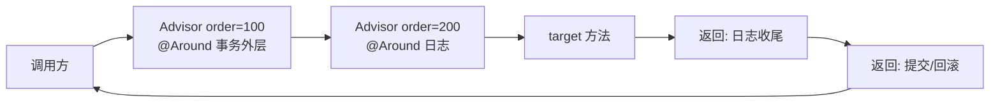
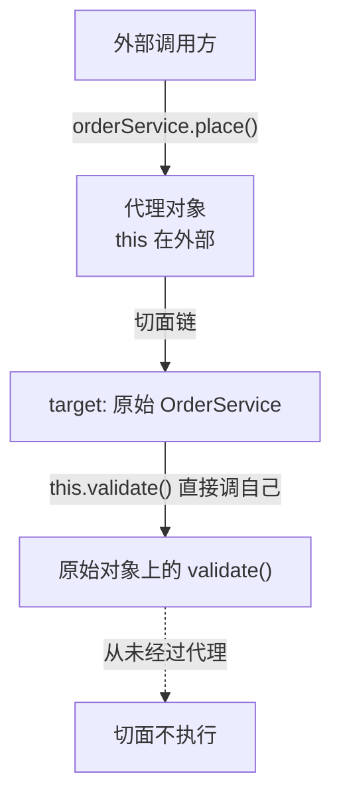

---
sources:
  - 03-第三阶段
---

# 04. AOP 与代理：自调用的真相

> [← 第三阶段导览](01-导览.md) · 切面不是一个「嵌进方法体」的东西，它是容器交给你的另一个对象；只要调用没经过那个对象，任何切面都不会生效——自调用失效的全部原因就这一句。

## 1. 代理生成的位置：`wrapIfNecessary`

AOP 的全部魔法发生在 `AbstractAutoProxyCreator.postProcessAfterInitialization` 里的一个方法：

```text
postProcessAfterInitialization(bean, beanName)
  └─ wrapIfNecessary(bean, beanName, cacheKey)
       ├─ getAdvicesAndAdvisorsForBean(...)      // 找出能套在这个 Bean 上的所有 Advisor
       ├─ if (specificInterceptors == EMPTY) return bean   // 没有匹配就原样返回
       └─ createProxy(...)                        // ProxyFactory → JDK 或 CGLIB
```

三个推论，解释了绝大多数「AOP 不生效」：

1. **没匹配到 Advisor 就不代理**。切点写错、注解写在 `private` 方法上、类不在被扫描的包里，都会让这里返回原始对象，且**不报错**。
2. **代理是「换掉返回值」而不是「改方法体」**。容器最终放进 `singletonObjects` 的是代理，容器外调用方拿到的也是代理。
3. **发生在 `postProcessAfterInitialization`**，也就是初始化完成之后（03 册 §5）。这决定了 `@PostConstruct` 里的 `this` 一定是原始对象。

`AnnotationAwareAspectJAutoProxyCreator` 是 Boot 里实际生效的实现（由 `@EnableAspectJAutoProxy` 经 `AopAutoConfiguration` 引入），它负责解析 `@Aspect` 类、把 `@Around`/`@Before` 等方法编译成 `Advisor`，再按 `@Order` 排序。

**为什么 Spring 选代理而不是字节码织入**：AspectJ 的编译期织入（CTW）与加载期织入（LTW）是把切面直接写进方法字节码，`this.validate()` 也会被织入——自调用因此天然生效，性能也更好（没有额外对象与反射）。代价是构建链路要多一道编译器或 `-javaagent`，IDE、热部署、增量编译全都要配合，且产物与源码不再一一对应。Spring AOP 选了「运行时生成代理」，用「必须经过容器调用」换「零构建侵入」——这是一个明确的取舍，不是能力缺失。理解这一点，你就不会再问「怎么让 Spring AOP 支持自调用」，而会问「这次调用该怎么设计」。

由此还能推出一条判断规则：**只要调用方拿到的是容器给的引用，切面就生效；只要调用方是「对象自己」，就不生效**。框架回调（`@PostConstruct`、`ApplicationRunner`、`@Scheduled`、`@EventListener`）里注入进来的依赖都是代理，所以它们调别人的方法没问题；问题只出在「调自己」。

## 2. JDK 动态代理 vs CGLIB

| 维度 | JDK 动态代理 | CGLIB |
|---|---|---|
| 原理 | `Proxy.newProxyInstance`，生成实现同一批接口的类 | 生成目标类的**子类**，覆写方法 |
| 前提 | 目标至少实现一个接口 | 目标类与目标方法不能是 `final` |
| 代理类名 | `jdk.proxy2.$Proxy42` | `OrderService$$SpringCGLIB$$0` |
| 注入类型 | 只能按接口注入，按实现类注入会抛 `BeanNotOfRequiredTypeException` | 可以按实现类注入 |
| 构造器 | 不涉及 | 通过 Objenesis 实例化，不调用你的构造器 |
| 字段访问 | 代理有自己的字段（全 null） | 同理，代理是子类实例，父类字段由 target 持有 |
| 性能 | 调用走反射/生成字节码，冷启动快 | 首次生成字节码较慢，之后接近直调 |
| 对 Kotlin | 友好（接口不受 `final` 影响） | 需要 `open`，否则生成子类失败 |

选择逻辑在 `DefaultAopProxyFactory.createAopProxy`：

```text
if (config.isOptimize() || config.isProxyTargetClass() || hasNoUserSuppliedProxyInterfaces(config))
    → CGLIB（若 target 本身是接口则仍用 JDK）
else
    → JDK
```

**Boot 的默认值是 CGLIB**：`AopAutoConfiguration` 里 `spring.aop.proxy-target-class` 缺省为 `true`（Boot 2.x 起）。这个默认值有明确的工程理由——按实现类注入是主流写法，JDK 代理会让 `@Autowired private val orderService: OrderService` 直接失败；而 CGLIB 不要求接口。代价是「类必须可被继承」，这条在 Kotlin 上是硬约束。

**坑**：把 `spring.aop.proxy-target-class` 改成 `false` 后，所有按实现类注入的地方会在启动时爆炸，报错形如 `Bean named 'orderService' is expected to be of type 'OrderService' but was actually of type 'jdk.proxy2.$Proxy68'`。改这个开关前先数一遍按实现类注入的点。

**CGLIB 的第二个前提是「类可见」**。生成的子类与目标类同包，所以目标类不能被 `private` 拦住：Kotlin 的顶层 `private class` 编译后是包私有，同包可见，勉强能用；嵌套类、`inner class`、匿名类则一律代理失败。这也是「Spring 管理的 Bean 应该是顶层可见类」这条规约的来源——它不是风格问题，是代理机制的硬约束。

## 3. Kotlin 的 `final` 与 CGLIB 的正面冲突

Kotlin 的类和方法默认 `final`。于是第一次在 Kotlin 项目里用 `@Transactional`，常见报错是：

```text
org.springframework.aop.framework.AopConfigException:
Could not generate CGLIB subclass of class [com.acme.order.OrderService]:
Common causes of this problem include using a final class or a non-visible class;
nested exception is java.lang.IllegalArgumentException: Cannot subclass final class com.acme.order.OrderService
```

读法：外层 `AopConfigException` 是 Spring 的包装，真正的因由在最后一句——CGLIB 想 `extends OrderService`，被 `final` 挡住。

三种解法，按推荐度排序：

| 解法 | 做法 | 代价 |
|---|---|---|
| `kotlin-spring` 插件 | 声明预设注解自动 `open` | 零代码改动；只对预设注解生效，自定义注解要额外配 |
| 手写 `open` | `open class` + `open fun` | 最直白，但每个类都要记得写，漏一个就是运行期才发现 |
| 走 JDK 代理 | 抽接口 + `proxy-target-class=false` | 改动最大，且 Kotlin 里接口 + 实现会让注入类型变多 |

插件配置只有一行：

```kotlin
plugins {
    kotlin("jvm") version "2.2.20"
    kotlin("plugin.spring") version "2.2.20"   // all-open + 预设注解
}
```

`kotlin-spring` 本质是 `all-open` 加一份预设清单：`@Component`、`@Async`、`@Transactional`、`@Cacheable`、`@SpringBootTest`、`@Configuration`、`@Controller` 等。被这些注解标记的类及其成员自动变成 `open`。**注意「及其成员」**：类 `open` 了但方法被显式标 `final` 仍然不行；反过来类没标这些注解、只被 `@Aspect` 切到，插件不会帮它 `open`（除非你自定义 preset）。

## 4. 切面链与 `@Order`

多个 Advisor 不是「依次执行」，而是**层层嵌套**：



规则三条：

- `order` 值小的在外层：进入时先执行，退出时后执行。
- 同一个切面类里的多个通知，按 `@Around` → `@Before` → `@After` → `@AfterReturning`/`@AfterThrowing` 的语义位置排，但**它们都在同一个 Advisor 内**，顺序由 `ReflectiveAspectJAdvisorFactory` 的方法排序决定。
- `TransactionInterceptor` 的 order 是 `Ordered.LOWEST_PRECEDENCE`，意味着事务在最内层——所以「日志切面记录的方法耗时」通常会**包含**事务提交时间，而「事务切面看到的异常」是已经被外层切面处理过的。

**这条嵌套关系直接决定了三件排障常识**：

1. 事务切面在内层，所以 `@Transactional` 方法里抛出的异常会先经过事务拦截器判断回滚规则，再往外传。
2. 权限切面（`@EnableMethodSecurity`）默认 order 500，落在事务外层——鉴权失败时事务还没开启，不会有「空事务」开销。
3. 若你自己写的日志切面没实现 `Ordered`，它的位置是「未指定」，不同版本可能变；一旦它排到事务外层，「日志里记录到的方法返回值」可能是事务提交前的状态。

还有一个高频困惑：「日志切面里打印的参数为什么是原始值、没被内层切面改过？」因为参数是调用方传进来的引用，内层切面若替换了参数（`pjp.proceed(args)` 传新数组），外层持有的仍是老数组——切面之间传参只能通过 `ProceedingJoinPoint` 的显式替换，没有「共享上下文」这回事。需要跨切面传值就自己放 ThreadLocal，并记得在 finally 里清。

## 5. 自调用的真相



关键不是「`this` 指向谁」，而是**「这次调用经过了几次方法分派」**。`this.validate()` 是一次普通的虚方法调用，接收者是 target 自己；代理对象根本没参与，`MethodInterceptor` 也就没被触发。

所以自调用失效的判据可以写得更精确：**只要调用的起点在 target 内部，且没有显式拿到代理引用，这次调用就不走切面。** 与它属于哪个类、方法是不是 public 都无关。

**代理不拦截字段访问**。这一条常被忽略：代理对象有自己的一份字段（CGLIB 子类继承来的、JDK 代理里根本没有），它们的值都是 null 或默认值，真正的数据在 target 里。所以通过代理读 `proxy.someField` 得到的是代理自己的字段，不是业务对象的状态；对外暴露字段（Kotlin 的 `val` 会生成 getter，`var` 生成 getter/setter）会被拦截，直接 `public` 字段则不会。这也是「Bean 不要暴露可变公有字段」在 AOP 语境下的第二个理由。

同一个原因造成的其他「失效」：`@Transactional`、`@Async`、`@Cacheable`、`@PreAuthorize`、`@Retryable`，全部遵循这条规则。第六阶段会把事务场景单独展开，这里只需要记住机制。

## 6. 三种解法与代价

| 解法 | 写法 | 优点 | 代价 |
|---|---|---|---|
| 拆类 | 把内层方法挪到另一个 Bean | 无框架耦合、可测、意图清晰 | 多一个类；跨类调用有真实的方法调用开销（可忽略） |
| 注入自身 | `ObjectProvider<Self>` 或 `@Lazy Self` | 改动最小，保留原方法签名 | 引入自引用；`@Lazy` 掩盖了「这个类职责过多」的信号 |
| `AopContext.currentProxy()` | 开 `exposeProxy`，`(Self) AopContext.currentProxy()` | 不改结构，能精确控制哪一行走代理 | 业务代码绑死 Spring；ThreadLocal 绑定，跨线程/协程失效；必须开全局开关 |

`exposeProxy` 的开关在 `@EnableAspectJAutoProxy(proxyTargetClass = true, exposeProxy = true)`，开启后 `CglibAopProxy`/`JdkDynamicAopProxy` 会在进入切面链时把代理塞进 `AopContext` 的 `ThreadLocal`，退出时清理。两个后果：

- **跨线程拿不到**：`@Async` 方法、线程池任务、`Dispatchers.Default` 里调用 `AopContext.currentProxy()` 会抛 `IllegalStateException: Cannot find current proxy`。
- **每次调用多两次 ThreadLocal 读写**，量级可忽略，但如果切面链里所有方法都开 `exposeProxy`，这是纯粹为极少数调用付的全局成本。

工程上的排序很清楚：**优先拆类**，其次注入自身（`ObjectProvider` 比 `@Lazy` 更显式），`AopContext` 只作为改造存量代码的过渡手段。判断标准很简单——如果一个类的两个方法必须走各自的切面才能正确工作，它们本来就是两个职责。

拆类要拆到位：把内层方法连同它需要的数据一起搬走，让新类只有「一个可被独立调用的事务边界」。半拆（只把方法挪走、仍然靠回传共享状态）会得到两个互相引用的类，循环依赖与脏读一起回来。拆完的收益不止是切面生效——新类的单测不再需要起容器，这才是「职责清晰」的可验证标志。

## 7. 不被代理的方法：`private`、`final`、`static`

| 方法形态 | JDK 代理 | CGLIB | 说明 |
|---|---|---|---|
| `public`（接口中声明） | 拦截 | 拦截 | 正常路径 |
| `public`（接口中未声明） | 不拦截 | 拦截 | JDK 只能拦接口方法 |
| `protected` | 不拦截 | 拦截 | CGLIB 子类可覆写 |
| `private` | 不拦截 | **不拦截** | 子类看不见，无法覆写 |
| `final` | 不拦截（接口方法不能 final） | **不拦截** | 无法覆写，静默放过 |
| `static` | 不拦截 | 不拦截 | 静态方法不属于实例分派 |

`private` 与 `final` 的危险在于**静默**：Spring 不会为它们报错，最多在 debug 日志里提一句。于是「`@Transactional` 加在 private 方法上」这类错误会一路跑到线上，直到某次故障复盘才被发现。`static` 更彻底：它不属于任何实例，连「代理对象」这个概念都用不上，切面匹配到也不会被调用。

Kotlin 侧还有两个专属坑：

- `internal fun` 编译后是 `public` 但方法名被改写（带 `$模块名` 后缀）。CGLIB 能拦到，但按方法名写的切点（如 `execution(* com.acme.*.find*(..))`）可能匹配不上。
- 在 `object` 或 `companion object` 里声明的方法不是实例方法，一律不被代理。

## 8. 最小可运行示例：证明自调用不走代理

一个注解、一个切面、一个服务、三个断言，够把这件事钉死。

```kotlin
@Target(AnnotationTarget.FUNCTION)
@Retention(AnnotationRetention.RUNTIME)
annotation class Logged

@Aspect
@Component
class CountingAspect {
    val hits = AtomicInteger()

    @Around("@annotation(com.acme.aop.Logged)")
    fun count(pjp: ProceedingJoinPoint): Any? {
        hits.incrementAndGet()
        return pjp.proceed()
    }
}

@Service
class ReportService(private val self: ObjectProvider<ReportService>) {

    @Logged
    fun outer(): String = inner()                     // 自调用：不经过代理

    @Logged
    fun inner(): String = "inner"

    @Logged
    fun outerViaSelf(): String = self.getObject().inner()   // 显式拿到代理再调
}
```

测试断言三件事：自调用只命中一次、经代理的调用命中两次、拿到的确实是 CGLIB 代理。

```kotlin
@SpringBootTest
class SelfInvocationTest @Autowired constructor(
    private val svc: ReportService,
    private val aspect: CountingAspect,
) {
    @BeforeEach
    fun reset() = aspect.hits.set(0)

    @Test
    fun `自调用只命中外层`() {
        svc.outer()
        assertEquals(1, aspect.hits.get())    // inner 的切面没执行
    }

    @Test
    fun `经代理的调用命中两次`() {
        svc.outerViaSelf()
        assertEquals(2, aspect.hits.get())
    }

    @Test
    fun `注入的是 CGLIB 代理`() {
        assertTrue(AopUtils.isCglibProxy(svc))
        assertNotSame(svc, AopTestUtils.getUltimateTargetObject(svc))
    }
}
```

跑之前确认两件事：`ReportService` 被 `kotlin-spring` 插件 `open` 了（否则第一个测试就报 `Cannot subclass final class`）；`ObjectProvider` 注入自身不会产生循环依赖（它是延迟解析，不是构造期依赖）。第三个断言的意义在于：**如果 `svc` 不是代理，前两个测试的结论会完全不同**——那是「AOP 根本没生效」，而不是「自调用失效」，两者要分开排查。

## 9. 自测

1. `wrapIfNecessary` 在什么阶段执行？如果一个 Bean 没有任何 Advisor 匹配，容器里放的是代理还是原对象？
2. 你把 `spring.aop.proxy-target-class` 设为 `false`，一个「只有实现类、没有接口」的 `@Service` 会怎样？
3. 报错 `Cannot subclass final class X` 出现在启动的哪一步？为什么它不属于编译期错误？
4. 两个切面 order 分别是 100 和 200，谁先进入、谁先退出？事务切面在哪个位置，这如何影响「日志里记录的异常类型」？
5. `AopContext.currentProxy()` 在 `@Async` 方法里为什么失效？给出替代方案。
6. 一个 `private` 方法上加了 `@Transactional`，启动会报错吗？会在什么时候暴露？

## 10. 延伸

- 上一册：[03-Bean生命周期与十二个扩展点](03-Bean生命周期与十二个扩展点.md)——代理生成的时机为什么必须是 `postProcessAfterInitialization`。
- 下一册：[05-自动配置与条件装配](05-自动配置与条件装配.md)——`AopAutoConfiguration` 这类配置是怎么被条件化地装配进来的。
- `@Transactional` 的六种失效现场（含自调用、异步、异常被吞）在[第六阶段 02 册](../06-第六阶段/02-Transactional全解与六种失效现场.md)；Kotlin 的 `allopen` 细节在[第二阶段 06 册](../02-第二阶段/06-Kotlin与Spring的接缝-allopen-noarg与DSL配置.md)。
- Filter、Interceptor、AOP 三者的执行顺序见[第四阶段 03 册](../04-第四阶段/03-Filter-Interceptor-AOP的执行顺序.md)。
