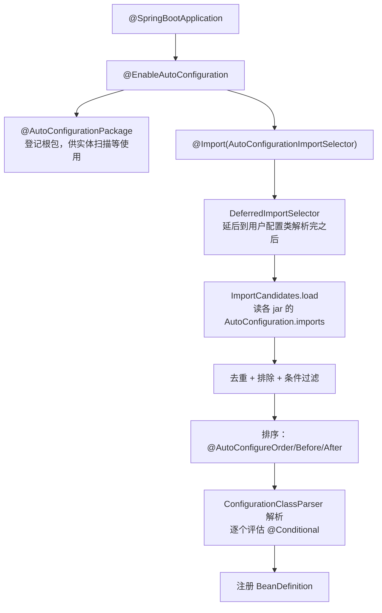

---
sources:
  - 03-第三阶段
---

# 05. 自动配置与条件装配

> [← 第三阶段导览](01-导览.md) · 自动配置不是「框架帮你 new 对象」，而是一批被条件守着的配置类：条件成立才注册定义，不成立就连类都不加载——搞懂条件在哪一步、看到什么，你就能精确地开关它。

## 1. 一条 import 链路



三件事值得单独说清楚。

**为什么是 `DeferredImportSelector`**。普通 `@Import` 在解析到该注解时立即生效，而 `DeferredImportSelector` 的 `selectImports` 被推迟到**所有用户配置类解析完之后**才调用。这一条是整个 `@ConditionalOnMissingBean` 机制的地基：等自动配置开始时，用户 `@Bean` 的定义已经在表里了，「缺失」判断才有意义（§7 会看到违反它的后果）。

**加载靠一个纯文本文件**。路径固定：

```text
META-INF/spring/org.springframework.boot.autoconfigure.AutoConfiguration.imports
```

每行一个全限定类名。Boot 2.7 引入这个文件，Boot 3 起彻底取代 `spring.factories` 里的 `EnableAutoConfiguration` 条目——所以「往 `spring.factories` 里写自动配置」在 3.x/4.x 上**完全不生效，且不报错**，是升级时最常见的静默故障。

**`@AutoConfigurationPackage` 不是自动配置**。它只做一件事：把主类所在包登记进 `AutoConfigurationPackages`，供 JPA 实体扫描、MyBatis mapper 扫描这类「需要知道根包」的框架使用。名字里的 AutoConfiguration 是历史包袱。

## 2. 两阶段过滤与评估顺序

条件不是「一次跑完」的。Boot 把它拆成两道关卡，目的是**尽量少加载类**：

| 阶段 | 在哪 | 评估什么 | 输入 |
|---|---|---|---|
| 第一道：导入期过滤 | `AutoConfigurationImportSelector.getAutoConfigurationEntry` → `filter` | `AutoConfigurationImportFilter`（`OnClassCondition`、`OnWebApplicationCondition`） | ASM 读到的类元数据，**不加载类** |
| 第二道：解析期评估 | `ConfigurationClassParser.processConfigurationClass` → `ConditionEvaluator.shouldSkip` | 类上全部 `@Conditional`，含 `@ConditionalOnBean`、`@ConditionalOnProperty` | 已有的 `BeanDefinition`、`Environment` |
| 第三道：注册期评估 | `ConfigurationClassBeanDefinitionReader` | `@Bean` 方法上的 `@Conditional` | 已注册定义 |

第一道关卡的价值：一个应用 classpath 上可能有 150 个自动配置类，先用「类存在吗」这把最便宜的尺子砍掉大半，剩下的才值得去加载并解析。这也是为什么你在 `--debug` 报告里看到的 `Negative matches` 大多是 `@ConditionalOnClass did not find required class`——它们在第一道关卡就被淘汰了。

**评估顺序不能靠注解书写位置控制**。你在一个类上写五个 `@Conditional`，它们按 Spring 内部收集顺序执行，跨版本可能变。唯一能依赖的语义是：`@ConditionalOnMissingBean` 只能看到**到那一刻为止**已注册的定义。所以「条件的相对顺序」在自定义 starter 里是必须显式设计的（用 `@AutoConfigureAfter`/`@AutoConfigureBefore` 表达类间顺序），而不是碰运气。

**`@ConditionalOnBean` 的可见性陷阱**：它默认只看当前 `BeanFactory` 里已注册的定义，且 `allowEagerInit=false`——不会为了判断而提前创建 `FactoryBean` 产出的对象。所以「`@ConditionalOnBean(SomeFactoryBean 产出的类型)`」可能判断错误。这条差异在排障时非常关键：报告说「没找到」，不等于运行时没有。

**三个「条件不生效」的典型现象**，成因完全不同：

| 现象 | 真实原因 | 验证方式 |
|---|---|---|
| 自动配置类根本不在报告里 | 模块不在 classpath，或 `imports` 文件路径/文件名写错 | `jar tf` 看有没有那个文件；看 Exclusions 段 |
| 在报告里但走了 Negative 分支 | 某条条件不满足，通常是缺依赖或缺配置 | 读 Negative matches 的具体条目 |
| 在报告里且 Positive，但 Bean 行为不对 | 注册成功后被你的同名 Bean 覆盖（或反之） | `getBeanDefinition` 看 `resourceDescription` 指向谁 |

## 3. `@Conditional` 家族

| 注解 | 实现类 | 判断依据 | 典型误用 |
|---|---|---|---|
| `@ConditionalOnClass` / `OnMissingClass` | `OnClassCondition` | classpath 上是否有该类 | 写成 `@ConditionalOnClass(SomeType::class)` 时类型必须能被加载，否则用 `name` 字符串形式 |
| `@ConditionalOnBean` / `OnMissingBean` | `OnBeanCondition` | 已注册定义中是否有该类型 | 在用户配置类里用它判断自动配置的 Bean（顺序反了） |
| `@ConditionalOnSingleCandidate` | `OnBeanCondition` | 恰好一个候选或有一个 `@Primary` | 多数据源场景下判成「有」，实际注入仍歧义 |
| `@ConditionalOnProperty` | `OnPropertyCondition` | 配置项存在/等于某值 | `havingValue` 与 `matchIfMissing` 组合写错，默认值反了 |
| `@ConditionalOnResource` | `OnResourceCondition` | 某个资源存在 | 用于 classpath 探测，不用于文件系统路径 |
| `@ConditionalOnWebApplication` | `OnWebApplicationCondition` | 应用类型（SERVLET/REACTIVE） | 与 `@ConditionalOnNotWebApplication` 混用导致谁也不生效 |
| `@ConditionalOnExpression` | `OnExpressionCondition` | SpEL 求值 | 在表达式里访问 Bean，触发提前初始化 |
| `@ConditionalOnJava` | `OnJavaCondition` | JVM 版本区间 | 只在库代码里用，业务代码没必要 |

`@ConditionalOnClass` 有一个必须知道的写法约束：属性写成 `Class` 类型时，**读取该注解**会触发类解析，目标类缺席就不是「条件为假」，而是抛 `TypeNotPresentException`/`ArrayStoreException`。所以「可能不存在」的类要用字符串形式 `@ConditionalOnClass(name = ["com.acme.MaybeMissing"])`——Spring 自己的自动配置普遍这么写，原因就在这里。

## 4. Boot 4 拆模块之后的排除粒度

Boot 4 把原来那个巨大的 `spring-boot-autoconfigure` 按技术拆成了一批模块（JDBC、JPA、WebMVC、Jackson、Flyway、Actuator 各归各家），每个模块自带自己的 `AutoConfiguration.imports`。对使用者来说，可排除的粒度变成三层：

| 粒度 | 手段 | 影响面 | 适用 |
|---|---|---|---|
| 依赖级 | 不引入该模块 / `exclude` 掉 starter | 整块能力消失，连类都不在 classpath | 确定不用（如不用 Redis） |
| 配置类级 | `spring.autoconfigure.exclude` 或 `@SpringBootApplication(exclude = …)` | 该配置类下的所有 `@Bean` 都不注册，但依赖仍在 | 想换实现、或要手工装配 |
| Bean 级 | 自己定义同类型 Bean + 对方的 `@ConditionalOnMissingBean` | 只替换某一个 Bean | 最常见，也最安全 |

拆细带来的实际收益是**条件更精确**：以前一个 `DataSourceAutoConfiguration` 里混着连接池、JdbcTemplate、事务管理器，现在各自独立，排除其中一个不会连带干掉另外两个。代价是「我该排除哪个类」的答案从「翻一个大 jar」变成了「翻若干小模块」——`--debug` 报告比记忆更可靠。

**排除的写法**（YAML 里是列表，注意别写成逗号字符串）：

```text
spring.autoconfigure.exclude[0]=org.springframework.boot.jdbc.autoconfigure.DataSourceAutoConfiguration
```

`@SpringBootApplication(exclude = [DataSourceAutoConfiguration::class])` 更类型安全，但要求该类在编译期可见；当你在写一个不依赖该模块的公共库时，只能用属性形式。

**升级到 Boot 4 时的三个动作**：核对 `spring.factories` 中是否还有 `EnableAutoConfiguration` 残留（迁到 `.imports`）；核对被 `exclude` 的全限定类名是否随模块调整而改名（旧名字不会报错，只是排不掉）；核对自定义 starter 的 `@AutoConfiguration` 是否从 `spring-boot-autoconfigure` 正确继承了新坐标。第三项最隐蔽——类名没变、包可能变了。

**排除不是银弹**。排掉 `DataSourceAutoConfiguration` 后，任何 `@ConditionalOnBean(DataSource)` 的自动配置会跟着失效，`JdbcTemplate` 也不会被创建；这不是级联 bug，正是条件机制的应有行为。排除前先用 `--debug` 看「谁依赖它」，比事后补 Bean 便宜得多。

## 5. 三种排查手段

| 手段 | 看到什么 | 成本 | 什么时候用 |
|---|---|---|---|
| `--debug`（或 `debug=true`） | 完整条件评估报告：Positive / Negative / Exclusions / Unconditional | 一次启动 + 几百行日志 | 排查「为什么这个 Bean 没生效」 |
| Actuator `conditions` 端点 | 同上，JSON 结构，可在运行中的实例上查 | 需开 `management.endpoints.web.exposure.include=conditions` | 生产/预发，不方便重启时 |
| `spring.autoconfigure.exclude` | 直接改变结果 | 需要重启 | 确认要关掉某块能力 |

`--debug` 报告的关键片段长这样：

```text
Positive matches:
-----------------
   SmsAutoConfiguration matched:
      - @ConditionalOnClass found required class 'com.acme.sms.SmsClient' (OnClassCondition)

Negative matches:
-----------------
   RedisAutoConfiguration:
      Did not match:
         - @ConditionalOnClass did not find required class 'redis.clients.jedis.Jedis' (OnClassCondition)
```

读法是**只看你关心的那两个类**：先确认它出现在 Positive 还是 Negative，再看否定理由挂在哪条条件上。负面理由通常一眼就能定位到「缺依赖」「缺配置项」「已有同类型 Bean」三类之一。

一个常被忽略的事实：报告只列出**被评估过**的配置类。如果一个类连第一道关卡都没进（比如它的 `imports` 条目被你 exclude 了），它不会出现在 Negative matches 里，而是出现在 Exclusions 段——「找不到」和「被排除」是两件事，别混。

## 6. 写一个自己的 starter

拆成两个模块是官方推荐：`acme-spring-boot-autoconfigure`（代码与条件）与 `acme-spring-boot-starter`（只有依赖声明）。小团队合成一个也行，但**自动配置类必须放在使用者的包扫描范围之外**——否则它会被 `@ComponentScan` 当普通配置类扫到，绕开所有条件。

先定义配置项。Kotlin 的 `data class` 加默认值，天然适合构造器绑定：

```kotlin
@ConfigurationProperties("acme.sms")
data class SmsProperties(
    val endpoint: String = "https://sms.internal",
    val timeout: Duration = Duration.ofSeconds(2),
    val retries: Int = 1,
)
```

再写自动配置类。三个注解各司其职：`@AutoConfiguration` 声明这是自动配置（隐含 `proxyBeanMethods = false`），`@ConditionalOnClass` 守住「依赖在才生效」，`@EnableConfigurationProperties` 把配置类注册进来：

```kotlin
@AutoConfiguration
@ConditionalOnClass(SmsClient::class)
@EnableConfigurationProperties(SmsProperties::class)
class SmsAutoConfiguration {

    @Bean
    @ConditionalOnMissingBean                       // 使用者定义了 SmsClient 就用他的
    fun smsClient(props: SmsProperties): SmsClient =
        SmsClient(props.endpoint, props.timeout, props.retries)
}
```

最后在 `src/main/resources/META-INF/spring/` 下放 `org.springframework.boot.autoconfigure.AutoConfiguration.imports`，一行写全限定名：

```text
com.acme.sms.autoconfigure.SmsAutoConfiguration
```

三个必查项：Kotlin 编译要开 `javaParameters = true`（构造器绑定的参数名靠它）；`Duration` 这类类型需要 `@DurationUnit` 或写成 `2s` 格式；`@ConfigurationProperties` 类不要加 `@Component`，否则会绕过 `@EnableConfigurationProperties` 的绑定流程，得到一个字段全默认值的对象。

模块拆分的意义在于**消费者能只依赖自动配置、不要 starter**：starter 只是一个声明依赖的空 jar，自动配置模块才是代码。当使用者想自己控制版本时，直接依赖自动配置模块即可，starter 的存在只是为了「一行依赖带走一整套默认值」。

## 7. `OnMissingBean` 的评估顺序陷阱

同一个条件，放类上和放 `@Bean` 方法上，语义差别很大：

```kotlin
// 推荐：方法级。哪个 Bean 缺失就补哪个，互不牵连
@AutoConfiguration
class CacheAutoConfiguration {
    @Bean @ConditionalOnMissingBean
    fun cacheManager(): CacheManager = CaffeineCacheManager()

    @Bean @ConditionalOnMissingBean
    fun cacheMetrics(manager: CacheManager): CacheMetrics = CacheMetrics(manager)
}

// 危险：类级。用户一旦自己定义了 CacheManager，整个类被跳过
@AutoConfiguration
@ConditionalOnMissingBean(CacheManager::class)
class BadCacheAutoConfiguration {
    @Bean fun cacheManager(): CacheManager = CaffeineCacheManager()
    @Bean fun cacheMetrics(manager: CacheManager): CacheMetrics = CacheMetrics(manager)
}
```

第二种写法的问题不是「多此一举」，而是**连坐**：用户自定义 `CacheManager` 后，`cacheMetrics` 也不会注册，而别的自动配置可能正依赖 `CacheMetrics` 做指标，于是报一个和缓存毫无关系的「找不到 Bean」。

三个具体的顺序陷阱：

1. **方法级条件只看「已注册」**。如果用户的 `@Bean` 声明在另一个自动配置里，且那个自动配置排在当前类之后（`@AutoConfigureAfter` 写反、或没写），默认实现会先注册，用户实现随后覆盖失败（Boot 默认禁止覆盖，直接抛 `BeanDefinitionOverrideException`）。修法是用 `@AutoConfigureBefore/After` 显式表达依赖，而不是赌字母序。
2. **类级条件与同类 `@Bean` 自相矛盾**。`@ConditionalOnMissingBean(X)` 在类上评估时，本类的 `@Bean` 还没注册，所以它只能看到别人给的 `X`；一旦别人给了，本类所有 `@Bean` 全部消失——包括那些与 `X` 无关的。
3. **`@ConditionalOnBean` 与 `@ConditionalOnMissingBean` 同时用**是「我有 A 才提供 B，但你没有 B 我才提供 B」式的绕口令，几乎总是设计错了。需要「按存在性二选一」时，用两个独立的自动配置类加相反条件，让 `--debug` 报告能一眼看出选了哪条分支。

一句话规约：**`@ConditionalOnMissingBean` 永远放在 `@Bean` 方法上**，除非这个类只提供一个 Bean。

## 8. 坑与取舍

- **自动配置类不要放进被扫描的包**。放进去等于放弃条件机制，`@ConditionalOnMissingBean` 会与用户 Bean 打架。
- **不要在自动配置里 `@Import` 用户可能自定义的配置类**，那会让条件失效；用 `@AutoConfigureAfter` 排顺序。
- **`ImportCandidates` 只认 `.imports` 文件**。从 Boot 2 升级上来的项目，`spring.factories` 里残留的条目不会报错，只会「自动配置莫名不生效」。
- **`spring.autoconfigure.exclude` 排不掉 `@Component`**。它只对 `imports` 文件里的类生效；手工 `@Component` 的类要自己删。
- **条件越复杂，启动越慢**。每个 `@ConditionalOnBean` 都要遍历定义表，几百个自动配置叠加时是毫秒级开销；这不是主要成本，但它是「启动慢」清单里容易被忽略的一项（06 册会量）。

## 9. 自测

1. 为什么 `AutoConfigurationImportSelector` 必须是 `DeferredImportSelector`？改成普通 `ImportSelector` 会破坏哪个机制？
2. `@ConditionalOnClass` 的 `value` 与 `name` 两种写法有什么区别？什么时候只能用 `name`？
3. `--debug` 报告里找不到某个自动配置类，可能是哪两种完全不同的原因？怎么区分？
4. 你写了一个 starter，用户反馈「我的 `SmsClient` 没被用上」。列出三个可能原因和验证手段。
5. 把 `@ConditionalOnMissingBean` 放在自动配置类上，用户自定义了其中一个 Bean 会发生什么？为什么这比「只影响一个 Bean」更糟？
6. Boot 4 拆模块后，想只替换连接池实现、保留 JdbcTemplate 与事务管理器，应该用哪一层粒度的排除/覆盖？

## 10. 延伸

- 上一册：[04-AOP与代理-自调用的真相](04-AOP与代理-自调用的真相.md)——`AopAutoConfiguration` 本身就是「条件 + 配置类」的样板。
- 下一册：[06-启动流程refresh与内嵌容器](06-启动流程refresh与内嵌容器.md)——这些条件在 `refresh()` 的哪一步被评估，为什么它们的开销算在启动时间里。
- 手工装配一次最小 Web 服务（关掉自动配置）是第三阶段的实践任务，落点在[第一阶段 04 册](../01-第一阶段/04-工程骨架与分层约定.md)。
- 配置项本身的治理（多环境、动态刷新、密钥外置）在[第十阶段 06 册](../10-第十阶段/06-配置分层与密钥外置.md)。
