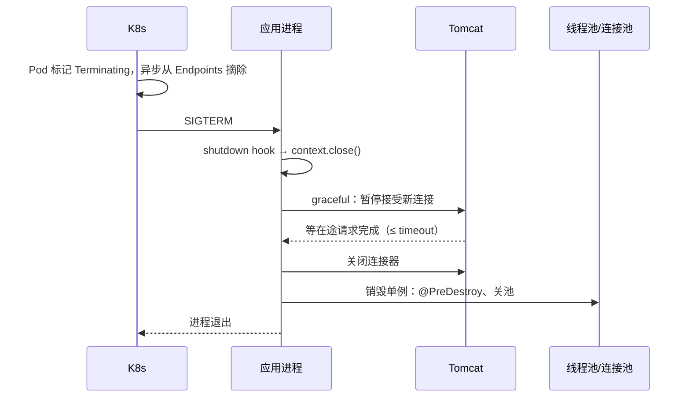

---
sources:
  - 03-第三阶段
---

# 06. 启动流程 refresh 与内嵌容器

> [← 第三阶段导览](01-导览.md) · 启动慢不是「Spring 慢」，是十几个阶段里某几个在等 IO 或扫太多类；把 `refresh()` 十二步与内嵌容器的创建时机对准，你就能把「40 秒启动」拆成可测量的四段。

## 1. `SpringApplication.run` 到 `refresh()` 的路径

`run()` 本身很短，主干只有八步，每一步都对应一个事件：

| # | 动作 | 发布的事件 | 典型耗时 |
|---|---|---|---|
| 1 | 加载 `SpringApplicationRunListener` | `ApplicationStartingEvent` | 1~5ms |
| 2 | `prepareEnvironment`：建 `Environment`、跑 `EnvironmentPostProcessor`、绑定 `application.yml` | `ApplicationEnvironmentPreparedEvent` | 50~500ms |
| 3 | `createApplicationContext`：按 web 类型选 `AnnotationConfigServletWebServerApplicationContext` | — | 10~50ms |
| 4 | `prepareContext`：应用 `ApplicationContextInitializer`、注册主配置类、`load()` 注册定义 | `ApplicationContextInitializedEvent`、`ApplicationPreparedEvent` | 20~150ms |
| 5 | `refreshContext`：进入 `AbstractApplicationContext.refresh()` | `ContextRefreshedEvent` | 占总时长 70% 以上 |
| 6 | `afterRefresh`（Boot 3 起为空实现，留给子类） | — | 0 |
| 7 | `listeners.started` | `ApplicationStartedEvent`、liveness=CORRECT | <10ms |
| 8 | `callRunners` → `listeners.ready` | `ApplicationReadyEvent`、readiness=ACCEPTING_TRAFFIC | 取决于你的 Runner |

两个值得记住的差别：**第 4 步已经在注册 BeanDefinition 了**（`prepareContext` 里的 `load()`），而真正造对象全在第 5 步；**readiness 在最后才置位**，所以 `ApplicationRunner` 执行期间端口已经开着，但 K8s 不会把流量放进来——这是「启动即预热」能安全落地的原因（§5）。

**第 2 步是最容易被低估的**。`prepareEnvironment` 要跑所有 `EnvironmentPostProcessor`，其中包含 Spring Cloud Config 的远程拉取、`spring.profiles.active` 的解析、`application-{profile}.yml` 的叠加。一旦配置中心抖动，这一步会稳稳吃掉重试时间（常见 3 次 × 2s），而且报错形态是「启动卡住」而不是「配置错误」。判断方法：阶段打点里 `ApplicationEnvironmentPreparedEvent` 到 `ApplicationContextInitializedEvent` 的间隔异常长。

## 2. `refresh()` 十二步

| # | 方法 | 做什么 | 谁在这里干活 |
|---|---|---|---|
| 1 | `prepareRefresh` | 记录启动时间、校验必需属性、初始化占位符 | 几乎零成本 |
| 2 | `obtainFreshBeanFactory` | 创建/获取 `DefaultListableBeanFactory`，设置 id | 毫秒级 |
| 3 | `prepareBeanFactory` | 注册 `ApplicationContextAwareProcessor` 等内置依赖、`BeanPostProcessor` | 毫秒级 |
| 4 | `postProcessBeanFactory` | 子类扩展：Web 容器注册 `ServletContextAwareProcessor` 与作用域 | 毫秒级 |
| 5 | `invokeBeanFactoryPostProcessors` | **解析配置类、扫包、注册定义、处理 `@ConfigurationProperties`** | 数百 ms ~ 数秒 |
| 6 | `registerBeanPostProcessors` | 实例化并排序所有 BPP | 数十 ms |
| 7 | `initMessageSource` | 国际化消息源 | <5ms |
| 8 | `initApplicationEventMulticaster` | 事件广播器（默认同步） | <1ms |
| 9 | `onRefresh` | **创建并启动内嵌容器（Tomcat 端口在此绑定）** | 200~800ms |
| 10 | `registerListeners` | 把监听器 Bean 注册进广播器，补发早期事件 | <5ms |
| 11 | `finishBeanFactoryInitialization` | **`preInstantiateSingletons()`：造出所有非懒加载单例** | 占总时长 40%~60% |
| 12 | `finishRefresh` | `LifecycleProcessor.onRefresh()`、发布 `ContextRefreshedEvent`、启动统计 | 数十 ~ 数百 ms |

第 12 步之后还有 `resetCommonCaches()`（清 `AnnotationUtils`/`ResolvableType` 的静态缓存），它在 `finally` 里执行，不属于「十二步」。它的作用不是提速，而是**避免启动期的元数据缓存长期持有类引用**——在容器共享 classloader、反复热部署的场景里，这是实打实的内存泄漏来源。

**为什么顺序是这个顺序**：5 必须在 6 之前（BPP 要先就位，才能在 11 里包装对象），6 必须在 11 之前（否则第一批 Bean 会被漏掉），9 必须在 11 之前（Servlet 容器的初始化要注册 `ServletContextInitializer`，而这些初始化器需要从容器里拿 Filter/Servlet Bean）。**每一步的「必须在谁之前」都比它做了什么更重要**——这是读 `refresh()` 唯一有效率的方式。

## 3. 哪几步最耗时

一个中等规模应用（约 600 个 Bean、含 JPA 与 Web）在本地 M 系列笔记本上的量级：

| 步骤 | 冷启动耗时 | 占比 | 主要成本 |
|---|---|---|---|
| 5 `invokeBeanFactoryPostProcessors` | 0.8~2.5s | 15%~25% | 扫包（ASM 读所有 class）、解析配置类、条件评估、`@ConfigurationProperties` 绑定 |
| 9 `onRefresh` | 0.2~0.8s | 5%~10% | Tomcat 启动、TLS 初始化、`ServletContextInitializer` 执行 |
| 11 `finishBeanFactoryInitialization` | 2~6s | 40%~60% | 反射实例化、注入、`@PostConstruct`、连接池建连、JPA `EntityManagerFactory` 构建 |
| 12 `finishRefresh` | 50~300ms | 2%~5% | 生命周期回调、事件监听器同步执行 |

三条经验数字：

- **JPA 应用里第 11 步有 60% 以上花在 `EntityManagerFactory` 上**（扫描实体、建元模型、校验命名策略），它随实体数量线性增长。
- **`@PostConstruct` 里的远程调用会 1:1 加到第 11 步**。三个 Bean 各打一次 200ms 的配置中心，就是 600ms 的纯等待。
- **容器里的启动通常比本地慢 30%~100%**：CPU 限额、冷页缓存、镜像层读取。用本地的数字定 SLO 会低估。

## 4. Tomcat 在哪一步创建、哪一步接流量

两件事要分开：

- **创建并绑定端口**：第 9 步 `onRefresh` → `ServletWebServerApplicationContext.createWebServer()` → `TomcatWebServer` 构造 → `tomcat.start()`。此刻 `listen` 已经成功，`connect` 能建立，但 Servlet 未必就绪。
- **标记为 started 并发布事件**：第 12 步 `finishRefresh` → `WebServerStartStopLifecycle.start()` → 发布 `ServletWebServerInitializedEvent`。

一个容易被忽略的连锁反应：`onRefresh` 里要把 `Filter`、`Servlet`、`EventListener` 注册进 Tomcat，这些对象得从容器里取。于是 **`DispatcherServlet` 在这一步就被实例化了**——比第 11 步更早。而它的 `initStrategies()`（创建 `RequestMappingHandlerMapping`、`HandlerAdapter` 等）默认**不在启动时执行**，因为 Boot 把 `spring.mvc.servlet.load-on-startup` 设为 `-1`，真正的初始化推迟到第一个请求。

这解释了两个现象：

1. `DispatcherServlet` 依赖的 Bean 创建顺序会早于「按依赖图推算」的预期，日志里能看到它们在业务 Bean 之前出现。
2. 把 `spring.mvc.servlet.load-on-startup` 改成 `1`，会让首次请求变快、启动变慢，且 `HandlerMapping` 的构建错误从「首次请求 500」提前成「启动失败」——生产环境通常值得这么换。

**坑**：在 `@PostConstruct` 里访问 `RequestMappingHandlerMapping`（比如打印所有路由）会触发它的提前初始化，而此时其他 Bean 可能还没建好。正确做法是在 `ApplicationReadyEvent` 或 `SmartInitializingSingleton` 里做。

顺带解决一个常见误判：**端口冲突（`Port 8080 was already in use`）一定发生在第 9 步**，因为绑定就那一次。看到这个报错不要去查 `refresh()` 前面的步骤，也不要去怀疑「Bean 创建失败导致端口没释放」——顺序上不成立。

## 5. 事件机制：`ApplicationReadyEvent` 与 `ApplicationRunner`

| 维度 | `ApplicationRunner` / `CommandLineRunner` | `ApplicationReadyEvent` 监听器 |
|---|---|---|
| 执行时机 | `ApplicationStartedEvent` 之后、`ApplicationReadyEvent` 之前 | 最后，`run()` 返回前 |
| 参数 | `ApplicationArguments`（可解析 `--key=value`） | 事件对象，需要什么自己注入 |
| 能否影响启动结果 | 抛异常会让启动失败（`run()` 抛出） | 同样在 `run()` 栈上，异常会向上抛 |
| 顺序控制 | `@Order` / `Ordered` | `@Order` / `Ordered` |
| 此时 Web 端口 | 已绑定、未置 readiness | 已绑定、readiness 刚置位 |
| 适合做什么 | 数据初始化、缓存预热、启动自检 | 启动完成的通知类动作（打点、注册到外部系统） |

选型规则：**需要在启动完成前做完、失败就该起不来的，用 Runner；只是「顺便通知一下」的，用事件**。两者都不适合放长耗时逻辑——它们直接叠加在启动时间里，K8s 的 `startupProbe` 失败阈值要给够。

`@EventListener` 默认是同步的：监听器在发布事件的那个线程上跑，抛异常会中断后续监听器。要并行就配 `ApplicationEventMulticaster` 的 `TaskExecutor`，代价是启动顺序不再确定。

**liveness 与 readiness 不是一回事**。liveness 在第 7 步（`ApplicationStartedEvent` 之后）就置为 `CORRECT`，readiness 要到第 8 步末尾才 `ACCEPTING_TRAFFIC`。所以「进程还活着但还没准备好接流量」是一个有明确实现支撑的状态，探针配置要分别指向 `/actuator/health/liveness` 与 `/actuator/health/readiness`，别用一个 `/actuator/health` 同时当两者——否则启动期一旦 readiness 失败，K8s 会把一个正在正常初始化的进程反复重启。

## 6. 优雅停机的完整时序



三个参数决定这条链能否走完：

| 参数 | 默认 | 作用 | 设错的后果 |
|---|---|---|---|
| `server.shutdown` | `immediate` | 改成 `graceful` 才暂停接受新请求并等待 | 直接断连，客户端看到 `connection reset` |
| `spring.lifecycle.timeout-per-shutdown-phase` | `30s` | 单阶段最长等待 | 太短：长请求被切断；太长：超过 K8s 宽限期被杀 |
| `terminationGracePeriodSeconds` | `30s`（K8s 默认） | SIGTERM 到 SIGKILL 的宽限 | 小于「摘流时间 + 停机等待」，进程被 `SIGKILL` |

**顺序陷阱（最常见的线上事故）**：readiness 摘流与 SIGTERM 是**并发**发生的，摘流要经过 Endpoints 更新、kube-proxy/Ingress 刷新，通常需要 1~5 秒。这期间新请求仍会打到 Pod 上，而 Tomcat 可能已经开始拒绝连接——表现为发布期间少量 502。标准解法是加一个 `preStop`：

```text
lifecycle:
  preStop:
    exec:
      command: ["sh", "-c", "sleep 5"]
```

让 SIGTERM 晚 5 秒到达，摘流先完成。**注意 Spring Boot 不会在停机时把 readiness 自动置为 OUT_OF_SERVICE**，所以不要指望探针替你摘流；要么靠 preStop 的固定等待，要么在 `@PreDestroy` 里主动调 Actuator 的 shutdown 端点（不推荐，停机路径变复杂）。

顺序记法一句话：**先摘流，再停 accept，再等在途，最后关池**。任何一步反过来，都会在发布窗口留下错误率尖刺。

**销毁阶段的第二个坑**：`@PreDestroy` 里的远程调用同样会拖长停机。往注册中心注销、往配置中心回写状态、往审计服务发一条「下线」记录——每一个都是 RTT，而且是在「已经在停机」的路径上。这些动作应该放在 `AvailabilityChangeEvent` 监听或更早的主动流程里，不要塞进 `@PreDestroy`。停机路径上只做本地释放：关连接、flush 缓冲、停线程池。

## 7. 启动耗时定位

三种手段，精度和成本递增：

| 手段 | 得到什么 | 成本 | 适用 |
|---|---|---|---|
| 阶段打点（下面这段代码） | 每个应用事件的时间戳 | 十行代码 | 先看「哪一段慢」 |
| `BufferingApplicationStartup` + `/actuator/startup` | 每个 `StartupStep`（Bean 级）的树形耗时 | 一行配置 + Actuator | 定位到具体 Bean |
| JFR / async-profiler | CPU 与阻塞栈 | 需要采样工具 | 定位到具体方法 |

先澄清一个高频误解：**`--debug` 不是性能工具**。它只输出条件评估报告（05 册），一个耗时数字都没有；把它当成「启动分析开关」会浪费一次重启。`--debug` 的价值在「为什么这个 Bean 没生效」，不在「为什么启动慢」。

先上打点，因为它最便宜且能覆盖 `run()` 的全部阶段（`StartupStep` 覆盖不到环境准备那一段）：

```kotlin
@Component
class StartupPhaseClock : ApplicationListener<ApplicationEvent> {
    private val t0 = System.nanoTime()
    private var last = t0

    override fun onApplicationEvent(event: ApplicationEvent) {
        val now = System.nanoTime()
        println("%8.1f ms (+%7.1f ms)  %s".format(
            (now - t0) / 1e6, (now - last) / 1e6, event.javaClass.simpleName,
        ))
        last = now
    }
}
```

它不会打印 `ApplicationStartingEvent`（那时这个 Bean 还不存在），但会覆盖 `ContextRefreshedEvent`、`ApplicationStartedEvent`、`ApplicationReadyEvent`——最后一个的累计值就是「端口可服务到完全就绪」的总时长。想看 Bean 级细分，再开 `BufferingApplicationStartup`：

```kotlin
fun main(args: Array<String>) {
    SpringApplication(BackendApplication::class.java)
        .apply { setApplicationStartup(BufferingApplicationStartup(2048)) }
        .run(*args)
}
```

配合 `management.endpoints.web.exposure.include=startup`，`GET /actuator/startup` 会返回按 `spring.beans.instantiate` 分组的树，能直接看到最慢的十个 Bean。注意缓冲区大小要大于 Step 数量，否则最早的 Step 会被丢弃——`2048` 对多数应用够用，Bean 上千时调到 `4096`。

## 8. 一个 40 秒启动的排查剧本

按「先分段、再分 Bean、最后看栈」的顺序，五步之内基本能定位：

| 步骤 | 动作 | 判据 |
|---|---|---|
| 1 | 打开阶段打点，看时间落在哪个事件区间 | 落在 `ContextRefreshedEvent` 之前且很长 → 环境准备（配置中心/网络） |
| 2 | 如果是第 5 步慢，数 BeanDefinition 数量与来源 | 业务定义占比高 → 扫描范围过大；某 jar 占大头 → 某个 starter |
| 3 | 如果是第 11 步慢，看最慢的十个 Bean | 常见元凶：`EntityManagerFactory`、连接池预建、`@PostConstruct` 里的远程调用 |
| 4 | 如果是第 9 步慢，看网络与 TLS | 容器内 DNS 解析慢、随机数熵不足、证书链校验超时 |
| 5 | 仍然不明，用 JFR 采 20 秒启动窗口 | 看 `jdk.SocketRead`/`jdk.FileRead` 的热点，区分「等 IO」与「算 CPU」 |

两个反直觉的事实：**启动慢常常不是 CPU 问题**，而是同步 IO 串行叠加（每个 Bean 都要等一次远程，600 个 Bean 里有 20 个就够 4 秒）；**`lazy-initialization=true` 不是解决方案**，它把启动耗时搬到首批请求上，往往制造更差的 P99，只在「必须快速通过就绪探针」的场景作为临时手段。

还有一条读数纪律：日志里那句 `Started BackendApplication in 3.247 seconds (process running for 4.102)` 的后半段才是用户感知的启动时间——前半段只覆盖 `run()`，不含 JVM 启动、类加载与镜像内的进程拉起。对比不同版本时固定看同一个指标，否则会得出「优化了 0.3 秒」但实际更慢的结论。

## 9. 自测

1. `refresh()` 里哪三步是「必须在前」的硬约束？分别因为什么？
2. Tomcat 的端口在哪一步绑定？`ServletWebServerInitializedEvent` 在哪一步发布？中间这段时间请求会怎样？
3. 为什么 `DispatcherServlet` 会在第 9 步就被实例化，而它的 `HandlerMapping` 却没有？改哪个配置能改变这个行为？
4. `ApplicationRunner` 抛异常与 `ApplicationReadyEvent` 监听器抛异常，对启动结果的影响分别是什么？
5. 一次发布中出现少量 502，日志显示连接被重置。按优雅停机的时序列出三个可能出错的位置。
6. 你的服务启动 40 秒，阶段打点显示 32 秒在 `finishBeanFactoryInitialization`。给出三个最可能的元凶和各自的验证方法。

## 10. 延伸

- 上一册：[05-自动配置与条件装配](05-自动配置与条件装配.md)——第 5 步里被评估的那几百个条件是怎么来的。
- 下一册：[07-手写一个迷你容器](07-手写一个迷你容器.md)——把这一册的十二步压缩成六十行，看哪些步骤是本质、哪些是工程妥协。
- Tomcat 的线程模型与连接器参数在[第四阶段 02 册](../04-第四阶段/02-Tomcat线程模型与Servlet6.1.md)；探针与镜像内的 JVM 参数在[第十阶段 07 册](../10-第十阶段/07-交付-分层镜像-探针与优雅停机.md)。
- 启动期指标如何接入监控（`application.started.time` 等）在[第十阶段 05 册](../10-第十阶段/05-可观测性落地-指标-日志与链路.md)。
