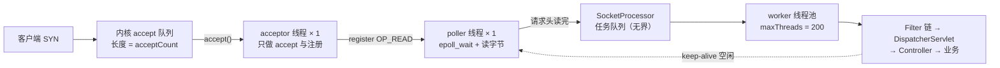

---
sources:
  - 04-第四阶段
---

# 02. Tomcat 线程模型与 Servlet 6.1

> [← 第四阶段导览](01-导览.md) · `maxThreads` 管「同时有多少人在干活」，`maxConnections` 管「同时允许多人拿号」，`acceptCount` 管「门外还能站多少人」——这三个概念一混，之后的调参会一路调反，而且现象会伪装成数据库慢。

## 1. NIO 三段式：三个线程角色各干什么

Tomcat 的 NIO 连接器不是「一个线程守一个连接」，而是把连接的三个阶段拆给三种线程。这不是为了省事，而是为了把「等」和「算」分开——等待网络的时间远多于计算的时间，让线程在 `epoll_wait` 上等几百个连接，比让几百个线程各自 `read()` 阻塞要便宜两个数量级。



| 角色 | 数量（默认） | 职责 | 阻塞在哪 |
|---|---|---|---|
| acceptor | 1（`acceptorThreadCount`） | 从内核队列 `accept()` 出 socket，注册到 poller | `accept()` 系统调用 |
| poller | 1（`pollerThreadCount`） | `epoll_wait` 等事件，把字节读进 buffer，拼出请求行与头 | `epoll_wait`（几乎不阻塞） |
| worker | `maxThreads`（200） | 跑 Filter、`DispatcherServlet`、你的业务代码 | 你的代码、下游 IO、锁 |

关键在于 **worker 只负责「算」和「写」，不负责「等下一个请求」**。一个 keep-alive 连接空闲时，它只是 poller 里的一条注册记录，不占任何 worker——这是 NIO 连接器相对「阻塞 IO 一连接一线程」最大的结构差异，也是为什么「一万个空闲长连接」和「一万个正在处理的请求」是完全不同的两件事。

**为什么 worker 数才是真并发**：业务代码是同步阻塞的（查库、调下游），一个 worker 在同一时刻只能服务一个请求。所以「服务能同时处理多少个请求」这个数字，在同步模型下就等于 `maxThreads`，不管 `maxConnections` 开多大。

**坑在 poller 的独苗上**：`pollerThreadCount` 默认只有 1。任何在 poller 线程里做的重活都会变成全局串行点——TLS 握手（老版本在 poller 里做）、超大请求头的解析、以及自定义 `ProtocolHandler` 里的逻辑。一台 32 核机器上跑 1 个 poller 是常态，因为它的活确实很轻（一次 `epoll_wait` 处理一批事件，每次几十微秒），但**轻的前提是你不往里塞东西**。

## 2. 三个数字的真实关系

| 参数 | Boot 属性 | 默认 | 约束的是什么 | 到顶之后 |
|---|---|---|---|---|
| `maxConnections` | `server.tomcat.max-connections` | 8192 | 连接器持有的**已建立 socket** 数 | acceptor 停止 `accept()`，新连接留在内核队列 |
| `acceptCount` | `server.tomcat.accept-count` | 100 | 内核 accept 队列长度（`bind()` 的 backlog） | 内核丢弃 SYN，客户端表现为连不上 |
| `maxThreads` | `server.tomcat.threads.max` | 200 | 同时执行 `service()` 的**业务线程**数 | 请求进入执行器队列排队，连接不断、响应不回 |

三者的生效顺序是固定的：**先撞 `maxConnections`，再撞 `maxThreads`**。因为 socket 必须先被 accept 才能变成任务；`maxConnections` 是「手里能攥多少条连接」，`maxThreads` 是「同时能加工多少个」。

由此得出两条常被忽略的推论：

1. **`maxConnections` 必须大于 `maxThreads`**，否则多出来的线程永远没活干。反过来，`maxConnections` 远大于 `maxThreads` 是正常的——那是给 keep-alive 空闲连接留的空间。
2. **`acceptCount` 不是 Tomcat 的队列**，它是传给操作系统的 backlog。真正生效的值是 `min(acceptCount, net.core.somaxconn)`。在容器里 `somaxconn` 常常是 4096，所以把 `acceptCount` 从 100 调到 1000 有效；但如果宿主把它设成 128，你调多大都没用——这类参数要在 `sysctl` 和 Pod 的 `securityContext` 两侧一起看。

**取舍**：把 `maxConnections` 开大不是没有成本。每条连接占一个文件描述符（`ulimit -n` 要跟着调）、一块读缓冲、以及 poller 里的注册项。8192 条连接在默认配置下大约吃掉几百 MB 直接内存与堆外缓冲，`ulimit` 不够时会看到 `Too many open files`——这个异常跟「连接数太多」看起来是一回事，但修法完全不同（一个是调 Tomcat，一个是调内核）。

## 3. 两个排队、两种超时：现象完全不同的故障

「请求排队」在 Tomcat 里有**两个物理位置**，它们产生的故障现象几乎没有共同点。分不清这两者，排障时会一直在错误的层里找。

| 维度 | 排队一：内核 accept 队列 | 排队二：执行器任务队列 |
|---|---|---|
| 队列在哪 | 操作系统内核，长度 = `acceptCount` | JVM 堆内，`TaskQueue`（容量近似无界） |
| 什么时候进 | 连接已握手完成，但应用没 `accept()` | 已 accept、已读完请求头，但没空闲 worker |
| 到顶的表现 | SYN 被丢弃 → 客户端 connect 超时 / `Connection refused` | 请求永不上不下 → 客户端 read 超时 / 网关 504 |
| 服务端日志 | **什么都没有**（请求还没进 JVM） | 有访问日志，但 `time` 字段远大于实际处理耗时 |
| 网关侧错误 | 502（连不上上游）/ 连接超时 | 504（上游超时） |
| 关键指标 | `socket` 层重传、`nstat` 的 `ListenOverflows` | 线程池 `activeCount`、队列长度、请求 P99 齐涨但 CPU 不高 |

**为什么第二种排队更危险**：`TaskQueue` 的容量实际上是 `Integer.MAX_VALUE`——Tomcat 故意把它做成「不拒绝，只排队」。这意味着**请求不会因为「线程不够」而被快速失败，而是静静地等**。等多久？没有上限。等到客户端放弃、网关超时、用户重试。而此时连接一直占着，worker 一直在忙，于是更多请求进入队列，正反馈形成。

对照两种超时参数，事情就清楚了：

| 参数 | 覆盖的阶段 | 超时后 | 常见误用 |
|---|---|---|---|
| `connectionTimeout`（默认 60s） | 连接建立后**读请求行与请求头**的时间 | 服务端直接关连接，客户端看到空响应/连接重置 | 以为它能限制「接口处理时间」 |
| `keepAliveTimeout`（默认等于 `connectionTimeout`） | 两次请求之间的**空闲** | 关连接 | 设得比上游 idle 超时还长 → 复用一条已死连接 → 502 |
| 无 | 业务处理阶段 | **不超时** | 一个慢接口永远占着 worker |

第三行是整节的结论：**Tomcat 不给你兜底处理时间**。一个卡在 `synchronized` 或下游超时上的接口，会一直占着那个 worker，`maxThreads=200` 意味着 200 个这样的请求就把整个服务变成「能连上但不响应」。这就是「一个慢接口拖垮全站」在容器层的准确机制——不是 CPU 被打满，是 worker 被占满且没有超时回收。

**取舍**：给应用层加超时（`spring.mvc.async.request-timeout` 只对异步生效；同步请求要靠下游客户端超时 + 网关超时）比调大 `maxThreads` 有效得多。`maxThreads` 调到 500 只是把「200 个慢请求拖垮」推迟到「500 个慢请求拖垮」，而且线程多了之后 GC 与上下文切换成本跟着涨。

## 4. keep-alive：省下的握手与付出的连接占用

第一阶段账本里 ① 站有一组数字：新建连接约 250µs（loopback），复用连接约 15µs。放到公网，这个差距是 3 个 RTT 的握手加 1~2 个 RTT 的 TLS，弱网下几百毫秒。keep-alive 的价值就是把这笔钱只付一次。

代价有三笔，都不在耗时上，而在容量上：

1. **socket 占用**。空闲连接不占 worker，但占 `maxConnections`。`maxConnections=8192` 被 8000 条空闲连接占满时，新用户连不进来——但服务器 CPU 是 0%。
2. **poller 的注册项**。每条连接在 selector 里有一个 `SelectionKey`，事件循环每次要遍历它们。几千条没有问题，几万条时 poller 的单线程开始成为可测量成本。
3. **状态不一致的窗口**。服务端要主动关连接时必须让客户端知道，靠的是 `Connection: close` 头或 `maxKeepAliveRequests` 到顶后的最后一次响应。

`maxKeepAliveRequests`（默认 100）就是给第三点兜底的：一条连接跑满 100 个请求后，Tomcat 在响应里带上 `Connection: close`，双方有序关闭。这避免了「一条连接活几小时、中间经过无数次网络设备状态老化」的玄学故障。

**最典型的线上事故是两端超时不匹配**：Nginx 侧 `keepalive_timeout 75s`，Tomcat 侧 `keepAliveTimeout 60s`。第 61 秒 Nginx 从池里取出一条它认为还活着的连接发请求，Tomcat 刚好在这个瞬间关掉它——Nginx 报 `upstream prematurely closed connection`，返回 502。**规矩是：下游（Tomcat）的空闲超时必须小于上游（Nginx/ELB）的空闲超时**，留 5~15 秒余量。反过来配，就等于让上游持续往一条正在关闭的连接上写。

## 5. Servlet 6.1 / Jakarta EE 11 带来的变化

Servlet 6.1 是个小版本，但它和 Boot 4 绑定在一起，实际迁移成本主要来自四件事：

| 变化 | 内容 | 对你的影响 |
|---|---|---|
| 命名空间 | 全部 `jakarta.servlet.*` | 任何 `javax.servlet` 的旧代码、旧依赖、旧教程都要改 |
| Java 基线 | 17 | 与 Boot 4 的 JDK 25 基线一致，不是障碍 |
| `sendEarlyHints()` | 支持 103 早期提示 | 大页面可以先把 CSS/JS 的 `Link` 头送出去，浏览器提前预取 |
| 请求/连接标识 | `getRequestId()`、`getProtocolRequestId()`、`getServletConnection()` | 日志里能打出容器级 ID，与 traceId 并列，排「trace 断在容器里」特别有用 |
| Cookie 属性 | 统一走 `Cookie#setAttribute`（SameSite、Partitioned） | 手写 `Set-Cookie` 拼接的老代码要改，否则新属性丢失 |

`getRequestId()` 值得单独说一句：在此之前，你要把「网关的 request id」和「应用的 traceId」对上，只能靠应用自己从 header 里读。Servlet 6.1 让容器直接提供连接级与请求级 ID，日志格式里加一列，跨层对齐就有了免费的主键。

**Boot 4 侧的三个真实差异**（比 Servlet 6.1 本身更容易踩）：

- starter 改名：`spring-boot-starter-web` → `spring-boot-starter-webmvc`。老坐标还能解析到吗？在 Boot 4 里旧名字已不再作为推荐入口，依赖树里混着新旧两个 starter 会出现两套 MVC 自动配置的告警。
- Undertow 不再被支持，内嵌容器只有 Tomcat / Jetty / Reactor Netty 三条路。之前为了「Undertow 更省内存」做的选型要重做。
- `@SpringBootTest` 不再自动提供 `MockMvc`，测 Web 层要显式加 `@AutoConfigureMockMvc`——这条在 08 册的契约测试里会再出现一次。

**取舍**：Servlet 6.1 的新 API 值得用，但不要在业务代码里直接依赖 `HttpServletRequest` 去拿 `getRequestId()`——那会把容器 API 泄漏到 Controller。正确做法是在 Filter 里读一次、塞进 MDC 或请求属性，业务侧只认自己的 `RequestContext`。

## 6. 虚拟线程执行器：Boot 4 的开关与「新瓶颈」推演

Boot 4 里让 Tomcat 用虚拟线程执行请求只需要一行：

```yaml
spring:
  threads:
    virtual:
      enabled: true
```

它做的事是把 protocol handler 的 `Executor` 换成 `VirtualThreadExecutor`——每个 `SocketProcessor` 任务 `Thread.ofVirtual().start(...)`。副作用是 **`maxThreads` 彻底失效**（虚拟线程没有池上限），连接器的并发上限退回到 `maxConnections`（8192）。

于是压力模型变了，而且变得很隐蔽：

| 维度 | 平台线程（200） | 虚拟线程（上限 8192 连接） |
|---|---|---|
| 并发上限由谁决定 | `maxThreads` | `maxConnections` |
| 内存成本 | 每线程约 1MB 栈预留 | 每线程几百字节到几 KB，按需增长 |
| 阻塞的代价 | 独占一个线程 | 卸载载体线程（carrier），几乎免费 |
| 到顶后的现象 | 请求在 Tomcat 队列里静静排队 | 请求全部涌向**下游资源** |
| 新瓶颈位置 | Tomcat | Hikari 连接池、Redis 连接、下游 HTTP 连接池 |
| 超时表现 | 504（读超时） | 500 + `SQLTransientConnectionException`（池等待超时） |

把这条推演走完：`maximumPoolSize=10`、每个请求持连接 5ms，吞吐天花板是 `10 / 0.005 = 2000 QPS`，与线程模型无关。平台线程模式下，超过 2000 QPS 时请求在 Tomcat 的 200 个 worker 上排队，表现为 P99 缓涨；虚拟线程模式下，8192 个虚拟线程同时冲进 `getConnection()`，Hikari 的 `connectionTimeout`（默认 30s）一到，**几千个请求在同一秒集体失败**。故障形态从「慢慢变慢」变成「悬崖式全挂」。

这才是「虚拟线程不是免费扩容」的准确含义：它把排队从一个你能看见的地方（Tomcat 线程池指标）搬到一个你不常看的地方（连接池 pending 数）。第八阶段会把这个推演做成压测对比，这里只需要记住判据：**开了虚拟线程之后，P99 的拐点由连接池的 `pending` 决定，不再由 `maxThreads` 决定**。

还有两个 JDK 25 上的细节：

- **pinning 基本消失**。JDK 24 的 JEP 491 让 `synchronized` 不再钉住载体线程，JDK 25 上剩下会 pin 的主要是 JNI/native 帧。也就是说「虚拟线程 + `synchronized`」这个老警告可以放下了，但「虚拟线程 + 阻塞式 JDBC」仍然是真问题——不是 pin，而是连接池不够。
- **`ThreadLocal` 的内存放大**。平台线程 200 个，每个存一份 MDC 上下文无所谓；8192 个虚拟线程同时活着时，每个都持有自己的 `ThreadLocalMap`，同样的上下文对象被复制几千份。JDK 25 的 `ScopedValue` 是正解，但在框架全面适配之前，至少要把 MDC 的内容控制在几个短字符串。

## 7. 调参与压测对照

参数分两类：**能用 `server.tomcat.*` 表达的**，和**必须写代码的**（自定义 `Executor`、线程工厂、连接器级钩子）。后者用 `WebServerFactoryCustomizer`：

```kotlin
@ConfigurationProperties("lab.tomcat")
data class ConnectorCapacity(
    val maxThreads: Int = 200,
    val minSpareThreads: Int = 20,
    val acceptCount: Int = 512,
    val maxConnections: Int = 8192,
    val keepAliveTimeout: Duration = Duration.ofSeconds(15),
    val maxKeepAliveRequests: Int = 200,
)

@Configuration
@EnableConfigurationProperties(ConnectorCapacity::class)
class TomcatTuning(private val cap: ConnectorCapacity) {

    @Bean
    fun connectorTuning() = WebServerFactoryCustomizer<TomcatServletWebServerFactory> { factory ->
        factory.addConnectorCustomizers { connector ->
            // protocolHandler 的具体类型是 Http11NioProtocol，参数都挂在它上面
            val protocol = connector.protocolHandler as AbstractHttp11Protocol<*>
            protocol.maxThreads = cap.maxThreads
            protocol.minSpareThreads = cap.minSpareThreads
            protocol.acceptCount = cap.acceptCount
            protocol.maxConnections = cap.maxConnections
            protocol.keepAliveTimeout = cap.keepAliveTimeout.toMillis()
            protocol.maxKeepAliveRequests = cap.maxKeepAliveRequests
            // 连接建立后读请求头的上限：它不是「接口处理超时」
            protocol.connectionTimeout = 20_000
        }
        // 让 Location 输出绝对地址：经过反向代理时不会被改写成错的主机名
        factory.addContextCustomizers { it.setUseRelativeRedirects(false) }
    }
}
```

如果不用 `spring.threads.virtual.enabled`，也可以手工指定执行器——场景是需要给虚拟线程起名、或者想在平台线程与虚拟线程之间按 profile 切换：

```kotlin
@Configuration
class VirtualThreadTomcat {

    @Bean
    fun virtualThreadProtocol() = TomcatProtocolHandlerCustomizer<ProtocolHandler> { handler ->
        // 每个请求一个虚拟线程；maxThreads 从此不再限制并发
        handler.executor = VirtualThreadExecutor { runnable ->
            Thread.ofVirtual().name("tomcat-vt-", 0).unstarted(runnable)
        }
    }
}

@RestController
class ThreadProbe {
    @GetMapping("/debug/thread")
    fun thread(): Map<String, Any> = mapOf(
        "name" to Thread.currentThread().name,
        "virtual" to Thread.currentThread().isVirtual,
    )
}
```

压测对照（4C8G 单机，接口 `SELECT` 一次并 sleep 5ms 模拟持连接，wrk 固定连接数，先预热 30s）：

| 配置 | 并发连接 | QPS | P50 | P99 | 错误率 | 错误形态 |
|---|---|---|---|---|---|---|
| `maxThreads=200`，平台线程 | 400 | 1 980 | 6ms | 210ms | 0% | 无，排队变慢 |
| `maxThreads=1000`，平台线程 | 400 | 2 000 | 6ms | 180ms | 0% | 同上（瓶颈已是连接池） |
| 虚拟线程 + `maxConnections=8192` | 400 | 1 990 | 6ms | 175ms | 0% | 同上 |
| 虚拟线程 + 池 10，压到 4000 QPS | 4000 | 1 950 | 8ms | 30s | 62% | `SQLTransientConnectionException` |

第三行和第一行几乎一样，是因为这个场景的瓶颈**从头到尾都是 10 条数据库连接**——这正是本节想让你看到的：调 Tomcat 参数在「Tomcat 是瓶颈」时有效，在「Tomcat 不是瓶颈」时只是让数字好看一点。第四行才是虚拟线程的真实收益与真实风险：吞吐没涨（池没变），但失败形态从「慢」变成「集体超时」。

**判据一句话**：先量连接池的 `pending` 与 `active`，再决定要不要动 Tomcat。顺序反了，你会在一个不是瓶颈的地方反复调参。

## 8. 自测

1. acceptor、poller、worker 三种线程各自阻塞在什么系统调用或操作上？为什么「把 TLS 握手与超大 header 解析塞进 poller」会变成全局串行点？
2. 为什么 `connectionTimeout` 不能用来限制接口处理时间？一个卡住 5 分钟的请求最终会怎么结束？
3. `maxConnections` 与 `maxThreads` 谁应该更大？如果反过来配（比如 100 与 200），会看到什么现象？
4. 上游 Nginx 的 `keepalive_timeout` 是 75s，Tomcat 的 `keepAliveTimeout` 是 90s，会产生什么偶发错误？正确的配置方向是什么？
5. 开了虚拟线程后，`maxThreads` 还有意义吗？新的并发上限由谁决定，新的瓶颈最可能在哪？
6. 压测显示 QPS 上不去、Tomcat 线程 `activeCount` 只有 60、Hikari `pending` 是 300，你会调哪个参数？为什么不是 `maxThreads`？

## 9. 延伸

- 下一册：[03-Filter-Interceptor-AOP的执行顺序](03-Filter-Interceptor-AOP的执行顺序.md)——请求离开 worker 之后，第一层就是 Filter 链。
- ①② 两站在账本里的耗时与线程归属：[第一阶段 02 册](../01-第一阶段/02-一次请求的十五站主时间线与账本.md)。
- 连接池为什么成为新瓶颈、池大小怎么算：[第五阶段 01 册](../05-第五阶段/01-导览.md)（正文在第五阶段 02 册）。
- 虚拟线程的 pinning、载体线程与压测对比：[第八阶段 01 册](../08-第八阶段/01-导览.md)。
- 优雅停机与探针的完整时序：[第十阶段 01 册](../10-第十阶段/01-导览.md)。
