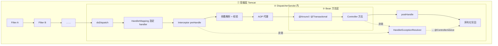

---
sources:
  - 04-第四阶段
---

# 03. Filter、Interceptor 与 AOP 的执行顺序

> [← 第四阶段导览](01-导览.md) · 三层拦截机制不是三个可互换的「钩子」，它们的差别在于**站在链路的哪一段**——站在哪一段，就决定你能看见什么、能改什么、异常会从哪个出口离开。

## 1. 三层位置：谁包着谁

一个请求进进程后，包裹关系是严格嵌套的：Filter 在最外，DispatcherServlet 在中间，AOP 代理在最里。这个嵌套不是设计偏好，而是三者被设计出来时各自要解决的问题决定的。



三层的本质差异可以用一句话概括：

| 机制 | 它被设计出来解决什么 | 因此它必须站在哪里 |
|---|---|---|
| Filter | Servlet 规范层面的**请求/响应字节流处理**：编码、压缩、认证、CORS | 容器里、DispatcherServlet 之前 |
| Interceptor | Spring MVC 层面的**「这次调用是哪个 handler」**：按注解鉴权、按接口计时 | handler 已选定、参数未解析 |
| AOP | **Bean 方法调用**的通用增强：事务、缓存、重试、指标 | 方法调用点上，与 Web 无关 |

**为什么不能只用一层**：Filter 拿不到 `HandlerMethod`，所以「按 `@RequireRole` 注解鉴权」写不出来；Interceptor 拿不到 Bean 代理，所以「事务边界内做幂等」写不出来；AOP 拿不到原始 `HttpServletRequest` 的字节流（它只有方法参数），所以「压缩响应体」写不出来。三层不是冗余，是三种不同的可见性。

## 2. 生命周期与能拿到的上下文

| 维度 | Filter | Interceptor | AOP |
|---|---|---|---|
| 接口 | `jakarta.servlet.Filter` | `HandlerInterceptor` | `@Aspect`（`ProceedingJoinPoint`） |
| 实例生命周期 | 单例，容器启动时创建 | 单例，注册在 `InterceptorRegistry` | 单例，由 Spring 创建代理 |
| 调用次数（单次请求） | 每个 dispatch 一次（`OncePerRequestFilter` 去重） | `preHandle` 一次、`postHandle` 一次、`afterCompletion` 一次 | 每个被拦截的方法调用一次 |
| 能拿到 | `ServletRequest`/`Response`、`FilterChain` | `HandlerMethod`、路径变量、`ModelAndView`（post 阶段） | 方法参数、返回值、异常、目标对象、注解 |
| 拿不到 | handler 方法、路径变量、返回值对象 | 请求体（未被参数解析器读过之前）、返回值对象 | 原始请求流、响应流（除非参数里带进来） |
| 能否改响应体 | 能（包装 `HttpServletResponse`） | 不能（只能改 header/状态码） | 能（改返回值对象） |
| 异常出口 | 容器 → `/error` | `HandlerExceptionResolver` | `HandlerExceptionResolver` |
| 能否短路 | 能（不调 `chain.doFilter`） | 能（`preHandle` 返回 false） | 能（不调 `proceed()`） |

两个细节值得单独记住：

- **Interceptor 的 `postHandle` 在序列化之前**。此时返回值还是对象，改它有效；一旦进了 `HttpMessageConverter`，就是字节了。所以「统一给响应加服务端时间戳」放 `postHandle` 可以，「统一包装响应体」必须用 `ResponseBodyAdvice`（04 册）。
- **AOP 的可见性是「方法」而不是「请求」**。一个请求可能调用 20 个被代理的 Bean 方法，每个都触发一次切面；反过来，一个 `@Async` 方法在提交那一刻就返回了，AOP 的 `around` 也随之结束——它测不到异步任务真正跑完的时间。这个坑在 §6 展开。

## 3. 完整时序表（含异常路径）

以 `POST /api/orders` 为例，正常路径与四种异常路径并排：

| # | 阶段 | Filter | Interceptor | AOP | 异常时发生什么 |
|---|---|---|---|---|---|
| 1 | 请求到达 | `doFilter` 前半段 | — | — | Filter 抛 → 容器 `/error`，`@ControllerAdvice` **接不到** |
| 2 | 路由匹配 | — | — | — | `HandlerMapping` 找不到 → `NoHandlerFoundException`/404，走 resolver |
| 3 | preHandle | — | `preHandle` 正序执行 | — | 抛异常 → 走 8 的异常分支；返回 false → 跳到 9，且只有**已经成功执行过 preHandle** 的拦截器会收到 `afterCompletion` |
| 4 | 参数解析 | — | — | — | `@RequestBody` 失败 → `HttpMessageNotReadableException` → 400 |
| 5 | 校验 | — | — | — | `MethodArgumentNotValidException` → 400 + 字段级 errors |
| 6 | 调用方法 | — | — | `@Around` 前半段 | AOP 抛 → 事务回滚 → 异常冒泡到 resolver |
| 7 | 方法返回 | — | — | `@Around` 后半段 | 返回值被切面改写（包装、脱敏）仍对下游可见 |
| 8 | postHandle | — | 逆序执行 | — | 方法抛异常时**不执行**；`postHandle` 自己抛 → 走 resolver，但响应可能已提交 |
| 9 | 序列化 | — | — | — | 序列化失败 → `HttpMessageNotWritableException` → 500（此时已无法改状态码） |
| 10 | afterCompletion | — | 逆序执行 | — | **唯一保证执行**的收尾点；这里抛异常只会被记录，不影响响应 |
| 11 | 响应写出 | `doFilter` 后半段 | — | — | 客户端已断开 → 写失败，只能记日志 |

两条从表里读出来的规律：

1. **越靠外，越早开始、越晚结束，也越难拿到语义信息**。Filter 的 `finally` 能包住整个请求（含序列化），是「总耗时」唯一准确的位置；Interceptor 的 `afterCompletion` 在序列化之前，测不到写回时间。
2. **异常会跳过中间层**。方法抛异常后，`postHandle` 整段被跳过，直接进异常解析；但 `afterCompletion` 对「已经通过 `preHandle`」的拦截器一定执行。所以资源清理、MDC 清空只能放 `afterCompletion` 或 Filter 的 `finally`，不能放 `postHandle`。

**异常出口的三条路**，这是本节最该背下来的部分：

| 抛出位置 | 谁接住 | `@ControllerAdvice` 能否处理 | 典型现象 |
|---|---|---|---|
| Filter（含 Security 过滤器链） | Servlet 容器 → ERROR dispatch → `BasicErrorController` | **不能** | 返回 Boot 默认错误 JSON，自定义错误体丢失 |
| `preHandle` / `postHandle` / Controller / AOP | `DispatcherServlet.processHandlerException` → `HandlerExceptionResolver` | **能** | 正常返回 `ProblemDetail` |
| `afterCompletion` | 只写日志（`DispatcherServlet` 捕获后 log） | 不能 | 响应已发出，异常只出现在日志里 |

第一行是最高频的困惑来源：「我在 `@RestControllerAdvice` 里写了 401 处理，为什么过滤器里抛的未认证异常返回的是 Boot 默认 JSON？」答案是异常根本没进 DispatcherServlet。Spring Security 的做法是自己在过滤器链里用 `AuthenticationEntryPoint` 写响应，绕开 MVC 的异常体系——这也是为什么 Security 的 401 与业务 401 长得很不一样。

## 4. 注册方式与排序

三套注册机制，各有各的排序规则：

| 机制 | 注册方式 | 排序依据 | 注意 |
|---|---|---|---|
| Filter | `FilterRegistrationBean` 或 `@Component` + `@Order` | `order` 值，小的先执行 | `@Order` 在 `@Component` 上生效，但 `FilterRegistrationBean` 的 `order` 优先级更高 |
| Interceptor | `WebMvcConfigurer#addInterceptors` | `registry.addInterceptor(x).order(n)`，缺省按注册顺序 | 同一 `InterceptorRegistry` 内按 order 排，`preHandle` 正序、`postHandle`/`afterCompletion` 逆序 |
| AOP | `@Aspect` + `@Component` + `@Order` | `@Order` 值，小的在外层 | 事务通知的 order 是 `LOWEST_PRECEDENCE`，所以自定义切面默认在事务**外面** |

```kotlin
@Configuration
class FilterChainConfig {

    // TraceId 必须最早：后面所有日志都要带上它
    @Bean
    fun traceIdFilter() = FilterRegistrationBean(TraceIdFilter()).apply {
        order = Ordered.HIGHEST_PRECEDENCE + 10
        addUrlPatterns("/*")
        setDispatcherTypes(DispatcherType.REQUEST, DispatcherType.ASYNC)
    }

    // 需要读 body 的过滤器只挂在 API 上，避免影响静态资源与上传
    @Bean
    fun bodyCacheFilter() = FilterRegistrationBean(BodyCacheFilter(maxBytes = 64 * 1024)).apply {
        order = Ordered.HIGHEST_PRECEDENCE + 20
        addUrlPatterns("/api/*")
    }
}

class TraceIdFilter : OncePerRequestFilter() {

    override fun doFilterInternal(
        req: HttpServletRequest, res: HttpServletResponse, chain: FilterChain,
    ) {
        val traceId = req.getHeader("X-Request-Id")
            ?.takeIf { it.length in 8..64 && it.all(Char::isLetterOrDigit) }
            ?: UUID.randomUUID().toString().replace("-", "")
        MDC.put("traceId", traceId)
        res.setHeader("X-Trace-Id", traceId)
        try {
            chain.doFilter(req, res)
        } finally {
            MDC.remove("traceId")      // 线程会被复用，不清就是脏数据
        }
    }

    // 异步二次分发时保持同一个 traceId，不要重新生成
    override fun shouldNotFilterAsyncDispatch() = false
    override fun shouldNotFilterErrorDispatch() = false
}
```

Interceptor 的注册里，`order` 与路径匹配同样重要——把鉴权拦截器挂到 `/api/**` 并排除登录接口，比在拦截器内部写 `if (path == "/login") return true` 更好维护：

```kotlin
@Configuration
class WebMvcConfig(
    private val accessLog: AccessLogInterceptor,
    private val auth: AuthInterceptor,
) : WebMvcConfigurer {

    override fun addInterceptors(registry: InterceptorRegistry) {
        registry.addInterceptor(accessLog).order(0).addPathPatterns("/api/**")
        registry.addInterceptor(auth).order(10)
            .addPathPatterns("/api/**")
            .excludePathPatterns("/api/auth/**", "/api/public/**")
    }
}

@Component
class AuthInterceptor(private val tokens: TokenService) : HandlerInterceptor {

    override fun preHandle(req: HttpServletRequest, res: HttpServletResponse, handler: Any): Boolean {
        // 静态资源、错误页的 handler 不是 HandlerMethod，直接放过
        if (handler !is HandlerMethod) return true
        if (handler.getMethodAnnotation(RequireLogin::class.java) == null) return true

        val principal = tokens.verify(req.getHeader(HttpHeaders.AUTHORIZATION))
            ?: throw UnauthorizedException("token 无效或已过期")
        // 只放属性，不放 ThreadLocal：异步切换线程后 ThreadLocal 会丢
        req.setAttribute(CURRENT_USER, principal)
        return true
    }
}
```

**为什么 `preHandle` 里不要用 `ThreadLocal` 存当前用户**：同步请求下没问题，一旦接口返回 `Callable`/`DeferredResult`，后续执行切到别的线程，`ThreadLocal` 就空了。用 `request.setAttribute` 或 `RequestContextHolder`，它们的生命周期跟着请求而不是线程。

## 5. 五类横切逻辑的选型

这是本册最实用的表。判断依据只有两个问题：**需不需要知道「哪个方法」**、**需不需要包住「整个请求」**。

| 横切逻辑 | 推荐位置 | 理由 | 反例（常见错误） |
|---|---|---|---|
| 认证（你是谁） | **Filter**（Security 链） | 要最早短路，要在没有 handler 时也能返回 401；要能改响应头（`WWW-Authenticate`） | 放 Interceptor：静态资源与 404 路径绕过认证 |
| 授权（你能不能） | **Interceptor / AOP** | 需要读方法或类上的注解（`@PreAuthorize`、`@RequireRole`） | 放 Filter：只能按 URL 前缀粗粒度判断 |
| 访问日志 | **Filter**（总耗时 + 状态码）+ Interceptor（业务标签） | 只有 Filter 能包住序列化与写回；只有 Interceptor 知道 handler | 只用 AOP：404/415 这类没进方法的请求没有日志 |
| 幂等 | **AOP**（业务层） | 需要拿到返回值做缓存、需要在事务边界外做去重判断 | 放 Filter：要自己缓存并重放整个响应字节流，还要处理流式响应 |
| 限流 | **Filter**（入口级）或网关；按用户/接口粒度可用 Interceptor | 越早拒绝越省资源；但要按注解区分接口就得进 MVC | 放 AOP：请求体已反序列化、线程已占用，成本已经付了 |
| 指标埋点 | **Filter**（`http.server.requests`）+ AOP（方法级） | 两层看的是不同的东西：请求维度 vs 方法维度 | 只用 AOP：拿不到 404，也拿不到真实的状态码 |

补充三条经验：

- **幂等放 AOP 的前提是「返回值可序列化」**。如果接口返回 `StreamingResponseBody` 或 SSE，缓存返回值没有意义，只能退回 Filter 缓存字节流。
- **限流放 Filter 的代价是拿不到用户身份**（如果认证也在 Filter 且顺序在后）。实践中常见组合是：认证 Filter 在前，把用户塞进 request attribute；限流 Filter 在后，读 attribute。顺序错一位，限流就退化成按 IP。
- **日志分两层是正解，不是重复**。Filter 的日志回答「这个请求多久、什么状态码」，Interceptor 的日志回答「调了哪个 handler、哪个业务动作」。只有一层时，你总有一半问题答不上来。

## 6. 异步请求下的差异

`Callable`、`DeferredResult`、`SseEmitter`、`ResponseBodyEmitter` 会让一次 HTTP 请求经历**两次 dispatch**：第一次在容器线程上启动异步处理，第二次在异步结果就绪后重新进 DispatcherServlet 完成渲染。这导致三层的执行次数完全不同：

| 机制 | 第一次 dispatch | 异步执行期间 | 第二次 dispatch（ASYNC） | 总次数 |
|---|---|---|---|---|
| Filter | 执行 | 容器线程被释放 | **默认不执行**（`shouldNotFilterAsyncDispatch()` 返回 true） | 1 |
| Interceptor `preHandle` | 执行 | — | **再执行一次** | 2 |
| Interceptor `postHandle` | **不执行** | — | 执行 | 1 |
| Interceptor `afterCompletion` | **不执行** | — | 执行 | 1 |
| `afterConcurrentHandlingStarted` | 执行（替代 postHandle） | — | — | 1 |
| AOP `@Around` | 执行（包住「提交任务」） | **不包** | — | 1，但测的是提交耗时 |

四个具体后果：

1. **`preHandle` 执行两次**。里面做计数、扣减配额、写审计，数量会翻倍。判据：`request.isAsyncDispatch()` 为 true 时跳过副作用。
2. **Filter 默认不参与第二次 dispatch**。响应头在第一次 dispatch 就写完了，第二次想改已经晚了；这就是为什么「异步接口的 traceId 响应头」有时是空的。
3. **AOP 计时严重偏小**。`@Around` 在方法返回 `CompletableFuture`/`DeferredResult` 时就结束了，测到的是「提交任务」的几微秒，不是「任务跑完」的几百毫秒。异步接口的耗时只能靠 Filter 的总时长或 `TaskExecutor` 侧的指标。
4. **`afterCompletion` 只在最后执行一次**，是异步场景下唯一可靠的收尾点——但它执行时响应已经写完，清理可以，改响应不行。

```kotlin
@Component
class AccessLogInterceptor : HandlerInterceptor, AsyncHandlerInterceptor {

    override fun preHandle(req: HttpServletRequest, res: HttpServletResponse, handler: Any): Boolean {
        if (req.isAsyncDispatch) return true          // 二次分发：不要重复开计时
        req.setAttribute(START_AT, System.nanoTime())
        return true
    }

    // 异步启动时 MVC 不调 postHandle，改调这个；此时响应还没写，可以收尾但别改 body
    override fun afterConcurrentHandlingStarted(
        req: HttpServletRequest, res: HttpServletResponse, handler: Any,
    ) {
        log.debug("async started, handler={}", (handler as? HandlerMethod)?.shortLogMessage)
    }

    override fun afterCompletion(
        req: HttpServletRequest, res: HttpServletResponse, handler: Any, ex: Exception?,
    ) {
        val start = req.getAttribute(START_AT) as? Long ?: return
        val costMs = (System.nanoTime() - start) / 1_000_000
        log.info("{} {} -> {} in {}ms async={}", req.method, req.requestURI, res.status, costMs, req.isAsyncStarted)
    }

    companion object { const val START_AT = "lab.startAt" }
}
```

## 7. 三个高频坑

### 7.1 Filter 里读 body，后续拿不到

Servlet 的 `getInputStream()` 是一次性流。任何 Filter 读了一次，`@RequestBody` 拿到的就是空流，报 `Required request body is missing`；如果 DTO 的字段全有默认值，则更隐蔽——**得到一个全部字段都是默认值的对象，校验全过，业务照常执行**。

```kotlin
class BodyCacheFilter(private val maxBytes: Int) : OncePerRequestFilter() {

    override fun doFilterInternal(
        req: HttpServletRequest, res: HttpServletResponse, chain: FilterChain,
    ) {
        val isJson = req.contentType?.startsWith(MediaType.APPLICATION_JSON_VALUE) == true
        if (!isJson) return chain.doFilter(req, res)

        // 读一次并缓存；后续 @RequestBody 从缓存读。上限必须有，否则大 body 直接进堆
        val cached = CachedBodyRequest(req, maxBytes)
        chain.doFilter(cached, res)
    }
}

class CachedBodyRequest(req: HttpServletRequest, maxBytes: Int) : HttpServletRequestWrapper(req) {

    private val body: ByteArray = req.inputStream.readNBytes(maxBytes)

    override fun getInputStream(): ServletInputStream {
        var pos = 0
        return object : ServletInputStream() {
            override fun read(): Int = if (pos >= body.size) -1 else body[pos++].toInt() and 0xFF
            override fun read(b: ByteArray, off: Int, len: Int): Int {
                if (pos >= body.size) return -1
                val n = minOf(len, body.size - pos)
                body.copyInto(b, off, pos, pos + n)
                pos += n
                return n
            }
            override fun isFinished() = pos >= body.size
            override fun isReady() = true
            override fun setReadListener(listener: ReadListener?) =
                throw UnsupportedOperationException("同步过滤器不支持非阻塞读")
        }
    }

    override fun getReader(): BufferedReader =
        BufferedReader(StringReader(body.toString(Charsets.UTF_8)))

    fun cachedBody(): ByteArray = body
}
```

注意 `ContentCachingRequestWrapper` 并不是「读了就缓存」的万能解：它只在**有人读**的时候才缓存，且缓存的是已读部分。如果 Filter 只是 `new` 了一个 wrapper 就往下传，`getContentAsByteArray()` 在 Controller 读之前是空的。要可靠，就得像上面这样主动读完并设上限。

**取舍**：读 body 的代价是「请求体全量进堆」。64KB 上限下，1000 并发就是 64MB 额外内存。所以这条路径只该给「确实需要看 body」的接口（如签名校验、幂等指纹），不要全站打开。

### 7.2 `OncePerRequestFilter` 到底在防什么

它用一个 request attribute（名字是「类名 + `.FILTERED`」）标记「这个过滤器已经跑过」，从而在 **forward / include / error / async 四种 dispatch** 下避免重复执行。不继承它的裸 `Filter` 在 `/*` 映射下会跑多次，症状是：

- 日志重复两条，第二条的耗时为 0；
- traceId 被第二次覆盖，导致上游对不上；
- 响应头被写两遍（某些头重复会直接报错）；
- 幂等/限流计数翻倍。

它还有两个可覆写的方法，决定了它在异步与错误 dispatch 下的行为：

| 方法 | 默认 | 覆写为 false 的场景 |
|---|---|---|
| `shouldNotFilterAsyncDispatch()` | `true`（异步二次分发不跑） | 需要在异步完成时再加工响应 |
| `shouldNotFilterErrorDispatch()` | `true`（错误页不跑） | 需要在 `/error` 上补 traceId 或改写错误体 |

### 7.3 拦截器里抛异常走的是哪个出口

`preHandle` 抛出的异常会进 `DispatcherServlet.processDispatchResult` → `HandlerExceptionResolver` 链 → 你的 `@ControllerAdvice` 能正常处理，返回统一错误体，**并且** `afterCompletion` 依然会执行（`triggerAfterCompletion` 用 `interceptorIndex` 记录了哪些拦截器已经 `preHandle` 过）。这条路径是安全的。

真正的问题在 `postHandle` 和 `afterCompletion`：

- `postHandle` 抛异常时，`HandlerAdapter` 已经把返回值交给 MVC，但响应还没写。异常会被 resolver 处理，不过**原来那个正常返回值被丢弃了**，客户端收到的是错误响应，而服务端日志里看起来「业务成功了」。
- `afterCompletion` 抛异常时响应通常已提交，异常只会被 `DispatcherServlet` 记一条日志。这里不要写可能失败的逻辑（远程调用、DB 写入）。

**规矩**：`preHandle` 里只做「判断 + 拒绝」，不做副作用；`postHandle` 里只做「无副作用的加工」；`afterCompletion` 里只做「不会抛的清理」。

## 8. 自测

1. 一个未认证请求在 Filter 里抛了自定义异常，`@RestControllerAdvice` 为什么接不到？最终返回的是什么？两种修法各是什么？
2. `preHandle` 返回 `false` 时，`postHandle` 与 `afterCompletion` 分别执行吗？为什么 `afterCompletion` 只对「已经执行过 preHandle」的拦截器调用？
3. 幂等为什么通常放 AOP 而不是 Filter？什么情况下又必须放 Filter？
4. 异步接口（返回 `Callable`）里，`preHandle` 会执行几次？AOP 的 `@Around` 测到的时长为什么不可信？
5. 你在 Filter 里用 `ContentCachingRequestWrapper` 包了一层，Controller 里 `@RequestBody` 仍然收到空对象，最可能的原因是什么？
6. 「访问日志」只用一个 AOP 切面实现，会漏掉哪三类请求？

## 9. 延伸

- 上一册：[02-Tomcat线程模型与Servlet6.1](02-Tomcat线程模型与Servlet6.1.md)——这一册的 Filter 跑在谁的线程上。
- 下一册：[04-DispatcherServlet分发与参数解析](04-DispatcherServlet分发与参数解析.md)——`preHandle` 之后 MVC 内部发生了什么。
- 异常出口的完整映射：[06-错误模型-ProblemDetail与错误码](06-错误模型-ProblemDetail与错误码.md)。
- 事务通知为什么默认在最外层、自调用为什么绕过切面：[02-第二阶段 06 册](../02-第二阶段/06-Kotlin与Spring的接缝-allopen-noarg与DSL配置.md)与[第三阶段导览](../03-第三阶段/01-导览.md)。
- 安全过滤器链的位置与顺序：[09-第九阶段 01 册](../09-第九阶段/01-导览.md)。
